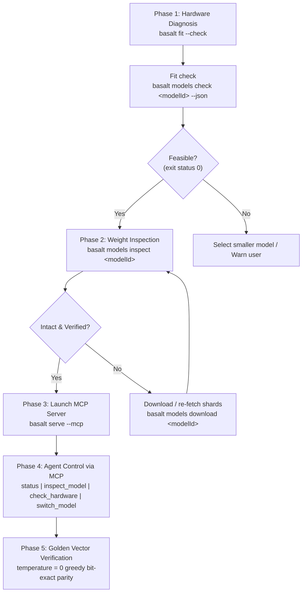

# AGENTS.md

Autonomous Agent Operations & Lifecycle Guide for `basalt`

This document defines the deterministic protocol for external AI agents (Claude Code, Cursor, Codex, OpenCode, Antigravity) interacting with the local MLX inference engine and dual-transport server.

---

## 1. Fast-Path Protocol for Agents

Agents MUST execute operations in the following deterministic sequence:



---

## 2. CLI Diagnostics & Inspection

### 2.1 Hardware Diagnosis (`--check`)
Without downloading or loading any model weights, query the host system's hardware capability:

```bash
# Output machine-readable JSON via SystemProfiler
basalt fit --check

# Alternative equivalent diagnostic
basalt models check --system --json
```

**JSON Output Schema:**
```json
{
  "availableRAMBytes": 25769803776,
  "availableRAMGB": 24.0,
  "chip": "M4",
  "compatible": true,
  "cpuCores": 10,
  "diskSpaceBytes": 104857600000,
  "diskSpaceGB": 97,
  "gpu": "Apple M4",
  "gpuMemoryGB": 24,
  "osVersion": "Version 15.0 (Build 24A335)",
  "totalRAMBytes": 34359738368,
  "totalRAMGB": 32
}
```

### 2.2 Model Weight Shard & Bit Width Inspection (`models inspect`)
Verify shard completeness, Safetensors headers, and actual quantization bit width:

```bash
# Human-readable summary
basalt models inspect ornith-ai/Ornith-1.5-9B-MLX-4bit

# Machine-readable JSON output
basalt models inspect ornith-ai/Ornith-1.5-9B-MLX-4bit --json
```

**Validation Checks Performed:**
1. The directory `serve` would load (HF cache `refs/main` snapshot, quant subfolders) or a local path.
2. Complete shard presence against `model.safetensors.index.json`; dangling HF blob links.
3. Safetensors header integrity and completeness: each shard must end exactly at its largest tensor offset, so an interrupted download is caught even with an intact header.
4. Actual bit width measured from the packed weights per layer; mixed widths (DQ) reported as `mixed a/b-bit`; a `config.json` claim that disagrees is an error.

Exit status is non-zero (and the MCP `inspect_model` result carries `isError: true`) whenever `intact` is false.

---

## 3. MCP Lifecycle Interface

`basalt` provides an MCP (Model Context Protocol) stdio server over JSON-RPC 2.0.

### Starting and stopping the MCP Server
```bash
basalt serve --mcp --model mlx-community/Qwen3.5-4B-4bit
```
The server speaks JSON-RPC on stdin/stdout for as long as stdin is open. To stop it, close its stdin (or send SIGTERM); there is no stop tool.

### Standard MCP Lifecycle Tools

| Tool Name | Arguments | Description |
|-----------|-----------|-------------|
| `status` | `{"modelId": "..."}` *(optional)* | Returns engine readiness, loaded model ID and token diagnostics. With `modelId`, `requestedModelLoaded` says whether that model is the one actually serving. |
| `check_hardware` | `{}` | Detects Apple Silicon chip, available Unified Memory, GPU and disk space as structured JSON. |
| `inspect_model` | `{"modelId": "..."}` | Validates weight shard integrity and detects actual bit width for the target model. |
| `switch_model` | `{"modelId": "..."}` | Hot-swaps the loaded model to a different model present in the local cache. |
| `gemma_generate` | `{"prompt": "...", "temperature": 0.0}` | Generates text using the loaded model via MLX. |
| `gemma_status` | `{}` | Legacy text status check for backward compatibility. |

---

## 4. Golden Test Vector & Reproducibility Standards

### Golden Test Vector
- **Model ID**: `ornith-ai/Ornith-1.5-9B-MLX-4bit` (registered in `ModelDatabase`, Qwen 3.5 architecture).
- **Benchmark Task**: ARC-AGI Task 1 (`benchmarks/arc-agi/compare-tasks/task_1.json`).
- **Prompt**: Grid pattern induction with 2 train demonstrations and 1 test grid.

### Reproducibility Invariants
**Greedy Parity (`temperature = 0`)**: two independent generation runs at `temperature = 0.0` on the golden vector MUST produce bit-identical output:
$$\text{Output}_1 \equiv \text{Output}_2$$

Verified by `SamplerAndGreedyParityTests` against the real MLX engine. The test loads several GB and runs on Metal, so it is opt-in and is reported as *skipped* otherwise — a green run without it proves nothing about parity:

```bash
BASALT_E2E=1 swift test --filter SamplerAndGreedyParityTests                     # golden model in the HF cache
BASALT_E2E=1 BASALT_E2E_MODEL_PATH=/path/to/model swift test --filter SamplerAndGreedyParityTests
```
