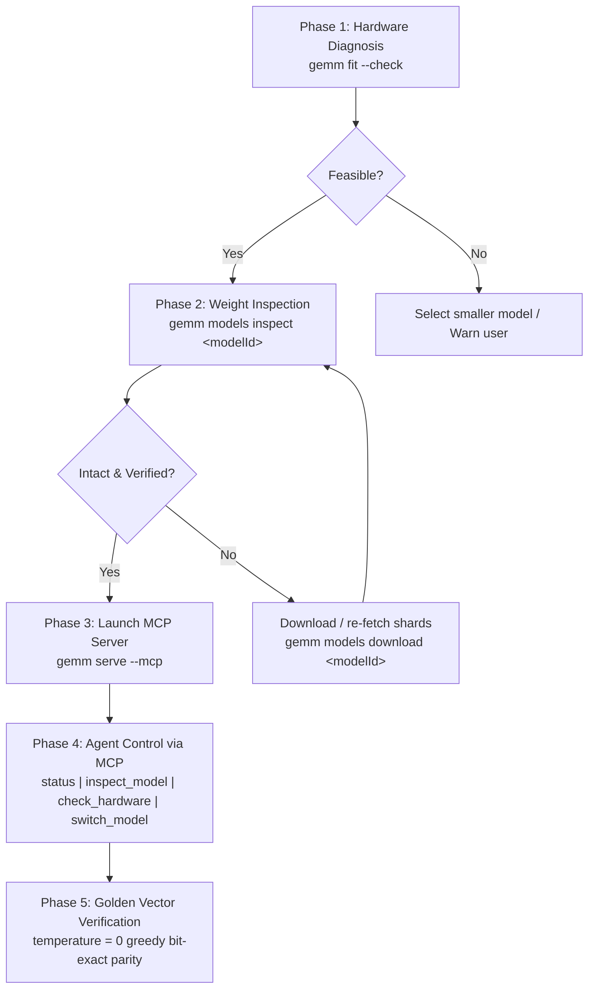

# AGENTS.md

Autonomous Agent Operations & Lifecycle Guide for `gemm` / `basalt`

This document defines the deterministic protocol for external AI agents (Claude Code, Cursor, Codex, OpenCode, Antigravity) interacting with the local MLX inference engine and dual-transport server.

---

## 1. Fast-Path Protocol for Agents

Agents MUST execute operations in the following deterministic sequence:



---

## 2. CLI Diagnostics & Inspection

### 2.1 Hardware Diagnosis (`--check`)
Without downloading or loading any model weights, query the host system's hardware capability:

```bash
# Output machine-readable JSON via SystemProfiler
gemm fit --check

# Alternative equivalent diagnostic
gemm models check --system --json
```

**JSON Output Schema:**
```json
{
  "availableRAMBytes": 25769803776,
  "availableRAMGB": 24.0,
  "chip": "M4",
  "compatible": true,
  "cpuCores": 10,
  "diskSpaceBytes": 104857600000,
  "diskSpaceGB": 97,
  "gpu": "Apple M4",
  "gpuMemoryGB": 24,
  "osVersion": "Version 15.0 (Build 24A335)",
  "totalRAMBytes": 34359738368,
  "totalRAMGB": 32
}
```

### 2.2 Model Weight Shard & Bit Width Inspection (`--inspect`)
Verify shard completeness, Safetensors headers, and actual quantization bit width:

```bash
# Human-readable summary
gemm models inspect ornith-ai/Ornith-1.5-9B-MLX-4bit

# Machine-readable JSON output
gemm models inspect ornith-ai/Ornith-1.5-9B-MLX-4bit --json
```

**Validation Checks Performed:**
1. Directory existence in `~/.cache/huggingface/hub/` or local path.
2. Complete shard presence against `model.safetensors.index.json` weight map.
3. Non-zero file sizes and 8-byte Safetensors header integrity.
4. Parsing `config.json` (`quantization.bits`, `group_size`, `mode`).
5. Detection of actual bit width (4-bit, 8-bit, 16-bit, DQ, NVFP4, OptiQ).

---

## 3. MCP Lifecycle Interface

`gemm` provides an MCP (Model Context Protocol) stdio server over JSON-RPC 2.0.

### Starting MCP Server
```bash
gemm serve --mcp --model mlx-community/Qwen3.5-4B-4bit
```

### Standard MCP Lifecycle Tools

| Tool Name | Arguments | Description |
|-----------|-----------|-------------|
| `status` | `{"modelId": "..."}` *(optional)* | Returns engine readiness, loaded model ID, memory snapshot, and token diagnostics. |
| `check_hardware` | `{}` | Detects Apple Silicon chip, available Unified Memory, GPU and disk space as structured JSON. |
| `inspect_model` | `{"modelId": "..."}` | Validates weight shard integrity and detects actual bit width for the target model. |
| `switch_model` | `{"modelId": "..."}` | Hot-swaps the loaded model to a different model present in the local cache. |
| `gemma_generate` | `{"prompt": "...", "temperature": 0.0}` | Generates text using the loaded model via MLX. |
| `gemma_status` | `{}` | Legacy text status check for backward compatibility. |

---

## 4. Golden Test Vector & Reproducibility Standards

### Golden Test Vector
- **Model ID**: `ornith-ai/Ornith-1.5-9B-MLX-4bit` (registered in `ModelDatabase`, Qwen 3.5 architecture).
- **Benchmark Task**: ARC-AGI Task 1 (`benchmarks/arc-agi/compare-tasks/task_1.json`).
- **Prompt**: Grid pattern induction with 2 train demonstrations and 1 test grid.

### Reproducibility Invariants
1. **Greedy Parity (`temperature = 0`)**: Two independent generation runs at `temperature = 0.0` MUST produce bit-exact identical outputs:
   $$\text{Output}_1 \equiv \text{Output}_2$$
2. **Reference Softmax Sampling Parity**: Categorical sampling over logits at temperature $T > 0$ matches theoretical softmax probabilities $p_i = \frac{e^{z_i/T}}{\sum_k e^{z_k/T}}$ within $|\hat{p}_i - p_i| < 0.02$.
3. **Seeded Parity**: When `seed` is specified, repeated runs at any temperature yield identical token sequences.
