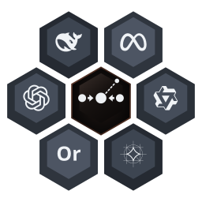

<p align="center"></p>

# basalt — tu Mac es ahora el laboratorio de IA.

> Sirve, entrena, cuantiza, compone y disecciona LLMs abiertos, modelos neuronales de voz, vídeo, OCR e imagen en Apple Silicon. Un único binario de Swift 6.4 habla la **API de OpenAI, la API de Anthropic y MCP**, con una app nativa de macOS 27 Liquid Glass encima. Sin Python en tiempo de ejecución. Sin nube a menos que tú la pidas.

[English](README.md) · [Русский](README.ru.md) · [中文](README.zh.md) · **Español** · [Français](README.fr.md) · [日本語](README.ja.md) · [Deutsch](README.de.md) · **[Website — bas-alt.vercel.app](https://bas-alt.vercel.app)**

[](https://bas-alt.vercel.app)
[](https://github.com/goodmai/basalt/releases/tag/v0.11.0)
[](https://github.com/goodmai/basalt/actions/workflows/release.yml)
[](https://github.com/goodmai/basalt/actions/workflows/security-audit.yml)
[](LICENSE)
[](https://huggingface.co/collections/goodmai/basalt-inference-and-quantization-stack-6af94bed95c64cce97e188fc)
[](https://goodmai-run-with-basalt.static.hf.space/?lang=en)

[](docs/i18n/es/install.md#requirements)
[](Package.swift)
[](docs/i18n/es/install.md#install-with-homebrew)
[](docs/i18n/es/benchmarks.md#benchmarks)
[](docs/i18n/es/benchmarks.md#benchmarks)

<p align="center"></p>
<p align="center"><sub>Ejecuta modelos de pesos abiertos en Apple Silicon. Verificados por logits aquí: Gemma 4, Qwen3.8 y LFM2.5 (la tabla siguiente); medidos y empaquetados en <a href="https://huggingface.co/goodmai">huggingface.co/goodmai</a>: Ornith, Bonsai, Qwen3.6-35B-A3B, DeepSeek-OCR-2, OpenJev y Laya (consulta <a href="docs/i18n/es/models.md#verified-models">la tabla de modelos</a>); gpt-oss y Llama son compatibles con MLX. Los logotipos son marcas comerciales de sus propietarios y se muestran únicamente para indicar compatibilidad. Los modelos de Anthropic son de pesos cerrados, por lo que no están en la colmena; la <i>API</i> de Anthropic es compatible para que Claude Code pueda comunicarse con un modelo local.</sub></p>

**Cinco cosas en un mismo repositorio:** un servidor de inferencia local con el que tus herramientas ya saben comunicarse, destilación LoRA y ajuste poscuantización, un docker-compose para sistemas multimodelo, un microscopio de rayos X en vivo para ver qué ocurre dentro del modelo y una app nativa para Mac que lo pone todo a una pulsación de tecla.

**Comprobado frente a logits de referencia en cada cambio** de la ruta de inferencia: [`GoldenLogitsTests`](Tests/BasaltTests/GoldenLogitsTests.swift) reproduce prompts grabados y falla cuando cambia un token greedy o un logit. Los logits de referencia por familia para qwen3, qwen3_5, gemma4, lfm2 y nemotron_h, densos y MoE, están en [`Fixtures/ReferenceLogits`](Tests/BasaltTests/Fixtures/ReferenceLogits).

| Modelo con pruebas golden | Clase | Fixture |
|---|---|---|
| [`mlx-community/gemma-4-26B-A4B-it-qat-4bit`](https://huggingface.co/mlx-community/gemma-4-26B-A4B-it-qat-4bit) | atención por ventana deslizante + completa, MoE | [golden](Tests/BasaltTests/Fixtures/golden/mlx-community--gemma-4-26B-A4B-it-qat-4bit.json) |
| [`lukaskremla/Qwen3.8-27B-3bit-MLX-TextOnly`](https://huggingface.co/lukaskremla/Qwen3.8-27B-3bit-MLX-TextOnly) | atención híbrida lineal/completa, denso | [golden](Tests/BasaltTests/Fixtures/golden/lukaskremla--Qwen3.8-27B-3bit-MLX-TextOnly.json) |
| [`LiquidAI/LFM2.5-24B-A2B-MLX-4bit`](https://huggingface.co/LiquidAI/LFM2.5-24B-A2B-MLX-4bit) | híbrido convolución + atención, MoE | [golden](Tests/BasaltTests/Fixtures/golden/LiquidAI--LFM2.5-24B-A2B-MLX-4bit.json) |

### Lanzamiento con un clic desde [`huggingface.co/goodmai`](https://huggingface.co/collections/goodmai/basalt-inference-and-quantization-stack-6af94bed95c64cce97e188fc) (más de 55 modelos verificados)

Cada ficha de modelo bajo [`goodmai`](https://huggingface.co/goodmai) incluye un botón **Run with Basalt** ([`goodmai-run-with-basalt.static.hf.space`](https://goodmai-run-with-basalt.static.hf.space/?lang=en)) que abre `Basalt.app` mediante `basalt://run?model=...` o imprime el comando exacto de la CLI `basalt serve` / `basalt compose`:

| Modelo / Stack | Rol y consumo en Mac de 24 GB | Lanzamiento |
|---|---|---|
| [`goodmai/gemma-4-12B-it-qat-4bit`](https://huggingface.co/goodmai/gemma-4-12B-it-qat-4bit) | 12B QAT para chat diario y visión (~7.6 GB, Ladder 4/5 + Lunar 6/6) | [](https://goodmai-run-with-basalt.static.hf.space/?model=goodmai%2Fgemma-4-12B-it-qat-4bit&role=chat&lang=en) |
| [`goodmai/gemma-4-26B-A4B-it-qat-4bit`](https://huggingface.co/goodmai/gemma-4-26B-A4B-it-qat-4bit) | 26B MoE (`A4B`), verificado con golden (14.9 GB, 56–63 tok/s, Ladder 4/5) | [](https://goodmai-run-with-basalt.static.hf.space/?model=goodmai%2Fgemma-4-26B-A4B-it-qat-4bit&role=chat&lang=en) |
| [`goodmai/gemma-4-31B-it-PV-MACaQ-3.2bpw-MLX`](https://huggingface.co/goodmai/gemma-4-31B-it-PV-MACaQ-3.2bpw-MLX) | 31B denso PV-MACaQ 3.2 bpw para Mac de 24 GB (15.1 GB, 14.1 tok/s, Ladder 4/5 + Lunar 4/6) | [](https://goodmai-run-with-basalt.static.hf.space/?model=goodmai%2Fgemma-4-31B-it-PV-MACaQ-3.2bpw-MLX&role=chat&lang=en) |
| [`goodmai/Qwen3.8-27B-PV-MACaQ-4bit-Affine-MLX`](https://huggingface.co/goodmai/Qwen3.8-27B-PV-MACaQ-4bit-Affine-MLX) | 27B denso PV-MACaQ 4-bit (15.3 GB, 11.6 tok/s p50, PPL 1.23, MSE −19.5%, Ladder 4/5) | [](https://goodmai-run-with-basalt.static.hf.space/?model=goodmai%2FQwen3.8-27B-PV-MACaQ-4bit-Affine-MLX&role=chat&lang=en) |
| [`goodmai/Ornith-1.5-35B-A3B-MACaQ-3bit-MLX`](https://huggingface.co/goodmai/Ornith-1.5-35B-A3B-MACaQ-3bit-MLX) | 35B MoE (`A3B`) 3-bit MACaQ (14.6 GB, 64–75 tok/s con switch WHT de `#628`) | [](https://goodmai-run-with-basalt.static.hf.space/?model=goodmai%2FOrnith-1.5-35B-A3B-MACaQ-3bit-MLX&role=chat&lang=en) |
| [`goodmai/Qwen3.8-27B-QTIP-2.5bpw-MLX`](https://huggingface.co/goodmai/Qwen3.8-27B-QTIP-2.5bpw-MLX) | 27B QTIP 2.5 bpw trellis (10.0 GB, PPL 16k 4.621) | [](https://goodmai-run-with-basalt.static.hf.space/?model=goodmai%2FQwen3.8-27B-QTIP-2.5bpw-MLX&role=chat&lang=en) |
| [`goodmai/Qwen3.8-27B-GSQ-RCO-IQ3_S-Basalt-Native`](https://huggingface.co/goodmai/Qwen3.8-27B-GSQ-RCO-IQ3_S-Basalt-Native) | 27B GSQ-RCO i-quant nativo (11.8 GB, PPL 4.17, 300/300 System One) | [](https://goodmai-run-with-basalt.static.hf.space/?model=goodmai%2FQwen3.8-27B-GSQ-RCO-IQ3_S-Basalt-Native&role=chat&lang=en) |
| [`goodmai/Qwen3.6-35B-A3B-8bit`](https://huggingface.co/goodmai/Qwen3.6-35B-A3B-8bit) | 35B MoE en 37.7 GB transmitido por streaming desde SSD a 8.77 tok/s, 0 swap | [](https://goodmai-run-with-basalt.static.hf.space/?model=goodmai%2FQwen3.6-35B-A3B-8bit&role=moe-stream&lang=en) |
| [`goodmai/Ternary-Bonsai-2-27B-MTPLX-Optimized-Speed`](https://huggingface.co/goodmai/Ternary-Bonsai-2-27B-MTPLX-Optimized-Speed) | 27B ternario de Hadamard en 7.4 GB, 27.1 tok/s con `--mtp` | [](https://goodmai-run-with-basalt.static.hf.space/?model=goodmai%2FTernary-Bonsai-2-27B-MTPLX-Optimized-Speed&role=mtp&lang=en) |
| [`goodmai/LFM2.5-24B-A2B-MLX-4bit`](https://huggingface.co/goodmai/LFM2.5-24B-A2B-MLX-4bit) | 24B MoE híbrido conv + atención, verificado con golden (~12.6 GB) | [](https://goodmai-run-with-basalt.static.hf.space/?model=goodmai%2FLFM2.5-24B-A2B-MLX-4bit&role=chat&lang=en) |
| [`Zyphra/ZONOS3-Mini-hf`](https://huggingface.co/Zyphra/ZONOS3-Mini-hf) | TTS neuronal a 44.1 kHz en 43 idiomas (2.24 GB, RTF 0.23–0.26) | [](https://goodmai-run-with-basalt.static.hf.space/?model=Zyphra%2FZONOS3-Mini-hf&role=tts&lang=en) |
| [`goodmai/DeepSeek-OCR-2-8bit`](https://huggingface.co/goodmai/DeepSeek-OCR-2-8bit) | OCR con codificador de visión y mosaico oficial 768 (`/v1/pipeline`) | [](https://goodmai-run-with-basalt.static.hf.space/?model=goodmai%2FDeepSeek-OCR-2-8bit&role=ocr&lang=en) |
| [`goodmai/OpenJev-Flash-9B-MLX-4bit`](https://huggingface.co/goodmai/OpenJev-Flash-9B-MLX-4bit) | Decisor local System One de 9B (98.9% acc, −77% tokens LLM) | [](https://goodmai-run-with-basalt.static.hf.space/?model=goodmai%2FOpenJev-Flash-9B-MLX-4bit&role=decide&lang=en) |
| [`24gb-voice-zonos`](docs/i18n/es/compose.md#bundled-hardware-tiered-profiles-526) | Stack Compose recomendado para 24 GB (Chat + ZONOS3 + Kokoro ANE) | [](https://goodmai-run-with-basalt.static.hf.space/?profile=24gb-voice-zonos&lang=en) |

---

## Inferencia: MoE de 40B a 67 tok/s, 27B en 7.4 GB o MoE de 37.7 GB sin swap — detrás de las APIs que ya usas

- **Claude Code en tu propia GPU en una línea.** `ANTHROPIC_BASE_URL=http://localhost:8080 ANTHROPIC_AUTH_TOKEN=local claude` — tu clave de API real no se toca nunca. Los SDKs de OpenAI, OpenCode, Continue, Cline y aider se conectan mediante la API de OpenAI; Claude Desktop y Cursor mediante MCP (con `--mcp-enable` / `--mcp-disable` por herramienta y por grupo, [#488](https://github.com/goodmai/basalt/pull/488)).
- **Rápido en un portátil.** En un M4 Pro con 24 GB: Recursive `Flint-40B-A2.5B` (`oQ3e`) decodifica a 67.02 tok/s en 17.61 GB ([#522](https://github.com/goodmai/basalt/pull/522)); `Ornith-1.5-35B-A3B-MACaQ-3bit` decodifica a 64–75 tok/s en 14.6 GB con nuestro kernel `MACaQSwitchLinear` WHT + `gatherQuantizedMM` de una sola pasada (kernel MoE `3.41×` más rápido, `+82%` de extremo a extremo en Gemma 4 26B-A4B, [#628](https://github.com/goodmai/basalt/pull/628)); `Qwen3.5-9B-PV-MACaQ-4bit` alcanza `43.2 tok/s` p50 (`+52%` de velocidad, `−33%` de RAM frente a 8-bit) con paridad exacta `4/5` en Ladder; `Gemma-4-31B-it-PV-MACaQ-3.2bpw` cabe como 31B denso en `15.1 GB` (`14.1 tok/s`, Ladder `4/5` + Lunar `4/6`) en un Mac de 24 GB donde 4-bit da OOM; Qwen3-4B decodifica a 78–89 tok/s; Ternary Bonsai 2 27B cabe en 7.4 GB y corre a 20.9–21.5 tok/s, 27.1 con su cabezal MTP y 31–38 con prompt lookup en código ([#239](https://github.com/goodmai/basalt/pull/239), [#263](https://github.com/goodmai/basalt/pull/263)); los checkpoints `.gguf` GSQ-RCO / `i-quant` se ejecutan directamente en kernels Metal propios ([#433](https://github.com/goodmai/basalt/pull/433), [#515](https://github.com/goodmai/basalt/pull/515)).
- **Modelos más grandes que la RAM, cero swap.** `Qwen3.6-35B-A3B-8bit` (37.7 GB) decodifica a 8.77 tok/s en un Mac de 24 GB con 0 swap mediante POSIX AIO por lotes y precarga de expertos de la siguiente capa desde SSD con `LIO_NOWAIT` (`--expert-streaming`, [#477](https://github.com/goodmai/basalt/pull/477), [#478](https://github.com/goodmai/basalt/pull/478), [#516](https://github.com/goodmai/basalt/pull/516)), junto con caché KV jerárquica L0/L1/L2 consciente de UMA (`TieredKVHierarchyCore`) y planificación heterogénea adaptativa ([#627](https://github.com/goodmai/basalt/pull/627)).
- **Decodificación especulativa que se mantiene exacta.** Prompt lookup logra 1.84–2.66× en ediciones de código (Bonsai 2 27B, [#239](https://github.com/goodmai/basalt/pull/239)) y 3.45–3.62× (Gemma 4 12B, [#265](https://github.com/goodmai/basalt/pull/265)), sin alterar la salida greedy; `SpecTr` OT + `Residual Race`, `EAGLE-3`, `SmallM` (`M=2..16`), `Fast-dLLM` + `DFlash` y `DiffuCD` amplían la decodificación sin pérdidas de múltiples borradores y difusión por bloques ([#593](https://github.com/goodmai/basalt/pull/593), [#603](https://github.com/goodmai/basalt/pull/603)).
- **El siguiente turno cuesta solo sus tokens nuevos.** Una caché de prompts en árbol de prefijos, incluso para modelos híbridos: en Ornith-1.5-9B con un prompt de agente de 12.6k tokens, el segundo turno tarda alrededor de 1 s en lugar de unos 36 s ([#82](https://github.com/goodmai/basalt/pull/82)).
- **Contextos largos en menos memoria.** Cuantización KV con zonas exactas (`4|8|k8v4`, además de balanceo 2D `KVarN`, `QJL` insesgado de 1 bit, `ChanMix`/`ThinKV`, transferencia RBO multilingüe `HeadKV`, `RQ-KV` por centroides, `turbo3|turbo4|turbo8v4` y claves de pares RoPE `polar4`, [#472](https://github.com/goodmai/basalt/pull/472), [#590](https://github.com/goodmai/basalt/pull/590), [#602](https://github.com/goodmai/basalt/pull/602)): un prompt de 16k alcanza un pico de 1.03 GB en vez de 3.11 GB en Qwen3-4B ([#159](https://github.com/goodmai/basalt/pull/159)).
- **Vídeo, TTS neuronal, voz full-duplex, música y síntesis de imagen MLX 2K.** Video Studio por fases para 24 GB UMA ejecuta `LTX-2.5 AV-DiT`, `Kandinsky 6.0 CrossDiT`, `LingBot-Video MoE` y `Wan 2.2` con 3D-VAE causal, kernels Metal STA por bloques y multiplexado `.mp4` con `AVAssetWriter` ([#608](https://github.com/goodmai/basalt/pull/608)–[#611](https://github.com/goodmai/basalt/pull/611)); `LFM2.5-Audio` con códecs dúplex Mimi/SNAC, `SmartTurn` + `Sortformer`, `MossFormer2`, `Soprano-80M`, `Qwen3ForcedAligner`, `Zyphra/ZONOS3-Mini-hf` (`44.1 kHz`, 43 idiomas, 2.24 GB, RTF 0.228–0.263, [#527](https://github.com/goodmai/basalt/pull/527)) y `Kokoro-82M` impulsan `/v1/audio/*` ([#604](https://github.com/goodmai/basalt/pull/604)); composición de 4 etapas `FLUX.3`, reescalado `SeedVR2`, música `ACE-Step 1.5`, `Z-Image-Turbo`, `Iris-3B` y `SANA-1.5` impulsan `/v1/images/*` y `/v1/music/*` ([#542](https://github.com/goodmai/basalt/pull/542), [#605](https://github.com/goodmai/basalt/pull/605)).
- **Todo un stack local + SDK en Swift.** Llamadas a herramientas, salida con esquema JSON, regex y gramática (XGrammar), Meta `Muse-Glimmer-30B` ([#534](https://github.com/goodmai/basalt/pull/534)), `Ripple-65B`, `Nemotron-3.5-Lightning` ([#522](https://github.com/goodmai/basalt/pull/522)), `DeepSeek-OCR-2` ([#476](https://github.com/goodmai/basalt/pull/476)), `/v1/embeddings`, `/v1/rerank`, el SDK Swift `BasaltFoundationModels` ([#606](https://github.com/goodmai/basalt/pull/606)), descargas Xet con `swift-huggingface` ([#587](https://github.com/goodmai/basalt/pull/587)), adaptadores LoRA/PHM/OFT seleccionados por petición y niveles ordenados de respaldo LAN antes que nube ([#480](https://github.com/goodmai/basalt/pull/480)).

Detalles: [REST API](docs/i18n/es/rest-api.md) · [integraciones](docs/i18n/es/integrations.md) · [comandos y flags](docs/i18n/es/commands.md) · [modelos](docs/i18n/es/models.md) · [benchmarks](docs/i18n/es/benchmarks.md)

## Entrenamiento y Cuantización: conversor universal any-to-any, PV-MACaQ, distribuido y QAT

- **Conversor universal de cuantización any-to-any (`basalt models convert`).** Convierte entre `MACaQ` (`affine` / `mxfp4` / `moe` 2.8 bpw con Hessiano ponderado por router, [#537](https://github.com/goodmai/basalt/pull/537), [#599](https://github.com/goodmai/basalt/pull/599)), `FlatQuant` y `LIRQuant` ([#588](https://github.com/goodmai/basalt/pull/588), [#594](https://github.com/goodmai/basalt/pull/594)), normalización de doble eje `SINQ` / `A-SINQ` / `EAQuant` ([#561](https://github.com/goodmai/basalt/pull/561)), retículo de 2 bits `QuIP# E8P` y `TurboBoA` Babai–LLL ([#589](https://github.com/goodmai/basalt/pull/589)), trellis de desplazamiento de bits `QTIP` (`2.0–3.0 bpw`, [#494](https://github.com/goodmai/basalt/pull/494)), `SVD-LLM V2` / `OBR` ([#592](https://github.com/goodmai/basalt/pull/592)), i-quants `.gguf` y `MACaQ-R`, además de refinamiento `QAT STE` consciente del dominio y auditoría poscuantización de calidad/equidad/fugas (`QuantizationAuditCore`, [#623](https://github.com/goodmai/basalt/pull/623)) — conectado de forma idéntica en la CLI, REST `/v1/models/convert*` y `ConvertModelSheet` de macOS ([#546](https://github.com/goodmai/basalt/issues/546)).
- **PV-Tuning y PV-MACaQ poscuantización.** `basalt models convert --to macaq:affine:4:64 --pv-tune` alterna actualizaciones continuas de escala/sesgo con refinamiento discreto por inversión de bits guiado por Hessiano sobre bloques Walsh–Hadamard: en `Qwen3.5-9B`, `8-bit → 4-bit PV-MACaQ` reduce la RAM en un 33% (`9.97 → 6.68 GB`) y acelera la decodificación un `+52%` (`27.3 → 41.6 tok/s`, p50 `43.2`) con paridad exacta `4/5` en Ladder (`valKL = 0.0044`); en checkpoints de 2–3 bits, PV-Tuning reduce la pérdida de perplejidad entre un 8.7% y un 29% en menos de 3 minutos ([#486](https://github.com/goodmai/basalt/pull/486), [#545](https://github.com/goodmai/basalt/pull/545)).
- **Destila, postentrena y distribuye entre Macs.** `basalt models distill` destila profesores de OpenAI/Anthropic en adaptadores `lora`, `phm`, `oft` o `AdaLoRA (LR/40)` cuantizados ([#501](https://github.com/goodmai/basalt/pull/501), [#508](https://github.com/goodmai/basalt/pull/508), [#624](https://github.com/goodmai/basalt/pull/624)); `SFT → DPO` en dos etapas, `ADPO`/`cADPO` sin copias, `EMA-QLoRA`, `Self-Appraisal` y la auditoría antiatajos `RLVR` mantienen precisa la alineación de preferencias ([#601](https://github.com/goodmai/basalt/pull/601), [#624](https://github.com/goodmai/basalt/pull/624)); el entrenamiento en clúster multi-Mac admite transporte autenticado, `DDP + ZeRO-2`, `DiLoCo` + `PowerSGD`, `Zero-Bubble ZB-H1` y `Expert-Parallel MoE` ([#595](https://github.com/goodmai/basalt/pull/595)–[#598](https://github.com/goodmai/basalt/pull/598)).
- **Entrena mientras sirves, con puerta de calidad.** `distill` por MCP dividido en rodajas de tiempo, `train_experts` solo con datos verificados, `train-jepa` y reversión bit a bit si empeoran la KL o la perplejidad en el conjunto de validación.

Detalles: [comandos de entrenamiento](docs/i18n/es/commands.md) · [autoentrenamiento, destilación y puerta de calidad](docs/i18n/es/research-tools.md#self-training-train_experts)

## Compose: `basalt.yaml v2.2` declarativo, gobernanza empresarial y 84 perfiles de hardware

- **docker-compose, para modelos (`basalt.yaml v2.2`).** Modelos locales y en la nube, planificador de deduplicación de RAM, perfiles de especialistas, modos de memoria `resident` / `on-demand` / `sequential`, enrutamiento de 5 componentes `BusinessOrchestrator`, caché semántica `LANTERN`, puerta de aprobación `HITL` (`/v1/mcp/approvals`) y núcleo de conocimiento neurosimbólico `LAAS-CNRS` (`SymbolicKnowledgeGraph`) — todo en un único archivo declarativo ([#607](https://github.com/goodmai/basalt/pull/607), [#625](https://github.com/goodmai/basalt/pull/625), [#626](https://github.com/goodmai/basalt/pull/626)).
- **84 perfiles integrados para cada Mac (`16 GB` a `256 GB`).** Siete niveles de memoria unificada (`16gb`, `24gb`, `32-36gb`, `48gb`, `64gb`, `128gb`, `256gb`) × 12 arquetipos de carga de trabajo que se lanzan con un comando (`basalt compose up 24gb-voice-zonos`, [#528](https://github.com/goodmai/basalt/pull/528)).
- **Rechaza lo que no cabe, aplica cambios en caliente.** `basalt compose plan` calcula el tamaño de los modelos desde el Hub antes de descargarlos y rechaza desbordamientos; `compose diff` / `compose up` recargan cambios en caliente de forma limpia; `compose bench` ejecuta suites de benchmarks declarativas y exporta paquetes de clasificación ([#505](https://github.com/goodmai/basalt/pull/505)).
- **Jueces locales, enrutamiento calibrado y presupuestos en la nube.** `OpenJev-Flash-9B-4bit` alcanza un 98.9% de precisión en triaje mientras recorta en un 77% los tokens de LLM posteriores ([#465](https://github.com/goodmai/basalt/pull/465)), `CalibratedRouterGate` con escalado de temperatura + `Gemini Decision 1` enrutan consultas difíciles de forma limpia dentro de límites diarios en USD ([#418](https://github.com/goodmai/basalt/pull/418), [#622](https://github.com/goodmai/basalt/pull/622)), y el texto percibido de documentos o audio nunca sale de tu Mac por defecto.

Detalles: [referencia de compose y mediciones](docs/i18n/es/compose.md) · [preajustes de pipeline y modos de memoria](docs/i18n/es/pipelines.md) · [decisiones en la nube con Gemini](docs/i18n/es/cloud-decisions.md)

## Investigación: abre el modelo mientras se ejecuta

- **Rayos X del modelo, atribución por token y compuertas epistémicas de Belnap.** `model_describe` (que informa manifiestos de módulos `MACaQ` / `FlatQuant` / `LIRQuant`, [#630](https://github.com/goodmai/basalt/pull/630)), `model_tensors`, `model_tensor`, `kv_inspect`, `trace_run`, `trace_tokens` (con manejo automático de BOS en Gemma, [#630](https://github.com/goodmai/basalt/pull/630)), logprobs por token y riesgo de alucinación en `/v1/xray/tokens` ([#613](https://github.com/goodmai/basalt/pull/613)), atribución de cabezales `Score d'influence` ([#622](https://github.com/goodmai/basalt/pull/622)), espectros de Marchenko–Pastur, estados de evidencia de cuatro valores Belnap `SIXTEEN_3` ([#500](https://github.com/goodmai/basalt/pull/500)), sondas fasoriales complejas MVN ([#509](https://github.com/goodmai/basalt/pull/509)), deriva de Fisher–Rao ([#503](https://github.com/goodmai/basalt/pull/503)) y OpenMetrics en `/api/v1/metrics` ([#458](https://github.com/goodmai/basalt/pull/458)).
- **Cirugía reversible y circuitos mecanísticos.** Con `serve --research-tools`: `intervene` (incluyendo ablación condicional, parcheo de grupos GQA, espacio nulo cognitivo y guardia anti-steering, [#600](https://github.com/goodmai/basalt/pull/600)), descomposición de características `MAO-SNMF`, `weights_delta`, `tensor_pack`/`tensor_unpack` en vivo, `activation_contrast`, `steer_search`/`steer_commit`, `experiment_compare` e `introspect`. Cada experimento es una superposición reversible con TTL y diario; los pesos en disco nunca se modifican.
- **Benchmarks que ejecutan el código del modelo.** Una escalera de cinco peldaños que culmina en una misión Tierra-Luna ejecuta el propio código del modelo frente a entradas nunca vistas, y ARC-AGI se ejecuta bajo las reglas oficiales de pass@2.

Detalles: [herramientas de investigación](docs/i18n/es/research-tools.md) · [fundamentos de investigación (más de 95 artículos)](docs/i18n/es/research-foundations.md) · [benchmarks](docs/i18n/es/benchmarks.md) · [flags de serve](docs/i18n/es/commands.md)

## Basalt para Mac: macOS 27 Liquid Glass, a una tecla o un clic de distancia

- **Una app nativa en SwiftUI sobre un motor supervisado.** Diseñada para macOS 27 Liquid Glass ([#479](https://github.com/goodmai/basalt/pull/479)) en inglés y ruso ([#456](https://github.com/goodmai/basalt/pull/456)): ventana en caliente en 257 ms, 0 despertares en reposo, 7.4 ms p95 por token transmitido en una conversación de 2,000 mensajes y 40 ms de sobrecarga en consulta rápida con `⌥Space` ([#463](https://github.com/goodmai/basalt/pull/463)).
- **Compose Video Studio, 2K Image Studio e interfaz del Conversor Universal.** Genera y reproduce vídeos A/V `.mp4` en Macs de 24 GB ([#611](https://github.com/goodmai/basalt/pull/611)), edita imágenes RGBA 2K con deslizador Antes/Después ([#519](https://github.com/goodmai/basalt/pull/519)), convierte y audita modelos con QAT directamente en `ConvertModelSheet` ([#623](https://github.com/goodmai/basalt/pull/623)), y explora/publica en Hugging Face con telemetría SSE a 10 Hz y descargas Xet ([#587](https://github.com/goodmai/basalt/pull/587)).
- **Perfiles de Compose (`⌥⌘C`), voz full-duplex y lanzamiento en 1 clic `basalt://`.** Recomienda automáticamente los mejores perfiles para el nivel de RAM de tu Mac (`16–256 GB`, [#528](https://github.com/goodmai/basalt/pull/528)), transmite voz manos libres mediante `SpeechAnalyzer` / `LFM2.5-Audio` / `ZONOS3-Mini` ([#604](https://github.com/goodmai/basalt/pull/604)) y gestiona enlaces `basalt://run?model=...`, consulta rápida con `⌥Space`, Atajos (Shortcuts), Spotlight y empaquetado `.dmg` notarizado.

Detalles: [Basalt para Mac](docs/i18n/es/mac-app.md)

---

## Inicio rápido

Requisitos: macOS 27+, Xcode 27.0+ / Swift 6.4 con la cadena de herramientas de Metal (`xcodebuild -downloadComponent MetalToolchain`), Apple Silicon M1–M4 y de 2 a 38 GB de disco según el modelo. Los pasos completos, la compilación desde el código fuente y el lanzador `./basalt-claude` están en [docs/i18n/es/install.md](docs/i18n/es/install.md).

```bash
brew tap goodmai/basalt https://github.com/goodmai/basalt
brew trust goodmai/basalt
brew install goodmai/basalt/basalt          # builds CLI & server from source

basalt onboard                              # picks a model that fits your Mac and downloads it
basalt serve --model goodmai/gemma-4-12B-it-qat-4bit --rest

# in another terminal: Claude Code, backed by your own GPU
ANTHROPIC_BASE_URL=http://localhost:8080 ANTHROPIC_AUTH_TOKEN=local claude
```

Transmite por streaming un modelo MoE de 37.7 GB en un Mac de 24 GB o ejecuta un sistema compose completo multimodelo:

```bash
basalt serve --model goodmai/Qwen3.6-35B-A3B-8bit --expert-streaming --rest

basalt compose plan 24gb-voice-zonos
basalt compose up 24gb-voice-zonos          # 84 profiles across 16–256 GB Macs
```

La app de Mac, desde una copia del repositorio (registra automáticamente los enlaces de 1 clic `basalt://` al abrirla por primera vez):

```bash
./scripts/bundle_app.swift                  # release build, Metal kernels, then .build/Basalt.app
open .build/Basalt.app
```

Los modelos locales de 4B–12B no son un reemplazo directo de un modelo frontera: están pensados para trabajo agéntico privado, sin conexión y a coste cero, y para sistemas híbridos local/nube. `basalt fit` te indica qué puede ejecutar realmente tu máquina. La tabla de modelos también enumera qué *falló*.

**Dale una estrella** si quieres más herramientas nativas de MLX en Swift, y abre un issue con tu Mac y tus tok/s — los [PRs que añaden una fila a la tabla de benchmarks](docs/i18n/es/benchmarks.md#benchmarks) son bienvenidos.

---

## Documentación

> Hay documentación traducida disponible en `docs/i18n/`: [Русский](docs/i18n/ru/) · [中文](docs/i18n/zh/) · [Español](docs/i18n/es/) · [Français](docs/i18n/fr/) · [日本語](docs/i18n/ja/) · [Deutsch](docs/i18n/de/).

| Tema | Documento |
|---|---|
| Instalación, requisitos, compilación desde fuentes, `./basalt-claude` | [docs/i18n/es/install.md](docs/i18n/es/install.md) |
| Comandos de CLI, flags de `serve`, caché de prompts, CacheBlend, PV-Tuning | [docs/i18n/es/commands.md](docs/i18n/es/commands.md) |
| API REST: seguridad, gestión de modelos, OpenAI, Anthropic, imágenes, SSE, OpenMetrics, Swagger | [docs/i18n/es/rest-api.md](docs/i18n/es/rest-api.md) |
| Claude Code, OpenCode, SDKs de OpenAI, MCP para Claude Desktop y Cursor | [docs/i18n/es/integrations.md](docs/i18n/es/integrations.md) |
| Modelos verificados, stack en Hub de `goodmai` y descarga | [docs/i18n/es/models.md](docs/i18n/es/models.md) |
| Resumen de funciones, escalera de benchmarks, ARC-AGI, procedencia | [docs/i18n/es/benchmarks.md](docs/i18n/es/benchmarks.md) |
| Preajustes de pipeline y modos de memoria | [docs/i18n/es/pipelines.md](docs/i18n/es/pipelines.md) |
| Decisiones en la nube: Gemini Decision 1, medios multimodales, profesor de calibración | [docs/i18n/es/cloud-decisions.md](docs/i18n/es/cloud-decisions.md) |
| Referencia de `basalt compose` y mediciones | [docs/i18n/es/compose.md](docs/i18n/es/compose.md) |
| Basalt para Mac y enlaces profundos `basalt://` | [docs/i18n/es/mac-app.md](docs/i18n/es/mac-app.md) |
| Rayos X del modelo, telemetría, experimentos, autoentrenamiento, destilación | [docs/i18n/es/research-tools.md](docs/i18n/es/research-tools.md) |
| Fundamentos matemáticos y científicos (más de 85 artículos y agradecimientos) | [docs/i18n/es/research-foundations.md](docs/i18n/es/research-foundations.md) |
| Estructura del proyecto, notas de arquitectura, scripts, dependencias | [docs/i18n/es/architecture.md](docs/i18n/es/architecture.md) |
| Patrones de arquitectura y módulos (ruso) | [docs/ARCHITECTURE_PATTERNS_AND_MODULES.md](docs/ARCHITECTURE_PATTERNS_AND_MODULES.md) |
| Nube: configuración de OpenRouter, optimización de costes, comparación de modelos | [docs/cloud/OPENROUTER_SETUP.md](docs/cloud/OPENROUTER_SETUP.md) · [docs/cloud/COST_OPTIMIZATION.md](docs/cloud/COST_OPTIMIZATION.md) · [docs/cloud/MODEL_COMPARISON.md](docs/cloud/MODEL_COMPARISON.md) |
| Trabajo en basalt con agentes de IA | [docs/AI_SETUP.md](docs/AI_SETUP.md) · [docs/AGENT_OPERATIONS.md](docs/AGENT_OPERATIONS.md) |
| Hoja de ruta, política de privacidad | [docs/ROADMAP.md](docs/ROADMAP.md) · [docs/PRIVACY_POLICY.md](docs/PRIVACY_POLICY.md) |
| Notas de investigación sobre CLIs de agentes, listas de verificación, especificaciones (ruso) | [docs/features.md](docs/features.md) · [docs/specs/FEATURES_CHECKLIST.md](docs/specs/FEATURES_CHECKLIST.md) · [docs/specs/AUDIT_CHECKLIST.md](docs/specs/AUDIT_CHECKLIST.md) · [docs/specs/EMOJI_AS_CODE.md](docs/specs/EMOJI_AS_CODE.md) |
| Contribuir, registro de cambios | [CONTRIBUTING.md](CONTRIBUTING.md) · [CHANGELOG.md](CHANGELOG.md) |

## Licencia

[MIT](LICENSE) © 2026 goodmai

Los pesos de los modelos **no** están cubiertos por esta licencia — cada modelo en HuggingFace tiene sus propios términos.
