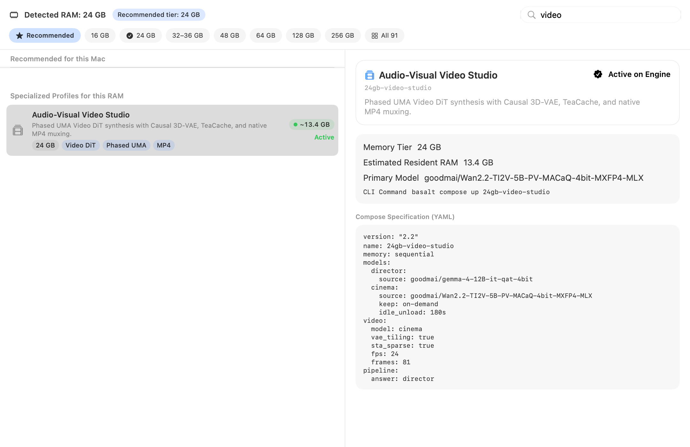
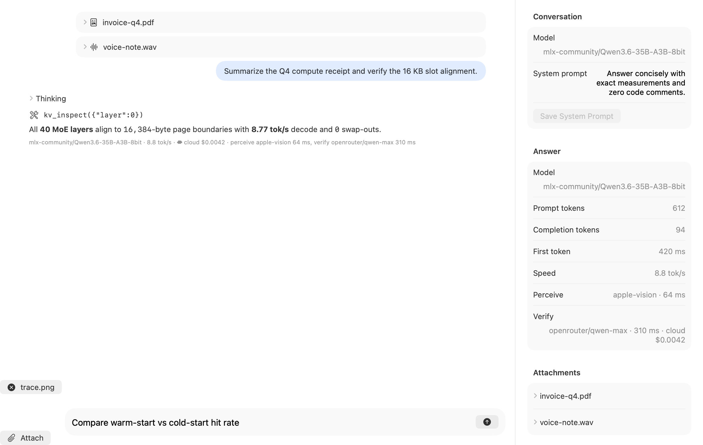

<p align="center"></p>

# basalt — Mac Anda kini menjadi laboratorium AI.

> Jalankan, latih, kuantisasi, susun (compose), dan bedah model LLM terbuka, suara neural, video, OCR, dan gambar di Apple Silicon. Satu biner Swift 6.4 berbicara dengan **OpenAI API, Anthropic API, dan MCP**, dilengkapi aplikasi native macOS 27 Liquid Glass di atasnya. Tanpa Python saat runtime. Tanpa cloud kecuali Anda memintanya.

[English](README.md) · [Русский](README.ru.md) · [中文](README.zh.md) · [Español](README.es.md) · [Français](README.fr.md) · [日本語](README.ja.md) · [Deutsch](README.de.md) · [한국어](README.ko.md) · **Bahasa Indonesia** · **[Website — bas-alt.vercel.app](https://bas-alt.vercel.app)**

[](https://bas-alt.vercel.app)
[](https://github.com/goodmai/basalt/releases/tag/v0.11.0)
[](https://github.com/goodmai/basalt/actions/workflows/release.yml)
[](https://github.com/goodmai/basalt/actions/workflows/security-audit.yml)
[](LICENSE)
[](https://huggingface.co/collections/goodmai/basalt-inference-and-quantization-stack-6af94bed95c64cce97e188fc)
[](https://goodmai-run-with-basalt.static.hf.space/?lang=en)

[](docs/i18n/id/install.md#requirements)
[](Package.swift)
[](docs/i18n/id/install.md#install-with-homebrew)
[](docs/i18n/id/benchmarks.md#benchmarks)
[](docs/i18n/id/benchmarks.md#benchmarks)

<p align="center"></p>
<p align="center"><sub>Menjalankan model open-weight di Apple Silicon. Terverifikasi logit di sini: Gemma 4, Qwen3.8, dan LFM2.5 (tabel di bawah); diukur dan dikemas di <a href="https://huggingface.co/goodmai">huggingface.co/goodmai</a>: Ornith, Bonsai, Qwen3.6-35B-A3B, DeepSeek-OCR-2, OpenJev, dan Laya (lihat <a href="docs/i18n/id/models.md#verified-models">tabel model</a>); gpt-oss dan Llama kompatibel dengan MLX. Logo adalah merek dagang pemilik masing-masing dan hanya ditampilkan untuk menunjukkan kompatibilitas. Model Anthropic bersifat closed-weight sehingga tidak ada di sini; <i>API</i> Anthropic didukung agar Claude Code dapat berkomunikasi dengan model lokal.</sub></p>

**Lima hal dalam satu repositori:** server inferensi lokal yang langsung dikenali oleh alat Anda, distilasi LoRA dan penyetelan pasca-kuantisasi, docker-compose untuk sistem multi-model, mikroskop X-ray langsung untuk melihat apa yang terjadi di dalam model, serta aplikasi Mac native yang menghadirkan semuanya dalam satu pintasan tombol.

**Diverifikasi terhadap logit referensi pada setiap perubahan** di jalur inferensi: [`GoldenLogitsTests`](Tests/BasaltTests/GoldenLogitsTests.swift) memutar ulang prompt terekam dan gagal jika token greedy atau logit berubah. Logit referensi per keluarga untuk qwen3, qwen3_5, gemma4, lfm2, dan nemotron_h (dense dan MoE) tersedia di [`Fixtures/ReferenceLogits`](Tests/BasaltTests/Fixtures/ReferenceLogits).

| Model teruji golden | Kelas arsitektur | Fixture |
|---|---|---|
| [`mlx-community/gemma-4-26B-A4B-it-qat-4bit`](https://huggingface.co/mlx-community/gemma-4-26B-A4B-it-qat-4bit) | sliding-window + full attention, MoE | [golden](Tests/BasaltTests/Fixtures/golden/mlx-community--gemma-4-26B-A4B-it-qat-4bit.json) |
| [`lukaskremla/Qwen3.8-27B-3bit-MLX-TextOnly`](https://huggingface.co/lukaskremla/Qwen3.8-27B-3bit-MLX-TextOnly) | hybrid linear/full attention, dense | [golden](Tests/BasaltTests/Fixtures/golden/lukaskremla--Qwen3.8-27B-3bit-MLX-TextOnly.json) |
| [`LiquidAI/LFM2.5-24B-A2B-MLX-4bit`](https://huggingface.co/LiquidAI/LFM2.5-24B-A2B-MLX-4bit) | hybrid conv + attention, MoE | [golden](Tests/BasaltTests/Fixtures/golden/LiquidAI--LFM2.5-24B-A2B-MLX-4bit.json) |

### Peluncuran sekali klik dari [`huggingface.co/goodmai`](https://huggingface.co/collections/goodmai/basalt-inference-and-quantization-stack-6af94bed95c64cce97e188fc) (55+ model terverifikasi)

Setiap kartu model di bawah [`goodmai`](https://huggingface.co/goodmai) dilengkapi tombol **Run with Basalt** ([`goodmai-run-with-basalt.static.hf.space`](https://goodmai-run-with-basalt.static.hf.space/?lang=en)) yang membuka `Basalt.app` melalui `basalt://run?model=...` atau menampilkan perintah CLI `basalt serve` / `basalt compose` yang tepat:

| Model / Stack | Peran & jejak memori di Mac 24 GB | Luncurkan |
|---|---|---|
| [`goodmai/gemma-4-12B-it-qat-4bit`](https://huggingface.co/goodmai/gemma-4-12B-it-qat-4bit) | 12B QAT untuk chat & visi harian (~7.6 GB, Ladder 4/5 + Lunar 6/6) | [](https://goodmai-run-with-basalt.static.hf.space/?model=goodmai%2Fgemma-4-12B-it-qat-4bit&role=chat&lang=en) |
| [`goodmai/gemma-4-26B-A4B-it-qat-4bit`](https://huggingface.co/goodmai/gemma-4-26B-A4B-it-qat-4bit) | 26B MoE (`A4B`), terverifikasi golden (14.9 GB, 56–63 tok/s, Ladder 4/5) | [](https://goodmai-run-with-basalt.static.hf.space/?model=goodmai%2Fgemma-4-26B-A4B-it-qat-4bit&role=chat&lang=en) |
| [`goodmai/gemma-4-31B-it-PV-MACaQ-3.2bpw-MLX`](https://huggingface.co/goodmai/gemma-4-31B-it-PV-MACaQ-3.2bpw-MLX) | 31B dense PV-MACaQ 3.2 bpw untuk Mac 24 GB (15.1 GB, 14.1 tok/s, Ladder 4/5 + Lunar 4/6) | [](https://goodmai-run-with-basalt.static.hf.space/?model=goodmai%2Fgemma-4-31B-it-PV-MACaQ-3.2bpw-MLX&role=chat&lang=en) |
| [`goodmai/Qwen3.8-27B-PV-MACaQ-4bit-Affine-MLX`](https://huggingface.co/goodmai/Qwen3.8-27B-PV-MACaQ-4bit-Affine-MLX) | 27B dense PV-MACaQ 4-bit (15.3 GB, 11.6 tok/s p50, PPL 1.23, MSE −19.5%, Ladder 4/5) | [](https://goodmai-run-with-basalt.static.hf.space/?model=goodmai%2FQwen3.8-27B-PV-MACaQ-4bit-Affine-MLX&role=chat&lang=en) |
| [`goodmai/Ornith-1.5-35B-A3B-MACaQ-3bit-MLX`](https://huggingface.co/goodmai/Ornith-1.5-35B-A3B-MACaQ-3bit-MLX) | 35B MoE (`A3B`) 3-bit MACaQ (14.6 GB, 64–75 tok/s dengan `#628` switch WHT) | [](https://goodmai-run-with-basalt.static.hf.space/?model=goodmai%2FOrnith-1.5-35B-A3B-MACaQ-3bit-MLX&role=chat&lang=en) |
| [`goodmai/Qwen3.8-27B-QTIP-2.5bpw-MLX`](https://huggingface.co/goodmai/Qwen3.8-27B-QTIP-2.5bpw-MLX) | 27B QTIP 2.5 bpw trellis (10.0 GB, 16k PPL 4.621) | [](https://goodmai-run-with-basalt.static.hf.space/?model=goodmai%2FQwen3.8-27B-QTIP-2.5bpw-MLX&role=chat&lang=en) |
| [`goodmai/Qwen3.8-27B-GSQ-RCO-IQ3_S-Basalt-Native`](https://huggingface.co/goodmai/Qwen3.8-27B-GSQ-RCO-IQ3_S-Basalt-Native) | 27B GSQ-RCO native i-quant (11.8 GB, PPL 4.17, 300/300 System One) | [](https://goodmai-run-with-basalt.static.hf.space/?model=goodmai%2FQwen3.8-27B-GSQ-RCO-IQ3_S-Basalt-Native&role=chat&lang=en) |
| [`goodmai/Qwen3.6-35B-A3B-8bit`](https://huggingface.co/goodmai/Qwen3.6-35B-A3B-8bit) | 35B MoE 37.7 GB dialirkan dari SSD pada 8.77 tok/s, 0 swap | [](https://goodmai-run-with-basalt.static.hf.space/?model=goodmai%2FQwen3.6-35B-A3B-8bit&role=moe-stream&lang=en) |
| [`goodmai/Ternary-Bonsai-2-27B-MTPLX-Optimized-Speed`](https://huggingface.co/goodmai/Ternary-Bonsai-2-27B-MTPLX-Optimized-Speed) | 27B Hadamard ternary dalam 7.4 GB, 27.1 tok/s dengan `--mtp` | [](https://goodmai-run-with-basalt.static.hf.space/?model=goodmai%2FTernary-Bonsai-2-27B-MTPLX-Optimized-Speed&role=mtp&lang=en) |
| [`goodmai/LFM2.5-24B-A2B-MLX-4bit`](https://huggingface.co/goodmai/LFM2.5-24B-A2B-MLX-4bit) | 24B hybrid conv + attention MoE, terverifikasi golden (~12.6 GB) | [](https://goodmai-run-with-basalt.static.hf.space/?model=goodmai%2FLFM2.5-24B-A2B-MLX-4bit&role=chat&lang=en) |
| [`Zyphra/ZONOS3-Mini-hf`](https://huggingface.co/Zyphra/ZONOS3-Mini-hf) | TTS neural 44.1 kHz untuk 43 bahasa (2.24 GB, RTF 0.23–0.26) | [](https://goodmai-run-with-basalt.static.hf.space/?model=Zyphra%2FZONOS3-Mini-hf&role=tts&lang=en) |
| [`goodmai/DeepSeek-OCR-2-8bit`](https://huggingface.co/goodmai/DeepSeek-OCR-2-8bit) | OCR vision-encoder dengan tiling 768 resmi (`/v1/pipeline`) | [](https://goodmai-run-with-basalt.static.hf.space/?model=goodmai%2FDeepSeek-OCR-2-8bit&role=ocr&lang=en) |
| [`goodmai/OpenJev-Flash-9B-MLX-4bit`](https://huggingface.co/goodmai/OpenJev-Flash-9B-MLX-4bit) | Pemutus System One lokal 9B (akurasi 98.9%, −77% token LLM) | [](https://goodmai-run-with-basalt.static.hf.space/?model=goodmai%2FOpenJev-Flash-9B-MLX-4bit&role=decide&lang=en) |
| [`24gb-voice-zonos`](docs/i18n/id/compose.md#bundled-hardware-tiered-profiles-526) | Stack Compose 24 GB yang direkomendasikan (Chat + ZONOS3 + Kokoro ANE) | [](https://goodmai-run-with-basalt.static.hf.space/?profile=24gb-voice-zonos&lang=en) |

---

## Inferensi: 40B MoE di 67 tok/s, 27B dalam 7.4 GB, atau 37.7 GB MoE tanpa swap — di balik API yang sudah Anda gunakan

- **Claude Code di GPU Anda sendiri dalam satu baris.** `ANTHROPIC_BASE_URL=http://localhost:8080 ANTHROPIC_AUTH_TOKEN=local claude` — kunci API asli Anda tidak pernah disentuh. OpenAI SDK, OpenCode, Continue, Cline, dan aider terhubung melalui OpenAI API; Claude Desktop dan Cursor melalui MCP (dengan `--mcp-enable` / `--mcp-disable` per alat atau grup, [#488](https://github.com/goodmai/basalt/pull/488)).
- **Cepat di laptop.** Di M4 Pro 24 GB: Recursive `Flint-40B-A2.5B` (`oQ3e`) mendekode pada 67.02 tok/s dalam 17.61 GB ([#522](https://github.com/goodmai/basalt/pull/522)); `Ornith-1.5-35B-A3B-MACaQ-3bit` mencapai 64–75 tok/s dalam 14.6 GB dengan kernel `MACaQSwitchLinear` WHT + `gatherQuantizedMM` (`3.41×` lebih cepat untuk MoE, `+82%` end-to-end pada Gemma 4 26B-A4B, [#628](https://github.com/goodmai/basalt/pull/628)); `Qwen3.5-9B-PV-MACaQ-4bit` mencapai `43.2 tok/s` p50 (`+52%` kecepatan, `−33%` RAM dibanding 8-bit) dengan paritas Ladder `4/5`; `Gemma-4-31B-it-PV-MACaQ-3.2bpw` memuat 31B dense dalam `15.1 GB` (`14.1 tok/s`, Ladder `4/5` + Lunar `4/6`) di Mac 24 GB tempat 4-bit mengalami OOM; Qwen3-4B berjalan di 78–89 tok/s; Ternary Bonsai 2 27B muat dalam 7.4 GB pada 20.9–21.5 tok/s, 27.1 dengan kepala MTP, dan 31–38 dengan prompt lookup pada kode ([#239](https://github.com/goodmai/basalt/pull/239), [#263](https://github.com/goodmai/basalt/pull/263)); checkpoint `.gguf` GSQ-RCO / `i-quant` dieksekusi langsung di kernel Metal kustom ([#433](https://github.com/goodmai/basalt/pull/433), [#515](https://github.com/goodmai/basalt/pull/515)).
- **Model lebih besar dari RAM, nol swap.** `Qwen3.6-35B-A3B-8bit` (37.7 GB) mendekode pada 8.77 tok/s di Mac 24 GB dengan 0 swap melalui POSIX AIO batch dan prefetch expert SSD `LIO_NOWAIT` (`--expert-streaming`, [#477](https://github.com/goodmai/basalt/pull/477), [#478](https://github.com/goodmai/basalt/pull/478), [#516](https://github.com/goodmai/basalt/pull/516)), bersama cache KV bertingkat L0/L1/L2 sadar UMA (`TieredKVHierarchyCore`) dan perencanaan heterogen adaptif ([#627](https://github.com/goodmai/basalt/pull/627)).
- **Dekode spekulatif yang tetap eksak.** Prompt lookup memberi percepatan 1.84–2.66× pada penyuntingan kode (Bonsai 2 27B, [#239](https://github.com/goodmai/basalt/pull/239)) dan 3.45–3.62× (Gemma 4 12B, [#265](https://github.com/goodmai/basalt/pull/265)) tanpa mengubah keluaran greedy; `SpecTr` OT + `Residual Race`, `EAGLE-3`, `SmallM` (`M=2..16`), `Fast-dLLM` + `DFlash`, dan `DiffuCD` memperluas dekode multi-draft dan block-diffusion tanpa kehilangan akurasi ([#593](https://github.com/goodmai/basalt/pull/593), [#603](https://github.com/goodmai/basalt/pull/603)).
- **Giliran berikutnya hanya membayar token barunya.** Cache prompt prefix-tree termasuk untuk model hibrida: pada Ornith-1.5-9B dengan prompt agen 12.6k token, giliran kedua hanya memakan ~1 detik alih-alih ~36 detik ([#82](https://github.com/goodmai/basalt/pull/82)).
- **Konteks panjang dengan memori lebih hemat.** Kuantisasi KV dengan zona eksak (`4|8|k8v4`, `KVarN`, 1-bit `QJL`, `ChanMix`/`ThinKV`, `HeadKV`, `RQ-KV`, `turbo3|turbo4|turbo8v4`, `polar4`, [#472](https://github.com/goodmai/basalt/pull/472), [#590](https://github.com/goodmai/basalt/pull/590), [#602](https://github.com/goodmai/basalt/pull/602)): prompt 16k pada Qwen3-4B turun dari 3.11 GB menjadi 1.03 GB ([#159](https://github.com/goodmai/basalt/pull/159)).
- **Video, TTS neural, suara full-duplex, musik & sintesis gambar 2K MLX.** Video Studio UMA 24 GB menjalankan `LTX-2.5 AV-DiT`, `Kandinsky 6.0 CrossDiT`, `LingBot-Video MoE`, dan `Wan 2.2` dengan causal 3D-VAE, kernel STA Metal, dan muxing `.mp4` ([#608](https://github.com/goodmai/basalt/pull/608)–[#611](https://github.com/goodmai/basalt/pull/611)); `LFM2.5-Audio`, `SmartTurn` + `Sortformer`, `MossFormer2`, `Soprano-80M`, `Qwen3ForcedAligner`, `Zyphra/ZONOS3-Mini-hf` (44.1 kHz, 43 bahasa, 2.24 GB, RTF 0.228–0.263, [#527](https://github.com/goodmai/basalt/pull/527)), dan `Kokoro-82M` menggerakkan `/v1/audio/*` ([#604](https://github.com/goodmai/basalt/pull/604)); `FLUX.3`, `SeedVR2`, `ACE-Step 1.5`, `Z-Image-Turbo`, `Iris-3B`, dan `SANA-1.5` menggerakkan `/v1/images/*` dan `/v1/music/*` ([#542](https://github.com/goodmai/basalt/pull/542), [#605](https://github.com/goodmai/basalt/pull/605)).
- **Stack lokal lengkap + Swift SDK.** Tool calls, output terstruktur JSON-schema/regex/grammar (XGrammar), Meta `Muse-Glimmer-30B` ([#534](https://github.com/goodmai/basalt/pull/534)), `Ripple-65B`, `Nemotron-3.5-Lightning` ([#522](https://github.com/goodmai/basalt/pull/522)), `DeepSeek-OCR-2` ([#476](https://github.com/goodmai/basalt/pull/476)), `/v1/embeddings`, `/v1/rerank`, `BasaltFoundationModels` Swift SDK ([#606](https://github.com/goodmai/basalt/pull/606)), unduhan Xet `swift-huggingface` ([#587](https://github.com/goodmai/basalt/pull/587)), adaptor LoRA/PHM/OFT per permintaan, serta fallback LAN-sebelum-cloud ([#480](https://github.com/goodmai/basalt/pull/480)).
- **PV-MACaQ 3-bit membuat 27B muat dan melesat di 24 GB.** `Qwen3.8-27B-PV-MACaQ-3bit` lulus Official Ladder 5/5 (termasuk `lunar` 6/6) dalam 11.5–12.4 GB pada 15.6–16.7 tok/s di M4 Pro, dibanding 4/5, 15.3 GB, dan 11.6 tok/s untuk 4-bit standar. `--speculative-lookup` kini juga berjalan pada checkpoint Qwen3.5/3.8 dengan vision tower, sementara `--kv-bits kvarn|kvarn-qjl` (KV 2-bit) dan `--attention-backend moba` terhubung ke `basalt serve` dan lulus passkey 4k ([#632](https://github.com/goodmai/basalt/issues/632), [#634](https://github.com/goodmai/basalt/issues/634)). Checkpoint: [`goodmai/Qwen3.8-27B-PV-MACaQ-3bit-Affine-MLX`](https://huggingface.co/goodmai/Qwen3.8-27B-PV-MACaQ-3bit-Affine-MLX), [`goodmai/Qwen3.8-27B-Heretic-PV-MACaQ-3bit-Affine-MLX`](https://huggingface.co/goodmai/Qwen3.8-27B-Heretic-PV-MACaQ-3bit-Affine-MLX).

Detail: [REST API](docs/i18n/id/rest-api.md) · [integrasi](docs/i18n/id/integrations.md) · [perintah dan flag](docs/i18n/id/commands.md) · [model](docs/i18n/id/models.md) · [benchmark](docs/i18n/id/benchmarks.md)

## Pelatihan & Kuantisasi: konverter universal any-to-any, PV-MACaQ, terdistribusi & QAT

- **Konverter kuantisasi universal any-to-any (`basalt models convert`).** Konversi lintas `MACaQ` (`affine` / `mxfp4` / `moe` 2.8 bpw, [#537](https://github.com/goodmai/basalt/pull/537), [#599](https://github.com/goodmai/basalt/pull/599)), `FlatQuant` & `LIRQuant` ([#588](https://github.com/goodmai/basalt/pull/588), [#594](https://github.com/goodmai/basalt/pull/594)), `SINQ` / `A-SINQ` / `EAQuant` ([#561](https://github.com/goodmai/basalt/pull/561)), `QuIP# E8P` & `TurboBoA` Babai–LLL ([#589](https://github.com/goodmai/basalt/pull/589)), `QTIP` (`2.0–3.0 bpw`, [#494](https://github.com/goodmai/basalt/pull/494)), `SVD-LLM V2` / `OBR` ([#592](https://github.com/goodmai/basalt/pull/592)), `.gguf` i-quants & `MACaQ-R`, ditambah penyempurnaan `QAT STE` dan audit kualitas/keadilan/kebocoran pasca-kuantisasi (`QuantizationAuditCore`, [#623](https://github.com/goodmai/basalt/pull/623)) — identik di CLI, REST `/v1/models/convert*`, dan macOS `ConvertModelSheet` ([#546](https://github.com/goodmai/basalt/issues/546)).
- **PV-Tuning & PV-MACaQ pasca-kuantisasi.** `basalt models convert --to macaq:affine:4:64 --pv-tune` memadukan pembaruan skala/bias kontinu dengan penyempurnaan flip Hessian diskrit pada blok Walsh–Hadamard: pada `Qwen3.5-9B`, `8-bit → 4-bit PV-MACaQ` memangkas RAM 33% (`9.97 → 6.68 GB`) dan mempercepat dekode `+52%` (`27.3 → 41.6 tok/s`, p50 `43.2`) dengan paritas Ladder `4/5` (`valKL = 0.0044`) ([#486](https://github.com/goodmai/basalt/pull/486), [#545](https://github.com/goodmai/basalt/pull/545)).
- **Distilasi, pasca-pelatihan & pelatihan terdistribusi lintas Mac.** `basalt models distill` mendistilasi guru OpenAI/Anthropic ke adaptor `lora`, `phm`, `oft`, atau `AdaLoRA (LR/40)` ([#501](https://github.com/goodmai/basalt/pull/501), [#508](https://github.com/goodmai/basalt/pull/508), [#624](https://github.com/goodmai/basalt/pull/624)); `SFT → DPO`, `ADPO`/`cADPO`, `EMA-QLoRA`, `Self-Appraisal`, dan audit `RLVR` menjaga keselarasan preferensi ([#601](https://github.com/goodmai/basalt/pull/601)); klaster multi-Mac mendukung transport terautentikasi, `DDP + ZeRO-2`, `DiLoCo` + `PowerSGD`, `Zero-Bubble ZB-H1`, dan `Expert-Parallel MoE` ([#595](https://github.com/goodmai/basalt/pull/595)–[#598](https://github.com/goodmai/basalt/pull/598)).
- **Latih sambil melayani, dengan gerbang kualitas.** MCP `distill` time-sliced, `train_experts` terverifikasi, `train-jepa`, dan rollback bit-per-bit bila KL atau perplexity held-out memburuk.

Detail: [perintah pelatihan](docs/i18n/id/commands.md) · [pelatihan mandiri, distilasi, dan gerbang kualitas](docs/i18n/id/research-tools.md#self-training-train_experts)

## Compose: `basalt.yaml v2.2` deklaratif, tata kelola & 84 profil perangkat keras

- **docker-compose untuk model (`basalt.yaml v2.2`).** Model lokal dan cloud, perencana deduplikasi RAM, profil spesialis, mode memori `resident` / `on-demand` / `sequential`, perutean `BusinessOrchestrator`, cache semantik `LANTERN`, gerbang persetujuan `HITL` (`/v1/mcp/approvals`), dan inti pengetahuan neuro-simbolik `LAAS-CNRS` (`SymbolicKnowledgeGraph`) dalam satu file deklaratif ([#607](https://github.com/goodmai/basalt/pull/607), [#625](https://github.com/goodmai/basalt/pull/625), [#626](https://github.com/goodmai/basalt/pull/626)).
- **84 profil bawaan untuk setiap Mac (`16 GB` hingga `256 GB`).** Tujuh tingkatan memori terpadu × 12 arketipe beban kerja diluncurkan dalam satu perintah (`basalt compose up 24gb-voice-zonos`, [#528](https://github.com/goodmai/basalt/pull/528)).
- **Menolak yang tidak muat, berubah secara langsung.** `basalt compose plan` mengukur ukuran model dari Hub sebelum mengunduh dan menolak luapan memori; `compose diff` / `compose up` melakukan hot-reload bersih; `compose bench` menjalankan rangkaian benchmark deklaratif ([#505](https://github.com/goodmai/basalt/pull/505)).
- **Penilai lokal, perutean terkalibrasi & anggaran cloud.** `OpenJev-Flash-9B-4bit` mencapai akurasi triase 98.9% sambil memangkas token LLM hilir 77% ([#465](https://github.com/goodmai/basalt/pull/465)), sementara `CalibratedRouterGate` + `Gemini Decision 1` merutekan kueri sulit dalam batas anggaran USD harian ([#418](https://github.com/goodmai/basalt/pull/418), [#622](https://github.com/goodmai/basalt/pull/622)).

Detail: [referensi compose dan pengukuran](docs/i18n/id/compose.md) · [preset pipeline dan mode memori](docs/i18n/id/pipelines.md) · [keputusan cloud dengan Gemini](docs/i18n/id/cloud-decisions.md)

## Riset: bedah model saat sedang berjalan

- **Model X-ray, atribusi per token & gerbang epistemik Belnap.** `model_describe` ([#630](https://github.com/goodmai/basalt/pull/630)), `model_tensors`, `model_tensor`, `kv_inspect`, `trace_run`, `trace_tokens`, `/v1/xray/tokens` logprobs per token & risiko halusinasi ([#613](https://github.com/goodmai/basalt/pull/613)), atribusi kepala `Score d'influence` ([#622](https://github.com/goodmai/basalt/pull/622)), spektrum Marchenko–Pastur, status bukti empat nilai Belnap `SIXTEEN_3` ([#500](https://github.com/goodmai/basalt/pull/500)), probe fasor MVN kompleks ([#509](https://github.com/goodmai/basalt/pull/509)), pergeseran Fisher–Rao ([#503](https://github.com/goodmai/basalt/pull/503)), dan OpenMetrics di `/api/v1/metrics` ([#458](https://github.com/goodmai/basalt/pull/458)).
- **Bedah reversibel & sirkuit mekanistik.** Dengan `serve --research-tools`: `intervene` ([#600](https://github.com/goodmai/basalt/pull/600)), `MAO-SNMF`, `weights_delta`, `tensor_pack`/`tensor_unpack` langsung, `activation_contrast`, `steer_search`/`steer_commit`, `experiment_compare`, dan `introspect`. Setiap eksperimen berupa overlay yang dapat dibatalkan dengan TTL dan jurnal; bobot di disk tidak pernah diubah.
- **Benchmark yang mengeksekusi kode buatan model.** Tangga lima tingkat hingga misi Bumi-ke-Bulan mengeksekusi kode model pada input tak terlihat, dan ARC-AGI berjalan dengan aturan resmi pass@2.

Detail: [alat riset](docs/i18n/id/research-tools.md) · [landasan riset (95+ makalah)](docs/i18n/id/research-foundations.md) · [benchmark](docs/i18n/id/benchmarks.md) · [flag serve](docs/i18n/id/commands.md)

## Basalt for Mac: macOS 27 Liquid Glass, cukup satu pintasan atau satu klik

- **Aplikasi SwiftUI native di atas mesin terawasi.** Dibangun untuk macOS 27 Liquid Glass ([#479](https://github.com/goodmai/basalt/pull/479)) dalam bahasa Inggris dan Rusia ([#456](https://github.com/goodmai/basalt/pull/456)): jendela hangat 257 ms, 0 idle wakeup, p95 7.4 ms per token streaming pada transkrip 2.000 pesan, dan overhead quick-ask `⌥Space` 40 ms ([#463](https://github.com/goodmai/basalt/pull/463)).
- **Compose Video Studio, 2K Image Studio & UI Konverter Universal.** Buat dan putar video A/V `.mp4` di Mac 24 GB ([#611](https://github.com/goodmai/basalt/pull/611)), sunting gambar 2K RGBA dengan slider Before/After ([#519](https://github.com/goodmai/basalt/pull/519)), konversi & audit QAT langsung di `ConvertModelSheet` ([#623](https://github.com/goodmai/basalt/pull/623)), serta jelajahi/terbitkan di Hugging Face dengan telemetri SSE 10 Hz & unduhan Xet ([#587](https://github.com/goodmai/basalt/pull/587)).
- **Profil Compose (`⌥⌘C`), suara full-duplex & peluncuran 1-klik `basalt://`.** Merekomendasikan profil terbaik otomatis untuk RAM Mac Anda (`16–256 GB`, [#528](https://github.com/goodmai/basalt/pull/528)), suara hands-free melalui `SpeechAnalyzer` / `LFM2.5-Audio` / `ZONOS3-Mini` ([#604](https://github.com/goodmai/basalt/pull/604)), tautan dalam `basalt://run?model=...`, `⌥Space` quick ask, Shortcuts, Spotlight, dan kemasan `.dmg` ternotarisasi.

**Basalt.app: Compose yang aktif di mesin dan obrolan dengan inspektor terbuka** (macOS 27 Liquid Glass, gelap & terang):

<p align="center"><picture><source media="(prefers-color-scheme: dark)" srcset="docs/assets/screenshots/app-compose-dark.png"></picture></p>

<p align="center"><picture><source media="(prefers-color-scheme: dark)" srcset="docs/assets/screenshots/app-chat-dark.png"></picture></p>

Detail: [Basalt for Mac](docs/i18n/id/mac-app.md)

---

## Mulai cepat

Persyaratan: macOS 27+, Xcode 27.0+ / Swift 6.4 dengan Metal toolchain (`xcodebuild -downloadComponent MetalToolchain`), Apple Silicon M1–M4, ruang disk 2–38 GB tergantung model. Langkah lengkap, membangun dari sumber, dan peluncur `./basalt-claude` ada di [docs/i18n/id/install.md](docs/i18n/id/install.md).

**Tanpa Xcode, tanpa kompilasi — jalankan biner Apple Silicon siap pakai dalam dua baris** (macOS 27+, Apple Silicon; `mlx.metallib` disertakan dalam arsip; jalankan pertama mengunduh model 12 GB, gunakan `goodmai/gemma-4-12B-it-qat-4bit` untuk awal lebih ringan):

```bash
curl -fsSL https://github.com/goodmai/basalt/releases/latest/download/basalt-macos-arm64.tar.gz | tar -xz
./basalt-macos-arm64/basalt serve --model goodmai/Qwen3.8-27B-PV-MACaQ-3bit-Affine-MLX --speculative-lookup --rest
```

```bash
brew tap goodmai/basalt https://github.com/goodmai/basalt
brew trust goodmai/basalt
brew install goodmai/basalt/basalt          # builds CLI & server from source

basalt onboard                              # picks a model that fits your Mac and downloads it
basalt serve --model goodmai/gemma-4-12B-it-qat-4bit --rest

# in another terminal: Claude Code, backed by your own GPU
ANTHROPIC_BASE_URL=http://localhost:8080 ANTHROPIC_AUTH_TOKEN=local claude
```

Alirkan model MoE 37.7 GB di Mac 24 GB, atau jalankan sistem compose multi-model lengkap:

```bash
basalt serve --model goodmai/Qwen3.6-35B-A3B-8bit --expert-streaming --rest

basalt compose plan 24gb-voice-zonos
basalt compose up 24gb-voice-zonos          # 84 profiles across 16–256 GB Macs
```

Aplikasi Mac dari sumber (mendaftarkan tautan 1-klik `basalt://` otomatis saat pertama dibuka):

```bash
./scripts/bundle_app.swift                  # release build, Metal kernels, then .build/Basalt.app
open .build/Basalt.app
```

Model lokal 4B–12B bukan pengganti langsung model frontier — melainkan untuk pekerjaan agen privat, luring, bebas biaya, dan sistem hibrida lokal/cloud. `basalt fit` menunjukkan apa yang benar-benar bisa dijalankan Mac Anda.

**Beri Star** jika Anda menginginkan lebih banyak perkakas MLX-native di Swift, dan buka issue dengan spesifikasi Mac serta angka tok/s Anda — [PR yang menambahkan baris ke tabel benchmark](docs/i18n/id/benchmarks.md#benchmarks) sangat disambut.

---

## Dokumentasi

> Dokumentasi terjemahan tersedia di `docs/i18n/`: [Русский](docs/i18n/ru/) · [中文](docs/i18n/zh/) · [Español](docs/i18n/es/) · [Français](docs/i18n/fr/) · [日本語](docs/i18n/ja/) · [Deutsch](docs/i18n/de/) · [한국어](docs/i18n/ko/) · [Bahasa Indonesia](docs/i18n/id/).

| Topik | Dokumen |
|---|---|
| Instalasi, persyaratan, bangun dari sumber, `./basalt-claude` | [docs/i18n/id/install.md](docs/i18n/id/install.md) |
| Perintah CLI, flag `serve`, cache prompt, CacheBlend, PV-Tuning | [docs/i18n/id/commands.md](docs/i18n/id/commands.md) |
| REST API: keamanan, manajemen model, OpenAI, Anthropic, gambar, SSE, OpenMetrics, Swagger | [docs/i18n/id/rest-api.md](docs/i18n/id/rest-api.md) |
| Claude Code, OpenCode, OpenAI SDK, MCP untuk Claude Desktop dan Cursor | [docs/i18n/id/integrations.md](docs/i18n/id/integrations.md) |
| Model terverifikasi, stack Hub `goodmai`, dan pengunduhan | [docs/i18n/id/models.md](docs/i18n/id/models.md) |
| Ringkasan fitur, tangga benchmark, ARC-AGI, provenance | [docs/i18n/id/benchmarks.md](docs/i18n/id/benchmarks.md) |
| Preset pipeline dan mode memori | [docs/i18n/id/pipelines.md](docs/i18n/id/pipelines.md) |
| Keputusan cloud: Gemini Decision 1, media multimodal, guru kalibrasi | [docs/i18n/id/cloud-decisions.md](docs/i18n/id/cloud-decisions.md) |
| Referensi dan pengukuran `basalt compose` | [docs/i18n/id/compose.md](docs/i18n/id/compose.md) |
| Basalt for Mac & tautan dalam `basalt://` | [docs/i18n/id/mac-app.md](docs/i18n/id/mac-app.md) |
| Model X-ray, telemetri, eksperimen, pelatihan mandiri, distilasi | [docs/i18n/id/research-tools.md](docs/i18n/id/research-tools.md) |
| Landasan riset matematis & ilmiah (85+ makalah & ucapan terima kasih) | [docs/i18n/id/research-foundations.md](docs/i18n/id/research-foundations.md) |
| Struktur proyek, catatan arsitektur, skrip, dependensi | [docs/i18n/id/architecture.md](docs/i18n/id/architecture.md) |
| Pola arsitektur dan modul (bahasa Rusia) | [docs/ARCHITECTURE_PATTERNS_AND_MODULES.md](docs/ARCHITECTURE_PATTERNS_AND_MODULES.md) |
| Cloud: pengaturan OpenRouter, optimasi biaya, perbandingan model | [docs/cloud/OPENROUTER_SETUP.md](docs/cloud/OPENROUTER_SETUP.md) · [docs/cloud/COST_OPTIMIZATION.md](docs/cloud/COST_OPTIMIZATION.md) · [docs/cloud/MODEL_COMPARISON.md](docs/cloud/MODEL_COMPARISON.md) |
| Bekerja pada basalt bersama agen AI | [docs/AI_SETUP.md](docs/AI_SETUP.md) · [docs/AGENT_OPERATIONS.md](docs/AGENT_OPERATIONS.md) |
| Peta jalan, kebijakan privasi | [docs/ROADMAP.md](docs/ROADMAP.md) · [docs/PRIVACY_POLICY.md](docs/PRIVACY_POLICY.md) |
| Catatan riset CLI agen, daftar periksa, spesifikasi (bahasa Rusia) | [docs/features.md](docs/features.md) · [docs/specs/FEATURES_CHECKLIST.md](docs/specs/FEATURES_CHECKLIST.md) · [docs/specs/AUDIT_CHECKLIST.md](docs/specs/AUDIT_CHECKLIST.md) · [docs/specs/EMOJI_AS_CODE.md](docs/specs/EMOJI_AS_CODE.md) |
| Panduan kontribusi, catatan perubahan | [CONTRIBUTING.md](CONTRIBUTING.md) · [CHANGELOG.md](CHANGELOG.md) |

## Lisensi

[MIT](LICENSE) © 2026 goodmai

Bobot model **tidak** tercakup dalam lisensi ini — setiap model di HuggingFace memiliki ketentuannya sendiri.
