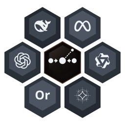

<p align="center"></p>

# basalt — turn your Mac into a local LLM server. Point Claude Code at it.

> Gemma 4, Qwen 3 and any MLX model on your Apple Silicon GPU, behind the **OpenAI API, the Anthropic API and MCP**. One Swift binary. No Python at runtime. No cloud. No API bill.

[English](README.md) · [Русский](README.ru.md)

[](https://github.com/goodmai/basalt/actions/workflows/release.yml)
[](https://github.com/goodmai/basalt/actions/workflows/security-audit.yml)
[](LICENSE)

[](#requirements)
[](Package.swift)
[](#install-with-homebrew)
[](#benchmarks)
[](#benchmarks)

```
┌──────────────────────────────────────────────────────┐
│                       Basalt                           │
│                                                      │
│   MCP stdio ──┐                                      │
│               ├──► ModelOrchestratorActor ──► MLX   │
│   REST :8080 ─┘        (actor, FIFO)      Metal GPU  │
└──────────────────────────────────────────────────────┘
```

Two transports share a single actor instance — **MCP stdio** for IDE integration (Claude Desktop, Cursor) and **REST HTTP** for agent-to-agent workflows and Claude Code backends.


<p align="center"></p>
<p align="center"><sub>Runs open-weight models on Apple Silicon. Verified here today: Gemma, Qwen, Ornith (see <a href="#verified-models">the table</a>); gpt-oss, DeepSeek and Llama are MLX-compatible but not benchmarked here yet. Logos are trademarks of their owners, shown only to indicate compatibility. Anthropic's models are closed-weight, so they are not in the hive; the Anthropic <i>API</i> is supported so that Claude Code can talk to a local model.</sub></p>

## Why basalt

- **One server, two transports.** REST speaks OpenAI *and* Anthropic (`/v1/messages`), MCP stdio plugs into Claude Desktop and Cursor, and every generation route can stream over SSE. They share a single model actor, so nothing loads twice.
- **Claude Code on a local model in two lines.** Set `ANTHROPIC_BASE_URL` and run `claude` — your real API key is never touched. See [Claude Code Integration](#claude-code-integration).
- **Fast on a laptop.** On a 24 GB Mac: ~110 tok/s on Gemma 4 E2B, ~92 tok/s on Qwen3.5-4B, ~37 tok/s on a 9B, ~12 tok/s on a 27B ([full table](#verified-models)).
- **Pure Swift.** SwiftPM only — no Node, no Python, no Docker at runtime. Metal kernels compiled once, `mlx.metallib` shipped next to the binary.
- **Honest numbers.** The model table lists what *broke* too (gibberish output, OOM). The benchmark ladder executes the model's own code against inputs the prompt never showed, so a plausible-looking wrong answer still fails ([Benchmarks](#benchmarks)).

## 60-second demo

```bash
brew tap goodmai/basalt https://github.com/goodmai/basalt
brew install goodmai/basalt/basalt          # builds from source, needs Xcode 26.4+

basalt onboard                              # picks a model that fits your Mac and downloads it
basalt serve --model mlx-community/Qwen3.5-4B-4bit --rest

# in another terminal: Claude Code, backed by your own GPU
ANTHROPIC_BASE_URL=http://localhost:8080 ANTHROPIC_AUTH_TOKEN=local claude
```

Local 4B–9B models are not a drop-in replacement for a frontier model — they are for private, offline, zero-cost agentic work and for tinkering. `basalt fit` tells you what your machine can actually run.

**Star it** if you want more MLX-native tooling in Swift, and open an issue with your Mac and your tok/s — [PRs adding a row to the benchmark table](#benchmarks) are welcome.

---

## Requirements

| | |
|---|---|
| **macOS** | 15+ (Sequoia) |
| **Xcode / Swift** | 26.4+ / Swift 6.3 |
| **Metal toolchain** | `xcodebuild -downloadComponent MetalToolchain` — Xcode 26 ships the Metal compiler separately, and MLX's kernels cannot be built without it |
| **Hardware** | Apple Silicon M1–M4, Unified Memory |
| **Disk** | 2–30 GB depending on model |

---

## Quick Start

### Install with Homebrew

```bash
brew tap goodmai/basalt https://github.com/goodmai/basalt
brew install goodmai/basalt/basalt
```

The tap needs the explicit URL because the repository is not named
`homebrew-basalt`. There is no bottle: the formula builds from source, so Xcode
26.4+ must be installed, along with the Metal toolchain — on Xcode 26 that is a
separate download:

```bash
xcodebuild -downloadComponent MetalToolchain
```

The formula checks for it before building and stops with that command if it is
missing, rather than burying you in per-kernel compiler errors.

The build does two things, and both matter:

1. `swift build -c release` — the server itself.
2. `scripts/build_metal.swift` — compiles MLX's Metal kernels and puts
   `mlx.metallib` next to the binary in `libexec`. A SwiftPM build of mlx-swift
   ships no metallib, and MLX's fallback lookup is relative to the working
   directory, so without this step `basalt` only runs from the directory holding
   the library. Expect this step to dominate the install time.

```bash
brew install --HEAD goodmai/basalt/basalt   # build main instead of the last tag
brew upgrade goodmai/basalt/basalt
brew uninstall basalt && brew untap goodmai/basalt
```

### Build from source

```bash
git clone https://github.com/goodmai/basalt
cd basalt

# Build
swift build -c release

# Compile the MLX Metal kernels. Required once per checkout: a SwiftPM build of
# mlx-swift ships no metallib, and without it the first inference call fails
# with "Failed to load the default metallib". The script places it next to the
# built binary, so the binary works from any directory.
./scripts/build_metal.swift

# Interactive chat
.build/release/basalt chat --model mlx-community/Qwen3.5-4B-4bit

# REST server on :8080 (OpenAI + Anthropic compatible)
.build/release/basalt serve --model mlx-community/Qwen3.5-4B-4bit --rest

# MCP stdio server (for Claude Desktop / Cursor)
.build/release/basalt serve --model mlx-community/gemma-4-e4b-it-4bit --mcp
```

### One-command launcher: `./basalt-claude`

The repo includes a self-contained Swift launcher that builds the server (if needed), waits for readiness, and opens Claude Code — all with local env vars scoped to that session:

```bash
chmod +x ./basalt-claude

./basalt-claude                                             # Qwen 4B, port 8080
./basalt-claude --model mlx-community/gemma-4-31b-it-4bit  # Gemma 4 31B
./basalt-claude --port 8081                                 # custom port
./basalt-claude -- --model haiku                            # pass --model haiku to claude
```

`basalt-claude` pins `ANTHROPIC_API_KEY=local` rather than inheriting it, so a real key is never forwarded to the local server or written into the `--settings` payload. Other terminals are untouched.

---

## Commands

`basalt` with no subcommand starts `chat`.

| Command | What it does |
|---|---|
| `basalt onboard` | first-run wizard: picks a model for your machine and downloads it |
| `basalt fit` | reads the hardware and ranks the model catalogue against it |
| `basalt chat --model <id>` | interactive terminal chat |
| `basalt serve --model <id> --rest` | REST server on :8080 (OpenAI + Anthropic compatible) |
| `basalt serve --model <id> --mcp` | MCP stdio server for Claude Desktop / Cursor |
| `basalt serve --model <id> --stats` | print telemetry to stderr every 5 s (`--stats-interval`); the same numbers at `GET /api/v1/stats` and in MCP `status` |
| `basalt models list --author <org>` | browse a HuggingFace author's models |
| `basalt models download <repo-id>` | download into the shared HF cache |
| `basalt models info <repo-id>` | size, quantization, context window |
| `basalt models cache` | what is on disk, and how much of it |
| `basalt models check <repo-id>` | will it fit in memory (non-zero exit when it does not) |
| `basalt models inspect <repo-id>` | verify a cached model is complete and measure its real bit width |
| `basalt cloud configure` | OpenRouter fallback for what does not fit locally |
| `basalt cloud cost` | spend so far on the cloud fallback |

Inside `basalt chat`:

| Input | Effect |
|---|---|
| `/clear` | wipe the conversation and the screen |
| `/color`, `/theme` | cycle the terminal colour theme |
| `exit`, `quit` | leave (no slash) |

The flags worth knowing on `serve`:

| Flag | Why you would reach for it |
|---|---|
| `--reasoning-effort none` | stop a reasoning model from spending the whole budget inside `<think>` |
| `--reasoning-effort xhigh\|medium\|low` | Qwen-family thinking budget |
| `--quant 4bit` | pick a quantization subfolder in repos that ship several |
| `--kv-bits 4\|8` | quantize the KV cache — buys context on a memory-tight machine; turns off prompt-cache reuse |
| `--prompt-cache-mb N` | memory kept for the prompt-cache prefix tree (default: half of what Metal's recommended GPU working set leaves after the weights, logged at load; `0` disables), see below |
| `--min-p`, `--top-k`, `--seed` | sampling; `--seed` makes a non-greedy run reproducible; a request's `min_p` overrides `--min-p` |
| `--max-tokens` | default generation ceiling (2048–128000) |
| `--dry-run` | memory feasibility check, then exit without loading |
| `--port`, `--host` | default 127.0.0.1:8080; any other host needs an API key (`BASALT_API_KEY` or `--auto-generate-key`) |
| `--rate-limit N` | server-wide requests per minute, 429 beyond it — default off on loopback, 120 otherwise; `0` disables; also `rate_limit` in `~/.gem/config.json` |

**Prompt-cache reuse.** The server keeps the model's KV cache for recent prompts in a prefix tree: prompts that start with the same tokens share one stored copy of that start, and a request prefills only what follows the longest stored prefix. So the next turn of a conversation costs only its new tokens (a tool result appended to a long agent transcript, not the whole history again; on `/v1/messages` tool blocks are not forwarded to the model yet, see #73), and a second conversation that opens with the same system prompt and tools — a Claude Code subagent, another Codex thread — starts from the shared part instead of prefilling it again. Matching is by tokens, so no conversation id is needed (`prompt_cache_key`, `metadata.user_id` and `x-session-id` are ignored); title and other service requests never touch the cache. Under the `--prompt-cache-mb` budget the least recently used branch is cut from its end (a hybrid model's snapshot branch, see below, is removed whole, since its recurrent state is valid only at its end), so an idle conversation keeps its system prompt and tools longest, and the node a running request reuses up to is never evicted (for a hybrid model that is its snapshot node; the request has its own copy of the data, so evicting the rest of its branch cannot affect it); the tree also keeps at most 4096 branches, dropping the least recently used free one beyond that. Usage reports what was actually reused: `prompt_tokens_details.cached_tokens` (Chat Completions), `input_tokens_details.cached_tokens` (Responses), `cache_read_input_tokens` (Anthropic, where `input_tokens` counts only the prefilled rest). Hybrid attention/SSM models such as Qwen3.5/3.6 and Ornith-1.5 reuse a conversation's previous turn too: their recurrent state cannot be rewound, so while prefilling a prompt the server keeps a snapshot of it at the end of the request text, before the chat template's closing tokens, and the next turn that extends that text restores the snapshot and prefills only what follows (Ornith-1.5-9B, 12.6k-token agent prompt: the second turn takes about 1 s instead of about 36 s). A reused turn can differ from an uncached run after its first tokens: the prefill is chunked differently, which shifts bf16 results slightly (measured on Ornith: the restored state is bitwise equal to a from-scratch prefill cut at the same points, and differs from a one-phase prefill by at most 1.56 in the last-position logits with the same top 5). They reuse only from such a snapshot, so a second conversation with the same system prompt prefills in full. Sliding-window layers such as Gemma 3/4 and `--kv-bits` always prefill the full prompt.

Privacy: all clients share one prefix tree, and `cached_tokens` reveals how many leading tokens a prompt shares with earlier prompts, so a caller can probe what another client sent. On a server shared by people who must not see each other's prompts, run with `--prompt-cache-mb 0`.

---

## Verified Models

Models are downloaded from HuggingFace and cached in `~/.cache/huggingface/hub/`.

```bash
huggingface-cli download mlx-community/Qwen3.5-4B-4bit
huggingface-cli download mlx-community/gemma-4-e4b-it-4bit
```

| Model | Params | RAM | Status on 24GB Mac |
|---|---|---|---|
| `mlx-community/gemma-4-e2b-it-4bit` | 2B | 2.7 GB | ✅ ~110 TPS |
| `mlx-community/gemma-4-e4b-it-4bit` | 4B | 4.3 GB | ✅ ~85 TPS |
| `mlx-community/Qwen3.5-4B-4bit` | 4B | 2.3 GB | ✅ ~92 TPS |
| `mlx-community/Qwen2.5-Coder-7B-Instruct-4bit` | 7B | 4.1 GB | ✅ ~60 TPS |
| `mlx-community/Qwen3.5-9B-OptiQ-4bit` | 9B | 5.8 GB | ✅ ~37 TPS |
| `AutisticAF/Huihui-Qwen3.8-27B-abliterated-mlx-4Bit` | 27B | 15.2 GB | ✅ ~12 TPS (Abliterated) |
| `Ex0bit/MYTHOS-26B-A4B-PRISM-PRO-DQ-MLX` | 26B MoE | 14.5 GB | ✅ ~14 TPS (Dynamic Quant) |
| `Ex0bit/Qwen3.6-35B-A3B-PRISM-MLX-NVFP4` | 35B MoE | 20.5 GB | ✅ ~8 TPS (NVFP4) |
| `Ex0bit/Elbaz-Olmo-3-7B-Instruct-abliterated` | 7B | 4.5 GB | ✅ ~55 TPS |
| `ornith-ai/Ornith-1.5-9B-MLX-4bit` | 9B | 4.7 GB | ✅ ~48 TPS (reasoning — see note) |
| `ornith-ai/Ornith-1.5-35B-A3B-MLX-4bit` | 35B MoE | 21 GB | ✅ untested above 24 GB |
| `huihui-ai/Huihui-Qwen3.8-27B-abliterated` (Base BF16) | 27B | ~54 GB | ❌ Needs 64GB+ (Use 4-bit MLX version on 24GB) |
| `mlx-community/gemma-4-26b-a4b-it-4bit` | 26B MoE | 14.5 GB | ❌ Gibberish output |
| `mlx-community/Qwen3.6-27B-4bit` | 27B | 14.5 GB | ❌ Gibberish output |
| `mlx-community/gemma-4-31b-it-4bit` | 31B | 17 GB | ❌ OOM (Needs 32GB+) |

> **Note on 24GB RAM Macs:** 
> - Unquantized 27B/35B models (~54 GB weights) exceed physical memory. Use MLX 4-bit / Dynamic Quant (DQ) quantized weights (e.g. `AutisticAF/Huihui-Qwen3.8-27B-abliterated-mlx-4Bit`, `Ex0bit/MYTHOS-26B-A4B-PRISM-PRO-DQ-MLX`) which comfortably fit in ~15 GB RAM.
> - Models > 10GB constrain KV-cache size under heavy multi-turn contexts. The KV cache takes `2 · layers · kv_heads · head_dim · 2 B` per token (fp16), read from the model's `config.json`; hybrid models count only their full-attention layers plus a fixed recurrent state, sliding-window layers stop at the window, `--kv-bits 4|8` stores `bits + 0.5` bits per element (`--kv-bits` does not apply to sliding-window layers). Qwen3-4B: 144 KiB per token, 4.5 GiB at 32k tokens; Ornith-1.5-9B (8 of 32 layers full attention): 32 KiB per token, 1.05 GiB at 32k. `serve --dry-run`, `models check`, `fit` and the memory-derived token budget use this figure (cap = max(--max-tokens, memory budget); the budget can only raise it above --max-tokens (see #85)); without a downloaded config they fall back to a parameter-count estimate that is close for dense 7B–32B models but several times off for small, hybrid and MoE ones. Estimates, not measurements: the recurrent state of Mamba layers (Jamba, NemotronH) is not counted, only their attention layers; MLA models (DeepSeek V2/V3) are counted as the decompressed per-head K and V that MLX caches, not the compressed latent.

---

## REST API

Base URL: `http://127.0.0.1:8080` — **no authentication required**.

### Model management

```bash
# List all locally cached models (OpenAI-compatible format)
curl http://localhost:8080/v1/models

# Currently loaded model + readiness status
curl http://localhost:8080/v1/models/current

# Hot-swap to a different model at runtime (blocks until loaded)
curl -s http://localhost:8080/v1/models/load \
  -H "Content-Type: application/json" \
  -d '{"model": "mlx-community/gemma-4-31b-it-4bit"}'
```

`GET /v1/models` returns IDs prefixed with `claude-local/` so Claude Code's automatic model picker adds them. The `display_name` field carries the original HuggingFace repo ID.

### Raw generation

```bash
curl -s http://localhost:8080/api/v1/generate \
  -H "Content-Type: application/json" \
  -d '{"prompt": "Explain quantum entanglement.", "maxTokens": 256}'
```

| Field | Type | Default | Description |
|---|---|---|---|
| `prompt` | string | required | Input text |
| `maxTokens` | int | 8192 | Max tokens to generate |
| `temperature` | float | 0.7 | Sampling temperature (0–2) |
| `topP` | float | 0.9 | Nucleus sampling |
| `minP` | float | server | Min-P 0–1: drop tokens below `minP × max p`. Overrides `--min-p` and the model profile; `0` turns it off |
| `dynamicTemperature` | bool | false | Entropy-based dynamic temperature (EDT): per token `T = T0·0.8^(1.5/H) + 0.5·R`, clamped to 0.05–2 (a colder request keeps its own temperature as the floor; `top_p`/`min_p` cut the original distribution), where `H` is the entropy of the next-token distribution and `R ∈ [0,1]` a repetition index. Near-greedy on confident tokens, warmer when a loop starts. No effect at `temperature: 0` |

`/v1/chat/completions`, `/v1/responses` and `/v1/messages` take the same two fields as `min_p` and `dynamic_temperature`; MCP `gemma_generate` as `minP` and `dynamicTemperature`.

### OpenAI-compatible

```bash
curl -s http://localhost:8080/v1/chat/completions \
  -H "Content-Type: application/json" \
  -d '{
    "model": "basalt",
    "messages": [{"role": "user", "content": "Hello"}],
    "stream": true
  }'
```

Supports streaming SSE, system prompts, and multi-turn conversation. Sending a HuggingFace model ID in the `"model"` field triggers a hot-swap automatically.

### Anthropic-compatible

```bash
curl -s http://localhost:8080/v1/messages \
  -H "Content-Type: application/json" \
  -d '{
    "model": "basalt",
    "max_tokens": 1024,
    "messages": [{"role": "user", "content": "Hello"}]
  }'
```

Implements the full Anthropic SSE event sequence (`message_start`, `content_block_start`, `content_block_delta`, `message_stop`). Accepts plain-string and block-array content formats.

### SSE streaming (native API)

```bash
curl -N http://localhost:8080/api/v1/generate/stream \
  -H "Content-Type: application/json" \
  -d '{"prompt": "Hello", "maxTokens": 512}'
```

Each event is a `data: {...}` line; the stream ends with `data: [DONE]`. A failure mid-stream arrives as `event: error` with `data: {"error": ...}`.

### Swagger UI

Visit `http://localhost:8080/swagger` for interactive API docs.

---

## Claude Code Integration

### Option A — environment variables (per terminal session)

```bash
# Start Basalt
.build/release/basalt serve --model mlx-community/Qwen3.5-4B-4bit --rest

# In another terminal — scope vars only to this claude process
ANTHROPIC_BASE_URL=http://localhost:8080 \
ANTHROPIC_AUTH_TOKEN=local \
claude
```

`ANTHROPIC_AUTH_TOKEN` sends as `Authorization: Bearer local` (not `x-api-key`), so your real `ANTHROPIC_API_KEY` is never touched.

### Option B — shell function (add to `~/.zshrc`)

```bash
function claude-local() {
  ANTHROPIC_BASE_URL=http://localhost:8080          \
  ANTHROPIC_AUTH_TOKEN=local                        \
  ANTHROPIC_DEFAULT_HAIKU_MODEL=mlx-community/gemma-4-e4b-it-4bit    \
  ANTHROPIC_DEFAULT_SONNET_MODEL=mlx-community/Qwen3.5-4B-4bit       \
  ANTHROPIC_DEFAULT_OPUS_MODEL=mlx-community/gemma-4-31b-it-4bit     \
  claude "$@"
}

claude-local                   # sonnet alias → Qwen 4B
claude-local --model haiku     # haiku alias → Gemma 4B (fastest)
claude-local --model opus      # opus alias → Gemma 31B (strongest)
```

### Option C — `./basalt-claude` launcher

Starts the server and Claude Code in one command (see Quick Start above).

### Model discovery

Claude Code (v2.1.126+) queries `GET /v1/models` at startup and adds returned models to the `/model` picker — but only if the ID starts with `claude` or `anthropic`. Basalt returns IDs in `claude-local/<hf-id>` form so discovery works automatically.

---

## OpenCode Integration

[OpenCode](https://github.com/opencode-ai/opencode) is a terminal-native AI coding agent. Basalt provides a native OpenAI-compatible API (`/v1/chat/completions`, `/v1/models`) and Anthropic-compatible API that connects directly to OpenCode without cloud dependencies or API keys.

### 1. Start Basalt Server

Start Basalt with your desired local model (e.g. Huihui Qwen3.8 Abliterated, Ex0bit MYTHOS 26B, or Qwen3.5 4B):

```bash
# High capability (Abliterated / MoE)
.build/release/basalt serve --model AutisticAF/Huihui-Qwen3.8-27B-abliterated-mlx-4Bit --rest

# Or fast coding model
.build/release/basalt serve --model mlx-community/Qwen2.5-Coder-7B-Instruct-4bit --rest
```

### 2. Connect OpenCode

#### Option A — Terminal Environment Variables

```bash
# In your project folder:
OPENAI_BASE_URL=http://localhost:8080/v1 \
OPENAI_API_KEY=local \
OPENAI_MODEL=basalt \
opencode
```

#### Option B — OpenCode Configuration File (`~/.config/opencode/config.json` or `opencode.json`)

```json
{
  "provider": "openai",
  "base_url": "http://localhost:8080/v1",
  "api_key": "local",
  "model": "basalt",
  "temperature": 0.7,
  "max_tokens": 16384
}
```

#### Option C — Shell Alias (add to `~/.zshrc`)

```bash
function basalt-opencode() {
  OPENAI_BASE_URL=http://localhost:8080/v1 \
  OPENAI_API_KEY=local \
  OPENAI_MODEL=basalt \
  opencode "$@"
}
```

---

## Downloading Models (mlx-community, huihui-ai, Ex0bit)

Basalt can browse, inspect, and download models from any creator or organization on Hugging Face:

```bash
# List models by author
basalt models list --author Ex0bit
basalt models list --author huihui-ai
basalt models list --author mlx-community

# Search with filters
basalt models list --author Ex0bit --search PRISM
basalt models list --search Huihui-Qwen3.8

# Download specific models
basalt models download AutisticAF/Huihui-Qwen3.8-27B-abliterated-mlx-4Bit
basalt models download Ex0bit/MYTHOS-26B-A4B-PRISM-PRO-DQ-MLX
basalt models download Ex0bit/Qwen3.6-35B-A3B-PRISM-MLX-NVFP4

# Interactive picker with custom author
basalt models download --author Ex0bit
```

---

## MCP Integration (Claude Desktop / Cursor)

Add to your MCP config (`~/.config/claude/claude_desktop_config.json`):

```json
{
  "mcpServers": {
    "basalt": {
      "command": "/path/to/.build/release/basalt",
      "args": ["serve", "--model", "mlx-community/Qwen3.5-4B-4bit", "--mcp"]
    }
  }
}
```

Available MCP tools:

| Tool | Description |
|---|---|
| `gemma_generate` | Generate text — `prompt`, `maxTokens`, `temperature`, `topP`, `minP`, `dynamicTemperature` |
| `gemma_status` | Returns server readiness, version, and current model |
| `playwright_screenshot` | Capture a webpage screenshot via Playwright |
| `gemma_add_knowledge` | Inject custom context into the session |

---

## Project Structure

```
Sources/                    — one SwiftPM target per directory; dependencies point down only
  BasaltCore/               — DTOs, errors, config, logger, profilers, calculators, HF cache, orchestrator
    Chat/                   — ModelProfile: everything that differs between model families
    Config/                 — ServerConfig value type
  BasaltInference/          — MLX inference engine, ContextDegradationProfiler, RepetitionGuard  (→ Core)
  BasaltCloud/              — OpenRouter / cloud model fallback (CostTracker, ModelRouter)    (→ Core)
  BasaltServer/             — REST (Hummingbird 2.x, API key + rate-limit middleware) and MCP JSON-RPC stdio server (→ Core)
  BasaltUI/                 — Terminal UI (Markdown, spinner, progress bar, diff, table)       (→ Core)
  BasaltApp/                — SwiftUI REST chat client, not linked into the CLI (launch: #55)  (→ Core)
  BasaltCLI/                — Subcommands and the CLI root command (App/)                     (→ all of the above)
  BasaltBin/                — Thin executable wrapper (product `Basalt`, installed as `basalt`)
  PerformanceBenchmark/     — Standalone benchmark CLI target

Tests/
  BasaltTests/              — Unit + integration tests
    CLI/                    — Command parsing, Cloud, Fit, PromptContextBuilder
    Cloud/                  — CostTracker, ModelRouter, OpenRouterClient
    UI/                     — Clipboard, Diff, Markdown, ProgressBar, Spinner, Table, TerminalUI
    MockInferenceEngine.swift — Controllable mock for orchestrator tests

basalt-claude                       — Executable Swift launcher (build + serve + claude)
scripts/                    — Build and maintenance Swift scripts
docs/                       — Extended documentation
```

Only `BasaltApp` may import SwiftUI/AppKit; every target the CLI links stays headless (enforced by `ModuleBoundaryTests`).
Symbols newly shared across targets use the `package` access level (existing public API stays `public`).

---

## Architecture Notes

**Dynamic Quantization & MoE** — `MLXInferenceEngine` automatically parses `config.json` to detect 2/3/4/8-bit quantization and dynamically switches between Dense and Sparse MoE (Mixture of Experts) architectures (e.g. using highly optimized `SwitchGLU` Metal kernels).

**Actor isolation** — `ModelOrchestratorActor` is a Swift 6 actor. All inference calls are serialised (FIFO) without explicit locking. Both MCP and REST share one actor instance.

**Model hot-swap** — `switchModel(to:)` resolves the HuggingFace repo ID from the local cache, unloads the current model (`container = nil` + `MLX.GPU.clearCache()`), then loads the new weights. The actor ensures in-flight requests finish before the swap begins.

**Timeout protection** — every `generate` and `generateStream` call is wrapped in a 5-minute timeout with cooperative Task cancellation, preventing model hangs from blocking the server indefinitely.

**Streaming** — Hummingbird 2's `AsyncStream<ByteBuffer>` response body is used for both SSE formats: OpenAI (`data: {...}`) and Anthropic (`event: content_block_delta`).

**Think-block stripping** — `generateStream` runs a state machine to suppress `<think>...</think>` reasoning blocks before forwarding tokens to clients.

**ID translation** — `ModelsController` translates between HuggingFace repo IDs (`mlx-community/Qwen3.5-4B-4bit`) and the `claude-local/mlx-community--Qwen3.5-4B-4bit` form required by Claude Code's model discovery filter. Both forms are accepted in API requests.

---

## Maintenance Scripts

| Script | Purpose |
|---|---|
| `scripts/build_metal.swift` | Compile Metal GPU kernels (skips if up to date) |
| `scripts/cleanup.swift` | `--mode=daily` rotates logs/images/reports, `--mode=release` removes build/runtime artifacts before publishing, `--mode=all` both; dry run unless `--apply` |
| `scripts/archive.sh` | Archive logs/reports/screenshots |

---

## Benchmarks

Two harnesses, both pointed at a running server, both reporting numbers you can
reproduce on your own machine.

**The ladder to the moon** — `benchmarks/ladder/run.py`. Five rungs, each
strictly harder than the one below it, ending in a full Earth-to-Moon mission.
Nothing is graded on how the answer reads: the model's own code is executed
against inputs the prompt never showed it, so a plausible-looking wrong answer
still fails.

| Rung | Task | What it actually tests |
|---|---|---|
| 1 | Biquadratic, real roots | closed form plus the edge cases: none, repeated, zero |
| 2 | Biquadratic, complex roots | branch handling — all four roots, with multiplicity |
| 3 | Fourier coefficients | numeric integration, checked on sawtooth, square wave, cosine |
| 4 | Pump head | units (mm vs m, L/s vs m³/s) + Colebrook, which has no closed form |
| 5 | **Earth → Moon mission** | exhaust velocity from `sqrt(2ηQ)`, Tsiolkovsky per stage, four-body propagation, lunar braking, soft landing — every constant is in the prompt, nothing recallable from a textbook |

The top rung is scored on six invariants rather than one answer, so a model that
gets the energetics right but never propagates the trajectory still shows a
number. Its prompt lives in `benchmarks/ladder/lunar_prompt.md`; the reference
values in `lunar_task.md` are never shown to the model.

`--warmup` prepends three cheap smoke tests (algebra, Fibonacci, translation)
that any instruct model should clear. They are not part of the ladder score.

**ARC-AGI** — `benchmarks/arc-agi/arc_agi_benchmark.py`, official pass@2 rules.
The corpus is not vendored; fetch it into `benchmarks/arc-agi/dataset/` first
(see `benchmarks/arc-agi/ARC_AGI.md`).

### Results

Measured on an M-series Mac with 24 GB unified memory. `thinking` is the chat
template's `<think>` block: on by default for reasoning models, disabled with
`--reasoning-effort none`.

| Model | Warm-up | Ladder | Top rung | ARC-AGI mini | tok/s |
|---|---|---|---|---|---|
| `ornith-ai/Ornith-1.5-9B-MLX-4bit` (thinking off) | 3/3 | 1/4 ² | not run | 0/3 ¹ | ~45 |
| `ornith-ai/Ornith-1.5-9B-MLX-4bit` (thinking on) | 2/3 | 0/4 ² | not run | not run | ~43 |

Ornith 9B rung by rung, thinking off:

| Rung | Result | Detail |
|---|---|---|
| 1 · biquadratic real | ✅ | roots correct, including the repeated and empty cases |
| 2 · biquadratic complex | ❌ | `x⁴ + 1` returns 2 roots instead of 4 |
| 3 · Fourier | ❌ | `a0 = 10.86` for `f(x) = x`, want 0 — the integration is wrong, not the formula |
| 4 · pump head | ❌ | `v = 0.0298` m/s, want 1.79 — never converted mm to m |
| 5 · lunar mission | — | not run |

Warm-up, thinking off: algebra ✅ (163 tok, 4 s), Fibonacci ✅ (757 tok, 16 s),
translation ✅ (303 tok, 7 s — German idiomatic, French paraphrased rather than
translated).

² Rungs 1 and 2 were measured before the ladder was split into separate
prompts: one prompt asked for both functions, the real half was correct and the
complex half was not. Rung 5 has not been run against this model yet.

¹ The ARC-AGI column is a partial run: three training tasks (`007bbfb7`,
`00d62c1b`, `017c7c7b`), none solved at pass@2, 330 s total. It was stopped
before the remaining two, so treat it as a smoke test rather than a score.

The validators are themselves checked, without a model or a GPU:

```bash
python3 benchmarks/ladder/selfcheck.py    # 9 assertions, both directions
```

With thinking **on**, all three hard tasks and the translation ended in
`finish_reason: length` — the budget went into the `<think>` block and no answer
was ever emitted. That is a budget failure, not a capability ceiling, which is
why the table above reports the two modes separately.

### Reproduce

```bash
basalt serve --model ornith-ai/Ornith-1.5-9B-MLX-4bit --rest --reasoning-effort none &

python3 benchmarks/ladder/run.py --port 8080 --warmup --json ladder.json
python3 benchmarks/arc-agi/arc_agi_benchmark.py --engine mlx --split training --limit 5
```

Adding a model to the table is one run of each — PRs with new rows are welcome.

---

## Dependencies

Everything is a SwiftPM package; there is no CocoaPods, no Node, no Python at
runtime. `Package.resolved` pins the exact revisions.

| Package | Used for |
|---|---|
| [mlx-swift](https://github.com/ml-explore/mlx-swift) | the array/NN layer on Metal |
| [mlx-swift-lm](https://github.com/ml-explore/mlx-swift-lm) | model architectures and loading — `MLXLLM`, `MLXVLM`, `MLXLMCommon` |
| [swift-transformers](https://github.com/huggingface/swift-transformers) | tokenizers and chat templates |
| [hummingbird](https://github.com/hummingbird-project/hummingbird) | the HTTP server |
| [swift-argument-parser](https://github.com/apple/swift-argument-parser) | the CLI |
| [Rainbow](https://github.com/onevcat/Rainbow) | terminal colour and layout |
| [swift-markdown](https://github.com/apple/swift-markdown), [Splash](https://github.com/JohnSundell/Splash) | Markdown rendering and syntax highlighting in the terminal |

`MLXVLM` is not optional: Gemma 4 and the Ornith checkpoints declare
`*ForConditionalGeneration`, and those architectures are registered there rather
than in `MLXLLM`.

Updates arrive as Dependabot PRs — weekly for SwiftPM, monthly for the GitHub
Actions. mlx-swift moves fast and a model architecture is often one release
away, which is the reason for the weekly cadence.

---

## Contributing

Issues and pull requests are welcome. Before opening a PR:

```bash
swift build          # must compile
swift test           # must stay green
```

Never commit credentials, tokens, or `*.sqlite3` state — `.gitignore` blocks the
usual suspects, and the release workflow runs a secret scan over the tree.

---

## License

[MIT](LICENSE) © 2026 goodmai

Model weights are **not** covered by this license — each model on HuggingFace
carries its own terms.
