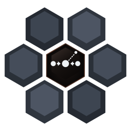

<p align="center"></p>

# basalt — your Mac is the AI lab now.

> Serve, train, quantize, compose and dissect open LLMs on Apple Silicon. One Swift 6.4 binary speaks the **OpenAI API, the Anthropic API and MCP**, and a native macOS 27 Liquid Glass app sits on top. No Python at runtime. No cloud unless you ask for it.

[English](README.md) · [Русский](README.ru.md)

[](https://github.com/goodmai/basalt/actions/workflows/release.yml)
[](https://github.com/goodmai/basalt/actions/workflows/security-audit.yml)
[](LICENSE)
[-black.svg)](https://huggingface.co/collections/goodmai/basalt-inference-and-quantization-stack-6af94bed95c64cce97e188fc)
[](https://huggingface.co/spaces/goodmai/run-with-basalt)

[](docs/install.md#requirements)
[](Package.swift)
[](docs/install.md#install-with-homebrew)
[](docs/benchmarks.md#benchmarks)
[](docs/benchmarks.md#benchmarks)

<p align="center"></p>
<p align="center"><sub>Runs open-weight models on Apple Silicon. Logit-verified here: Gemma 4, Qwen3.8 and LFM2.5 (the table below); measured and packaged in <a href="https://huggingface.co/goodmai">huggingface.co/goodmai</a>: Ornith, Bonsai, Qwen3.6-35B-A3B, DeepSeek-OCR-2, OpenJev and Laya (see <a href="docs/models.md#verified-models">the models table</a>); gpt-oss and Llama are MLX-compatible. Logos are trademarks of their owners, shown only to indicate compatibility. Anthropic's models are closed-weight, so they are not in the hive; the Anthropic <i>API</i> is supported so that Claude Code can talk to a local model.</sub></p>

**Five things in one repo:** a local inference server your tools already know how to talk to, LoRA distillation and post-quantization tuning, a docker-compose for multi-model systems, a live X-ray microscope for what happens inside the model, and a native Mac app that puts it all one keystroke away.

**Checked against reference logits on every change** to the inference path: [`GoldenLogitsTests`](Tests/BasaltTests/GoldenLogitsTests.swift) replays recorded prompts and fails when a greedy token or a logit moves. Per-family reference logits for qwen3, qwen3_5, gemma4, lfm2 and nemotron_h, dense and MoE, are in [`Fixtures/ReferenceLogits`](Tests/BasaltTests/Fixtures/ReferenceLogits).

| Golden-tested model | Class | Fixture |
|---|---|---|
| [`mlx-community/gemma-4-26B-A4B-it-qat-4bit`](https://huggingface.co/mlx-community/gemma-4-26B-A4B-it-qat-4bit) | sliding-window + full attention, MoE | [golden](Tests/BasaltTests/Fixtures/golden/mlx-community--gemma-4-26B-A4B-it-qat-4bit.json) |
| [`lukaskremla/Qwen3.8-27B-3bit-MLX-TextOnly`](https://huggingface.co/lukaskremla/Qwen3.8-27B-3bit-MLX-TextOnly) | hybrid linear/full attention, dense | [golden](Tests/BasaltTests/Fixtures/golden/lukaskremla--Qwen3.8-27B-3bit-MLX-TextOnly.json) |
| [`LiquidAI/LFM2.5-24B-A2B-MLX-4bit`](https://huggingface.co/LiquidAI/LFM2.5-24B-A2B-MLX-4bit) | hybrid conv + attention, MoE | [golden](Tests/BasaltTests/Fixtures/golden/LiquidAI--LFM2.5-24B-A2B-MLX-4bit.json) |

### One-click launch from [`huggingface.co/goodmai`](https://huggingface.co/collections/goodmai/basalt-inference-and-quantization-stack-6af94bed95c64cce97e188fc) (35+ verified models)

Every model card under [`goodmai`](https://huggingface.co/goodmai) carries a **Run with Basalt** button that opens `Basalt.app` via `basalt://run?model=...` or prints the exact `basalt serve` CLI command:

| Model (`goodmai/*`) | Role & footprint on 24 GB Mac | Launch |
|---|---|---|
| [`goodmai/gemma-4-12B-it-qat-4bit`](https://huggingface.co/goodmai/gemma-4-12B-it-qat-4bit) | 12B QAT daily-driver chat & vision (~7.6 GB) | [](https://goodmai-run-with-basalt.hf.space/?model=goodmai%2Fgemma-4-12B-it-qat-4bit&role=chat&lang=en) |
| [`goodmai/gemma-4-26B-A4B-it-qat-4bit`](https://huggingface.co/goodmai/gemma-4-26B-A4B-it-qat-4bit) | 26B MoE (`A4B`), golden-verified (~14.5 GB) | [](https://goodmai-run-with-basalt.hf.space/?model=goodmai%2Fgemma-4-26B-A4B-it-qat-4bit&role=chat&lang=en) |
| [`goodmai/Qwen3.8-27B-GSQ-RCO-IQ3_S-Basalt-Native`](https://huggingface.co/goodmai/Qwen3.8-27B-GSQ-RCO-IQ3_S-Basalt-Native) | 27B GSQ-RCO native i-quant (11.8 GB, PPL 4.17, 300/300 System One) | [](https://goodmai-run-with-basalt.hf.space/?model=goodmai%2FQwen3.8-27B-GSQ-RCO-IQ3_S-Basalt-Native&role=chat&lang=en) |
| [`goodmai/Qwen3.6-35B-A3B-8bit`](https://huggingface.co/goodmai/Qwen3.6-35B-A3B-8bit) | 35B MoE in 37.7 GB streamed from SSD at 8.77 tok/s, 0 swap | [](https://goodmai-run-with-basalt.hf.space/?model=goodmai%2FQwen3.6-35B-A3B-8bit&role=moe-stream&lang=en) |
| [`goodmai/Ternary-Bonsai-2-27B-MTPLX-Optimized-Speed`](https://huggingface.co/goodmai/Ternary-Bonsai-2-27B-MTPLX-Optimized-Speed) | 27B Hadamard ternary in 7.4 GB, 27.1 tok/s with `--mtp` | [](https://goodmai-run-with-basalt.hf.space/?model=goodmai%2FTernary-Bonsai-2-27B-MTPLX-Optimized-Speed&role=mtp&lang=en) |
| [`goodmai/LFM2.5-24B-A2B-MLX-4bit`](https://huggingface.co/goodmai/LFM2.5-24B-A2B-MLX-4bit) | 24B hybrid conv + attention MoE, golden-verified (~12.6 GB) | [](https://goodmai-run-with-basalt.hf.space/?model=goodmai%2FLFM2.5-24B-A2B-MLX-4bit&role=chat&lang=en) |
| [`goodmai/DeepSeek-OCR-2-8bit`](https://huggingface.co/goodmai/DeepSeek-OCR-2-8bit) | Vision-encoder OCR with official 768 tiling (`/v1/pipeline`) | [](https://goodmai-run-with-basalt.hf.space/?model=goodmai%2FDeepSeek-OCR-2-8bit&role=ocr&lang=en) |
| [`goodmai/OpenJev-Flash-9B-MLX-4bit`](https://huggingface.co/goodmai/OpenJev-Flash-9B-MLX-4bit) | 9B local System One decider (98.9% acc, −77% LLM tokens) | [](https://goodmai-run-with-basalt.hf.space/?model=goodmai%2FOpenJev-Flash-9B-MLX-4bit&role=decide&lang=en) |

---

## Inference: 27B in 7.4 GB, or 37.7 GB MoE with zero swap — behind the APIs you already use

- **Claude Code on your own GPU in one line.** `ANTHROPIC_BASE_URL=http://localhost:8080 ANTHROPIC_AUTH_TOKEN=local claude` — your real API key is never touched. OpenAI SDKs, OpenCode, Continue, Cline and aider connect over the OpenAI API, Claude Desktop and Cursor over MCP (with per-tool and per-group `--mcp-enable` / `--mcp-disable`, [#488](https://github.com/goodmai/basalt/pull/488)).
- **Fast on a laptop.** On an M4 Pro with 24 GB: Qwen3-4B decodes at 78–89 tok/s; Ternary Bonsai 2 27B fits in 7.4 GB and runs at 20.9–21.5 tok/s, 27.1 with its MTP head and 31–38 with prompt lookup on code ([#239](https://github.com/goodmai/basalt/pull/239), [#263](https://github.com/goodmai/basalt/pull/263)); `.gguf` GSQ-RCO / `i-quant` checkpoints execute directly on custom Metal kernels ([#433](https://github.com/goodmai/basalt/pull/433)).
- **Models larger than RAM, zero swap.** `Qwen3.6-35B-A3B-8bit` (37.7 GB) decodes at 8.77 tok/s on a 24 GB Mac with 0 swap via batched POSIX AIO and `LIO_NOWAIT` next-layer SSD expert prefetch (`--experimental-expert-streaming`, [#477](https://github.com/goodmai/basalt/pull/477), [#478](https://github.com/goodmai/basalt/pull/478)).
- **Speculative decoding that stays exact.** Prompt lookup gives 1.84–2.66× on code edits (Bonsai 2 27B, [#239](https://github.com/goodmai/basalt/pull/239)) and 3.45–3.62× (Gemma 4 12B, [#265](https://github.com/goodmai/basalt/pull/265)), with greedy output unchanged.
- **The next turn costs only its new tokens.** A prefix-tree prompt cache, even for hybrid models: on Ornith-1.5-9B with a 12.6k-token agent prompt, the second turn takes about 1 s instead of about 36 s ([#82](https://github.com/goodmai/basalt/pull/82)).
- **Long contexts in less memory.** KV quantization with exact zones (`4|8|k8v4`, plus experimental `turbo3|turbo4|turbo8v4` and `polar4` RoPE-pair keys, [#472](https://github.com/goodmai/basalt/pull/472), [#473](https://github.com/goodmai/basalt/pull/473)): a 16k prompt peaks at 1.03 GB instead of 3.11 GB on Qwen3-4B ([#159](https://github.com/goodmai/basalt/pull/159)).
- **A whole local stack.** Tool calls, JSON-schema, regex and grammar output (XGrammar), images and `DeepSeek-OCR-2` ([#476](https://github.com/goodmai/basalt/pull/476)), `/v1/embeddings`, `/v1/rerank`, LoRA adapters picked per request, and ordered LAN-before-cloud fallback tiers ([#480](https://github.com/goodmai/basalt/pull/480)).

Details: [REST API](docs/rest-api.md) · [integrations](docs/integrations.md) · [commands and flags](docs/commands.md) · [models](docs/models.md) · [benchmarks](docs/benchmarks.md)

## Training & Quantization: distill from a frontier model, recover sub-3-bit quality

- **Distill a frontier model into a LoRA.** `basalt models distill` sends your prompts to a teacher behind an OpenAI- or Anthropic-format API, caps the spend with `--budget-usd`, can keep only verified answers, and checkpoints so an interrupted run resumes (#393). `--on-policy` trains on the student's own samples with per-token reverse KL from a basalt teacher.
- **Post-quantization PV-Tuning.** `basalt models convert --experimental-pv-tune` alternates continuous scale/bias updates with discrete integer-code refinement on Apple Silicon, cutting 2–3-bit quantization perplexity loss by 8.7–29% in under 3 minutes ([#486](https://github.com/goodmai/basalt/pull/486)).
- **Bitshift trellis quantization (QTIP).** `basalt models convert --experimental-qtip --bits 2.5` fits `Qwen3.8-27B` in 10.00 GB and beats 3-bit MLX affine & PV-Tuning on 16k perplexity (4.621 vs 4.702 / 4.652), while 2.0 bpw (8.48 GB) cuts 2-bit perplexity by 72.1% (5.345 vs 19.146, [#494](https://github.com/goodmai/basalt/pull/494)).
- **Train while you serve.** The MCP `distill` tool is time-sliced: the model is held one optimizer step at a time, so `serve` keeps answering.
- **Self-training that learns nothing unverified.** `train_experts` collects answers to checkable tasks, keeps only the verified ones, trains a LoRA and reports held-out accuracy before and after.
- **A quality gate before anything sticks.** A gated adapter stays only if KL and perplexity on held-out prompts stay within limits; a failed gate undoes it bit for bit.
- **JEPA and conversion.** `basalt models train-jepa` trains a JEPA adapter and projector on multi-view data; `basalt models convert` imports `.gguf` i-quants, merges a LoRA, requantizes or exports HF safetensors.

Details: [training commands](docs/commands.md) · [self-training, distillation and the quality gate](docs/research-tools.md#self-training-train_experts)

## Compose: one YAML file for a whole model system

- **docker-compose, for models.** Local and cloud models, how each stays in memory (`resident`, `on-demand` with `idle_unload` [#481](https://github.com/goodmai/basalt/pull/481), `sequential`), and a perceive → decide → answer pipeline — OCR, speech, a System One decision cascade and the chat model — in one file.
- **Refuses what will not fit.** `basalt compose plan` adds up the bytes (including unmerged Jev LoRA adapters [#462](https://github.com/goodmai/basalt/pull/462)), sizing models you have not downloaded from the Hugging Face API, and refuses a system that does not fit before anything loads. `compose pull` fetches and verifies every model ahead of time.
- **Change it live.** `compose diff` shows what would change; `compose up` on a running system reloads only the models, experimental flags or MCP toggles that changed ([#489](https://github.com/goodmai/basalt/pull/489)) and swaps pipelines between requests. `compose ps` shows state and spend, `compose down` stops it.
- **Local judges and cloud budgets.** `OpenJev-Flash-9B-4bit` fits beside Gemma 4 12B in 15.3 GB on a 24 GB Mac, reaching 98.9% triage accuracy while cutting downstream LLM tokens by 77% ([#465](https://github.com/goodmai/basalt/pull/465)), and Laya answers on the Neural Engine in ~11 ms. Answer routes send hard queries to a cloud model while its daily budget lasts: 100% accuracy at $0.035 per 1000 requests, p95 4.8 s vs 10.0 s local only ([#418](https://github.com/goodmai/basalt/pull/418)).
- **Private by default.** Keys come only from environment variables, and text read from your documents or audio never goes to a cloud model.
- **Google's Gemini Decision 1 as a decision stage.** `cloud:gemini/gemini-decision-1` answers yes/no, choice and score questions over text, images, audio, video and PDFs in one pass, in front of a local decider ([#449](https://github.com/goodmai/basalt/pull/449)). It is also the calibration teacher for local decision models (#448).

Details: [compose reference and measurements](docs/compose.md) · [pipeline presets and memory modes](docs/pipelines.md) · [cloud decisions with Gemini](docs/cloud-decisions.md)

## Research: open the model up while it runs

- **Model X-ray and live telemetry.** `model_describe`, `model_tensors`, `model_tensor`, `kv_inspect`, `trace_run` and `telemetry_query` expose layer anatomy, Marchenko–Pastur spectra, the prompt-cache tree, per-head logit lens, MoE routing & expert-cache hit rates, per-token confidence shapes, and OpenMetrics at `/api/v1/metrics` ([#458](https://github.com/goodmai/basalt/pull/458), [#459](https://github.com/goodmai/basalt/pull/459)).
- **Reversible experiments.** With `serve --research-tools`: steering and head or expert ablation (`intervene`), weight deltas, live re-packing of a layer to 2–8-bit, mxfp4, nf4 or ternary, and `experiment_compare` with KL and perplexity. Every experiment is an undoable overlay with a TTL and a journal; model files on disk are never written.
- **Find the circuit behind a behaviour.** `trace_tokens` and `activation_contrast` rank heads and experts by Cohen's d and AUROC, then a conditional ablation fires only on the tokens that trigger it (#405). `steer_search` and `steer_commit` turn contrastive directions into gated adapters.
- **The model studies itself.** `introspect` hands the X-ray tools to the served model and records its hypotheses, tests and outcomes.
- **Papers and hybrid compute in the engine.** CacheBlend (arXiv:2405.16444), EPIC chunk heads (arXiv:2410.15332), L2-norm KV eviction (arXiv:2406.11430), DuoAttention, Token Recycling, Walsh–Hadamard value rotation, and GPU + Neural Engine column-split FFN prefill ([#468](https://github.com/goodmai/basalt/pull/468)) — each opt-in, with its measured trade-offs next to its flag.
- **Benchmarks that run the model's code.** A five-rung ladder ending in an Earth-to-Moon mission executes the model's own code against unseen inputs, and ARC-AGI runs under official pass@2 rules.

Details: [research tools](docs/research-tools.md) · [benchmarks](docs/benchmarks.md) · [serve flags](docs/commands.md)

## Basalt for Mac: macOS 27 Liquid Glass, one keystroke or one click away

- **A native SwiftUI app on a supervised engine.** Built for macOS 27 Liquid Glass ([#479](https://github.com/goodmai/basalt/pull/479)) in English and Russian ([#456](https://github.com/goodmai/basalt/pull/456)): 257 ms warm window, 0 idle wakeups, 7.4 ms p95 per streamed token in a 2,000-message transcript, and 40 ms `⌥Space` quick-ask overhead ([#463](https://github.com/goodmai/basalt/pull/463)).
- **One-click `basalt://` launch from Hugging Face.** Clicking **Run with Basalt** on any [`goodmai`](https://huggingface.co/goodmai) model card opens `Basalt.app` via `basalt://run?model=...` and switches the supervised engine to that model or pipeline role.
- **Ask from anywhere.** `⌥Space` opens a floating panel over any app, even a full-screen one, without an Accessibility permission. Conversations live in SwiftData, with a system prompt per conversation.
- **A model library that knows your Mac.** The Models window lists the Hugging Face cache with a fit verdict for this machine, loads with one click, and resumes interrupted downloads.
- **Drop in a PDF, image or recording.** Attachments go through the perceive → decide → answer pipeline; the inspector shows the text the engine read, tokens, time to first token, speed and each stage.
- **Part of macOS & notarized distribution.** Shortcuts and Spotlight (Ask Basalt, Summarize File, Transcribe Audio, Switch Model), Services → Ask Basalt, Dock drop, notifications, menu bar supervision, Monitor with live compose/cloud spend, and signed/notarized `.dmg` + Homebrew cask packaging ([#457](https://github.com/goodmai/basalt/pull/457)).

Details: [Basalt for Mac](docs/mac-app.md)

---

## Quick start

Requirements: macOS 27+, Xcode 27.0+ / Swift 6.4 with the Metal toolchain (`xcodebuild -downloadComponent MetalToolchain`), Apple Silicon M1–M4, 2–38 GB of disk depending on the model. Full steps, building from source and the `./basalt-claude` launcher are in [docs/install.md](docs/install.md).

```bash
brew tap goodmai/basalt https://github.com/goodmai/basalt
brew trust goodmai/basalt
brew install goodmai/basalt/basalt          # builds CLI & server from source

basalt onboard                              # picks a model that fits your Mac and downloads it
basalt serve --model goodmai/gemma-4-12B-it-qat-4bit --rest

# in another terminal: Claude Code, backed by your own GPU
ANTHROPIC_BASE_URL=http://localhost:8080 ANTHROPIC_AUTH_TOKEN=local claude
```

Stream a 37.7 GB MoE model on a 24 GB Mac, or run a full multi-model compose system:

```bash
basalt serve --model goodmai/Qwen3.6-35B-A3B-8bit --experimental-expert-streaming --rest

basalt compose plan -f docs/examples/compose/document-qa-cloud.yaml
basalt compose up voice-agent               # bundled: document-qa, voice-agent
```

The Mac app, from a checkout (registers `basalt://` 1-click links automatically on first open):

```bash
./scripts/bundle_app.swift                  # release build, Metal kernels, then .build/Basalt.app
open .build/Basalt.app
```

Local 4B–12B models are not a drop-in replacement for a frontier model — they are for private, offline, zero-cost agentic work and for hybrid local/cloud systems. `basalt fit` tells you what your machine can actually run. The model table lists what *broke* too.

**Star it** if you want more MLX-native tooling in Swift, and open an issue with your Mac and your tok/s — [PRs adding a row to the benchmark table](docs/benchmarks.md#benchmarks) are welcome.

---

## Documentation

| Topic | Doc |
|---|---|
| Install, requirements, build from source, `./basalt-claude` | [docs/install.md](docs/install.md) |
| CLI commands, `serve` flags, prompt cache, CacheBlend, PV-Tuning | [docs/commands.md](docs/commands.md) |
| REST API: security, model management, OpenAI, Anthropic, images, SSE, OpenMetrics, Swagger | [docs/rest-api.md](docs/rest-api.md) |
| Claude Code, OpenCode, OpenAI SDKs, MCP for Claude Desktop and Cursor | [docs/integrations.md](docs/integrations.md) |
| Verified models, `goodmai` Hub stack and downloading | [docs/models.md](docs/models.md) |
| Features at a glance, benchmark ladder, ARC-AGI, provenance | [docs/benchmarks.md](docs/benchmarks.md) |
| Pipeline presets and memory modes | [docs/pipelines.md](docs/pipelines.md) |
| Cloud decisions: Gemini Decision 1, multimodal media, the calibration teacher | [docs/cloud-decisions.md](docs/cloud-decisions.md) |
| `basalt compose` reference and measurements | [docs/compose.md](docs/compose.md) |
| Basalt for Mac & `basalt://` deep links | [docs/mac-app.md](docs/mac-app.md) |
| Model X-ray, telemetry, experiments, self-training, distillation | [docs/research-tools.md](docs/research-tools.md) |
| Project structure, architecture notes, scripts, dependencies | [docs/architecture.md](docs/architecture.md) |
| Architecture patterns and modules (Russian) | [docs/ARCHITECTURE_PATTERNS_AND_MODULES.md](docs/ARCHITECTURE_PATTERNS_AND_MODULES.md) |
| Cloud: OpenRouter setup, cost optimization, model comparison | [docs/cloud/OPENROUTER_SETUP.md](docs/cloud/OPENROUTER_SETUP.md) · [docs/cloud/COST_OPTIMIZATION.md](docs/cloud/COST_OPTIMIZATION.md) · [docs/cloud/MODEL_COMPARISON.md](docs/cloud/MODEL_COMPARISON.md) |
| Working on basalt with AI agents | [docs/AI_SETUP.md](docs/AI_SETUP.md) · [docs/AGENT_OPERATIONS.md](docs/AGENT_OPERATIONS.md) |
| Roadmap, privacy policy | [docs/ROADMAP.md](docs/ROADMAP.md) · [docs/PRIVACY_POLICY.md](docs/PRIVACY_POLICY.md) |
| Research notes on agent CLIs, checklists, specs (Russian) | [docs/features.md](docs/features.md) · [docs/specs/FEATURES_CHECKLIST.md](docs/specs/FEATURES_CHECKLIST.md) · [docs/specs/AUDIT_CHECKLIST.md](docs/specs/AUDIT_CHECKLIST.md) · [docs/specs/EMOJI_AS_CODE.md](docs/specs/EMOJI_AS_CODE.md) |
| Contributing, changelog | [CONTRIBUTING.md](CONTRIBUTING.md) · [CHANGELOG.md](CHANGELOG.md) |

## License

[MIT](LICENSE) © 2026 goodmai

Model weights are **not** covered by this license — each model on HuggingFace carries its own terms.
