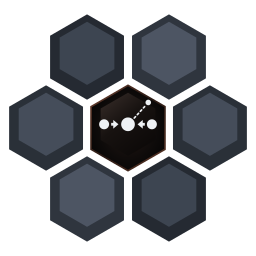
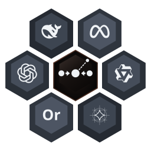

<p align="center"></p>

# basalt — your Mac is the AI lab now.

> Serve, train, compose and dissect open LLMs on Apple Silicon. One Swift binary speaks the **OpenAI API, the Anthropic API and MCP**, and a native Mac app sits on top. No Python at runtime. No cloud unless you ask for it.

[English](README.md) · [Русский](README.ru.md)

[](https://github.com/goodmai/basalt/actions/workflows/release.yml)
[](https://github.com/goodmai/basalt/actions/workflows/security-audit.yml)
[](LICENSE)

[](docs/install.md#requirements)
[](Package.swift)
[](docs/install.md#install-with-homebrew)
[](docs/benchmarks.md#benchmarks)
[](docs/benchmarks.md#benchmarks)

<p align="center"></p>
<p align="center"><sub>Runs open-weight models on Apple Silicon. Verified here today: Gemma, Qwen, Ornith (see <a href="docs/models.md#verified-models">the table</a>); gpt-oss, DeepSeek and Llama are MLX-compatible but not benchmarked here yet. Logos are trademarks of their owners, shown only to indicate compatibility. Anthropic's models are closed-weight, so they are not in the hive; the Anthropic <i>API</i> is supported so that Claude Code can talk to a local model.</sub></p>

**Five things in one repo:** a local inference server your tools already know how to talk to, LoRA training and distillation from a stronger model, a docker-compose for model systems, a microscope for what happens inside the model, and a Mac app that puts it all one keystroke away.

---

## Inference: a 27B model in 7.4 GB, behind the APIs you already use

- **Claude Code on your own GPU in one line.** `ANTHROPIC_BASE_URL=http://localhost:8080 ANTHROPIC_AUTH_TOKEN=local claude` — your real API key is never touched. OpenAI SDKs, OpenCode, Continue, Cline and aider connect over the OpenAI API, Claude Desktop and Cursor over MCP.
- **Fast on a laptop.** On an M4 Pro with 24 GB: Qwen3-4B decodes at 78–89 tok/s; Ternary Bonsai 2 27B fits in 7.4 GB and runs at 20.9–21.5 tok/s, 27.1 with its MTP head and 31–38 with prompt lookup on code.
- **Speculative decoding that stays exact.** Prompt lookup gives 1.84–2.66× on code edits (Bonsai 2 27B) and 3.45–3.62× (Gemma 4 12B), with greedy output unchanged.
- **The next turn costs only its new tokens.** A prefix-tree prompt cache, even for hybrid models: on Ornith-1.5-9B with a 12.6k-token agent prompt, the second turn takes about 1 s instead of about 36 s.
- **Long contexts in less memory.** KV quantization with exact zones: a 16k prompt peaks at 1.03 GB instead of 3.11 GB on Qwen3-4B.
- **A whole local stack.** Tool calls, JSON-schema, regex and grammar output (XGrammar), images, `/v1/embeddings`, `/v1/rerank`, LoRA adapters picked per request, and an optional cloud fallback for what does not fit.

Details: [REST API](docs/rest-api.md) · [integrations](docs/integrations.md) · [commands and flags](docs/commands.md) · [models](docs/models.md) · [benchmarks](docs/benchmarks.md)

## Training: make the local model learn from a better one

- **Distill a frontier model into a LoRA.** `basalt models distill` sends your prompts to a teacher behind an OpenAI- or Anthropic-format API, caps the spend with `--budget-usd`, can keep only verified answers, and checkpoints so an interrupted run resumes (#393). `--on-policy` trains on the student's own samples with per-token reverse KL from a basalt teacher.
- **Train while you serve.** The MCP `distill` tool is time-sliced: the model is held one optimizer step at a time, so `serve` keeps answering.
- **Self-training that learns nothing unverified.** `train_experts` collects answers to checkable tasks, keeps only the verified ones, trains a LoRA and reports held-out accuracy before and after.
- **A quality gate before anything sticks.** A gated adapter stays only if KL and perplexity on held-out prompts stay within limits; a failed gate undoes it bit for bit.
- **JEPA and conversion.** `basalt models train-jepa` trains a JEPA adapter and projector on multi-view data; `basalt models convert` merges a LoRA, requantizes or exports HF safetensors.

Details: [training commands](docs/commands.md) · [self-training, distillation and the quality gate](docs/research-tools.md#self-training-train_experts)

## Compose: one YAML file for a whole model system

- **docker-compose, for models.** Local and cloud models, how each stays in memory (`resident`, `on-demand`, `sequential`), and a perceive → decide → answer pipeline — OCR, speech, a decision cascade and the chat model — in one file.
- **Refuses what will not fit.** `basalt compose plan` adds up the bytes, sizing models you have not downloaded from the Hugging Face API, and refuses a system that does not fit before anything loads. `compose pull` fetches and verifies every model ahead of time.
- **Change it live.** `compose diff` shows what would change; `compose up` on a running system then loads, reloads and unloads only the models that changed and swaps pipelines between requests, streaming progress events as it goes. `compose ps` shows state and spend, `compose down` stops it. Version 2 files pick models per Mac by memory and chip.
- **A mixture of models with a budget.** Answer routes send code to a cloud model while its daily budget lasts and everything else to the local model. On a 55-request mixed workload: every label right, $0.035 per 1000 requests, p95 4.8 s against 10.0 s local only (M4 Pro).
- **Private by default.** Keys come only from environment variables, and text read from your documents or audio never goes to a cloud model.

- **Google's Gemini Decision 1 as a decision stage.** `cloud:gemini/gemini-decision-1` answers yes/no, choice and score questions over text, images, audio, video and PDFs in one pass, in front of a local decider. It is also the ideal calibration teacher for local decision models (#448).

Details: [compose reference and measurements](docs/compose.md) · [pipeline presets and memory modes](docs/pipelines.md) · [cloud decisions with Gemini](docs/cloud-decisions.md)

## Research: open the model up while it runs

- **Model X-ray over MCP.** `model_describe`, `model_tensors`, `model_tensor`, `kv_inspect` and `trace_run` show layer anatomy, tensor statistics (with `--research-tools`, spectra too: Marchenko–Pastur, Gavish–Donoho rank), the prompt-cache tree and a logit lens with per-head attention and MoE router choices.
- **Reversible experiments.** With `serve --research-tools`: steering and head or expert ablation (`intervene`), weight deltas, live re-packing of a layer to 2–8-bit, mxfp4, nf4 or ternary, and `experiment_compare` with KL and perplexity. Every experiment is an undoable overlay with a TTL and a journal; model files on disk are never written.
- **Find the circuit behind a behaviour.** `trace_tokens` and `activation_contrast` rank heads and experts by Cohen's d and AUROC, then a conditional ablation fires only on the tokens that trigger it (#405). `steer_search` and `steer_commit` turn contrastive directions into gated adapters.
- **The model studies itself.** `introspect` hands the X-ray tools to the served model and records its hypotheses, tests and outcomes.
- **Papers in the engine.** CacheBlend (arXiv:2405.16444) with EPIC-style chunk heads (arXiv:2410.15332), L2-norm KV eviction (arXiv:2406.11430), DuoAttention head split, Token Recycling, Walsh–Hadamard value rotation — each opt-in, with its measured trade-offs next to its flag.
- **Benchmarks that run the model's code.** A five-rung ladder ending in an Earth-to-Moon mission executes the model's own code against unseen inputs, and ARC-AGI runs under official pass@2 rules.

Details: [research tools](docs/research-tools.md) · [benchmarks](docs/benchmarks.md) · [serve flags](docs/commands.md)

## Basalt for Mac: the whole thing, one keystroke away

- **A native SwiftUI app on a supervised engine.** The engine runs as a separate process: a crash restarts it with backoff instead of taking the app down, and a relaunch adopts the running engine so the model is not loaded again.
- **Ask from anywhere.** ⌥Space opens a floating panel over any app, even a full-screen one, without an Accessibility permission. Conversations live in SwiftData, with a system prompt per conversation.
- **A model library that knows your Mac.** The Models window lists the Hugging Face cache with a fit verdict for this machine, loads with one click, and resumes interrupted downloads.
- **Drop in a PDF, image or recording.** Attachments go through the perceive → decide → answer pipeline; the inspector shows the text the engine read, tokens, time to first token, speed and each stage.
- **Part of macOS.** Shortcuts and Spotlight (Ask Basalt, Summarize File, Transcribe Audio, Switch Model), Services → Ask Basalt, Dock drop, notifications, and a menu bar item that works with every window closed.
- **Compose systems and cloud spend in view.** Run a model or a compose file from Settings; the Monitor shows each model's state and today's cloud spend, and any answer that used the cloud is marked on its receipt. Cloud keys live in the Keychain.

Details: [Basalt for Mac](docs/mac-app.md)

---

## Quick start

Requirements: macOS 27+, Xcode 27.0+ / Swift 6.4 with the Metal toolchain (`xcodebuild -downloadComponent MetalToolchain`), Apple Silicon M1–M4, 2–30 GB of disk depending on the model. Full steps, building from source and the `./basalt-claude` launcher are in [docs/install.md](docs/install.md).

```bash
brew tap goodmai/basalt https://github.com/goodmai/basalt
brew trust goodmai/basalt
brew install goodmai/basalt/basalt          # builds from source

basalt onboard                              # picks a model that fits your Mac and downloads it
basalt serve --model mlx-community/Qwen3.5-4B-4bit --rest

# in another terminal: Claude Code, backed by your own GPU
ANTHROPIC_BASE_URL=http://localhost:8080 ANTHROPIC_AUTH_TOKEN=local claude
```

A model system instead of one model:

```bash
basalt compose plan -f docs/examples/compose/document-qa-cloud.yaml
basalt compose up voice-agent               # bundled: document-qa, voice-agent
```

The Mac app, from a checkout:

```bash
./scripts/bundle_app.swift                  # release build, Metal kernels, then .build/Basalt.app
open .build/Basalt.app
```

Local 4B–9B models are not a drop-in replacement for a frontier model — they are for private, offline, zero-cost agentic work and for tinkering. `basalt fit` tells you what your machine can actually run. The model table lists what *broke* too.

**Star it** if you want more MLX-native tooling in Swift, and open an issue with your Mac and your tok/s — [PRs adding a row to the benchmark table](docs/benchmarks.md#benchmarks) are welcome.

---

## Documentation

| Topic | Doc |
|---|---|
| Install, requirements, build from source, `./basalt-claude` | [docs/install.md](docs/install.md) |
| CLI commands, `serve` flags, prompt cache, CacheBlend | [docs/commands.md](docs/commands.md) |
| REST API: security, model management, OpenAI, Anthropic, images, SSE, Swagger | [docs/rest-api.md](docs/rest-api.md) |
| Claude Code, OpenCode, OpenAI SDKs, MCP for Claude Desktop and Cursor | [docs/integrations.md](docs/integrations.md) |
| Verified models and downloading | [docs/models.md](docs/models.md) |
| Features at a glance, benchmark ladder, ARC-AGI | [docs/benchmarks.md](docs/benchmarks.md) |
| Pipeline presets and memory modes | [docs/pipelines.md](docs/pipelines.md) |
| Cloud decisions: Gemini Decision 1, multimodal media, the calibration teacher | [docs/cloud-decisions.md](docs/cloud-decisions.md) |
| `basalt compose` reference and measurements | [docs/compose.md](docs/compose.md) |
| Basalt for Mac | [docs/mac-app.md](docs/mac-app.md) |
| Model X-ray, experiments, self-training, distillation | [docs/research-tools.md](docs/research-tools.md) |
| Project structure, architecture notes, scripts, dependencies | [docs/architecture.md](docs/architecture.md) |
| Architecture patterns and modules (Russian) | [docs/ARCHITECTURE_PATTERNS_AND_MODULES.md](docs/ARCHITECTURE_PATTERNS_AND_MODULES.md) |
| Cloud: OpenRouter setup, cost optimization, model comparison | [docs/cloud/OPENROUTER_SETUP.md](docs/cloud/OPENROUTER_SETUP.md) · [docs/cloud/COST_OPTIMIZATION.md](docs/cloud/COST_OPTIMIZATION.md) · [docs/cloud/MODEL_COMPARISON.md](docs/cloud/MODEL_COMPARISON.md) |
| Working on basalt with AI agents | [docs/AI_SETUP.md](docs/AI_SETUP.md) · [docs/AGENT_OPERATIONS.md](docs/AGENT_OPERATIONS.md) |
| Roadmap, privacy policy | [docs/ROADMAP.md](docs/ROADMAP.md) · [docs/PRIVACY_POLICY.md](docs/PRIVACY_POLICY.md) |
| Research notes on agent CLIs, checklists, specs (Russian) | [docs/features.md](docs/features.md) · [docs/specs/FEATURES_CHECKLIST.md](docs/specs/FEATURES_CHECKLIST.md) · [docs/specs/AUDIT_CHECKLIST.md](docs/specs/AUDIT_CHECKLIST.md) · [docs/specs/EMOJI_AS_CODE.md](docs/specs/EMOJI_AS_CODE.md) |
| Contributing, changelog | [CONTRIBUTING.md](CONTRIBUTING.md) · [CHANGELOG.md](CHANGELOG.md) |

## License

[MIT](LICENSE) © 2026 goodmai

Model weights are **not** covered by this license — each model on HuggingFace carries its own terms.
