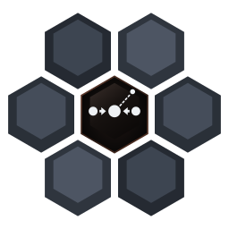
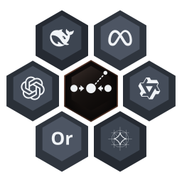

<p align="center"></p>

# basalt — теперь ваш Mac и есть AI-лаборатория.

> Запускайте, обучайте, собирайте в системы и вскрывайте открытые LLM на Apple Silicon. Один Swift-бинарник говорит на **OpenAI API, Anthropic API и MCP**, а сверху — нативное приложение для Mac. Никакого Python в рантайме. Никакого облака, пока вы сами о нём не попросите.

[English](README.md) · [Русский](README.ru.md)

[](https://github.com/goodmai/basalt/actions/workflows/release.yml)
[](https://github.com/goodmai/basalt/actions/workflows/security-audit.yml)
[](LICENSE)

[](docs/install.md#requirements)
[](Package.swift)
[](docs/install.md#install-with-homebrew)
[](docs/benchmarks.md#benchmarks)
[](docs/benchmarks.md#benchmarks)

<p align="center"></p>
<p align="center"><sub>Запускает модели с открытыми весами на Apple Silicon. Проверены здесь сегодня: Gemma, Qwen, Ornith (см. <a href="docs/models.md#verified-models">таблицу</a>); gpt-oss, DeepSeek и Llama совместимы с MLX, но здесь ещё не замерены. Логотипы — товарные знаки их владельцев и показаны только для обозначения совместимости. Модели Anthropic закрыты, поэтому их нет в «улье»; <i>API</i> Anthropic поддержан, чтобы Claude Code мог работать с локальной моделью.</sub></p>

**Пять вещей в одном репозитории:** локальный сервер инференса, с которым ваши инструменты уже умеют говорить; обучение LoRA и дистилляция из более сильной модели; docker-compose для систем из моделей; микроскоп для того, что происходит внутри модели; и приложение для Mac, которое держит всё это на расстоянии одной клавиши.

---

## Инференс: модель на 27B в 7,4 GB — за теми API, которыми вы уже пользуетесь

- **Claude Code на вашем GPU одной строкой.** `ANTHROPIC_BASE_URL=http://localhost:8080 ANTHROPIC_AUTH_TOKEN=local claude` — ваш настоящий API-ключ не используется. OpenAI SDK, OpenCode, Continue, Cline и aider подключаются через OpenAI API, Claude Desktop и Cursor — через MCP.
- **Быстро на ноутбуке.** На M4 Pro с 24 GB: Qwen3-4B декодирует 78–89 tok/s; Ternary Bonsai 2 27B помещается в 7,4 GB и выдаёт 20,9–21,5 tok/s, 27,1 со своей MTP-головой и 31–38 с prompt lookup на коде.
- **Спекулятивное декодирование без потери точности.** Prompt lookup даёт 1,84–2,66× на правках кода (Bonsai 2 27B) и 3,45–3,62× (Gemma 4 12B), а жадный вывод не меняется.
- **Следующий ход стоит только новых токенов.** Префиксное дерево кэша промптов, даже для гибридных моделей: на Ornith-1.5-9B с агентским промптом на 12,6k токенов второй ход занимает около 1 с вместо примерно 36 с.
- **Длинный контекст в меньшей памяти.** Квантование KV с точными зонами: промпт на 16k токенов на пике занимает 1,03 GB вместо 3,11 GB на Qwen3-4B.
- **Целый локальный стек.** Вызовы инструментов, вывод по JSON-схеме, regex и грамматике (XGrammar), изображения, `/v1/embeddings`, `/v1/rerank`, LoRA-адаптеры на каждый запрос и необязательный облачный fallback для того, что не помещается.

Подробнее: [REST API](docs/rest-api.md) · [интеграции](docs/integrations.md) · [команды и флаги](docs/commands.md) · [модели](docs/models.md) · [бенчмарки](docs/benchmarks.md)

## Обучение: локальная модель учится у лучшей

- **Дистиллируйте фронтирную модель в LoRA.** `basalt models distill` отправляет ваши промпты учителю за API в формате OpenAI или Anthropic, ограничивает траты через `--budget-usd`, может оставлять только проверенные ответы и сохраняет чекпойнты, так что прерванный прогон продолжается (#393). `--on-policy` обучает на собственных сэмплах ученика с потокенным обратным KL от учителя на basalt.
- **Обучение прямо во время работы сервера.** MCP-инструмент `distill` работает квантами: модель занята по одному шагу оптимизатора, и `serve` продолжает отвечать.
- **Самообучение, которое не учит непроверенному.** `train_experts` собирает ответы на проверяемые задачи, оставляет только проверенные, обучает LoRA и показывает точность на отложенной выборке до и после.
- **Гейт качества, прежде чем что-то останется.** Адаптер остаётся, только если KL и перплексия на отложенных промптах в пределах лимитов; проваленный гейт откатывает его бит в бит.
- **JEPA и конвертация.** `basalt models train-jepa` обучает JEPA-адаптер и проектор на многоракурсных данных; `basalt models convert` вливает LoRA, переквантовывает или экспортирует HF safetensors.

Подробнее: [команды обучения](docs/commands.md) · [самообучение, дистилляция и гейт качества](docs/research-tools.md#self-training-train_experts)

## Compose: один YAML-файл на целую систему моделей

- **docker-compose, только для моделей.** Локальные и облачные модели, как каждая держится в памяти (`resident`, `on-demand`, `sequential`), и пайплайн «воспринять → решить → ответить» — OCR, речь, каскад решений и чат-модель — в одном файле.
- **Отказывает в том, что не поместится.** `basalt compose plan` складывает байты, берёт размеры ещё не скачанных моделей из Hugging Face API и отказывает системе, которая не помещается, ещё до загрузки. `compose pull` заранее скачивает и проверяет все модели.
- **Меняйте на ходу.** `compose diff` показывает, что изменится; затем `compose up` на работающей системе загружает, перезагружает и выгружает только изменившиеся модели и подменяет пайплайны между запросами, транслируя события прогресса. `compose ps` показывает состояние и расходы, `compose down` останавливает систему. Файлы версии 2 выбирают модели под каждый Mac по памяти и чипу.
- **Смесь моделей с бюджетом.** Маршруты ответов отправляют код в облачную модель, пока не исчерпан её дневной бюджет, а всё остальное — в локальную. На смешанной нагрузке из 55 запросов: все метки верны, $0,035 на 1000 запросов, p95 4,8 с против 10,0 с только локально (M4 Pro).
- **Приватно по умолчанию.** Ключи берутся только из переменных окружения, а текст, прочитанный из ваших документов или аудио, никогда не уходит в облачную модель.
- **Gemini Decision 1 от Google как ступень решений.** `cloud:gemini/gemini-decision-1` отвечает на вопросы «да/нет», выбора и оценки по тексту, изображениям, аудио, видео и PDF за один проход, перед локальным decider. Это ещё и идеальный калибровочный учитель для локальных моделей решений (#448).

Подробнее: [справочник compose и замеры](docs/compose.md) · [пресеты пайплайнов и режимы памяти](docs/pipelines.md) · [облачные решения с Gemini](docs/cloud-decisions.md)

## Исследования: вскройте модель прямо на ходу

- **Model X-ray через MCP.** `model_describe`, `model_tensors`, `model_tensor`, `kv_inspect` и `trace_run` показывают анатомию слоёв, статистику тензоров (с `--research-tools` — ещё и спектры: Марченко — Пастур, ранг Гавиша — Донохо), дерево кэша промптов и logit lens с вниманием по головам и выбором роутера MoE.
- **Обратимые эксперименты.** С `serve --research-tools`: стиринг и абляция голов или экспертов (`intervene`), дельты весов, живая переупаковка слоя в 2–8 бит, mxfp4, nf4 или троичный формат, и `experiment_compare` с KL и перплексией. Каждый эксперимент — отменяемый оверлей с TTL и журналом; файлы модели на диске никогда не перезаписываются.
- **Найдите схему за поведением.** `trace_tokens` и `activation_contrast` ранжируют головы и экспертов по d Коэна и AUROC, после чего условная абляция срабатывает только на тех токенах, что её вызывают (#405). `steer_search` и `steer_commit` превращают контрастные направления в адаптеры с гейтом.
- **Модель изучает саму себя.** `introspect` отдаёт инструменты X-ray обслуживаемой модели и записывает её гипотезы, тесты и результаты.
- **Статьи внутри движка.** CacheBlend (arXiv:2405.16444) с головами чанков в стиле EPIC (arXiv:2410.15332), вытеснение KV по L2-норме (arXiv:2406.11430), разделение голов DuoAttention, Token Recycling, вращение значений Уолша — Адамара — каждое включается отдельно, а замеренные компромиссы описаны рядом с флагом.
- **Бенчмарки, которые запускают код модели.** Пятиступенчатая лестница, заканчивающаяся полётом с Земли на Луну, исполняет собственный код модели на невиданных входах, а ARC-AGI идёт по официальным правилам pass@2.

Подробнее: [исследовательские инструменты](docs/research-tools.md) · [бенчмарки](docs/benchmarks.md) · [флаги serve](docs/commands.md)

## Basalt для Mac: всё сразу, на расстоянии одной клавиши

- **Нативное SwiftUI-приложение поверх движка под присмотром.** Движок работает отдельным процессом: при сбое он перезапускается с паузами, а не роняет приложение, а при повторном запуске приложение подхватывает уже работающий движок, так что модель не загружается заново.
- **Спрашивайте откуда угодно.** ⌥Space открывает плавающую панель поверх любого приложения, даже полноэкранного, без разрешения Accessibility. Разговоры хранятся в SwiftData, с системным промптом на каждый разговор.
- **Библиотека моделей, которая знает ваш Mac.** Окно Models показывает кэш Hugging Face с вердиктом «влезет ли» для этой машины, загружает модель одним кликом и докачивает прерванные загрузки.
- **Бросьте PDF, картинку или запись.** Вложения проходят через пайплайн «воспринять → решить → ответить»; инспектор показывает прочитанный движком текст, токены, время до первого токена, скорость и каждую стадию.
- **Часть macOS.** Shortcuts и Spotlight (Ask Basalt, Summarize File, Transcribe Audio, Switch Model), Службы → Ask Basalt, файлы на иконку в Dock, уведомления и пункт в строке меню, который работает даже при закрытых окнах.
- **Compose-системы и облачные расходы на виду.** Запускайте модель или compose-файл из настроек; Monitor показывает состояние каждой модели и сегодняшние облачные траты, а каждый ответ, использовавший облако, помечен в квитанции. Облачные ключи живут в Связке ключей.

Подробнее: [Basalt для Mac](docs/mac-app.md)

---

## Быстрый старт

Требования: macOS 27+, Xcode 27.0+ / Swift 6.4 с Metal toolchain (`xcodebuild -downloadComponent MetalToolchain`), Apple Silicon M1–M4, 2–30 GB диска в зависимости от модели. Полные шаги, сборка из исходников и лаунчер `./basalt-claude` — в [docs/install.md](docs/install.md).

```bash
brew tap goodmai/basalt https://github.com/goodmai/basalt
brew trust goodmai/basalt
brew install goodmai/basalt/basalt          # собирается из исходников

basalt onboard                              # подбирает модель под ваш Mac и скачивает её
basalt serve --model mlx-community/Qwen3.5-4B-4bit --rest

# в другом терминале: Claude Code на вашем собственном GPU
ANTHROPIC_BASE_URL=http://localhost:8080 ANTHROPIC_AUTH_TOKEN=local claude
```

Система моделей вместо одной модели:

```bash
basalt compose plan -f docs/examples/compose/document-qa-cloud.yaml
basalt compose up voice-agent               # встроенные: document-qa, voice-agent
```

Приложение для Mac из исходников:

```bash
./scripts/bundle_app.swift                  # release-сборка, Metal-ядра, затем .build/Basalt.app
open .build/Basalt.app
```

Локальные модели на 4B–9B не заменяют фронтирную модель один к одному — они для приватной, офлайн и бесплатной агентной работы и для экспериментов. `basalt fit` скажет, что ваша машина реально потянет. В таблице моделей указано и то, что *сломалось*.

**Поставьте звезду**, если хотите больше MLX-нативных инструментов на Swift, и откройте issue со своим Mac и своими tok/s — [PR с новой строкой в таблице бенчмарков](docs/benchmarks.md#benchmarks) приветствуются.

---

## Документация

Подробные документы пока на английском, кроме отмеченных.

| Тема | Документ |
|---|---|
| Установка, требования, сборка из исходников, `./basalt-claude` | [docs/install.md](docs/install.md) |
| Команды CLI, флаги `serve`, кэш промптов, CacheBlend | [docs/commands.md](docs/commands.md) |
| REST API: безопасность, управление моделями, OpenAI, Anthropic, изображения, SSE, Swagger | [docs/rest-api.md](docs/rest-api.md) |
| Claude Code, OpenCode, OpenAI SDK, MCP для Claude Desktop и Cursor | [docs/integrations.md](docs/integrations.md) |
| Проверенные модели и скачивание | [docs/models.md](docs/models.md) |
| Возможности кратко, лестница бенчмарков, ARC-AGI | [docs/benchmarks.md](docs/benchmarks.md) |
| Пресеты пайплайнов и режимы памяти | [docs/pipelines.md](docs/pipelines.md) |
| Облачные решения: Gemini Decision 1, мультимодальные данные, калибровочный учитель | [docs/cloud-decisions.md](docs/cloud-decisions.md) |
| Справочник `basalt compose` и замеры | [docs/compose.md](docs/compose.md) |
| Basalt для Mac | [docs/mac-app.md](docs/mac-app.md) |
| Model X-ray, эксперименты, самообучение, дистилляция | [docs/research-tools.md](docs/research-tools.md) |
| Структура проекта, архитектура, скрипты, зависимости | [docs/architecture.md](docs/architecture.md) |
| Архитектурные паттерны и модули (на русском) | [docs/ARCHITECTURE_PATTERNS_AND_MODULES.md](docs/ARCHITECTURE_PATTERNS_AND_MODULES.md) |
| Облако: настройка OpenRouter, оптимизация расходов, сравнение моделей | [docs/cloud/OPENROUTER_SETUP.md](docs/cloud/OPENROUTER_SETUP.md) · [docs/cloud/COST_OPTIMIZATION.md](docs/cloud/COST_OPTIMIZATION.md) · [docs/cloud/MODEL_COMPARISON.md](docs/cloud/MODEL_COMPARISON.md) |
| Работа над basalt с AI-агентами | [docs/AI_SETUP.md](docs/AI_SETUP.md) · [docs/AGENT_OPERATIONS.md](docs/AGENT_OPERATIONS.md) |
| Дорожная карта, политика конфиденциальности | [docs/ROADMAP.md](docs/ROADMAP.md) · [docs/PRIVACY_POLICY.md](docs/PRIVACY_POLICY.md) |
| Заметки об агентных CLI, чек-листы, спецификации (на русском) | [docs/features.md](docs/features.md) · [docs/specs/FEATURES_CHECKLIST.md](docs/specs/FEATURES_CHECKLIST.md) · [docs/specs/AUDIT_CHECKLIST.md](docs/specs/AUDIT_CHECKLIST.md) · [docs/specs/EMOJI_AS_CODE.md](docs/specs/EMOJI_AS_CODE.md) |
| Участие в разработке, история изменений | [CONTRIBUTING.md](CONTRIBUTING.md) · [CHANGELOG.md](CHANGELOG.md) |

## Лицензия

[MIT](LICENSE) © 2026 goodmai

Веса моделей **не** покрываются этой лицензией — у каждой модели на HuggingFace свои условия.
