# **تطوّر معماريات الشبكات العصبية وآلياتها الرياضية وخوارزميات تدريبها (1958–2027): مونوغراف زمني، ومعايير قياس، وتطبيقات مرجعية، وببليوغرافيا**

**المؤلف:** Aleksei Boklag · **الترخيص:** النص [CC BY 4.0](https://creativecommons.org/licenses/by/4.0/deed.ar)، وقوائم الشيفرة MIT · نُشر في [basalt](https://github.com/goodmai/basalt) بتاريخ 26 نوفمبر 2026 · تُرجم من الأصل الروسي بمساعدة الذكاء الاصطناعي، و[النسخة الروسية](evo.ru.md) هي المرجع المعتمد.

على امتداد سبعة عقود من التطوّر — من المُدرِك الحسّي (Perceptron) العتادي Mark I (1958) إلى النماذج الهجينة المتناثرة ذات التريليونات من المعاملات، والأنظمة الكلامية كاملة الازدواج، ومحوّلات الانتشار ذات العمق التكراري الكامن في مطلع 2026–2027 — تطوّرت نظرية الشبكات العصبية وهندستها على امتداد أربعة محاور رياضية أساسية: **طوبولوجيا توجيه الأوزان** (من المصفوفات الكثيفة إلى خليط الخبراء (Mixture-of-Experts) دقيق التحبّب في الفضاء الجزئي الكامن)، و**ضغط السياق الزمني** (من الشبكات العصبية التكرارية غير الخطية والانتباه التربيعي  إلى نماذج فضاء الحالة الثنائية (dual)، وقاعدة دلتا، والانتباه المتناثر المتوافق مع العتاد)، و**عمق الحساب التكراري** (من الوصلات المتبقية إلى إسقاط الوصلات الفائقة على منطوية بيركهوف وحلقات الاستدلال الكامنة)، و**النقل الاحتمالي المتصل والمتقطع** (من الحدود التغايرية إلى تدفقات Flow Matching المُقوَّمة، والمرمّزات التلقائية السببية ثلاثية الأبعاد، والتكميم الاتجاهي المتبقي للصوت)1. يقدّم هذا المونوغراف إعادة بناء زمنية متصلة لهذا التطوّر بمعدّل فصل واحد لكل سنة بالضبط على امتداد الفترة الممتدة سبعين عامًا من **1958 إلى 2027**، يفتتحها دليل القراءة ومعجم صارم للرموز التنسورية، وتختمها جداول مجمَّعة لمعايير القياس الموثَّقة (الملحق أ)، وتطبيقات مرجعية قابلة للتنفيذ لجميع الآليات الرئيسة على PyTorch (الملحق ب)، وببليوغرافيا منظَّمة تضم **445 ورقة علمية وكتابًا أساسيًا ومستودعًا مفتوحًا**6.  
عند تفسير المقاييس التجريبية ينبغي مراعاة قيدين منهجيين اعتبارًا من **25 نوفمبر 2026**. أولًا، تعتمد مؤشرات المعماريات الرائدة في 2025–2026 (DeepSeek-V3.2 وV4 Pro، وKimi K2.5 وK3، وQwen3.8، وGemma 4، وGLM-5، وNemotron 3 و3.5، وWan 2.2، وLTX-2.5، وPersonaPlex) اعتمادًا جوهريًا على ميزانية الاستدلال المخصَّصة وقت الاستنتاج (reasoning\_effort، وطول مسار CoT)، وعلى صيغة التكميم (BF16 وFP8 وMXFP4 وNVFP4) وبروتوكولات التقييم؛ ولذلك فُصل في النص وفي جداول الملحق أ بين بيانات التقارير التقنية للمطوّرين والقياسات المستقلة (Artificial Analysis وEpoch AI وInferenceX وFull-Duplex-Bench)10. وثانيًا، يستند فصل **2027** حصرًا إلى أعمال موثَّقة حتى نوفمبر 2026 اجتازت الانتقاء إلى وقائع مؤتمرات شتاء–ربيع 2027 (WACV 2027 وAAAI/IAAI 2027 وWSDM 2027 وDATE 2027)، وإلى مقدَّمات مؤتمر ICLR 2027 المفتوحة المحكَّمة على منصة OpenReview، دون أي تنبؤات تخمينية15.

## **مقدمة: بنية التطوّر العصبي ودليل القراءة**

كثيرًا ما يُروى تاريخ التعلم العميق بوصفه سلسلة من «الشتاءات» المتفرقة والقفزات التجريبية المفاجئة، بيد أن تحليل المصادر الأولى يكشف عن استمرارية رياضية متصلة في الأفكار7. فقد شكّلت طريقة المعادلات المرافقة المتصلة لهنري كيلي (1960)، والانحدار التدريجي العشوائي الشامل لسيونيتشي أماري للشبكات خماسية الطبقات (1967)، والشبكات متعددة الحدود ثمانية الطبقات لأليكسي إيفاخنينكو (1965–1971)، والاشتقاق التلقائي بالنمط العكسي لسيبو لينّاينمّا (1970، 1976\) — الجهازَ التحليلي الكامل للتدريب قبل زمن طويل من الانتشار الواسع للانتشار العكسي للخطأ عام 1986 7. وبالصلة الوراثية المباشرة نفسها ترتبط قاعدة تصحيح الخطأ لويدرو—هوف (1960) وشبكات برمجة «الأوزان السريعة» (Fast Weight Programmers، 1991–1992، 2021\) بالمحوّلات الخطية الحديثة القائمة على قاعدة دلتا (DeltaNet وGated DeltaNet وKimi Delta Attention وRWKV-7)، المنقولة إلى عمليات مصفوفية متوازية كتليًّا على نوى التنسور في وحدات GPU9.  
على المستوى الماكروسكوبي يمكن اختزال المسار الممتد سبعين عامًا في اندماج أربعة خطوط معزولة تاريخيًا عبر ثلاثة عصور تقنية في حزمة متعددة الوسائط موحَّدة لعامي 2026–2027 1:

| محور التصميم | الأساس الكلاسيكي (1958–2011) | عصر الشبكات العميقة والانتباه (2012–2023) | النواة المتقاربة (2024–2027) |
| :---- | :---- | :---- | :---- |
| **سعة الأوزان وتوجيهها** | البيرسبترون، MLP، خليط الخبراء المحلي MoE (1991) | Sparsely-Gated MoE، وSwitch Top-1، وMixtral Top-2 | **LatentMoE** دقيق التحبّب بخبراء مشتركين \+ موجَّهين مع موازنة بلا عقوبات في دالة الخسارة27 |
| **ذاكرة السياق الزمني** | شبكات أماري—هوبفيلد، الشبكات التكرارية RNN، LSTM ببوابة النسيان، الأوزان السريعة | الانتباه المُقيَّس ، وRoPE، وGQA، وFlashAttention، وS4، وMamba | هجائن 3:1 (**Gated DeltaNet / KDA / Mamba-3** \+ **MLA / DSA / CSA**) بنافذة 1M+ رمز4 |
| **طوبولوجيا الحساب وعمقه** | Neocognitron، وLeNet، والمرمّزات التلقائية الطبقية، وتطبيع الأوزان | ResNet، وPre-LN، وRMSNorm، وACT، وUniversal Transformer، وDEQ، وViT | الوصلات الفائقة على متعدد وجوه بيركهوف (**mHC**)، و**Attention Residuals**، والشبكات الحلقية (**Huginn, Ouro, PLT**)2 |
| **النقل الاحتمالي والمرمِّزات** | آلات بولتزمان، وRBM (CD\-)، ومطابقة الدرجة Score Matching وDSM (2005–2011) | VAE، وGAN، وVQ-VAE، وDDPM/SDE، وSoundStream/EnCodec (RVQ)، وLDM، وDiT | **Rectified Flow / MMDiT**، ومحاذاة **REPA**، والانتشار المقنَّع للنص (**dLLM**) ومرمِّز Full-Duplex **Mimi** (12.5 هرتز)26 |

للعمل الفعّال مع هذا المرجع يُنصح بترتيب القراءة الآتي:

> 1. **نظام الترميز الموحَّد (القسم التالي):** قبل قراءة الصيغ والشيفرة قارنوا ما فيها بمعجم الأبعاد التنسورية والآليات الأساسية الاثنتين والعشرين — فهذا يزيل الالتباس بين مصطلحات نظرية التحكم (SSM) والفيزياء الإحصائية (الانتشار) ومعالجة الكلام (المحوِّلات transducers والمرمِّزات codecs).  
> 2. **البحث الزمني والمجالي عبر الفصول (1958–2027):** كل فصل من الفصول السبعين معنون بسنة، وفي سطره الأول وسوم تصفية للمجالات (الأساس، التحسين، المرمِّز، الانتباه/LLM، MoE، الحلقات/SSM، الانتشار، الفيديو، STT، TTS، STS). وتُورَد داخل الفصل الاشتقاقات الرياضية للآلية الرئيسة في تلك السنة، ومفاضلاتها الحسابية، وإحالات من الشكل (№ 1)–(№ 445\) إلى الفهرس الببليوغرافي الكامل.  
> 3. **التحقق الكمي (الملحق أ):** للمقارنة السريعة بين النماذج استخدموا الجدول أ.1 (الفهرس السنوي لسبعين عامًا) والجداول المتخصصة أ.2–أ.6 (معماريات LLM ومعايير قياسها، والنماذج الحلقية ونماذج الانتشار، ومولّدات الفيديو، والأنظمة الكلامية، والمكتبات مفتوحة المصدر).  
> 4. **التطبيق الهندسي (الملحق ب):** اثنتا عشرة قائمة شيفرة وحدوية على PyTorch (ب.1–ب.12) تتيح الانتقال من المعادلات التحليلية مباشرة إلى شيفرة تنسورية عاملة لكل آلية.

## **معجم المصطلحات والرموز الرياضية**

ثُبّتت في الجدول أدناه الأبعاد المستعرضة والمؤثِّرات المستخدمة في جميع فصول المونوغراف وقوائمه البرمجية:

| الرمز | الكائن الرياضي وبُعده | المعنى الفيزيائي / الخوارزمي |
| :---- | :---- | :---- |
| **** | الأعداد الطبيعية  | حجم الدفعة الصغيرة (mini-batch) ()، وطول متتالية الرموز أو الإطارات ()، والبعد المخفي للنموذج ( أو ) |
|  | الأعداد الطبيعية  | عدد الطبقات الفيزيائية الفريدة () وعدد التكرارات التكرارية على العمق / الحلقات ()3 |
|  | الأعداد الطبيعية  | عدد رؤوس الاستعلامات ()، وعدد رؤوس المفاتيح—القيم ( في GQA/MQA)، وبُعد الرأس الواحد ()30 |
|  | متجهات  | متجه الدخل في الخطوة  والحالة المخفية في الطبقة  في الخطوة  |
|  | مصفوفة  أو متجه 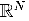 | حالة تكرارية ثابتة الحجم (أوزان سريعة / ذاكرة ترابطية) في SSM والانتباه الخطي25 |
|  | مؤثِّرات تنسورية ثنائية | جداء هادامار عنصريّ () والجداء الخارجي/الكرونكري () |
| 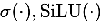 | دوال تنشيط غير خطية | السيغمويد اللوجستي  والدالة  (Swish-1) |
|  | دالّي  | تباعد كولباك—لايبلر  |

فيما يلي التعريفات الصارمة للآليات المعمارية والخوارزمية الأساسية:

* **الاشتقاق التلقائي بالنمط العكسي (Reverse-Mode AD / Backpropagation)** — خوارزمية لحساب تدرّج دالة الخسارة العددية  بدقة بالنسبة إلى جميع عقد الرسم الحسابي اللادوري في زمن يتناسب مع تمريرة أمامية واحدة، وذلك بنشر المشتقات المرافقة  تكراريًا من الخرج إلى الدخل7.  
* **زمن الحساب التكيّفي (Adaptive Computation Time, ACT / Early Exit Gate)** — آلية لتخصيص عدد التكرارات  ديناميكيًا لكل رمز عبر بوابة إيقاف قابلة للتعلّم ، تتيح إنفاق عمليات حسابية أكثر على المواضع المعقدة منطقيًا41.  
* **الأوزان السريعة والتدريب أثناء الاختبار (Fast Weights / Test-Time Training, TTT)** — معاملات شبكة فرعية داخلية أو مصفوفة ذاكرة ترابطية  تُحدَّث ديناميكيًا في مرحلة الاستدلال (عبر قاعدة هيب أو قاعدة دلتا أو خطوة انحدار تدريجي على دالة خسارة ذاتية الإشراف) لضغط السياق الطويل في حجم ذاكرة ثابت44.  
* **التكميم الاتجاهي والمتبقي والسلّمي المنتهي (VQ / RVQ / FSQ)** — تقطيع المتجه الكامن المتصل  بالبحث عن أقرب عنصر في دفتر الشيفرة (VQ)، أو بالتكميم المتتالي للبواقي على  من دفاتر الشيفرة (Residual VQ في SoundStream وEnCodec وMimi)، أو بالتقريب المباشر لكل إحداثي في شبكة صحيحة محدودة دون دفتر شيفرة قابل للتعلّم (Finite Scalar Quantization في CosyVoice 3\)46.  
* **الانتباه ذو الاستعلامات المجمَّعة (Grouped-Query Attention, GQA) والانتباه متعدد الاستعلام (MQA)** — مشاركة مجموعة واحدة من إسقاطات المفاتيح والقيم  بين جميع رؤوس الاستعلام  (، MQA) أو داخل  من المجموعات (، GQA) لتقليص حجم ذاكرة KV-cache وحركة البيانات من ذاكرة الفيديو HBM عند فك الترميز بعدة أضعاف39.  
* **الانتباه الكامن متعدد الرؤوس بذاكرة مخبّأة مضغوطة (Multi-Head Latent Attention, MLA)** — آلية تُسقِط الحالة المخفية في متجه واحد منخفض الرتبة  (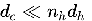) مع فرع منفصل صغير الأبعاد للترميز الموضعي Decoupled RoPE؛ وفي الاستدلال يُخزَّن مؤقتًا الكامن المضغوط وحده، فتنخفض ذاكرة KV-cache بنسبة 93.3% على مستوى النموذج (حتى 98.24% لكل طبقة قياسًا إلى MHA ذي 128 رأسًا)50.  
* **التحسين النسبي الجماعي للسياسة (Group Relative Policy Optimization, GRPO)** — خوارزمية تعلّم معزَّز دون شبكة ناقد منفصلة (value model)، تقدّر الأفضلية 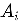 بتوحيد معياري للمكافآت داخل مجموعة من  مسارًا مولَّدًا لموجِّه (prompt) واحد53.  
* **قاعدة دلتا في الانتباه الخطي (DeltaNet / Gated DeltaNet / KDA)** — استبدال الكتابة التراكمية  بانعكاس هاوسهولدر معمَّم مع اضمحلال ، يمحو القيمة القديمة عند المفتاح 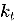 قبل كتابة القيمة الجديدة  (حيث  — عددي  في GDN أو مصفوفة قطرية 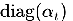 في KDA)24.  
* **انتشار النص المتقطع (Masked / Uniform Diffusion Language Models, dLLM / MDM / UDLM)** — نماذج لغوية غير انحدارية ذاتيًا قائمة على محوّل ثنائي الاتجاه، تستعيد الرموز على التوازي من الأقنعة \[MASK\] (MDM: وهي MDLM وLLaDA وDream وMercury) أو من الاستبدالات العشوائية في المعجم (UDLM) بتصغير حدٍّ تغايري موزون للأرجحية35.  
* **المحاذاة الكامنة للتمثيلات (Representation Alignment, REPA / JEPA)** — عائلة من مبادئ التدريب: ففي فهم العالم البصري (I-JEPA وV-JEPA) تتنبأ الشبكة بالتمثيلات المخفية للكتل المقنَّعة في فضاء مرمِّز EMA دون توليد البكسلات؛ وفي التوليد بالانتشار (REPA) تُحاذى الطبقات الوسيطة في DiT بتشابه جيب التمام مع سمات معلّم بصري مدرَّب مسبقًا (مثل DINOv2)36.  
* **الوصلات الفائقة المقيَّدة بالمنطوية (Manifold-Constrained Hyper-Connections, mHC)** — توسيع للتيار المتبقي في المحوّل من متجه واحد  إلى  من المسارات المتوازية 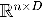، حيث تُسقَط مصفوفة خلط المسارات بخوارزمية سينكهورن—كنوب على متعدد وجوه بيركهوف للمصفوفات ثنائية العشوائية، لنشر الإشارة بلا تمدّد () على أي عمق2.  
* **نماذج فضاء الحالة (Structured State Space Models, SSM / S4 / Mamba)** — نظم ديناميكية خطية  تُقطَّع بخطوة ؛ وفي SSM الانتقائية (Mamba-1/2/3) تعتمد المعاملات  على الدخل، فتتيح تدريبًا متوازيًا خطيًا بالنسبة إلى  وذاكرة ثابتة  لكل خطوة في الاستدلال32.  
* **التنبؤ متعدد الرموز (Multi-Token Prediction, MTP)** — معمارية تدريب وفك ترميز تأملي ذاتي، تتنبأ فيها رؤوس متتالية فوق الجذع المشترك للنموذج بعدة رموز نصية مستقبلية أو بمستويات البواقي في دفاتر شيفرة الصوت RVQ29.  
* **الزخم المصفوفي المتعامد (Muon / MuonClip)** — مُحسِّن للطبقات المصفوفية ثنائية الأبعاد، يستعيض عن تدريج التدرّج لكل إحداثي بتعامد تقريبي لمصفوفة الزخم  بتكرارات نيوتن—شولتز كثيرة الحدود ()، مما يسوّي طيف القيم المفردة لخطوة التحديث65.  
* **الوصلات المتبقية بالانتباه على العمق (Attention Residuals, AttnRes)** — استبدال الجمع الثابت لمخرجات جميع الطبقات السابقة بانتباه softmax قابل للتعلّم على امتداد محور العمق (عبر الكتل السابقة)، يزيل تلاشي معيار السمات في محوّلات Pre-LN العميقة34.  
* **النماذج الكلامية كاملة الازدواج (Full-Duplex Speech-to-Speech, STS)** — معماريات (Moshi وPersonaPlex وNemotronLabs VoiceChat) تعالج بتزامن تيار رموز الصوت الوارد من المستخدم وتولّد تيارات متوازية لـ«المونولوج الداخلي» (النص) ولرموز صوت الإجابة دون تقطيع إلى ردود متناوبة، مما يدعم المقاطعات وأصوات التعجّب بزمن تأخير 160–205 مللي ثانية68.  
* **التضمينات الموضعية الدوّارة (Rotary Position Embedding, RoPE / p-RoPE / 3D-RoPE / TMRoPE)** — ترميز الموضع النسبي بتدوير أزواج إحداثيات الاستعلامات 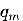 والمفاتيح  بزوايا 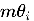، بحيث يعتمد الجداء السلّمي  على الإزاحة  وحدها؛ ويُعمَّم على تدوير جزء من الفضاء الجزئي (\-RoPE) وعلى المحاور المكانية–الزمنية للفيديو والصوت (3D-RoPE وTMRoPE)71.  
* **خليط الخبراء المتناثر (Sparse Mixture-of-Experts, MoE / LatentMoE)** — استبدال طبقة FFN الكثيفة بمجموعة من  من الشبكات الفرعية الخبيرة مع تنشيط  من الخبراء لكل رمز؛ وفي **LatentMoE** يُضغَط متجه الدخل مسبقًا إلى كامن منخفض الأبعاد لتقليل حركة قراءة الأوزان والإرسال بين الخوادم All-to-All27.  
* **الانتباه المتناثر المتوافق مع العتاد (NSA / DSA / CSA)** — آليات انتباه متناثر قابلة للتعلّم (Native Sparse Attention وDeepSeek Sparse Attention وCompressed Sparse Attention) تستخدم ضغطًا كتليًا هرميًا أو مفهرسًا خفيفًا (lightning indexer) لانتقاء أفضل top\- من المفاتيح لكل استعلام، فتخفض تعقيد الانتباه من  إلى 31.  
* **المحوّل التكراري العمق (الحلقي) (Looped / Recurrent-Depth Transformer, PLT)** — معمارية بأوزان مشتركة على العمق، تمرّر الحالة المخفية عبر كتلة طبقات مشتركة  مرة (Huginn وOuro)؛ وفي **Parallel Loop Transformer (PLT)** تُنفَّذ التكرارات المتتابعة للرموز المتجاورة على نحو أنبوبي في تمريرة متوازية واحدة (Cross-Loop Parallelism)3.  
* **التدفقات المُقوَّمة ومطابقة التدفقات (Flow Matching / Rectified Flow)** — تدريب المعادلة التفاضلية العادية التوليدية  بانحدار مباشر لحقل السرعات على امتداد الاستيفاء الخطي  بين البيانات والضجيج الغاوسي، مما يتيح توليدًا حتميًا سريعًا بعدد صغير من خطوات أويلر5.  
* **محوِّل الرموز والمدد (Token-and-Duration Transducer, TDT)** — توسيع لفاكّ ترميز ASR التدفقي RNN-T، يتنبأ بالتزامن بالرمز دون الكلمي وبعدد الإطارات الصوتية  التي يغطيها، لتخطي المقاطع الساكنة والوقفات في الاستدلال79.

## **1958**

**المجالات:** الأساس  
كانت نقطة انطلاق التعلّم المعلمي للشبكات العصبية الاصطناعية نشرَ فرانك روزنبلات لـ *«The Perceptron: A Probabilistic Model for Information Storage and Organization in the Brain»* في مجلة *Psychological Review* (№ 1\)، والتنفيذ العتادي لآلة Mark I Perceptron في مختبر كورنيل للطيران (بعد محاكاة أولية على الحاسوب المركزي IBM 704\)82. وخلافًا للعناصر المنطقية الثابتة لدى ماكولوك وبيتس (1943)، فصل بيرسبترون روزنبلات بين الشبكية الحسية (الكتلة \-)، وطبقة من الإسقاطات الترابطية اللاخطية العشوائية (الكتلة \-، السمات )، ومجمِّع عتبي قابل للتعلّم (الكتلة \-) يحدّد المستوى الفائق الفاصل:  
  
حدّثت قاعدة التصحيح بالخطأ الأوزان  على الكائنات المصنَّفة خطأً فقط ، حيث ، وفق الصيغة 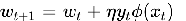83. وفي السنة نفسها 1958 صدر بعد الوفاة مونوغراف جون فون نيومان *«The Computer and the Brain»* (№ 2)، الذي قارن للمرة الأولى بين البنية المتوازية على نطاق واسع ومنخفضة التردد للذاكرة المشبكية في الدماغ وعنق الزجاجة التسلسلي للحواسيب الرقمية. ومع أن روزنبلات نظر منذ 1958 في مخططات متعددة الطبقات، فقد افتقر إلى خوارزمية قابلة للاشتقاق لإسناد الفضل (credit assignment) للطبقات المخفية7.

## **1959**

**المجالات:** المرمِّز الأساس  
في عام 1959 ظهرت ثلاث ركائز مفاهيمية للشبكات العميقة المستقبلية: التسلسل الهرمي العصبي-الفيزيولوجي للمرشِّحات البصرية، والتعرّف المتتالي المتوازي، والاستنهاض الذاتي (bootstrapping) لدالة التقييم عبر الزمن. فقد اكتشف ديفيد هيوبل وتورستن فيزل في مقالة بمجلة *The Journal of Physiology* (№ 3\) في القشرة المخططة للقطة حقولًا مستقبِلة محلية انتقائية الاتجاه، صارت النموذج البيولوجي الأولي للنوى الالتفافية85. وفي الوقت نفسه قدّم أوليفر سيلفريدج في ندوة تيدينغتون معمارية **Pandemonium** (№ 4\) — تسلسلًا هرميًا متوازيًا من «شياطين السمات» و«الشياطين المعرفية» التي تزنها و«شيطان القرار» الأعلى الذي ينتقي أقصى استجابة 87. وفي العام نفسه نشر آرثر صامويل في *IBM Journal of Research and Development* عمله الشهير عن لعبة الداما ذاتية التعلّم (№ 5)، فثبّت مصطلح *machine learning* (تعلّم الآلة) وأدخل تحديث أوزان كثير حدود التقييم بحسب الفرق بين تقييمي الوضع الحالي والتالي — وهو النموذج الأولي المباشر لطريقة الفروق الزمنية (TD learning) والناقد في التعلّم المعزَّز.

## **1960**

**المجالات:** الأساس التحسين  
أنجز الانتقال من قاعدة العتبة المنقطعة للبيرسبترون إلى التحسين التدرّجي الأملس برنارد ويدرو ومارسيان هوف، اللذان قدّما العقدة الخطية التكيفية **ADALINE** وخوارزمية المربعات الصغرى **LMS** (Widrow–Hoff / Delta Rule، № 6\)88. وتمثّل الجديد المبدئي في ADALINE في حساب الخطأ من الخرج الخطي المتصل  *قبل* المُكمِّم العتبي الثنائي. وقد أعطى الانحدار التدريجي العشوائي على الخطأ التربيعي اللحظي  قاعدة دلتا الكلاسيكية:  
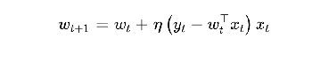  
وهذه المعادلة بالذات — معادةً كتابتها للذاكرة الترابطية المصفوفية على الصورة  — هي أساس المحوّلات الخطية الحديثة **DeltaNet** و**Gated DeltaNet** (2024–2026)25. وفي العام نفسه 1960 نشر هنري كيلي في *ARS Journal* مقالة *«Gradient Theory of Optimal Flight Paths»* (№ 7)، مشتقًّا طريقة المعادلات المرافقة المتصلة للنشر العكسي لمشتقات دالي الكلفة على امتداد مسار نظام ديناميكي — السلف التحليلي لكل من الانتشار العكسي للخطأ وNeural ODE7.

## **1961**

**المجالات:** الحلقات الذاكرة الأساس  
في عام 1961 نشر السيبرنطيقي الألماني كارل شتاينبوخ في المجلد الأول من مجلة *Kybernetik* عمله *«Die Lernmatrix»* («المصفوفة المتعلِّمة»، № 8\) — أولى المعماريات المصفوفية للذاكرة الترابطية غير المتجانسة على شبكة متقاطعة من الموصِّلات91. وفي مصفوفة شتاينبوخ كان متجه السمات الداخل  ورمز الصنف  يرتبطان بقاعدة محلية من نمط هيب ، ويجري الاستخراج بضرب مصفوفة في متجه على التوازي  مع انتقاء تنافسي للأقصى. وجبريًّا وضعت «المصفوفة المتعلِّمة» النموذج الأولي للذاكرات الترابطية الخطية الحديثة من نوع مفتاح–قيمة . وفي العام نفسه قسّم إدواردو كاياييلو في *Journal of Theoretical Biology* (№ 9\) الديناميكا العصبية إلى مقياسَي زمن مترابطين: «معادلات عصبية» سريعة لاسترخاء التنشيطات، و«معادلات ذاكرية» أديباتية بطيئة لليونة الأوزان المشبكية.

## **1962**

**المجالات:** الأساس المرمِّز  
في أبريل 1962 قدّم عالم الرياضيات ألبرت نوفيكوف برهانًا صارمًا وموجزًا على **مبرهنة تقارب البيرسبترون** (№ 10؛ ونشر هـ. د. بلوك في السنة نفسها تقديرات مماثلة، № 13\)92. وبيّن نوفيكوف أنه إذا كانت العيّنة 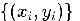 ذات معيار مدخلات محدود 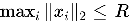 قابلة للفصل خطيًا بمتجه وحدة  () بهامش موجب 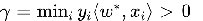، فإن خوارزمية البيرسبترون المنطلقة من المتجه الصفري  تنتهي بما لا يزيد على  من التحديثات. ففي كل مثال خاطئ يزداد الجداء السلّمي مع الأوراكل بمقدار 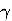 على الأقل ()، في حين أن شرط الخطأ  يحدّ الزيادة في مربع المعيار من الأعلى بالمقدار  ()، ومن ذلك ينتج تقدير لا يعتمد إطلاقًا على بُعد الفضاء 83:  
  
وفي العام نفسه صدر المونوغراف الختامي لفرانك روزنبلات *«Principles of Neurodynamics»* (№ 11)، والمعمارية المتعددة الأجزاء الخطية **MADALINE** لبرنارد ويدرو (№ 12\)، ومقالة هيوبل وفيزل الكلاسيكية (№ 14) التي وصفت تناوب *الخلايا البسيطة* (كاشفات حواف خطية محلية) و*الخلايا المعقدة* (تجميع pooling ثابت مكانيًا) في القشرة البصرية87.

## **1963**

**المجالات:** الأساس التحسين  
تطويرًا لهندسة هامش الفصل  نشر فلاديمير فابنيك وألكسندر ليرنر في مجلة *«Автоматика и телемеханика»* مقالة *«التعرّف على الأنماط بواسطة الصور المعمَّمة»* (№ 15\)97. وبدلًا من البحث عن مستوى فائق فاصل اعتباطي، صاغ المؤلفان مسألة تحسين تربيعي لإيجاد **المستوى الفائق ذي الهامش الأقصى** الوحيد (النموذج الخطي الأولي لآلة المتجهات الداعمة SVM)، يتحلّل متجه ناظمه على المتجهات الداعمة الطرفية وحدها من العيّنة . وبذلك دخل في نظرية التعلّم مبدأ التحكم في معيار الأوزان  بوصفه مقياسًا لسعة المصنِّف. وفي العام نفسه نشر شتاينبوخ وبيسكه في *IEEE Transactions on Electronic Computers* تحليلًا لمصفوفات الذاكرة المتصلة عند الإشارات المضجَّجة (№ 16)، وبسّط ستيوارت دريفوس اشتقاق قاعدة السلسلة للمضاعِفات المرافقة عبر البرمجة الديناميكية (№ 17\)7.

## **1964**

**المجالات:** التحسين الأساس  
في عام 1964 أُنشئت ثلاث أدوات رياضية تعمل مباشرة في أطر التعلم العميق الحديثة. فقد نشر بوريس تيودوروفيتش بولياك في *«Журнал вычислительной математики и математической физики»* طريقة **«الكرة الثقيلة» (Heavy-Ball Momentum)** القصورية (№ 18\) لتسريع الانحدار التدريجي في المسائل الوديانية سيئة التهيئة100:  
  
يكبح الحدّ القصوري  التذبذبات العرضية للتدرّج، ويقلّص العدد الفعلي لشرطية المسألة التربيعية من  إلى 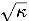. وفي الوقت نفسه أدخل مارك أيزرمان وإمانويل برافرمان ولِف روزونوير في *«Автоматика и телемеханика»* **طريقة الدوال الكامنة** (№ 19\) — تأسيسًا صارمًا لـ*خدعة النواة*  المرتبطة مباشرة بتحليل النواة المستقبلي للانتباه الخطي20. وفي العام نفسه قدّم روبرت فنغرت في *Communications of the ACM* (№ 20\) الخوارزمية البرمجية لـ**النمط الأمامي للاشتقاق التلقائي (Forward-Mode AD)** على قائمة العمليات الأولية.

## **1965**

**المجالات:** الأساس التحسين  
في عام 1965 نشر أليكسي غريغوريفيتش إيفاخنينكو وفالنتين غريغوريفيتش لابا مونوغراف *«Кибернетические предсказывающие устройства»* (№ 21)، واصفين أولى الخوارزميات العاملة للتدريب الطبقي لـ**البيرسبترونات العميقة متعددة الطبقات** بعدد اعتباطي من الطبقات المخفية7. وكانت كل عقدة في الشبكة تحسب كثير حدود تربيعيًا من نمط كولموغوروف—غابور بجداءات ضربية للمدخلات ( — سلف جبري لكتل البوابات GLU وSwiGLU)، وتُوجَد المعاملات بطريقة المربعات الصغرى، وكانت عيّنة التحقق تُقصي العصبونات مفرطة التكيّف قبل بناء الطبقة التالية7.  
وبالتوازي برهن توماس كوفر في *IEEE Transactions on Electronic Computers* **مبرهنة كوفر الأساسية حول سعة الفصل الخطي** (№ 22): فعدد التقسيمات الثنائية القابلة للتحقيق خطيًا لـ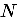 من النقاط في الوضع العام في  يساوي ، أي نصف جميع الانقسامات الثنائية  بالضبط عند ، ويؤول أسّيًا إلى الصفر عند . وتفسّر هذه الحقيقة الهندسية ضرورة الإسقاطات الواسعة للسمات في الطبقات المخفية لـMLP وMoE. وأتمّ العامَ كتابُ نيلس نيلسون الكلاسيكي *«Learning Machines»* (№ 23\)88 وطريقة هو—كاشياب التدرّجية لأنظمة المتباينات الخطية (№ 24).

## **1966**

**المجالات:** التحسين الأساس  
في عام 1966 اختزل ياكوف زالمانوفيتش تسيبكين في عمله *«Адаптация, обучение и самообучение в автоматических системах»* (*Автоматика и телемеханика*، № 25\) قواعد البيرسبترونات وADALINE والترشيح المتفرقة إلى مسألة تغايرية واحدة هي **تصغير التوقع الرياضي لدالة الخسارة (المخاطرة المتوسطة)**  بالتقريب العشوائي التكراري لروبنز—مونرو 105. وصارت هذه الصياغة اللغة المعيارية لنظرية تحسين الشبكات العصبية الحديثة. وفي العام نفسه عمّم إمانويل برافرمان طريقة الدوال الكامنة على مسألة التعلّم الذاتي والتجميع دون معلّم (№ 26\)20، وأصدر لورانس فوغل وألفين أوينز ومايكل والش مونوغراف *«Artificial Intelligence through Simulated Evolution»* (№ 27)، الذي افتتح اتجاه البحث التطوّري بلا تدرّجات.

## **1967**

**المجالات:** الأساس التحسين  
في يونيو 1967 نشر سيونيتشي أماري في *IEEE Transactions on Electronic Computers* مقالة *«A Theory of Adaptive Pattern Classifiers»* (№ 28\) — أول عمل في التاريخ طُبِّق فيه **الانحدار التدريجي العشوائي الشامل (end-to-end SGD)** لتدريب شبكة عصبية متعددة الطبقات ذات طبقات مخفية لاخطية على توزيعات غير قابلة للفصل خطيًا7. وباستبدال درجة العتبة بدوال تنشيط ملساء قابلة للاشتقاق، استنتج أماري قاعدة السلسلة لتصحيح الأوزان المخفية 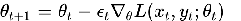 ودرّب تجريبيًا مصنِّفًا ذا 5 طبقات قبل تسع عشرة سنة من منشور 1986 في *Nature*7.  
وفي العام نفسه ظهر عملان ذوا أهمية مستقبلية كبرى: فقد برهن توماس كوفر وبيتر هارت تقديرًا مقاربيًا لخطأ قاعدة الجار الأقرب (، № 29)، واضعين الأساس النظري للبحث المتجهي وأنظمة RAG، ونشر ريتشارد سينكهورن وبول كنوب في *Pacific Journal of Mathematics* مبرهنة وخوارزمية تكرارية للتطبيع المتناوب لصفوف مصفوفة موجبة وأعمدتها إلى الشكل ثنائي العشوائية (№ 30\) — وهو مؤثِّر **Sinkhorn–Knopp** نفسه الذي ضمن في مطلع 2025–2026 استقرار الوصلات الفائقة متعددة المسارات **mHC** في معماريات DeepSeek2.

## **1968**

**المجالات:** الأساس الحلقات  
في عام 1968 صاغ أليكسي إيفاخنينكو **طريقة المعالجة الجماعية للحجج (GMDH / Group Method of Data Handling)** في مجلة *«Автоматика»* (№ 31\)104، منظِّمًا التنمية التلقائية للشبكات متعددة الحدود العميقة مع انتقاء منتظم لأفضل العصبونات وإيقاف مبكر للعمق على مجموعة تحقق مستقلة. وبالتوازي نشر ستيفن غروسبرغ في *PNAS* نموذجًا لاخطيًا للتعلّم الترابطي **Outstar** ومنظومة معادلات تفاضلية للذاكرة قصيرة المدى (STM) وطويلة المدى (LTM) (№ 32\)109:  
  
مبرهنًا على التقارب غير المشروط للأوزان المشبكية إلى النسب المكانية لنمط الدخل. وفي العام نفسه نشر فلاديمير فابنيك وأليكسي تشيرفونينكيس في *«Доклады АН СССР»* مبرهنة التقارب المنتظم للتواترات التجريبية إلى الاحتمالات على صنف من الأحداث، مُدخِلَين مقياسًا تركيبيًا لسعة الأسر الدالية — **بُعد فابنيك—تشيرفونينكيس (VC-dimension)** (№ 33).

## **1969**

**المجالات:** الأساس المرمِّز التحسين  
في عام 1969 أصدر مارفن مينسكي وسيمور بيبرت المونوغراف التحليلي *«Perceptrons: An Introduction to Computational Geometry»* (№ 34\)7. وبمساعدة نظرية لامتغيرات الزمر برهن المؤلفان بصرامة استحالة تحقيق محمول الزوجية (بما فيه **XOR** ثنائي البتّ) ومحمول الترابط الطوبولوجي بواسطة بيرسبترون وحيد الطبقة بسمات محلية محدودة الرتبة. ومع أن المؤلفين نبّها إلى أن الشبكات متعددة الطبقات خالية من هذا القيد، فإن غياب خوارزمية فعّالة معروفة على نطاق واسع في الغرب لتدريب الطبقات المخفية أدّى إلى فتور الاهتمام بالاتصالية (connectionism) في الوسط الأكاديمي الناطق بالإنجليزية7.  
بيد أنه نُشر في عام 1969 نفسه عنصران محوريان من التعلم العميق الحديث. فقد دوّن آرثر برايسون ويو-تشي هو في كتاب *«Applied Optimal Control»* (№ 35\) صيغًا متقطعة صريحة للنشر العكسي لمضاعِفات لاغرانج عبر سلاسل متعددة الخطوات 7. وفي الوقت نفسه أدخل كونيهيكو فوكوشيما في مقالة *«Visual Feature Extraction by a Multilayered Network of Analog Threshold Elements»* (*IEEE Transactions on Systems Science and Cybernetics*، № 36\)85 شبكة بصرية متعددة الطبقات بـ**مقوِّمات نصف موجية تماثلية**  — وهو أول تطبيق تاريخيًا لدالة التنشيط **ReLU** في الشبكات العصبية متعددة الطبقات7.

## **1970**

**المجالات:** الأساس التحسين  
في عام 1970 دافع عالم الرياضيات الفنلندي سيبو لينّاينمّا في جامعة هلسنكي عن رسالة الماجستير (№ 37\)7 التي صاغ فيها لأول مرة ونفّذ بالشيفرة الآلية خوارزمية عامة **للنمط العكسي للاشتقاق التلقائي (Reverse-Mode Automatic Differentiation)** لرسوم حسابية اعتباطية. فإذا فُكّك حساب دالة الخسارة العددية  إلى عقد أولية  ()، فإن المرور العكسي من  إلى  يراكم المشتقات الجزئية تكراريًا:  
  
ويتطلب حساب متجه التدرّج الكامل  بالنسبة إلى عدد اعتباطي من المعاملات  مضاعفًا ثابتًا من عمليات تمريرة أمامية واحدة114. وفي العام نفسه 1970 اشتق برويدن وفليتشر وغولدفارب وشانّو بصورة مستقلة طريقة الرتبة الثانية شبه النيوتنية **BFGS** (№ 38)، ونشر إيفاخنينكو في المجلة الدولية *Automatica* استعراضًا للتنظيم الذاتي الإرشادي للشبكات العميقة (№ 39\)115.

## **1971**

**المجالات:** الأساس الذاكرة  
في أكتوبر 1971 نشر أليكسي إيفاخنينكو في *IEEE Transactions on Systems, Man, and Cybernetics* مقالة *«Polynomial Theory of Complex Systems»* (№ 40\)115، واصفًا بالتفصيل بناء **شبكة عميقة ذات 8 طبقات** ذات انتشار أمامي وتدريبها بطريقة GMDH مع انتقاء تنظيمي للسمات على عيّنة التحقق7. وصارت هذه المنشورة من أوائل الأمثلة المستشهَد بها على نطاق واسع في الأدبيات الدولية على التدريب العملي لمعمارية عميقة ثُمانية الطبقات7.  
وفي العام نفسه نشر ديفيد مار في *Philosophical Transactions of the Royal Society B* النموذج الرياضي لقرن آمون (الحُصين) *«Simple Memory: A Theory for Archicortex»* (№ 41\)7. وبيّن مار أن الترميز المتناثر لمتجهات الدخل في فضاء عالي الأبعاد، مقترنًا بيونة هيب المحلية وعتبة كبح تكيفية، يتيح تسجيل حجم كبير من الارتباطات العَرَضية في تمريرة واحدة واستعادتها دون خطأ من تلميحات جزئية — وهو المبدأ الذي تقوم عليه وحدات الذاكرة الخارجية والوسيطية المتناثرة الحديثة.

## **1972**

**المجالات:** الحلقات الذاكرة  
في نوفمبر 1972 نشر سيونيتشي أماري في *IEEE Transactions on Computers* مقالة *«Learning Patterns and Pattern Sequences by Self-Organizing Nets of Threshold Elements»* (№ 42)، مشتقًّا قبل منشور هوبفيلد بعشر سنوات معادلات استقرار الشبكات الترابطية التكرارية المتقطعة (**شبكة أماري—هوبفيلد**) سواء للجواذب الساكنة بمصفوفة أوزان متناظرة، أو لسلاسل المتتاليات الديناميكية بمصفوفة غير متناظرة7:  
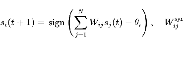  
وفي العام نفسه 1972 أدخل تيوفو كوهونن في *IEEE Transactions on Computers* بصورة مستقلة ذاكرات المصفوفات الارتباطية (№ 43\)118، ووصف جيمس أندرسون الذاكرة التفاعلية الخطية-العتبية في *Mathematical Biosciences* (№ 44)، وبنى كاورو ناكانو المنظومة الترابطية **Associatron** (№ 45\)7، واشتق هيو ويلسون وجاك كوان في *Biophysical Journal* منظومة ODE لاخطية لمجموعات عصبية مثيرة وكابحة متقارنة (، № 46)، مبرهنين تحليليًا على الصلة بين دورات الحدّ للتذبذبات والتخلّف المغنطيسي متعدد الاستقرار للذاكرة119.

## **1973**

**المجالات:** المرمِّز الحلقات  
في عام 1973 نشر كريستوف فون دير مالسبورغ في *Kybernetik* مقالة *«Self-Organization of Orientation Sensitive Cells in the Striate Cortex»* (№ 47\)115 — أول عرض حاسوبي لـ**التعلّم الذاتي التنافسي (competitive learning)** لكاشفات السمات المحلية. وإذ جمع فون دير مالسبورغ بين الإثارة القشرية الداخلية القريبة والكبح الجانبي وقاعدة هيب مع **حفظ \-معيار المشابك الداخلة لكل عصبون** (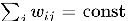)، فقد بيّن التشكّل التلقائي لخرائط مرتَّبة من أعمدة الاتجاه دون معلّم.  
وفي الوقت نفسه نشر ستيفن غروسبرغ في *Studies in Applied Mathematics* تحليلًا صارمًا **للشبكات التكرارية المُحوِّلة (shunting)** ذات التشبّع الضربي والكبح الجانبي القسمي (divisive) (№ 48\)109: وبرهن أن الخاصية الانتقالية السيغمويدية بالذات تكبح الضجيج الخلفي صغير السعة وتحفظ التباين النسبي للنمط دون تشبّع مهما ازدادت السطوع الكلي للدخل — وهو الأساس النظري لطبقات تطبيع التنشيطات. وعمّم هيو ويلسون وجاك كوان ديناميكا مجموعاتهما إلى حقول عصبية متصلة مكانيًا للقشرة والمهاد (№ 49\)124.

## **1974**

**المجالات:** الأساس التحسين الحلقات  
في عام 1974 دافع بول ويربوس في جامعة هارفارد عن أطروحة الدكتوراه *«Beyond Regression: New Tools for Prediction and Analysis in the Behavioral Sciences»* (№ 50\)7. وصاغ ويربوس طريقة «التغذية الراجعة الديناميكية» — صيغًا صريحة للنشر العكسي التسلسلي لمشتقات دالة الهدف عبر شبكات متعددة الطبقات اعتباطية ذات عقد لاخطية، مهيِّئًا التطبيق المباشر للطريقة على الشبكات العصبية في مطلع الثمانينيات115.  
وفي العام نفسه نشر الفيزيائي ويليام ليتل في *Mathematical Biosciences* مقالة *«The Existence of Persistent States in the Brain»* (№ 51\)126، أرست تطابقًا مباشرًا بين الفيزياء الإحصائية لـ**منظومات سبين إيزينغ** والشبكات العصبية التكرارية العشوائية. وبإدخال درجة حرارة فعّالة لضجيج المشبك  واحتمال لوجستي لانطلاق العصبون ، وصف ليتل الذاكرة طويلة المدى بأنها حالات ذاتية عليا منحلّة لمصفوفة الانتقال المركوفية — وهو أساس آلات بولتزمان والنماذج التوليدية الديناميكية الحرارية.

## **1975**

**المجالات:** المرمِّز الذاكرة الأساس  
في عام 1975 قدّم كونيهيكو فوكوشيما في *Biological Cybernetics* الشبكة الذاتية التنظيم متعددة الطبقات **Cognitron** (№ 52\)86. ففي Cognitron جُمعت الحقول المستقبِلة المحلية المثيرة والكابحة مع نسبة قسمية مُحوِّلة  وتقوية تنافسية لمشابك العصبون الأكثر نشاطًا فقط في الجوار؛ ومع ذلك لم تكن الشبكة تقاسم الأوزان على المستوى بأكمله، ولذا بقيت حسّاسة لانزياحات الصورة129.  
وبالتوازي ظهرت ثلاثة أعمال بارزة في مجالات مجاورة: فقد أنشأ جيمس ألبوس المعمارية السريعة ذات التجزئة المحلية للمتحكم المخيخي **CMAC** بحقول مستقبِلة خشنة متراكبة (№ 53\)130؛ وأدخل ديفيد شيرينغتون وسكوت كيركباتريك في *Physical Review Letters* نموذج **الزجاج السبيني SK** القابل للحل بروابط عشوائية متناوبة الإشارة  (№ 54\)126، الذي صارت طريقة النسخ التحليلية فيه أساسًا لحساب الانتقالات الطورية وسعة الشبكات العصبية؛ ونشر جون هولاند مونوغراف *«Adaptation in Natural and Artificial Systems»* (№ 55)، واضعًا رياضيات الخوارزميات الجينية.

## **1976**

**المجالات:** التحسين الحلقات الأساس  
في يونيو 1976 نشر سيبو لينّاينمّا في المجلة الدولية *BIT Numerical Mathematics* مقالة بالإنجليزية *«Taylor Expansion of the Accumulated Rounding Error»* (№ 56\)23. وإلى جانب الخوارزميات الكاملة من الرتبة الأولى والرتب العليا للاشتقاق العكسي على الرسم الحسابي، حلّل لينّاينمّا لأول مرة المشكلة الجوهرية لذاكرة المرور العكسي — الحاجة إلى حفظ الحالات الوسيطة لجميع العمليات وطرق خفض ذروة استهلاك الذاكرة، متنبئًا بتقنيات إعادة الحساب الانتقائي للتنشيطات الحديثة (**activation / gradient checkpointing**، المستخدمة خصوصًا في تدريب Ring Attention وDeepSeek mHC2).  
وفي العام نفسه صاغ ستيفن غروسبرغ في عمل من جزأين في *Biological Cybernetics* (№ 57\)126 **معضلة الاستقرار—اللدونة** (كيف تُعاد تدريب الشبكة على أصناف جديدة دون التدمير الكارثي للتمثيلات المتعلَّمة سابقًا) واقترح آلية ترشيح رنيني للسمات الصاعدة بالتوقعات النازلة (**Adaptive Resonance Theory, ART**)، وبنى ديفيد ويلشاو وكريستوف فون دير مالسبورغ نموذجًا مشبكيًا للتنظيم الذاتي للإسقاطات الطبوغرافية المتصلة للشبكية (№ 58).

## **1977**

**المجالات:** الحلقات الذاكرة التحسين  
في عام 1977 نشر جيمس أندرسون وجاك سيلفرستاين وستيفن ريتز ورانديل جونز في *Psychological Review* النموذج التكراري اللاخطي للذاكرة الفئوية **Brain-State-in-a-Box (BSB)** (№ 59\)122، الذي يقيّد مسار التغذية الراجعة الموجبة بجدران مكعب الوحدة الفائق :  
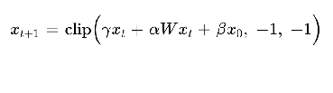  
تعزّز مصفوفة روابط هيب المتناظرة  الإسقاطات على امتداد المتجهات الذاتية الرئيسة إلى أن تستقر الحالة في رأس من رؤوس المكعب الفائق يقابل نمطًا أوليًا متقطعًا نقيًا للذاكرة. وفي العام نفسه نشر سيونيتشي أماري النظرية الرياضية القانونية للإثارات الموضعية («نتوءات» الذاكرة العاملة) في الحقول العصبية المتصلة ذات الكبح الجانبي (№ 60\)124، وأصدر تيوفو كوهونن مونوغراف *«Associative Memory»* (№ 61)، وأضفى آرثر ديمبستر ونان ليرد ودونالد روبين في *JRSS-B* طابعًا صوريًا على **خوارزمية EM** لتعظيم أرجحية النماذج ذات المتغيرات المخفية عبر حدّ ينسن التغايري (№ 62\) — وهو الأساس التحليلي لتدريب MoE والمرمّزات التلقائية التغايرية.

## **1978**

**المجالات:** الذاكرة الحلقات الأساس  
في عام 1978 نشر ويليام ليتل وغوردون شو في *Mathematical Biosciences* عمل *«Analytic Study of the Memory Storage Capacity of a Neural Network»* (№ 63\)127. فبحلّ تحليلي لنموذج خطّي مُبسَّط لشبكة عصبية عشوائية ذات روابط لدنة، بيّن المؤلفان بصرامة أن السعة المعلوماتية للذاكرة العصبية الموزَّعة تتناسب مع **عدد المشابك** 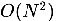، لا مع عدد العصبونات 127. وفي الهندسة الحديثة يفسّر هذا القانون بالذات لماذا يتطلب تخزين حقائق العالم توسيع العدد الإجمالي لمعاملات الأوزان إلى مئات المليارات وإلى التريليونات في معماريات MoE المتناثرة حتى حين تكفي مجموعة جزئية فعّالة صغيرة من العصبونات لمعالجة رمز واحد.  
وفي العام نفسه أدخل غيديون شفارتس في *Annals of Statistics* المعيار المعلوماتي البايزي **BIC** لاختيار بُعد النماذج المعلمية (№ 64)، وقدّم ستيفن غروسبرغ نظرية التجزئة الهرمية (chunking) للمتتاليات في الذاكرة العاملة (№ 65\)109، وحسّن كونيهيكو فوكوشيما قاعدة المشبك من النمط التربيعي المتوسط للتعلّم الذاتي العميق دون معلّم (№ 66\)129.

## **1979**

**المجالات:** المرمِّز الأساس  
في أكتوبر 1979 نشر كونيهيكو فوكوشيما في المجلة اليابانية *Transactions of the IECE of Japan* (المجلد J62-A، № 10، ص. 658–665) أول مقالة عن معمارية **Neocognitron** — أول شبكة عصبية التفافية عميقة ثابتة إزاء الانزياح المكاني لصور الدخل (№ 67\)7. وبوحي من اكتشاف هيوبل وفيزل، نظّم فوكوشيما الشبكة بوصفها تناوبًا متعدد المراحل لأزواج من الطبقات من نوعين: مستويات **\-الخلايا**، حيث تملك جميع عصبونات المستوى الواحد *أوزانًا مشتركة متطابقة تمامًا* (weight sharing) وتستخرج سمة محلية في كل نقطة من الحقل ثنائي الأبعاد (عملية التفاف ثنائي الأبعاد مع المقوِّم ReLU)، ومستويات **\-الخلايا** التي تجمع استجابات الجوار المحلي لخلايا \- مع خفض الدقة (عملية التجميع المكاني pooling)، وبفضل ذلك يتراكم هامش خطأ الانزياح المسموح به برفق من طبقة إلى أخرى دون فقدان الهندسة المتبادلة للتفاصيل87. وفي العام نفسه نشر ليون كوبر وف. ليبرمان وإركي أويا في *Biological Cybernetics* نموذجًا مشبكيًا لتشكّل انتقائية عصبونات القشرة البصرية (№ 68).

## **1980**

**المجالات:** المرمِّز التحسين  
في أبريل 1980 صدر في *Biological Cybernetics* (المجلد 36، ص. 193–202) المنشور الكلاسيكي بالإنجليزية لكونيهيكو فوكوشيما *«Neocognitron: A Self-Organizing Neural Network Model for a Mechanism of Pattern Recognition Unaffected by Shift in Position»* (№ 69\)86، الذي جعل التسلسل الهرمي الالتفافي-التجميعي معروفًا لدى المجتمع العالمي كله. وكانت استجابة خلية \- عند الموضع  من مستوى السمة  في الطبقة  مع الكبح القسمي بالنشاط التربيعي المتوسط  في النافذة المحلية  تُعطى بالمعادلة:  
  
وبذلك اكتمل بناء كل الطوبولوجيا البنيوية للشبكات البصرية العميقة — التفافات ثنائية الأبعاد متعددة القنوات بمشاركة الأوزان، والتقويم ، والتطبيع التربيعي المتوسط المحلي، والتجميع المكاني — بانتظار أن تحل محل قواعد التنظيم الذاتي المحلية انحدارٌ تدريجي شامل87. وفي العام نفسه نشر ستيفن غروسبرغ في *Psychological Review* مقالة جامعة عن الشيفرات المعرفية الرنينية (№ 70)، وبرهن فيلفريد باور وفولكر شتراسن مبرهنة التعقيد الجبري الشهيرة (Baur–Strassen Theorem، № 71): فحساب تدرّج أي دالة كسرية في عدة متغيرات على دارة حسابية لا يتطلب أكثر من خمسة أضعاف عدد عمليات حساب الدالة نفسها114.

## **1981**

**المجالات:** الذاكرة الحلقات التحسين  
في عام 1981 أصدر جيفري هينتون وجيمس أندرسون المونوغراف الجماعي البرنامجي *«Parallel Models of Associative Memory»* (№ 72\)140، الذي برّر الانتقال من العقد الرمزية الموضعية («مفهوم واحد — خلية واحدة») إلى **التمثيلات المتجهية الموزَّعة** الكثيفة (distributed representations)، حيث يُشفَّر كل مفهوم بنمط نشاط لعناصر كثيرة، مما يتيح تعميمًا تلقائيًا بحسب تشابه السمات الدقيقة. وفي العام نفسه قدّم جيمس ماكليلاند وديفيد روميلهارت في *Psychological Review* **نموذج التنشيط التفاعلي** لإدراك الحروف والكلمات بتغذيات راجعة ثنائية الاتجاه بين الطبقات (№ 73)، ونشر أندرو بارتو وريتشارد ساتون وبيتر براور في *Biological Cybernetics* نموذج **الشبكة الترابطية البحثية** (№ 74)، جامعين التوليد العشوائي للأفعال مع التعلّم بإشارة التعزيز العددية — السلف المباشر لطرائق التعلّم المعزَّز التدرّجية.

## **1982**

**المجالات:** الحلقات الذاكرة المرمِّز الأساس  
في أبريل 1982 نشر جون هوبفيلد في *PNAS* مقالته الشهيرة *«Neural Networks and Physical Systems with Emergent Collective Computational Abilities»* (№ 75\)124. فقد قرن بالشبكة التكرارية الثنائية  ذات مصفوفة الأوزان المتناظرة  () **دالة طاقة ليابونوف** فيزيائية صريحة:  
  
وبرهن هوبفيلد على عدم تزايد الطاقة رتابةً () عند التحديثات العتبية غير المتزامنة  وعلى التقارب إلى الحدود الدنيا المحلية — جواذب الذاكرة المعنونة بالمحتوى (تبلغ سعة الصيغة الثنائية الكلاسيكية نحو  من الأنماط غير المترابطة، بينما تمتلك شبكات هوبفيلد الأسّية الحديثة للأعوام 2016–2020 سعة أسّية وتكافئ انتباه softmax في المحوّل142).  
وفي العام نفسه 1982 نشر بول ويربوس في مؤتمر IFIP للمرة الأولى صراحةً تطبيق الانتشار العكسي للخطأ مباشرة على الشبكات العصبية الاصطناعية (№ 76\)7؛ وأنشأ تيوفو كوهونن **خرائط السمات ذاتية التنظيم (SOM)** الطبوغرافية (№ 77)؛ واشتق إركي أويا قاعدة اللدونة المحلية المطبَّعة 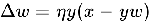 (**قاعدة أويا**، № 78) التي تستخرج المتجه الذاتي الرئيس لمصفوفة تغاير البيانات (PCA العصبي)؛ واقترح بيننستوك وكوبر ومونرو قاعدة التعديل المشبكي اللاخطية ذات العتبة المنزلقة **BCM** (№ 79)؛ وصدر بعد الوفاة كتاب ديفيد مار الأساسي *«Vision»* (№ 80).

## **1983**

**المجالات:** التحسين الحلقات  
في عام 1983 نشر يوري يفغينيفيتش نيستيروف في *«Доклады АН СССР»* (*Soviet Mathematics Doklady*، 27(2)، 372–376) الطريقة المثلى لتصغير الدوال المحدبة الملساء بسرعة تقارب  — **طريقة نيستيروف التدرّجية المتسارعة (NAG)** (№ 81\)143:  
  
وقد وفّر حساب التدرّج في النقطة القصورية الاستباقية  تصحيحًا للمسار عند المنعطفات الحادة في مشهد الخسارة، وصار معيارًا في التعديلات الحديثة لـSGD وNAdam وللزخم المتعامد Muon. وفي عدد مايو من *Science* قدّم سكوت كيركباتريك وتشارلز جيلات وماريو فيكي التحسين الشامل العشوائي بطريقة **التلدين المحاكى (Simulated Annealing)** مع احتمال انتقال ميتروبوليس  (№ 82\)144، ونشر أندرو بارتو وريتشارد ساتون وتشارلز أندرسون في *IEEE TSMC* المعمارية العصبية **Actor–Critic** على مسألة إبقاء البندول المقلوب (№ 83\)144.

## **1984**

**المجالات:** الأساس الحلقات الانتشار  
في نوفمبر 1984 نشر ليزلي فاليانت في *Communications of the ACM* مقالة *«A Theory of the Learnable»* (№ 84\)146، التي أرست الأساس الحسابي-الإحصائي الصارم **للتعلّم الصحيح تقريبيًا احتماليًا (PAC Learning)**: إضفاء الصورية على تعقيد العيّنة والتعقيد الحسابي لبلوغ خطأ التعميم  بموثوقية . وفي العام نفسه عمّم جون هوبفيلد نموذجه على دارات ديناميكية متصلة بسيغمويد أملس رتيب  ودالي ليابونوف متصل (№ 85)، وأدخل الأخوان ستيوارت ودونالد جيمان في *IEEE TPAMI* **أخذ العيّنات بطريقة غيبس (Gibbs Sampling)** على الحقول العشوائية المركوفية بتوزيع غيبس  للاستعادة البايزية للصور المضجَّجة (№ 86)، وأصدر تيوفو كوهونن مونوغرافًا موسَّعًا *«Self-Organization and Associative Memory»* (№ 87).

## **1985**

**المجالات:** الأساس الذاكرة الانتشار  
في عام 1985 نشر ديفيد أكلي وجيفري هينتون وتيرينس سيجنوفسكي في *Cognitive Science* خوارزمية تدريب **آلات بولتزمان** (№ 88\)146 — شبكات طاقية عشوائية ذات *متغيرات مخفية*  تنمذج توزيع المتجهات المرئية  بالتهميش . وانحصر تدرّج تباعد كولباك—لايبلر بالنسبة إلى الوزن المتناظر  في فرق الارتباطات الثنائية في نظامين ديناميكيين حراريين:  
  
ومع أن التلدين الطويل بـMCMC حدّ من حجم آلات بولتزمان كاملة الاتصال، فقد كان ذلك أول عرض صارم نظريًا لتدريب التمثيلات الموزَّعة العميقة في الشبكات التوليدية150. وفي العام نفسه 1985 نشر يان لوكون في مؤتمر *Cognitiva 85* في باريس (№ 89\) وديفيد باركر في تقرير MIT *«Learning-Logic»* (№ 90\) بصورة مستقلة مخططات تدرّجية للانتشار العكسي للخطأ للشبكات متعددة الطبقات، ونظّم ديفيد روميلهارت وديفيد زيبسر التجميع التنافسي للسمات (№ 91).

## **1986**

**المجالات:** الأساس الحلقات التحسين  
في أكتوبر 1986 نشر ديفيد روميلهارت وجيفري هينتون ورونالد ويليامز في *Nature* مقالتهم الشهيرة *«Learning Representations by Back-Propagating Errors»* (№ 92)، تزامنًا مع صدور العمل الأساسي ذي المجلدين لمجموعة PDP *«Parallel Distributed Processing»* (MIT Press، № 93\)7. وبيّن المؤلفون أن البيرسبترون متعدد الطبقات (MLP) ذا التنشيطات الملساء 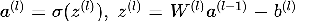، المدرَّب بالنشر التكراري لمتجه الحساسية:  
  
يبني في الطبقات الوسيطة تمثيلات دلالية غير بسيطة ويحل المحمولات غير القابلة للفصل خطيًا151. وفي إصدار PDP نفسه أدخل بول سمولينسكي الشبكة الطاقية ثنائية الأجزاء بلا روابط داخل الطبقة **Harmonium** — المكافئة رياضيًا لـ**آلة بولتزمان المقيّدة (RBM)** ذات الاستنتاج الشرطي الدقيق بخطوة واحدة  (№ 94)؛ واقترح مايكل جوردان شبكة تكرارية بتغذية راجعة من الخرج إلى متجه حالة سياقي  (**Jordan RNN**، № 95)؛ وأظهر تيرينس سيجنوفسكي وتشارلز روزنبرغ مولِّف النسخ الفونيمي للنص الإنجليزي **NETtalk** (№ 96).

## **1987**

**المجالات:** STT الحلقات المرمِّز  
في عام 1987 أنشأ ألكسندر فايبل وتاشيوكي هانازاوا وجيفري هينتون وكيوهيرو شيكانو وكيفن لانغ **شبكة التأخير الزمني (Time-Delay Neural Network, TDNN)** للتعرف على الفونيمات الكلامية (№ 97\)87 — أول شبكة التفافية أحادية البعد على محور الزمن بأوزان مشتركة، ثابتة إزاء انزياح الصيغ الصوتية (formants) ومدرَّبة بالانتشار العكسي للخطأ. وفي العام نفسه نشر جيفري هينتون وديفيد بلوت عمل *«Using Fast Weights to Deblur Old Memories»* (№ 98\)45، مزوِّدين كل رابط بزوج من وزن بطيء طويل المدى ووزن سياقي سريع الاضمحلال (**Fast Weights**) — وهو المصدر المفاهيمي المباشر لطبقات الانتباه الخطي الحديثة والتدريب أثناء الاختبار (TTT وTitans). وبالتوازي اقترح دانا بالارد في مؤتمر AAAI التدريب المسبق الطبقي الوحدوي للتسلسلات الهرمية العميقة بـ**كومة من المرمّزات التلقائية** (№ 99)، وأضفى غيل كاربنتر وستيفن غروسبرغ الصورية على معمارية الرنين التكيفي **ART 1** (№ 100\)110، واشتق فرناندو بينيدا في *Physical Review Letters* الانتشار العكسي المتصل للتدرّجات للنقاط الثابتة للجواذب التكرارية  (**Recurrent Backpropagation**، № 101\) — السلف التحليلي للشبكات التوازنية DEQ.

## **1988**

**المجالات:** المرمِّز التحسين الحلقات  
في عام 1988 نشر وي تشانغ ومعاونوه أول **شبكة عصبية التفافية ثنائية الأبعاد ثابتة إزاء الانزياح (Shift-Invariant 2D CNN)** للتعرف على الرموز، مدرَّبة مباشرة بطريقة الانتشار العكسي للخطأ (№ 102\)20. وأدخل ديفيد برومهيد وديفيد لو في *Complex Systems* **شبكات الدوال الأساسية الشعاعية (RBF Networks)**  (№ 103). وفي نظرية التعلّم نشر ريتشارد ساتون في مجلة *Machine Learning* العمل الأساسي عن **التعلّم بطريقة الفروق الزمنية TD()** (№ 104\)152، الذي يحدّث معاملات المتنبّئ بحسب باقي بيلمان  قبل انتهاء الحلقة. وفي الوقت نفسه برهن إيرفيه بورلار وإيف كامب أن المرمّز التلقائي الخطي ذا عنق الزجاجة بالبعد  يتعلّم مسقطًا متعامدًا على الفضاءات الجزئية المفردة الرئيسة في SVD (№ 105)، وأدخل بارت كوسكو الذاكرة الترابطية غير المتجانسة ثنائية الاتجاه **BAM** (№ 106).

## **1989**

**المجالات:** المرمِّز الأساس التحسين الحلقات  
في عام 1989 نشر يان لوكون وبرنهارد بوزر وجون دينكر ودوني هندرسون وريتشارد هاورد وواين هبّارد ولورنس جاكل في *Neural Computation* مقالة *«Backpropagation Applied to Handwritten Zip Code Recognition»* (№ 107\)87، فدرّبوا شبكة التفافية عميقة بمرشحات مشتركة 5×5 وأخذ عيّنات جزئي (stride 2\) مباشرة على بكسلات مطبَّعة للرموز البريدية المكتوبة بخط اليد في USPS، وأظهروا تحسنًا حادًا في التعميم بفضل المشاركة المكانية للأوزان. وفي العام نفسه برهن جورج سيبنكو (№ 108\) وبصورة مستقلة كورت هورنيك وماكسويل ستينتشكومب وهالبرت وايت (№ 109\) **مبرهنة التقريب الشامل** للدوال المتصلة على المجموعات المتراصة بواسطة بيرسبترونات ثنائية الطبقات بتنشيط غير كثير حدود. وتميّز العام أيضًا بخوارزمية التدريب المتصلة للشبكات التكرارية **RTRL** لرونالد ويليامز وديفيد زيبسر (№ 110)، وبإنشاء **Q-learning** في أطروحة كريستوفر واتكنز (№ 111)، وبطريقة الذاكرة المحدودة **L-BFGS** لدونغ ليو وخورخي نوسيدال (№ 112\)153 وبالتفسير الاحتمالي لدالة **Softmax** عند جون بريدل (№ 113).

## **1990**

**المجالات:** الحلقات التحسين الأساس  
في عام 1990 نشر جيفري إلمان في *Cognitive Science* مقالة *«Finding Structure in Time»* (№ 114\)154، التي جعلت **الشبكة التكرارية البسيطة (Simple RNN / Elman Network)**  أداة أساسية لنمذجة المتتاليات وأظهرت النشوء التلقائي لعناقيد نحوية-دلالية في الفضاء المخفي عند التنبؤ بالكلمة التالية. وثبّت بول ويربوس في *Proceedings of the IEEE* الصياغة العامة **للانتشار العكسي عبر الزمن (BPTT)** بالنشر خطوةً بخطوة للرسم (№ 115). وفي مؤتمر NIPS قدّم يان لوكون وجون دينكر وسارا سولا طريقة التشذيب المتناثر للأوزان من الرتبة الثانية **Optimal Brain Damage (OBD)** بقطر الهسيان  (№ 116\) — السلف المباشر لخوارزميات ضغط LLM الحديثة. وبالتوازي اقترح يورغن شميدهوبر لعبة مينيماكس بين شبكتين في إطار **الفضول الاصطناعي التنافسي** (№ 117\)7، وبرّر لارس هانسن وبيتر سالامون خفض تباين الخطأ في **مجموعات الشبكات العصبية (ensembles)** (№ 118).

## **1991**

**المجالات:** MoE الحلقات الانتباه/LLM الأساس  
في عام 1991 وُضعت ثلاث آليات أساسية تحدّد معمارية النماذج الرائدة للأعوام 2024–2027. فقد نشر روبرت جاكوبز ومايكل جوردان وستيفن نولان وجيفري هينتون في *Neural Computation* مقالة *«Adaptive Mixtures of Local Experts»* (**أول MoE**، № 119\)156. وباستبدال متوسط الخطأ التربيعي بتعظيم لوغاريتم أرجحية خليط غاوسي بإدارة شبكة بوابية :  
  
حقق المؤلفون تخصصًا تنافسيًا للخبراء  في مناطق مختلفة من فضاء الدخل، إذ يتلقى التدرّج في معظمه الخبيرُ ذو أكبر مسؤولية لاحقة عن المثال.  
وفي يونيو من العام 1991 نفسه دافع زيب هوخرايتر بإشراف يورغن شميدهوبر عن بحث الدبلوم (№ 120\)7، مقدِّمًا للمرة الأولى تحليلًا صارمًا **لتلاشي التدرّجات وانفجارها** في الشبكات العميقة والتكرارية عبر جداء اليعقوبيات 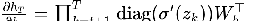. وفي ربيع 1991 اقترح شميدهوبر معمارية **Fast Weight Programmers** (№ 121؛ نُشرت في مجلة 1992\)7، حيث تولّد شبكة بطيئة ديناميكيًا متجهات المفاتيح والقيم لإعادة الكتابة التراكمية لمصفوفة الأوزان السريعة  والقراءة 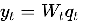 — بنية متماثلة رياضيًا مع الانتباه الذاتي الخطي غير المطبَّع22. وختم العامَ المرمّزاتُ التلقائية اللاخطية خماسية الطبقات لمارك كرامر (№ 122\) والكتاب الدراسي الكلاسيكي في الميكانيكا الإحصائية للشبكات العصبية لهيرتس وكروغ وبالمر (№ 123).

## **1992**

**المجالات:** التحسين الحلقات الأساس  
في عام 1992 نشر رونالد ويليامز في *Machine Learning* تقدير تدرّج السياسة **REINFORCE** مع مستوى أساس مطروح  لخفض التباين (№ 124):  
  
الذي صار الأساس المباشر لتحسين النماذج اللغوية المستدلّة بطريقتَي PPO وGRPO53. وفي الوقت نفسه أدخل يورغن شميدهوبر في *Neural Computation* **ضاغط التاريخ العصبي** (№ 125\)22 — تدريبًا مسبقًا هرميًا ذاتي الإشراف لـRNN، لا ينقل إلى المستوى الأعلى سوى الرموز غير القابلة للتنبؤ («المدهشة») مع الضغط اللاحق («التقطير») لمعلّم عميق في شبكة طالب مدمجة7. وبرهن بوريس بولياك وأناتولي يوديتسكي على الأمثلية المقاربية **لمتوسطة مسار أوزان SGD**  (№ 126\) — الأساس النظري لأهداف EMA في DINO وJEPA والانتشار؛ وبرّر أندرس كروغ وجون هيرتس التنظيم باضمحلال الأوزان (**Weight Decay**، № 127)؛ وجمع بوزر وغيون وفابنيك هامش المستوى الفائق مع خدعة النواة في COLT (№ 128).

## **1993**

**المجالات:** المرمِّز الأساس التحسين  
في عام 1993 قدّم جين برومّلي وإيزابيل غيون ويان لوكون ومعاونوهم في NIPS **الشبكات العصبية التوأمية (Siamese Networks)** (№ 129): برجان التفافيان متطابقان بأوزان مشتركة يُسقطان زوج مدخلات في فضاء متري مشترك من قرب جيب التمام — نموذج يقوم عليه جميع المرمِّزات التقابلية الحديثة (CLIP وSigLIP والاسترجاع الكثيف). وفي مؤتمر COLT صاغ جيفري هينتون ودرو فان كامب مبدأ أدنى طول وصف للأوزان عبر تصغير الطاقة الحرة التغايرية  (**الاستدلال البايزي التغايري في الشبكات العصبية**، № 130)، الذي استبق الدالي ELBO. وفي العام نفسه برهن أندرو بارون على استقلال سرعة التقريب  بشبكة ثنائية الطبقات عن بُعد الفضاء  للدوال ذات المعيار الطيفي لفورييه المحدود (№ 131)، وعمّم بابك حسيبي وديفيد ستورك تشذيب الهسيان إلى **Optimal Brain Surgeon (OBS)** الكامل غير القطري (№ 132\) — القاعدة الرياضية لمكمِّمات أوزان LLM الحديثة (GPTQ).

## **1994**

**المجالات:** الحلقات MoE التحسين  
في عام 1994 نشر يوشوا بنجيو وباتريس سيمار وباولو فراسكوني في *IEEE Transactions on Neural Networks* المبرهنة الصارمة *«Learning Long-Term Dependencies with Gradient Descent is Difficult»* (№ 133)، مبرهنين على التعارض الأساسي في النظم الديناميكية اللاخطية: فالتخزين المقاوم للتشويش لبتّ واحد في جاذب زائدي يتطلب قيمًا ذاتية لليعقوبي ، مما يستدعي تلقائيًا اضمحلالًا أسّيًا لتدرّج الخطأ عبر الزمن. وفي العام نفسه عمّم مايكل جوردان وروبرت جاكوبز خليط الخبراء إلى **خليط خبراء هرمي (HME)** شجري مع تعلّم EM سريع (№ 134)، واشتق باروخ بيرلماتر المؤثر التفاضلي  للضرب الدقيق للهسيان في متجه في  عملية دون تخزين مصفوفة المشتقات الثانية (№ 135)، وصدرت الطبعة الأولى من المقرر الأساسي لسايمون هايكن *«Neural Networks: A Comprehensive Foundation»* (№ 136).

## **1995**

**المجالات:** الأساس الانتشار المرمِّز  
في مايو 1995 نشر جيفري هينتون وبيتر دايان وبريندان فري ورادفورد نيل في *Science* معمارية **آلة هيلمهولتز** والخوارزمية ثنائية الطور **Wake–Sleep** (№ 137)، مقرِنين نموذجًا توليديًا موجّهًا  بشبكة استدلال تعرّفية سريعة  — السلف البنيوي المباشر للمرمّز التلقائي التغايري. وأنشأ أنتوني بيل وتيرينس سيجنوفسكي خوارزمية الفصل الأعمى للإشارات **InfoMax ICA** بتعظيم إنتروبيا الخرج اللاخطي (№ 138)؛ وأدخلت كورينا كورتيس وفلاديمير فابنيك مصنّف الهامش الليّن **Support-Vector Networks** (№ 139\)149؛ ونظّم يان لوكون ويوشوا بنجيو المعماريات الالتفافية أحادية وثنائية الأبعاد للكلام والصور (№ 140)؛ وأصدر كريستوفر بيشوب المونوغراف الكلاسيكي *«Neural Networks for Pattern Recognition»* (Oxford University Press، № 141\)88، الذي ثبّت المعالجة البايزية والاحتمالية لدوال الخسارة والتنظيم.

## **1996**

**المجالات:** المرمِّز الأساس الحلقات  
في يونيو 1996 بيّن برونو أولشاوزن وديفيد فيلد في مجلة *Nature* (*«Emergence of Simple-Cell Receptive Field Properties by Learning a Sparse Code for Natural Images»*، № 142) أن تصغير خطأ إعادة بناء الصور الطبيعية بقاموس فائض مع عقوبة تناثر \- هي  يشكّل تلقائيًا موجات غابور المحلية الموجَّهة — الأساس الرياضي لكل من الترميز المتناثر والمرمّزات التلقائية المتناثرة الحديثة (Sparse Autoencoders, SAE) لقابلية تفسير LLM. وفي العام نفسه برهن رادفورد نيل في المونوغراف *«Bayesian Learning for Neural Networks»* (№ 143\) على تقارب الشبكات العصبية العشوائية التهيئة ذات العرض اللانهائي () إلى **العمليات الغاوسية (NNGP)**، وأدخل كريستوف غوللر وأندرياس كوشلر الانتشار العكسي على الرسوم اللادورية والأشجار النحوية (№ 144)، وصدر كتاب برايان ريبلي *«Pattern Recognition and Neural Networks»* (№ 145).

## **1997**

**المجالات:** الحلقات الذاكرة التحسين  
في نوفمبر 1997 نشر زيب هوخرايتر ويورغن شميدهوبر في *Neural Computation* معمارية **الذاكرة الطويلة قصيرة المدى (Long Short-Term Memory, LSTM)** (№ 146\)7. فللتغلب على تلاشي التدرّجات استبدل المؤلفان التحويل اللاخطي الانضغاطي للحالة بـ**دوّارة خطأ ثابت (Constant Error Carousel, CEC)** خطية 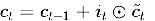 ذات يعقوبي وحدوي عبر الزمن، وحمَوا الكتابة والقراءة ببوابتين ضربيتين: بوابة الدخل () وبوابة الخرج ():  
  
وفي العام نفسه 1997 أنشأ مايكل شوستر وكولديب باليوال في *IEEE TSP* **الشبكات التكرارية ثنائية الاتجاه (BiRNN)** (№ 147) التي تجمع بين النشرين الزمنيين الأمامي والخلفي للترميز السياقي الكامل؛ وأدخل هوخرايتر وشميدهوبر معيار البحث عن **الحدود الدنيا المسطحة (Flat Minima)** ذات انحناء الهسيان الصغير لتحسين التعميم (№ 148)؛ ونشر يوآف فرويند وروبرت شابير خوارزمية التعزيز الموزون **AdaBoost** (№ 149).

## **1998**

**المجالات:** المرمِّز التحسين الأساس  
في نوفمبر 1998 نشر يان لوكون وليون بوتو ويوشوا بنجيو وباتريك هافنر في *Proceedings of the IEEE* المقالة الضخمة *«Gradient-Based Learning Applied to Document Recognition»* (№ 150)، مثبّتين الشبكة الالتفافية المرجعية ذات 7 طبقات **LeNet-5** (خطأ 0.8% على مجموعة بيانات MNIST) و**شبكات المحوِّلات البيانية (GTN)** القابلة للتدريب الشامل لقراءة وثائق متعددة الرموز دون تجزئة مسبقة، مستكملين إياها بدليل عملي لتقييس التنشيطات والتهيئة *«Efficient BackProp»* (№ 151). وفي الوقت نفسه اشتق سيونيتشي أماري في *Neural Computation* **التدرّج الطبيعي (Natural Gradient)**  في المقياس الريماني لمصفوفة فيشر المعلوماتية  (№ 152\)159 — الأساس اللامتغير إزاء المعلمة لخوارزميات الرتبة الثانية K-FAC وShampoo وSOAP والمناطق الموثوقة في PPO160. وفي العام نفسه صدرت المونوغرافات الكلاسيكية لريتشارد ساتون وأندرو بارتو في التعلّم المعزَّز (№ 153\)152 ولفلاديمير فابنيك *«Statistical Learning Theory»* (№ 154\)99.

## **1999**

**المجالات:** الحلقات الذاكرة الأساس  
في التدفقات المتصلة بلا علامات إعادة ضبط كانت خلية الذاكرة الخطية  في LSTM الأصلية لعام 1997 تتشبّع بلا حدود. وحلّ فيليكس غيرس ويورغن شميدهوبر وفريد كامينز هذه المشكلة في مؤتمر ICANN 1999 (№ 155\)155 بإدخال **بوابة النسيان (Forget Gate)** الضربية ، التي مكّنت الخلية من محو الحالة البالية ديناميكيًا. ومن اللافت أن الانتقال من DeltaNet الخطي إلى **Gated DeltaNet** و**KDA** في 2024–2025 أعاد إنتاج الفكرة الرياضية نفسها بإدخال مضروب اضمحلال معتمد على الدخل  قبل الذاكرة المصفوفية24. وفي العام نفسه نشر دانيال لي وسيباستيان سيونغ في *Nature* **التحليل المصفوفي غير السالب (NMF)** (№ 156)، مبيّنين أن منع الطرح المتبادل للسمات عند  يستخلص مكوّنات جمعية قابلة للتفسير (وهو مبدأ نُقل في 2025 إلى الإسقاطات غير السالبة  في معمارية DeepSeek **mHC**2)، وقدّم نين تشيان تحليلًا طيفيًا دقيقًا للزخم في الانحدار التدريجي (№ 157).

## **2000**

**المجالات:** الحلقات الذاكرة الأساس  
في عام 2000 نشر غيرس وشميدهوبر وكامينز النسخة المجلّية الكاملة من **LSTM ببوابة النسيان** في *Neural Computation* (№ 158\) وأكملاها بـ**وصلات «ثقب الباب» (Peephole Connections)** من حالة الخلية  مباشرة إلى البوابات لعدّ فواصل الزمن بدقة (№ 159):  
  
وفي مؤتمر NIPS 2000 أدخل شارل دوغا ويوشوا بنجيو ومعاونوهما دالة التنشيط الملساء الموجبة تمامًا **Softplus**  (№ 160\)161، وهي الدالة الأصلية للسيغمويد اللوجستي، التي هي في SSM الحديثة (Mamba-1/2/3) والشبكات الدلتوية المعلِّم القياسي لخطوة التقطيع 24. وفي الوقت نفسه صدرت في مجلة *Science* الخوارزميات الهندسية لتقويم منطويات البيانات اللاخطي **Isomap** لتننباوم وآخرين (№ 161\) و**LLE** لروايس وسول (№ 162).

## **2001**

**المجالات:** الحلقات المرمِّز الأساس  
في عام 2001 قدّم هربرت ييغر مفهوم الحوسبة الخزّانية في تقرير عن **شبكات حالة الصدى (Echo State Networks, ESN)** (№ 163): خزّان تكراري ثابت كبير بنصف قطر طيفي  يُسقط تاريخ الدخل لاخطيًا في حالة عالية الأبعاد ، يُدرَّب فوقها بالانحدار الخطي مصفوفة القراءة الخارجة وحدها دون BPTT. وفي مؤتمر ICML 2001 أدخل جون لافرتي وأندرو ماكالوم وفرناندو بيريرا **الحقول العشوائية الشرطية (Conditional Random Fields, CRF)** (№ 164)، التي تطبّع عالميًا احتمالات متتالية الخرج بأكملها 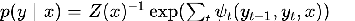 وأزالت انحياز النماذج المركوفية المطبَّعة محليًا. وفي العام نفسه صدرت الطبعة الأولى من المونوغراف الإحصائي الأساسي لهاستي وتبشيراني وفريدمان *«The Elements of Statistical Learning»* (№ 165).

## **2002**

**المجالات:** الانتشار الأساس الحلقات  
في عام 2002 نشر جيفري هينتون في *Neural Computation* خوارزمية **التباعد التقابلي (\-step Contrastive Divergence, CD\-)** (№ 166\)142، التي سرّعت جذريًا تدريب النماذج الطاقية وRBM: فبدلًا من الإيصال الطويل لسلسلة ماركوف إلى الكثافة المنمذَجة المتوازنة، يُقرَّب الطور السالب للتدرّج بخطوة واحدة فقط  من أخذ عيّنات غيبس تنطلق من متجه بيانات حقيقي. وقدّم فولفغانغ ماس وتوماس ناتشلاغر وهنري ماركرام المناظر النبضي للشبكات الخزّانية — **آلات الحالات السائلة (LSM)** (№ 167)؛ وعمّم مايكل كولينز في EMNLP البيرسبترون ومبرهنة نوفيكوف على مسائل التنبؤ البنيوي بالمتتاليات مع فك ترميز فيتربي (№ 168)؛ وأصدر رونان كولوبير وسامي بنجيو وجوني ماريتيز مكتبة C++ مفتوحة وحدوية **Torch** (№ 169)، التي صارت سلف PyTorch الحديثة.

## **2003**

**المجالات:** الأساس الانتباه/LLM المرمِّز  
في عام 2003 نشر يوشوا بنجيو وريجان دوشارم وباسكال فنسان وكريستيان جوفين في *JMLR* مقالة *«A Neural Probabilistic Language Model»* (№ 170)، التي استبدلت العدّادات المتقطعة لـ\-غرام بمصفوفة قابلة للتعلّم من **التضمينات المتجهية الكثيفة للكلمات**  وببيرسبترون أملس فوق نافذة مسلسلة من الرموز السابقة :  
  
وقد نقل التدريب المشترك للتضمينات والطبقة المخفية الكتلة الاحتمالية إلى تركيبات كلمات متقاربة دلاليًا لم تظهر قط حرفيًا في المدوّنة، فاتحًا الطريق مباشرة أمام LLM الحديثة. وفي العام نفسه أدخل باتريس سيمار وديف شتاينكراوس وجون بلات التشوهات المرنة للبيانات وقيّسوا الممارسات الالتفافية البسيطة في ICDAR (خطأ 0.4% على MNIST، № 171)، وأصدر ديفيد ماكاي العمل الأساسي *«Information Theory, Inference, and Learning Algorithms»* (№ 172).

## **2004**

**المجالات:** التحسين الأساس  
في عام 2004 نشر كيون-سو أو وكيتشول جونغ في *Pattern Recognition* مقالة *«GPU Implementation of Neural Networks»* (№ 173)، ناقلَين للمرة الأولى عمليات ضرب المصفوفات في شبكة عصبية كاملة الاتصال إلى خط أنابيب مظلِّلات البكسل في بطاقة الفيديو (ATI Radeon 9700 Pro) بـ**تسريع 20×** قياسًا إلى المعالج المركزي7. وفي مؤتمر ICML 2004 برهن أندرو أنغ بصرامة أنه مع وجود عدد أسّي من السمات الضجيجية يزداد تعقيد العيّنة للتنظيم بـ\- لوغاريتميًا فقط ، في حين يزداد خطيًا  في الطرائق الثابتة دورانيًا ذات عقوبة 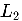\- (№ 174). وفي NIPS وسّع ماكس ويلينغ وميخال روزن-تسفي وجيفري هينتون معمارية RBM إلى التوزيعات المتصلة للعائلة الأسّية (**Exponential Family Harmoniums**، № 175\)162.

## **2005**

**المجالات:** الانتشار STT المرمِّز الأساس  
في عام 2005 نشر آابو هيفارينن في *JMLR* طريقة **مطابقة دالة الدرجة (Score Matching)** (№ 176\)161، التي مكّنت من تدريب الكثافات الطاقية غير المطبَّعة  دون حساب دالة التجزئة  بتصغير تباعد تدرّجات لوغاريتم الكثافة بالنسبة إلى متجه البيانات  (مع استبعاد المجهول 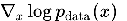 بالتكامل بالتجزئة):  
  
وفي العام نفسه جمع أليكس غريفز ويورغن شميدهوبر بين LSTM ذات البوابات والنشر ثنائي الاتجاه عبر الزمن (**BiLSTM**) والانتشار العكسي الكامل عبر البوابات لتصنيف الفونيمات الكلامية (№ 177)؛ وأدخل سوميت تشوبرا وريا هادسيل ويان لوكون في CVPR دالة الخسارة المترية **Contrastive Loss** (№ 178)؛ واقترح ماركو غوري وغابرييلي مونفاردييني وفرانكو سكارسيلي أول صياغة **للشبكات العصبية البيانية (GNN)** (№ 179)؛ وسرّع فريدريك موران ويوشوا بنجيو الطبقة الخارجة للنماذج اللغوية من  إلى  بواسطة **Softmax الهرمي** على شجرة ثنائية من الكلمات (№ 180).

## **2006**

**المجالات:** STT الأساس المرمِّز  
في مؤتمر ICML 2006 قدّم أليكس غريفز وسانتياغو فرنانديز وفاوستينو غوميز ويورغن شميدهوبر آلية **Connectionist Temporal Classification (CTC)** (№ 181)، التي حرّرت التعرف على الكلام والنص المكتوب بخط اليد من ضرورة الوسم الفونيمي إطارًا بإطار. فبتوسيع الأبجدية بالرمز الفارغ  (blank) وإدخال مؤثر طيّ التكرارات والفراغات ، تحسب CTC الاحتمال الدقيق للنسخ الهدف  بالجمع على جميع مسارات المحاذاة المسموحة ذات الطول  بطريقة البرمجة الديناميكية للمرور الأمامي-الخلفي في :  
  
وفي الوقت نفسه نشر جيفري هينتون وسايمون أوسينديرو ويي-واي تيه التدريب المسبق الطبقي **لشبكات الاعتقاد العميقة (Deep Belief Nets)** من كومة RBM (№ 182\)142، وبيّن هينتون وروسلان سالاخوتدينوف في مجلة *Science* الضغط اللاخطي للبيانات بمرمّزات تلقائية عميقة مع التدريب اللاحق بالانتشار العكسي (№ 183)، معيدين الشبكات العميقة إلى بؤرة اهتمام العلم. وختم العامَ الاستعراضُ الأساسي للنماذج الطاقية ليان لوكون ومعاونيه (№ 184\) والكتاب الدراسي الكلاسيكي لكريستوفر بيشوب *«Pattern Recognition and Machine Learning»* (№ 185\)164.

## **2007**

**المجالات:** الأساس التحسين المرمِّز  
في عام 2007 بيّن يوشوا بنجيو وباسكال لامبلان ودان بوبوفيسي وهوغو لاروشيل في NIPS (*«Greedy Layer-Wise Training of Deep Networks»*، № 186\)163 أن التدريب المسبق الطبقي الجشع للمرمّزات التلقائية الحتمية يهيّئ الشبكات العميقة بنجاح مماثل لنجاح RBM العشوائية. وفي المؤتمر نفسه نشر ليون بوتو وأوليفييه بوسكيه عمل *«The Tradeoffs of Large Scale Learning»* (№ 187)، مبرهنَين أنه عند ميزانية ثابتة من زمن الحساب في نظام العيّنات الكبيرة يصغّر الانحدار التدريجي العشوائي البسيط من الرتبة الأولى (SGD) المخاطرة التعميمية المتوقعة بكفاءة مقاربية أعلى من المُحسِّنات الثقيلة من الرتبة الثانية. وأدخل أندريه منيه وجيفري هينتون **Log-Bilinear Language Model** (№ 188)، وطبّق روسلان سالاخوتدينوف وأندريه منيه وجيفري هينتون RBM على الترشيح المصفوفي للتوصيات في Netflix Prize (№ 189).

## **2008**

**المجالات:** المرمِّز الانتشار الانتباه/LLM  
في مؤتمر ICML 2008 قدّم باسكال فنسان وهوغو لاروشيل ويوشوا بنجيو وبيير-أنطوان مانزاغول **المرمّزات التلقائية المزيلة للضجيج (Denoising Autoencoders, DAE)** (№ 190\)161: يُشوَّه متجه الدخل عمدًا بتصفير عشوائي للمركّبات (الإخفاء بالأقنعة) أو بضجيج غاوسي ، وتُدرَّب الشبكة على إسقاط النقطة المضجَّجة عائدةً إلى منطوية البيانات النظيفة 165. وصار هذا الاستبدال البسيط لإعادة البناء المتطابقة بإزالة الضجيج جسرًا مفاهيميًا مباشرًا إلى كلٍّ من نمذجة اللغة المقنَّعة (BERT وLLaDA) ومطابقة الدرجة الانتشارية. وفي ICML نفسه درّب رونان كولوبير وجيسون ويستون معمارية التفافية واحدة بتضمينات كلمات مدرَّبة مسبقًا على ويكيبيديا لحل ست مهام معالجة لغة طبيعية معًا دون هندسة يدوية للسمات (№ 191)، وأدخل لورنس فان دير ماتن وجيفري هينتون في *JMLR* خوارزمية تصوير المنطويات **t-SNE** (№ 192).

## **2009**

**المجالات:** المرمِّز التحسين الأساس  
في عام 2009 تزامنت ثلاثة أحداث مهّدت لتوسيع نطاق التعلم العميق الحديث. فقد قدّم جيا دنغ وفاي-فاي لي ومعاونوهم في CVPR المدوّنة الهرمية **ImageNet** (أكثر من 14 مليون صورة موسومة، № 193\)167؛ ودرّب راجات راينا وأناند مادهافان وأندرو أنغ في ICML شبكات عميقة من 100 مليون معامل على نوى **CUDA GPU** القابلة للبرمجة بـ**تسريع 70×** قياسًا إلى المعالجات متعددة النوى (№ 194)؛ وأضفى يوشوا بنجيو وجيروم لورادور ورونان كولوبير وجيسون ويستون الصورية على **التعلّم بالمنهج (Curriculum Learning)** (№ 195\) — الرفع التدريجي لصعوبة أمثلة التدريب وطولها، الذي صار مرحلة إلزامية في التدريب التدريجي على السياق الطويل والدقة العالية في جميع LLM ومولّدات الفيديو الحديثة59. وفي العام نفسه أنشأ سالاخوتدينوف وهينتون **آلات بولتزمان العميقة (DBM)** ذات الروابط ثنائية الاتجاه بين الطبقات (№ 196)، وثبّت فرانكو سكارسيلي وآخرون التقارب الرياضي لشبكات **GNN** البيانية في *IEEE TNN* (№ 197).

## **2010**

**المجالات:** الأساس التحسين الحلقات  
في عام 2010 أُزيلت العوائق الرئيسة أمام تدريب الشبكات العميقة ذات الانتشار الأمامي من الصفر دون تدريب مسبق طبقي. فقد بيّن كزافييه غلوروت ويوشوا بنجيو في مؤتمر AISTATS (№ 198\) أنه للحفاظ في آن واحد على تباين الإشارة في المرور الأمامي وتباين التدرّجات في المرور العكسي ينبغي أن تُهيَّأ أوزان الطبقة بتباين **غلوروت (Xavier Initialization)**:  
  
وفي مؤتمر ICML 2010 نشر فينود نير وجيفري هينتون عمل *«Rectified Linear Units Improve Restricted Boltzmann Machines»* (№ 199)، مُدخِلَين في الممارسة الواسعة دالة التنشيط القطعية الخطية **ReLU**  ذات المشتقة الوحدوية على نصف المحور الموجب. وفي العام نفسه قدّم توماش ميكولوف ومعاونوه في Interspeech **النموذج اللغوي التكراري (RNNLM)** للتعرف على الكلام (№ 200)، واشتق مايكل غوتمان وآابو هيفارينن **التقدير المقابل للضجيج (NCE)** (№ 201)، ودرّب جيمس مارتنز شبكات عميقة دون تدريب مسبق بطريقة الرتبة الثانية **Hessian-Free** (№ 202)، وصدر مترجم الاشتقاق التلقائي الرمزي-التنسوري على GPU **Theano** لجيمس بيرغسترا ومجموعة بنجيو (№ 203).

## **2011**

**المجالات:** التحسين الانتشار الأساس STT  
في عام 2011 نشر جون دوتشي وإيلاد هازان ويورام سينغر في *JMLR* المُحسِّن التكيفي **AdaGrad** (№ 204\)168، الذي يطبّع خطوة كل إحداثي بالجذر التربيعي لمجموع مربعات تدرّجاته السابقة المتراكم ، مما دشّن العائلة الكاملة لطرائق التحسين التكيفية للشبكات العميقة.  
وفي صيف 2011 نشر باسكال فنسان في *Neural Computation* المقالة النظرية الأساسية *«A Connection Between Score Matching and Denoising Autoencoders»* (**Denoising Score Matching, DSM**، № 205\)161. وبرهن فنسان بصرامة أن تدريب المرمّز التلقائي على كبح الضجيج الغاوسي  يكافئ تقدير دالة الدرجة للكثافة المملَّسة بنافذة بارزن  *دون حساب المشتقات الثانية لليعقوبي*166:  
  
وبما أن ، فإن هذه الصيغة هي النواة الرياضية المباشرة لجميع نماذج الانتشار المتصلة (NCSN وDDPM وScore SDE)142. وفي العام نفسه برّر غلوروت وبوردس وبنجيو تناثر الشبكات العميقة القائمة على ReLU (№ 206)، وربط ماكس ويلينغ ويي-واي تيه التدرّج العشوائي بديناميكا لانجفان في **SGLD** (№ 207)، وحقق فرانك زايدا وغان لي ودونغ يو اختراقًا في التعرف الصناعي على الكلام المحكي بالنموذج الهجين **CD-DNN-HMM** (№ 208)، وأصدر كولوبير وآخرون المقالة الختامية *«Natural Language Processing (Almost) from Scratch»* في *JMLR* (№ 209).

## **2012**

**المجالات:** المرمِّز STT التحسين الحلقات  
في ديسمبر 2012 قدّم أليكس كريجيفسكي وإيليا سوتسكيفر وجيفري هينتون في NIPS الشبكة الالتفافية ثمانية الطبقات **AlexNet** (№ 210\)96، التي خفّضت خطأ Top-5 على ImageNet ILSVRC-2012 من 26.2% إلى **15.3%** (دقة Top-1 تبلغ 63.3%). وجمع نجاح AlexNet بين 60 مليون معامل، واللاخطية **ReLU** (التي سرّعت التقارب بمقدار 6× مقارنةً بـ)، والتعطيل العشوائي للعصبونات **Dropout** لكبح التكيّف المشترك للسمات (هينتون وآخرون، 2012، № 212\)، والتدريب المتوازي على مستوى النموذج على بطاقتَي فيديو NVIDIA GTX 580167.  
وفي الوقت نفسه، في نوفمبر 2012، نشر أليكس غريفز معمارية **RNN-Transducer (RNN-T)** (№ 211)، التي رفعت افتراض الاستقلال الشرطي لمخرجات CTC بجمع المرمّز الصوتي  والشبكة الانحدارية الذاتية لتنبؤ النص  في شبكة مشتركة **Joiner**  مع التهميش على الشبكة ثنائية الأبعاد  — معيار جميع أنظمة التعرف التدفقي على الكلام حتى TDT الحديثة170. وفي العام نفسه ظهرت التدريج المتوسط التربيعي المنزلق للخطوة **RMSProp** لهينتون والطريقة عديمة الأبعاد **Adadelta** لماثيو زايلر (№ 213)، والإطار العنقودي الموزَّع **DistBelief** لجيف دين وآخرين (№ 214)، ومجموعات GPU-CNN لدان تشيريشان وأولي ماير ويورغن شميدهوبر بأول دقة فوق بشرية في التعرف على اللافتات (№ 215\)155 وبرهان فعالية البحث العشوائي عن المعاملات الفائقة لبيرغسترا وبنجيو (№ 216).

## **2013**

**المجالات:** المرمِّز الانتشار الأساس التحسين  
في ديسمبر 2013 نشر ديديريك كينغما وماكس ويلينغ **المرمّز التلقائي التغايري (Variational Autoencoder, VAE)** (*«Auto-Encoding Variational Bayes»*، № 217؛ وبصورة مستقلة دانيلو ريزيندي وشاكير محمد ودان فيرسترا، № 218)، الذي يعظّم الحدّ الأدنى التغايري للأرجحية (**ELBO**):  
  
و**خدعة إعادة المعلمة**  التي أدخلها المؤلفون نقلت العشوائية إلى ضجيج خارجي ومكّنت من تدريب مرمّزات احتمالية عميقة اعتباطية بالانتشار العكسي للخطأ المعتاد؛ وبالذات فإن الفضاءات المضغوطة لـVAE تشكّل اليوم الركيزة الكامنة لجميع مولّدات الصور والفيديو والكلام الطويل الرائدة74.  
وبالتوازي قدّم توماش ميكولوف ومعاونوه في Google المعماريات التقابلية **Word2Vec** (Skip-Gram وCBOW مع أخذ العيّنات السالبة، № 219)، التي وسّعت تدريب التمثيلات المتجهية للكلمات إلى مدوّنات بمليارات الكلمات ذات بنية دلالية خطية. وأدخل مين لين وتشيانغ تشن وشويتشنغ يان الالتفافات النقطية 1×1 والتجميع المتوسط الشامل في **Network in Network** (№ 220)، واقترح إيان غودفيلو وآخرون التنشيط **Maxout** (№ 221)، وربط فلاديمير منيه وفريق DeepMind الشبكة الالتفافية بالتعلّم Q ومخزن التجربة في **DQN** على ألعاب Atari (№ 222)، وبرهن أندرو ساكس وجيمس ماكليلاند وسوريا غانغولي على حفظ القيم المفردة لليعقوبي عند **التهيئة المتعامدة** للشبكات العميقة (№ 223\)175، وأدخل ريتشارد جونسون وتونغ تشانغ خفض تباين التدرّج **SVRG** (№ 224).

## **2014**

**المجالات:** الانتباه/LLM الحلقات الانتشار المرمِّز التحسين  
في عام 2014 وُلد الانتباه الليّن القابل للاشتقاق، والشبكات التوليدية التنافسية، والمُحسِّن الرئيس للتعلم العميق الحديث. فبعد نموذج **Seq2Seq** لإيليا سوتسكيفر وأوريول فينيالس وكوك لي (№ 225)، الذي كان يضغط الجملة الداخلة في متجه LSTM ثابت واحد، أزال دميتري بهداناو وكيونغهيون تشو ويوشوا بنجيو (*«Neural Machine Translation by Jointly Learning to Align and Translate»*، № 226\) عنق الزجاجة المعلوماتي للمتجه الثابت، مُمكِّنين فاكّ الترميز في كل خطوة 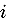 من وزن جميع الحالات المخفية للمرمّز  ديناميكيًا (**الانتباه الجمعي**):  
  
وفي العام نفسه بسّط كيونغهيون تشو وآخرون الخلية التكرارية ذات البوابات إلى بوابتين في **GRU** (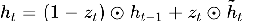، № 227)، وزوّد أليكس غريفز وغريغ وين وإيفو دانيليخكا الشبكة العصبية بذاكرة مصفوفية خارجية قابلة للاشتقاق في **Neural Turing Machine (NTM)** (№ 228). وفي NIPS 2014 صاغ إيان غودفيلو ومعاونوه لعبة المينيماكس بين المولِّد والمميِّز في **GAN** (، № 229)، وفي ديسمبر نشر ديديريك كينغما وجيمي با المُحسِّن **Adam** (№ 230)، الذي جمع التقديرات الأسّية المنزلقة للعزمين الأول والثاني للتدرّج مع تصحيح انحياز الصفر. وفي الرؤية الحاسوبية والتضمينات صدرت سلاسل النوى الضيقة 3×3 في **VGG** لسيمونيان وزيسرمان (№ 231\)176، والكتل متعددة المقاييس **GoogLeNet / Inception** لسيجيدي وآخرين (№ 232)، والتحليل المصفوفي للتواجد المشترك للكلمات **GloVe** لبينينغتون وآخرين (№ 233)، وعمل غودفيلو وآخرين عن الطبيعة الخطية **للاضطرابات التنافسية (FGSM)** (№ 234\) ومكتبة **Caffe** ليانغ جيا (№ 235).

## **2015**

**المجالات:** الأساس الانتشار المرمِّز التحسين STT  
في عام 2015 جرى تجاوز حاجز تدهور عمق الشبكات وصيغ في الوقت نفسه الانتشار الديناميكي الحراري. فتطويرًا للطرق السريعة ذات البوابات **Highway Networks** لروبيش سريفاستافا وكلاوس غريف ويورغن شميدهوبر (، № 236\)7، بسّط كايمنغ هي وشيانغيو تشانغ وشاوتشينغ رن وجيان صن تمرير الإشارة إلى جمع تطابقي خالص في **ResNet-152** (№ 237؛ بالاقتران مع التهيئة **Kaiming Init** 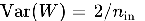 لـReLU، № 238\)61:  
  
وقد وفّرت الوحدة الجمعية 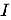 في اليعقوبي تدفقًا غير متضائل للتدرّج عبر مئات الطبقات وأتت بالفوز في ILSVRC-2015 بخطأ مجموعة بلغ 3.57%34.  
وفي العام نفسه أدخل سيرغي إيوفي وكريستيان سيجيدي **Batch Normalization** (№ 239\)178؛ وأنشأ أولاف رونيبيرغر وفيليب فيشر وتوماس بروكس المعمارية الالتفافية المتناظرة مرمِّز–فاكّ ترميز مع تمرير الخرائط المكانية للسمات **U-Net** (№ 240\)179؛ ونشر ياشا سول-ديكشتاين وإريك وايس ونيرو ماهيسواران وسوريا غانغولي في ICML 2015 المقالة الرائدة *«Deep Unsupervised Learning using Nonequilibrium Thermodynamics»* (№ 241)، مُدخِلين سلسلة ماركوف الأمامية لتضجيج الانتشار  والسلسلة العكسية القابلة للتعلّم للاستعادة التوليدية . وأتمّ العامَ **تقطير المعرفة** الحراري لهينتون وفينيالس ودين (№ 242)، وتقريب فيشر **K-FAC** لمارتنز وغروس (№ 243)، والانتباه العددي للونغ (№ 244)، والمعماريات الكلامية الشاملة **LAS** لتشان وآخرين (№ 245\) و**DeepSpeech 2** لعمودي وآخرين (№ 246)، والتجزئة دون الكلمية **BPE** لزينريش وآخرين (№ 247\) والإصدار المفتوح للإطار **TensorFlow** (№ 248).

## **2016**

**المجالات:** TTS الحلقات الأساس التحسين المرمِّز  
في عام 2016 تبلورت آليات التطبيع لكل رمز، والحلقات التكرارية التكيفية، والتوليف الانحداري الذاتي للصوت. فاقترح جيمي با وجيمي كيروس وجيفري هينتون **Layer Normalization (LayerNorm)** (№ 249) التي تطبّع متجه السمات لكل رمز على حدة بصرف النظر عن حجم الدفعة، وبرهن كايمنغ هي وآخرون أن نقل التطبيع إلى داخل الفرع المتبقي (**Pre-LN ResNet**: ، № 250\) يحافظ على المسار الرئيس التطابقي النقي عند عمق يتجاوز 1000 طبقة61. وأدخل أليكس غريفز آلية **Adaptive Computation Time (ACT)** (№ 251\)41، التي تتيح للشبكة تنفيذ عدد متغير قابل للتعلّم من التكرارات الداخلية على كل رمز بإدارة بوابة إيقاف سيغمويدية (ponder cost) — الأساس المباشر للعمق التكيفي في Universal Transformer وOuro وHuginn41. واقترح دان هندريكس وكيفن غيمبل اللاخطية الاحتمالية الملساء **GELU**  (№ 252).  
وفي توليف الكلام قدّم آرون فان دن أورد وفريق DeepMind **WaveNet** (№ 253\) — كومة من الالتفافات أحادية البعد السببية المتّسعة بنمو أسّي للاتساع  ولاخطيات ذات بوابات ، قرّبت للمرة الأولى توليف الموجة من الصوت الطبيعي. وفي العام نفسه أنشأ لوران دينه وياشا سول-ديكشتاين وسامي بنجيو التدفقات المطبِّعة العكوسة **RealNVP** (№ 254)؛ واشتق إريك جانغ وآخرون الاسترخاء الفئوي القابل للاشتقاق **Gumbel-Softmax** (№ 255\)54؛ وأضفى توماس كيبف وماكس ويلينغ الصورية على **الشبكات الالتفافية البيانية (GCN)** الطيفية (№ 256)؛ وقدّم غاو هوانغ وآخرون **DenseNet** (№ 257\)180؛ وأدخل إيليا لوشيلوف وفرانك هوتر جدول معدل التعلّم بجيب التمام **SGDR / Cosine Annealing** (№ 258)؛ وصدر الكتاب الدراسي الكلاسيكي لغودفيلو وبنجيو وكورفيل *«Deep Learning»* (MIT Press، № 259\)8.

## **2017**

**المجالات:** الانتباه/LLM MoE TTS المرمِّز التحسين  
في يونيو 2017 نشر آشيش فاسواني ونوام شازير وني برمار وياكوب أوشكوريت وليون جونز وإيدان غوميز وكوكاش كايزر وإيليا بولوسوخين مقالة *«Attention Is All You Need»* (№ 260\)182، مستبدلين السلاسل التكرارية والالتفافات بمعمارية **Transformer** القائمة على الانتباه الذاتي متعدد الرؤوس بالجداء السلّمي المُقيَّس (**Multi-Head Attention, MHA**):  
  
يثبّت المضروب  تباين اللوجيتات قبل softmax، ويتقلّص طول مسار انتقال الإشارة بين أي موضعين من المتتالية إلى ، ويتلاءم التوازي الكامل على جميع رموز  في مرحلة التدريب تمامًا مع عمليات الضرب التنسورية في GPU على حساب تعقيد تربيعي .  
وفي عام 2017 نفسه صدرت خمسة أعمال أخرى شكّلت ملامح الأنظمة متعددة الوسائط والمتناثرة الحديثة. فقدّم نوام شازير ومعاونوه في ICLR **Sparsely-Gated Mixture-of-Experts** (№ 261\)184، موسِّعين النموذج اللغوي إلى 137 مليار معامل بفضل التوجيه المتناثر  مع عقوبة موازنة مساعدة لحمل الخبراء. وأنشأ آرون فان دن أورد وأوريول فينيالس وكوراي كافوكتشوغلو **VQ-VAE** (№ 262)، مُدخِلين التكميم الاتجاهي للفضاء الكامن في دفتر شيفرة متقطع مع تقدير التدرّج الشامل Straight-Through Estimator — الآلية الأساسية لجميع مرمِّزات الصوت العصبية الحديثة. وبنى يوان وانغ وآخرون (**Tacotron**، № 263\) وجوناثان شين وآخرون (**Tacotron 2**، № 264\) التوليف الكلامي الشامل «نص  طيف مل  مرمِّز صوتي عصبي (vocoder)». وفي التحسين فصل إيليا لوشيلوف وفرانك هوتر اضمحلال الأوزان عن العزم الثاني التكيفي في **AdamW** (، № 265)، وأنشأ جون شولمان وآخرون تدرّج السياسة البديل المقتطَع **PPO** (№ 266\)158، وثبّت مارتن أرجوفسكي وسوميت تشينتالا وليون بوتو الشبكات التنافسية بمقياس فاسرشتاين **WGAN** (№ 267). وأثرت الترسانة المعمارية الالتفافاتُ القابلة للفصل عمقيًا **MobileNets** لهاوارد وآخرين (№ 268)، والانتباه القنوي **SENet** لهو وآخرين (№ 269)، والتنشيط **Swish / SiLU**  لراماتشاندران وآخرين (№ 270\) والانتباه البياني **GAT** لفيليتشكوفيتش وآخرين (№ 271).

## **2018**

**المجالات:** المرمِّز الانتباه/LLM الحلقات TTS التحسين  
في عام 2018 انقسم التدريب المسبق للمحوّلات على مدوّنات كبيرة غير موسومة إلى فرعين متكاملين. فبعد التمثيلات السياقية لـBiLSTM **ELMo** لماثيو بيترز وآخرين (№ 272)، قدّم أليك رادفورد ومعاونوه في OpenAI فاكّ الترميز السببي الانحداري الذاتي **GPT-1** (№ 273)، وأنشأ جاكوب ديفلين ومينغ-وي تشانغ وكينتون لي وكريستينا توتانوفا في Google المرمّز العميق ثنائي الاتجاه **BERT** (№ 274\)186، المدرَّب على استعادة 15% من الرموز المقنَّعة عشوائيًا (**Masked Language Modeling, MLM**) من السياق الكامل يسارًا ويمينًا.  
وفي الوقت نفسه أدخل مصطفى دهقاني ومعاونوه **Universal Transformer** (№ 275\)187 — أول محوّل حلقي بمشاركة الأوزان على العمق وإيقاف ACT لكل رمز، مبرهنين على شموليته الحسابية عند عمق متغير، وواضعين الأساس المباشر لنماذج Huginn وOuro الحديثة. وانتقل ريكي تشن ويوليا روباتوفا وجيسي بيتنكور وديفيد دوفينو إلى النهاية المتصلة للشبكة المتبقية  في **Neural ODE** مع التدريب بطريقة المعادلات المرافقة بذاكرة  على العمق (№ 276\)190. وفي العام نفسه صاغ آرون فان دن أورد وياتشن لي وأوريول فينيالس الدالي التقابلي **InfoNCE** ضمن **CPC** (№ 277\)191؛ وأنشأ كينغما ودهاريوال المولِّد العكوس **Glow** (№ 278)، الذي كيّفه ريان برينجر وآخرون إلى المرمِّز الصوتي التدفقي السريع **WaveGlow** (№ 279)؛ وأدخل يوكسوان وو وكايمنغ هي **GroupNorm** (№ 280)؛ وظهر في التحسين **Adafactor** منخفض الرتبة لشازير وشتيرن (№ 281\)192 والمهيِّئ المسبق المصفوفي للانحناء **Shampoo** لغوبتا وكورين وسينغر (№ 282\)160؛ ووصف آرثر جاكو وآخرون نظام **النواة المماسية العصبية (NTK)** (№ 283)؛ وأصدر تاكو كودو وجون ريتشاردسون المجزِّئ **SentencePiece** (№ 284\)73.

## **2019**

**المجالات:** الانتباه/LLM الحلقات TTS الانتشار التحسين  
في عام 2019 تبلور الهيكل الهندسي لفاكّ ترميز LLM الحديث والبنية التحتية لتدريبه الموزَّع. فقد رسّخ أليك رادفورد ومعاونوه في **GPT-2** (1.5B معامل، № 285\)1 مخطط **Pre-LN** وتنفيذ المهام بأسلوب zero-shot عبر المتابعة اللغوية. وقدّم بياو تشانغ وريكو زينريش **RMSNorm** (№ 286\)28، متخلِّصَين من توسيط المتوسط في LayerNorm ومبقيَين على التطبيع الثابت إزاء المقياس بالسعة التربيعية المتوسطة وحدها:  
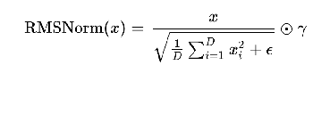  
مما سرّع التطبيع على GPU وصار معيارًا لجميع المعماريات المفتوحة تقريبًا للأعوام 2023–2026196. وفي نوفمبر نشر نوام شازير **Multi-Query Attention (MQA)** (№ 287\)49، مشيرًا إلى قيد فك الترميز الانحداري الذاتي بعرض نطاق ذاكرة HBM عند قراءة KV-cache، ومقترحًا إسقاطات مشتركة  لجميع رؤوس الاستعلام.  
وفي النماذج الحلقية وطويلة السياق أنشأ شاوجيه باي وزيكو كولتر وفلادلن كولتون **Deep Equilibrium Models (DEQ)** (№ 288)، التي تجد النقطة الثابتة للحلقة  بحلّال عددي للجذور وتشتقّها تحليليًا عبر مبرهنة الدالة الضمنية بذاكرة ؛ وطبّق تشنغتشونغ لان وآخرون المشاركة الشاملة لأوزان الطبقات في **ALBERT** (№ 289\)189؛ وأدخل كولين رافيل وآخرون الانحياز الجدولي النسبي للانتباه في **T5** (№ 290\)72؛ وجمع تسيهان داي وآخرون التكرارية القطعية مع المواضع النسبية في **Transformer-XL** (№ 291\)190. وفي توليف الكلام أنشأ يي رن وآخرون المحوّل غير الانحداري الذاتي **FastSpeech** بمنظِّم صريح لمدد الفونيمات (**Length Regulator**، № 292)، مسرِّعين توليد أطياف مل بمقدار رتبتين دون فقدان الاستقرار. وأحيا يانغ سونغ وستيفانو إرمون النمذجة التوليدية بحسب الدرجة على شبكة ضجيج متعددة المقاييس في **NCSN** (№ 293). وختم العامَ التوسيعُ المركّب للشبكات الالتفافية **EfficientNet** لتان ولي (№ 294\)178، والمرمّز الصوتي ذاتي الإشراف **wav2vec** لشنايدر وآخرين (№ 295)، والتوازي التنسوري داخل الطبقة **Megatron-LM** من NVIDIA (№ 296\)198، وتجزئة حالات المُحسِّن والأوزان **ZeRO** من Microsoft DeepSpeed (№ 297\)73 والمقالة المرجعية لآدم باشكه وآخرين عن **PyTorch** (№ 298).

## **2020**

**المجالات:** الانتباه/LLM الانتشار المُرمِّز STT TTS الحلقات/SSM  
في عام 2020 تحوّلت في آنٍ واحد النماذج اللغوية والتوليد بالانتشار والرؤية الحاسوبية والتقنيات الصوتية. فقد أرسى Jared Kaplan وزملاؤه **قوانين التوسع (Scaling Laws)** من نوع قانون القوة لخسارة النموذج اللغوي بدلالة عدد المعاملات والبيانات وميزانية FLOPs  (№ 299\)4، وجسّدها Tom Brown وفريق OpenAI في النموذج **GPT-3** ذي 175 مليار معامل مع التعلّم الناشئ في السياق (№ 300). وأدخل Noam Shazeer عائلة الكتل كاملة الاتصال ذات البوابات **SwiGLU**  (№ 301\)199 التي حلّت محل الشبكة متعددة الطبقات (MLP) ثنائية الطبقات المعتادة في النماذج اللغوية الكبيرة الحديثة، بينما حلّل Angelos Katharopoulos وآخرون الانتباه عبر نواة ميزات موجبة 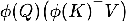 في **Linear Attention** (№ 302\)25، مبيّنين ثنائية المحوّل الخطي والشبكة العودية ذات الذاكرة المصفوفية 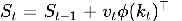 بتعقيد .  
وفي النماذج التوليدية نشر Jonathan Ho وAjay Jain وPieter Abbeel النموذج **DDPM** (№ 303\)37، فاختزلوا التدريب التبايني لسلسلة ماركوف العكسية إلى التنبؤ بالضجيج الغاوسي المضاف ؛ وبنى Jiaming Song وChenlin Meng وStefano Ermon مسارات حتمية غير ماركوفية لأخذ العينات المُسرَّع **DDIM** (№ 304\)5؛ ووحّد Yang Song وآخرون الانتشار وتقدير الدالة الدرجية (score) في معادلات تفاضلية عشوائية مستمرة **Score SDE** وفي تدفق الاحتمال الحتمي **Probability Flow ODE** (№ 305\)5. وفي الرؤية الحاسوبية قدّم Alexey Dosovitskiy وLucas Beyer وآخرون المحوّل الرقعي الخالص **ViT** (تقسيم الصورة إلى رقع 16×16 دون التفافات، وبلغت دقة Top-1 نسبة 88.55% على ImageNet لدى ViT-H/14، № 306\)73، إلى جانب اختراق التعلم الذاتي التبايني **SimCLR** (№ 311\)202 و**MoCo** (№ 312\) و**BYOL** الخالي من العينات السالبة (№ 313).  
وفي معالجة الصوت ظهرت ثلاثة مكوّنات أساسية للمنظومة الصوتية الحديثة: النموذج الهجين الالتفافي–المحوّلي **Conformer** لـ Anmol Gulati وآخرين (Macaron-FFN \+ MHSA \+ DepthwiseConv، الذي حقق **1.9% / 3.9% WER** على LibriSpeech test-clean / test-other، № 307\)203، والمُرمِّز الكمّي ذاتي الإشراف للموجة الخام **wav2vec 2.0** لـ Alexei Baevski وآخرين (№ 308\)191، ومُرمِّز الصوت (vocoder) التوليدي التنافسي متعدد الدورات **HiFi-GAN** لـ Jungil Kong وآخرين (№ 309\)206. وأخيرًا استنتج Albert Gu وTri Dao ومعاونوهم مؤثّرات الإسقاط متعدد الحدود المتعامد للتاريخ المستمر للإشارة **HiPPO** (№ 310\)62 (الأساس النظري لـ S4 وMamba)، وأنشأ Patrick Lewis وآخرون معمارية **RAG** (№ 314)، ووسّع Dmitry Lepikhin وآخرون خليط الخبراء (MoE) إلى 600B معامل في منظومة **GShard** (№ 315\)27.

## **2021**

**المجالات:** الانتباه/LLM MoE المُرمِّز الحلقات/SSM TTS الانتشار التحسين  
في عام 2021 تشكّلت معايير الترميز الموضعي النسبي، والتكيّف منخفض الرتبة، وفضاءات الحالة المهيكلة، والانتشار الكامن. فقد أدخل Jianlin Su وزملاؤه في **RoFormer** **الترميز الموضعي الدوّار (RoPE)** (№ 316\)72، إذ تُضرب أزواج إحداثيات الاستعلامات والمفاتيح في مصفوفات دوران متعامدة في المستوى العقدي بطيف ترددات هندسي :  
  
واقترح Ofir Press وآخرون عقوبات موضعية خطية للانتباه **ALiBi** (№ 317)؛ وبسّط William Fedus وBarret Zoph وNoam Shazeer خليط الخبراء إلى توجيه **Top-1** في **Switch Transformer** ذي 1.6 تريليون معامل (№ 318)؛ وابتكر Edward Hu وآخرون طريقة **LoRA** (№ 319\)210 التي تجمّد المصفوفات المدرَّبة مسبقًا  وتدرّب فقط إضافة منخفضة الرتبة  من الرتبة  دون زمن تأخير إضافي في الاستدلال.  
وفي المُرمِّزات متعددة الوسائط والبصرية، وازن Alec Radford وآخرون بين فضاءي الصور والنصوص على 400 مليون زوج في **CLIP** (№ 320\)212، وأنشأ Kaiming He وآخرون المُرمِّز الذاتي اللاتماثلي المقنَّع للرقع **MAE** (إخفاء 75% من الرقع، № 321)، واكتشفت Mathilde Caron وآخرون التقطير الذاتي للمحوّلات البصرية دون تسميات **DINO** (№ 322\)213، وأدخل Ze Liu وآخرون النوافذ المزاحة الهرمية في **Swin Transformer** (№ 323). وفي نمذجة التسلسلات الطويلة نشر Albert Gu وKaran Goel وChristopher Ré النموذج **S4 (Structured State Spaces)** (№ 324\)62: فبتحليل مصفوفة HiPPO إلى مجموع مصفوفة نظامية ومصفوفة منخفضة الرتبة (**NPLR**: ) اختزلوا حساب نواة الالتفاف ذات الطول  إلى نواة Cauchy وتحويل FFT بتعقيد ، فحلّوا لأول مرة مسألة Path-X بطول 16,384 على Long Range Arena (متوسط الدرجة 86.09)216؛ وبالتوازي أدخل Imanol Schlag وKazuki Irie وJürgen Schmidhuber في ICML 2021 قاعدة دلتا للكتابة فوق الذاكرة في المحوّلات الخطية (**Fast Weight Programmers**، № 325\)157، التي غدت المصدر النظري المباشر لـ DeltaNet.  
وفي المجالين الصوتي والتوليدي جمع Jaehyeon Kim وJungil Kong وJuhee Son بين الاستدلال التبايني والتدفقات التطبيعية وتخليق الموجة التنافسي في **VITS** (№ 326\)217؛ وأنشأ Neil Zeghidour وآخرون أول ترميز صوتي عصبي طرفًا إلى طرف مع **التكميم المتجهي المتبقي (RVQ)** هو **SoundStream** (№ 327\)47؛ وقدّم Wei-Ning Hsu وآخرون المُرمِّز الكلامي المقنَّع **HuBERT** (№ 328\)191؛ وبرهن Prafulla Dhariwal وAlex Nichol على تفوّق الانتشار على GAN في جودة الصور في **ADM** (№ 329\)219؛ وصاغ Jacob Austin وآخرون الانتشار المتقطع ذا الرمز الماص \[MASK\] في **D3PM** (№ 330\)35؛ وفي ديسمبر نقل Robin Rombach وAndreas Blattmann وDominik Lorenz وPatrick Esser وBjörn Ommer الانتشار إلى الفضاء المضغوط لمُرمِّز ذاتي إدراكي مع انتباه متقاطع (cross-attention) نصي في **Latent Diffusion Models (LDM / Stable Diffusion)** (№ 331\)179.

## **2022**

**المجالات:** الانتباه/LLM التحسين الانتشار STT TTS  
في عام 2022 غيّرت الخوارزميات الواعية بالعتاد للذاكرة، وقوانين التوسع الأمثل حسابيًا، وتدفقات المعادلات التفاضلية العادية المستقيمة، اقتصاديات النماذج الكبيرة. فقد نشر Tri Dao وDaniel Fu وStefano Ermon وAtri Rudra وChristopher Ré الخوارزمية **FlashAttention** (№ 332\)199: إذ قسّموا المصفوفات  إلى كتل في الذاكرة السريعة داخل شريحة GPU المسماة **SRAM**، وطبّقوا إعادة التحجيم الدقيقة كتلةً كتلة عبر **softmax المتصل (online-softmax)** (الذي يعود إلى Milakov وGimelshein، № 333):  
  
وحسب المؤلفون انتباهًا دقيقًا رياضيًا دون كتابة المصفوفة  في الذاكرة العامة HBM، فخفّضوا استهلاك الذاكرة إلى 223. وبيّن Jordan Hoffmann وآخرون في العمل **Chinchilla** (№ 334\)224 أنه عند ميزانية FLOPs ثابتة يتطلب نظام التدريب الأمثل توسيعًا متناسبًا لعدد المعاملات وعدد رموز التدريب ()، بينما استنتج Greg Yang وEdward Hu وآخرون المعايرة **P** لنقل المعاملات الفائقة بلا أمثلة (zero-shot) من النماذج الصغيرة إلى عمليات التشغيل الضخمة (№ 335).  
وفي النمذجة التوليدية أدخل Jonathan Ho وTim Salimans **التوجيه دون مصنِّف (CFG)** (№ 336)، ونظّم Tero Karras وآخرون الشرط المسبق للضجيج وأجهزة أخذ العينات من الرتبة الثانية في **EDM** (№ 337\)37، وفي خريف 2022 نقل كلٌّ من Xingchao Liu وChengyue Gong وQiang Liu (**Rectified Flow**، № 338)، وYaron Lipman وRicky Chen وآخرين (**Flow Matching**، № 339\)، وMichael Albergo مع Eric Vanden-Eijnden (**Stochastic Interpolants**، № 340\) التوليدَ إلى تدريب حقول سرعة مستقيمة للمعادلة التفاضلية العادية  على امتداد الاستكمال الخطي 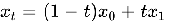 مع إجراء تقويم المسارات **Reflow**5. وفي ديسمبر استبدل William Peebles وSaining Xie في الانتشار الكامن شبكة U-Net بمحوّل قابل للتوسع مع تطبيع تكيّفي **adaLN-Zero**، أي **Diffusion Transformer (DiT)** (FID 2.27 على ImageNet 256×256، № 341\)219. وفي الصوت وما بعد التدريب ظهر محوّل التعرف على الكلام متعدد اللغات **Whisper** لـ Alec Radford وآخرين على 680,000 ساعة من التوسيم الضعيف (№ 342\)229، ورمّاز RVQ المفتوح بتردد 24 كيلوهرتز **EnCodec** لـ Alexandre Défossez وآخرين (№ 343\)231، والمواءمة ثلاثية المراحل مع تفضيلات البشر **InstructGPT (RLHF)** لـ Long Ouyang وآخرين (№ 344)، والحثّ بسلاسل الاستدلال **Chain-of-Thought** لـ Jason Wei وآخرين (№ 345\)، والمُحسِّنات ذات 8 بتات المكمَّمة بالكتل لـ Tim Dettmers وآخرين (№ 346\)169.

## **2023**

**المجالات:** الانتباه/LLM MoE الحلقات/SSM المُرمِّز الفيديو STT TTS STS التحسين  
في عام 2023 حصل النظام المفتوح للنماذج اللغوية الكبيرة على معيار للفك الفعّال، وتحدّت النماذج الخطية العودية المحوّلاتِ لأول مرة في المهام اللغوية. فقد أدخل Joshua Ainslie وآخرون **Grouped-Query Attention (GQA)** (№ 347\)39، مقاسمين  مجموعة من المفاتيح والقيم بين  رأس استعلام (وطُبّق في **Llama 2 70B** لـ Touvron وآخرين، № 348194)؛ وأزال Woosuk Kwon وآخرون تجزؤ ذاكرة الفيديو لمخبأ KV بآلية الصفحات **PagedAttention** في محرك **vLLM** (№ 349\)232؛ وحسّن Tri Dao التوازي على مستوى الـ warp في **FlashAttention-2** (№ 350\)198؛ وابتكر Hao Liu وMatei Zaharia وPieter Abbeel الانتباه الموزَّع على حلقة من المسرّعات **Ring Attention** للسياقات التي تبلغ ملايين الرموز (№ 351\)132؛ وأصدر فريق Mistral AI خليط الخبراء المتناثر المفتوح **Mixtral 8x7B** (Top-2 من 8، № 352\)234؛ واستنتج Rafael Rafailov وآخرون الصيغة المغلقة لمواءمة السياسة دون نموذج مكافآت، أي **Direct Preference Optimization (DPO)** (№ 353\)158:  
  
وفي الوقت نفسه اتسع هجوم المعماريات دون التربيعية ذات الذاكرة الثابتة في الاستدلال : **RWKV-4** لـ Bo Peng وآخرين (№ 354\)236، وشبكة الاحتفاظ متعددة المقاييس **RetNet** لـ Yutao Sun وآخرين (№ 355\)49، وفي ديسمبر **Mamba (S6)** لـ Albert Gu وTri Dao (№ 356\)25. فبجعل معاملات فضاء الحالة  دوالَّ للرمز المُدخَل الحالي (**Selective SSM**) وتنفيذ ماسح تجميعي متوازٍ واعٍ بالعتاد في SRAM، حلّ Mamba مشكلة الترشيح المعتمد على المحتوى للسياق بتعقيد خطي .  
وفي المجالات البصرية والانتشار النصي والكلامي ظهر المتنبئ الكامن غير التوليدي للصور **I-JEPA** لـ Assran وLeCun وآخرين (№ 357)، والمُرمِّز التبايني الزوجي السيغمويدي الخالي من softmax **SigLIP** لـ Zhai وآخرين (№ 358\)212، والنموذج البصري الأساسي **DINOv2** لـ Oquab وآخرين (№ 359\)176، ومولّد الفيديو **Stable Video Diffusion** لـ Blattmann وآخرين (№ 360)، والانتشار المتقطع مع تقدير نسب الاحتمالات **SEDD** لـ Lou وMeng وErmon (№ 361\)57، وأول نموذج لغوي ترميزي لتخليق الكلام zero-shot من عينة مدتها 3 ثوانٍ **VALL-E** لـ Wang وآخرين (№ 362\)218، والرمّاز الصوتي المحسَّن **DAC** لـ Kumar وآخرين (№ 363\)55، ونموذج الكلام الحواري **SpeechGPT** لـ Zhang وآخرين (№ 364\)240، والمُرمِّز **FastConformer** ذو الإطار 80 ميلي ثانية والأسرع بمقدار 2.8× لـ Rekesh وآخرين (№ 365\)171، والمحوّل **Token-and-Duration Transducer (TDT)** الذي يتخطى الإطارات الفارغة لـ Xu وMajumdar وGinsburg (№ 366\)79، والتكييف بـ 4 بتات **QLoRA** لـ Dettmers وآخرين (№ 367)، وتوسيع نافذة RoPE **YaRN** لـ Peng وآخرين (№ 368\)30، وكتاب Simon Prince *«Understanding Deep Learning»* (MIT Press، № 369\)8.

## **2024**

**المجالات:** الانتباه/LLM MoE الحلقات/SSM الانتشار الفيديو المُرمِّز STT TTS STS التحسين

### **الانتباه الكامن MLA، وموازنة MoE دون عقوبات، والتدريب المسبق المكمَّم**

في عام 2024 أعادت سلسلة أعمال مختبر DeepSeek-AI النظر في معمارية الانتباه وتوجيه الخبراء. ففي **DeepSeekMoE** (arXiv:2401.06066، № 370\)29 جُزِّئ الخبراء إلى شبكات فرعية صغيرة متخصصة مقترنة بـ *خبراء مشتركين* معزولين ونشطين دائمًا. وفي مايو أُدخلت في **DeepSeek-V2** (arXiv:2405.04434، 236B معامل إجمالي / 21B نشط، № 371\)50 آلية **Multi-Head Latent Attention (MLA)**:  
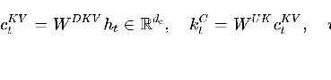  
وبفضل امتصاص مصفوفات فك الضغط  في إسقاطي الاستعلامات والخرج في مرحلة الاستدلال، لا يُخزَّن في الذاكرة سوى المتجه المضغوط 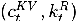 المؤلف من  عنصرًا لكل طبقة بدلًا من 32,768 لدى MHA ذي 128 رأسًا، أي تقليص لمخبأ KV بنسبة 98.24% لكل طبقة (وبنسبة 93.3% على مستوى نموذج V2 بأكمله مقابل DeepSeek 67B الكثيف)50. وفي ديسمبر جُمع في **DeepSeek-V3** (arXiv:2412.19437، 671B معامل إجمالي / 37B نشط، 14.8T رمز، № 372\)29 كلٌّ من **موازنة حمل الخبراء دون خسارة مساعدة** عبر انحياز ديناميكي 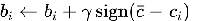 عند اختيار Top\-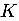 (وهي تطوير لـ Loss-Free Balancing لـ Wang وآخرين، № 37327)، والوحدة التعاقبية **Multi-Token Prediction (MTP)** (التي أسّسها نظريًا في أبريل Fabian Gloeckle وآخرون من Meta، arXiv:2404.19737، № 37464)، وخط أنابيب تداخل الاتصالات **DualPipe**، والتدريب المستقر بدقة **FP8** خلال 2.788 مليون ساعة GPU من طراز H800 (نحو \$5.576M بسعر تقديري \$2/ساعة، دون احتساب التشغيلات البحثية التمهيدية ودراسات الاستئصال (ablations)؛ MMLU 88.5%، MATH-500 90.2%)29. وقبل ذلك في فبراير قدّم Zhihong Shao وآخرون في **DeepSeekMath** (arXiv:2402.03300، № 375\)53 خوارزمية RL **GRPO** الخالية من الناقد. وبالتوازي أثبت Shuming Ma وآخرون جدوى الأوزان الثلاثية  في **BitNet b1.58** (arXiv:2402.17764، № 376\)51، وتصدّر خط المحوّلات الكثيفة المفتوح كلٌّ من **Llama 3.1 405B** (№ 377\)246 و**Qwen2.5** (№ 378\)247.

### **ثنائية SSM، وGated DeltaNet، وTTT، والمُحسِّنات من الجيل الثاني**

وعلى محور التسلسلات العودية برهن Tri Dao وAlbert Gu في **Mamba-2** (arXiv:2405.21060، № 379\)32 على ثنائية بنيوية صارمة (**SSD**) بين نماذج SSM الانتقائية ذات الانتقال العددي  والانتباه الخطي شبه القابل للفصل 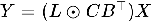، فنقلا تدريب SSM إلى كتل مصفوفية على Tensor Cores. ووسّع Maximilian Beck وSepp Hochreiter نطاق LSTM ذي البوابات الأسية والذاكرة المصفوفية التغايرية **mLSTM** في **xLSTM** (arXiv:2405.04517، № 380\)183؛ ووازى Songlin Yang وآخرون المحوّل الخطي ذا قاعدة دلتا عبر تمثيل WY لـ Householder بالأجزاء (**DeltaNet**، № 381248)، وفي ديسمبر، بالاشتراك مع Jan Kautz وAli Hatamizadeh، جمعوا قاعدة دلتا مع التخميد التكيّفي في Mamba-2 في **Gated DeltaNet** (arXiv:2412.06464، № 382\)157:  
  
وفي العام نفسه ظهرت النماذج المصفوفية العودية **RWKV-5/6 (Eagle & Finch)** لـ Bo Peng وآخرين (№ 383\)249، والنموذج الهجين Mamba–Transformer–MoE **Jamba** لـ Opher Lieber وآخرين (№ 384\)184، والتدفقات المتبقية متعددة المسارات **Hyper-Connections (HC)** لـ Defa Zhu وآخرين (arXiv:2409.19606، № 385\)61، وطبقات **Test-Time Training (TTT-Linear / TTT-MLP)** لـ Yu Sun وKaran Dalal وآخرين (arXiv:2407.04620، № 386\)44 التي حوّلت الحالة المخفية نفسها إلى مُدرِك (perceptron) ثنائي الطبقات يُدرَّب على سياق الاختبار. وفي التحسين العتادي والعددي ظهر **FlashAttention-3** غير المتزامن لرقاقات Hopper H100 (740 TFLOPs/s بدقة FP16، № 387\)252، والمُهيِّئ المسبق **SOAP** لـ Nikhil Vyas وSham Kakade وآخرين (arXiv:2409.11321، تشغيل AdamW في الأساس الذاتي لمصفوفات Shampoo بخفض زمن تدريب الدفعات الكبيرة بأكثر من 35%، № 388\)168، والزخم المصفوفي المتعامد **Muon** لـ Keller Jordan (№ 389\)65.

### **DiT متعدد الوسائط، وVAE للفيديو، وREPA، والحوار ثنائي الاتجاه المتزامن Moshi**

في توليد الصور والفيديو رسّخ Patrick Esser وآخرون في **Stable Diffusion 3** (arXiv:2403.03206، № 390\)174 وفريق Black Forest Labs في **FLUX.1** (12B معامل، № 391\)174 المعمارية ثنائية التدفق **MMDiT** مع Rectified Flow. وحلّت محل نماذج الفيديو الالتفافية نماذج DiT ثلاثية الأبعاد زمانية–مكانية فوق VAE سببية ثلاثية الأبعاد (ضغط 4×8×8): **CogVideoX** لـ Zhuoyi Yang وآخرين (№ 392\)255، و**Mochi 1** (№ 393\)254، و**HunyuanVideo** ذو 13 مليار معامل لـ Weijie Kong وآخرين مع ترميز المحثّات بـ MLLM وRoPE ثلاثي الأبعاد (arXiv:2412.03603، № 394\)256، و**LTX-Video** فائق السرعة من Lightricks بضغط Video-VAE بنسبة 1:192 (arXiv:2501.00103، № 395\)258. وسرّع Sihyun Yu وآخرون تقارب محوّلات الانتشار بأكثر من **17.5×** بطريقة مواءمة الرقع الكامنة مع ميزات DINOv2 (**REPA**، arXiv:2410.06940، FID 1.42 على ImageNet 256×256، № 396\)36؛ واستنتج Subham Sahoo وآخرون الحد المستمر للانتشار المقنَّع للنص في **MDLM** (arXiv:2406.07524، № 397\)222؛ وقدّم Adrien Bardes وآخرون مُرمِّز الفيديو للتنبؤ بالميزات **V-JEPA** (arXiv:2404.08471، № 398\)60؛ وحدّث Benjamin Warner وآخرون المُرمِّزات ثنائية الاتجاه للنص والشفرة إلى نافذة 8,192 رمزًا في **ModernBERT** (arXiv:2412.13663، تناوب الانتباه العام والمنزلق بنسبة 1:2، وRoPE، وGeGLU، وunpadding، № 399\)186.  
وفي التفاعل الكلامي أصدر Alexandre Défossez وآخرون من مختبر Kyutai النموذج **Moshi** والرمّاز العصبي المتدفق **Mimi** (arXiv:2410.00037، № 400\)26 — أول نموذج لغوي كلامي مفتوح ثنائي الاتجاه المتزامن بزمن تأخير نظري **160 ميلي ثانية** (200 ميلي ثانية عمليًا مقابل نحو 230 ميلي ثانية هي متوسط الوقفة في الكلام البشري). يضغط الرمّاز Mimi موجة 24 كيلوهرتز إلى تردد **12.5 هرتز** (خطوة 80 ميلي ثانية) في 8 دفاتر شفرات RVQ من 2,048 مدخلًا (**1.1 كيلوبت/ث**) مع تقطير دلالات WavLM في دفتر الشفرات الأول، بينما يتنبأ تسلسل هرمي من Temporal Transformer ذي 7B وDepth Transformer صغير بالتوازي بـ«المونولوج الداخلي» النصي (Inner Monologue) وبتدفقين صوتيين دون تقسيم المحادثة إلى أدوار26. وأكمل منظومةَ 2024 المُرمِّزُ غير الانحداري الذاتي **SenseVoice** (أسرع من Whisper-Large بـ 15×) والمُخلِّق **CosyVoice** (FunAudioLLM، № 401\)263، و**F5-TTS** المتدفق (№ 402\)264، و**Fish-Speech** ثنائي التعاقب (№ 403\)265، وكذلك الكتب الدراسية الأساسية الجديدة لـ Christopher وHugh Bishop *«Deep Learning: Foundations and Concepts»* (Springer، № 404\)266 ولـ Sebastian Raschka *«Build a Large Language Model (From Scratch)»* (Manning، № 405\)267.

## **2025**

**المجالات:** الانتباه/LLM MoE الحلقات/SSM الانتشار الفيديو المُرمِّز STT TTS STS التحسين

### **التعلم المعزَّز القابل للتحقق للاستدلال، والانتباه المتناثر، وmHC، والنماذج التريليونية على Muon**

في يناير 2025 بيّن نشر **DeepSeek-R1** (arXiv:2501.12948، الذي صدر في سبتمبر 2025 في مجلة *Nature*، № 406\)50 عبر تجربة **DeepSeek-R1-Zero** أن التوسيع الخالص للتعلم المعزَّز **GRPO** وفق قواعد قابلة للتحقق دون SFT ابتدائي يُكوِّن تلقائيًا سلاسل طويلة من التحقق الذاتي والتأمل، فيرفع الدقة على AIME 2024 من 15.6% إلى 71.0%، وبلغ **DeepSeek-R1** الكامل متعدد المراحل **79.8% Pass@1 على AIME 2024** و**97.3% على MATH-500** مع تقطير ناجح للاستدلال في نماذج كثيفة من 1.5B إلى 70B269. وفي فبراير قدّم Jingyang Yuan وآخرون **Native Sparse Attention (NSA)** (arXiv:2502.11089، أفضل ورقة في ACL 2025، № 407\)50، مقسّمين الانتباه إلى فروع مضغوط وانتقائي ومحلي ذي نافذة، مع تسريع الفك حتى 11.6×76. وفي ديسمبر صدر **DeepSeek-V3.2** (arXiv:2512.02556، № 408\)10 الذي أدمج فوق MLA آلية **DeepSeek Sparse Attention (DSA)** بمفهرس سريع (lightning indexer) واختيار top\- رمز بتعقيد  (وأظهر الإصدار عالي الميزانية V3.2-Speciale نتائج بمستوى الذهب في IMO 2025 وIOI 2025 وفق تقرير المؤلفين)10، وعمل Zhenda Xie وShengding Hu وآخرين حول **Manifold-Constrained Hyper-Connections (mHC)** (arXiv:2512.24880، № 409\)2، الذي أسقط مصفوفات خلط مسارات التدفق المتبقي بخوارزمية Sinkhorn–Knopp على متعدد السطوح Birkhoff للمصفوفات ثنائية العشوائية (ضمان  وبنفقات زمنية إضافية لا تتجاوز 6.7% عند )2.  
وبالتوازي أثبت فريق Moonshot AI قابلية المُحسِّن المصفوفي **Muon** للتوسع (arXiv:2502.16982، № 410\)65، وفي يوليو درّب على 15.5 تريليون رمز دون ارتفاع مفاجئ واحد في الخسارة النموذجَ الوكيلي التريليوني الرائد **Kimi K2** (arXiv:2507.20534، 1.04T معامل إجمالي / 32.6B نشط، 8 من 384 خبيرًا \+ 1 مشترك، № 411\) بفضل حزمة **MuonClip** (تكرارات Newton–Schulz \+ تقييد أقصى لوغاريتم للانتباه **QK-Clip**)66، وأتبعه في أكتوبر بالمعمارية الهجينة **Kimi Linear** ذات تخميد دلتا لكل قناة **KDA** (arXiv:2510.26692، تسريع فك يصل إلى 6× على سياق 1M، № 412\)278. وتوسّعت الجبهة المفتوحة بعائلة **Qwen3** القابلة للتحكم في الاستدلال (حتى 235B-A22B على 36T رمز، arXiv:2505.09388، № 413\)247، والنماذج الأصلية متعددة الوسائط ذات الدمج المبكر **Llama 4 Scout** (109B-A17B، سياق 10 ملايين رمز) و**Llama 4 Maverick** (400B-A17B، № 414\)280، و**GLM-4.5** الوكيلي (355B-A32B، arXiv:2508.06471، № 415\)282، والنموذج الهجين Mamba-2 \+ GQA \+ MoE بصيغة NVFP4 **NVIDIA Nemotron 3 Nano** (31.6B-A3.2B، سياق 1M، arXiv:2512.20848، № 416\)13.

### **العمق العودي، والذاكرة أثناء الاستدلال، والنماذج اللغوية الانتشارية، وفيديو MoE**

في فبراير 2025 وسّع Jonas Geiping وTom Goldstein وآخرون الاستدلال الكامن بالعمق في النموذج **Huginn-0125** (3.5B معامل، 800B رمز، arXiv:2502.05171، № 417\)3: إذ يعيد المخطط الساندويتشي  تشغيل نواة من 4 طبقات ذات تهيئة عشوائية 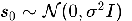 مع إعادة حقن المُدخل  حتى  مرة (132 طبقة فعّالة)، رغم أن الدراسات اللاحقة بطريقة الاستقصاء (probing) (Lu et al., arXiv:2507.02199) أشارت إلى غموض التفسير النصي المباشر للتكرارات المخفية الوسيطة وإلى احتياطي أكثر تواضعًا من الذاكرة الوقائعية (MMLU 31.4%) مقارنة بالنماذج المدرَّبة على 4T رمز187. وفي أكتوبر درّب Rui-Jie Zhu وآخرون (ByteDance) على 7.7T رمز نماذج حلقية كاملة المكدس ذات خروج تكيّفي **Ouro-1.4B وOuro-2.6B** (arXiv:2510.25741، № 418\)77، حيث بلغ نموذج 2.6B عند  نسبة 90.8% على MATH-500 وعادل نماذج كثيفة حتى 12B بفضل التركيب متعدد الخطوات للمعرفة، بينما أزال Bohong Wu وآخرون عقوبة التأخير التسلسلي للحلقات بجدولة خط الأنابيب **Cross-Loop Parallelism** في **Parallel Loop Transformer (PLT)** (arXiv:2510.24824، № 419\)33. وفي الوقت نفسه أنشأ Ali Behrouz وآخرون الذاكرة العصبية طويلة المدى **Titans** المحدَّثة بالتدرج مع الزخم أثناء الاستدلال (arXiv:2501.00663، № 420\)288، ووسّع Tianyuan Zhang وآخرون تدريب الأوزان السريعة على أجزاء حتى 1M رمز في **LaCT** (arXiv:2505.23884، № 421\)289، وأصدر Maximilian Beck وSepp Hochreiter النموذج **xLSTM 7B** (arXiv:2503.13427، № 422\)183، وأصدر Bo Peng وآخرون **RWKV-7 "Goose"** بالتطور الديناميكي منخفض الرتبة للحالة (arXiv:2503.14456، № 423\)236.  
وفي الانتشار المتقطع للنص صدر النموذج **LLaDA-8B** المدرَّب من الصفر بخسارة ELBO الموزونة  (ومتغيره MoE بـ 7B-A1B) لـ Shen Nie وآخرين (arXiv:2502.09992، № 424\)35، والعائلة التجارية **Mercury Coder** من Inception Labs بسرعة توليد متوازٍ **1,109 رمز/ث** على H100 (arXiv:2506.17298، № 425\)58 و**Dream 7B** لـ Jiacheng Ye وآخرين (arXiv:2508.15487، № 426\)294. وفي توليد الفيديو فتح فريق Alibaba بترخيص Apache 2.0 النموذجين **Wan 2.1** (arXiv:2503.20314، № 427\) و**Wan 2.2** (№ 428\) — أول معمارية انتشار فيديو مع **مزيل ضجيج MoE زمني ثنائي الخبراء** (27B إجمالي / 14B نشط، مع التبديل بين خبير البنية الخشنة وخبير التفاصيل الدقيقة بعتبة SNR دون زيادة في تكلفة الخطوة، إضافة إلى النموذج المدمج **TI2V-5B** بضغط VAE بنسبة 4×16×16 لبطاقة RTX 4090 واحدة)172. وصدر أيضًا **HunyuanVideo 1.5** (8.3B معامل، 75 ثانية للتصيير على RTX 4090 في نمط step-distilled، arXiv:2511.18870، № 429\)297، والمحرِّر السياقي والمولّد ذو 32 مليار معامل **FLUX.1 Kontext / FLUX.2** (Mistral-3 24B \+ VAE ذو 128 قناة، № 430\)174، والمُرمِّز متعدد اللغات **SigLIP 2** (arXiv:2502.14786، 85.0% zero-shot على ImageNet لدى ViT-g/16، № 431\)239، ونموذج العالم الفيديوي مع تخطيط الروبوتات **V-JEPA 2** (arXiv:2506.09985، № 432\)59، والمُرمِّز البصري ذو 7 مليارات معامل **DINOv3** بآلية **Gram Anchoring** للحفاظ على خرائط التقطيع الكثيفة أثناء التدريب الطويل (arXiv:2508.10104، 55.9 mIoU على ADE20k، № 433\)301.  
وفي المنظومة الصوتية قدّمت Alibaba النماذج متعددة الوسائط الشاملة **Qwen2.5-Omni** (arXiv:2503.20215، № 434\) و**Qwen3-Omni** (arXiv:2509.17765، معمارية **Thinker–Talker MoE** \+ مُرمِّز **AuT** بتردد 12.5 هرتز على 20 مليون ساعة صوت \+ مفكّك سببي لحظي Code2Wav دون تراجع في MMLU النصي، № 435\)303. وإلى جانبها صدر **Step-Audio** ذو 130 مليار معامل (arXiv:2502.11946، № 436\)306، و**LLaMA-Omni2** المتدفق (arXiv:2505.02625، № 437\)308، والمُخلِّق ذو التكميم FSQ **CosyVoice 3** (arXiv:2505.17589، № 438\)46، والنماذج المفتوحة المحلية **Kokoro-82M** و**Orpheus-3B** و**Chatterbox**311، والمولّد الحواري لمدة 90 دقيقة على \-VAE المستمر **Microsoft VibeVoice** (arXiv:2508.19205، № 439\)173، ونماذج Kyutai الصوتية اللغوية المستمرة (arXiv:2509.06926، № 440\)315، والنموذج الصوتي اللغوي **Mistral Voxtral** (arXiv:2507.13264، № 441\)316، و**NVIDIA Canary-1B-v2 وParakeet-TDT-0.6B-v3** فائقا السرعة (arXiv:2509.14128، 3,332.7 RTFx، № 442\)229 و**GigaAM-v3**317.

## **2026**

**المجالات:** الانتباه/LLM MoE الحلقات/SSM الانتشار الفيديو المُرمِّز STT TTS STS التحسين

### **النماذج الرائدة فائقة التناثر، والانتباه بالعمق (AttnRes)، وتوفير مخبأ KV العام**

بحلول نوفمبر 2026 انتقلت المعماريات المفتوحة (التي نظّمها Sebastian Raschka في فهرسه *LLM Architecture Gallery* المؤلف من 132 نموذجًا وفي كتابه *«Build a Reasoning Model (From Scratch)»*، يونيو 2026، № 445\)1 إلى التنشيط فائق التناثر للأوزان (3–6% لكل رمز) والضغط الهجين للانتباه. فقد وسّع النموذج **DeepSeek V4 Pro** (الإصدار 0813 في أغسطس 2026، ترخيص MIT) نطاق MoE إلى **1.6 تريليون معامل مع \~49B نشطة لكل رمز (\~3.06%)** بنافذة 1M رمز (التدريب على \>32T رمز بمُحسِّن Muon): وخفّض الجمع بين **Compressed Sparse Attention (CSA)** و**Heavily Compressed Attention (HCA)** التكاليف الحسابية على سياق 1M إلى 27% من FLOPs، وذاكرة مخبأ KV إلى 10% من مستوى V3.2 (وتفيد المراجعات المنشورة ومواد الإصدار بنسبة 93–94% على LiveCodeBench، و\>90% على GPQA Diamond، و62.7 على DeepSWE)31.  
وأصدر فريق Moonshot AI، في أعقاب **Kimi K2.5** البصري الوكيلي (arXiv:2602.02276)، طريقة **Attention Residuals (AttnRes)** (arXiv:2603.15031) التي تستبدل التراكم المنتظم للتدفق المتبقي بانتباه softmax كتلي قابل للتعلم على امتداد محور عمق الطبقات السابقة، وفي يوليو 2026 فتح النموذج الرائد ذا 2.8 تريليون معامل، وهو الأكبر حينها، **Kimi K3** (arXiv:2607.24653، 104B معامل نشط — 16 من 896 خبيرًا موجَّهًا \+ 2 مشتركين، نافذة 1M، نقطة حفظ أصلية MXFP4، № 443\)4. وطُبِّق في Kimi K3 تناوب 3:1 بين طبقات **KDA** الخطية (بتخميد لوغاريتمي سيغمويدي محدود من الأسفل يتسع في المدى الديناميكي لـ BF16 على أنوية المصفوفات الكثيفة Tensor Cores) وطبقات **Gated MLA** العامة **دون أي ترميز موضعي (NoPE)**، وكذلك **Normalized LatentMoE** مع طبقة RMSNorm قبل الإسقاط الرافع4. وأكملت سلسلة MoE الكبيرة ذات الانتباه المتناثر النماذجُ **GLM-5** (arXiv:2602.15763، 744B-A40B، MLA \+ DSA \+ RL وكيلي غير متزامن APRIL، 77.8% على SWE-bench Verified و50.4 على AA Index v4.0)321، و**Tencent Hy4** (770B-A49B، Gated MLA \+ DSA مع IndexCache عبر الطبقات وروابط فائقة رباعية المسارات iHC)1، و**Meta Muse Spark Open** (816B-A42B)1.  
وفي قطب الأنظمة المحلية المدمجة أدخل **Google Gemma 4** (arXiv:2607.02770، Apache 2.0، بأحجام E2B وE4B و12B Unified و26B-A4B MoE و31B Dense) ثلاث آليات معمارية دفعة واحدة: جداول التضمين لكل طبقة **Per-Layer Embeddings (PLE)** في النماذج الأصغر، و**الإسقاط الخالي كليًا من المُرمِّز (Encoder-Free)** لمقاطع الصوت الخام بطول 40 ميلي ثانية ورقع الصور مباشرة إلى المفكّك في 12B Unified، و**إعادة استخدام المفاتيح بوصفها قيمًا ()** مع التدوير الجزئي **\-RoPE ()** في طبقات الانتباه العامة (نسبة المحلي إلى العام 5:1)، مما خفّض مخبأ KV العام بنسبة **37.5%**73. ومع التقييمات العالية في الاختبارات الرياضية والعلمية (89.2% على AIME 2026 و84.3% على GPQA Diamond لدى 31B في نمط Thinking) لاحظ أرشيف Artificial Analysis v5.0.1 المستقل تخلّف نموذج 31B في السيناريوهات الوكيلية المعقدة متعددة الخطوات عن الأنظمة التريليونية الكبيرة324.

### **الهجائن 3:1 (Qwen 3.8، Nemotron 3/3.5)، وMamba-3، وFlashAttention-4، والنماذج الحلقية الانتشارية**

ترسّخ هجين الذاكرة المصفوفية الخطية والانتباه الكامل النادر في **Alibaba Qwen 3.8-27B** (أغسطس 2026، Apache 2.0، معمارية VLM كثيفة من 64 طبقة: 16 كتلة من 3 طبقات **Gated DeltaNet** وطبقة **Gated Attention** واحدة، بالتوازي مع النموذج المغلق/الرائد 2.4T-A95B Qwen 3.8-Max)11. وفي 48 طبقة Gated DeltaNet تُخزَّن مصفوفات حالة ثابتة الحجم لـ 48 رأس قيم  تشغل **72.0 ميبيبايت ثابتة في BF16** (**144.0 ميبيبايت / 151.0 ميغابايت في FP32**) عند أي طول للتسلسل، بينما تتطلب 16 طبقة Gated Attention ذاكرة لمخبأ KV أقل بأربع مرات من محوّل منتظم من 64 طبقة30. وفي عائلة **NVIDIA Nemotron 3 Super** (120B-A12B، arXiv:2604.12374) و**Nemotron 3 Ultra** (550B-A55B، 108 طبقات، arXiv:2606.15007) و**Nemotron 3.5 Super & Lightning** (arXiv:2610.38095) يُجمع الهجين Mamba-2 \+ GQA مع **LatentMoE** (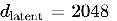) ومسوِّدة MTP تعاودية للفك التأملي على سياق حتى 1M رمز27.  
وشهدت الأنوية الأساسية لـ SSM والانتباه نفسها تحديثًا جوهريًا. فقد قدّم Aakash Lahoti وTri Dao وAlbert Gu وآخرون **Mamba-3** (arXiv:2603.15569، ICLR 2026\)32: إذ أزال الانتقال إلى **التقطيع الأسي شبه المنحرف** من الرتبة الثانية في الدقة 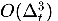 الحاجة إلى التفاف 1D خارجي، وسمحت **انتقالات الحالة العقدية** (المكافئة لـ **RoPE** المعتمد على المُدخل) بتتبع التكافؤ (Parity) بدقة 100%، ورفعت **صياغة MIMO** من الرتبة  الكثافة الحسابية للفك بمقدار 4× دون زيادة في التأخير، مساوية الحالة  بالسابقة 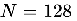329. وفصل Ali Hatamizadeh وYejin Choi وJan Kautz بوابتي المحو والكتابة في **Gated DeltaNet-2** (arXiv:2605.22791)248، وأصدر مختبر Tri Dao **FlashAttention-4** (arXiv:2603.05451) للتوسع اللامتماثل لمسرّعات **NVIDIA Blackwell (B200/GB200)**: فقد أتاحت المحاكاة متعددة الحدود للدالة الأسية على وحدات FMA و**التخطي الشرطي لإعادة تحجيم softmax المتصل** عند  بلوغ 1,600 TFLOPs/s (71% من الذروة)، وخفّضت كتابة النواة بلغة Python عبر **CuTe-DSL** زمن التصريف 20–30 مرة مقارنة بقوالب C++223. وعند تقاطع الحلقات والانتشار أنشأ Sanghyun Lee وآخرون **Looped Diffusion Language Models (LoopMDM)** (arXiv:2605.26106، NeurIPS 2026)، بتكرار الطبقات الأولى–المتوسطة لنموذج لغوي انتشاري مقنَّع مع توفير يصل إلى **3.34× من FLOPs التدريب**188 (وطُوِّر في **Looped UDLMs**، arXiv:2610.3006656)؛ وصدرت كذلك دراسة تشبّع المُرمِّز 7B **LoopCoder-v2 (PLT-7B)** (arXiv:2606.18023)38، و**Hyperloop Transformers** (arXiv:2604.21254)334، و**LoopFold** (arXiv:2610.35556)194، والنموذج الحلقي المفتوح MoE **Inkling 2 Mini** (Thinking Machines Lab، 26.4B-A3.4B، 3 مرورات للطبقات المتوسطة \+ AttnRes)197.

### **التخليق المتزامن للصوت والفيديو LTX-2.5 والوكلاء الصوتيون ثنائيو الاتجاه المتزامن مع الأدوات**

في الفيديو التوليدي نشرت Lightricks **LTX-2** (arXiv:2601.03233، DiT لامتماثل ثنائي التدفق من تدفق فيديو 14B مع RoPE ثلاثي الأبعاد وتدفق صوت 5B مع RoPE أحادي البعد، مرتبطين بانتباه متقاطع ثنائي الاتجاه عبر الزمن)335، وفي أغسطس 2026 أصدرت **LTX-2.5** ذا 22 مليار معامل (مُرمِّز نصي Gemma 4 12B، توليد فيديو متزامن حتى 4K بمدة تصل إلى 20 ثانية وصوت ستيريو 24 كيلوهرتز في مرور واحد، واستمرارية المشاهد متعددة اللقطات والتحكم عبر IC-LoRA)258، بينما في توليد الصور خفّض المحوّل المنفصل **DDT-XL/2** لـ Wang وآخرين (CVPR 2026، arXiv:2504.05741) قيمة FID على ImageNet 256×256 إلى **1.26**219. وفي الكلام ثنائي الاتجاه المتزامن قدّم فريق NVIDIA **PersonaPlex 7B** (arXiv:2602.06053، محثّ هجين مثبَّت في السياق للدور وعينة الصوت فوق معمارية Moshi \+ Mimi: الطبيعية DMOS **3.90 ± 0.15** وتشابه استنساخ الصوت SSIM **0.57**)68 و**NemotronLabs VoiceChat** (arXiv:2609.21967، أول نموذج STS مفتوح ثنائي الاتجاه المتزامن (Full-Duplex) مع الاستدعاء الأصلي للأدوات Tool Calling، ونسخ مساعد بـ RNN-T، واعتراض بنسبة 100% عند المقاطعة واستئناف الكلام بنسبة 93% بعد تعبيرات المستمع القصيرة)69. وأكمل المنظومة الصوتية المتدفقة **Qwen3-TTS** (arXiv:2601.15621، فرع سببي بتردد 12.5 هرتز مع MTP ذي 16 دفتر شفرات وتأخير الحزمة الأولى نحو **97–100 ميلي ثانية**) و**Qwen-Audio-3.0-TTS** (arXiv:2607.23938)54، و**Qwen3.5-Omni** (arXiv:2604.15804، مواءمة ARIA)342، و**Fish Audio S2-Pro** (arXiv:2603.08823، TTFA \~100 ميلي ثانية، RTF 0.195) و**Drama 3** (arXiv:2610.18010)158، و**Kyutai Pocket TTS** العامل بسرعة أعلى من الزمن الحقيقي بـ 6× على نواتين من وحدة المعالجة المركزية في حاسوب محمول (100M معامل، MIT)344، و**Mistral Voxtral Realtime** المتدفق (arXiv:2602.11298، تأخير 480 ميلي ثانية)345، و**GigaAM Multilingual** (arXiv:2607.10371، Interspeech 2026\)346 و**Nemotron 3.5 Transcribe** ثنائي الفرعين (TDT \+ مُقسِّم المتحدثين Sortformer)348.

## **2027**

**المجالات:** الانتباه/LLM الحلقات/SSM الانتشار الفيديو التحسين  
يتركز البرنامج العلمي لعام **2027**، الذي ثبّتته بحلول نوفمبر 2026 المنشورات المقبولة في مؤتمرات الشتاء–الربيع **WACV 2027** و**AAAI / IAAI 2027** و**WSDM 2027** و**DATE 2027** والمدوّنة المفتوحة المحكَّمة المؤلفة من 37,028 تقديمًا في **ICLR 2027** على OpenReview، على التوحيد النظري للنماذج التوليدية ومعالجة الأمراض العددية–الطورية الدقيقة في الشبكات الهجينة والحلقية15. ففي الورقة المقبولة في WACV 2027 لـ Amandeep Kumar وNithin Nair وVishal Patel بعنوان *«Scale-wise VAR is Secretly Discrete Diffusion»* (№ 444\)17 أُثبت بصرامة أن النماذج الانحدارية الذاتية البصرية للتنبؤ بالمقياس التالي (VAR) مكافئة وظيفيًا للانتشار المقنَّع المتقطع بحسب المقياس في الفضاء الكامن متعدد المقاييس. وقُدِّمت كذلك في أعمال WACV 2027 وAAAI/IAAI 2027 محوّلات الفيديو المقنَّعة للتقطيع طويل المدى **LVMT** (Norouzi et al.)16، والمخططات التدفقية أحادية الخطوة (arXiv:2608.09579)، ومفكّكات الانتشار **PixCell** (arXiv:2611.01141)، والانحيازات البنيوية للانتباه (arXiv:2611.04657)، والمعماريات الصناعية للاسترجاع الموثوق المقيَّد (arXiv:2611.20398)19.  
وفي مدوّنة ICLR 2027 المحكَّمة ظهرت ثلاث آليات أساسية من الجيل التالي. أولًا، بيّن تحليل الضغط بالأجزاء لمخبأ KV (*«Periodic Weak Spots: Phase Sensitivity from Chunked KV-Cache Compression»*) أنه في نماذج صنف DeepSeek-V4 تتفاوت دقة استخراج الوقائع حتى **40 نقطة مئوية** بحسب طور موضع الرمز بالنسبة لحدود نافذة الضغط نتيجة نشوء رؤوس متخصصة بالطور15. ثانيًا، أثبت عمل حول الاستقرار العددي للمرور العكسي للانتباه (OpenReview:LJvGaCWmFh) أن انفجارات التدرج المتأخرة عند التدريب بـ **BF16 FlashAttention-3** ناتجة عن انتهاك التقريب BF16 لقانون الحفظ الدقيق لمجموع تدرجات صف softmax (الخطأ الوسيط لتدرج الاستعلامات 219%)، واقترح تصحيحًا لنواة المرور العكسي يخفض الخطأ إلى **0.34% / 0.37%** (مستوى FP32) بزيادة في كلفة الخطوة قدرها 4.7% فقط352. ثالثًا، اقتُرحت **Variable-Width («Hourglass») Transformers** المتضيقة في المنتصف، و**Matryoshka Language Model Suites** المتداخلة (توفير 36% من الحساب لتدريب سلسلة الأحجام) وطريقة **SafeBridge** لمواءمة أمان النماذج الحلقية عند جميع أعماق التكرار — ردًا على اكتشاف أن خفض عدد الحلقات إلى النصف أثناء الاستدلال في Ouro وHuginn يحافظ على 89% من الدقة على GSM8K لكنه يدمّر متجه الرفض المتكوّن متأخرًا، مما يرفع الهشاشة أمام الطلبات الضارة بمقدار 5.3–9.9 مرة15.

## **الملحق أ. جداول ملخصة للمعماريات والمعايير القياسية والإحصاءات والمستودعات**

### **الجدول أ.1. المصفوفة الزمنية الكاملة للمعماريات والآليات (1958–2027، بخطوة سنة واحدة)**

| السنة | المجال / الوسوم | المعمارية / الخوارزمية الرئيسية | الآلية الرياضية الأساسية | المعالم والمؤلفون ورقم المرجع في الببليوغرافيا |
| :---- | :---- | :---- | :---- | :---- |
| **1958** | الأساس | المُدرِك Mark I (Perceptron) | المستوى الفائق ، تصحيح الأخطاء | Rosenblatt (№ 1), von Neumann (№ 2\) |
| **1959** | المُرمِّز الأساس | Pandemonium؛ TD-الداما؛ الحقول الاستقبالية V1 | الاختيار المتوازي ؛ الفرق الزمني لتقدير الموضع | Hubel & Wiesel (№ 3), Selfridge (№ 4), Samuel (№ 5\) |
| **1960** | الأساس التحسين | ADALINE / قاعدة LMS؛ التدرج المترافق | قاعدة دلتا ؛ المعادلات التفاضلية العادية المترافقة المستمرة | Widrow & Hoff (№ 6), Kelley (№ 7\)7 |
| **1961** | الحلقات الذاكرة | Die Lernmatrix؛ المعادلات التذكّرية | الذاكرة الترابطية المصفوفية غير المتجانسة  | Steinbuch (№ 8\)91, Caianiello (№ 9\) |
| **1962** | الأساس المُرمِّز | مبرهنة تقارب المُدرِك؛ MADALINE | حدّ الأخطاء ؛ الخلايا البسيطة والمعقدة في القشرة | Novikoff (№ 10\)93, Hubel & Wiesel (№ 14\) |
| **1963** | الأساس التحسين | الصورة المعمَّمة (SVM خطي) | المستوى الفائق ذو الهامش الأقصى 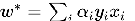 | Vapnik & Lerner (№ 15\)98 |
| **1964** | التحسين الأساس | طريقة الزخم لـ Polyak؛ الدوال الكامنة | Heavy-ball ؛ حيلة النواة؛ AD الأمامي | Polyak (№ 18\)101, Aizerman et al. (№ 19), Wengert (№ 20\) |
| **1965** | الأساس | أولى MLP العميقة؛ مبرهنة Cover | الانتقاء الطبقي لكثيرات الحدود Kolmogorov–Gabor؛ عدد الثنائيات  | Ivakhnenko & Lapa (№ 21\)7, Cover (№ 22\) |
| **1966** | التحسين الأساس | تصغير المخاطرة المتوسطة في التعلم | التقريب العشوائي  | Tsypkin (№ 25\)106, Braverman (№ 26\) |
| **1967** | الأساس التحسين | SGD متعدد الطبقات من طرف إلى طرف؛ Sinkhorn–Knopp | الانحدار التدرجي في شبكة من 5 طبقات؛ إسقاط المصفوفات ثنائية العشوائية | Amari (№ 28\)21, Sinkhorn & Knopp (№ 30\)61 |
| **1968** | الأساس الحلقات | GMDH (طريقة المعالجة الجماعية للمعطيات)؛ شبكات Outstar؛ نظرية VC | التنظيم التحققي للعمق؛ معادلات اللدونة STM/LTM | Ivakhnenko (№ 31), Grossberg (№ 32), Vapnik (№ 33\) |
| **1969** | الأساس المُرمِّز | حدود المُدرِكات؛ ReLU التناظري | استحالة فصل XOR بطبقة واحدة؛ المقوِّم متعدد الطبقات  | Minsky & Papert (№ 34), Bryson & Ho (№ 35), Fukushima (№ 36\)85 |
| **1970** | الأساس التحسين | الوضع العكسي للاشتقاق الآلي؛ BFGS | قاعدة السلسلة الدقيقة على الرسم البياني ؛ شبه نيوتن | Linnainmaa (№ 37\)113, BFGS (№ 38\) |
| **1971** | الأساس الذاكرة | شبكة GMDH من 8 طبقات؛ نظرية القشرة العتيقة | شبكة كثيرات حدود عميقة؛ الذاكرة الترابطية المتناثرة للحُصين | Ivakhnenko (№ 40\)115, Marr (№ 41\) |
| **1972** | الحلقات الذاكرة | شبكة Amari–Hopfield؛ مجموعات Wilson–Cowan | الجاذبات العودية ؛ الدورات الحدّية E–I | Amari (№ 42\)115, Kohonen (№ 43), Wilson & Cowan (№ 46\)120 |
| **1973** | المُرمِّز الحلقات | التنظيم الذاتي لقشرة V1؛ الشبكات التحويلية (Shunting) | قاعدة Hebb التنافسية مع التطبيع  للأوزان؛ التباين القسمي | von der Malsburg (№ 47\)123, Grossberg (№ 48\) |
| **1974** | الأساس الحلقات | Backprop للشبكات العصبية؛ نموذج السبين للدماغ | التغذية الراجعة الديناميكية للمشتقات؛ توزيع Ising مع درجة الحرارة | Werbos (№ 50\)123, Little (№ 51\)127 |
| **1975** | المُرمِّز الذاكرة | Cognitron؛ CMAC؛ زجاج السبين SK | التثبيط القسمي للطبقات؛ الترميز التجزيئي المحلي؛ هاملتوني SK | Fukushima (№ 52\)122, Albus (№ 53), SK (№ 54\) |
| **1976** | التحسين الحلقات | Reverse AD في المطبوع (BIT)؛ النموذج الأولي لـ ART | مفكوك Taylor مع مفاضلة الذاكرة؛ معضلة الاستقرار–اللدونة | Linnainmaa (№ 56\)23, Grossberg (№ 57\) |
| **1977** | الحلقات التحسين | Brain-State-in-a-Box (BSB)؛ خوارزمية EM | الجاذبات في المكعب الفائق ؛ الحد الأدنى لاحتمالية المتغيرات المخفية | Anderson et al. (№ 59\)122, Dempster et al. (№ 62\) |
| **1978** | الذاكرة الأساس | السعة المشبكية للذاكرة؛ معيار BIC | تدرّج سعة الذاكرة  بعدد المشابك | Little & Shaw (№ 63\)127, Schwarz (№ 64\) |
| **1979** | المُرمِّز | Neocognitron (النشر الأصلي) | تعاقب المستويات المشتركة لخلايا \- (الالتفاف) وخلايا \- (التجميع) | Fukushima (№ 67\)86 |
| **1980** | المُرمِّز التحسين | Neocognitron (الدولي)؛ حدّ Baur–Strassen | اللاتغيّر بالنسبة للإزاحة بالتعاقب ؛ تقدير تعقيد التدرج 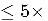 | Fukushima (№ 69\)129, Baur & Strassen (№ 71\) |
| **1981** | الذاكرة الحلقات | التمثيلات الموزَّعة؛ RL الترابطي | التنشيط التفاعلي للميزات؛ تدرج البحث وفق التعزيز | Hinton & Anderson (№ 72), Barto et al. (№ 74\) |
| **1982** | الحلقات المُرمِّز | شبكة Hopfield؛ خرائط Kohonen (SOM)؛ قاعدة Oja | دالة Lyapunov ؛ التعلم الطوبوغرافي؛ PCA العصبي | Hopfield (№ 75), Werbos (№ 76), Kohonen (№ 77), Oja (№ 78\) |
| **1983** | التحسين الحلقات | طريقة Nesterov المسرَّعة؛ التلدين المحاكى | الانحدار الأمثل  في النقطة الاستباقية؛ Actor–Critic RL | Nesterov (№ 81\)143, Kirkpatrick (№ 82), Barto (№ 83\) |
| **1984** | الأساس الانتشار | تعلّم PAC؛ Hopfield المستمر؛ عيّنة Gibbs | قابلية التعلم كثيرة الحدود ؛ استرخاء MCMC على حقول MRF | Valiant (№ 84\)147, Hopfield (№ 85), Geman (№ 86\) |
| **1985** | الأساس الانتشار | آلة Boltzmann؛ الاستنتاجات المستقلة لـ Backprop | تدرج فرق ارتباطات الطورين  | Ackley, Hinton & Sejnowski (№ 88\)150, LeCun (№ 89\) |
| **1986** | الأساس الحلقات | MLP \+ Backpropagation؛ RBM (Harmonium)؛ Jordan RNN | التدرج المتسلسل للتمثيلات المخفية ؛ طاقة ثنائية الأجزاء دون حلقات | Rumelhart, Hinton & Williams (№ 92), Smolensky (№ 94), Jordan (№ 95\) |
| **1987** | STT الحلقات | TDNN؛ الأوزان السريعة (Fast Weights)؛ Autoencoder stack | التفاف 1D بالزمن للكلام؛ إضافة سياقية مرنة للأوزان | Waibel (№ 97), Hinton & Plaut (№ 98), Ballard (№ 99), Pineda (№ 101\) |
| **1988** | المُرمِّز التحسين | 2D-CNN مع backprop؛ شبكات RBF؛ تعلّم TD() | التفاف ثنائي الأبعاد بالتعلم من الخطأ؛ تمهيد (bootstrapping) باقي Bellman | Zhang (№ 102\)20, Broomhead (№ 103), Sutton (№ 104\) |
| **1989** | المُرمِّز الأساس | الشبكة الالتفافية لـ LeCun (USPS)؛ مبرهنة التقريب | Backprop من طرف إلى طرف على نوى 2D مع stride؛ كثافة MLP في ؛ Q-learning | LeCun et al. (№ 107), Cybenko (№ 108), Hornik (№ 109), Watkins (№ 111\) |
| **1990** | الحلقات التحسين | شبكة Elman (Simple RNN)؛ BPTT؛ Optimal Brain Damage | السياق المخفي ؛ التقليم وفق قطر الهسّي | Elman (№ 114), Werbos (№ 115), LeCun et al. (№ 116), Schmidhuber (№ 117\) |
| **1991** | MoE الحلقات الانتباه | Mixture of Experts؛ تلاشي التدرج؛ Fast Weights | شبكة البوابة 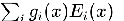؛ تحليل ؛ الانتباه الذاتي الخطي | Jacobs et al. (№ 119), Hochreiter (№ 120), Schmidhuber (№ 121\)22 |
| **1992** | التحسين الحلقات | REINFORCE؛ ضاغط التاريخ العصبي؛ متوسط Polyak | تدرج السياسة ؛ تقطير RNN؛ متوسط المسار لـ SGD | Williams (№ 124), Schmidhuber (№ 125), Polyak & Juditsky (№ 126\) |
| **1993** | المُرمِّز الأساس | الشبكات التوأمية (Siamese)؛ MDL التبايني؛ حدّ Barron | أبراج مترية بأوزان مشتركة؛ الطاقة الحرة للأوزان؛ تقليم OBS | Bromley & LeCun (№ 129), Hinton & van Camp (№ 130), Barron (№ 131\) |
| **1994** | الحلقات MoE | مبرهنة الاعتماديات بعيدة المدى؛ MoE الهرمي | تعارض التخزين المستقر مع التدرج في RNN؛ المؤثر  في  | Bengio et al. (№ 133), Jordan & Jacobs (№ 134), Pearlmutter (№ 135\) |
| **1995** | الأساس الانتشار | آلة Helmholtz (Wake–Sleep)؛ Soft-margin SVM | زوج المولِّد/شبكة الاستدلال ؛ تعظيم المعلومات المتبادلة | Hinton et al. (№ 137), Cortes & Vapnik (№ 139), Bishop (№ 141\) |
| **1996** | المُرمِّز الأساس | الترميز المتناثر في V1؛ الحد الغاوسي للعرض اللانهائي | إعادة بناء  بقاموس مفرط الاكتمال؛ تقارب  إلى NNGP | Olshausen & Field (№ 142), Neal (№ 143), Goller & Küchler (№ 144\) |
| **1997** | الحلقات الذاكرة | LSTM؛ الشبكة العودية ثنائية الاتجاه (BiRNN)؛ الحدود الدنيا المسطحة | الخلية التراكمية  (CEC)؛ فرعا الزمن الأمامي والخلفي | Hochreiter & Schmidhuber (№ 146), Schuster & Paliwal (№ 147\) |
| **1998** | المُرمِّز التحسين | LeNet-5؛ التدرج الطبيعي لـ Amari | تعاقب Conv–Pool–FC \+ محوِّل بياني؛ مقياس Fisher  | LeCun et al. (№ 150), Amari (№ 152), Sutton & Barto (№ 153\) |
| **1999** | الحلقات الأساس | بوابة النسيان في LSTM؛ التحليل غير السالب NMF | إعادة ضبط ضربية ؛ ميزات إضافية  | Gers, Schmidhuber & Cummins (№ 155\)155, Lee & Seung (№ 156\) |
| **2000** | الحلقات الأساس | Peephole LSTM؛ Softplus؛ تعلّم المنطويات (Isomap/LLE) | ربط الخلية  بالبوابات؛ التنشيط الملس  | Gers et al. (№ 158, 159), Dugas et al. (№ 160), Tenenbaum (№ 161\) |
| **2001** | الحلقات المُرمِّز | Echo State Networks (ESN)؛ الحقول العشوائية الشرطية (CRF) | المستودع المتخامد ؛ التطبيع العام للمسارات  | Jaeger (№ 163), Lafferty et al. (№ 164), Hastie et al. (№ 165\) |
| **2002** | الانتشار الأساس | التباعد التبايني (CD\-)؛ المُدرِك البنيوي | تقدير تدرج RBM بخطوة MCMC واحدة من البيانات؛ مكتبة Torch | Hinton (№ 166), Collins (№ 168), Collobert et al. (№ 169\) |
| **2003** | الأساس الانتباه/LLM | النموذج اللغوي الاحتمالي العصبي (NPLM) | تضمينات كلمات كثيفة قابلة للتعلم ؛ التشوهات المرنة لـ CNN | Bengio et al. (№ 170), Simard et al. (№ 171), MacKay (№ 172\) |
| **2004** | التحسين الأساس | أول تسريع للشبكات العصبية على GPU؛ نظرية  مقابل  | عمليات مصفوفية في مظلِّلات GPU (20×)؛ التعقيد اللوغاريتمي  | Oh & Jung (№ 173), Ng (№ 174), Welling et al. (№ 175\) |
| **2005** | الانتشار STT الأساس | Score Matching؛ BiLSTM للكلام؛ الشبكات البيانية (GNN) | تقدير  دون دالة التجزئة ؛ Softmax الهرمي | Hyvärinen (№ 176\)163, Graves (№ 177), Gori et al. (№ 179\) |
| **2006** | STT الأساس | CTC؛ شبكات الاعتقاد العميقة (DBN) والمُرمِّزات الذاتية | جمع المحاذاات مع الرمز الفارغ ؛ مكدس RBM طبقة بعد طبقة | Graves et al. (№ 181), Hinton et al. (№ 182, 183), Bishop (№ 185\) |
| **2007** | الأساس التحسين | تقاربات SGD على البيانات الكبيرة؛ مكدس المُرمِّزات الذاتية | أمثلية SGD من الرتبة الأولى عند حد زمن الحساب | Bengio et al. (№ 186), Bottou & Bousquet (№ 187), Mnih (№ 188\) |
| **2008** | المُرمِّز الانتشار | المُرمِّزات الذاتية مزيلة الضجيج (DAE)؛ CNN-NLP الموحَّد | إعادة بناء  النظيف من  المضجَّج؛ تضمينات متعددة المهام؛ t-SNE | Vincent et al. (№ 190), Collobert & Weston (№ 191), t-SNE (№ 192\) |
| **2009** | المُرمِّز التحسين | ImageNet؛ التعلم العميق على CUDA؛ Curriculum Learning | التوسع إلى 14M صورة وCUDA (70×)؛ جدول الصعوبة | Deng et al. (№ 193), Raina, Madhavan & Ng (№ 194), Bengio (№ 195\) |
| **2010** | الأساس التحسين | تهيئة Xavier؛ ReLU في الشبكات العميقة؛ RNNLM؛ NCE | الحفاظ على التباين ؛ الخطية متعددة القطع ؛ Theano | Glorot & Bengio (№ 198), Nair & Hinton (№ 199), Mikolov (№ 200\) |
| **2011** | التحسين الانتشار | AdaGrad؛ Denoising Score Matching (DSM)؛ CD-DNN-HMM | التحجيم لكل إحداثي ؛ تكافؤ DAE و  | Duchi et al. (№ 204), Vincent (№ 205\)166, Seide et al. (№ 208\) |
| **2012** | المُرمِّز STT | AlexNet؛ RNN-Transducer (RNN-T)؛ Dropout؛ RMSProp | شبكة CNN عميقة على GPU مع ReLU وDropout؛ شبكة Joiner المشتركة  لـ ASR المباشر | Krizhevsky et al. (№ 210\)167, Graves (№ 211), Hinton (№ 212\) |
| **2013** | المُرمِّز الانتشار | Variational Autoencoder (VAE)؛ Word2Vec؛ NiN؛ DQN | الحد الأدنى ELBO \+ إعادة المعايرة ؛ Skip-Gram التبايني | Kingma & Welling (№ 217), Mikolov (№ 219), Lin (№ 220), Mnih (№ 222\) |
| **2014** | الانتباه الانتشار | Seq2Seq \+ Bahdanau Attention؛ GRU؛ GAN؛ مُحسِّن Adam | المحاذاة الناعمة للسياق ؛ minimax ؛ العزوم التكيّفية | Sutskever (№ 225), Bahdanau (№ 226), Cho (№ 227), GAN (№ 229), Adam (№ 230\) |
| **2015** | الأساس الانتشار | ResNet \+ Kaiming Init؛ BatchNorm؛ U-Net؛ الانتشار | التمرير المطابق ؛ مُرمِّز–مفكّك skip؛ عكس سلسلة Markov | He et al. (№ 237), Ioffe (№ 239), U-Net (№ 240), Sohl-Dickstein (№ 241\) |
| **2016** | TTS الحلقات الأساس | LayerNorm؛ Pre-LN ResNet؛ ACT؛ GELU؛ WaveNet | التطبيع على ميزات الرمز؛ بوابة إيقاف الحلقة القابلة للتعلم؛ الالتفافات المتمددة | Ba (№ 249), He (№ 250), Graves (№ 251), GELU (№ 252), WaveNet (№ 253\) |
| **2017** | الانتباه/LLM MoE TTS | Transformer القانوني؛ Sparse MoE؛ VQ-VAE؛ AdamW؛ PPO | ؛ التوجيه Top\-؛ دفتر الشفرات المتقطع؛ weight decay المنفصل | Vaswani (№ 260), Shazeer (№ 261), VQ-VAE (№ 262), AdamW (№ 265), PPO (№ 266\) |
| **2018** | المُرمِّز LLM الحلقات | BERT؛ GPT-1؛ Universal Transformer؛ Neural ODE؛ InfoNCE؛ Shampoo | MLM ثنائي الاتجاه مقابل AR سببي؛ حلقة المحوّل مع ACT؛ العمق المستمر | Devlin (№ 274), Radford (№ 273), Dehghani (№ 275), Chen (№ 276), Shampoo (№ 282\) |
| **2019** | الانتباه/LLM الحلقات TTS | GPT-2؛ RMSNorm؛ MQA؛ DEQ؛ FastSpeech؛ NCSN؛ ZeRO/Megatron | تطبيع دون إزاحة؛ رأس KV واحد؛ نقطة ثابتة ضمنية ؛ منظِّم الأطوال | Radford (№ 285), RMSNorm (№ 286), MQA (№ 287), DEQ (№ 288), FastSpeech (№ 292\) |
| **2020** | LLM الانتشار STT | GPT-3 & Scaling Laws؛ SwiGLU؛ Linear Attn؛ DDPM/SDE؛ ViT؛ Conformer | FFN ذو بوابات؛ النواة ؛ خسارة الضجيج ؛ رقع 16×16؛ هجين Conv+Attn | Brown (№ 300), SwiGLU (№ 301), DDPM (№ 303), ViT (№ 306), Conformer (№ 307\) |
| **2021** | LLM الحلقات/SSM TTS | RoPE؛ ALiBi؛ Switch MoE؛ LoRA؛ CLIP؛ S4؛ VITS؛ SoundStream؛ LDM | الدوران العقدي ؛ المهايئ  من الرتبة ؛ NPLR SSM؛ الرمّاز الصوتي RVQ؛ الانتشار في VAE | RoPE (№ 316), LoRA (№ 319), CLIP (№ 320), S4 (№ 324), SoundStream (№ 327), LDM (№ 331\) |
| **2022** | LLM الانتشار STT | FlashAttention؛ Chinchilla؛ DiT؛ Flow Matching / Rectified Flow؛ Whisper | التبليط في SRAM مع online-softmax؛ ؛ محوّل adaLN-Zero؛ المعادلات التفاضلية المستقيمة  | Dao (№ 332), Chinchilla (№ 334), Rectified Flow (№ 338), DiT (№ 341), Whisper (№ 342\) |
| **2023** | LLM الحلقات/SSM STS | GQA؛ vLLM؛ Mixtral 8x7B؛ Mamba (S6)؛ RWKV/RetNet؛ SigLIP؛ VALL-E؛ TDT؛ DPO | KV مجموعاتي؛  المعتمدة على المُدخل؛ خسارة سيغمويدية؛ تخطي الإطارات بالمدة | GQA (№ 347), Mamba (№ 356), SigLIP (№ 358), VALL-E (№ 362), TDT (№ 366), DPO (№ 353\) |
| **2024** | LLM MoE الحلقات STS | DeepSeek-V2/V3 (MLA, Aux-Free MoE, MTP)؛ Mamba-2؛ xLSTM؛ GDN؛ MMDiT؛ Moshi | مخبأ KV منخفض الرتبة في MLA؛ الموازنة بالانحياز ؛ قاعدة دلتا ؛ Full-Duplex 160 ميلي ثانية (Mimi) | DeepSeek (№ 371, 372), Mamba-2 (№ 379), GDN (№ 382), HunyuanVideo (№ 394), Moshi (№ 400\) |
| **2025** | LLM الحلقات الانتشار الفيديو | DeepSeek-R1 & V3.2 (DSA) & mHC؛ Kimi K2 (MuonClip) & KDA؛ Huginn/Ouro/PLT؛ LLaDA/Mercury؛ Wan 2.2 | GRPO القابل للتحقق؛ إسقاط Sinkhorn على متعدد سطوح Birkhoff؛ الحلقات الكامنة؛ dLLM؛ فيديو MoE | R1 (№ 406), V3.2 (№ 408), mHC (№ 409), K2 (№ 411), Huginn (№ 417), Ouro (№ 418), LLaDA (№ 424\) |
| **2026** | LLM الهجائن الفيديو STS | DeepSeek V4 Pro؛ Kimi K3 (AttnRes)؛ Gemma 4؛ Qwen 3.8؛ Nemotron 3/3.5؛ Mamba-3؛ FA-4؛ LTX-2.5؛ PersonaPlex | CSA+HCA (10% KV)؛ الانتباه بالعمق؛  \+ \-RoPE؛ هجين 3:1 GDN؛ SSM عقدي MIMO؛ DiT صوتي–مرئي | K3 (№ 443\)4, Gemma 4156, Qwen 3.830, Mamba-332, LTX-2.5297 |
| **2027** | LLM الانتشار التحسين | Scale-wise VAR \= dLLM؛ تحليل أطوار KV في DeepSeek-V4؛ BF16 FA-bwd الدقيق؛ Hourglass LM؛ SafeBridge | تماثل VAR والانتشار المقنَّع؛ قانون حفظ تدرج softmax؛ الأمان عبر الحلقات | Kumar et al. (WACV'27, № 444\)17, OpenReview ICLR'2715 |

يقع تحوّلان نظاميان حاسمان في المعماريات اللغوية المفتوحة خلال 2024–2026 في مستوى إدارة ذاكرة بطاقات الرسوميات: الضغط الجذري لحالة السياق (عبر مخبأ MLA منخفض الرتبة واستبدال 75% من طبقات الانتباه بذاكرة مصفوفية ثابتة الطول هي Gated DeltaNet أو KDA)، والانتقال إلى التنشيط فائق التناثر للأوزان، إذ يُنشَّط لكل رمز، عند حجم إجمالي للمعرفة يبلغ 0.7–2.8 تريليون معامل، ما بين 3.1% و10.0% فقط من الشبكة4.  
  
ويفسّر مقارنةُ أحجام الذاكرة المذكورة الاقتصادَ العملي للاستدلال الوكيلي طويل السياق: ففي النماذج المنتظمة ذات الانتباه الكامل يتجاوز النمو الخطي لمخبأ KV بسرعة حجمَ أوزان النموذج نفسها، مما يُجبر على توزيع الاستدلال على عدة عقد لمجرد تخزين تاريخ الحوار196. وعلى العكس، فإن المعمارية الهجينة 3:1 تجمّد تمامًا نمو الذاكرة في 75% من طبقات الشبكة (مبقيةً إياها عند 72 ميبيبايت في BF16 بغض النظر عن كون طول السياق 32K أو 1M رمز)، ومع 3–5% من الخبراء النشطين تتيح خدمة المسارات متعددة الخطوات بكلفة أقل بمرتبة كاملة عند تساوي الجودة30.

### **الجدول أ.2. المواصفات المعمارية والمعايير القياسية للنماذج اللغوية المفتوحة الرائدة والهجائن (2024–2026)**

*ملاحظة حول الإسناد (حتى 25.11.2026):* أُوردت المقاييس وفق التقارير التقنية الرسمية وبطاقات النماذج لدى المطوّرين؛ وحيثما توفرت قياسات أو مراجعات مستقلة (Epoch AI وArtificial Analysis والملخصات التقنية) فإن المصدر مذكور صراحةً في الخلية31. وتعني الشرطة (—) غياب نشر مقارن للمقياس في المصدر الأول.

| النموذج (الإصدار، الترخيص) | الأوزان الإجمالية / النشطة | معمارية الانتباه / SSM والخبراء | نافذة السياق | MMLU-Pro (%) | GPQA Diamond (%) | AIME 24 / 25 / 26 (%) | LiveCodeBench (%) | SWE-bench Verified (%) |
| :---- | :---- | :---- | :---- | :---- | :---- | :---- | :---- | :---- |
| **DeepSeek-V3 / 0324** (ديسمبر 2024، MIT)29 | 671B / 37B (5.5%) | 61 طبقة: MLA \+ Aux-Loss-Free MoE (8/256 \+ 1 shared) \+ MTP | 128K | 75.9 (81.2 في 0324\) | 59.1 (68.4 في 0324\) | 39.2 ('24؛ 59.4 في 0324\) | 46.9 (v6, 0324\) | 38.8 (Agentic, 0324\) |
| **DeepSeek-R1 / 0528** (يناير/مايو 2025، MIT)268 | 671B / 37B (5.5%) | قاعدة V3 \+ RL متعدد المراحل قابل للتحقق (GRPO) | 128K | 84.0 | 71.5 (81.0 في 0528\) | 79.8 ('24) / 70\.0$\rightarrow$87.5 ('25) | 63\.5$\rightarrow$73.3 (v6) | 49.2 |
| **Llama 4 Maverick** (أبريل 2025، Llama 4\)280 | 400B / 17B (4.3%) | تناوب الطبقات الكثيفة وطبقات MoE (1/128 \+ 1 shared)، دمج مبكر | 1M (10M لدى Scout) | — | 67.0 (Epoch AI) | — | — | — |
| **Qwen3-235B-A22B** (مايو/يوليو 2025، Apache 2.0)247 | 235B / 22B (9.4%) | 94 طبقة: GQA (64Q / 4KV) \+ MoE (8/128)، نمط Think/Non-Think | 128K–262K (1M DCA) | 77.3 (non-think) | 62.9 (non-think) | 85.7 ('24) / 81.5 ('25, think) | 70.7 (v5, think) | 34.4 (non-think) |
| **Kimi K2 Instruct** (يوليو 2025، Mod. MIT)66 | 1.04T / 32.6B (3.1%) | 61 طبقة: MLA (64 رأسًا) \+ MoE (8/384 \+ 1 shared)، دُرِّب بـ MuonClip | 128K | 81.1 | 75.1 | 69.6 ('24) / 49.5 ('25) | 53.7 (v6, non-think) | 65.8 (71.6 multi) |
| **GLM-4.5** (يوليو 2025، MIT)282 | 355B / 32B (9.0%) | MoE عميق \+ GQA \+ MTP، هجين Thinking / Non-Thinking | 128K | 84.6 | 79.1 | 91.0 (AIME'24) | 72.9 | 64.2 |
| **DeepSeek-V3.2** (ديسمبر 2025، MIT)10 | 671B / 37B (5.5%) | MLA \+ **DeepSeek Sparse Attention (DSA)** \+ GRPO وكيلي موحَّد | 128K | \~85.0 | 82.4 | 94.17 (AIME'26) | — | 70.2 (Multilingual) |
| **Nemotron 3 Nano** (ديسمبر 2025، OpenMDW)184 | 31.6B / 3.2B (10.1%) | هجين Mamba-2 \+ GQA \+ MoE دقيق التجزئة (6/128)، NVFP4 | 1M (RULER 86.3) | 78.3 | 73.0 (75.0 tools) | 89.1 ('25) / 99.2 (tools) | 68.3 (v6) | 38.8 (OpenHands) |
| **GLM-5 / GLM-5.1** (فبراير/أبريل 2026، MIT)321 | 744B / 40B (5.4%) | 80 طبقة: MLA \+ **DSA** \+ 256 خبيرًا \+ Muon \+ RL غير متزامن APRIL | 200K–1M | — | — | 95.4 / 95.3 (AIME'26) | — | 77.8 |
| **Qwen3.5-397B-A17B** (ربيع 2026، Apache 2.0)353 | 397B / 17B (4.3%) | هجين 3:1 (75% **Gated DeltaNet** \+ 25% GQA) \+ Sparse MoE | 256K | — | 88.4 (ملخص) | 91.3 (AIME'26) | 83.6 (v6) | — |
| **Gemma 4 31B Dense** (أبريل/يوليو 2026، Apache 2.0)324 | 30.7B / 30.7B (100%) | 60 طبقة: 5:1 SWA/Global،  **\+ \-RoPE** (توفير 37.5% من KV)، MTP | 256K | 85.2 | 84.3 (75.8 min Epoch) | 89.2 (AIME'26) | 80.0 (v6) | — |
| **Gemma 4 26B-A4B** (أبريل/يوليو 2026، Apache 2.0)324 | 25.2B / 3.8B (15.1%) | 30 طبقة: 5:1 SWA/Global (، \-RoPE) \+ MoE (8/128 \+ 1 shared) | 256K | 82.6 | 82.3 | 88.3 (AIME'26) | 77.1 (v6) | — |
| **Nemotron 3 Ultra** (يونيو 2026، OpenMDW)326 | 550B / 55B (10.0%) | 108 طبقات: Mamba-2 \+ GQA (64Q/2KV) \+ **LatentMoE** (22/512) \+ 2 MTP | 1M | — | — (AA Index 56.4) | — | — | — |
| **Kimi K3** (يوليو 2026، Kimi K3 Lic.)4 | 2.8T / 104B (3.7%) | هجين 3:1 (**KDA** \+ Gated MLA NoPE) \+ **AttnRes** \+ Stable LatentMoE (16/896) | 1M | — | — | — | — | 81.2 (FrontierSWE) |
| **DeepSeek V4 Pro** (أغسطس 2026، MIT)31 | 1.6T / \~49B (3.1%) | هجين **CSA \+ HCA** (27% FLOPs و10% KV بالنسبة لـ V3.2 على 1M) \+ Muon (\>32T رمز) | 1M | — | \>90.0 (مراجعة الإصدار) | — | 93–94 (مراجعة الإصدار) | 62.7 (DeepSWE) |
| **Qwen3.8-27B** (أغسطس 2026، Apache 2.0)30 | 27B / 27B (100%, VLM) | 64 طبقة: **48 Gated DeltaNet** (48V/16QK) \+ **16 Gated Attn** (24Q/4KV) \+ MTP | 262K (1M YaRN) | — | — (AA v4.3.2: 33.7) | — | — | 42.2 (DeepSWE 1.1) |
| **Tencent Hy4** (أغسطس 2026، Open)1 | 770B / 49B (6.4%) | 78 طبقة: Gated MLA \+ **DSA (IndexCache)** \+ **iHC** رباعي المسارات \+ MoE (8/256 \+ 1\) | — | — | — | — | — | — |
| **Nemotron 3.5 Super** (أكتوبر 2026، OpenMDW)327 | 120B / 12B (10.0%) | هجين Mamba-2 \+ GQA \+ LatentMoE (512 خبيرًا) \+ مسوِّدة MTP تعاودية | 1M | — | — | — | — | 86\.9$\rightarrow$92.1 (Pro V2 \+ RL) |

تتجلى ديناميكية كثافة الذكاء بين جيلي 2025 و2026 بوضوح خاص عند مقارنة المسائل العلمية والأولمبية المعقدة (GPQA Diamond وAIME 2026\) بالكفاءة المعاملية للنماذج ذات العمق العودي10.  
  
وتكشف البيانات المذكورة قانونية مهمة: في مهام الاستنتاج الاستنباطي التسلسلي (AIME وMATH-500) لا يكون العامل الحاسم هو العدد الخام للمعاملات الفريدة، بل *العمق الفعّال للتحويلات اللاخطية المتسلسلة* — الذي يتحقق إما صراحةً عبر نمط الاستدلال في السياق (إذ يرفع نمط Thinking في Gemma 4 26B-A4B ذي 3.8B معامل نشط نتيجة AIME 2026 إلى 88.3% مقابل 20.8% لدى Gemma 3 27B غير المستدلّ)، وإما ضمنيًا داخل الحالة المخفية عبر  مرورات عودية على مكدس الطبقات المشترك في Ouro-2.6B286.

### **الجدول أ.3. النماذج اللغوية ذات العمق العودي (الحلقية) والانتشارية (2025–2026)**

| النموذج / المعمارية | النمط (paradigm) وطوبولوجيا العمق | المعاملات الفريدة / رموز التدريب | المقاييس التجريبية الرئيسية والتسريعات |
| :---- | :---- | :---- | :---- |
| **Huginn-0125** (arXiv:2502.05171)3 | حلقة ساندويتشية  مع حقن المُدخل بالتسلسل (concat)  و ،  () | 3.5B / 800B رمز (4,096 MI250X) | عند زيادة الحلقات : ARC-Easy 49.07%69.91%، HellaSwag 43.46%65.21%، GSM8K CoT 42.08%؛ مشاركة KV بلا أمثلة (zero-shot) على 4 فتحات دون خسائر في MT-Bench (5.86)284 |
| **Ouro-1.4B & Ouro-2.6B** (arXiv:2510.25741)286 | حلقة المكدس الكامل () مع بوابة خروج مبكر قابلة للتعلم (ACT gate) | 1.4B و2.6B / 7.7T رمز | **Ouro-1.4B**: MMLU 67.3%، GSM8K 78.9%، MATH-500 82.4%؛ **Ouro-2.6B**: MMLU 74.6%، MMLU-Pro 55.7%، BBH 80.5%، MATH-500 **90.8%** (تعادل النماذج الكثيفة حتى 12B)286 |
| **PLT & LoopCoder-v2 7B** (arXiv:2510.24824, 2606.18023)33 | خط أنابيب Cross-Loop Parallelism (CLP) \+ KV مشترك للحلقة الأولى \+ Gated SWA () | 1.7B نشط / 7B كثيف (18T رمز من الشفرة والنص) | يزيل عقوبة التأخير التسلسلي (+96%\~4% نفقات إضافية عند )؛ \+5.0 نقاط مئوية في الدقة على حلقتين، وشُخِّص التشبّع عند  بسبب الإزاحة الطورية لـ CLP33 |
| **Inkling 2 Mini** (Thinking Machines، نوفمبر 2026\)197 | ساندويتش  تطبيقًا من 24 طبقة \+ AttnRes \+ MoE (8/128) | 26.4B إجمالي / 3.4B فريد نشط (5.4B تنشيطًا) | سياق 1,048,576 رمز، Apache 2.0، 5 نوافذ SWA محلية (1024) \+ 1 GQA عام لكل كتلة، مخبأ KV بحجم 192 كيبيبايت/رمز197 |
| **LLaDA-8B / LLaDA-MoE** (arXiv:2502.09992)35 | محوّل انتشار مقنَّع ثنائي الاتجاه (MDM، ELBO موزون ) | 8B كثيف؛ 7B-A1B MoE | تكافؤ مع LLaMA-3 8B عند FLOPs متساوية؛ Instruct (إزالة القناع بالكتل): GSM8K **78.6%**، MATH **42.2%**، CMMLU 69.9%؛ يتجاوز reversal curse57 |
| **Dream 7B** (arXiv:2508.15487)57 | LLM انتشاري متقطع مهيَّأ من أوزان انحدارية ذاتية | 7B كثيف | MATH **51.2%**، HumanEval **54.3%**، تخطيط قوي وملء ثنائي الاتجاه للفراغات57 |
| **Mercury Coder Mini / Small** (arXiv:2506.17298)58 | LLM برمجي انتشاري تجاري مع توليد متوازٍ للرموز | حجم مغلق (تريليونات الرموز) | الإنتاجية على NVIDIA H100 القياسية: **1,109 رمز/ث** (Mini) و**737 رمز/ث** (Small) وفق قياس Artificial Analysis (أسرع حتى 10× من نماذج AR)58 |
| **LoopMDM & Looped UDLM** (arXiv:2605.26106, 2610.30066)56 | حلقة انتقائية على الطبقات الأولى–المتوسطة داخل مزيل ضجيج الانتشار المتقطع | 125M–170M (NeurIPS 2026\) | يبلغ NLL التحقق نفسه عند **FLOPs تدريب أقل بـ 3.34×** على FineWeb-Edu؛ \+8.5 نقطة مئوية على GSM8K؛ الخروج التكيّفي يوفر حتى 34.8% من الحلقات56 |

### **الجدول أ.4. المُرمِّزات البصرية والنماذج التوليدية للصور والفيديو (2012–2026)**

| النموذج (السنة) | النوع والآلية الرئيسية | الحجم / الضغط الكامن | مقاييس الجودة والسرعة الموثَّقة |
| :---- | :---- | :---- | :---- |
| **AlexNet** (2012)  **ResNet-152** (2015)  **ViT-H/14** (2020)167 | التطور من 2D-CNN (ReLU+Dropout) إلى الشبكات المتبقية والمحوّلات الرقعية | 60M  60M  632M | دقة Top-1 على ImageNet-1K: **63.3%** (AlexNet)  **78.3%** (ResNet-152، مجموعة، خطأ Top-5 3.57%)  **88.55%** (ViT-H/14 JFT)177 |
| **SigLIP 2** (فبراير 2025، arXiv:2502.14786)300 | ViT متعدد اللغات (109 لغات): Sigmoid loss \+ مفكّك LocCa \+ SILC/TIPS \+ NaFlex | 86M (B)، 303M (L)، 400M (So400m)، 1B (g) | Top-1 zero-shot على ImageNet-1K: **84.3%** (So400m/16 @ 512px) و**85.0%** (ViT-g/16 @ 384px)؛ COCO T2I R@1: 53.2% لدى B/16300 |
| **V-JEPA 2** (يونيو 2025، arXiv:2506.09985)59 | تنبؤ ذاتي الإشراف بميزات الفيديو دون بكسلات ونص \+ V-JEPA 2-AC | دُرِّب على VideoMix22M (حتى 64 إطارًا 384×384) | Something-Something v2: **77.3%** Top-1؛ PerceptionTest: **84.0%**؛ استباق الأفعال في Epic-Kitchens-100: **39.7 R@5** (+44% نسبيًا)59 |
| **DINOv3** (أغسطس 2025، arXiv:2508.10104)301 | التقطير الذاتي على 1.7B صورة \+ **Gram Anchoring** لخرائط الرقع الكثيفة | من 21.6M (ViT-S/16) إلى **7B** (ViT-7B/16) | الاستقصاء الخطي للميزات المجمَّدة: ImageNet-1K **88.0%**، تقطيع ADE20k **55.9 mIoU** (مقابل 49.5 لدى DINOv2-g/14)301 |
| **ADM**  **LDM-4**  **DiT-XL/2**  **SiT-XL/2 \+ REPA**  **DDT-XL/2**36 | تطور توليد ImageNet 256×256: U-Net بكسلي  U-Net على VAE  DiT  المواءمة مع DINOv2  DiT منفصل | 554M / 400M / 675M / 675M / 675M | FID-50K على ImageNet 256×256 (مع CFG، الأقل أفضل): **4.59** (ADM)  **3.60** (LDM-4)  **2.27** (DiT-XL/2)  **2.06** (SiT-XL/2)  **1.42** (+REPA، تقارب أسرع بـ 17.5×)  **1.26** (DDT-XL/2، 2025–2026)36 |
| **FLUX.1** (2024)  **FLUX.2** (نوفمبر 2025، BFL)174 | Rectified Flow كامن \+ MMDiT؛ وفي الإصدار الثاني VLM Mistral-3 24B \+ VAE ذو 128 قناة | 12B (FLUX.1)  32B (FLUX.2 \[dev\]) | توليد موحَّد وتحرير متعدد الصور حتى 4 ميغابكسل مع عدد خطوات قابل للتحكم وطباعة دقيقة299 |
| **HunyuanVideo** (ديسمبر 2024\) & **1.5** (نوفمبر 2025\)257 | Dual-to-Single Stream DiT \+ مُرمِّز نصي MLLM \+ Causal 3D-VAE \+ RoPE ثلاثي الأبعاد | 13B (v1.0، ضغط 4×8×8) / **8.3B** (v1.5) | v1.0: جودة حركة 66.5% في اختبار أعمى (60–80 غيغابايت VRAM)؛ v1.5: تصيير خلال **\~75 ث على RTX 4090 واحدة** (step-distilled)297 |
| **Wan 2.1** (فبراير 2025\) & **Wan 2.2** (يوليو 2025، Apache 2.0)172 | Flow-Matching DiT؛ وفي 2.2 — **MoE زمني ثنائي الخبراء بحسب SNR** وVAE مضغوط | **27B-A14B MoE** (4×8×8) و**TI2V-5B** (4×16×16) | رائد النماذج المفتوحة في الجمالية (85.3 على Wan-Bench 2.0) وVBVR (0.371 مقابل 0.273 لدى CogVideoX-1.5)؛ نموذج 5B يصيّر 720p@24fps على RTX 4090 واحدة172 |
| **LTX-Video**  **LTX-2**  **LTX-2.5** (أغسطس 2026، Lightricks)259 | Video-VAE فائق الضغط (1:192)  **DiT صوتي–مرئي لامتماثل ثنائي التدفق** مع انتباه متقاطع 1D/3D-RoPE | 2B/13B  19B (14B V \+ 5B A)  **22B** (+Gemma 4 12B) | توليد فيديو متزامن حتى 4K (حتى 20 ث في Fast) وصوت ستيريو 24 كيلوهرتز (حوارات، فولي، مزامنة الشفاه) في مرور واحد؛ التشغيل من 12–24 غيغابايت VRAM بـ FP8297 |

وبالتزامن في المجالين البصري والكلامي اقتربت النماذج التوليدية بحلول 2026 اقترابًا وثيقًا من حدّين فيزيائيين أساسيين: حد دقة إعادة بناء المُرمِّز الذاتي الكامن نفسه (rFID \= 1.20 لدى SD-VAE القياسي على ImageNet 256×256) ومتوسط مدة الوقفة الطبيعية بين الجمل في المحادثة البشرية الحية (230 ميلي ثانية وفق القياسات عبر اللغات)70.  
  
ويفسّر بلوغ مزيلات الضجيج عتبة FID قدرها 1.26 مقابل 1.20 لدى SD-VAE نفسه سبب انتقال التركيز البحثي في النصف الثاني من 2025–2026 من تعديل محوّل الانتشار نفسه إلى إعادة تصميم الفضاءات الكامنة للمُرمِّزات الذاتية — من الضبط الطرفي لـ VAE بمساعدة REPA-E إلى الفضاء ذي 128 قناة **FLUX.2-VAE** والفضاء الفيديوي عالي الضغط **Wan2.2-VAE**36. وفي المقابل، في المنظومة الكلامية، أتاح الانتقال إلى تردد إطارات منخفض جدًا قدره **12.5 هرتز** (خطوة 80 ميلي ثانية في Mimi وQwen3-Omni وQwen3-TTS) حصر توليد أول حزمة صوتية في خطوة أو خطوتين من المفكّك الانحداري الذاتي، فصار التواصل الصوتي الحي مع المقاطعات لا يُميَّز زمنيًا عن حوار البشر48.

### **الجدول أ.5. الخصائص والمقاييس الملخصة للمنظومة الكلامية: STT (ASR) وTTS وSTS ثنائي الاتجاه المتزامن (2020–2026)**

| النظام (المطوِّر، السنة) | الصنف والمعمارية | تردد الرموز / الرمّاز | مقاييس الدقة والسرعة والتأخير الموثَّقة |
| :---- | :---- | :---- | :---- |
| **Conformer** (Google، 2020\)203 | STT هجين Macaron FFN \+ MHSA \+ DepthwiseConv \+ RNN-T | 25 هرتز (تقليل العينات 4×) | WER على LibriSpeech test-clean / test-other: **2.1% / 4.3%** (دون LM)، **1.9% / 3.9%** (مع LM)؛ إصدار 10M: 2.7% / 6.3%203 |
| **Whisper Large-v3** (OpenAI، 2022–2023)229 | STT محوّل مُرمِّز–مفكّك 1.55B (32+32 طبقة، 128-bin mel) | مُرمِّز 50 هرتز (نافذة 30 ث) | LibriSpeech test-clean **1.86–2.01% WER**، test-other **4.2–5.0% WER**؛ متوسط 99 لغة في FLEURS \~10.6% WER؛ السرعة \~145.5 RTFx229 |
| **SenseVoice-Small** (Alibaba، 2024\)263 | STT مُرمِّز ASR غير انحداري ذاتي \+ العواطف (SER) \+ الأحداث | NAR من طرف إلى طرف | أسرع من Whisper-Large بأكثر من **15×** ومن Whisper-Small بـ **5×** مع التعرف على العواطف والأحداث الصوتية263 |
| **Parakeet-TDT-0.6B-v3 & Canary-1B-v2** (NVIDIA، سبتمبر 2025\)193 | STT FastConformer (stride 8×) \+ **TDT** (تخطي 0–4 إطارات) / AED | **12.5 هرتز** (إطار 80 ميلي ثانية) | **Parakeet-TDT-0.6B-v3**: متوسط WER 6.32% بسرعة **3,332.7 RTFx** (أسرع بـ 54× من LLM-ASR)؛ **Canary-1B-v2**: 25 لغة، WER للإنجليزية 7.15%، 749 RTFx229 |
| **Voxtral / Voxtral Realtime** (Mistral، 2025–2026)316 | STT نموذج صوتي–لغوي أصلي (3B/24B، سياق 32K \= 40 دقيقة \+ استدعاء الدوال) | ترميز متدفق | Apache 2.0؛ يعادل **Voxtral Realtime** عند تأخير **480 ميلي ثانية** نموذج Whisper غير المتصل، ويتفوق عند 960 ميلي ثانية على خطوط الأساس316 |
| **GigaAM-v3 & Multilingual** (Sber، 2025–2026)317 | STT Conformer SSL (بأسلوب HuBERT على 2 مليون ساعة مع موازنة بيانية) | 25 هرتز (خطوة 40 ميلي ثانية) | يتفوق على Whisper Large-v3 وOmnilingual-1B في المدونات الناقصة التمثيل لآسيا الوسطى والمكالمات الهاتفية التلقائية317 |
| **Nemotron 3.5 Transcribe** (NVIDIA، أكتوبر 2026\)348 | STT مُرمِّز خبراء متوازٍ (0.6B TDT \+ Sortformer مجمَّد) \+ LLM | أجزاء 30 ث (375 إطارًا، 12.5 هرتز) | نسخ حرفي ومنسَّق في آن واحد، وطوابع زمنية للكلمات وتجزئة المتحدثين من طرف إلى طرف على 65K رمز (BF16/FP8/NVFP4)348 |
| **CosyVoice 3** (Alibaba، مايو 2025\)46 | TTS AR-LLM لرموز الكلام \+ مولّد Flow-Matching \+ DiffRO RL | **25 هرتز** أحادي التدفق **FSQ** (MinMo) | الرائد على معيار المراجع «البرية» CV3-Eval، وبث ثنائي الاتجاه (bi-streaming) واستنساخ الصوت عبر اللغات46 |
| **Qwen3-TTS** (Alibaba، يناير 2026\)341 | TTS LLM ثنائي المسار (0.6B/1.7B، 5M ساعة) \+ **MTP** ذو 16 دفتر شفرات | **12.5 هرتز** (16 RVQ) أو **25 هرتز** (DiT) | أول حزمة صوتية خلال **\~97–100 ميلي ثانية** على المسار السببي 12.5 هرتز؛ انخفاض الخطأ ZH$\rightarrow$KO بنسبة 66% مقارنة بـ CosyVoice 3 (4.82 مقابل 14.4 WER)؛ \>10 دقائق من الكلام المستقر63 |
| **Kyutai Pocket TTS** (يناير 2026، MIT)315 | TTS نموذج صوتي–لغوي مستمر مع تضجيج الكامنات (100M معامل) | خرج 24 كيلوهرتز دون GPU | يعمل بسرعة **\~6× أسرع من الزمن الحقيقي على نواتين من CPU** (MacBook Air M4)، تأخير القطعة الأولى \~200 ميلي ثانية، استنساخ الصوت، 6 لغات344 |
| **Fish Audio S2-Pro** (مارس 2026\)158 | TTS Dual-AR تسلسلي (Fast AR على دفاتر الشفرات) \+ GRPO \+ SGLang | RVQ ذو 10 دفاتر شفرات (قاعدة DAC) | أكثر من 80 لغة، **TTFA \~100 ميلي ثانية**، **RTF 0.195** على H200 (\>3000 رمز/ث)، فوز بنسبة 81.88% في EmergentTTS-Eval (91.61% في الاستدلال شبه اللغوي)55 |
| **Moshi \+ Mimi** (Kyutai، أكتوبر 2024\)26 | STS RQ-Transformer ثنائي الاتجاه المتزامن (7B Helium \+ Depth Tr.) \+ Inner Monologue | **Mimi: 12.5 هرتز**، 8 RVQ، **1.1 كيلوبت/ث** | أول STS مفتوح ثنائي الاتجاه المتزامن (Full-Duplex): تأخير **160 ميلي ثانية** نظريًا / **200 ميلي ثانية** عمليًا؛ WER لـ TTS المتدفق 4.7%، وWER لـ ASR 5.7%26 |
| **Qwen3-Omni & 3.5-Omni** (Alibaba، 2025–2026)303 | STS **Thinker–Talker MoE** شامل الوسائط \+ مُرمِّز **AuT** \+ Code2Wav سببي | **12.5 هرتز** RVQ \+ MTP (ARIA في 3.5) | تأخير الحوار الصوتي **234 ميلي ثانية** (547 ميلي ثانية صوت+فيديو)، أفضل أداء مفتوح في 32 من 36 معيارًا صوتيًا دون تراجع في MMLU النصي (81.69%)304 |
| **NVIDIA PersonaPlex 7B** (يناير 2026\)68 | STS Full-Duplex (قاعدة Moshi \+ Mimi) مع محثّ هجين مثبَّت (نص+صوت) | **12.5 هرتز** Mimi (نافذة 2,048 إطارًا) | الطبيعية في Full-Duplex-Bench DMOS **3.90 ± 0.15** (مقابل 3.72 لدى Gemini و3.11 لدى Moshi)، تشابه الصوت المستنسخ SSIM **0.57**68 |
| **NemotronLabs VoiceChat** (NVIDIA، سبتمبر 2026\)69 | STS مفكّك Full-Duplex \+ مُرمِّز متدفق \+ فرع RNN-T إضافي \+ **Tool Calling** | خرج متوازٍ متدفق | Full-Duplex-Bench 1.0: **اعتراض 100% عند المقاطعة**، جودة الرد 4.33/5؛ FDB 1.5: **93% عودة إلى الكلام** بعد التعبيرات القصيرة؛ FDB 3.0: **82.5% F1 في اختيار الأدوات**69 |

### **الجدول أ.6. سجل المستودعات المفتوحة الرئيسية لمعماريات الشبكات العصبية وأنويتها (Open-Source Ecosystem)**

| المجال | المستودع (GitHub / المنظمة) | الترخيص | الآليات المنفَّذة والقيمة الهندسية |
| :---- | :---- | :---- | :---- |
| **فهرس معماريات LLM** | rasbt/llm-architecture-gallery197 | Apache-2.0 | بيانات وصفية models.yml ومخططات وحاسبة ذاكرة لـ 132 معمارية LLM حديثة (حُدِّث في نوفمبر 2026\) |
| **أنوية الانتباه (Hopper / Blackwell)** | Dao-AILab/flash-attention223 | BSD-3 | FlashAttention-1/2/3 و**FlashAttention-4** بلغة Python عبر CuTe-DSL (softmax المتصل الشرطي، خطوط أنابيب B200 غير المتزامنة) |
| **الانتباه الكامن والمتناثر \+ MoE** | deepseek-ai/DeepSeek-V3, DeepSeek-V3.2-Exp, FlashMLA, DeepEP, DeepGEMM50 | MIT | تنفيذات مرجعية لـ MLA وDeepSeek Sparse Attention (DSA) وFP8 GEMM والتوجيه الخبيري بين الخوادم |
| **الروابط الفائقة على منطوي Birkhoff** | tokenbender/mHC-manifold-constrained-hyper-connections384 | MIT | تنفيذ بحثي لـ DeepSeek **mHC** (arXiv:2512.24880) مع إسقاط Sinkhorn–Knopp |
| **الانتباه الخطي وشبكات دلتا** | fla-org/flash-linear-attention9 | MIT | أنوية Triton / TileLang عالية السرعة لـ **Gated DeltaNet** و**GDN-2** و**Kimi Delta Attention (KDA)** وGLA وRetNet وRWKV-7 و**AttnRes** |
| **نماذج فضاء الحالة (SSM)** | state-spaces/mamba (s4)207 | Apache-2.0 | الماسحات الرسمية بـ CUDA وكتل **S4** و**S4D** و**Mamba-1** و**Mamba-2 (SSD)** و**Mamba-3 (MIMO \+ Complex RoPE)** |
| **LSTM المصفوفي والشبكات العودية الديناميكية** | NX-AI/xlstm, mlstm\_kernels; BlinkDL/RWKV-LM175 | Apache-2.0 | أنوية Triton/CUDA لـ **mLSTM / xLSTM 7B** والتطور الديناميكي للحالة في **RWKV-5/6/7 ("Goose")** |
| **العمق العودي والنماذج اللغوية الحلقية** | seal-rg/recurrent-pretraining (Huginn); rkstgr/LoopLM (Ouro)42 | Apache-2.0 | التدريب المسبق بالعمق العودي **Huginn-0125** والخروج التكيّفي في النماذج الحلقية **Ouro** |
| **تدريب الأوزان السريعة أثناء الاستدلال** | a1600012888/LaCT; nikhilvyas/SOAP192 | MIT | التدريب أثناء الاختبار بالكتل الكبيرة **LaCT** بـ PyTorch خالص والمُهيِّئ المسبق من الرتبة الثانية **SOAP** |
| **النماذج اللغوية الانتشارية والمُرمِّزات الحديثة** | ML-GSAI/LLaDA; AnswerDotAI/ModernBERT; google-research/big\_vision186 | MIT / Apache-2.0 | الانتشار المقنَّع للنص **LLaDA-8B / MoE** والمُرمِّز طويل السياق **ModernBERT** و**SigLIP 2** |
| **توليد الصور وDiT الصوتي–المرئي** | CompVis/latent-diffusion, black-forest-labs/flux, Wan-Video/Wan2.2, Tencent-Hunyuan/HunyuanVideo-1.5, Lightricks/LTX-2296 | Apache-2.0 / Comm. | المنظومة الكاملة من أول LDM إلى مولّد الفيديو MoE **Wan 2.2** و**LTX-2 / LTX-2.5** الصوتي–المرئي المتزامن |
| **المنظومة الكلامية وثنائية الاتجاه المتزامن** | kyutai-labs/moshi, kyutai-labs/pocket-tts, NVIDIA/personaplex, NVIDIA/NeMo, QwenLM/Qwen3-Omni, QwenLM/Qwen3-TTS, FunAudioLLM/CosyVoice, fishaudio/fish-speech, salute-developers/GigaAM26 | MIT / Apache-2.0 | الرمّاز **Mimi**، والنموذجان ثنائيا الاتجاه المتزامن **Moshi** و**PersonaPlex**، ومفكّكات **FastConformer / TDT**، والنموذج الشامل **Qwen3-Omni**، وتخليق **Pocket TTS** على CPU |

## **الملحق ب. القوائم البرمجية المرجعية لجميع الآليات الرئيسية**

فيما يلي اثنتا عشرة وحدة مستقلة بذاتها بلغة Python (torch) تنفّذ الآليات الرياضية الأساسية لجميع المجالات العشرة التي عالجتها فصول 1958–2027.

### **القائمة ب.1. المُدرِك (1958) ومحرك الاشتقاق الآلي العكسي (1970–1986)**

```python
import math
import torch
import torch.nn as nn
import torch.nn.functional as F

class RosenblattPerceptron:
    """1958–1962: مُدرِك Rosenblatt الخطي مع حدّ التقارب لـ Novikoff (R/gamma)^2."""
    def __init__(self, dim: int, lr: float = 1.0):
        self.w = torch.zeros(dim)
        self.b = torch.zeros(1)
        self.lr = lr

    def fit_step(self, x: torch.Tensor, y: float) -> bool:
        margin = y * (torch.dot(self.w, x) + self.b)
        if margin <= 0.0:
            self.w = self.w + self.lr * y * x
            self.b = self.b + self.lr * y
            return True
        return False

class ScalarNode:
    """1970، 1976، 1986: الوضع العكسي للاشتقاق الآلي (Linnainmaa / Rumelhart et al.)."""
    def __init__(self, val: float, parents: tuple = ()):
        self.val = float(val)
        self.grad = 0.0
        self._parents = parents

    def __add__(self, other: "ScalarNode") -> "ScalarNode":
        return ScalarNode(self.val + other.val, ((self, 1.0), (other, 1.0)))

    def __mul__(self, other: "ScalarNode") -> "ScalarNode":
        return ScalarNode(self.val * other.val, ((self, other.val), (other, self.val)))

    def tanh(self) -> "ScalarNode":
        t = math.tanh(self.val)
        return ScalarNode(t, ((self, 1.0 - t * t),))

    def backward(self) -> None:
        topo, visited = [], set()

        def build(node: "ScalarNode") -> None:
            if node not in visited:
                visited.add(node)
                for parent, _ in node._parents:
                    build(parent)
                topo.append(node)

        build(self)
        self.grad = 1.0
        for node in reversed(topo):
            for parent, local_deriv in node._parents:
                parent.grad += node.grad * local_deriv
```

### **القائمة ب.2. اللبنات الأساسية لـ Transformer++: RMSNorm (2019) وSwiGLU (2020) وكتلة Conformer (2020)**

```python
class RMSNorm(nn.Module):
    """2019: تطبيع الطبقة بالجذر التربيعي لمتوسط المربعات دون مركزة المتوسط (Zhang & Sennrich)."""
    def __init__(self, dim: int, eps: float = 1e-6):
        super().__init__()
        self.eps = eps
        self.weight = nn.Parameter(torch.ones(dim))

    def forward(self, x: torch.Tensor) -> torch.Tensor:
        rms = torch.rsqrt(x.float().pow(2).mean(dim=-1, keepdim=True) + self.eps)
        return (x.float() * rms).to(x.dtype) * self.weight

class SwiGLUFFN(nn.Module):
    """2020: الشبكة الفرعية كاملة الاتصال ذات البوابات SwiGLU (Shazeer)."""
    def __init__(self, d_model: int, d_ff: int):
        super().__init__()
        self.w_gate = nn.Linear(d_model, d_ff, bias=False)
        self.w_up = nn.Linear(d_model, d_ff, bias=False)
        self.w_down = nn.Linear(d_ff, d_model, bias=False)

    def forward(self, x: torch.Tensor) -> torch.Tensor:
        return self.w_down(F.silu(self.w_gate(x)) * self.w_up(x))

class ConformerConvModule(nn.Module):
    """2020: الوحدة الالتفافية في Conformer / FastConformer (Pointwise GLU -> Depthwise Conv1d -> SiLU)."""
    def __init__(self, d_model: int, kernel_size: int = 15):
        super().__init__()
        self.norm = RMSNorm(d_model)
        self.pw_in = nn.Conv1d(d_model, 2 * d_model, kernel_size=1)
        self.dw = nn.Conv1d(d_model, d_model, kernel_size=kernel_size,
                            padding=kernel_size // 2, groups=d_model)
        self.gn = nn.GroupNorm(1, d_model)
        self.pw_out = nn.Conv1d(d_model, d_model, kernel_size=1)

    def forward(self, x: torch.Tensor) -> torch.Tensor:
        h = self.norm(x).transpose(1, 2)
        a, b = self.pw_in(h).chunk(2, dim=1)
        h = a * torch.sigmoid(b)
        h = self.pw_out(F.silu(self.gn(self.dw(h)))).transpose(1, 2)
        return x + h
```

### **القائمة ب.3. تطور الذاكرة ذات البوابات: LSTM مع بوابة النسيان (1997–2000) مقابل mLSTM في xLSTM (2024–2025)**

```python
class ForgetGateLSTMCell(nn.Module):
    """1997–2000: خلية LSTM الكلاسيكية ذات دوّامة الخطأ CEC وبوابة النسيان."""
    def __init__(self, d_in: int, d_hid: int):
        super().__init__()
        self.proj = nn.Linear(d_in + d_hid, 4 * d_hid)

    def forward(self, x_t: torch.Tensor, state: tuple[torch.Tensor, torch.Tensor]):
        h_prev, c_prev = state
        i, f, o, g = self.proj(torch.cat([x_t, h_prev], dim=-1)).chunk(4, dim=-1)
        c_t = torch.sigmoid(f) * c_prev + torch.sigmoid(i) * torch.tanh(g)
        h_t = torch.sigmoid(o) * torch.tanh(c_t)
        return h_t, c_t

class MatrixLSTMCell(nn.Module):
    """2024–2025: خلية mLSTM من xLSTM 7B ذات الذاكرة المصفوفية C_t وتحديد soft-capping للبوابات."""
    def __init__(self, d_model: int, d_head: int = 64, softcap: float = 15.0):
        super().__init__()
        self.scale = d_head ** -0.5
        self.softcap = softcap
        self.wq = nn.Linear(d_model, d_head, bias=False)
        self.wk = nn.Linear(d_model, d_head, bias=False)
        self.wv = nn.Linear(d_model, d_head, bias=False)
        self.gates = nn.Linear(d_model, 2)
        self.wo = nn.Linear(d_model, d_head, bias=False)

    def _cap(self, x: torch.Tensor) -> torch.Tensor:
        return self.softcap * torch.tanh(x / self.softcap)

    def step(self, x_t: torch.Tensor, C_prev: torch.Tensor, n_prev: torch.Tensor, m_prev: torch.Tensor):
        q = self.wq(x_t).unsqueeze(-1)
        k = (self.wk(x_t) * self.scale).unsqueeze(-1)
        v = self.wv(x_t).unsqueeze(-1)
        raw_i, raw_f = self._cap(self.gates(x_t)).chunk(2, dim=-1)
        log_f = -F.softplus(-raw_f).unsqueeze(-1)
        log_i = raw_i.unsqueeze(-1)

        m_t = torch.maximum(log_f + m_prev, log_i)
        i_t = torch.exp(log_i - m_t)
        f_t = torch.exp(log_f + m_prev - m_t)

        C_t = f_t * C_prev + i_t * (v @ k.transpose(-1, -2))
        n_t = f_t * n_prev + i_t * k
        denom = torch.clamp((n_t.transpose(-1, -2) @ q).abs(), min=1.0)
        h_tilde = (C_t @ q) / denom
        h_t = torch.sigmoid(self.wo(x_t)) * h_tilde.squeeze(-1)
        return h_t, C_t, n_t, m_t
```

### **القائمة ب.4. المُحسِّنات المصفوفية: Muon مع تكرار Newton–Schulz وQK-Clip (2024–2026) وSOAP (2024–2025)**

```python
def zeropower_via_newtonschulz5(G: torch.Tensor, steps: int = 5, eps: float = 1e-7) -> torch.Tensor:
    """2024–2026: التعامد متعدد الحدود بخمس خطوات لمصفوفة الزخم في مُحسِّن Muon."""
    a, b, c = (3.4445, -4.7750, 2.0315)
    X = G.bfloat16() / (G.norm() + eps)
    transposed = X.size(0) > X.size(1)
    if transposed:
        X = X.T
    for _ in range(steps):
        A = X @ X.T
        B = b * A + c * (A @ A)
        X = a * X + B @ X
    return X.T if transposed else X

@torch.no_grad()
def apply_qk_clip(wq: torch.Tensor, wk: torch.Tensor, max_attn_logit: float, tau: float = 100.0) -> None:
    """2025: مثبِّت لوغاريتمات الانتباه QK-Clip من Kimi K2 (MuonClip)."""
    if max_attn_logit > tau:
        scale = (tau / max_attn_logit) ** 0.5
        wq.mul_(scale)
        wk.mul_(scale)

class MinimalSOAPStep:
    """2024–2025: خطوة مُحسِّن SOAP — تشغيل Adam في الأساس الذاتي للمُهيِّئ المسبق Shampoo."""
    def __init__(self, shape: tuple[int, int], lr: float = 1e-3, beta1: float = 0.9,
                 beta2: float = 0.999, precond_freq: int = 10):
        m, n = shape
        self.lr, self.b1, self.b2, self.freq = lr, beta1, beta2, precond_freq
        self.step_idx = 0
        self.L, self.R = torch.zeros(m, m), torch.zeros(n, n)
        self.QL, self.QR = torch.eye(m), torch.eye(n)
        self.exp_avg, self.exp_avg_sq = torch.zeros(m, n), torch.zeros(m, n)

    @torch.no_grad()
    def step(self, W: torch.Tensor, G: torch.Tensor) -> torch.Tensor:
        self.step_idx += 1
        self.L.lerp_(G @ G.T, 1.0 - self.b2)
        self.R.lerp_(G.T @ G, 1.0 - self.b2)

        G_rot = self.QL.T @ G @ self.QR
        self.exp_avg.lerp_(G_rot, 1.0 - self.b1)
        self.exp_avg_sq.lerp_(G_rot.pow(2), 1.0 - self.b2)

        step_rot = self.exp_avg / (self.exp_avg_sq.sqrt() + 1e-8)
        W.sub_(self.lr * (self.QL @ step_rot @ self.QR.T))

        if self.step_idx % self.freq == 0:
            _, QL_new = torch.linalg.eigh(self.L + 1e-6 * torch.eye(self.L.size(0), device=G.device))
            _, QR_new = torch.linalg.eigh(self.R + 1e-6 * torch.eye(self.R.size(0), device=G.device))
            self.exp_avg = QL_new.T @ self.QL @ self.exp_avg @ self.QR.T @ QR_new
            self.QL, self.QR = QL_new, QR_new
        return W
```

### **القائمة ب.5. منظومة الانتباه الحديثة: p-RoPE (2021/2026) وonline-softmax في FlashAttention-4 (2022–2026) وMLA (2024) وDSA (2025)**

```python
def apply_partial_rope(x: torch.Tensor, cos: torch.Tensor, sin: torch.Tensor, p_ratio: float = 0.25) -> torch.Tensor:
    """2021، 2026: الترميز الموضعي الدوّار الجزئي p-RoPE (RoFormer / Gemma 4 / Qwen 3.8)."""
    rot_dim = int(x.size(-1) * p_ratio) // 2 * 2
    x_rot, x_pass = x[..., :rot_dim], x[..., rot_dim:]
    x1, x2 = x_rot[..., ::2], x_rot[..., 1::2]
    rotated = torch.stack([x1 * cos - x2 * sin, x1 * sin + x2 * cos], dim=-1).flatten(-2)
    return torch.cat([rotated, x_pass], dim=-1)

def flash_attention_v4_tiled(Q: torch.Tensor, K: torch.Tensor, V: torch.Tensor,
                             block_size: int = 64, tau: float = 0.25) -> torch.Tensor:
    """2022–2026: online-softmax بالكتل مع التخطي الشرطي لإعادة التحجيم (FlashAttention-4)."""
    B, H, T, D = Q.shape
    scale = D ** -0.5
    O = torch.zeros_like(Q)
    m = torch.full((B, H, T, 1), -float("inf"), device=Q.device, dtype=Q.dtype)
    ell = torch.zeros((B, H, T, 1), device=Q.device, dtype=Q.dtype)

    for j in range(0, T, block_size):
        Kj = K[:, :, j:j + block_size]
        Vj = V[:, :, j:j + block_size]
        Sj = torch.matmul(Q, Kj.transpose(-1, -2)) * scale

        mj_cand = torch.maximum(m, Sj.amax(dim=-1, keepdim=True))
        need_rescale = (mj_cand - m) > tau
        mj = torch.where(need_rescale, mj_cand, m)
        alpha = torch.where(need_rescale, torch.exp(m - mj), torch.ones_like(m))

        Pj = torch.exp(Sj - mj)
        ell = alpha * ell + Pj.sum(dim=-1, keepdim=True)
        O = alpha * O + torch.matmul(Pj, Vj)
        m = mj
    return O / ell

class MultiHeadLatentAttentionDSA(nn.Module):
    """2024–2026: مخبأ MLA المضغوط (DeepSeek-V2/V3) مع مفهرس top-k خفيف DSA (DeepSeek-V3.2)."""
    def __init__(self, d_model: int = 512, n_heads: int = 8, d_head: int = 64,
                 d_latent_kv: int = 128, top_k_tokens: int = 64):
        super().__init__()
        self.n_heads, self.d_head, self.top_k = n_heads, d_head, top_k_tokens
        self.wq = nn.Linear(d_model, n_heads * d_head, bias=False)
        self.w_dkv = nn.Linear(d_model, d_latent_kv, bias=False)
        self.w_uk = nn.Linear(d_latent_kv, n_heads * d_head, bias=False)
        self.w_uv = nn.Linear(d_latent_kv, n_heads * d_head, bias=False)
        self.idx_q = nn.Linear(d_model, 32, bias=False)
        self.idx_k = nn.Linear(d_latent_kv, 32, bias=False)
        self.wo = nn.Linear(n_heads * d_head, d_model, bias=False)

    def forward(self, h: torch.Tensor) -> torch.Tensor:
        B, T, _ = h.shape
        c_kv = self.w_dkv(h)
        q = self.wq(h).view(B, T, self.n_heads, self.d_head)

        k_sel = min(self.top_k, T)
        idx_scores = torch.matmul(self.idx_q(h), self.idx_k(c_kv).transpose(-1, -2))
        causal = torch.triu(torch.full((T, T), -float("inf"), device=h.device), diagonal=1)
        _, top_indices = torch.topk(idx_scores + causal, k=k_sel, dim=-1)

        c_selected = c_kv.unsqueeze(1).expand(B, T, T, -1).gather(
            2, top_indices.unsqueeze(-1).expand(-1, -1, -1, c_kv.size(-1))
        )
        k = self.w_uk(c_selected).view(B, T, k_sel, self.n_heads, self.d_head)
        v = self.w_uv(c_selected).view(B, T, k_sel, self.n_heads, self.d_head)

        attn_logits = torch.einsum("bthd,btkhd->bthk", q, k) * (self.d_head ** -0.5)
        attn_weights = F.softmax(attn_logits, dim=-1)
        out = torch.einsum("bthk,btkhd->bthd", attn_weights, v).reshape(B, T, -1)
        return self.wo(out)
```

### **القائمة ب.6. Normalized LatentMoE المتناثر مع الموازنة دون عقوبة في الخسارة (2024–2026)**

```python
class NormalizedLatentMoE(nn.Module):
    """2024–2026: تركيب Aux-Loss-Free MoE (DeepSeek-V3) وNormalized LatentMoE (Nemotron 3 / Kimi K3)."""
    def __init__(self, d_model: int = 512, d_latent: int = 192, n_routed: int = 16,
                 top_k: int = 4, d_expert: int = 256, bias_lr: float = 1e-3):
        super().__init__()
        self.top_k, self.bias_lr = top_k, bias_lr
        self.down_proj = nn.Linear(d_model, d_latent, bias=False)
        self.up_proj = nn.Linear(d_latent, d_model, bias=False)
        self.post_agg_norm = RMSNorm(d_latent)

        self.router = nn.Linear(d_model, n_routed, bias=False)
        self.register_buffer("expert_bias", torch.zeros(n_routed))

        self.shared_expert = SwiGLUFFN(d_model, 2 * d_expert)
        self.experts = nn.ModuleList([SwiGLUFFN(d_latent, d_expert) for _ in range(n_routed)])

    def forward(self, x: torch.Tensor) -> torch.Tensor:
        B, T, D = x.shape
        x_flat = x.view(-1, D)
        z_flat = self.down_proj(x_flat)

        scores = torch.sigmoid(self.router(x_flat))
        _, top_idx = torch.topk(scores + self.expert_bias, k=self.top_k, dim=-1)
        weights = torch.gather(scores, 1, top_idx)
        weights = weights / (weights.sum(dim=-1, keepdim=True) + 1e-6)

        if self.training:
            with torch.no_grad():
                counts = torch.bincount(top_idx.reshape(-1), minlength=len(self.experts)).float()
                self.expert_bias.add_(self.bias_lr * torch.sign(counts.mean() - counts))

        agg_latent = torch.zeros_like(z_flat)
        for i, expert in enumerate(self.experts):
            tok_ids, slot_ids = torch.where(top_idx == i)
            if tok_ids.numel() > 0:
                agg_latent.index_add_(0, tok_ids, expert(z_flat[tok_ids]) * weights[tok_ids, slot_ids, None])

        routed_out = self.up_proj(self.post_agg_norm(agg_latent))
        return (routed_out + self.shared_expert(x_flat)).view(B, T, D)
```

### **القائمة ب.7. شبكات دلتا الخطية وSSM: Gated DeltaNet / KDA (2024–2026) وMamba-3 MIMO RoPE-SSM (2026)**

```python
class KimiDeltaAttentionLayer(nn.Module):
    """2024–2026: Gated DeltaNet / Kimi Delta Attention (KDA) مع تخميد محدود لكل قناة."""
    def __init__(self, d_model: int = 256, d_k: int = 64, d_v: int = 64, g_min: float = -4.0):
        super().__init__()
        self.d_k, self.d_v, self.g_min = d_k, d_v, g_min
        self.wq = nn.Linear(d_model, d_k, bias=False)
        self.wk = nn.Linear(d_model, d_k, bias=False)
        self.wv = nn.Linear(d_model, d_v, bias=False)
        self.w_beta = nn.Linear(d_model, 1)
        self.w_decay = nn.Linear(d_model, d_k)
        self.w_gate = nn.Linear(d_model, d_v)
        self.wo = nn.Linear(d_v, d_model, bias=False)

    def forward(self, x: torch.Tensor) -> tuple[torch.Tensor, torch.Tensor]:
        B, T, _ = x.shape
        q = F.normalize(self.wq(x), dim=-1)
        k = F.normalize(self.wk(x), dim=-1)
        v = self.wv(x)
        beta = torch.sigmoid(self.w_beta(x)).unsqueeze(-1)
        alpha = torch.exp(self.g_min * torch.sigmoid(self.w_decay(x)))

        S = torch.zeros(B, self.d_v, self.d_k, device=x.device, dtype=x.dtype)
        outputs = []
        for t in range(T):
            S_pred = S * alpha[:, t].unsqueeze(1)
            k_t = k[:, t].unsqueeze(-1)
            v_t = v[:, t].unsqueeze(-1)
            residual = v_t - torch.matmul(S_pred, k_t)
            S = S_pred + beta[:, t] * torch.matmul(residual, k_t.transpose(-1, -2))
            y_t = torch.matmul(S, q[:, t].unsqueeze(-1)).squeeze(-1)
            outputs.append(y_t)

        y = torch.stack(outputs, dim=1) * F.silu(self.w_gate(x))
        return self.wo(y), S

class Mamba3MIMOCell(nn.Module):
    """2026: نواة Mamba-3 — التقطيع شبه المنحرف، وتدوير RoPE في الحالة، ورتبة MIMO R."""
    def __init__(self, d_model: int = 256, state_dim: int = 64, mimo_rank: int = 4):
        super().__init__()
        self.N, self.R = state_dim, mimo_rank
        self.w_x = nn.Linear(d_model, d_model * mimo_rank, bias=False)
        self.w_bc = nn.Linear(d_model, 2 * state_dim * mimo_rank)
        self.w_dt_lam = nn.Linear(d_model, 2)
        self.w_theta = nn.Linear(d_model, state_dim // 2)
        self.wo = nn.Linear(d_model, d_model, bias=False)

    @staticmethod
    def _rotate(v: torch.Tensor, cos: torch.Tensor, sin: torch.Tensor) -> torch.Tensor:
        v1, v2 = v[..., ::2], v[..., 1::2]
        return torch.stack([v1 * cos - v2 * sin, v1 * sin + v2 * cos], dim=-1).flatten(-2)

    def forward(self, u: torch.Tensor) -> torch.Tensor:
        B, T, D = u.shape
        H = torch.zeros(B, D, self.N, device=u.device, dtype=u.dtype)
        prev_u_proj = torch.zeros(B, D, self.N, device=u.device, dtype=u.dtype)
        outs = []

        for t in range(T):
            ut = u[:, t]
            dt_raw, lam_raw = self.w_dt_lam(ut).chunk(2, dim=-1)
            dt = F.softplus(dt_raw).unsqueeze(-1)
            lam = torch.sigmoid(lam_raw).unsqueeze(-1)
            alpha = torch.exp(-dt)

            theta = self.w_theta(ut)
            cos, sin = torch.cos(theta).unsqueeze(1), torch.sin(theta).unsqueeze(1)

            x_r = self.w_x(ut).view(B, D, self.R)
            b_r, c_r = self.w_bc(ut).chunk(2, dim=-1)
            b_r = b_r.view(B, self.R, self.N)
            c_r = c_r.view(B, self.N, self.R)

            cur_u_proj = dt * torch.matmul(x_r, b_r)
            H_rot = self._rotate(H, cos, sin)
            H = alpha * H_rot + (1.0 - lam) * alpha * prev_u_proj + lam * cur_u_proj
            prev_u_proj = cur_u_proj

            yt = torch.matmul(H, c_r).mean(dim=-1)
            outs.append(yt)
        return self.wo(torch.stack(outs, dim=1))
```

### **القائمة ب.8. طوبولوجيا العمق: الروابط الفائقة mHC (2025–2026) وAttention Residuals (2026) وTest-Time Training (2024–2025)**

```python
def sinkhorn_knopp_birkhoff(logits: torch.Tensor, iters: int = 8, eps: float = 1e-6) -> torch.Tensor:
    """1967 / 2025: إسقاط مصفوفة على متعدد سطوح Birkhoff للمصفوفات ثنائية العشوائية (mHC)."""
    P = torch.exp(logits - logits.amax(dim=-1, keepdim=True))
    for _ in range(iters):
        P = P / (P.sum(dim=-1, keepdim=True) + eps)
        P = P / (P.sum(dim=-2, keepdim=True) + eps)
    return P

class ManifoldHyperConnectionBlock(nn.Module):
    """2025–2026: طبقة Manifold-Constrained Hyper-Connections (DeepSeek mHC, arXiv:2512.24880)."""
    def __init__(self, d_model: int, n_streams: int = 4):
        super().__init__()
        self.h_res_logits = nn.Parameter(torch.eye(n_streams) * 2.0)
        self.h_pre_logits = nn.Parameter(torch.zeros(n_streams))
        self.h_post_logits = nn.Parameter(torch.zeros(n_streams))
        self.norm = RMSNorm(d_model)
        self.sublayer = SwiGLUFFN(d_model, 2 * d_model)

    def forward(self, streams: torch.Tensor) -> torch.Tensor:
        H_res = sinkhorn_knopp_birkhoff(self.h_res_logits)
        h_pre = F.softmax(self.h_pre_logits, dim=0)
        h_post = F.softplus(self.h_post_logits)

        layer_in = torch.einsum("n,btnd->btd", h_pre, streams)
        layer_out = self.sublayer(self.norm(layer_in))
        mixed = torch.einsum("mn,btnd->btmd", H_res, streams)
        return mixed + torch.einsum("m,btd->btmd", h_post, layer_out)

class AttentionResidualAggregator(nn.Module):
    """2026: Attention Residuals (AttnRes, Kimi K3, arXiv:2603.15031) — الانتباه على امتداد محور العمق."""
    def __init__(self, d_model: int):
        super().__init__()
        self.q_proj = nn.Parameter(torch.randn(d_model) * 0.02)
        self.k_norm = RMSNorm(d_model)

    def forward(self, block_history: list[torch.Tensor]) -> torch.Tensor:
        stacked = torch.stack(block_history, dim=2)
        keys = self.k_norm(stacked)
        scores = torch.einsum("d,btmd->btm", self.q_proj, keys) * (stacked.size(-1) ** -0.5)
        weights = F.softmax(scores, dim=-1)
        return torch.einsum("btm,btmd->btd", weights, stacked)

class LargeChunkTTTLayer(nn.Module):
    """2024–2025: تدريب الأوزان السريعة أثناء الاستدلال بالأجزاء (TTT / Titans / LaCT)."""
    def __init__(self, d_model: int = 256, inner_lr: float = 0.1):
        super().__init__()
        self.inner_lr = inner_lr
        self.wq = nn.Linear(d_model, d_model, bias=False)
        self.wk = nn.Linear(d_model, d_model, bias=False)
        self.wv = nn.Linear(d_model, d_model, bias=False)
        self.w_fast_init = nn.Parameter(torch.eye(d_model) * 0.1)

    def forward(self, x: torch.Tensor, chunk_size: int = 64) -> torch.Tensor:
        B, T, D = x.shape
        W_fast = self.w_fast_init.unsqueeze(0).expand(B, D, D).clone()
        outs = []
        for s in range(0, T, chunk_size):
            xc = x[:, s:s + chunk_size]
            qc, kc, vc = self.wq(xc), F.normalize(self.wk(xc), dim=-1), self.wv(xc)
            outs.append(torch.matmul(qc, W_fast.transpose(-1, -2)))
            err = torch.matmul(kc, W_fast.transpose(-1, -2)) - vc
            grad_w = torch.matmul(err.transpose(-1, -2), kc) / xc.size(1)
            W_fast = W_fast - self.inner_lr * grad_w
        return torch.cat(outs, dim=1)
```

### **القائمة ب.9. الشبكات ذات العمق العودي (الحلقية): Looped Transformer مع ACT (2025) وخط أنابيب PLT (2025–2026)**

```python
class LoopedTransformerACT(nn.Module):
    """2025–2026: نموذج ذو عمق عودي مع حقن المُدخل وبوابة ACT (Huginn / Ouro)."""
    def __init__(self, vocab_size: int, d_model: int = 256, n_heads: int = 4,
                 core_layers: int = 2, max_loops: int = 4):
        super().__init__()
        self.max_loops = max_loops
        self.emb = nn.Embedding(vocab_size, d_model)
        self.inject_proj = nn.Linear(2 * d_model, d_model)
        self.core = nn.ModuleList([
            nn.TransformerEncoderLayer(d_model, n_heads, 4 * d_model,
                                       activation="gelu", batch_first=True, norm_first=True)
            for _ in range(core_layers)
        ])
        self.exit_gate = nn.Linear(d_model, 1)
        self.norm = RMSNorm(d_model)
        self.head = nn.Linear(d_model, vocab_size)

    def forward(self, idx: torch.Tensor, n_loops: int | None = None) -> tuple[torch.Tensor, torch.Tensor]:
        B, T = idx.shape
        R = n_loops or self.max_loops
        e = self.emb(idx)
        s = e
        causal_mask = nn.Transformer.generate_square_subsequent_mask(T, device=idx.device)

        remaining_prob = torch.ones(B, T, 1, device=idx.device)
        weighted_state = torch.zeros_like(e)
        halt_probs = []

        for r in range(R):
            h = self.inject_proj(torch.cat([s, e], dim=-1))
            for layer in self.core:
                h = layer(h, src_mask=causal_mask, is_causal=True)
            s = h
            p_r = torch.sigmoid(self.exit_gate(s)) if r < R - 1 else torch.ones_like(remaining_prob)
            step_weight = remaining_prob * p_r
            weighted_state = weighted_state + step_weight * s
            remaining_prob = remaining_prob * (1.0 - p_r)
            halt_probs.append(step_weight)

        return self.head(self.norm(weighted_state)), torch.cat(halt_probs, dim=-1)

class ParallelLoopCoreSimulator(nn.Module):
    """2025–2026: خط أنابيب Cross-Loop Parallelism (PLT, Wu et al.): مرور واحد لكل رمز لعدد R من الحلقات."""
    def __init__(self, d_model: int = 256, n_loops: int = 3):
        super().__init__()
        self.R = n_loops
        self.shared_block = nn.Sequential(RMSNorm(d_model), SwiGLUFFN(d_model, 2 * d_model))

    def decode_pipeline(self, token_embs: torch.Tensor) -> torch.Tensor:
        B, T, _ = token_embs.shape
        states = [[None for _ in range(self.R + 1)] for _ in range(T)]
        for t in range(T):
            states[t][0] = token_embs[:, t]

        for s in range(T + self.R - 1):
            active_coords = [
                (s - r, r) for r in range(self.R) if 0 <= (s - r) < T and states[s - r][r] is not None
            ]
            if active_coords:
                batch_in = torch.stack([states[tok][lp] for tok, lp in active_coords], dim=1)
                batch_out = batch_in + self.shared_block(batch_in)
                for idx, (tok, lp) in enumerate(active_coords):
                    states[tok][lp + 1] = batch_out[:, idx]

        return torch.stack([states[t][self.R] for t in range(T)], dim=1)
```

### **القائمة ب.10. Rectified Flow المستمر مع REPA (2022–2026) والانتشار المقنَّع المتقطع LLaDA (2025)**

```python
def rectified_flow_repa_loss(dit_step_fn, proj_mlp: nn.Module, x_0: torch.Tensor,
                             dino_clean_feats: torch.Tensor, repa_weight: float = 0.5) -> torch.Tensor:
    """2022–2026: خسارة مشتركة Flow Matching + REPA (مواءمة الطبقة المخفية مع DINOv2/v3)."""
    B = x_0.size(0)
    t = torch.sigmoid(torch.randn(B, device=x_0.device))
    t_view = t.view(B, *([1] * (x_0.ndim - 1)))

    noise = torch.randn_like(x_0)
    x_t = (1.0 - t_view) * x_0 + t_view * noise
    v_pred, mid_hidden = dit_step_fn(x_t, t)

    fm_loss = F.mse_loss(v_pred, noise - x_0)
    aligned = F.normalize(proj_mlp(mid_hidden), dim=-1)
    target = F.normalize(dino_clean_feats.detach(), dim=-1)
    repa_loss = -(aligned * target).sum(dim=-1).mean()
    return fm_loss + repa_weight * repa_loss

def llada_masked_diffusion_loss(bidir_transformer: nn.Module, clean_ids: torch.Tensor,
                                mask_token_id: int, eps: float = 1e-3) -> torch.Tensor:
    """2024–2026: خسارة ELBO الصارمة الموزونة بـ 1/t للانتشار المقنَّع المتقطع (MDLM / LLaDA)."""
    B, L = clean_ids.shape
    t = eps + (1.0 - eps) * torch.rand(B, 1, device=clean_ids.device)
    mask = torch.rand(B, L, device=clean_ids.device) < t
    noisy_ids = torch.where(mask, mask_token_id, clean_ids)

    logits = bidir_transformer(noisy_ids)
    tok_nll = F.cross_entropy(logits.transpose(1, 2), clean_ids, reduction="none")
    weighted_nll = (tok_nll * mask.float()) / t
    return weighted_nll.sum(dim=-1).mean() / L
```

### **القائمة ب.11. تعلّم الاستدلال والمواءمة دون ناقد: DPO (2023) وGRPO (2024–2026)**

```python
def dpo_preference_loss(policy_w_logp: torch.Tensor, policy_l_logp: torch.Tensor,
                        ref_w_logp: torch.Tensor, ref_l_logp: torch.Tensor, beta: float = 0.1) -> torch.Tensor:
    """2023: التحسين المباشر للتفضيلات DPO (Rafailov et al.)."""
    logits = (policy_w_logp - ref_w_logp) - (policy_l_logp - ref_l_logp)
    return -F.logsigmoid(beta * logits).mean()

def grpo_policy_loss(logp_new: torch.Tensor, logp_old: torch.Tensor, logp_ref: torch.Tensor,
                     rewards: torch.Tensor, resp_mask: torch.Tensor,
                     clip_eps: float = 0.2, kl_beta: float = 0.04) -> torch.Tensor:
    """2024–2026: Group Relative Policy Optimization (DeepSeekMath / DeepSeek-R1 / Qwen3 / GLM-5)."""
    mean_r = rewards.mean(dim=-1, keepdim=True)
    std_r = rewards.std(dim=-1, keepdim=True) + 1e-6
    advantages = ((rewards - mean_r) / std_r).unsqueeze(-1)

    ratio = torch.exp(logp_new - logp_old.detach())
    surr1 = ratio * advantages
    surr2 = torch.clamp(ratio, 1.0 - clip_eps, 1.0 + clip_eps) * advantages

    log_ratio_ref = logp_ref.detach() - logp_new
    kl_per_tok = torch.exp(log_ratio_ref) - log_ratio_ref - 1.0

    per_tok_obj = torch.minimum(surr1, surr2) - kl_beta * kl_per_tok
    return -(per_tok_obj * resp_mask).sum() / (resp_mask.sum() + 1e-6)
```

### **القائمة ب.12. المنظومة الكلامية الكاملة: CTC (2006) وRVQ وFSQ (2021–2025) وTDT (2023) ونبضة Full-Duplex في Moshi / PersonaPlex (2024–2026)**

```python
def ctc_forward_log_likelihood(log_probs: torch.Tensor, targets: list[int], blank: int = 0) -> torch.Tensor:
    """2006: خوارزمية CTC الأمامية الدقيقة بالبرمجة الديناميكية في الفضاء اللوغاريتمي (Graves et al.)."""
    ext = [blank]
    for y in targets:
        ext.extend([y, blank])
    L_ext, T_steps = len(ext), log_probs.size(0)
    alpha = log_probs.new_full((T_steps, L_ext), -float("inf"))
    alpha[0, 0] = log_probs[0, ext[0]]
    if L_ext > 1:
        alpha[0, 1] = log_probs[0, ext[1]]

    for t in range(1, T_steps):
        for s in range(L_ext):
            prev = [alpha[t - 1, s]]
            if s >= 1:
                prev.append(alpha[t - 1, s - 1])
            if s >= 2 and ext[s] != blank and ext[s] != ext[s - 2]:
                prev.append(alpha[t - 1, s - 2])
            alpha[t, s] = torch.logsumexp(torch.stack(prev), dim=0) + log_probs[t, ext[s]]

    end_terms = [alpha[-1, -1]] + ([alpha[-1, -2]] if L_ext > 1 else [])
    return torch.logsumexp(torch.stack(end_terms), dim=0)

class ResidualVQTokenizer(nn.Module):
    """2021–2026: التكميم المتجهي المتبقي للصوت RVQ (SoundStream / EnCodec / Mimi / Qwen3-TTS)."""
    def __init__(self, d_latent: int = 128, n_codebooks: int = 8, codebook_size: int = 2048):
        super().__init__()
        self.codebooks = nn.ModuleList([nn.Embedding(codebook_size, d_latent) for _ in range(n_codebooks)])

    def forward(self, z: torch.Tensor) -> tuple[torch.Tensor, torch.Tensor, torch.Tensor]:
        residual, z_q_total, codes_all, commit_loss = z, torch.zeros_like(z), [], z.new_zeros(())
        for cb in self.codebooks:
            dist = residual.pow(2).sum(-1, keepdim=True) - 2 * (residual @ cb.weight.t()) + cb.weight.pow(2).sum(-1)
            idx = dist.argmin(dim=-1)
            q = cb(idx)
            commit_loss = commit_loss + F.mse_loss(residual, q.detach()) + 0.25 * F.mse_loss(residual.detach(), q)
            z_q_total = z_q_total + (residual + (q - residual).detach())
            residual = residual - q.detach()
            codes_all.append(idx)
        return z_q_total, torch.stack(codes_all, dim=-1), commit_loss

class FiniteScalarQuantizer(nn.Module):
    """2023–2025: التكميم العددي FSQ دون دفتر شفرات مع تدرج طرفي إلى طرف (CosyVoice 3)."""
    def __init__(self, d_in: int = 256, levels: list[int] = [8, 5, 5, 5]):
        super().__init__()
        self.register_buffer("levels", torch.tensor(levels, dtype=torch.float32))
        self.proj_down = nn.Linear(d_in, len(levels))
        self.proj_up = nn.Linear(len(levels), d_in)

    def forward(self, h: torch.Tensor) -> tuple[torch.Tensor, torch.Tensor]:
        half_w = (self.levels - 1.0) * 0.5
        z = torch.tanh(self.proj_down(h)) * half_w
        z_q = z + (torch.round(z) - z).detach()
        bases = torch.cumprod(torch.cat([torch.ones(1, device=h.device), self.levels[:-1]]), dim=0)
        indices = ((torch.round(z) + half_w) * bases).long().sum(dim=-1)
        return self.proj_up(z_q), indices

@torch.no_grad()
def tdt_frame_skipping_greedy_decode(enc_frames: torch.Tensor, pred_step_fn, joiner_fn,
                                     blank_id: int = 0, durations: tuple = (0, 1, 2, 3, 4)) -> list[int]:
    """2023–2026: فك ترميز Token-and-Duration Transducer مع تخطي الإطارات (Parakeet-TDT)."""
    T_frames = enc_frames.size(0)
    t, pred_state, transcript, last_tok = 0, None, [], blank_id
    while t < T_frames:
        pred_vec, cand_state = pred_step_fn(last_tok, pred_state)
        tok_logits, dur_logits = joiner_fn(enc_frames[t], pred_vec)
        tok = int(tok_logits.argmax().item())
        skip = durations[int(dur_logits.argmax().item())]
        if tok != blank_id:
            transcript.append(tok)
            last_tok, pred_state = tok, cand_state
            t += max(1, skip) if skip > 0 else 1
        else:
            t += max(1, skip)
    return transcript

class FullDuplexRQStep(nn.Module):
    """2024–2026: نبضة واحدة مدتها 80 ميلي ثانية (12.5 هرتز) لنموذج Moshi / PersonaPlex ثنائي الاتجاه المتزامن."""
    def __init__(self, d_temporal: int = 512, d_depth: int = 256, n_cb: int = 8,
                 text_vocab: int = 4096, audio_vocab: int = 2048):
        super().__init__()
        self.n_cb = n_cb
        self.user_embs = nn.ModuleList([nn.Embedding(audio_vocab, d_temporal) for _ in range(n_cb)])
        self.agent_embs = nn.ModuleList([nn.Embedding(audio_vocab, d_temporal) for _ in range(n_cb)])
        self.text_emb = nn.Embedding(text_vocab, d_temporal)

        self.temporal_cell = nn.GRUCell(d_temporal, d_temporal)
        self.inner_monologue_head = nn.Linear(d_temporal, text_vocab)
        self.to_depth = nn.Linear(d_temporal, d_depth)
        self.depth_cell = nn.GRUCell(d_depth, d_depth)
        self.cb_emb_depth = nn.ModuleList([nn.Embedding(audio_vocab, d_depth) for _ in range(n_cb)])
        self.cb_heads = nn.ModuleList([nn.Linear(d_depth, audio_vocab) for _ in range(n_cb)])

    def step_80ms(self, user_codes_t: torch.Tensor, prev_agent_codes: torch.Tensor,
                  prev_text_tok: torch.Tensor, h_temporal: torch.Tensor):
        u_sum = sum(emb(user_codes_t[:, q]) for q, emb in enumerate(self.user_embs))
        a_sum = sum(emb(prev_agent_codes[:, q]) for q, emb in enumerate(self.agent_embs))
        h_temporal = self.temporal_cell(u_sum + a_sum + self.text_emb(prev_text_tok), h_temporal)
        agent_text_tok = self.inner_monologue_head(h_temporal).argmax(dim=-1)

        h_d = self.to_depth(h_temporal)
        d_in = self.cb_emb_depth[0](agent_text_tok % self.cb_heads[0].out_features)
        agent_codes_out = []
        for q in range(self.n_cb):
            h_d = self.depth_cell(d_in, h_d)
            code_q = self.cb_heads[q](h_d).argmax(dim=-1)
            agent_codes_out.append(code_q)
            d_in = self.cb_emb_depth[q](code_q)

        return agent_text_tok, torch.stack(agent_codes_out, dim=-1), h_temporal
```

## **الملحق C. ما يدعمه basalt حاليًا من محتوى الدراسة**

يطابق هذا الملحق بين أنواع النماذج والآليات التي تعدّها الدراسة محطات مفصلية (معظمها بين 2012 و2027، إضافة إلى الأسس التي يعتمد عليها basalt) وبين basalt main بحسب حالته في 2026-11-27. لا يُعدّ الصف «مدعومًا» إلا إذا وصل إليه `model_type` مسجَّل أو علم مقبول أو نقطة نهاية موجَّهة مع أوزان حقيقية. أما الأنوية المستقلة، والأعلام المرفوضة أو التجريبية فقط، والوحدات التي تحمّل الأوزان بأقصى جهد فوق هيكل مبذور، فتُعدّ «جزئي». وحيثما يختلف README الخاص بـ basalt مع الشيفرة أو CHANGELOG، فالمعتمد هو الشيفرة وCHANGELOG.

الروابط إلى `https://github.com/goodmai/mlx-swift-lm/...` تشير إلى مراجعة النسخة المتفرعة المثبَّتة `8e76c2f` (`Package.swift`)، وفيها معظم تعريفات المعماريات.

قائمة التحقق الخاصة بهذه الصفوف لكتاب مسائل الدراسة تُتابَع في المسألة [#816](https://github.com/goodmai/basalt/issues/816).

### الأسس (Basis)

| الآلية / نوع النموذج | الفصل (السنة) | الحالة في basalt | الموضع في basalt |
|---|---|---|---|
| Perceptron Mark I بوصفه آلة عتادية | 1958; B.1 | خارج النطاق | جهاز مادي. أما الوحدة الخطية نفسها فهي `MLXNN.Linear`. |
| الاشتقاق التلقائي بالنمط العكسي والانتشار الخلفي | 1970–1986; B.1 | مدعوم | `valueAndGrad` من MLX في مدرّبات المحوّلات: [`ADPOTrainer.swift`](../../Sources/BasaltInference/ADPOTrainer.swift)، [`MLXInferenceEngine+LeJEPATrain.swift`](../../Sources/BasaltInference/MLXInferenceEngine+LeJEPATrain.swift)، [`PVTuner+Steps.swift`](../../Sources/BasaltInference/PVTuner+Steps.swift) |
| الشبكات الالتفافية (LeNet وAlexNet وVGG وInception) | 1989–2014 | جزئي | لا تظهر الالتفافات إلا داخل المشفّرات وفاكّات الترميز: عنق SAM في [`DeepSeekOCRSAM.swift`](../../Sources/BasaltInference/DeepSeekOCRSAM.swift) و[`CausalConv3d.swift`](../../Sources/BasaltInference/Video/CausalConv3d.swift). لا توجد نقطة نهاية لتصنيف الصور. |
| الوصلات المتبقية وفرع Pre-LN (ResNet وPre-LN ResNet وGPT-2) | 2015–2019 | مدعوم | كل كتلة فك ترميز في النسخة المتفرعة، مثل [`Qwen35.swift`](https://github.com/goodmai/mlx-swift-lm/blob/8e76c2fb9322f9bccc2724fc7c4eebb19fe28f8a/Libraries/MLXLLM/Models/Qwen35.swift) و[`Gemma4Text.swift`](https://github.com/goodmai/mlx-swift-lm/blob/8e76c2fb9322f9bccc2724fc7c4eebb19fe28f8a/Libraries/MLXLLM/Models/Gemma4Text.swift) |
| LSTM وGRU | 1997, 2014; B.3 | جزئي | يوجد فقط sLSTM، وهو خلية LSTM ببوابات أسّية، ككتلة اختيارية في `xlstm` ([`XLSTMOps.swift`](../../Sources/BasaltInference/Models/XLSTM/XLSTMOps.swift)، [#864](https://github.com/goodmai/basalt/pull/864)). وهي اصطناعية: ليس لها تخطيط مأخوذ من نقطة حفظ عامة، ولا تُختبر إلا على تجهيزة صغيرة مقابل مرجع على CPU. لا يوجد LSTM أو GRU تقليدي. |
| Seq2Seq بانتباه جمعي (Bahdanau) | 2014 | جزئي | نمط المشفّر→فاكّ الترميز موجود فقط على هيئة مشفّر صوتي → LLM (Nemotron 3.5 Transcribe، [`NemotronTranscribeEncoder.swift`](../../Sources/BasaltInference/NemotronTranscribeEncoder.swift)) وعلى هيئة انتباه متقاطع نصي في هياكل DiT. أما التسجيل الجمعي فغائب. |
| المحوّل (Transformer) بانتباه متعدد الرؤوس، والنموذج اللغوي السببي ذو فاكّ الترميز فقط (GPT-1…3) | 2017–2020 | مدعوم | SDPA المدمج في MLX في كل نموذج من النسخة المتفرعة. المسارات المدمجة الخاصة بـ basalt في [`FusedTransformerKernels.swift`](../../Sources/BasaltInference/FusedTransformerKernels.swift). يقدّمه `basalt serve` عبر واجهتي OpenAI وAnthropic ([الأوامر](../commands.md)). |
| المشفّر ثنائي الاتجاه BERT والنموذج اللغوي المقنَّع | 2018 | جزئي | مشفّرات عائلة BERT تخدم `/v1/embeddings` و`/v1/rerank` ([`Bert.swift`](https://github.com/goodmai/mlx-swift-lm/blob/8e76c2fb9322f9bccc2724fc7c4eebb19fe28f8a/Libraries/MLXEmbedders/Models/Bert.swift)، [#178](https://github.com/goodmai/basalt/issues/178)). لا يوجد رأس MLM ولا تدريب MLM. |
| ModernBERT | 2024 | غير مدعوم بعد | تضم MLXEmbedders كلًّا من Bert وNomicBert وQwen3 وGemma3 وLFM2Bidirectional، ولا تضم ModernBERT. |
| قوانين التدرّج، وChinchilla، وμP | 2020–2022 | خارج النطاق | هذه تحكم توزيع حوسبة ما قبل التدريب، وbasalt لا يجري أي تدريب مسبق. |

### الانتباه والترميز الموضعي (Attention/LLM)

| الآلية / نوع النموذج | الفصل (السنة) | الحالة في basalt | الموضع في basalt |
|---|---|---|---|
| MQA وGQA | 2019, 2023 | مدعوم | رؤوس KV مشتركة في كل طبقة انتباه في النسخة المتفرعة. يستخدم Qwen3.8-27B أربعة رؤوس KV. وتستخدم الطبقات العامة في Gemma 4 12B القيمة `num_global_key_value_heads = 1`. تقدير حجم KV في [النماذج](../models.md). |
| FlashAttention: انتباه مقسَّم إلى بلاطات مع softmax تراكمي | 2022; B.5 | مدعوم | SDPA المدمج على Metal (`MLXFast.scaledDotProductAttention`). تُحدَّد أقصى أحجام مقاطع التعبئة المسبقة غير المدمجة بواسطة [`PrefillAttentionScratch.swift`](../../Sources/BasaltInference/PrefillAttentionScratch.swift) ([#762](https://github.com/goodmai/basalt/issues/762)). |
| أنوية FlashAttention-2/3/4 | 2023–2026; B.5 | خارج النطاق | أنوية CUDA لمعماريات Ampere وHopper وBlackwell (تخصيص الـ warp وTMA وexp المحاكاة بـ FMA). وعلى معالجات Apple الرسومية يؤدي SDPA في MLX Metal هذا الدور. |
| RoPE | 2021 | مدعوم | كل عائلات LLM المخدومة، مثل [`Qwen35.swift`](https://github.com/goodmai/mlx-swift-lm/blob/8e76c2fb9322f9bccc2724fc7c4eebb19fe28f8a/Libraries/MLXLLM/Models/Qwen35.swift) |
| توسيع السياق بـ YaRN | 2023 | مدعوم | `--rope-yarn` لنماذج Qwen 3.5/3.6/3.8 ([`RopeYarnStage.swift`](../../Sources/BasaltInference/RopeYarnStage.swift)، [#729](https://github.com/goodmai/basalt/issues/729)) |
| ALiBi | 2021 | غير مدعوم بعد | لم يُعثر على أي دليل. |
| انحياز الموضع النسبي (T5) | 2019 | جزئي | يضيف Inkling 2 انحيازًا نسبيًا متعلَّمًا (`d_rel` تساوي 16، و`rel_extent` تساوي 1024) في [`Inkling2Attention.swift`](../../Sources/BasaltInference/Models/Inkling2/Inkling2Attention.swift). أما الانحياز المقسَّم إلى سلال على نمط T5 فغائب. |
| التناوب بين المحلي والعام بنوافذ منزلقة (ModernBERT بنسبة 1:2، وGemma 4 بنسبة 5:1) | 2024–2026 | مدعوم | يستخدم Gemma 4 نافذة من 1024 رمزًا بنسبة 5:1. يمر فك الترميز الدفعي عبر [`BatchRotatingKVCache.swift`](../../Sources/BasaltInference/BatchRotatingKVCache.swift) ([#255](https://github.com/goodmai/basalt/issues/255)). |
| الدوران الجزئي p-RoPE | 2026; B.5 | مدعوم | `partial_rotary_factor` تساوي 0.25 في الطبقات العامة من Gemma 4 ([`Gemma4Text.swift`](https://github.com/goodmai/mlx-swift-lm/blob/8e76c2fb9322f9bccc2724fc7c4eebb19fe28f8a/Libraries/MLXLLM/Models/Gemma4Text.swift)). يُرفض YaRN مع p-RoPE ([#729](https://github.com/goodmai/basalt/issues/729)). |
| إعادة استخدام المفاتيح قيمًا، K = V (Gemma 4) | 2026 | مدعوم | تقرأ النسخة المتفرعة `attention_k_eq_v`. يخزّن `--experimental-kv-shared-row` صفًّا واحدًا من 640 قيمة لكل رأس، أي 0.625 من KV العام ([`KEqVRowKVCache.swift`](../../Sources/BasaltInference/KV/KEqVRowKVCache.swift)، [#645](https://github.com/goodmai/basalt/issues/645)). |
| طبقات NoPE (الطبقات العامة في Kimi K3) | 2026 | مدعوم | `no_rope_layer_indices` في Flint ([`FlintConfiguration.swift`](../../Sources/BasaltInference/Models/Flint/FlintConfiguration.swift)). يستخدم Ripple-65B قيمة NoPE مع RoPE جزئي ([#520](https://github.com/goodmai/basalt/issues/520)). |
| ناتج الانتباه المبوَّب (Gated Attention في Qwen 3.8) | 2026 | مدعوم | `sigmoidMultiply(merged, gate)` في [`Qwen35.swift`](https://github.com/goodmai/mlx-swift-lm/blob/8e76c2fb9322f9bccc2724fc7c4eebb19fe28f8a/Libraries/MLXLLM/Models/Qwen35.swift)، ويحرّكه إعداد `attn_output_gate`. |
| MLA، الانتباه الكامن متعدد الرؤوس | 2024; B.5 | مدعوم | يحتفظ deepseek_v2/v3 ([`DeepseekV3.swift`](https://github.com/goodmai/mlx-swift-lm/blob/8e76c2fb9322f9bccc2724fc7c4eebb19fe28f8a/Libraries/MLXLLM/Models/DeepseekV3.swift)) بالمخبأ غير مضغوط لكل رأس ([النماذج](../models.md)). ويحتفظ bailing_hybrid بمخبأ كامن مُمتَصّ ([`BailingHybridMLAAbsorption.swift`](../../Sources/BasaltInference/Models/BailingHybrid/BailingHybridMLAAbsorption.swift)، [#672](https://github.com/goodmai/basalt/issues/672)). |
| MLA المبوَّب (Kimi K3 وTencent Hy4) | 2026 | جزئي | يطابق `GatedMLAAttention` ببوابات للمخرجات وللقيم وبلا ترميز موضعي (NoPE) ([`GatedMLAAttention.swift`](../../Sources/BasaltInference/Attention/GatedMLAAttention.swift)، [#864](https://github.com/goodmai/basalt/pull/864)) مرجعًا على CPU على تجهيزات صغيرة، لكن لا يستخدمه أي نوع نموذج. ويقبل MLA في bailing_hybrid أيضًا خياري NoPE وبوابة المخرجات، دون تشغيل بأوزان حقيقية حتى الآن ([#672](https://github.com/goodmai/basalt/issues/672)). لم تُشغَّل أي نقطة حفظ لـ Kimi K3 أو Tencent Hy4. |
| الانتباه المتناثر الأصلي (NSA) | 2025 | جزئي | يشغّل `--attention-backend nsa` مع `--nsa-window` ([`KVCacheOptions.swift`](../../Sources/BasaltCLI/KVCacheOptions.swift)، [`SageMXKVCache+NSA.swift`](../../Sources/BasaltInference/Attention/SageMXKVCache+NSA.swift)، [#864](https://github.com/goodmai/basalt/pull/864)) تقريبًا تجريبيًا للفروع الثلاثة: ضغط بالمتوسط، واختيار top-k للكتل عبر [`BlockSparseRoutingMetal.swift`](../../Sources/BasaltInference/Attention/BlockSparseRoutingMetal.swift)، ونافذة منزلقة، تُمزج ببوابات ثابتة لا مدرَّبة. لا يوجد بعد جدول للسرعة أو الحيرة على نموذج حقيقي. |
| الانتباه المتناثر في DeepSeek (DSA) بمفهرس البرق | 2025; B.5 | جزئي | لمفهرس البرق وانتباهه المتناثر top-k نوى Metal تطابق مرجعًا على CPU على تجهيزات صغيرة ([`DSALightningIndexer.swift`](../../Sources/BasaltInference/Attention/DSALightningIndexer.swift)، [`DSALightningIndexerMetal.swift`](../../Sources/BasaltInference/Attention/DSALightningIndexerMetal.swift)، [#864](https://github.com/goodmai/basalt/pull/864))، ويقبل bailing_hybrid مفهرسًا عبر مفاتيح الإعداد `dsa_*`. لا تحمل أي نقطة حفظ مفتوحة بحجم 40B أو أقل أوزان مفهرس مدرَّبة، و`--attention-backend dsa` غير متاح. |
| الانتباه المضغوط CSA + HCA (DeepSeek V4) | 2026 | غير مدعوم بعد | لم يُعثر على أي دليل. |
| إسقاط متعدد الوسائط بلا مشفّر (Gemma 4 12B Unified) | 2026 | جزئي | `gemma4_unified` مسجَّل، وتذهب رقع الصور مباشرة إلى فاكّ الترميز (`Gemma4UnifiedVisionEmbedder` في [`Gemma4.swift`](https://github.com/goodmai/mlx-swift-lm/blob/8e76c2fb9322f9bccc2724fc7c4eebb19fe28f8a/Libraries/MLXVLM/Models/Gemma4.swift)). يمرّر basalt الصوت عبر النسخ النصي ([`PipelineRunner.swift`](../../Sources/BasaltServer/REST/PipelineRunner.swift))، لا بوصفه مقاطع خام مدتها 40 ms. |
| التضمينات لكل طبقة (PLE، في Gemma 4 E2B/E4B) | 2026 | مدعوم | مدخلات لكل طبقة في [`Gemma4Text.swift`](https://github.com/goodmai/mlx-swift-lm/blob/8e76c2fb9322f9bccc2724fc7c4eebb19fe28f8a/Libraries/MLXLLM/Models/Gemma4Text.swift) و[`Gemma3nText.swift`](https://github.com/goodmai/mlx-swift-lm/blob/8e76c2fb9322f9bccc2724fc7c4eebb19fe28f8a/Libraries/MLXLLM/Models/Gemma3nText.swift). النموذجان gemma-4-e2b وe4b مدرجان في [النماذج](../models.md). |

### خليط الخبراء والتوجيه (MoE)

| الآلية / نوع النموذج | الفصل (السنة) | الحالة في basalt | الموضع في basalt |
|---|---|---|---|
| خليط خبراء متناثر البوابات بتوجيه top-k (Jacobs MoE وShazeer وSwitch top-1 وMixtral top-2) | 1991, 2017, 2021, 2023 | مدعوم | توجيه SwitchGLU في qwen3_moe و`mixtral` وGemma 4 26B-A4B (golden، [`GoldenLogitsTests.swift`](../../Tests/BasaltTests/GoldenLogitsTests.swift)). الموجّه المدمج هو [`FusedMoERouterKernel.swift`](../../Sources/BasaltInference/FusedMoERouterKernel.swift). Mixtral ليس في جدول basalt للنماذج الموثَّقة، ولذلك تبقى ميزات serve الخاصة به معطَّلة ([`ModelCapabilities.swift`](../../Sources/BasaltInference/ModelCapabilities.swift)). |
| خبراء موجَّهون دقيقو الحبيبات مع خبراء مشتركين (DeepSeekMoE) | 2024 | مدعوم | deepseek_v3. لدى Flint ما عدده 512 خبيرًا موجَّهًا، وtop-10، إضافة إلى خبير مشترك واحد ([#518](https://github.com/goodmai/basalt/issues/518)). ولدى Gemma 4 طبقة MLP مشتركة. |
| موازنة الحِمل: الخسارة المساعدة، والانحياز بلا خسارة (DeepSeek-V3) | 2017, 2024; B.6 | جزئي | يطبّق الاستدلال القيمة المدرَّبة `e_score_correction_bias` ([`DeepseekV3.swift`](https://github.com/goodmai/mlx-swift-lm/blob/8e76c2fb9322f9bccc2724fc7c4eebb19fe28f8a/Libraries/MLXLLM/Models/DeepseekV3.swift)). ولا يدرّب basalt أي موجّهات. |
| LatentMoE (Nemotron 3/3.5؛ والنسخة المطبَّعة في Kimi K3) | 2026; B.6 | مدعوم | `NemotronLatentMoEMixer` مع `fc1/fc2_latent_proj` ([`NemotronLightningModel.swift`](../../Sources/BasaltInference/Models/NemotronLightning/NemotronLightningModel.swift)، [#521](https://github.com/goodmai/basalt/issues/521)). لم يُعثر على دليل للنسخة التي تضع RMSNorm قبل إسقاط التكبير. |
| استدلال MoE فائق التناثر، مع تنشيط 3–6% من الأوزان | 2025–2026 | مدعوم | بث الخبراء من SSD، `--expert-streaming` ([`ExpertStreamingLoader.swift`](../../Sources/BasaltInference/ExpertStreamingLoader.swift)، [#225](https://github.com/goodmai/basalt/issues/225)، [#477](https://github.com/goodmai/basalt/issues/477)، [#478](https://github.com/goodmai/basalt/issues/478)). تُبثّ الخبراء تلقائيًا عندما تضيق مساحة KV ([#793](https://github.com/goodmai/basalt/issues/793)). |
| توازي الخبراء عبر الأجهزة (GShard) | 2020 | جزئي | الملف [`ZeroBubbleAndExpertParallel.swift`](../../Sources/BasaltInference/Distributed/ZeroBubbleAndExpertParallel.swift) ([#568](https://github.com/goodmai/basalt/issues/568)) لا يُشار إليه من خارج `Distributed/`. |

### نماذج فضاء الحالة والانتباه الخطي وقواعد دلتا (Loops/SSM)

| الآلية / نوع النموذج | الفصل (السنة) | الحالة في basalt | الموضع في basalt |
|---|---|---|---|
| الانتباه الخطي (Katharopoulos) | 2020 | جزئي | موجود فقط عبر سليلاته المبوَّبة من دلتا (Gated DeltaNet وKDA). ولا يوجد انتباه خطي بخريطة سمات نواتية. |
| S4 وHiPPO | 2020–2021 | غير مدعوم بعد | لم يُعثر على أي دليل. |
| SSM الانتقائي، Mamba | 2023 | مدعوم | يضم نوع النموذج `jamba` خالط Mamba مع `dt_proj` و`A_log` ([`Jamba.swift`](https://github.com/goodmai/mlx-swift-lm/blob/8e76c2fb9322f9bccc2724fc7c4eebb19fe28f8a/Libraries/MLXLLM/Models/Jamba.swift)). وهو ليس في جدول basalt للنماذج الموثَّقة. |
| Mamba-2 وثنائية SSD | 2024 | مدعوم | nemotron_h (عيّنة golden)، وfalcon_h1، وmamba2 ([`NemotronH.swift`](https://github.com/goodmai/mlx-swift-lm/blob/8e76c2fb9322f9bccc2724fc7c4eebb19fe28f8a/Libraries/MLXLLM/Models/NemotronH.swift)، [`Mamba2.swift`](https://github.com/goodmai/mlx-swift-lm/blob/8e76c2fb9322f9bccc2724fc7c4eebb19fe28f8a/Libraries/MLXLLM/Models/Mamba2.swift)) |
| من قاعدة دلتا إلى Gated DeltaNet (Fast Weight Programmers وDeltaNet وGDN) | 1991, 2021, 2024; B.7 | مدعوم | بالصيغة المبوَّبة فقط، في هجائن qwen3_5/3.6/3.8 (يخضع Qwen3.8-27B لاختبار golden). المسار السريع على Metal هو [`GatedDeltaFastPath.swift`](../../Sources/BasaltInference/Kernels/GatedDeltaFastPath.swift). |
| Kimi Delta Attention (KDA) | 2025; B.7 | جزئي | bailing_hybrid (Ling-3.0) بنواة KDA على Metal لكل قناة ([`BailingHybridKDAKernel.swift`](../../Sources/BasaltInference/Models/BailingHybrid/BailingHybridKDAKernel.swift)، [#672](https://github.com/goodmai/basalt/issues/672)). أما نوع النموذج `kimi_linear` نفسه فغير مسجَّل. ما زال اختبار الأوزان الحقيقية (P3، [#672](https://github.com/goodmai/basalt/issues/672)) مفتوحًا. |
| الجيل الثاني من أنوية SSM ودلتا: Mamba-3 (MIMO، انتقالات مركّبة) وGated DeltaNet-2 | 2026; B.7 | جزئي | ينفّذ `mamba3` ([`Mamba3Model.swift`](../../Sources/BasaltInference/Models/Mamba3/Mamba3Model.swift)) نمطي SISO وMIMO بانتقالات مركّبة على طريقة RoPE، ويطابق إعداد `state-spaces/mamba3-mimo-187m` وأشكال طبقته 0، لكن لم تُشغَّل أي نقطة حفظ محوَّلة من البداية إلى النهاية: يجب تحويل ملف `.bin` الأصلي أولًا ([#868](https://github.com/goodmai/basalt/issues/868)). ولـ `gdn2` ([`GatedDeltaNet2Model.swift`](../../Sources/BasaltInference/Models/GatedDeltaNet2/GatedDeltaNet2Model.swift)) نواة Metal مدمجة، ولا يُختبر إلا على تجهيزات صغيرة، دون نقطة حفظ لتشغيلها. كلاهما من [#867](https://github.com/goodmai/basalt/pull/867). |
| نماذج لغوية تكرارية أخرى: RWKV-4…7 وRetNet وxLSTM/mLSTM | 2023–2025; B.3 | جزئي | `rwkv7` ([`RWKV7Model.swift`](../../Sources/BasaltInference/Models/RWKV7/RWKV7Model.swift)، [#840](https://github.com/goodmai/basalt/pull/840)) و`xlstm` ([`XLSTMModel.swift`](../../Sources/BasaltInference/Models/XLSTM/XLSTMModel.swift)، [#864](https://github.com/goodmai/basalt/pull/864)) نوعا نموذج مسجَّلان لا يُختبران إلا على تجهيزات صغيرة. ولم يُشغَّل أيّ منهما بأوزان حقيقية. ولا يوجد RetNet. |
| هجين 3:1 من الانتباه الخطي والكامل (Qwen 3.5/3.8) | 2026 | مدعوم | لدى Qwen3.8-27B ما عدده 48 طبقة GDN و16 طبقة انتباه مبوَّب، ويخضع لاختبار golden. تتيح لقطات الحالة التكرارية إعادة استخدام ذاكرة الموجِّه المؤقتة ([`HybridPrefixSnapshot.swift`](../../Sources/BasaltInference/HybridPrefixSnapshot.swift)، [#79](https://github.com/goodmai/basalt/issues/79)). |
| هجين من Mamba-2 وGQA وMoE (Jamba وNemotron 3/3.5) | 2024–2026 | مدعوم | nemotron_h وNemotron-3.5-Lightning ([#521](https://github.com/goodmai/basalt/issues/521)) |
| طبقات التدريب وقت الاختبار: TTT وTitans وLaCT | 2024–2025; B.8 | جزئي | تحدّث `ttt` (Linear وMLP) و`titans` (MAC وMAG وMAL) و`lact` ([`TTTModel.swift`](../../Sources/BasaltInference/Models/FastWeights/TTTModel.swift)، [`TitansModel.swift`](../../Sources/BasaltInference/Models/FastWeights/TitansModel.swift)، [`LaCTModel.swift`](../../Sources/BasaltInference/Models/FastWeights/LaCTModel.swift)، [#867](https://github.com/goodmai/basalt/pull/867)) أوزانًا سريعة داخل الطبقة وقت الاستدلال. وهي تطابق مراجع عددية على CPU على تجهيزات صغيرة؛ ولم يُربط أي تخطيط لنقاط الحفظ الأصلية ولم يُشغَّل. |

### طوبولوجيا العمق (Loops)

| الآلية / نوع النموذج | الفصل (السنة) | الحالة في basalt | الموضع في basalt |
|---|---|---|---|
| الوصلات الفائقة (HC)، وmHC على متعدد وجوه Birkhoff، وiHC | 2024–2026; B.8 | جزئي | `mhc` و`ihc` و`hyper_connection` ([`HyperConnectionModel.swift`](../../Sources/BasaltInference/Models/HyperConnection/HyperConnectionModel.swift)، [#864](https://github.com/goodmai/basalt/pull/864))، مع إسقاط Sinkhorn–Knopp على متعدد وجوه Birkhoff بنواة Metal ([`HyperConnectionSinkhornKernel.swift`](../../Sources/BasaltInference/Kernels/HyperConnectionSinkhornKernel.swift)). لا تُختبر إلا على تجهيزات صغيرة؛ ولا تستخدم أي نقطة حفظ مفتوحة بحجم 40B أو أقل mHC أو iHC. |
| البواقي الانتباهية (AttnRes)، الانتباه على امتداد العمق | 2026; B.8 | مدعوم | يطبّق Inkling 2 الانتباه على كتل بواقٍ من 6 طبقات (`depthAttention` في [`Inkling2Layers.swift`](../../Sources/BasaltInference/Models/Inkling2/Inkling2Layers.swift))، مع مطابقة لـ mlx-lm ([#755](https://github.com/goodmai/basalt/issues/755)). |
| عمق مكرَّر بأوزان مشتركة (من Universal Transformer إلى النماذج اللغوية المكرَّرة) | 2018–2026; B.9 | مدعوم | يشغّل مشغّل الحلقة في Inkling 2 الطبقات 6–17 ثلاث مرات، أي 48 زيارة للطبقات ([`Inkling2Model.swift`](../../Sources/BasaltInference/Models/Inkling2/Inkling2Model.swift)، [#650](https://github.com/goodmai/basalt/issues/650)). |
| Huginn-0125 وOuro وParallel Loop Transformer (التوازي عبر الحلقات) | 2025; B.9 | جزئي | يعمل Huginn-0125 (`huginn_raven`، [`HuginnModel.swift`](../../Sources/BasaltInference/Models/Huginn/HuginnModel.swift)، [#838](https://github.com/goodmai/basalt/pull/838)) وOuro (`ouro`، [`OuroModel.swift`](../../Sources/BasaltInference/Models/Ouro/OuroModel.swift)، [#832](https://github.com/goodmai/basalt/pull/832)) وLoopCoder-V2 (`iquestpltcoder`، [`PLTModel.swift`](../../Sources/BasaltInference/Models/PLT/PLTModel.swift)، [#869](https://github.com/goodmai/basalt/pull/869)) بأوزان حقيقية؛ ويبلغ LoopCoder-V2 حيرة 1.93 على الشيفرة بحلقتين مقابل 15.5 بحلقة واحدة. التخزين المشترك لـ KV الحلقة 0 والنافذة المنزلقة المبوَّبة في PLT منفَّذان، لكن الحلقات تعمل واحدة بعد أخرى (نحو 1.6× كلفة الرمز)، فالتوازي عبر الحلقات نفسه غير موجود. |
| التوقف التكيفي (ACT) وبوابات الخروج المبكر (Ouro) | 2016, 2025; B.9 | مدعوم | `--experimental-loop-exit <threshold>` ([`LoopExit.swift`](../../Sources/BasaltInference/Models/LoopExit.swift)، [#820](https://github.com/goodmai/basalt/issues/820)): يستخدم Ouro بوابة الخروج المدرَّبة الخاصة به؛ ويستخدم Inkling 2 وHuginn خروجًا لا يحتاج إلى تدريب يعتمد على التغيّر النسبي في المتبقّي (residual) بين التمريرات. على Huginn-0125 تعطي العتبة 0.1 سرعة فك ترميز أعلى بمقدار 2.3× مقابل زيادة في الحيرة (perplexity) بنسبة +1.9% ([#849](https://github.com/goodmai/basalt/pull/849)). |
| المحوّلات متغيرة العرض Hourglass، ومجموعات Matryoshka، وأمان SafeBridge عبر أعماق الحلقات | 2027 | غير مدعوم بعد | لم يُعثر على أي دليل. توجد أدوات اتجاه الرفض (`steer_search`، [أدوات البحث](../research-tools.md))، لكنها لا تعمل على شيء لكل عمق حلقة. |

### التطبيع ودوال التنشيط (Basis)

| الآلية / نوع النموذج | الفصل (السنة) | الحالة في basalt | الموضع في basalt |
|---|---|---|---|
| ReLU، بما فيها ReLU المربَّعة | 2010–2012 | مدعوم | طبقة MLP من نوع `relu2` في [`NemotronH.swift`](https://github.com/goodmai/mlx-swift-lm/blob/8e76c2fb9322f9bccc2724fc7c4eebb19fe28f8a/Libraries/MLXLLM/Models/NemotronH.swift) |
| GELU/GeGLU وSwish/SiLU وSwiGLU | 2016, 2017, 2020; B.2 | مدعوم | تستخدم طبقات MLP في Gemma دالة GeGLU وتستخدم طبقات MLP في Qwen دالة SwiGLU ([`Gemma4Text.swift`](https://github.com/goodmai/mlx-swift-lm/blob/8e76c2fb9322f9bccc2724fc7c4eebb19fe28f8a/Libraries/MLXLLM/Models/Gemma4Text.swift)، [`Qwen35.swift`](https://github.com/goodmai/mlx-swift-lm/blob/8e76c2fb9322f9bccc2724fc7c4eebb19fe28f8a/Libraries/MLXLLM/Models/Qwen35.swift)). |
| LayerNorm وRMSNorm | 2016, 2019; B.2 | مدعوم | LayerNorm في أبراج الرؤية ومشفّرات BERT. وRMSNorm في كل عائلة فك ترميز مخدومة. |

### المُحسِّنات والتدريب (Optimisation)

| الآلية / نوع النموذج | الفصل (السنة) | الحالة في basalt | الموضع في basalt |
|---|---|---|---|
| Adam وAdamW | 2014, 2017 | مدعوم | يحرّك Adam مدرّبات التقطير والمدوّنة وLoRA على السياسة ([`MLXInferenceEngine+DistillTrain.swift`](../../Sources/BasaltInference/MLXInferenceEngine+DistillTrain.swift)). ويحرّك AdamW مدرّبي LeJEPA وبنك القرارات ([`MLXInferenceEngine+LeJEPATrain.swift`](../../Sources/BasaltInference/MLXInferenceEngine+LeJEPATrain.swift)). |
| مُحسِّنات أخرى: AdaGrad وRMSProp وAdafactor وShampoo/SOAP والمُحسِّنات ذات 8 بتات | 2011–2024; B.4 | جزئي | يدرّب `--optimizer soap` ([`SOAPOptimizer.swift`](../../Sources/BasaltInference/Training/SOAPOptimizer.swift)، [#853](https://github.com/goodmai/basalt/pull/853)) محوّلات LoRA وقد شُغِّل على Gemma 4 12B (انخفض NLL على المجموعة المحجوزة من 5.954 إلى 3.010 في 20 خطوة). تأتي AdaGrad وRMSProp وAdafactor ضمن [MLXOptimizers](https://github.com/ml-explore/mlx-swift/blob/0.33.0/Source/MLXOptimizers/Optimizers.swift)، لكن basalt لا يبنيها. ولم يُعثر على دليل لـ Shampoo مستقل أو لحالات 8 بت. |
| Muon وMuonClip (Newton–Schulz وQK-Clip) | 2024–2025; B.4 | جزئي | يشغّل `--optimizer muon` مُحسِّن Muon بجذر متوسط مربعات مطابَق وتكرارات Newton–Schulz ([`MatchedRMSMuonOptimizer.swift`](../../Sources/BasaltInference/Training/MatchedRMSMuonOptimizer.swift)، [#840](https://github.com/goodmai/basalt/pull/840)، [#853](https://github.com/goodmai/basalt/pull/853)) في مدرّبات المحوّلات، وقد شُغِّل على Gemma 4 12B (انخفض NLL على المجموعة المحجوزة من 5.954 إلى 3.530 في 20 خطوة). أما QK-Clip في MuonClip ([`QKClipController.swift`](../../Sources/BasaltInference/Training/QKClipController.swift)) فلا يُختبر إلا على تجهيزة صغيرة: مدرّبات المحوّلات، وهي مسار التدريب الوحيد، ترفض `--optimizer muonclip` لأنها تجمّد `W_q` و`W_k`. |
| LoRA | 2021 | مدعوم | `--adapter name=dir` ([#179](https://github.com/goodmai/basalt/issues/179))، و`models distill`، وأداة MCP `train_experts`، واستيراد PEFT مع تصدير مدمج ([#675](https://github.com/goodmai/basalt/issues/675)) |
| QLoRA: LoRA فوق أساس مكمَّم | 2023 | مدعوم | تُدرَّب المحوّلات وتُخدَم فوق أسس 4 بتات وmxfp4 وnvfp4 ([#746](https://github.com/goodmai/basalt/issues/746)، [#675](https://github.com/goodmai/basalt/issues/675)). |
| تقطير المعرفة، وتقطير الاستدلال إلى نماذج كثيفة (R1) | 2015, 2025 | مدعوم | `basalt models distill` من معلّم عبر API، مع KD على مستوى التسلسل وKL عكسي بـ `--on-policy` ([الأوامر](../commands.md)، [#393](https://github.com/goodmai/basalt/issues/393)، [#394](https://github.com/goodmai/basalt/issues/394)) |
| RLHF مع PPO (InstructGPT) | 2017, 2022 | غير مدعوم بعد | لم يُعثر على أي دليل. |
| DPO | 2023; B.11 | مدعوم | يدرّب `basalt models train --dpo-pairs` محوّل LoRA بـ DPO دون اتصال ([`OfflineDPOTrainer.swift`](../../Sources/BasaltInference/Training/OfflineDPOTrainer.swift)، [`ModelsTrainCommand.swift`](../../Sources/BasaltCLI/ModelsTrainCommand.swift)، [#840](https://github.com/goodmai/basalt/pull/840)). على Gemma 4 12B رفعت 4 خطوات هامش التفضيل من 0 إلى 4.74. وتعمل خسارة بصيغة DPO أيضًا عبر أداة MCP `train_experts` ([`ADPOTrainer.swift`](../../Sources/BasaltInference/ADPOTrainer.swift)). |
| GRPO | 2024; B.11 | جزئي | يطبّق `basalt models train --grpo` ([`GRPOTrainer.swift`](../../Sources/BasaltInference/Training/GRPOTrainer.swift)، [#840](https://github.com/goodmai/basalt/pull/840)) تحديثات نسبية للمجموعة مع قصّ PPO، تحقَّق منها على تجهيزة صغيرة. في تشغيل Gemma 4 12B حُلّت كل الـ rollouts الحسابية، فكانت الميزة صفرًا في كل مجموعة ولم يُطبَّق أي تحديث ([#822](https://github.com/goodmai/basalt/issues/822)). |
| التعلم المعزَّز بمكافآت قابلة للتحقق (DeepSeek-R1-Zero) | 2025 | جزئي | تحتفظ `train_experts` فقط بالإجابات التي يقبلها المتحقِّق، وتدرّب LoRA، وتتراجع إذا ساء KL أو PPL على المجموعة المحجوزة ([`MLXInferenceEngine+LabTrain.swift`](../../Sources/BasaltInference/MLXInferenceEngine+LabTrain.swift)، [أدوات البحث](../research-tools.md#self-training-train_experts)). توجد تحديثات بتدرّج السياسة على مكافآت قابلة للتحقق عبر `--grpo`، لكنها لم تغيّر أوزانًا حقيقية بعد (انظر GRPO). |
| سلسلة الأفكار وأنماط التفكير وحوسبة وقت الاختبار | 2022, 2025 | مدعوم | `--reasoning-effort`، وميزانيات التفكير ([`ThinkingSplitter.swift`](../../Sources/BasaltInference/ThinkingSplitter.swift))، و`--experimental-adaptive-thinking-budget` ([#41](https://github.com/goodmai/basalt/issues/41)) |
| التدريب المتوازي للبيانات والموتّرات وخط الأنابيب (ZeRO وMegatron وDDP) | 2019 | جزئي | الملفان [`ZeRO2AdapterTrainer.swift`](../../Sources/BasaltInference/Distributed/ZeRO2AdapterTrainer.swift) و[`DiLoCoTrainer.swift`](../../Sources/BasaltInference/Distributed/DiLoCoTrainer.swift) ([#564](https://github.com/goodmai/basalt/issues/564)) لا يُشار إليهما من خارج `Distributed/`. |
| ما قبل التدريب بـ FP8 وDualPipe (DeepSeek-V3) | 2024 | خارج النطاق | لا تملك معالجات Apple الرسومية حسابًا بـ FP8، وDualPipe اتصال خاص بالتدريب المسبق متعدد العُقد. |
| تمرير خلفي مصحَّح لـ FlashAttention بصيغة BF16 (ورقة مقدَّمة إلى ICLR 2027) | 2027 | غير مدعوم بعد | لم يُعثر على أي دليل. يدرّب basalt المحوّلات عبر SDPA في MLX. |

### التكميم والضغط

| الآلية / نوع النموذج | الفصل (السنة) | الحالة في basalt | الموضع في basalt |
|---|---|---|---|
| أوزان NF4 (من QLoRA) | 2023 | مدعوم | `models convert --quantize nf4:32`، تجريبي ([`NF4Linear.swift`](../../Sources/BasaltInference/NF4Linear.swift)، [#357](https://github.com/goodmai/basalt/issues/357)) |
| الأوزان الثلاثية، BitNet b1.58 | 2024 | مدعوم | `bitnet_b1_58` مسجَّل ([`ModelCapabilities.swift`](../../Sources/BasaltInference/ModelCapabilities.swift)). يعمل Ternary Bonsai 2 27B في 7.4 GB ([`PrismHadamard.swift`](../../Sources/BasaltInference/PrismHadamard.swift)، [النماذج](../models.md)). |
| FP8 وMXFP8 | 2024 | جزئي | تُستورد طبقات FP8 من ModelOpt بوصفها affine بـ 8 بتات، ويُرفض FP8 لكل قناة ([`ModelOptImporter.swift`](../../Sources/BasaltInference/Quantization/ModelOptImporter.swift)، [#677](https://github.com/goodmai/basalt/issues/677)). ويعمل LoRA فوق أسس mxfp8 ([#675](https://github.com/goodmai/basalt/issues/675)). لا يوجد حساب بـ FP8. |
| MXFP4 (أصلي في Kimi K3) | 2026 | مدعوم | الهدفان `mxfp4` و`macaq:mxfp4` ([`QuantizationTarget.swift`](../../Sources/BasaltCore/QuantizationTarget.swift)) |
| NVFP4 (Nemotron 3 Nano) | 2025 | مدعوم | `models convert --to nvfp4` واستيراد ModelOpt دون فقد ([#677](https://github.com/goodmai/basalt/issues/677)) |
| التدريب الواعي بالتكميم ومنخفض الدقة | 2024 | جزئي | توجد نواة تكميم مزيَّف بـ STE هي [`QATFakeQuantizer.swift`](../../Sources/BasaltInference/Quantization/QATFakeQuantizer.swift) ([#616](https://github.com/goodmai/basalt/issues/616))، لكن CLI يرفض تحويل QAT ([CHANGELOG 0.13.0](../../CHANGELOG.md)). أما نقاط QAT الموجودة، مثل Gemma 4 QAT، فتعمل. |
| التقليم بأهمية من الرتبة الثانية (OBD وOBS) | 1990, 1993 | جزئي | نواة التعويض OBR [`OBRAndSharedBasisMoE.swift`](../../Sources/BasaltInference/Quantization/OBRAndSharedBasisMoE.swift) ([#552](https://github.com/goodmai/basalt/issues/552)) ليس لها حالة في `QuantizationTarget`. |

### ذاكرة KV المؤقتة والسياق الطويل

| الآلية / نوع النموذج | الفصل (السنة) | الحالة في basalt | الموضع في basalt |
|---|---|---|---|
| تكميم ذاكرة KV المؤقتة ومناطق الدقة الكاملة (توفير KV العام) | 2024–2026 | مدعوم | `--kv-bits 4\|8\|auto\|k8v4` مع `--kv-zones` ([`ZonedKVCache.swift`](../../Sources/BasaltInference/ZonedKVCache.swift)، [الأوامر](../commands.md)). الصيغ `turbo*` و`polar4` و`kvarn` تجريبية. |
| ذاكرة KV مقسَّمة إلى صفحات (PagedAttention في vLLM) | 2023 | جزئي | مشاركة KV بشجرة بادئات ([`PromptCacheTree.swift`](../../Sources/BasaltInference/PromptCacheTree.swift)) وKV دفعي (`--batch-slots`، [`BatchKVCache.swift`](../../Sources/BasaltInference/BatchKVCache.swift)). لا يوجد مخصِّص مقسَّم إلى كتل صفحية. |
| Ring Attention عبر الأجهزة | 2023 | غير مدعوم بعد | لم يُعثر على أي دليل. |
| حساسية الطور في ضغط KV المقسَّم إلى مقاطع (ورقة مقدَّمة إلى ICLR 2027) | 2027 | جزئي | توجد مناطق KV بحسب المجموعات وتشغيلات passkey متعددة الأعماق (`--kv-zones`). ولا شيء يحلّل طور الرمز مقابل حدود مقاطع الضغط. |

### فك الترميز التخميني ومتعدد الرموز والانتشاري

| الآلية / نوع النموذج | الفصل (السنة) | الحالة في basalt | الموضع في basalt |
|---|---|---|---|
| فك الترميز التخميني: المسودة والتحقق | 2023–2026 | مدعوم | البحث في الموجِّه بـ `--speculative-lookup` ([`PromptLookupTokenIterator.swift`](../../Sources/BasaltInference/PromptLookupTokenIterator.swift)، [#239](https://github.com/goodmai/basalt/issues/239)، [#265](https://github.com/goodmai/basalt/issues/265)) و`--speculative-recycling` |
| رؤوس التنبؤ بعدة رموز، بما فيها مسودِّد MTP التعاودي (Nemotron 3.5) | 2024, 2026 | مدعوم | يغطي `--mtp` ([`MTPSidecar.swift`](../../Sources/BasaltInference/MTPSidecar.swift)) نموذج Qwen 3.5/3.8 MTP ([`Qwen35MTP.swift`](https://github.com/goodmai/mlx-swift-lm/blob/8e76c2fb9322f9bccc2724fc7c4eebb19fe28f8a/Libraries/MLXLLM/Models/Qwen35MTP.swift))، ومسودِّد Nemotron ([`NemotronLightningMTP.swift`](../../Sources/BasaltInference/Models/NemotronLightning/NemotronLightningMTP.swift))، وInkling 2 DSpark ([#728](https://github.com/goodmai/basalt/issues/728)). أما مسودِّد Gemma 4 في النسخة المتفرعة ([`Gemma4Assistant.swift`](https://github.com/goodmai/mlx-swift-lm/blob/8e76c2fb9322f9bccc2724fc7c4eebb19fe28f8a/Libraries/MLXVLM/Models/Gemma4Assistant.swift)) فغير موصول. |
| نماذج الانتشار اللغوية المنفصلة المقنَّعة (D3PM وSEDD وMDLM وLLaDA وDream وMercury) | 2021–2025; B.10 | مدعوم | يعمل LLaDA-8B (`llada`، [`LLaDAModel.swift`](../../Sources/BasaltInference/Models/LLaDA/LLaDAModel.swift)) مع أوزان حقيقية تحت `--experimental-dllm` عبر مشغّل Fast-dLLM ([`FastDLLMRunner.swift`](../../Sources/BasaltInference/DiffusionLLM/FastDLLMRunner.swift)، [#832](https://github.com/goodmai/basalt/pull/832)، [#833](https://github.com/goodmai/basalt/pull/833)) مع نواة انتباه مدمجة ثنائية الكتلة ([#840](https://github.com/goodmai/basalt/pull/840)). أما Dream وMercury فغير مدعومين. ولا يُشغَّل `nemotron_labs_diffusion` من النسخة المتفرعة إلا على مساره الانحداري الذاتي. |
| نماذج الانتشار اللغوية المكرَّرة (LoopMDM وLooped UDLM) وVAR على مستوى المقياس بوصفه انتشارًا منفصلًا (WACV 2027) | 2026–2027 | غير مدعوم بعد | لم يُعثر على أي دليل. |

### مشفّرات الرؤية والوسائط المتعددة (Encoder)

| الآلية / نوع النموذج | الفصل (السنة) | الحالة في basalt | الموضع في basalt |
|---|---|---|---|
| ViT | 2020 | مدعوم | أبراج VLM ([`Qwen3VL.swift`](https://github.com/goodmai/mlx-swift-lm/blob/8e76c2fb9322f9bccc2724fc7c4eebb19fe28f8a/Libraries/MLXVLM/Models/Qwen3VL.swift)، [`Gemma4.swift`](https://github.com/goodmai/mlx-swift-lm/blob/8e76c2fb9322f9bccc2724fc7c4eebb19fe28f8a/Libraries/MLXVLM/Models/Gemma4.swift)) مع اختبار على نموذج حقيقي ([`VisionRealModelTests.swift`](../../Tests/BasaltTests/VisionRealModelTests.swift)) |
| مشفّرات الصورة–النص التقابلية: CLIP وSigLIP وSigLIP 2 | 2021, 2023, 2025 | جزئي | تظهر فقط بوصفها أبراجًا: CLIP-L داخل DeepSeek-OCR ([`DeepSeekOCR.swift`](../../Sources/BasaltInference/DeepSeekOCR.swift))، وSigLIP داخل PaliGemma وIdefics3 ([`Paligemma.swift`](https://github.com/goodmai/mlx-swift-lm/blob/8e76c2fb9322f9bccc2724fc7c4eebb19fe28f8a/Libraries/MLXVLM/Models/Paligemma.swift)). لا توجد نقطة نهاية لتضمين الصورة–النص أو للتصنيف دون أمثلة، ولا تدريب تقابلي. |
| MAE وDINO / DINOv2 / DINOv3 | 2021–2025 | غير مدعوم بعد | لم يُعثر على أي دليل. |
| عائلة JEPA: I-JEPA وV-JEPA 2 وLeJEPA | 2023–2026 | جزئي | يدرّب `basalt models train-jepa` وحدة LoRA ومُسقِطًا من نوع LeJEPA على نص متعدد المناظير ([`LeJEPALoss.swift`](../../Sources/BasaltInference/LeJEPALoss.swift)، [الأوامر](../commands.md)). لا يوجد JEPA للصور أو الفيديو. |
| نماذج LLM متعددة الوسائط الأصلية مع RoPE متعدد الوسائط/ثلاثي الأبعاد (الدمج المبكر في Llama 4 وM-RoPE في Qwen-VL وKimi K2.5) | 2024–2026 | مدعوم | عائلات MLXVLM وهي gemma4 وqwen3_5 وqwen3_vl وmistral3 وmuse_glimmer. يُعالَج `mrope_section` في Qwen3.8 داخل النسخة المتفرعة. ويعمل OCR على DeepSeek-OCR-2 وPaddleOCR-VL. ويستخدم الفيديو [`Fractional3DMultimodalRoPE.swift`](../../Sources/BasaltInference/Video/Fractional3DMultimodalRoPE.swift). |

### الكلام والصوت ثنائي الاتجاه الكامل (STT / TTS / STS)

| الآلية / نوع النموذج | الفصل (السنة) | الحالة في basalt | الموضع في basalt |
|---|---|---|---|
| CTC | 2006; B.12 | جزئي | نواة محاذاة قسرية بـ CTC (`Qwen3CTCAlignerCore` في [`SpeechEnhancementAndAligner.swift`](../../Sources/BasaltInference/Speech/SpeechEnhancementAndAligner.swift)) بلا نقطة نهاية |
| RNN-Transducer وTDT | 2012, 2023; B.12 | غير مدعوم بعد | يفك Nemotron 3.5 Transcribe الترميز بواسطة LLM الخاص به، لا برأس محوِّل (transducer). |
| مشفّر Conformer وLLM صوتي مع فصل المتحدثين (Conformer وSALM / Voxtral وNemotron 3.5 Transcribe) | 2020, 2025–2026; B.2 | مدعوم | يجمع Nemotron 3.5 Transcribe بين مشفّر Conformer ([`NemotronTranscribeEncoder.swift`](../../Sources/BasaltInference/NemotronTranscribeEncoder.swift)) ومُفصِّل متحدثين Sortformer ([`NemotronTranscribeDiarizer.swift`](../../Sources/BasaltInference/NemotronTranscribeDiarizer.swift)) وLLM من نوع Nemotron-H خلف `/v1/audio/transcriptions` ([#230](https://github.com/goodmai/basalt/issues/230)). وله اختبار على نموذج حقيقي ([`NemotronTranscribeTests.swift`](../../Tests/BasaltTests/NemotronTranscribeTests.swift)). |
| Whisper والتعرف السريع على الكلام (Parakeet-TDT وCanary وSenseVoice وGigaAM وVoxtral Realtime) | 2022–2026 | مدعوم | يوجّه `/v1/audio/transcriptions` كلًّا من Whisper (`whisper`، [`Speech/Whisper`](../../Sources/BasaltInference/Speech/Whisper/)، [#838](https://github.com/goodmai/basalt/pull/838)) وParakeet-TDT ([`Speech/Parakeet`](../../Sources/BasaltInference/Speech/Parakeet/)، [#839](https://github.com/goodmai/basalt/pull/839)) عبر `SpeechRecognitionModel`، وقد قيسا مع أوزان حقيقية في [#818](https://github.com/goodmai/basalt/issues/818). لا تزال مستودعات Whisper في mlx-community تحتاج إلى `tokenizer.json` ([#851](https://github.com/goodmai/basalt/issues/851)). أما Canary وSenseVoice وGigaAM وVoxtral Realtime فغير مدعومة. |
| مشفّرات الكلام ذاتية الإشراف (wav2vec 2.0 وHuBERT وWavLM) | 2019–2021 | غير مدعوم بعد | لم يُعثر على أي دليل. |
| نماذج الموجات الانحدارية ذاتيًا والقائمة على التدفق (WaveNet وRealNVP وGlow وWaveGlow) | 2016–2018 | غير مدعوم بعد | لم يُعثر على أي دليل. |
| مرمِّز صوتي (vocoder) أو فاكّ ترميز لمرمِّز-فاكّ مدرَّب بـ GAN (HiFi-GAN وDAC) | 2020, 2023 | مدعوم | يفك ZONOS3-Mini الترميز بفاكّ على نمط DAC ([`Zonos3MiniCodec.swift`](../../Sources/BasaltInference/TTS/Zonos3MiniCodec.swift)، [`Zonos3MiniTests.swift`](../../Tests/BasaltTests/Zonos3MiniTests.swift)). أما وحدتا iSTFTNet وVocos في خلفيات TTS الأخرى فهما هياكل. |
| TTS غير انحداري ذاتيًا مع متنبئ للمدة (FastSpeech وVITS وKokoro) | 2019, 2021, 2025 | جزئي | تحمّل وحدة Kokoro-82M ([`KokoroMLXSynthesizer.swift`](../../Sources/BasaltInference/TTS/KokoroMLXSynthesizer.swift)) فقط الأوزان التي يطابق مفتاحها وشكلها هيكلًا مبذورًا ([`TTSAudioConditioning.swift`](../../Sources/BasaltInference/TTS/TTSAudioConditioning.swift)). لم يُعثر على اختبار مطابقة. |
| المرمِّزات-الفاكّات العصبية RVQ (SoundStream وEnCodec وMimi)، وPocket TTS المبني على Mimi | 2021–2026; B.12 | جزئي | وحدات المرمِّزات-الفاكّات على نمط Mimi وSNAC تبدأ من تهيئة `.tiny` عشوائية ([`StreamingAudioCodecs.swift`](../../Sources/BasaltInference/Speech/StreamingAudioCodecs.swift)). و`PocketTTSSynthesizer` عنصر نائب يحوّل الحروف إلى رموز عبر تضمين عشوائي ([`SopranoAndPocketSynthesizers.swift`](../../Sources/BasaltInference/Speech/SopranoAndPocketSynthesizers.swift)). |
| دفاتر رموز FSQ (CosyVoice 3) | 2025; B.12 | مدعوم | يستخدم ZONOS3-Mini مرمِّزًا-فاكًّا DAC متعدد الرؤوس بـ FSQ من 32 دفتر رموز ([#525](https://github.com/goodmai/basalt/issues/525)، [#527](https://github.com/goodmai/basalt/issues/527)). |
| TTS بنموذج لغوي للمرمِّز-الفاكّ (VALL-E وFish-Speech وQwen3-TTS) | 2023–2026 | مدعوم | يشغّل ZONOS3-Mini عمودًا فقريًا من Llama بحجم 1.6B فوق رموز المرمِّز-الفاكّ بمعامل RTF يتراوح بين 0.23 و0.26 ([`Zonos3MiniLM.swift`](../../Sources/BasaltInference/TTS/Zonos3MiniLM.swift)، [#527](https://github.com/goodmai/basalt/issues/527)). أما وحدة Qwen3-TTS ([`Qwen3TTSSynthesizer.swift`](../../Sources/BasaltInference/TTS/Qwen3TTSSynthesizer.swift)) فهيكل. |
| TTS بمطابقة التدفق (F5-TTS وCosyVoice 3) | 2024–2025 | جزئي | الملف [`CosyVoice3Modules.swift`](../../Sources/BasaltInference/TTS/CosyVoice3Modules.swift) هيكل مبذور يحمّل الأوزان بأقصى جهد. |
| نموذج كلام لغوي ثنائي الاتجاه الكامل (Moshi مع Mimi) | 2024; B.12 | جزئي | مشغّل جلسات الازدواج في LFM2.5-Audio لا يحمّل أي أوزان ([`LFM25AudioSessionRunner.swift`](../../Sources/BasaltInference/Speech/LFM25AudioSessionRunner.swift)). والصوت بلا استخدام اليدين في تطبيق Mac عبارة عن تعاقب من SpeechAnalyzer وLLM وTTS ([#604](https://github.com/goodmai/basalt/issues/604)). |
| الازدواج الموجَّه بشخصية، والازدواج مع استدعاءات الأدوات، وOmni Thinker–Talker (PersonaPlex وNemotronLabs VoiceChat وQwen-Omni) | 2025–2026; B.12 | غير مدعوم بعد | لم يُعثر على أي دليل. |

### توليد الصور والفيديو (Diffusion / Video)

الواجهات الخلفية للصور والفيديو موجَّهة (`/v1/images/*` و`/v1/videos/*` في [`RESTServer.swift`](../../Sources/BasaltServer/REST/RESTServer.swift)). تبني كل واجهة هيكلًا مبذورًا وتنسخ فيه فقط ملفات safetensors التي يطابق مفتاحها وشكلها ([`ImageRunnerCore.swift`](../../Sources/BasaltInference/Image/ImageRunnerCore.swift)، [`VideoDiTCheckpointCompat.swift`](../../Sources/BasaltInference/Video/VideoDiTCheckpointCompat.swift)). والتهيئة النصية للصور مضمِّن بتجزئة فورييه ([`SharedTextEncoderBridge.swift`](../../Sources/BasaltInference/Image/SharedTextEncoderBridge.swift)). لم يُعثر على اختبار مطابقة لنقطة حفظ حقيقية، ولذلك صُنِّفت هذه الآليات «جزئي».

| الآلية / نوع النموذج | الفصل (السنة) | الحالة في basalt | الموضع في basalt |
|---|---|---|---|
| VAE | 2013 | جزئي | فاكّات VAE في هياكل الصور والفيديو ([`Causal3DVAE.swift`](../../Sources/BasaltInference/Video/Causal3DVAE.swift)) |
| GAN | 2014 | جزئي | استدلال فقط، لفاكّات مدرَّبة بـ GAN مثل DAC في ZONOS3. ولا يوجد تدريب تخاصمي. |
| DDPM وDDIM وScore SDE وEDM | 2015–2022 | غير مدعوم بعد | لم يُعثر على تنبؤ ε ولا على مُعيِّن DDIM. تكامل المُعيِّنات حقل سرعة. |
| التوجيه بلا مصنِّف | 2022 | مدعوم | يستخدم ZONOS3 قيمة CFG تساوي 1.5 ([`Zonos3MiniSampling.swift`](../../Sources/BasaltInference/TTS/Zonos3MiniSampling.swift)، [#527](https://github.com/goodmai/basalt/issues/527)). وتقبل هياكل الصور والفيديو أيضًا مقياس توجيه. |
| الانتشار الكامن مع DiT وadaLN-Zero (LDM وDiT) | 2021–2022 | جزئي | [`ImageDiTModules.swift`](../../Sources/BasaltInference/Image/ImageDiTModules.swift) و[`PixelDiTModules.swift`](../../Sources/BasaltInference/Image/PixelDiTModules.swift) (هيكل) |
| التدفق المصحَّح ومطابقة التدفق | 2022; B.10 | جزئي | مُعيِّنات حقل السرعة في [`S3DiTSynthesizer.swift`](../../Sources/BasaltInference/Image/S3DiTSynthesizer.swift) و[`FluxKleinSynthesizer.swift`](../../Sources/BasaltInference/Image/FluxKleinSynthesizer.swift) (هيكل) |
| كتل MMDiT ثنائية المسار وأحادية المسار، والتحرير ضمن السياق (SD3 وFLUX.1 وFLUX.1 Kontext / FLUX.2) | 2024–2025 | جزئي | `dualBlocks` و`singleBlocks` في [`FluxKleinSynthesizer.swift`](../../Sources/BasaltInference/Image/FluxKleinSynthesizer.swift). تمر تعديلات الصورة المرجعية عبر `/v1/images/edits` ([`ReferenceImageKVCache.swift`](../../Sources/BasaltInference/Image/ReferenceImageKVCache.swift)، [#605](https://github.com/goodmai/basalt/issues/605)) (هيكل). |
| REPA وDDT المفصول | 2024–2026; B.10 | غير مدعوم بعد | كلاهما محاذاة وقت التدريب مع سمات DINOv2. لم يُعثر على أي دليل. |
| DiT للفيديو فوق VAE سببي ثلاثي الأبعاد، بما فيه مزيل الضوضاء ثنائي الخبراء في Wan 2.2 المبدَّل بحسب SNR (CogVideoX وHunyuanVideo وLTX-Video وWan) | 2024–2025 | جزئي | `serve --video-model` و`/v1/videos/generations` ([`PhasedVideoRunnerActor.swift`](../../Sources/BasaltInference/Video/PhasedVideoRunnerActor.swift)، [#608](https://github.com/goodmai/basalt/issues/608)–[#611](https://github.com/goodmai/basalt/issues/611)). يوجّه DiT للفيديو الرموز إلى خبراء عامين (4 خبراء، top-2)، دون تبديل بحسب SNR ([`AudioVisualVideoDiTModels.swift`](../../Sources/BasaltInference/Video/AudioVisualVideoDiTModels.swift)). |
| DiT صوتي–مرئي ثنائي المسار (LTX-2 وLTX-2.5) | 2026 | جزئي | مسار إدخال صوتي في [`AudioVisualVideoDiTModels.swift`](../../Sources/BasaltInference/Video/AudioVisualVideoDiTModels.swift). تُكتشف أدلة `ltx_2_5_av` بواسطة [`VideoDiTCheckpointCompat.swift`](../../Sources/BasaltInference/Video/VideoDiTCheckpointCompat.swift) (هيكل). |

### الترميز إلى رموز والتضمينات

| الآلية / نوع النموذج | الفصل (السنة) | الحالة في basalt | الموضع في basalt |
|---|---|---|---|
| مجزِّئات BPE وSentencePiece/Unigram | 2015, 2018 | مدعوم | تخدم مجزِّئات swift-transformers كل نموذج ([CHANGELOG 0.10.0](../../CHANGELOG.md)). |
| التضمينات النصية التقابلية والاسترجاع (InfoNCE/CPC وRAG) | 2018, 2020 | جزئي | `/v1/embeddings` و`/v1/rerank` ([#178](https://github.com/goodmai/basalt/issues/178))، إضافة إلى الذاكرة المؤقتة الدلالية LANTERN ([#625](https://github.com/goodmai/basalt/issues/625)). لم يُعثر على فهرس استرجاع ولا على خط أنابيب RAG. |

### عائلات النماذج الرائدة (الجدولان A.2–A.3)

| الآلية / نوع النموذج | الفصل (السنة) | الحالة في basalt | الموضع في basalt |
|---|---|---|---|
| العائلات المخدومة فعلًا: Qwen3 وQwen 3.5/3.8 وGemma 4 وNemotron 3/3.5 وGLM-4.5 وInkling 2 Mini | 2025–2026 | مدعوم | صفوف موثَّقة في [`ModelCapabilities.swift`](../../Sources/BasaltInference/ModelCapabilities.swift). تغطي اختبارات golden كلًّا من Gemma 4 26B-A4B وQwen3.8-27B وnemotron_h. و`glm4_moe` يأتي من النسخة المتفرعة وغير موثَّق. ولدى Inkling 2 مطابقة مع mlx-lm ([#755](https://github.com/goodmai/basalt/issues/755)). |
| DeepSeek-V3 / R1 | 2024–2025 | مدعوم | `deepseek_v3` ([`DeepseekV3.swift`](https://github.com/goodmai/mlx-swift-lm/blob/8e76c2fb9322f9bccc2724fc7c4eebb19fe28f8a/Libraries/MLXLLM/Models/DeepseekV3.swift))، غير موثَّق في basalt. وبحجم 671B يتجاوز قدرة معظم أجهزة Mac. |
| Kimi K2 | 2025 | جزئي | تخطيط DeepSeek-V3 يُحمَّل، لكن نوع النموذج `kimi_k2` غير مربوط. ولا يوجد إلا محلِّل استدعاءات الأدوات الخاص به ([`ToolCallFormat.swift`](https://github.com/goodmai/mlx-swift-lm/blob/8e76c2fb9322f9bccc2724fc7c4eebb19fe28f8a/Libraries/MLXLMCommon/Tool/ToolCallFormat.swift)). |
| Llama 4 Scout / Maverick | 2025 | غير مدعوم بعد | لا يوجد نوع نموذج `llama4` في مصنع النسخة المتفرعة ([`LLMModelFactory.swift`](https://github.com/goodmai/mlx-swift-lm/blob/8e76c2fb9322f9bccc2724fc7c4eebb19fe28f8a/Libraries/MLXLLM/LLMModelFactory.swift)). |
| نماذج الحدود ذات الانتباه المتناثر: DeepSeek-V3.2 وGLM-5 وDeepSeek V4 Pro وKimi K3 وTencent Hy4 | 2025–2026 | غير مدعوم بعد | لا يوجد نوع نموذج لهذه العائلات. لا توجد DSA وMLA المبوَّب وiHC إلا كآليات على تجهيزات صغيرة ([#864](https://github.com/goodmai/basalt/pull/864))، ولا يوجد CSA/HCA. أما KDA وAttnRes فموجودان منفصلين (bailing_hybrid وInkling 2). |

**الإجمالي: 120 صفًا — مدعوم 54، جزئي 44، غير مدعوم بعد 18، خارج النطاق 4.**

## **المراجع**

تضم الفهرس الببليوغرافي **445 مصدرًا أوليًا مرقَّمًا فرديًا** (منشورات علمية وكتب أساسية ومستودعات مفتوحة للفترة 1958–2027)، مرتبة زمنيًا:

> 1. Rosenblatt, F. (1958). The perceptron: A probabilistic model for information storage and organization in the brain. *Psychological Review*, 65(6), 386–408.82  
> 2. von Neumann, J. (1958). *The Computer and the Brain*. Yale University Press.  
> 3. Hubel, D. H., & Wiesel, T. N. (1959). Receptive fields of single neurones in the cat's striate cortex. *The Journal of Physiology*, 148(3), 574–591.86  
> 4. Selfridge, O. G. (1959). Pandemonium: A paradigm for learning. *Proceedings of the Symposium on Mechanisation of Thought Processes*, HMSO, 511–529.87  
> 5. Samuel, A. L. (1959). Some studies in machine learning using the game of checkers. *IBM Journal of Research and Development*, 3(3), 210–229.  
> 6. Widrow, B., & Hoff, M. E. (1960). Adaptive switching circuits (ADALINE & LMS). *IRE WESCON Convention Record*, Part 4, 96–104.88  
> 7. Kelley, H. J. (1960). Gradient theory of optimal flight paths. *ARS Journal*, 30(10), 947–954.7  
> 8. Steinbuch, K. (1961). Die Lernmatrix. *Kybernetik*, 1(1), 36–45.91  
> 9. Caianiello, E. R. (1961). Outline of a theory of thought-processes and thinking machines. *Journal of Theoretical Biology*, 1(2), 204–235.  
> 10. Novikoff, A. B. J. (1962). On convergence proofs on perceptrons. *Proceedings of the Symposium on the Mathematical Theory of Automata*, 12, 615–622.92  
> 11. Rosenblatt, F. (1962). *Principles of Neurodynamics: Perceptrons and the Theory of Brain Mechanisms*. Spartan Books.  
> 12. Widrow, B. (1962). Generalization and information storage in networks of adaline "neurons" (MADALINE). *Self-Organizing Systems*, Spartan Books, 435–461.  
> 13. Block, H. D. (1962). The perceptron: A model for brain functioning. I. *Reviews of Modern Physics*, 34(1), 123–135.94  
> 14. Hubel, D. H., & Wiesel, T. N. (1962). Receptive fields, binocular interaction and functional architecture in the cat's visual cortex. *The Journal of Physiology*, 160(1), 106–154.96  
> 15. Vapnik, V. N., & Lerner, A. Y. (1963). Pattern recognition using generalized portraits. *Avtomatika i Telemekhanika*, 24(6), 774–780.98  
> 16. Steinbuch, K., & Piske, U. A. W. (1963). Learning matrices and their applications. *IEEE Transactions on Electronic Computers*, EC-12(6), 846–862.  
> 17. Dreyfus, S. E. (1962/1963). Variational problems with inequality constraints. *Journal of Mathematical Analysis and Applications*, 4(2), 297–308.7  
> 18. Polyak, B. T. (1964). Some methods of speeding up the convergence of iteration methods (Heavy-Ball Momentum). *USSR Computational Mathematics and Mathematical Physics*, 4(5), 1–17.100  
> 19. Aizerman, M. A., Braverman, E. M., & Rozonoer, L. I. (1964). Theoretical foundations of the potential function method in pattern recognition learning. *Automation and Remote Control*, 25, 821–837.20  
> 20. Wengert, R. E. (1964). A simple automatic derivative evaluation program. *Communications of the ACM*, 7(8), 463–464.  
> 21. Ivakhnenko, A. G., & Lapa, V. G. (1965). *Cybernetic Predicting Devices* (Кибернетические предсказывающие устройства). Наукова думка.7  
> 22. Cover, T. M. (1965). Geometrical and statistical properties of systems of linear inequalities with applications in pattern recognition. *IEEE Transactions on Electronic Computers*, EC-14(3), 326–334.  
> 23. Nilsson, N. J. (1965). *Learning Machines: Foundations of Trainable Pattern-Classifying Systems*. McGraw-Hill.88  
> 24. Ho, Y.-C., & Kashyap, R. L. (1965). An algorithm for linear inequalities and its applications. *IEEE Transactions on Electronic Computers*, EC-14(5), 683–688.  
> 25. Tsypkin, Y. Z. (1966). Adaptation, training and self-organization in automatic systems. *Avtomatika i Telemekhanika*, 27(1), 23–61.106  
> 26. Braverman, E. M. (1966). The method of potential functions in the problem of training machines to recognize patterns without a teacher. *Avtomatika i Telemekhanika*, 27(10), 100–121.103  
> 27. Fogel, L. J., Owens, A. J., & Walsh, M. J. (1966). *Artificial Intelligence through Simulated Evolution*. John Wiley & Sons.  
> 28. Amari, S.-I. (1967). A theory of adaptive pattern classifiers. *IEEE Transactions on Electronic Computers*, EC-16(3), 299–307.21  
> 29. Cover, T., & Hart, P. (1967). Nearest neighbor pattern classification. *IEEE Transactions on Information Theory*, 13(1), 21–27.  
> 30. Sinkhorn, R., & Knopp, P. (1967). Concerning nonnegative matrices and doubly stochastic matrices. *Pacific Journal of Mathematics*, 21(2), 343–348.61  
> 31. Ivakhnenko, A. G. (1968). The group method of data handling — a rival of the method of stochastic approximation. *Soviet Automatic Control*, 13(3), 43–55.104  
> 32. Grossberg, S. (1968). Some nonlinear networks capable of learning a spatial pattern of arbitrary complexity. *PNAS*, 59(2), 368–372.109  
> 33. Vapnik, V. N., & Chervonenkis, A. Y. (1968). On the uniform convergence of relative frequencies of events to their probabilities. *Doklady Akademii Nauk SSSR*, 181(4), 781–783.  
> 34. Minsky, M., & Papert, S. (1969). *Perceptrons: An Introduction to Computational Geometry*. MIT Press.82  
> 35. Bryson, A. E., & Ho, Y.-C. (1969). *Applied Optimal Control: Optimization, Estimation, and Control*. Blaisdell Publishing.7  
> 36. Fukushima, K. (1969). Visual feature extraction by a multilayered network of analog threshold elements. *IEEE Transactions on Systems Science and Cybernetics*, 5(4), 322–333.85  
> 37. Linnainmaa, S. (1970). *The representation of the cumulative rounding error of an algorithm as a Taylor expansion of the local rounding errors*. Master's Thesis, University of Helsinki.113  
> 38. Goldfarb, D. (1970). A family of variable-metric methods derived by variational means (BFGS). *Mathematics of Computation*, 24(109), 23–26.  
> 39. Ivakhnenko, A. G. (1970). Heuristic self-organization in problems of engineering cybernetics. *Automatica*, 6(2), 207–219.115  
> 40. Ivakhnenko, A. G. (1971). Polynomial theory of complex systems. *IEEE Transactions on Systems, Man, and Cybernetics*, SMC-1(4), 364–378.115  
> 41. Marr, D. (1971). Simple memory: A theory for archicortex. *Philosophical Transactions of the Royal Society of London B*, 262(841), 23–81.7  
> 42. Amari, S.-I. (1972). Learning patterns and pattern sequences by self-organizing nets of threshold elements. *IEEE Transactions on Computers*, C-21(11), 1197–1206.115  
> 43. Kohonen, T. (1972). Correlation matrix memories. *IEEE Transactions on Computers*, C-21(4), 353–359.118  
> 44. Anderson, J. A. (1972). A simple neural network generating an interactive memory. *Mathematical Biosciences*, 14(3–4), 197–220.  
> 45. Nakano, K. (1972). Associatron — A model of associative memory. *IEEE Transactions on Systems, Man, and Cybernetics*, SMC-2(3), 380–388.7  
> 46. Wilson, H. R., & Cowan, J. D. (1972). Excitatory and inhibitory interactions in localized populations of model neurons. *Biophysical Journal*, 12(1), 1–24.119  
> 47. von der Malsburg, C. (1973). Self-organization of orientation sensitive cells in the striate cortex. *Kybernetik*, 14(2), 85–100.123  
> 48. Grossberg, S. (1973). Contour enhancement, short term memory, and constancies in reverberating neural networks. *Studies in Applied Mathematics*, 52(3), 213–257.109  
> 49. Wilson, H. R., & Cowan, J. D. (1973). A mathematical theory of the functional dynamics of cortical and thalamic nervous tissue. *Kybernetik*, 13(2), 55–80.125  
> 50. Werbos, P. J. (1974). *Beyond Regression: New Tools for Prediction and Analysis in the Behavioral Sciences*. PhD Thesis, Harvard University.123  
> 51. Little, W. A. (1974). The existence of persistent states in the brain. *Mathematical Biosciences*, 19(1–2), 101–120.127  
> 52. Fukushima, K. (1975). Cognitron: A self-organizing multilayered neural network. *Biological Cybernetics*, 20(3–4), 121–136.86  
> 53. Albus, J. S. (1975). A new approach to manipulator control: The cerebellar model articulation controller (CMAC). *Transactions of the ASME, Journal of Dynamic Systems, Measurement, and Control*, 97(3), 220–227.130  
> 54. Sherrington, D., & Kirkpatrick, S. (1975). Solvable model of a spin-glass. *Physical Review Letters*, 35(26), 1792–1796.  
> 55. Holland, J. H. (1975). *Adaptation in Natural and Artificial Systems*. University of Michigan Press.  
> 56. Linnainmaa, S. (1976). Taylor expansion of the accumulated rounding error. *BIT Numerical Mathematics*, 16(2), 146–160.23  
> 57. Grossberg, S. (1976). Adaptive pattern classification and universal recoding: I & II. *Biological Cybernetics*, 23, 121–134 & 187–202.89  
> 58. Willshaw, D. J., & von der Malsburg, C. (1976). How patterned neural connections can be set up by self-organization. *Proceedings of the Royal Society of London B*, 194(1117), 431–445.  
> 59. Anderson, J. A., Silverstein, J. W., Ritz, S. A., & Jones, R. S. (1977). Distinctive features, categorical perception, and probability learning: Some applications of a neural model (BSB). *Psychological Review*, 84(5), 413–451.122  
> 60. Amari, S.-I. (1977). Dynamics of pattern formation in lateral-inhibition type neural fields. *Biological Cybernetics*, 27(2), 77–87.124  
> 61. Kohonen, T. (1977). *Associative Memory: A System-Theoretical Approach*. Springer-Verlag.  
> 62. Dempster, A. P., Laird, N. M., & Rubin, D. B. (1977). Maximum likelihood from incomplete data via the EM algorithm. *JRSS: Series B*, 39(1), 1–38.  
> 63. Little, W. A., & Shaw, G. L. (1978). Analytic study of the memory storage capacity of a neural network. *Mathematical Biosciences*, 39(3–4), 281–290.127  
> 64. Schwarz, G. (1978). Estimating the dimension of a model. *The Annals of Statistics*, 6(2), 461–464.  
> 65. Grossberg, S. (1978). A theory of human memory: Self-organization and performance of sensory-motor codes, maps, and plans. *Progress in Theoretical Biology*, 5, 233–374.  
> 66. Fukushima, K. (1979). Improved Cognitron with r.m.s.-type synapses. *Biological Cybernetics*, 32, 97–108.129  
> 67. Fukushima, K. (1979). Neural network model for a mechanism of pattern recognition unaffected by shift in position — Neocognitron (in Japanese). *Transactions of the IECE of Japan*, J62-A(10), 658–665.86  
> 68. Cooper, L. N., Liberman, F., & Oja, E. (1979). A theory for the acquisition and loss of neuron specificity in visual cortex. *Biological Cybernetics*, 33(1), 9–28.  
> 69. Fukushima, K. (1980). Neocognitron: A self-organizing neural network model for a mechanism of pattern recognition unaffected by shift in position. *Biological Cybernetics*, 36(4), 193–202.129  
> 70. Grossberg, S. (1980). How does a brain build a cognitive code? *Psychological Review*, 87(1), 1–51.  
> 71. Baur, W., & Strassen, V. (1983/1980). The complexity of partial derivatives. *Theoretical Computer Science*, 22(3), 317–330.114  
> 72. Hinton, G. E., & Anderson, J. A. (Eds.). (1981). *Parallel Models of Associative Memory*. Lawrence Erlbaum Associates.  
> 73. McClelland, J. L., & Rumelhart, D. E. (1981). An interactive activation model of context effects in letter perception: Part 1\. *Psychological Review*, 88(5), 375–407.  
> 74. Barto, A. G., Sutton, R. S., & Brouwer, P. S. (1981). Associative search network: A reinforcement learning associative memory. *Biological Cybernetics*, 40(3), 201–211.  
> 75. Hopfield, J. J. (1982). Neural networks and physical systems with emergent collective computational abilities. *PNAS*, 79(8), 2554–2558.124  
> 76. Werbos, P. J. (1982). Applications of advances in nonlinear sensitivity analysis. *System Modeling and Optimization (IFIP)*, Springer, 762–770.7  
> 77. Kohonen, T. (1982). Self-organized formation of topologically correct feature maps. *Biological Cybernetics*, 43(1), 59–69.  
> 78. Oja, E. (1982). Simplified neuron model as a principal component analyzer. *Journal of Mathematical Biology*, 15(3), 267–273.  
> 79. Bienenstock, E. L., Cooper, L. N., & Munro, P. W. (1982). Theory for the development of neuron selectivity: Orientation specificity and binocular interaction in visual cortex. *Journal of Neuroscience*, 2(1), 32–48.  
> 80. Marr, D. (1982). *Vision: A Computational Investigation into the Human Representation and Processing of Visual Information*. W. H. Freeman.  
> 81. Nesterov, Y. E. (1983). A method for solving the convex programming problem with convergence rate . *Doklady Akademii Nauk SSSR*, 269(3), 543–547 (*Soviet Math. Dokl.*, 27(2), 372–376).143  
> 82. Kirkpatrick, S., Gelatt, C. D., & Vecchi, M. P. (1983). Optimization by simulated annealing. *Science*, 220(4598), 671–680.144  
> 83. Barto, A. G., Sutton, R. S., & Anderson, C. W. (1983). Neuronlike adaptive elements that can solve difficult learning control problems. *IEEE TSMC*, SMC-13(5), 834–846.  
> 84. Valiant, L. G. (1984). A theory of the learnable. *Communications of the ACM*, 27(11), 1134–1142.147  
> 85. Hopfield, J. J. (1984). Neurons with graded response have collective computational properties like those of two-state neurons. *PNAS*, 81(10), 3088–3092.  
> 86. Geman, S., & Geman, D. (1984). Stochastic relaxation, Gibbs distributions, and the Bayesian restoration of images. *IEEE TPAMI*, 6(6), 721–741.  
> 87. Kohonen, T. (1984). *Self-Organization and Associative Memory*. Springer-Verlag.  
> 88. Ackley, D. H., Hinton, G. E., & Sejnowski, T. J. (1985). A learning algorithm for Boltzmann machines. *Cognitive Science*, 9(1), 147–169.149  
> 89. LeCun, Y. (1985). Une procédure d'apprentissage pour réseau à seuil asymétrique. *Proceedings of Cognitiva 85*, 599–604.  
> 90. Parker, D. B. (1985). *Learning-Logic*. Technical Report TR-47, Center for Computational Research in Economics and Management Science, MIT.  
> 91. Rumelhart, D. E., & Zipser, D. (1985). Feature discovery by competitive learning. *Cognitive Science*, 9(1), 75–112.  
> 92. Rumelhart, D. E., Hinton, G. E., & Williams, R. J. (1986). Learning representations by back-propagating errors. *Nature*, 323(6088), 533–536.115  
> 93. Rumelhart, D. E., McClelland, J. L., & the PDP Research Group. (1986). *Parallel Distributed Processing: Explorations in the Microstructure of Cognition* (Vols. 1 & 2). MIT Press.150  
> 94. Smolensky, P. (1986). Information processing in dynamical systems: Foundations of harmony theory. In *Parallel Distributed Processing* (Vol. 1, pp. 194–281). MIT Press.  
> 95. Jordan, M. I. (1986). *Attractor dynamics and parallelism in a connectionist sequential machine*. Proceedings of the 8th Annual Conference of the Cognitive Science Society, 531–546.  
> 96. Sejnowski, T. J., & Rosenberg, C. R. (1987/1986). Parallel networks that learn to pronounce English text (NETtalk). *Complex Systems*, 1(1), 145–168.  
> 97. Waibel, A., Hanazawa, T., Hinton, G., Shikano, K., & Lang, K. J. (1989/1987). Phoneme recognition using time-delay neural networks (TDNN). *IEEE TASSP*, 37(3), 328–339 (ATR TR-I-0006, 1987).87  
> 98. Hinton, G. E., & Plaut, D. C. (1987). Using fast weights to deblur old memories. *Proceedings of the 9th Annual Conference of the Cognitive Science Society*, 177–186.45  
> 99. Ballard, D. H. (1987). Modular learning in neural networks. *Proceedings of AAAI-87*, 279–284.  
> 100. Carpenter, G. A., & Grossberg, S. (1987). A massively parallel architecture for a self-organizing neural pattern recognition machine (ART 1). *Computer Vision, Graphics, and Image Processing*, 37(1), 54–115.  
> 101. Pineda, F. J. (1987). Generalization of back-propagation to recurrent neural networks. *Physical Review Letters*, 59(19), 2229–2232.  
> 102. Zhang, W., Tanida, J., Itoh, K., & Ichioka, Y. (1988). Shift-invariant pattern recognition neural network and its optical architecture. *Proceedings of Annual Conference of the Japan Society of Applied Physics*, 2147–2151.20  
> 103. Broomhead, D. S., & Lowe, D. (1988). Multivariable functional interpolation and adaptive networks (RBF). *Complex Systems*, 2, 321–355.  
> 104. Sutton, R. S. (1988). Learning to predict by the methods of temporal differences. *Machine Learning*, 3(1), 9–44.  
> 105. Bourlard, H., & Kamp, Y. (1988). Auto-association by multilayer perceptrons and singular value decomposition. *Biological Cybernetics*, 59(4–5), 291–294.  
> 106. Kosko, B. (1988). Bidirectional associative memories. *IEEE TSMC*, 18(1), 49–60.  
> 107. LeCun, Y., Boser, B., Denker, J. S., Henderson, D., Howard, R. E., Hubbard, W., & Jackel, L. D. (1989). Backpropagation applied to handwritten zip code recognition. *Neural Computation*, 1(4), 541–551.96  
> 108. Cybenko, G. (1989). Approximation by superpositions of a sigmoidal function. *Mathematics of Control, Signals, and Systems*, 2(4), 303–314.  
> 109. Hornik, K., Stinchcombe, M., & White, H. (1989). Multilayer feedforward networks are universal approximators. *Neural Networks*, 2(5), 359–366.  
> 110. Williams, R. J., & Zipser, D. (1989). A learning algorithm for continually running fully recurrent neural networks (RTRL). *Neural Computation*, 1(2), 270–280.  
> 111. Watkins, C. J. C. H. (1989). *Learning from Delayed Rewards*. PhD Thesis, King's College, University of Cambridge.  
> 112. Liu, D. C., & Nocedal, J. (1989). On the limited memory BFGS method for large scale optimization. *Mathematical Programming*, 45(1–3), 503–528.153  
> 113. Bridle, J. S. (1990/1989). Probabilistic interpretation of feedforward classification network outputs, with relationships to statistical pattern recognition (Softmax). *Neurocomputing*, Springer, 227–236.  
> 114. Elman, J. L. (1990). Finding structure in time. *Cognitive Science*, 14(2), 179–211.154  
> 115. Werbos, P. J. (1990). Backpropagation through time: What it does and how to do it. *Proceedings of the IEEE*, 78(10), 1550–1560.  
> 116. LeCun, Y., Denker, J. S., & Solla, S. A. (1990). Optimal brain damage. *NeurIPS*, 2, 598–605.  
> 117. Schmidhuber, J. (1990). Making the world differentiable: On using self-supervised fully recurrent neural networks for dynamic reinforcement learning and planning in non-stationary environments. Technical Report FKI-126-90, TU Munich.7  
> 118. Hansen, L. K., & Salamon, P. (1990). Neural network ensembles. *IEEE TPAMI*, 12(10), 993–1001.  
> 119. Jacobs, R. A., Jordan, M. I., Nowlan, S. J., & Hinton, G. E. (1991). Adaptive mixtures of local experts. *Neural Computation*, 3(1), 79–87.156  
> 120. Hochreiter, S. (1991). *Untersuchungen zu dynamischen neuronalen Netzen*. Diploma Thesis, Institut für Informatik, Technische Universität München.7  
> 121. Schmidhuber, J. (1992/1991). Learning to control fast-weight memories: An alternative to dynamic recurrent networks. *Neural Computation*, 4(1), 131–139 (TR FKI-147-91, March 1991).22  
> 122. Kramer, M. A. (1991). Nonlinear principal component analysis using autoassociative neural networks. *AIChE Journal*, 37(2), 233–243.  
> 123. Hertz, J., Krogh, A., & Palmer, R. G. (1991). *Introduction to the Theory of Neural Computation*. Addison-Wesley.  
> 124. Williams, R. J. (1992). Simple statistical gradient-following algorithms for connectionist reinforcement learning (REINFORCE). *Machine Learning*, 8(3–4), 229–256.  
> 125. Schmidhuber, J. (1992). Learning complex, extended sequences using the principle of history compression. *Neural Computation*, 4(2), 234–242.22  
> 126. Polyak, B. T., & Juditsky, A. B. (1992). Acceleration of stochastic approximation by averaging. *SIAM Journal on Control and Optimization*, 30(4), 838–855.  
> 127. Krogh, A., & Hertz, J. A. (1992). A simple weight decay can improve generalization. *NeurIPS*, 4, 950–957.  
> 128. Boser, B. E., Guyon, I. M., & Vapnik, V. N. (1992). A training algorithm for optimal margin classifiers. *Proceedings of COLT*, 144–152.  
> 129. Bromley, J., Guyon, I., LeCun, Y., Säckinger, E., & Shah, R. (1993). Signature verification using a "Siamese" time delay neural network. *NeurIPS*, 6, 737–744.  
> 130. Hinton, G. E., & van Camp, D. (1993). Keeping the neural networks simple by minimizing the description length of the weights. *Proceedings of COLT*, 5–13.  
> 131. Barron, A. R. (1993). Universal approximation bounds for superpositions of a sigmoidal function. *IEEE Transactions on Information Theory*, 39(3), 930–945.  
> 132. Hassibi, B., & Stork, D. G. (1993). Second order derivatives for network pruning: Optimal Brain Surgeon. *NeurIPS*, 5, 164–171.  
> 133. Bengio, Y., Simard, P., & Frasconi, P. (1994). Learning long-term dependencies with gradient descent is difficult. *IEEE Transactions on Neural Networks*, 5(2), 157–166.  
> 134. Jordan, M. I., & Jacobs, R. A. (1994). Hierarchical mixtures of experts and the EM algorithm. *Neural Computation*, 6(2), 181–214.  
> 135. Pearlmutter, B. A. (1994). Fast exact multiplication by the Hessian. *Neural Computation*, 6(1), 147–160.  
> 136. Haykin, S. (1994). *Neural Networks: A Comprehensive Foundation*. Macmillan / Prentice Hall.  
> 137. Hinton, G. E., Dayan, P., Frey, B. J., & Neal, R. M. (1995). The "wake-sleep" algorithm for unsupervised neural networks. *Science*, 268(5214), 1158–1161.  
> 138. Bell, A. J., & Sejnowski, T. J. (1995). An information-maximization approach to blind separation and blind deconvolution. *Neural Computation*, 7(6), 1129–1159.  
> 139. Cortes, C., & Vapnik, V. (1995). Support-vector networks. *Machine Learning*, 20(3), 273–297.149  
> 140. LeCun, Y., & Bengio, Y. (1995). Convolutional networks for images, speech, and time series. In *The Handbook of Brain Theory and Neural Networks* (pp. 255–258). MIT Press.  
> 141. Bishop, C. M. (1995). *Neural Networks for Pattern Recognition*. Oxford University Press.88  
> 142. Olshausen, B. A., & Field, D. J. (1996). Emergence of simple-cell receptive field properties by learning a sparse code for natural images. *Nature*, 381(6583), 607–609.  
> 143. Neal, R. M. (1996). *Bayesian Learning for Neural Networks*. Lecture Notes in Statistics, Vol. 118, Springer.  
> 144. Goller, C., & Küchler, A. (1996). Learning task-dependent distributed representations by backpropagation through structure. *Proceedings of IEEE ICNN*, 1, 347–352.  
> 145. Ripley, B. D. (1996). *Pattern Recognition and Neural Networks*. Cambridge University Press.  
> 146. Hochreiter, S., & Schmidhuber, J. (1997). Long short-term memory. *Neural Computation*, 9(8), 1735–1780.155  
> 147. Schuster, M., & Paliwal, K. K. (1997). Bidirectional recurrent neural networks. *IEEE Transactions on Signal Processing*, 45(11), 2673–2681.  
> 148. Hochreiter, S., & Schmidhuber, J. (1997). Flat minima. *Neural Computation*, 9(1), 1–42.  
> 149. Freund, Y., & Schapire, R. E. (1997). A decision-theoretic generalization of on-line learning and an application to boosting (AdaBoost). *Journal of Computer and System Sciences*, 55(1), 119–139.  
> 150. LeCun, Y., Bottou, L., Bengio, Y., & Haffner, P. (1998). Gradient-based learning applied to document recognition (LeNet-5). *Proceedings of the IEEE*, 86(11), 2278–2324.  
> 151. LeCun, Y., Bottou, L., Orr, G. B., & Müller, K.-R. (1998). Efficient BackProp. In *Neural Networks: Tricks of the Trade* (pp. 9–50). Springer.  
> 152. Amari, S.-I. (1998). Natural gradient works efficiently in learning. *Neural Computation*, 10(2), 251–276.159  
> 153. Sutton, R. S., & Barto, A. G. (1998/2018). *Reinforcement Learning: An Introduction*. MIT Press.152  
> 154. Vapnik, V. N. (1998). *Statistical Learning Theory*. John Wiley & Sons.99  
> 155. Gers, F. A., Schmidhuber, J., & Cummins, F. (1999). Learning to forget: Continual prediction with LSTM. *Proceedings of ICANN*, 2, 850–855.155  
> 156. Lee, D. D., & Seung, H. S. (1999). Learning the parts of objects by non-negative matrix factorization. *Nature*, 401(6755), 788–791.  
> 157. Qian, N. (1999). On the momentum term in gradient descent learning algorithms. *Neural Networks*, 12(1), 145–151.  
> 158. Gers, F. A., Schmidhuber, J., & Cummins, F. (2000). Learning to forget: Continual prediction with LSTM. *Neural Computation*, 12(10), 2451–2471.  
> 159. Gers, F. A., & Schmidhuber, J. (2000). Recurrent nets that time and count (Peephole LSTM). *Proceedings of IEEE IJCNN*, 3, 189–194.  
> 160. Dugas, C., Bengio, Y., Bélisle, F., Nadeau, C., & Garcia, R. (2000). Incorporating second-order functional knowledge for better option pricing (Softplus). *NeurIPS*, 13, 472–478.  
> 161. Tenenbaum, J. B., de Silva, V., & Langford, J. C. (2000). A global geometric framework for nonlinear dimensionality reduction (Isomap). *Science*, 290(5500), 2319–2323.  
> 162. Roweis, S. T., & Saul, L. K. (2000). Nonlinear dimensionality reduction by locally linear embedding (LLE). *Science*, 290(5500), 2323–2326.  
> 163. Jaeger, H. (2001). *The "echo state" approach to analysing and training recurrent neural networks*. GMD Report 148, German National Research Center for Information Technology.  
> 164. Lafferty, J., McCallum, A., & Pereira, F. C. N. (2001). Conditional random fields: Probabilistic models for segmenting and labeling sequence data. *ICML*, 282–289.  
> 165. Hastie, T., Tibshirani, R., & Friedman, J. (2001). *The Elements of Statistical Learning: Data Mining, Inference, and Prediction*. Springer.  
> 166. Hinton, G. E. (2002). Training products of experts by minimizing contrastive divergence. *Neural Computation*, 14(8), 1771–1800.142  
> 167. Maass, W., Natschläger, T., & Markram, H. (2002). Real-time computing without stable states: A new framework for neural computation based on perturbations (LSM). *Neural Computation*, 14(11), 2531–2560.  
> 168. Collins, M. (2002). Discriminative training methods for hidden Markov models: Theory and experiments with perceptron algorithms. *EMNLP*, 1–8.  
> 169. Collobert, R., Bengio, S., & Mariéthoz, J. (2002). *Torch: A modular machine learning software library*. Technical Report IDIAP-RR 02-46.  
> 170. Bengio, Y., Ducharme, R., Vincent, P., & Jauvin, C. (2003). A neural probabilistic language model. *Journal of Machine Learning Research*, 3, 1137–1155.  
> 171. Simard, P. Y., Steinkraus, D., & Platt, J. C. (2003). Best practices for convolutional neural networks applied to visual document analysis. *ICDAR*, 958–963.  
> 172. MacKay, D. J. C. (2003). *Information Theory, Inference, and Learning Algorithms*. Cambridge University Press.  
> 173. Oh, K.-S., & Jung, K. (2004). GPU implementation of neural networks. *Pattern Recognition*, 37(6), 1311–1314.  
> 174. Ng, A. Y. (2004). Feature selection,  vs.  regularization, and rotational invariance. *ICML*, 78\.  
> 175. Welling, M., Rosen-Zvi, M., & Hinton, G. E. (2004). Exponential family harmoniums with an application to information retrieval. *NeurIPS*, 17, 1481–1488.163  
> 176. Hyvärinen, A. (2005). Estimation of non-normalized statistical models by score matching. *Journal of Machine Learning Research*, 6, 695–709.163  
> 177. Graves, A., & Schmidhuber, J. (2005). Framewise phoneme classification with bidirectional LSTM and other neural network architectures. *Neural Networks*, 18(5–6), 602–610.  
> 178. Chopra, S., Hadsell, R., & LeCun, Y. (2005). Learning a similarity metric discriminatively, with application to face verification. *CVPR*, 1, 539–546.  
> 179. Gori, M., Monfardini, G., & Scarselli, F. (2005). A new model for learning in graph domains. *IEEE IJCNN*, 2, 729–734.  
> 180. Morin, F., & Bengio, Y. (2005). Hierarchical probabilistic neural network language model. *AISTATS*, 246–252.  
> 181. Graves, A., Fernández, S., Gomez, F., & Schmidhuber, J. (2006). Connectionist temporal classification: Labelling unsegmented sequence data with recurrent neural networks (CTC). *ICML*, 369–376.  
> 182. Hinton, G. E., Osindero, S., & Teh, Y.-W. (2006). A fast learning algorithm for deep belief nets. *Neural Computation*, 18(7), 1527–1554.142  
> 183. Hinton, G. E., & Salakhutdinov, R. R. (2006). Reducing the dimensionality of data with neural networks. *Science*, 313(5786), 504–507.  
> 184. LeCun, Y., Chopra, S., Hadsell, R., Ranzato, M., & Huang, F. J. (2006). A tutorial on energy-based learning. *Predicting Structured Data*, MIT Press, 1–59.  
> 185. Bishop, C. M. (2006). *Pattern Recognition and Machine Learning*. Springer.164  
> 186. Bengio, Y., Lamblin, P., Popovici, D., & Larochelle, H. (2007). Greedy layer-wise training of deep networks. *NeurIPS*, 19, 153–160.163  
> 187. Bottou, L., & Bousquet, O. (2007). The tradeoffs of large scale learning. *NeurIPS*, 20, 161–168.  
> 188. Mnih, A., & Hinton, G. (2007). Three new graphical models for statistical language modelling. *ICML*, 641–648.  
> 189. Salakhutdinov, R., Mnih, A., & Hinton, G. (2007). Restricted Boltzmann machines for collaborative filtering. *ICML*, 791–798.  
> 190. Vincent, P., Larochelle, H., Bengio, Y., & Manzagol, P.-A. (2008). Extracting and composing robust features with denoising autoencoders. *ICML*, 1096–1103.161  
> 191. Collobert, R., & Weston, J. (2008). A unified architecture for natural language processing: Deep neural networks with multitask learning. *ICML*, 160–167.  
> 192. van der Maaten, L., & Hinton, G. (2008). Visualizing data using t-SNE. *Journal of Machine Learning Research*, 9, 2579–2605.  
> 193. Deng, J., Dong, W., Socher, R., Li, L.-J., Li, K., & Fei-Fei, L. (2009). ImageNet: A large-scale hierarchical image database. *CVPR*, 248–255.  
> 194. Raina, R., Madhavan, A., & Ng, A. Y. (2009). Large-scale deep unsupervised learning using graphics processors. *ICML*, 873–880.  
> 195. Bengio, Y., Louradour, J., Collobert, R., & Weston, J. (2009). Curriculum learning. *ICML*, 41–48.  
> 196. Salakhutdinov, R., & Hinton, G. E. (2009). Deep Boltzmann machines. *AISTATS*, 448–455.  
> 197. Scarselli, F., Gori, M., Tsoi, A. C., Hagenbuchner, M., & Monfardini, G. (2009). The graph neural network model. *IEEE Transactions on Neural Networks*, 20(1), 61–80.  
> 198. Glorot, X., & Bengio, Y. (2010). Understanding the difficulty of training deep feedforward neural networks (Xavier Init). *AISTATS*, 249–256.  
> 199. Nair, V., & Hinton, G. E. (2010). Rectified linear units improve restricted Boltzmann machines (ReLU). *ICML*, 807–814.  
> 200. Mikolov, T., Karafiát, M., Burget, L., Černocký, J., & Khudanpur, S. (2010). Recurrent neural network based language model. *Interspeech*, 1045–1048.  
> 201. Gutmann, M., & Hyvärinen, A. (2010). Noise-contrastive estimation: A new estimation principle for unnormalized statistical models (NCE). *AISTATS*, 297–304.  
> 202. Martens, J. (2010). Deep learning via Hessian-free optimization. *ICML*, 735–742.  
> 203. Bergstra, J., Breuleux, O., Bastien, F., Lamblin, P., Pascanu, R., Desjardins, G., Turian, J., Warde-Farley, D., & Bengio, Y. (2010). Theano: A CPU and GPU math compiler in Python. *SciPy*, 3–10.  
> 204. Duchi, J., Hazan, E., & Singer, Y. (2011). Adaptive subgradient methods for online learning and stochastic optimization (AdaGrad). *Journal of Machine Learning Research*, 12, 2121–2159.168  
> 205. Vincent, P. (2011). A connection between score matching and denoising autoencoders (DSM). *Neural Computation*, 23(7), 1661–1674.161  
> 206. Glorot, X., Bordes, A., & Bengio, Y. (2011). Deep sparse rectifier neural networks. *AISTATS*, 315–323.  
> 207. Welling, M., & Teh, Y. W. (2011). Bayesian learning via stochastic gradient Langevin dynamics (SGLD). *ICML*, 681–688.  
> 208. Seide, F., Li, G., & Yu, D. (2011). Conversational speech transcription using context-dependent deep neural networks. *Interspeech*, 437–440.  
> 209. Collobert, R., Weston, J., Bottou, L., Karlen, M., Kavukcuoglu, K., & Kuksa, P. (2011). Natural language processing (almost) from scratch. *JMLR*, 12, 2493–2537.  
> 210. Krizhevsky, A., Sutskever, I., & Hinton, G. E. (2012). ImageNet classification with deep convolutional neural networks (AlexNet). *NeurIPS*, 25, 1097–1105.96  
> 211. Graves, A. (2012). Sequence transduction with recurrent neural networks (RNN-T). *arXiv preprint arXiv:1211.3711*.  
> 212. Hinton, G. E., Srivastava, N., Krizhevsky, A., Sutskever, I., & Salakhutdinov, R. R. (2012). Improving neural networks by preventing co-adaptation of feature detectors (Dropout). *arXiv:1207.0580* (*JMLR* 2014).  
> 213. Zeiler, M. D. (2012). ADADELTA: An adaptive learning rate method. *arXiv preprint arXiv:1212.5701*.  
> 214. Dean, J., Corrado, G., Monga, R., Chen, K., Devin, M., Mao, M., ... & Ng, A. Y. (2012). Large scale distributed deep networks (DistBelief). *NeurIPS*, 25, 1223–1231.  
> 215. Cireşan, D., Meier, U., & Schmidhuber, J. (2012). Multi-column deep neural networks for image classification. *CVPR*, 3642–3649.155  
> 216. Bergstra, J., & Bengio, Y. (2012). Random search for hyper-parameter optimization. *JMLR*, 13, 281–305.  
> 217. Kingma, D. P., & Welling, M. (2013). Auto-encoding variational Bayes (VAE). *arXiv preprint arXiv:1312.6114* (ICLR 2014).  
> 218. Rezende, D. J., Mohamed, S., & Wierstra, D. (2014/2013). Stochastic backpropagation and approximate inference in deep generative models. *ICML*, 1278–1286.  
> 219. Mikolov, T., Sutskever, I., Chen, K., Corrado, G. S., & Dean, J. (2013). Distributed representations of words and phrases and their compositionality (Word2Vec). *NeurIPS*, 26, 3111–3119.  
> 220. Lin, M., Chen, Q., & Yan, S. (2013). Network in network. *arXiv preprint arXiv:1312.4400*.  
> 221. Goodfellow, I. J., Warde-Farley, D., Mirza, M., Courville, A., & Bengio, Y. (2013). Maxout networks. *ICML*, 1319–1327.  
> 222. Mnih, V., Kavukcuoglu, K., Silver, D., Graves, A., Antonoglou, I., Wierstra, D., & Riedmiller, M. (2013/2015). Playing Atari with deep reinforcement learning (DQN). *arXiv:1312.5602* (*Nature* 2015).  
> 223. Saxe, A. M., McClelland, J. L., & Ganguli, S. (2013). Exact solutions to the nonlinear dynamics of learning in deep linear neural networks. *arXiv:1312.6120* (ICLR 2014).  
> 224. Johnson, R., & Zhang, T. (2013). Accelerating stochastic gradient descent using predictive variance reduction (SVRG). *NeurIPS*, 26, 315–323.  
> 225. Sutskever, I., Vinyals, O., & Le, Q. V. (2014). Sequence to sequence learning with neural networks. *NeurIPS*, 27, 3104–3112.  
> 226. Bahdanau, D., Cho, K., & Bengio, Y. (2014). Neural machine translation by jointly learning to align and translate. *arXiv preprint arXiv:1409.0473* (ICLR 2015).  
> 227. Cho, K., van Merriënboer, B., Gulcehre, C., Bahdanau, D., Bougares, F., Schwenk, H., & Bengio, Y. (2014). Learning phrase representations using RNN encoder-decoder for statistical machine translation (GRU). *EMNLP*, 1724–1734.  
> 228. Graves, A., Wayne, G., & Danihelka, I. (2014). Neural Turing machines. *arXiv preprint arXiv:1410.5401*.  
> 229. Goodfellow, I., Pouget-Abadie, J., Mirza, M., Xu, B., Warde-Farley, D., Ozair, S., Courville, A., & Bengio, Y. (2014). Generative adversarial nets (GAN). *NeurIPS*, 27, 2672–2680.  
> 230. Kingma, D. P., & Ba, J. (2014). Adam: A method for stochastic optimization. *arXiv preprint arXiv:1412.6980* (ICLR 2015).  
> 231. Simonyan, K., & Zisserman, A. (2014). Very deep convolutional networks for large-scale image recognition (VGG). *arXiv preprint arXiv:1409.1556*.176  
> 232. Szegedy, C., Liu, W., Jia, Y., Sermanet, P., Reed, S., Anguelov, D., ... & Rabinovich, A. (2015/2014). Going deeper with convolutions (GoogLeNet). *CVPR*, 1–9 (arXiv:1409.4842).  
> 233. Pennington, J., Socher, R., & Manning, C. D. (2014). GloVe: Global vectors for word representation. *EMNLP*, 1532–1543.  
> 234. Goodfellow, I. J., Shlens, J., & Szegedy, C. (2014). Explaining and harnessing adversarial examples. *arXiv preprint arXiv:1412.6572* (ICLR 2015).  
> 235. Jia, Y., Shelhamer, E., Donahue, J., Karayev, S., Long, J., Girshick, R., Guadarrama, S., & Darrell, T. (2014). Caffe: Convolutional architecture for fast feature embedding. *ACM Multimedia*, 675–678.  
> 236. Srivastava, R. K., Greff, K., & Schmidhuber, J. (2015). Highway networks. *arXiv preprint arXiv:1505.00387*.  
> 237. He, K., Zhang, X., Ren, S., & Sun, J. (2016/2015). Deep residual learning for image recognition (ResNet). *CVPR*, 770–778 (arXiv:1512.03385).61  
> 238. He, K., Zhang, X., Ren, S., & Sun, J. (2015). Delving deep into rectifiers: Surpassing human-level performance on ImageNet classification (Kaiming Init). *ICCV*, 1026–1034.  
> 239. Ioffe, S., & Szegedy, C. (2015). Batch normalization: Accelerating deep network training by reducing internal covariate shift. *ICML*, 448–456.178  
> 240. Ronneberger, O., Fischer, P., & Brox, T. (2015). U-Net: Convolutional networks for biomedical image segmentation. *MICCAI*, Springer, 234–241.179  
> 241. Sohl-Dickstein, J., Weiss, E., Maheswaranathan, N., & Ganguli, S. (2015). Deep unsupervised learning using nonequilibrium thermodynamics. *ICML*, 2256–2265.  
> 242. Hinton, G., Vinyals, O., & Dean, J. (2015). Distilling the knowledge in a neural network. *arXiv preprint arXiv:1503.02531*.  
> 243. Martens, J., & Grosse, R. (2015). Optimizing neural networks with Kronecker-factored approximate curvature (K-FAC). *ICML*, 2408–2417.  
> 244. Luong, M.-T., Pham, H., & Manning, C. D. (2015). Effective approaches to attention-based neural machine translation. *EMNLP*, 1412–1421.  
> 245. Chan, W., Jaitly, N., Le, Q., & Vinyals, O. (2016/2015). Listen, attend and spell (LAS). *ICASSP*, 4960–4964 (arXiv:1508.01211).  
> 246. Amodei, D., Ananthanarayanan, S., Anubhai, R., Bai, J., Battenberg, E., Case, C., ... & Zhu, Z. (2016/2015). Deep Speech 2: End-to-end speech recognition in English and Mandarin. *ICML*, 173–182 (arXiv:1512.02595).  
> 247. Sennrich, R., Haddow, B., & Birch, A. (2016/2015). Neural machine translation of rare words with subword units (BPE). *ACL*, 1715–1725 (arXiv:1508.07909).  
> 248. Abadi, M., Barham, P., Chen, J., Chen, Z., Davis, A., Dean, J., ... & Zheng, X. (2016/2015). TensorFlow: A system for large-scale machine learning. *OSDI*, 265–283 (github.com/tensorflow/tensorflow).  
> 249. Ba, J. L., Kiros, J. R., & Hinton, G. E. (2016). Layer normalization. *arXiv preprint arXiv:1607.06450*.  
> 250. He, K., Zhang, X., Ren, S., & Sun, J. (2016). Identity mappings in deep residual networks (Pre-LN ResNet). *ECCV*, 630–645.61  
> 251. Graves, A. (2016). Adaptive computation time for recurrent neural networks (ACT). *arXiv preprint arXiv:1603.08983*.41  
> 252. Hendrycks, D., & Gimpel, K. (2016). Gaussian error linear units (GELUs). *arXiv preprint arXiv:1606.08415*.  
> 253. van den Oord, A., Dieleman, S., Zen, H., Simonyan, K., Vinyals, O., Graves, A., Kalchbrenner, N., Senior, A., & Kavukcuoglu, K. (2016). WaveNet: A generative model for raw audio. *arXiv:1609.03499*.  
> 254. Dinh, L., Sohl-Dickstein, J., & Bengio, S. (2016). Density estimation using Real NVP. *arXiv preprint arXiv:1605.08803* (ICLR 2017).  
> 255. Jang, E., Gu, S., & Poole, B. (2016). Categorical reparameterization with Gumbel-Softmax. *arXiv preprint arXiv:1611.01144* (ICLR 2017).54  
> 256. Kipf, T. N., & Welling, M. (2016). Semi-supervised classification with graph convolutional networks (GCN). *arXiv preprint arXiv:1609.02907* (ICLR 2017).  
> 257. Huang, G., Liu, Z., Van Der Maaten, L., & Weinberger, K. Q. (2017/2016). Densely connected convolutional networks (DenseNet). *CVPR*, 4700–4708 (arXiv:1608.06993).180  
> 258. Loshchilov, I., & Hutter, F. (2016). SGDR: Stochastic gradient descent with warm restarts (Cosine Annealing). *arXiv:1608.03983* (ICLR 2017).  
> 259. Goodfellow, I., Bengio, Y., & Courville, A. (2016). *Deep Learning*. MIT Press.8  
> 260. Vaswani, A., Shazeer, N., Parmar, N., Uszkoreit, J., Jones, L., Gomez, A. N., Kaiser, Ł., & Polosukhin, I. (2017). Attention is all you need. *NeurIPS*, 30, 5998–6008.182  
> 261. Shazeer, N., Mirhoseini, A., Maziarz, K., Davis, A., Le, Q., Hinton, G., & Dean, J. (2017). Outrageously large neural networks: The sparsely-gated mixture-of-experts layer. *ICLR* (arXiv:1701.06538).184  
> 262. van den Oord, A., Vinyals, O., & Kavukcuoglu, K. (2017). Neural discrete representation learning (VQ-VAE). *NeurIPS*, 30, 6306–6315.  
> 263. Wang, Y., Skerry-Ryan, R., Stanton, D., Wu, Y., Weiss, R. J., Jaitly, N., ... & Saurous, R. A. (2017). Tacotron: Towards end-to-end speech synthesis. *Interspeech*, 4006–4010.  
> 264. Shen, J., Pang, R., Weiss, R. J., Schuster, M., Jaitly, N., Yang, Z., ... & Wu, Y. (2018/2017). Natural TTS synthesis by conditioning WaveNet on mel spectrogram predictions (Tacotron 2). *ICASSP*, 4779–4783 (arXiv:1712.05884).  
> 265. Loshchilov, I., & Hutter, F. (2017). Decoupled weight decay regularization (AdamW). *arXiv preprint arXiv:1711.05101* (ICLR 2019).  
> 266. Schulman, J., Wolski, F., Dhariwal, P., Radford, A., & Klimov, O. (2017). Proximal policy optimization algorithms (PPO). *arXiv preprint arXiv:1707.06347*.158  
> 267. Arjovsky, M., Chintala, S., & Bottou, L. (2017). Wasserstein generative adversarial networks (WGAN). *ICML*, 214–223.  
> 268. Howard, A. G., Zhu, M., Chen, B., Kalenichenko, D., Wang, W., Weyand, T., Andreetto, M., & Adam, H. (2017). MobileNets: Efficient convolutional neural networks for mobile vision applications. *arXiv:1704.04861*.  
> 269. Hu, J., Shen, L., & Sun, G. (2018/2017). Squeeze-and-excitation networks (SENet). *CVPR*, 7132–7141 (arXiv:1709.01507).  
> 270. Ramachandran, P., Zoph, B., & Le, Q. V. (2017). Searching for activation functions (Swish). *arXiv preprint arXiv:1710.05941*.  
> 271. Veličković, P., Cucurull, G., Casanova, A., Romero, A., Liò, P., & Bengio, Y. (2017). Graph attention networks (GAT). *arXiv:1710.10903* (ICLR 2018).  
> 272. Peters, M. E., Neumann, M., Iyyer, M., Gardner, M., Clark, C., Lee, K., & Zettlemoyer, L. (2018). Deep contextualized word representations (ELMo). *NAACL-HLT*, 2227–2237.  
> 273. Radford, A., Narasimhan, K., Salimans, T., & Sutskever, I. (2018). Improving language understanding by generative pre-training (GPT-1). *OpenAI Technical Report*.  
> 274. Devlin, J., Chang, M.-W., Lee, K., & Toutanova, K. (2019/2018). BERT: Pre-training of deep bidirectional transformers for language understanding. *NAACL-HLT*, 4171–4186 (arXiv:1810.04805).186  
> 275. Dehghani, M., Gouws, S., Vinyals, O., Uszkoreit, J., & Kaiser, Ł. (2018). Universal transformers. *arXiv preprint arXiv:1807.03819* (ICLR 2019).41  
> 276. Chen, R. T. Q., Rubanova, Y., Bettencourt, J., & Duvenaud, D. K. (2018). Neural ordinary differential equations. *NeurIPS*, 31, 6571–6583.  
> 277. van den Oord, A., Li, Y., & Vinyals, O. (2018). Representation learning with contrastive predictive coding (CPC / InfoNCE). *arXiv preprint arXiv:1807.03748*.191  
> 278. Kingma, D. P., & Dhariwal, P. (2018). Glow: Generative flow with invertible 1x1 convolutions. *NeurIPS*, 31, 10215–10224.  
> 279. Prenger, R., Valle, R., & Catanzaro, B. (2019/2018). WaveGlow: A flow-based generative network for speech synthesis. *ICASSP*, 3617–3621 (arXiv:1811.00002).  
> 280. Wu, Y., & He, K. (2018). Group normalization. *ECCV*, 3–19.  
> 281. Shazeer, N., & Stern, M. (2018). Adafactor: Adaptive learning rates with sublinear memory cost. *ICML*, 4596–4604.192  
> 282. Gupta, V., Koren, T., & Singer, Y. (2018). Shampoo: Preconditioned stochastic tensor optimization. *ICML*, 1842–1850.160  
> 283. Jacot, A., Gabriel, F., & Hongler, C. (2018). Neural tangent kernel: Convergence and generalization in neural networks. *NeurIPS*, 31, 8571–8580.  
> 284. Kudo, T., & Richardson, J. (2018). SentencePiece: A simple and language independent subword tokenizer and detokenizer for neural text processing. *EMNLP Demo*, 66–71 (github.com/google/sentencepiece).193  
> 285. Radford, A., Wu, J., Child, R., Luan, D., Amodei, D., & Sutskever, I. (2019). Language models are unsupervised multitask learners (GPT-2). *OpenAI Blog*, 1(8), 9\.194  
> 286. Zhang, B., & Sennrich, R. (2019). Root mean square layer normalization (RMSNorm). *NeurIPS*, 32, 12360–12371.73  
> 287. Shazeer, N. (2019). Fast transformer decoding: One write-head is all you need (MQA). *arXiv preprint arXiv:1911.02150*.156  
> 288. Bai, S., Kolter, J. Z., & Koltun, V. (2019). Deep equilibrium models (DEQ). *NeurIPS*, 32, 690–701.  
> 289. Lan, Z., Chen, M., Goodman, S., Gimpel, K., Sharma, P., & Soricut, R. (2019). ALBERT: A lite BERT for self-supervised learning of language representations. *arXiv:1909.11942* (ICLR 2020).189  
> 290. Raffel, C., Shazeer, N., Roberts, A., Lee, K., Narang, S., Matena, M., Zhou, Y., Li, W., & Liu, P. J. (2020/2019). Exploring the limits of transfer learning with a unified text-to-text transformer (T5). *JMLR*, 21(140), 1–67 (arXiv:1910.10683).72  
> 291. Dai, Z., Yang, Z., Yang, Y., Carbonell, J., Le, Q. V., & Salakhutdinov, R. (2019). Transformer-XL: Attentive language models beyond a fixed-length context. *ACL*, 2978–2988.190  
> 292. Ren, Y., Ruan, Y., Tan, X., Qin, T., Zhao, S., Zhao, Z., & Liu, T.-Y. (2019). FastSpeech: Fast, robust and controllable text to speech. *NeurIPS*, 32, 3171–3180.  
> 293. Song, Y., & Ermon, S. (2019). Generative modeling by estimating gradients of the data distribution (NCSN). *NeurIPS*, 32, 11895–11907.  
> 294. Tan, M., & Le, Q. (2019). EfficientNet: Rethinking model scaling for convolutional neural networks. *ICML*, 6105–6114.178  
> 295. Schneider, S., Baevski, A., Collobert, R., & Auli, M. (2019). wav2vec: Unsupervised pre-training for speech recognition. *Interspeech*, 3465–3469.  
> 296. Shoeybi, M., Patwary, M., Puri, R., LeGresley, P., Casper, J., & Catanzaro, B. (2019). Megatron-LM: Training multi-billion parameter language models using model parallelism. *arXiv:1909.08053* (github.com/NVIDIA/Megatron-LM).198  
> 297. Rajbhandari, S., Rasley, J., Ruwase, O., & He, Y. (2020/2019). ZeRO: Memory optimizations toward training trillion parameter models. *SC20* (arXiv:1910.02054, github.com/microsoft/DeepSpeed).73  
> 298. Paszke, A., Gross, S., Massa, F., Lerer, A., Bradbury, J., Chanan, G., ... & Chintala, S. (2019). PyTorch: An imperative style, high-performance deep learning library. *NeurIPS*, 32, 8024–8035 (github.com/pytorch/pytorch).  
> 299. Kaplan, J., McCandlish, S., Henighan, T., Brown, T. B., Chess, B., Child, R., ... & Amodei, D. (2020). Scaling laws for neural language models. *arXiv preprint arXiv:2001.08361*.4  
> 300. Brown, T., Mann, B., Ryder, N., Subbiah, M., Kaplan, J. D., Dhariwal, P., ... & Amodei, D. (2020). Language models are few-shot learners (GPT-3). *NeurIPS*, 33, 1877–1901.  
> 301. Shazeer, N. (2020). GLU variants improve transformer (SwiGLU / GeGLU). *arXiv preprint arXiv:2002.05202*.199  
> 302. Katharopoulos, A., Vyas, A., Pappas, N., & Fleuret, F. (2020). Transformers are RNNs: Fast autoregressive transformers with linear attention. *ICML*, 5156–5165.25  
> 303. Ho, J., Jain, A., & Abbeel, P. (2020). Denoising diffusion probabilistic models (DDPM). *NeurIPS*, 33, 6840–6851.37  
> 304. Song, J., Meng, C., & Ermon, S. (2020). Denoising diffusion implicit models (DDIM). *arXiv preprint arXiv:2010.02502* (ICLR 2021).5  
> 305. Song, Y., Sohl-Dickstein, J., Kingma, D. P., Kumar, A., Ermon, S., & Poole, B. (2020). Score-based generative modeling through stochastic differential equations (Score SDE). *arXiv:2011.13456* (ICLR 2021).37  
> 306. Dosovitskiy, A., Beyer, L., Kolesnikov, A., Weissenborn, D., Zhai, X., Unterthiner, T., ... & Houlsby, N. (2020). An image is worth 16x16 words: Transformers for image recognition at scale (ViT). *arXiv:2010.11929* (ICLR 2021).73  
> 307. Gulati, A., Qin, J., Chiu, C.-C., Parmar, N., Zhang, Y., Yu, J., ... & Pang, R. (2020). Conformer: Convolution-augmented transformer for speech recognition. *Interspeech*, 5036–5040 (arXiv:2005.08100).203  
> 308. Baevski, A., Zhou, Y., Mohamed, A., & Auli, M. (2020). wav2vec 2.0: A framework for self-supervised learning of speech representations. *NeurIPS*, 33, 12449–12460.191  
> 309. Kong, J., Kim, J., & Bae, J. (2020). HiFi-GAN: Generative adversarial networks for efficient and high fidelity speech synthesis. *NeurIPS*, 33, 17022–17033.206  
> 310. Gu, A., Dao, T., Ermon, S., Rudra, A., & Ré, C. (2020). HiPPO: Recurrent memory with optimal polynomial projections. *NeurIPS*, 33, 1474–1487 (arXiv:2008.07669).207  
> 311. Chen, T., Kornblith, S., Norouzi, M., & Hinton, G. (2020). A simple framework for contrastive learning of visual representations (SimCLR). *ICML*, 1597–1607.202  
> 312. He, K., Fan, H., Wu, Y., Xie, S., & Girshick, R. (2020). Momentum contrast for unsupervised visual representation learning (MoCo). *CVPR*, 9729–9738.  
> 313. Grill, J.-B., Strub, F., Altché, F., Tallec, C., Richemond, P., Buchatskaya, E., ... & Valko, M. (2020). Bootstrap your own latent — A new approach to self-supervised learning (BYOL). *NeurIPS*, 33, 21271–21284.  
> 314. Lewis, P., Perez, E., Piktus, A., Petroni, F., Karpukhin, V., Goyal, N., ... & Kiela, D. (2020). Retrieval-augmented generation for knowledge-intensive NLP tasks (RAG). *NeurIPS*, 33, 9459–9474.  
> 315. Lepikhin, D., Lee, H., Xu, Y., Chen, D., Firat, O., Huang, Y., ... & Chen, Z. (2020). GShard: Scaling giant models with conditional computation and automatic sharding. *arXiv:2006.16668* (ICLR 2021).27  
> 316. Su, J., Ahmed, M., Lu, Y., Pan, S., Bo, W., & Liu, Y. (2021). RoFormer: Enhanced transformer with rotary position embedding (RoPE). *arXiv:2104.09864* (*Neurocomputing*, 568, 2024).190  
> 317. Press, O., Smith, N. A., & Lewis, M. (2021). Train short, test long: Attention with linear biases enables input length extrapolation (ALiBi). *arXiv:2108.12409* (ICLR 2022).  
> 318. Fedus, W., Zoph, B., & Shazeer, N. (2021/2022). Switch transformers: Scaling to trillion parameter models with simple and efficient sparsity. *JMLR*, 23(120), 1–39 (arXiv:2101.03961).  
> 319. Hu, E. J., Shen, Y., Wallis, P., Allen-Zhu, Z., Li, Y., Wang, S., Wang, L., & Chen, W. (2021). LoRA: Low-rank adaptation of large language models. *arXiv:2106.09685* (ICLR 2022, github.com/microsoft/LoRA).210  
> 320. Radford, A., Kim, J. W., Hallacy, C., Ramesh, A., Goh, G., Agarwal, S., ... & Sutskever, I. (2021). Learning transferable visual models from natural language supervision (CLIP). *ICML*, 8748–8763 (github.com/openai/CLIP).212  
> 321. He, K., Chen, X., Xie, S., Li, Y., Dollár, P., & Girshick, R. (2022/2021). Masked autoencoders are scalable vision learners (MAE). *CVPR*, 16000–16009 (arXiv:2111.06377).  
> 322. Caron, M., Touvron, H., Misra, I., Jégou, H., Mairal, J., Bojanowski, P., & Joulin, A. (2021). Emerging properties in self-supervised vision transformers (DINO). *ICCV*, 9650–9660.214  
> 323. Liu, Z., Lin, Y., Cao, Y., Hu, H., Wei, Y., Zhang, Z., Lin, S., & Guo, B. (2021). Swin Transformer: Hierarchical vision transformer using shifted windows. *ICCV*, 10012–10022.  
> 324. Gu, A., Goel, K., & Ré, C. (2021). Efficiently modeling long sequences with structured state spaces (S4). *arXiv:2111.00396* (ICLR 2022, github.com/state-spaces/s4).62  
> 325. Schlag, I., Irie, K., & Schmidhuber, J. (2021). Linear transformers are secretly fast weight programmers. *ICML*, 9355–9366 (arXiv:2102.11174).157  
> 326. Kim, J., Kong, J., & Son, J. (2021). Conditional variational autoencoder with adversarial learning for end-to-end text-to-speech (VITS). *ICML*, 5530–5540 (arXiv:2106.06103).217  
> 327. Zeghidour, N., Luebs, A., Omran, A., Skoglund, J., & Tagliasacchi, M. (2021). SoundStream: An end-to-end neural audio codec. *IEEE/ACM TASLP*, 30, 495–507 (arXiv:2107.03312).47  
> 328. Hsu, W.-N., Bolte, B., Tsai, Y.-H. H., Lakhotia, K., Salakhutdinov, R., & Mohamed, A. (2021). HuBERT: Self-supervised speech representation learning by masked prediction of hidden units. *IEEE/ACM TASLP*, 29, 3451–3460.191  
> 329. Dhariwal, P., & Nichol, A. (2021). Diffusion models beat GANs on image synthesis (ADM). *NeurIPS*, 34, 8780–8794.219  
> 330. Austin, J., Johnson, D. D., Ho, J., Tarlow, D., & van den Berg, R. (2021). Structured denoising diffusion models in discrete state-spaces (D3PM). *NeurIPS*, 34, 17981–17993.35  
> 331. Rombach, R., Blattmann, A., Lorenz, D., Esser, P., & Ommer, B. (2022/2021). High-resolution image synthesis with latent diffusion models (LDM / Stable Diffusion). *CVPR*, 10684–10695 (arXiv:2112.10752, github.com/CompVis/latent-diffusion).179  
> 332. Dao, T., Fu, D. Y., Ermon, S., Rudra, A., & Ré, C. (2022). FlashAttention: Fast and memory-efficient exact attention with IO-awareness. *NeurIPS*, 35, 16344–16359 (github.com/Dao-AILab/flash-attention).199  
> 333. Milakov, M., & Gimelshein, N. (2018/2022). Online normalizer calculation for softmax. *arXiv preprint arXiv:1805.02867*.  
> 334. Hoffmann, J., Borgeaud, S., Mensch, A., Buchatskaya, E., Cai, T., Rutherford, E., ... & Sifre, L. (2022). Training compute-optimal large language models (Chinchilla). *NeurIPS*, 35, 30016–30030 (arXiv:2203.15556).  
> 335. Yang, G., Hu, E. J., Babuschkin, I., Sidor, S., Liu, X., Farhi, D., ... & Chen, J. (2022). Tensor programs V: Tuning large neural networks via zero-shot hyperparameter transfer (P). *NeurIPS*, 35, 17084–17097.  
> 336. Ho, J., & Salimans, T. (2022). Classifier-free diffusion guidance (CFG). *NeurIPS 2021 Workshop on Deep Generative Models* (arXiv:2207.12598).  
> 337. Karras, T., Aittala, M., Aila, T., & Laine, S. (2022). Elucidating the design space of diffusion-based generative models (EDM). *NeurIPS*, 35, 26565–26577 (arXiv:2206.00364).37  
> 338. Liu, X., Gong, C., & Liu, Q. (2022). Flow straight and fast: Learning to generate and transfer data with rectified flow. *arXiv:2209.03003* (ICLR 2023).5  
> 339. Lipman, Y., Chen, R. T. Q., Ben-Hamu, H., Nickel, M., & Le, M. (2022). Flow matching for generative modeling. *arXiv:2210.02747* (ICLR 2023).37  
> 340. Albergo, M. S., & Vanden-Eijnden, E. (2022). Building normalizing flows with stochastic interpolants. *arXiv:2209.15571* (ICLR 2023).78  
> 341. Peebles, W., & Xie, S. (2023/2022). Scalable diffusion models with transformers (DiT). *ICCV*, 4195–4205 (arXiv:2212.09748).219  
> 342. Radford, A., Kim, J. W., Xu, T., Brockman, G., McLeavey, C., & Sutskever, I. (2023/2022). Robust speech recognition via large-scale weak supervision (Whisper). *ICML*, 28492–28518 (arXiv:2212.04356, github.com/openai/whisper).229  
> 343. Défossez, A., Copet, J., Synnaeve, G., & Adi, Y. (2022). High fidelity neural audio compression (EnCodec). *arXiv:2210.13438* (*TMLR* 2023, github.com/facebookresearch/encodec).231  
> 344. Ouyang, L., Wu, J., Jiang, X., Almeida, D., Wainwright, C., Mishkin, P., ... & Lowe, R. (2022). Training language models to follow instructions with human feedback (InstructGPT). *NeurIPS*, 35, 27730–27744.  
> 345. Wei, J., Wang, X., Schuurmans, D., Bosma, M., Ichter, B., Xia, F., Chi, E., Le, Q., & Zhou, D. (2022). Chain-of-thought prompting elicits reasoning in large language models. *NeurIPS*, 35, 24824–24837.  
> 346. Dettmers, T., Lewis, M., Shleifer, S., & Zettlemoyer, L. (2022). 8-bit optimizers via block-wise quantization (bitsandbytes). *ICLR* (openreview.net/forum?id=shpkpVXzo3h).169  
> 347. Ainslie, J., Lee-Thorp, J., de Jong, M., Zemlyanskiy, Y., Lebrón, F., & Sanghai, S. (2023). GQA: Training generalized multi-query transformer models from multi-head checkpoints. *EMNLP*, 4895–4901 (arXiv:2305.13245).39  
> 348. Touvron, H., Martin, L., Stone, K., Albert, P., Almahairi, A., Babaei, Y., ... & Scialom, T. (2023). Llama 2: Open foundation and fine-tuned chat models. *arXiv:2307.09288*.194  
> 349. Kwon, W., Li, Z., Zhuang, S., Sheng, Y., Zheng, L., Yu, C. H., Gonzalez, J., Zhang, H., & Stoica, I. (2023). Efficient memory management for large language model serving with PagedAttention (vLLM). *SOSP*, 611–626 (github.com/vllm-project/vllm).232  
> 350. Dao, T. (2023). FlashAttention-2: Faster attention with better parallelism and work partitioning. *arXiv:2307.08691* (ICLR 2024).198  
> 351. Liu, H., Zaharia, M., & Abbeel, P. (2023). Ring Attention with blockwise transformers for near-infinite context. *arXiv:2310.01889* (ICLR 2024).132  
> 352. Jiang, A. Q., Sablayrolles, A., Roux, A., Mensch, A., Savary, B., Bamford, C., ... & Sayed, W. E. (2024/2023). Mixtral of experts. *arXiv:2401.04088* (open weights Dec 2023).234  
> 353. Rafailov, R., Sharma, A., Mitchell, E., Ermon, S., Manning, C. D., & Finn, C. (2023). Direct preference optimization: Your language model is secretly a reward model (DPO). *NeurIPS*, 36, 53728–53741 (arXiv:2305.18290).158  
> 354. Peng, B., Alcaide, E., Anthony, Q., Albalak, A., Arcadinho, S., Biderman, S., ... & Zhu, R.-J. (2023). RWKV: Reinventing RNNs for the transformer era. *Findings of EMNLP*, 14048–14077 (arXiv:2305.13048, github.com/BlinkDL/RWKV-LM).175  
> 355. Sun, Y., Dong, L., Huang, S., Ma, S., Xia, Y., Xue, J., Wang, J., & Wei, F. (2023). Retentive network: A successor to transformer for large language models (RetNet). *arXiv:2307.08621*.49  
> 356. Gu, A., & Dao, T. (2023). Mamba: Linear-time sequence modeling with selective state spaces. *arXiv:2312.00752* (COLM 2024, github.com/state-spaces/mamba).25  
> 357. Assran, M., Duval, Q., Misra, I., Bojanowski, P., Vincent, P., Rabbat, M., LeCun, Y., & Ballas, N. (2023). Self-supervised learning from images with a joint-embedding predictive architecture (I-JEPA). *CVPR*, 15619–15629 (arXiv:2301.08243).  
> 358. Zhai, X., Mustafa, B., Kolesnikov, A., & Beyer, L. (2023). Sigmoid loss for language image pre-training (SigLIP). *ICCV*, 11975–11986 (arXiv:2303.15343).212  
> 359. Oquab, M., Darcet, T., Moutakanni, T., Vo, H., Szafraniec, M., Khalidov, V., ... & Bojanowski, P. (2023). DINOv2: Learning robust visual features without supervision. *arXiv:2304.07193* (*TMLR* 2024, github.com/facebookresearch/dinov2).176  
> 360. Blattmann, A., Dockhorn, T., Kulal, S., Mendelevitch, D., Kilian, M., Lorenz, D., ... & Rombach, R. (2023). Stable Video Diffusion: Scaling latent video diffusion models to large datasets. *arXiv:2311.15127*.  
> 361. Lou, A., Meng, C., & Ermon, S. (2023). Discrete diffusion modeling by estimating the ratios of the data distribution (SEDD). *arXiv:2310.16834* (ICML 2024 Best Paper).56  
> 362. Wang, C., Chen, S., Wu, Y., Zhang, Z., Zhou, L., Liu, S., ... & Wei, F. (2023). Neural codec language models are zero-shot text to speech synthesizers (VALL-E). *arXiv:2301.02111*.218  
> 363. Kumar, R., Seetharaman, P., Luebs, A., Kumar, I., & Kumar, K. (2023). High-fidelity audio compression with improved RVQGAN (DAC). *NeurIPS*, 36 (arXiv:2306.06546).55  
> 364. Zhang, D., Li, S., Zhang, X., Zhan, J., Wang, P., Zhou, Y., & Qiu, X. (2023). SpeechGPT: Empowering large language models with intrinsic cross-modal conversational abilities. *Findings of EMNLP*, 15757–15773 (arXiv:2305.11000).240  
> 365. Rekesh, D., Koluguri, N. R., Kriman, S., Majumdar, S., Noroozi, V., Huang, H., ... & Ginsburg, B. (2023). Fast Conformer with linearly scalable attention for efficient speech recognition. *IEEE ASRU*, 1–8 (arXiv:2305.05084).81  
> 366. Xu, H., Jia, F., Majumdar, S., Huang, H., Watanabe, S., & Ginsburg, B. (2023). Efficient sequence transduction by jointly predicting tokens and durations (TDT). *ICML*, 38464–38484 (arXiv:2304.06795, github.com/NVIDIA/NeMo).79  
> 367. Dettmers, T., Pagnoni, A., Holtzman, A., & Zettlemoyer, L. (2023). QLoRA: Efficient finetuning of quantized LLMs. *NeurIPS*, 36, 10088–10115.  
> 368. Peng, B., Quesnelle, J., Fan, H., & Shippole, E. (2023). YaRN: Efficient context window extension of large language models. *arXiv:2309.00071* (ICLR 2024).30  
> 369. Prince, S. J. D. (2023). *Understanding Deep Learning*. MIT Press (udlbook.github.io/udlbook).8  
> 370. Dai, D., Deng, C., Zhao, C., Xu, R. X., Gao, H., Chen, D., ... & Liang, W. (2024). DeepSeekMoE: Towards ultimate expert specialization in mixture-of-experts language models. *ACL* (arXiv:2401.06066).29  
> 371. DeepSeek-AI. (2024). DeepSeek-V2: A strong, economical, and efficient mixture-of-experts language model (MLA). *arXiv:2405.04434*.51  
> 372. DeepSeek-AI, Liu, A., Feng, B., Xue, B., Wang, B., Wu, B., ... & Liang, W. (2024). DeepSeek-V3 Technical Report. *arXiv:2412.19437* (github.com/deepseek-ai/DeepSeek-V3).29  
> 373. Wang, L., Gao, H., Zhao, C., Sun, X., & Dai, D. (2024). Auxiliary-loss-free load balancing strategy for mixture-of-experts. *arXiv:2408.15664*.27  
> 374. Gloeckle, F., Idrissi, B. Y., Rozière, B., Lopez-Paz, D., & Synnaeve, G. (2024). Better & faster large language models via multi-token prediction (MTP). *ICML* (arXiv:2404.19737).13  
> 375. Shao, Z., Wang, P., Zhu, Q., Xu, R., Song, J., Bi, X., ... & Guo, D. (2024). DeepSeekMath: Pushing the limits of mathematical reasoning in open language models (GRPO). *arXiv:2402.03300*.53  
> 376. Ma, S., Wang, H., Ma, L., Wang, L., Wang, W., Huang, S., Dong, L., Wang, R., Xue, J., & Wei, F. (2024). The era of 1-bit LLMs: All large language models are in 1.58 bits (BitNet b1.58). *arXiv:2402.17764*.51  
> 377. Grattafiori, A., Dubey, A., Jauhri, A., Pandey, A., Kadian, A., Al-Dahle, A., ... & Meta Llama Team. (2024). The Llama 3 herd of models. *arXiv:2407.21783*.246  
> 378. Yang, A., Yang, B., Zhang, B., Hui, B., Zheng, B., Yu, B., ... & Qwen Team. (2024). Qwen2.5 technical report. *arXiv:2412.15115*.247  
> 379. Dao, T., & Gu, A. (2024). Transformers are SSMs: Generalized models and efficient algorithms through structured state space duality (Mamba-2). *ICML* (arXiv:2405.21060).184  
> 380. Beck, M., Pöppel, K., Spanring, M., Auer, A., Prudnikova, O., Kopp, M., Klambauer, G., Brandstetter, J., & Hochreiter, S. (2024). xLSTM: Extended long short-term memory. *NeurIPS* (arXiv:2405.04517, github.com/NX-AI/xlstm).183  
> 381. Yang, S., Wang, B., Zhang, Y., Shen, Y., & Kim, Y. (2024). Parallelizing linear transformers with the delta rule over sequence length (DeltaNet). *NeurIPS* (arXiv:2406.06484, github.com/fla-org/flash-linear-attention).9  
> 382. Yang, S., Kautz, J., & Hatamizadeh, A. (2024). Gated Delta Networks: Improving Mamba2 with delta rule. *arXiv:2412.06464* (ICLR 2025).157  
> 383. Peng, B., Goldstein, D., Anthony, Q., Albalak, A., Alcaide, E., Biderman, S., ... & Zhu, R.-J. (2024). Eagle and Finch: RWKV with matrix-valued states and dynamic recurrence (RWKV-5/6). *COLM* (arXiv:2404.05892).236  
> 384. Lieber, O., Lenz, B., Bata, H., Cohen, G., Osin, J., Dalmedigos, I., ... & Shoham, Y. (2024). Jamba: A hybrid Transformer-Mamba language model. *arXiv:2403.19887*.184  
> 385. Zhu, D., Huang, H., Huang, Z., Zeng, Y., Mao, Y., Wu, B., Min, Q., & Zhou, X. (2024). Hyper-Connections. *arXiv:2409.19606* (ICLR 2025).61  
> 386. Sun, Y., Li, X., Dalal, K., Xu, J., Vikram, A., Zhang, G., Dubois, Y., Chen, X., Wang, X., Koyejo, S., Hashimoto, T., & Guestrin, C. (2024). Learning to (learn at test time): RNNs with expressive hidden states (TTT). *arXiv:2407.04620* (ICML 2025).44  
> 387. Shah, J., Bikshandi, G., Zhang, Y., Thakkar, V., Ramani, P., & Dao, T. (2024). FlashAttention-3: Fast and accurate attention with asynchrony and low-precision. *NeurIPS* (arXiv:2407.08608).198  
> 388. Vyas, N., Morwani, D., Zhao, R., Kwun, M., Shapira, I., Brandfonbrener, D., Janson, L., & Kakade, S. (2024). SOAP: Improving and stabilizing Shampoo using Adam. *arXiv:2409.11321* (ICLR 2025, github.com/nikhilvyas/SOAP).192  
> 389. Jordan, K., Jin, Y., Boza, V., Jiacheng, Y., Cecista, F., Newhouse, L., & Bernstein, J. (2024). Muon: An optimizer for hidden layers in neural networks (github.com/KellerJordan/Muon).65  
> 390. Esser, P., Kulal, S., Blattmann, A., Entezari, R., Müller, J., Saini, H., ... & Rombach, R. (2024). Scaling rectified flow transformers for high-resolution image synthesis (Stable Diffusion 3 / MMDiT). *ICML* (arXiv:2403.03206).174  
> 391. Black Forest Labs. (2024). FLUX.1: 12B Rectified Flow Transformer (github.com/black-forest-labs/flux).254  
> 392. Yang, Z., Teng, J., Zheng, W., Ding, M., Huang, S., Xu, J., ... & Tang, J. (2024). CogVideoX: Text-to-video diffusion models with an expert transformer. *arXiv:2408.06072* (ICLR 2025).255  
> 393. Genmo Team. (2024). Mochi 1: Asymmetric Diffusion Transformer for Video Generation (github.com/genmoai/mochi).254  
> 394. Kong, W., Tian, Q., Zhang, Z., Min, R., Dai, Z., Zhou, J., ... & Zhong, Z. (2024). HunyuanVideo: A systematic framework for large video generative models. *arXiv:2412.03603* (github.com/Tencent-Hunyuan/HunyuanVideo).256  
> 395. HaCohen, Y., Chiprut, N., Brazowski, B., Shalem, D., Moshe, D., Richardson, E., ... & Lightricks Team. (2024). LTX-Video: Realtime video latent diffusion. *arXiv:2501.00103* (github.com/Lightricks/LTX-Video).258  
> 396. Yu, S., Kwak, S., Jang, H., Jeong, J., Huang, J., Shin, J., & Xie, S. (2024). Representation alignment for generation: Training diffusion transformers is easier than you think (REPA). *arXiv:2410.06940* (ICLR 2025).36  
> 397. Sahoo, S. S., Arriola, M., Schiff, Y., Gokaslan, A., Marroquin, E., Chiu, J. T., Rush, A., & Kuleshov, V. (2024). Simple and effective masked diffusion language models (MDLM). *NeurIPS* (arXiv:2406.07524).56  
> 398. Bardes, A., Garrido, Q., Ponce, J., Chen, X., Rabbat, M., LeCun, Y., Assran, M., & Ballas, N. (2024). Revisiting feature prediction for learning visual representations from video (V-JEPA). *TMLR* (arXiv:2404.08471).60  
> 399. Warner, B., Chaffin, A., Clavié, B., Weller, O., Hallström, O., Taghadouini, S., ... & Poli, I. (2024). Smarter, better, faster, longer: A modern bidirectional encoder for fast, memory efficient, and long context finetuning and inference (ModernBERT). *arXiv:2412.13663* (github.com/AnswerDotAI/ModernBERT).186  
> 400. Défossez, A., Mazaré, L., Orsini, M., Royer, A., Pérez, P., Jégou, H., Grave, E., & Zeghidour, N. (2024). Moshi: A speech-text foundation model for real-time dialogue (and Mimi codec). *arXiv:2410.00037* (github.com/kyutai-labs/moshi).26  
> 401. An, K., Chen, Q., Deng, C., Du, Z., Gao, C., Gao, Z., ... & FunAudioLLM Team. (2024). FunAudioLLM: Voice understanding and generation foundation models for natural interaction between humans and LLMs (SenseVoice & CosyVoice). *arXiv:2407.04051* (github.com/FunAudioLLM).407  
> 402. Chen, Y., Niu, Z., Ma, Z., Deng, K., Wang, C., Zhao, J., Yu, K., & Chen, X. (2024). F5-TTS: A fairytaler that fakes fluent and faithful speech with flow matching. *arXiv:2410.06885*.264  
> 403. Liao, S., Wang, Y., Li, T., Cheng, Y., Zhang, R., Zhou, R., & Xing, Y. (2024). Fish-Speech: Leveraging large language models for advanced multilingual text-to-speech synthesis. *arXiv:2411.01156* (github.com/fishaudio/fish-speech).265  
> 404. Bishop, C. M., & Bishop, H. (2024). *Deep Learning: Foundations and Concepts*. Springer Nature (bishopbook.com).8  
> 405. Raschka, S. (2024). *Build a Large Language Model (From Scratch)*. Manning Publications.196  
> 406. DeepSeek-AI, Guo, D., Yang, D., Zhang, H., Song, J., Zhang, R., ... & Liang, W. (2025). DeepSeek-R1: Incentivizing reasoning capability in LLMs via reinforcement learning. *arXiv:2501.12948* (*Nature*, Sept 2025).50  
> 407. Yuan, J., Gao, H., Dai, D., Luo, J., Zhao, L., Zhang, Z., Xie, Z., Wei, Y. X., Wang, L., Xiao, Z., Wang, Y., Ruan, C., Zhang, M., Liang, W., & Zeng, W. (2025). Native Sparse Attention: Hardware-aligned and natively trainable sparse attention (NSA). *ACL* (Best Paper), 23078–23097 (arXiv:2502.11089).50  
> 408. DeepSeek-AI. (2025). DeepSeek-V3.2: Pushing the frontier of open large language models (DeepSeek Sparse Attention, DSA). *arXiv:2512.02556* (github.com/deepseek-ai/DeepSeek-V3.2-Exp).10  
> 409. Xie, Z., Hu, S., Wang, Y., Yuan, J., Wang, L., & Liang, W. (2025/2026). Manifold-Constrained Hyper-Connections (mHC). *arXiv:2512.24880* (github.com/tokenbender/mHC-manifold-constrained-hyper-connections).61  
> 410. Liu, J., Su, J., Yao, X., Jiang, Z., Lai, G., Du, Y., ... & Moonshot AI. (2025). Muon is scalable for LLM training (Moonlight). *arXiv:2502.16982*.65  
> 411. Kimi Team, Bai, Y., Du, Y., ... & Moonshot AI. (2025). Kimi K2: Open agentic intelligence (MuonClip). *arXiv:2507.20534* (github.com/MoonshotAI/Kimi-K2).66  
> 412. Kimi Team, Moonshot AI. (2025). Kimi Linear: An expressive, efficient attention architecture (Kimi Delta Attention, KDA). *arXiv:2510.26692*.24  
> 413. Yang, A., ... & Qwen Team. (2025). Qwen3 technical report. *arXiv:2505.09388* (github.com/QwenLM/Qwen3).247  
> 414. Meta AI. (2025). The Llama 4 herd: Scout & Maverick natively multimodal MoE models (ai.meta.com/blog/llama-4-multimodal-intelligence, huggingface.co/meta-llama).280  
> 415. GLM-4.5 Team, Zhipu AI. (2025). GLM-4.5: Agentic, reasoning, and coding open-weight MoE models. *arXiv:2508.06471* (github.com/zai-org).282  
> 416. NVIDIA, Blakeman, A., et al. (2025). Nemotron 3 Nano: Open, efficient mixture-of-experts hybrid Mamba-Transformer model for agentic reasoning. *arXiv:2512.20848*.184  
> 417. Geiping, J., McLeish, S., Jain, N., Kirchenbauer, J., Singh, S., Bartoldson, B. R., Kailkhura, B., Bhatele, A., & Goldstein, T. (2025). Scaling up test-time compute with latent reasoning: A recurrent depth approach (Huginn-0125). *arXiv:2502.05171* (github.com/seal-rg/recurrent-pretraining).3  
> 418. Zhu, R.-J., Wang, Z., Hua, K., ... & ByteDance. (2025). Scaling latent reasoning via looped language models (Ouro-1.4B / 2.6B). *arXiv:2510.25741* (github.com/rkstgr/LoopLM).42  
> 419. Wu, B., Chen, M., Luo, X., ... & ByteDance Seed. (2025). Parallel Loop Transformer for efficient test-time computation scaling (PLT). *arXiv:2510.24824*.287  
> 420. Behrouz, A., Zhong, P., & Mirrokni, V. (2025). Titans: Learning to memorize at test time. *arXiv:2501.00663*.288  
> 421. Zhang, T., Bi, S., Hong, Y., Zhang, K., Luan, F., Yang, S., Sunkavalli, K., Freeman, W. T., & Tan, H. (2025/2026). Test-time training done right (LaCT). *arXiv:2505.23884* (ICLR 2026, github.com/a1600012888/LaCT).45  
> 422. Beck, M., Pöppel, K., Lippe, P., Kurle, R., Blies, P. M., Klambauer, G., Böck, S., & Hochreiter, S. (2025). xLSTM 7B: A recurrent LLM for fast and efficient inference. *arXiv:2503.13427* (github.com/NX-AI/xlstm-jax).183  
> 423. Peng, B., ... & RWKV Community. (2025). RWKV-7 "Goose" with expressive dynamic state evolution. *arXiv:2503.14456*.249  
> 424. Nie, S., Zhu, F., You, Z., Zhang, X., Ou, J., Hu, J., Zhou, J., Lin, Y., Wen, J.-R., & Li, C. (2025). Large language diffusion models (LLaDA). *arXiv:2502.09992* (github.com/ML-GSAI/LLaDA).35  
> 425. Khanna, S., Kharbanda, S., Li, S., Varma, H., Wang, E., Birnbaum, S., Luo, Z., Miraoui, Y., Palrecha, A., Ermon, S., Grover, A., & Kuleshov, V. (2025). Mercury: Ultra-fast language models based on diffusion. *arXiv:2506.17298*.58  
> 426. Ye, J., Xie, Z., Zheng, L., Gao, J., Wu, Z., Jiang, X., Li, Z., & Kong, L. (2025). Dream 7B: Diffusion large language models. *arXiv:2508.15487*.294  
> 427. Team Wan, Wang, A., Ai, B., Wen, B., ... & Alibaba Cloud. (2025). Wan: Open and advanced large-scale video generative models (Wan 2.1). *arXiv:2503.20314*.421  
> 428. Wan Team, Alibaba Cloud. (2025). Wan 2.2: Mixture-of-Experts video diffusion models & TI2V-5B (wan.video/blog/wan2.2, huggingface.co/Wan-AI).172  
> 429. Wu, B., ... & Tencent Hunyuan Foundation Model Team. (2025). HunyuanVideo 1.5 technical report. *arXiv:2511.18870* (github.com/Tencent-Hunyuan/HunyuanVideo-1.5).298  
> 430. Black Forest Labs. (2025). FLUX.1 Kontext & FLUX.2: Frontier visual intelligence (bfl.ai/blog/flux-2).174  
> 431. Tschannen, M., Gritsenko, A., Wang, X., Naeem, M. F., Alabdulmohsin, I., ... & Zhai, X. (2025). SigLIP 2: Multilingual vision-language encoders with improved semantic understanding, localization, and dense features. *arXiv:2502.14786* (github.com/google-research/big\_vision).212  
> 432. Assran, M., ... & Ballas, N., Rabbat, M. (2025). V-JEPA 2: Self-supervised video models enable understanding, prediction and planning. *arXiv:2506.09985*.59  
> 433. Siméoni, O., Vo, H. V., Seitzer, M., Baldassarre, F., Oquab, M., ... & Meta AI. (2025). DINOv3. *arXiv:2508.10104*.371  
> 434. Xu, J., Guo, Z., He, J., Hu, H., ... & Lin, J. (2025). Qwen2.5-Omni technical report. *arXiv:2503.20215* (github.com/QwenLM/Qwen2.5-Omni).305  
> 435. Xu, J., Guo, Z., Hu, H., Chu, Y., ... & Lin, J. (2025). Qwen3-Omni technical report. *arXiv:2509.17765* (github.com/QwenLM/Qwen3-Omni).303  
> 436. Huang, A., ... & StepFun. (2025). Step-Audio: Unified understanding and generation in intelligent speech interaction. *arXiv:2502.11946*.306  
> 437. Fang, Q., Zhou, Y., Guo, S., Zhang, S., & Feng, Y. (2025). LLaMA-Omni2: LLM-based real-time spoken chatbot with autoregressive streaming speech synthesis. *ACL* (arXiv:2505.02625, github.com/ictnlp/LLaMA-Omni2).308  
> 438. Du, Z., Gao, C., ... & Ye, J. (2025). CosyVoice 3: Towards in-the-wild speech generation via scaling-up and post-training. *arXiv:2505.17589*.310  
> 439. Microsoft VibeVoice Team. (2025). VibeVoice: Continuous speech tokenizers and long-form dialogue synthesis. *arXiv:2508.19205* (github.com/microsoft/VibeVoice).173  
> 440. Kyutai Labs. (2025/2026). Continuous audio language models & Pocket TTS. *arXiv:2509.06926* (github.com/kyutai-labs/pocket-tts).315  
> 441. Mistral AI. (2025/2026). Voxtral (arXiv:2507.13264) & Voxtral Realtime (arXiv:2602.11298).316  
> 442. NVIDIA NeMo Speech Team. (2025/2026). Canary-1B-v2 & Parakeet-TDT-0.6B-v3 (arXiv:2509.14128), PersonaPlex (arXiv:2602.06053, Roy et al., github.com/NVIDIA/personaplex), NemotronLabs VoiceChat (arXiv:2609.21967, Balam et al.) & Nemotron 3.5 Transcribe; Kuzmenko, A., et al. (2026). GigaAM Multilingual (*Interspeech 2026*, arXiv:2607.10371, github.com/salute-developers/GigaAM); Hu, H., et al. (2026). Qwen3-TTS (arXiv:2601.15621) & Qwen-Audio-3.0-TTS (arXiv:2607.23938); Liao, S., et al. (2026). Fish Audio S2 (arXiv:2603.08823) & Drama 3 (arXiv:2610.18010).54  
> 443. Kimi Team (2026). Kimi K2.5 (arXiv:2602.02276), Attention Residuals (arXiv:2603.15031) & Kimi K3: Open frontier intelligence (arXiv:2607.24653); GLM-5 Team (2026). GLM-5 (arXiv:2602.15763); Gemma Team (2026). Gemma 4 (arXiv:2607.02770); NVIDIA (2026). Nemotron 3 Super (arXiv:2604.12374), Ultra (arXiv:2606.15007) & Nemotron 3.5 (arXiv:2610.38095); Alibaba Qwen (2026). Qwen3.5-Omni (arXiv:2604.15804) & Qwen3.8-27B; DeepSeek-AI (2026). DeepSeek V4 Pro; Lahoti, A., Dao, T., Gu, A., et al. (2026). Mamba-3 (arXiv:2603.15569); Hatamizadeh, A., Choi, Y., & Kautz, J. (2026). Gated DeltaNet-2 (arXiv:2605.22791); Dao-AILab (2026). FlashAttention-4 (arXiv:2603.05451); Lee, S., et al. (2026). Looped Diffusion LMs (arXiv:2605.26106, NeurIPS 2026); HaCohen, Y., et al. (2026). LTX-2 (arXiv:2601.03233) & LTX-2.5; Wang, Z., et al. (2026). DDT (CVPR 2026, arXiv:2504.05741).4  
> 444. Kumar, A., Nair, N. G., & Patel, V. M. (2027). Scale-wise VAR is secretly discrete diffusion (*WACV 2027*); Norouzi, N., et al. (2027). LVMT: Video Mask Transformer (*WACV 2027*); Fu, Y., & Gabriel, N. (2027). Bounded retrieval control-logic LLM (*AAAI/IAAI 2027*, arXiv:2611.20398); OpenReview ICLR 2027 Corpus (Periodic Weak Spots in Chunked KV-Cache Compression, Variable-Width Transformers, Matryoshka Language Model Suites, SafeBridge: Aligning Safety Across Recurrent Depths, OpenReview:LJvGaCWmFh BF16 FlashAttention-3 backward conservation).15  
> 445. Raschka, S. (2026). *Build a Reasoning Model (From Scratch)* (Manning, ISBN 978-1-63343-467-7) & *LLM Architecture Gallery* (github.com/rasbt/llm-architecture-gallery); Schmidhuber, J. (2022/2025). Annotated history of modern AI and deep learning (arXiv:2212.11279); Канал «Скрытый слой» (2026). *Обучил 6 нейросетей из разных эпох на «Анне Карениной». От перцептрона до трансформера*.116

#### **Works cited**

> 1. LLM Architecture Gallery \| Sebastian Raschka, PhD, [https\://sebastianraschka.com/llm-architecture-gallery/](https://sebastianraschka.com/llm-architecture-gallery/)  
> 2. mHC: Manifold-Constrained Hyper-Connections \- arXiv, [https\://arxiv.org/html/2512.24880v2](https://arxiv.org/html/2512.24880v2)  
> 3. 1 Scaling by Thinking in Continuous Space \- arXiv, [https\://arxiv.org/html/2502.05171v1](https://arxiv.org/html/2502.05171v1)  
> 4. Kimi K3: Open Frontier Intelligence \- arXiv, [https\://arxiv.org/pdf/2607.24653](https://arxiv.org/pdf/2607.24653)  
> 5. Rectified Flow \- UT Austin Computer Science, [https\://www\.cs.utexas.edu/\~lqiang/rectflow/html/intro.html](https://www.cs.utexas.edu/~lqiang/rectflow/html/intro.html)  
> 6. Inside the LLM Architecture Gallery \| Sebastian Raschka, PhD, [https\://sebastianraschka.com/blog/2026/llm-architecture-gallery.html](https://sebastianraschka.com/blog/2026/llm-architecture-gallery.html)  
> 7. Annotated history of modern AI and deep neural networks, [https\://shuyuej.com/resources/Annotated-History-of-Modern-AI-and-Deep-Learning.pdf](https://shuyuej.com/resources/Annotated-History-of-Modern-AI-and-Deep-Learning.pdf)  
> 8. machinelearning/docs/02\_-\_resources.md at main \- GitHub, [https\://github.com/diegoandresalvarez/machinelearning/blob/main/docs/02\_-\_resources.md](https://github.com/diegoandresalvarez/machinelearning/blob/main/docs/02_-_resources.md)  
> 9. GitHub \- fla-org/flash-linear-attention: Efficient implementations for, [https\://github.com/fla-org/flash-linear-attention](https://github.com/fla-org/flash-linear-attention)  
> 10. Paper page \- DeepSeek-V3.2: Pushing the Frontier of Open Large, [https\://huggingface.co/papers/2512.02556](https://huggingface.co/papers/2512.02556)  
> 11. Qwen3.8 27B (eager) — Architecture, Evals & Inference Performance, [https\://inferencex.semianalysis.com/model/qwen-3-8-27b-eager](https://inferencex.semianalysis.com/model/qwen-3-8-27b-eager)  
> 12. Qwen 3.8 27B Release: A Deep Dive \- Kie.ai, [https\://kie.ai/blog/qwen-3-8-27b-27b-dense-multimodal-local-model](https://kie.ai/blog/qwen-3-8-27b-27b-dense-multimodal-local-model)  
> 13. NVIDIA Nemotron 3: Efficient and Open Intelligence, [https\://research.nvidia.com/labs/nemotron/files/NVIDIA-Nemotron-3-White-Paper.pdf](https://research.nvidia.com/labs/nemotron/files/NVIDIA-Nemotron-3-White-Paper.pdf)  
> 14. Kimi K3: Moonshot's 2.8T Flagship, Open Weights, 1M Context \- Morph, [https\://www\.morphllm.com/kimi-k3](https://www.morphllm.com/kimi-k3)  
> 15. Paper Digest: ICLR 2027 Top-Rated Submissions & Review Score, [https\://www\.paperdigest.org/2026/11/iclr-2027-papers-highlights/](https://www.paperdigest.org/2026/11/iclr-2027-papers-highlights/)  
> 16. Publications \- Daan de Geus, [https\://daandegeus.com/publications/](https://daandegeus.com/publications/)  
> 17. Nithin Gopalakrishnan Nair, [https\://nithin-gk.github.io/](https://nithin-gk.github.io/)  
> 18. Computer Science \- arXiv, [https\://arxiv.org/list/cs/new?skip=500](https://arxiv.org/list/cs/new?skip=500)  
> 19. Computer Science \- arXiv, [https\://www\.arxiv.org/list/cs/new?skip=875\&show=1000](https://www.arxiv.org/list/cs/new?skip=875&show=1000)  
> 20. Annotated History of Modern AI and Deep Learning, [https\://people.idsia.ch/\~juergen/deep-learning-history.html](https://people.idsia.ch/~juergen/deep-learning-history.html)  
> 21. Optimization Methods for Large-Scale Machine Learning, [https\://epubs.siam.org/doi/10.1137/16M1080173](https://epubs.siam.org/doi/10.1137/16M1080173)  
> 22. Who Invented Deep Learning?, [https\://people.idsia.ch/\~juergen/who-invented-deep-learning.html](https://people.idsia.ch/~juergen/who-invented-deep-learning.html)  
> 23. Taylor expansion of the accumulated rounding error, [https\://papers.baulab.info/papers/also/Linnainmaa-1976.pdf](https://papers.baulab.info/papers/also/Linnainmaa-1976.pdf)  
> 24. Inside Kimi K3 Technical Report \| Towards AI, [https\://towardsai.com/p/machine-learning/inside-kimi-k3-technical-report](https://towardsai.com/p/machine-learning/inside-kimi-k3-technical-report)  
> 25. Kalman Delta Networks: Uncertainty-aware Associative Memory, [https\://arxiv.org/pdf/2609.07816](https://arxiv.org/pdf/2609.07816)  
> 26. GitHub \- kyutai-labs/moshi: Moshi is a speech-text foundation model, [https\://github.com/kyutai-labs/moshi](https://github.com/kyutai-labs/moshi)  
> 27. Nemotron 3 Super: Open, Efficient Mixture-of-Experts Hybrid Mamba, [https\://arxiv.org/html/2604.12374v1](https://arxiv.org/html/2604.12374v1)  
> 28. Kimi K3: Open Frontier Intelligence \- arXiv, [https\://arxiv.org/html/2607.24653v2](https://arxiv.org/html/2607.24653v2)  
> 29. DeepSeek-V3 Technical Report \- arXiv, [https\://arxiv.org/pdf/2412.19437](https://arxiv.org/pdf/2412.19437)  
> 30. Qwen/Qwen3.8-27B \- Hugging Face, [https\://huggingface.co/Qwen/Qwen3.8-27B](https://huggingface.co/Qwen/Qwen3.8-27B)  
> 31. [https\://www\.eigent.ai/blog/deepseek-v4-pro](https://www.eigent.ai/blog/deepseek-v4-pro)  
> 32. Mamba-3: Improved Sequence Modeling using State Space Principles, [https\://arxiv.org/pdf/2603.15569](https://arxiv.org/pdf/2603.15569)  
> 33. Parallel Loop Transformer for Efficient Test-Time Computation Scaling, [https\://arxiv.org/pdf/2510.24824](https://arxiv.org/pdf/2510.24824)  
> 34. Attention Residuals \- arXiv, [https\://arxiv.org/pdf/2603.15031](https://arxiv.org/pdf/2603.15031)  
> 35. LLaDA \- Large Language Diffusion Models, [https\://ml-gsai.github.io/LLaDA-demo/](https://ml-gsai.github.io/LLaDA-demo/)  
> 36. Representation Alignment for Generation: Training Diffusion, [https\://www\.alphaxiv.org/abs/2410.06940](https://www.alphaxiv.org/abs/2410.06940)  
> 37. Rectified Diffusion: Straightness Is Not Your Need in Rectified Flow, [https\://arxiv.org/html/2410.07303v1](https://arxiv.org/html/2410.07303v1)  
> 38. LoopCoder-v2: Only Loop Once for Efficient Test-Time Computation, [https\://arxiv.org/html/2606.18023v1](https://arxiv.org/html/2606.18023v1)  
> 39. GQA: Training Generalized Multi-Query Transformer Models ... \- arXiv, [https\://arxiv.org/abs/2305.13245](https://arxiv.org/abs/2305.13245)  
> 40. MAMBA-3: IMPROVED SEQUENCE MODELING USING STATE, [https\://openreview.net/pdf?id=HwCvaJOiCj](https://openreview.net/pdf?id=HwCvaJOiCj)  
> 41. Depth-adaptive Inference of Looped Language Models via ... \- arXiv, [https\://arxiv.org/pdf/2608.09444](https://arxiv.org/pdf/2608.09444)  
> 42. rkstgr/LoopLM: Implementation of "Scaling Latent Reasoning via, [https\://github.com/rkstgr/LoopLM](https://github.com/rkstgr/LoopLM)  
> 43. Running Fewer Loops Removes Refusal Behaviour in Recurrent, [https\://www\.researchgate.net/publication/415749610\_Running\_Fewer\_Loops\_Removes\_Refusal\_Behaviour\_in\_Recurrent-Depth\_Language\_Models](https://www.researchgate.net/publication/415749610_Running_Fewer_Loops_Removes_Refusal_Behaviour_in_Recurrent-Depth_Language_Models)  
> 44. Learning to (Learn at Test Time): RNNs with Expressive Hidden States, [https\://icml.cc/virtual/2025/poster/43617](https://icml.cc/virtual/2025/poster/43617)  
> 45. TEST-TIME TRAINING DONE RIGHT \- ICLR Proceedings, [https\://proceedings.iclr.cc/paper\_files/paper/2026/file/ffbfff81fb78e4bb558273b91e12e318-Paper-Conference.pdf](https://proceedings.iclr.cc/paper_files/paper/2026/file/ffbfff81fb78e4bb558273b91e12e318-Paper-Conference.pdf)  
> 46. CosyVoice 3: Towards In-the-wild Speech Generation via Scaling, [https\://arxiv.org/html/2505.17589v1](https://arxiv.org/html/2505.17589v1)  
> 47. SoundStream: An End-to-End Neural Audio Codec \- arXiv, [https\://arxiv.org/abs/2107.03312](https://arxiv.org/abs/2107.03312)  
> 48. Full-Duplex Speech-to-Speech AI Explained: Audio Tokens and, [https\://safeguard.sh/resources/blog/full-duplex-speech-to-speech-ai-models-explained-audio-tokens-neural-codecs-why-they-sound-human-and-how-to-label-synthetic-speech](https://safeguard.sh/resources/blog/full-duplex-speech-to-speech-ai-models-explained-audio-tokens-neural-codecs-why-they-sound-human-and-how-to-label-synthetic-speech)  
> 49. A Survey of Techniques to Extend the Context Length in Large, [https\://arxiv.org/html/2402.02244v2](https://arxiv.org/html/2402.02244v2)  
> 50. Chinese AI Labs: The Complete Guide to DeepSeek, Qwen, Kimi, [https\://blog.prompt20.com/posts/chinese-ai-labs-complete-guide/](https://blog.prompt20.com/posts/chinese-ai-labs-complete-guide/)  
> 51. DeepSeek-V2: A Strong, Economical, and Efficient Mixture-of ... \- arXiv, [https\://arxiv.org/abs/2405.04434](https://arxiv.org/abs/2405.04434)  
> 52. [unknown\_url](http://docs.google.com/unknown_url)  
> 53. Boosting Long-Context Efficiency with DeepSeek Sparse Attention, [https\://aarnphm.xyz/thoughts/papers/DeepSeek\_V3\_2.pdf](https://aarnphm.xyz/thoughts/papers/DeepSeek_V3_2.pdf)  
> 54. Qwen-Audio-3.0-TTS: Freely Controllable and Highly Robust ... \- arXiv, [https\://arxiv.org/pdf/2607.23938](https://arxiv.org/pdf/2607.23938)  
> 55. Fish Audio S2 Technical Report \- alphaXiv, [https\://www\.alphaxiv.org/abs/2603.08823](https://www.alphaxiv.org/abs/2603.08823)  
> 56. Looped Uniform Diffusion Language Models \- arXiv, [https\://arxiv.org/pdf/2610.30066](https://arxiv.org/pdf/2610.30066)  
> 57. Diffusion Language Models: LLaDA, Masked Discrete Diffusion, [https\://iotdigitaltwinplm.com/diffusion-language-models-llada-masked-discrete-diffusion-vs-autoregressive-parallel-decoding-2026/](https://iotdigitaltwinplm.com/diffusion-language-models-llada-masked-discrete-diffusion-vs-autoregressive-parallel-decoding-2026/)  
> 58. arXiv:2506.17298v1 \[cs.CL\] 17 Jun 2025, [https\://arxiv.org/pdf/2506.17298](https://arxiv.org/pdf/2506.17298)  
> 59. V-JEPA 2: Self-Supervised Video Models Enable Understanding, [https\://arxiv.org/html/2506.09985v1](https://arxiv.org/html/2506.09985v1)  
> 60. Revisiting Feature Prediction for Learning Visual Representations, [https\://arxiv.org/abs/2404.08471](https://arxiv.org/abs/2404.08471)  
> 61. mHC: Manifold-Constrained Hyper-Connections \- arXiv, [https\://arxiv.org/pdf/2512.24880](https://arxiv.org/pdf/2512.24880)  
> 62. EFFICIENTLY MODELING LONG SEQUENCES WITH, [https\://openreview.net/pdf?id=uYLFoz1vlAC](https://openreview.net/pdf?id=uYLFoz1vlAC)  
> 63. (PDF) Qwen3-TTS Technical Report \- ResearchGate, [https\://www\.researchgate.net/publication/400002843\_Qwen3-TTS\_Technical\_Report](https://www.researchgate.net/publication/400002843_Qwen3-TTS_Technical_Report)  
> 64. Better & Faster Large Language Models via Multi-token Prediction, [https\://arxiv.org/pdf/2404.19737](https://arxiv.org/pdf/2404.19737)  
> 65. Muon is Scalable for LLM Training \- arXiv, [https\://arxiv.org/pdf/2502.16982](https://arxiv.org/pdf/2502.16982)  
> 66. Kimi K2: Open Agentic Intelligence \- arXiv, [https\://arxiv.org/html/2507.20534?ref=nextomoro.com](https://arxiv.org/html/2507.20534?ref=nextomoro.com)  
> 67. \[2603.15031\] Attention Residuals \- arXiv, [https\://arxiv.org/abs/2603.15031](https://arxiv.org/abs/2603.15031)  
> 68. personaplex: voice and role control for full duplex conversational, [https\://www\.rivista.ai/wp-content/uploads/2026/01/personaplex\_preprint.pdf](https://www.rivista.ai/wp-content/uploads/2026/01/personaplex_preprint.pdf)  
> 69. NemotronLabs VoiceChat: An Open Full-duplex Speech-to ... \- arXiv, [https\://arxiv.org/pdf/2609.21967](https://arxiv.org/pdf/2609.21967)  
> 70. Moshi: a speech-text foundation model for real-time dialogue, [https\://www\.researchgate.net/publication/384563750\_Moshi\_a\_speech-text\_foundation\_model\_for\_real-time\_dialogue](https://www.researchgate.net/publication/384563750_Moshi_a_speech-text_foundation_model_for_real-time_dialogue)  
> 71. Qwen2.5-Omni Technical Report \- alphaXiv, [https\://www\.alphaxiv.org/abs/2503.20215](https://www.alphaxiv.org/abs/2503.20215)  
> 72. roformer: enhanced transformer with rotary position embedding, [https\://zhanggroup.org/teaching/literature/Su\_2022\_RoFormer.pdf](https://zhanggroup.org/teaching/literature/Su_2022_RoFormer.pdf)  
> 73. Gemma 4 Technical Report \- arXiv, [https\://arxiv.org/pdf/2607.02770](https://arxiv.org/pdf/2607.02770)  
> 74. HunyuanVideo: A Systematic Framework For Large Video ... \- arXiv, [https\://arxiv.org/html/2412.03603v1](https://arxiv.org/html/2412.03603v1)  
> 75. DeepSeek-V3.2: Pushing the Frontier of Open Large Language, [https\://cocoxu.github.io/CS8803-LLM-spring2026/presentations/2026-03-02/deepseek-v3-2-pushing-the-frontier-of-open-large.pdf](https://cocoxu.github.io/CS8803-LLM-spring2026/presentations/2026-03-02/deepseek-v3-2-pushing-the-frontier-of-open-large.pdf)  
> 76. Optimizing Native Sparse Attention with Latent Attention and Local, [https\://arxiv.org/html/2511.00819v1](https://arxiv.org/html/2511.00819v1)  
> 77. Scaling Latent Reasoning via Looped Language Models, [https\://www\.farez.ai/papers/looped-language-models/](https://www.farez.ai/papers/looped-language-models/)  
> 78. Improving the Training of Rectified Flows \- arXiv, [https\://arxiv.org/html/2405.20320v1](https://arxiv.org/html/2405.20320v1)  
> 79. Efficient Sequence Transduction by Jointly Predicting Tokens and, [https\://huggingface.co/papers/2304.06795](https://huggingface.co/papers/2304.06795)  
> 80. arXiv:2409.05601v1 \[eess.AS\] 9 Sep 2024, [https\://arxiv.org/pdf/2409.05601?](https://arxiv.org/pdf/2409.05601)  
> 81. Parakeet TDT vs. Whisper on Apple Silicon \- Lapis, [https\://lapis.lvrpiz.com/en/blog/parakeet-vs-whisper-apple-silicon](https://lapis.lvrpiz.com/en/blog/parakeet-vs-whisper-apple-silicon)  
> 82. The Perceptron Convergence Theorem \| by dilli\_hangrae \- Medium, [https\://medium.com/@dillihangrae/the-perceptron-convergence-theorem-c71d0efbc334](https://medium.com/@dillihangrae/the-perceptron-convergence-theorem-c71d0efbc334)  
> 83. Novikoff 's Proof for Perceptron Convergence \- Math Stack Exchange, [https\://math.stackexchange.com/questions/2183227/novikoff-s-proof-for-perceptron-convergence](https://math.stackexchange.com/questions/2183227/novikoff-s-proof-for-perceptron-convergence)  
> 84. The Perceptron as a prototype for machine learning theory., [https\://archives.argmin.net/2021/11/04/perceptron/](https://archives.argmin.net/2021/11/04/perceptron/)  
> 85. Visual Feature Extraction by a Multilayered Network of Analog, [https\://www\.semanticscholar.org/paper/Visual-Feature-Extraction-by-a-Multilayered-Network-Fukushima/30ed843e8e1f4893f5885bdc419e1df67b01dde3](https://www.semanticscholar.org/paper/Visual-Feature-Extraction-by-a-Multilayered-Network-Fukushima/30ed843e8e1f4893f5885bdc419e1df67b01dde3)  
> 86. Neocognitron \- Wikipedia, [https\://en.wikipedia.org/wiki/Neocognitron](https://en.wikipedia.org/wiki/Neocognitron)  
> 87. The neocognitron (October 1979–April 1980\) \- The History of AI, [https\://thehistoryofai.com/en/timeline/papers?milestone=neocognitron\&pdf=schmidhuber-2022-historia](https://thehistoryofai.com/en/timeline/papers?milestone=neocognitron&pdf=schmidhuber-2022-historia)  
> 88. Neural Networks for Pattern Recognition, [https\://people.sabanciuniv.edu/berrin/cs512/lectures/Book-Bishop-Neural%20Networks%20for%20Pattern%20Recognition.pdf](https://people.sabanciuniv.edu/berrin/cs512/lectures/Book-Bishop-Neural%20Networks%20for%20Pattern%20Recognition.pdf)  
> 89. 30 years of adaptive neural networks \- Information Systems Laboratory, [https\://www-isl.stanford.edu/\~widrow/papers/j199030years.pdf](https://www-isl.stanford.edu/~widrow/papers/j199030years.pdf)  
> 90. UNIVERSITÉ DU QUÉBEC À RIMOUSKI \- UQAR, [https\://semaphore.uqar.ca/id/eprint/3305/1/Samira\_Mohammadi\_mars2025.pdf](https://semaphore.uqar.ca/id/eprint/3305/1/Samira_Mohammadi_mars2025.pdf)  
> 91. Neural Nets \| Quarterly Reviews of Biophysics \| Cambridge Core, [https\://www\.cambridge.org/core/journals/quarterly-reviews-of-biophysics/article/neural-nets/28E212CF4A4133332FD563BAE6DBAFEC](https://www.cambridge.org/core/journals/quarterly-reviews-of-biophysics/article/neural-nets/28E212CF4A4133332FD563BAE6DBAFEC)  
> 92. On Convergence proofs for perceptrons, [https\://cs.uwaterloo.ca/\~y328yu/classics/novikoff.pdf](https://cs.uwaterloo.ca/~y328yu/classics/novikoff.pdf)  
> 93. Exploration 2.4: Perceptron Convergence Theorem and Proof, [https\://web.engr.oregonstate.edu/\~huanlian/teaching/ML/2024fall/unit2/convergence.html](https://web.engr.oregonstate.edu/~huanlian/teaching/ML/2024fall/unit2/convergence.html)  
> 94. The Perceptron Mistake Bound, [https\://svivek.com/teaching/machine-learning/lectures/slides/perceptron/perceptron-mistake-bound.pdf](https://svivek.com/teaching/machine-learning/lectures/slides/perceptron/perceptron-mistake-bound.pdf)  
> 95. Perceptrons, [https\://academicweb.nd.edu/\~dchiang/teaching/tonn/2024/chapter2.pdf](https://academicweb.nd.edu/~dchiang/teaching/tonn/2024/chapter2.pdf)  
> 96. GitHub \- ishandutta2007/Awesome-Neocognitron, [https\://github.com/ishandutta2007/Awesome-Neocognitron](https://github.com/ishandutta2007/Awesome-Neocognitron)  
> 97. Early History of Support Vector Machines \- ResearchGate, [https\://www\.researchgate.net/publication/297645312\_Early\_History\_of\_Support\_Vector\_Machines](https://www.researchgate.net/publication/297645312_Early_History_of_Support_Vector_Machines)  
> 98. Master's Thesis \- LUTPub, [https\://lutpub.lut.fi/bitstream/handle/10024/163995/diplomityo\_lunttila\_jenni.pdf?sequence=1\&isAllowed=y](https://lutpub.lut.fi/bitstream/handle/10024/163995/diplomityo_lunttila_jenni.pdf?sequence=1&isAllowed=y)  
> 99. Support Vector Method for Novelty Detection, [http\://papers.neurips.cc/paper/1723-support-vector-method-for-novelty-detection.pdf](http://papers.neurips.cc/paper/1723-support-vector-method-for-novelty-detection.pdf)  
> 100. by James Martens A thesis submitted in conformity with ... \- toronto.edu, [https\://www\.cs.toronto.edu/\~jmartens/docs/thesis\_phd\_martens.pdf](https://www.cs.toronto.edu/~jmartens/docs/thesis_phd_martens.pdf)  
> 101. Optimization of Fast Deep Learning Models for Audio Analysis and, [https\://ai.honu.io/misc/Deep%20learning%20networks%20for%20audio%20analysis%20and%20synthesis.pdf](https://ai.honu.io/misc/Deep%20learning%20networks%20for%20audio%20analysis%20and%20synthesis.pdf)  
> 102. Deep Learning Architectures \- A Mathematical Approach \[1, [https\://dokumen.pub/deep-learning-architectures-a-mathematical-approach-1nbsped-9783030367206-9783030367213.html](https://dokumen.pub/deep-learning-architectures-a-mathematical-approach-1nbsped-9783030367206-9783030367213.html)  
> 103. On pattern classification algorithms introduction and survey \- SciSpace, [https\://scispace.com/pdf/on-pattern-classification-algorithms-introduction-and-survey-1zxhwc4y39.pdf](https://scispace.com/pdf/on-pattern-classification-algorithms-introduction-and-survey-1zxhwc4y39.pdf)  
> 104. Deep learning in neural networks: An overview, [https\://faculty.sites.iastate.edu/tesfatsi/archive/tesfatsi/DeepLearningInNeuralNetworksOverview.JSchmidhuber2015.pdf](https://faculty.sites.iastate.edu/tesfatsi/archive/tesfatsi/DeepLearningInNeuralNetworksOverview.JSchmidhuber2015.pdf)  
> 105. A Historical Perspective of Adaptive Control and Learning \- arXiv, [https\://arxiv.org/pdf/2108.11336](https://arxiv.org/pdf/2108.11336)  
> 106. A Historical Perspective of Adaptive Control and Learning \- arXiv, [https\://arxiv.org/html/2108.11336v2](https://arxiv.org/html/2108.11336v2)  
> 107. A Theory of Pattern Recognition \- J-Stage, [https\://www\.jstage.jst.go.jp/article/sicejl1962/7/3/7\_3\_180/\_article/-char/en](https://www.jstage.jst.go.jp/article/sicejl1962/7/3/7_3_180/_article/-char/en)  
> 108. Residual Networks, Neural Differential Equations and Transformers, [https\://hal.science/tel-04955468v1/file/Manuscript\_HAL.pdf](https://hal.science/tel-04955468v1/file/Manuscript_HAL.pdf)  
> 109. SELF-ORGANIZING NEURAL NETWORKS FOR STABLE, [https\://sites.bu.edu/steveg/files/2016/06/Gro1993SelfOrganNN.pdf](https://sites.bu.edu/steveg/files/2016/06/Gro1993SelfOrganNN.pdf)  
> 110. Neural Network Models for Pattern Recognition and Associative, [https\://papers.baulab.info/papers/also/Carpenter-1991.pdf](https://papers.baulab.info/papers/also/Carpenter-1991.pdf)  
> 111. Visual Feature Extraction by a Multilayered Network of Analog, [https\://colab.ws/articles/10.1109%2FTSSC.1969.300225](https://colab.ws/articles/10.1109%2FTSSC.1969.300225)  
> 112. Neural network (machine learning) \- Wikipedia, [https\://en.wikipedia.org/wiki/Neural\_network\_(machine\_learning)](https://en.wikipedia.org/wiki/Neural_network_\(machine_learning\))  
> 113. Seppo Linnainmaa \- Wikipedia, la enciclopedia libre, [https\://es.wikipedia.org/wiki/Seppo\_Linnainmaa](https://es.wikipedia.org/wiki/Seppo_Linnainmaa)  
> 114. Taylor expansion of the accumulated rounding error, [https\://www\.semanticscholar.org/paper/Taylor-expansion-of-the-accumulated-rounding-error-Linnainmaa/f49101078fb25f714a9813259ece149581017782](https://www.semanticscholar.org/paper/Taylor-expansion-of-the-accumulated-rounding-error-Linnainmaa/f49101078fb25f714a9813259ece149581017782)  
> 115. History of artificial neural networks \- Wikipedia, [https\://en.wikipedia.org/wiki/History\_of\_artificial\_neural\_networks](https://en.wikipedia.org/wiki/History_of_artificial_neural_networks)  
> 116. Modern Artificial Intelligence in the 1970s \- Bryant McGill \- Substack, [https\://bryantmcgill.substack.com/p/modern-artificial-intelligence-in](https://bryantmcgill.substack.com/p/modern-artificial-intelligence-in)  
> 117. devoted to the Group Method of Data Handling \- GMDH, [http\://www\.gmdh.net/articles/rus/list.pdf](http://www.gmdh.net/articles/rus/list.pdf)  
> 118. Deep Learning in Neural Networks: An Overview Technical Report, [https\://arxiv.org/html/1404.7828v4](https://arxiv.org/html/1404.7828v4)  
> 119. excitatory and inhibitory interactions in localized populations, [https\://case.edu/artsci/math/thomas/b378s08/WilsonCowan1972BiophysicalJournal.pdf](https://case.edu/artsci/math/thomas/b378s08/WilsonCowan1972BiophysicalJournal.pdf)  
> 120. Excitatory and inhibitory interactions in localized populations of, [https\://www\.semanticscholar.org/paper/Excitatory-and-inhibitory-interactions-in-localized-Wilson-Cowan/ebe6859ace06f9fde4edcb46e1c1612c7dd026e1](https://www.semanticscholar.org/paper/Excitatory-and-inhibitory-interactions-in-localized-Wilson-Cowan/ebe6859ace06f9fde4edcb46e1c1612c7dd026e1)  
> 121. Excitatory and Inhibitory Interactions in Localized Populations of, [https\://pmc.ncbi.nlm.nih.gov/articles/PMC1484078/](https://pmc.ncbi.nlm.nih.gov/articles/PMC1484078/)  
> 122. Perceptron PDF \| PDF \| Red neuronal artificial \- Scribd, [https\://es.scribd.com/document/96839153/Perceptron-pdf](https://es.scribd.com/document/96839153/Perceptron-pdf)  
> 123. Eine Einführung \- Literaturverzeichnis \- Neuronale Netze, [https\://www\.neuronalesnetz.de/literaturverzeichnis.html](https://www.neuronalesnetz.de/literaturverzeichnis.html)  
> 124. Excitatory and Inhibitory Interactions in Localized Populations of, [https\://scispace.com/papers/excitatory-and-inhibitory-interactions-in-localized-4861zp0jf0](https://scispace.com/papers/excitatory-and-inhibitory-interactions-in-localized-4861zp0jf0)  
> 125. Hugh R. Wilson \| alphaXiv, [https\://www\.alphaxiv.org/@hugh-r-wilson](https://www.alphaxiv.org/@hugh-r-wilson)  
> 126. Spiking Neuron Models \- Laboratory of Computational Neuroscience, [https\://lcnwww.epfl.ch/gerstner/PUBLICATIONS/SpikingNeuronM-extracts.pdf](https://lcnwww.epfl.ch/gerstner/PUBLICATIONS/SpikingNeuronM-extracts.pdf)  
> 127. Analytic study of the memory storage capacity of a neural network, [https\://www\.semanticscholar.org/paper/Analytic-study-of-the-memory-storage-capacity-of-a-Little-Shaw/55df761c57a71bc14ac36323d3ba49062d48243e](https://www.semanticscholar.org/paper/Analytic-study-of-the-memory-storage-capacity-of-a-Little-Shaw/55df761c57a71bc14ac36323d3ba49062d48243e)  
> 128. Demystifying Deep Learning \[1 ed.\] 9781394205608 \- dokumen.pub, [https\://dokumen.pub/demystifying-deep-learning-1nbsped-9781394205608.html](https://dokumen.pub/demystifying-deep-learning-1nbsped-9781394205608.html)  
> 129. Neocognitron: A self-organizing neural network model for a, [https\://www\.rctn.org/bruno/public/papers/Fukushima1980.pdf](https://www.rctn.org/bruno/public/papers/Fukushima1980.pdf)  
> 130. 过程神经元网络的若干理论问题, [http\://devp-service.oss-cn-beijing.aliyuncs.com/c1bef5bc349340ef8ae8faa19e39d47e/file\_1562050542944.pdf](http://devp-service.oss-cn-beijing.aliyuncs.com/c1bef5bc349340ef8ae8faa19e39d47e/file_1562050542944.pdf)  
> 131. Seppo Linnainmaa \- Wikipedia, [https\://en.wikipedia.org/wiki/Seppo\_Linnainmaa](https://en.wikipedia.org/wiki/Seppo_Linnainmaa)  
> 132. Ring Attention with Blockwise Transformers for Near-Infinite Context., [https\://arxiv.org/pdf/2310.01889](https://arxiv.org/pdf/2310.01889)  
> 133. artificial general intelligence systems challenges \- ResearchGate, [https\://www\.researchgate.net/publication/370818366\_ARTIFICIAL\_GENERAL\_INTELLIGENCE\_SYSTEMS\_CHALLENGES](https://www.researchgate.net/publication/370818366_ARTIFICIAL_GENERAL_INTELLIGENCE_SYSTEMS_CHALLENGES)  
> 134. Neural Networks and Statistical Learning \[2nd ed. 2019\] 978-1-4471, [https\://dokumen.pub/neural-networks-and-statistical-learning-2nd-ed-2019-978-1-4471-7451-6-978-1-4471-7452-3.html](https://dokumen.pub/neural-networks-and-statistical-learning-2nd-ed-2019-978-1-4471-7451-6-978-1-4471-7452-3.html)  
> 135. International Joint Conference on Neural Networks ... \- Gwern.net, [https\://gwern.net/doc/ai/nn/1990-caudill-internationaljointconferenceonneuralnetworks1990-v1.pdf](https://gwern.net/doc/ai/nn/1990-caudill-internationaljointconferenceonneuralnetworks1990-v1.pdf)  
> 136. The eigenvalues of a deterministic neural net \- ScienceDirect \- DOI, [https\://doi.org/10.1016/0025-5564(81)90003-1](https://doi.org/10.1016/0025-5564\(81\)90003-1)  
> 137. Active Filtering: A Predictive Function of Recurrent Circuits of, [https\://www\.annualreviews.org/content/journals/10.1146/annurev-vision-101922-041523?crawler=true](https://www.annualreviews.org/content/journals/10.1146/annurev-vision-101922-041523?crawler=true)  
> 138. Neocognitron \- Scholarpedia, [http\://www\.scholarpedia.org/article/Neocognitron](http://www.scholarpedia.org/article/Neocognitron)  
> 139. a self organizing neural network model for a mechanism of pattern, [https\://pubmed.ncbi.nlm.nih.gov/7370364/](https://pubmed.ncbi.nlm.nih.gov/7370364/)  
> 140. Neural associative memories and sparse coding \- MIT, [https\://www\.mit.edu/\~9.54/fall14/Classes/class07/Palm.pdf](https://www.mit.edu/~9.54/fall14/Classes/class07/Palm.pdf)  
> 141. Lagrangian Density Space-Time Deep Neural Network Topology, [https\://arxiv.org/pdf/2207.12209](https://arxiv.org/pdf/2207.12209)  
> 142. A Connection Between Score Matching and Denoising Autoencoders, [https\://portal.mardi4nfdi.de/wiki/A\_Connection\_Between\_Score\_Matching\_and\_Denoising\_Autoencoders](https://portal.mardi4nfdi.de/wiki/A_Connection_Between_Score_Matching_and_Denoising_Autoencoders)  
> 143. 「量子(68)アニーリングの基礎」の参考文献の参考文献 \- Qiita, [https\://qiita.com/kaizen\_nagoya/items/2b2fe08b5824c6c3c68d](https://qiita.com/kaizen_nagoya/items/2b2fe08b5824c6c3c68d)  
> 144. Untitled \- IIIA-CSIC, [https\://www\.iiia.csic.es/\~raquel.ros/publications/2024\_CCIA\_Sanz\_Proceedings.pdf](https://www.iiia.csic.es/~raquel.ros/publications/2024_CCIA_Sanz_Proceedings.pdf)  
> 145. Proceedings of Abstracts – ICRAMCS 2026 \- Sciencesconf.org, [https\://icramcs2026.sciencesconf.org/data/Proceedings\_Abstracts\_ICRAMCS\_2026.pdf](https://icramcs2026.sciencesconf.org/data/Proceedings_Abstracts_ICRAMCS_2026.pdf)  
> 146. \[PDF\] Learning Disjunction of Conjunctions \- Semantic Scholar, [https\://www\.semanticscholar.org/paper/Learning-Disjunction-of-Conjunctions-Valiant/6bee88f11407225011db66795bf0d74f9bedffad](https://www.semanticscholar.org/paper/Learning-Disjunction-of-Conjunctions-Valiant/6bee88f11407225011db66795bf0d74f9bedffad)  
> 147. Connectionist Learning Procedures \- University of Toronto, [https\://www\.cs.toronto.edu/\~hinton/absps/clp.pdf](https://www.cs.toronto.edu/~hinton/absps/clp.pdf)  
> 148. The Lagrangian Brain:A Constraint Mechanics of Mind and Machine, [https\://arxiv.org/html/2611.10737v1](https://arxiv.org/html/2611.10737v1)  
> 149. Important papers in the history of artificial intelligence \- GitHub, [https\://github.com/beamlab-hsph/journalclub](https://github.com/beamlab-hsph/journalclub)  
> 150. Scaling Relationships in Back-Propagation Learning \- Wolfram, [https\://content.wolfram.com/sites/13/2018/02/01-2-7.pdf](https://content.wolfram.com/sites/13/2018/02/01-2-7.pdf)  
> 151. DOCUMENT RESUME TM 011 451 Hinton, Geoffrey E ... \- ERIC, [https\://files.eric.ed.gov/fulltext/ED294889.pdf](https://files.eric.ed.gov/fulltext/ED294889.pdf)  
> 152. A Technical Review of Quantum Computing Use-Cases for Finance, [https\://www\.preprints.org/manuscript/202511.1802](https://www.preprints.org/manuscript/202511.1802)  
> 153. Numerical methods for large-scale minimization \- ECMWF, [https\://www\.ecmwf.int/sites/default/files/elibrary/1991/74609-numerical-methods-large-scale-minimization\_0.pdf](https://www.ecmwf.int/sites/default/files/elibrary/1991/74609-numerical-methods-large-scale-minimization_0.pdf)  
> 154. Systematic Generalization in Connectionist Models \- Róbert Csordás, [https\://robertcsordas.github.io/data/thesis.pdf](https://robertcsordas.github.io/data/thesis.pdf)  
> 155. Understanding Artificial Neural Networks \| PDF \| Deep Learning, [https\://www\.scribd.com/document/817384772/Neural-network-machine-learning](https://www.scribd.com/document/817384772/Neural-network-machine-learning)  
> 156. Gemma 4 Technical Report \- arXiv, [https\://arxiv.org/html/2607.02770v2](https://arxiv.org/html/2607.02770v2)  
> 157. Allocating Recurrent Compute in Looped Language Models, [https\://www\.researchgate.net/publication/412820914\_Allocating\_Recurrent\_Compute\_in\_Looped\_Language\_Models](https://www.researchgate.net/publication/412820914_Allocating_Recurrent_Compute_in_Looped_Language_Models)  
> 158. Fish Audio S2 Technical Report \- arXiv, [https\://arxiv.org/html/2603.08823v1](https://arxiv.org/html/2603.08823v1)  
> 159. Optimization Methods for Large-Scale Machine Learning \- arXiv, [https\://arxiv.org/pdf/1606.04838v1.pdf?source=post\_page---------------------------](https://arxiv.org/pdf/1606.04838v1.pdf?source=post_page---------------------------)  
> 160. \[PDF\] SOAP: Improving and Stabilizing Shampoo using Adam, [https\://www\.semanticscholar.org/paper/8c21832fb5a2294281d4190ec53e8bbc3bb74702](https://www.semanticscholar.org/paper/8c21832fb5a2294281d4190ec53e8bbc3bb74702)  
> 161. A Connection Between Score Matching and Denoising Autoencoders, [https\://www\.researchgate.net/publication/51050318\_A\_Connection\_Between\_Score\_Matching\_and\_Denoising\_Autoencoders](https://www.researchgate.net/publication/51050318_A_Connection_Between_Score_Matching_and_Denoising_Autoencoders)  
> 162. A Connection Between Score Matching and Denoising Autoencoders, [https\://www\.semanticscholar.org/paper/A-Connection-Between-Score-Matching-and-Denoising-Vincent/872bae24c109f7c30e052ac218b17a8b028d08a0](https://www.semanticscholar.org/paper/A-Connection-Between-Score-Matching-and-Denoising-Vincent/872bae24c109f7c30e052ac218b17a8b028d08a0)  
> 163. A Connection Between Score Matching and Denoising Autoencoders, [https\://www\.iro.umontreal.ca/\~vincentp/Publications/smdae\_techreport.pdf](https://www.iro.umontreal.ca/~vincentp/Publications/smdae_techreport.pdf)  
> 164. \[N\] New book by Bishop: Deep Learning Foundations and Concepts, [https\://www\.reddit.com/r/MachineLearning/comments/18pp37w/n\_new\_book\_by\_bishop\_deep\_learning\_foundations/](https://www.reddit.com/r/MachineLearning/comments/18pp37w/n_new_book_by_bishop_deep_learning_foundations/)  
> 165. A connection between Score Matching and Denoising Autoencoders, [https\://citeseerx.ist.psu.edu/document?repid=rep1\&type=pdf\&doi=00832729e722d619a8508190ee538ba0dd245946](https://citeseerx.ist.psu.edu/document?repid=rep1&type=pdf&doi=00832729e722d619a8508190ee538ba0dd245946)  
> 166. Score Matching and Denoising Autoencoders: A Connection, [https\://hunterheidenreich.com/notes/machine-learning/generative-models/score-matching-denoising-autoencoders/](https://hunterheidenreich.com/notes/machine-learning/generative-models/score-matching-denoising-autoencoders/)  
> 167. ImageNet Classification with Deep Convolutional Neural Networks, [https\://medium.com/@alriffaud/imagenet-classification-with-deep-convolutional-neural-networks-a-detailed-analysis-of-krizhevsky-d41d6fe418fd](https://medium.com/@alriffaud/imagenet-classification-with-deep-convolutional-neural-networks-a-detailed-analysis-of-krizhevsky-d41d6fe418fd)  
> 168. SOAP: Improving and Stabilizing Shampoo using Adam \- arXiv, [https\://arxiv.org/html/2409.11321v1](https://arxiv.org/html/2409.11321v1)  
> 169. SOAP: Improving and Stabilizing Shampoo using Adam, [https\://www\.researchgate.net/publication/384085944\_SOAP\_Improving\_and\_Stabilizing\_Shampoo\_using\_Adam](https://www.researchgate.net/publication/384085944_SOAP_Improving_and_Stabilizing_Shampoo_using_Adam)  
> 170. Label-Looping: Highly Efficient Decoding for Transducers \- arXiv, [https\://arxiv.org/html/2406.06220v1](https://arxiv.org/html/2406.06220v1)  
> 171. FastConformer, explained \| Quran Lab, [https\://fastconformer.com/](https://fastconformer.com/)  
> 172. Wan2.2 \- Wan AI: Leading AI Video Generation Model, [https\://wan.video/blog/wan2.2](https://wan.video/blog/wan2.2)  
> 173. VibeVoice Technical Report \- arXiv, [https\://arxiv.org/html/2508.19205v1](https://arxiv.org/html/2508.19205v1)  
> 174. FLUX.2 latent-space representation comparison \- Black Forest Labs, [https\://bfl.ai/research/representation-comparison](https://bfl.ai/research/representation-comparison)  
> 175. RWKV (pronounced RwaKuv) is an RNN with great LLM ... \- GitHub, [https\://github.com/blinkdl/rwkv-lm](https://github.com/blinkdl/rwkv-lm)  
> 176. Comparative Analysis of ImageNet Pre-Trained Deep Learning, [https\://arxiv.org/pdf/2402.07595](https://arxiv.org/pdf/2402.07595)  
> 177. Daily Papers \- Hugging Face, [https\://huggingface.co/papers?q=32-layer%20ResNet](https://huggingface.co/papers?q=32-layer+ResNet)  
> 178. High-Performance Large-Scale Image Recognition Without ... \- arXiv, [https\://arxiv.org/pdf/2102.06171](https://arxiv.org/pdf/2102.06171)  
> 179. High-Resolution Image Synthesis With Latent Diffusion Models, [https\://openaccess.thecvf.com/content/CVPR2022/papers/Rombach\_High-Resolution\_Image\_Synthesis\_With\_Latent\_Diffusion\_Models\_CVPR\_2022\_paper.pdf](https://openaccess.thecvf.com/content/CVPR2022/papers/Rombach_High-Resolution_Image_Synthesis_With_Latent_Diffusion_Models_CVPR_2022_paper.pdf)  
> 180. Model Zoo — FiftyOne Docs, [https\://docs.voxel51.com/model\_zoo/](https://docs.voxel51.com/model_zoo/)  
> 181. Foundations of Deep Learning \- Penn State, [https\://www\.cse.psu.edu/\~mzm616/courses/cse580/slides/cse580\_syllabus\_spring2025.pdf](https://www.cse.psu.edu/~mzm616/courses/cse580/slides/cse580_syllabus_spring2025.pdf)  
> 182. TRANSFORMERS AS IN-CONTEXT SAMPLERS \- OpenReview, [https\://openreview.net/pdf?id=Ga6UG3NWAE](https://openreview.net/pdf?id=Ga6UG3NWAE)  
> 183. xLSTM 7B: A Recurrent LLM for Fast and Efficient Inference \- arXiv, [https\://arxiv.org/html/2503.13427v1](https://arxiv.org/html/2503.13427v1)  
> 184. Nemotron 3 Nano: Open, Efficient Mixture-of-Experts Hybrid Mamba, [https\://research.nvidia.com/labs/nemotron/files/NVIDIA-Nemotron-3-Nano-Technical-Report.pdf](https://research.nvidia.com/labs/nemotron/files/NVIDIA-Nemotron-3-Nano-Technical-Report.pdf)  
> 185. Fish Audio Drama 3 Technical Report \- arXiv, [https\://arxiv.org/html/2610.18010v1](https://arxiv.org/html/2610.18010v1)  
> 186. arXiv:2412.13663v2 \[cs.CL\] 19 Dec 2024, [https\://arxiv.org/pdf/2412.13663](https://arxiv.org/pdf/2412.13663)  
> 187. Research Library \| RecurrentDepth.org, [https\://recurrentdepth.org/research](https://recurrentdepth.org/research)  
> 188. Looped Diffusion Language Models \- arXiv, [https\://arxiv.org/pdf/2605.26106](https://arxiv.org/pdf/2605.26106)  
> 189. Parallel Loop Transformer for Efficient Test-Time Computation Scaling, [https\://arxiv.org/html/2510.24824v1](https://arxiv.org/html/2510.24824v1)  
> 190. RoFormer: Enhanced Transformer with Rotary Position Embedding, [https\://www\.semanticscholar.org/paper/RoFormer%3A-Enhanced-Transformer-with-Rotary-Position-Su-Ahmed/66c10bf1f11bc1b2d92204d8f8391d087f6de1c4](https://www.semanticscholar.org/paper/RoFormer%3A-Enhanced-Transformer-with-Rotary-Position-Su-Ahmed/66c10bf1f11bc1b2d92204d8f8391d087f6de1c4)  
> 191. Recent Advances in Speech Language Models: A Survey, [https\://aclanthology.org/2025.acl-long.682.pdf](https://aclanthology.org/2025.acl-long.682.pdf)  
> 192. Soap: Improving and stabilizing shampoo using adam. \- arXiv, [https\://arxiv.org/pdf/2409.11321](https://arxiv.org/pdf/2409.11321)  
> 193. nvidia/canary-1b-v2 · Hugging Face, [https\://huggingface.co/nvidia/canary-1b-v2](https://huggingface.co/nvidia/canary-1b-v2)  
> 194. LoopFold: Parallelizing Recurrent Depth in Looped Transformers, [https\://arxiv.org/html/2610.35556v1](https://arxiv.org/html/2610.35556v1)  
> 195. xLSTM 7B: A Recurrent LLM for Fast and Efficient Inference \| alphaXiv, [https\://www\.alphaxiv.org/abs/2503.13427](https://www.alphaxiv.org/abs/2503.13427)  
> 196. LLM Architecture in 2026: What You Need to Know with Sebastian, [https\://podcasts.apple.com/ie/podcast/llm-architecture-in-2026-what-you-need-to-know-with/id1610318868?i=1000761022875](https://podcasts.apple.com/ie/podcast/llm-architecture-in-2026-what-you-need-to-know-with/id1610318868?i=1000761022875)  
> 197. rasbt/llm-architecture-gallery \- GitHub, [https\://github.com/rasbt/llm-architecture-gallery](https://github.com/rasbt/llm-architecture-gallery)  
> 198. A Modern Bidirectional Encoder for Fast, Memory Efficient, and Long, [https\://www\.semanticscholar.org/paper/Smarter%2C-Better%2C-Faster%2C-Longer%3A-A-Modern-Encoder-Warner-Chaffin/8dc5a5f57b5a4564536badf3ca98e5680f313314](https://www.semanticscholar.org/paper/Smarter%2C-Better%2C-Faster%2C-Longer%3A-A-Modern-Encoder-Warner-Chaffin/8dc5a5f57b5a4564536badf3ca98e5680f313314)  
> 199. TabiBERT:A Large-Scale ModernBERT Foundation Model and A, [https\://arxiv.org/html/2512.23065v2](https://arxiv.org/html/2512.23065v2)  
> 200. Kimi K2 Explained: Agentic Architecture & MCP Integration \- Cirra AI, [https\://cirra.ai/articles/kimi-k2-agentic-llm-mcp](https://cirra.ai/articles/kimi-k2-agentic-llm-mcp)  
> 201. when diffusion recommenders stop sampling: preserving generative di, [https\://arxiv.org/pdf/2610.36954](https://arxiv.org/pdf/2610.36954)  
> 202. arXiv:2003.10580v4 \[cs.LG\] 1 Mar 2021, [https\://arxiv.org/pdf/2003.10580](https://arxiv.org/pdf/2003.10580)  
> 203. Convolution-augmented Transformer for Speech Recognition \- arXiv, [https\://arxiv.org/abs/2005.08100](https://arxiv.org/abs/2005.08100)  
> 204. Convolution-augmented Transformer for Speech Recognition \- GptGet, [https\://gptget.net/papers/2005.08100?lang=en](https://gptget.net/papers/2005.08100?lang=en)  
> 205. Audio Representation Learning and Downstream Task Modeling, [https\://openreview.net/pdf/257c18c46a6e177d783e176a6cf6e792b72e58ff.pdf](https://openreview.net/pdf/257c18c46a6e177d783e176a6cf6e792b72e58ff.pdf)  
> 206. LLaMA-Omni2: LLM-based Real-time Spoken Chatbot with ... \- arXiv, [https\://arxiv.org/pdf/2505.02625](https://arxiv.org/pdf/2505.02625)  
> 207. raminmh/l-state-spaces: Sequence Modeling with Structured State, [https\://github.com/raminmh/l-state-spaces](https://github.com/raminmh/l-state-spaces)  
> 208. RoFormer: Enhanced Transformer with Rotary Position Embedding, [https\://arxiv.org/abs/2104.09864](https://arxiv.org/abs/2104.09864)  
> 209. RoFormer: Enhanced Transformer with Rotary Position Embedding, [https\://www\.researchgate.net/publication/351019664\_RoFormer\_Enhanced\_Transformer\_with\_Rotary\_Position\_Embedding](https://www.researchgate.net/publication/351019664_RoFormer_Enhanced_Transformer_with_Rotary_Position_Embedding)  
> 210. LoRA: Low-Rank Adaptation of Large Language Models \- arXiv, [https\://arxiv.org/abs/2106.09685](https://arxiv.org/abs/2106.09685)  
> 211. ON MULTI-TOKEN PREDICTION FOR EFFICIENT LLM INFERENCE, [https\://openreview.net/pdf?id=gKInyC9nlQ](https://openreview.net/pdf?id=gKInyC9nlQ)  
> 212. SigLIP 2: Enhanced Multilingual Encoders \| PDF \- Scribd, [https\://www\.scribd.com/document/863972086/SigLIP-2-Multilingual-Vision-Language-Encoders-with-Improved-Semantic-Understanding-Localization-and-Dense-Features](https://www.scribd.com/document/863972086/SigLIP-2-Multilingual-Vision-Language-Encoders-with-Improved-Semantic-Understanding-Localization-and-Dense-Features)  
> 213. DINOv3 Guide: Train Meta's Self-Supervised Vision Model \- Roboflow, [https\://roboflow.com/blog/train-dinov3](https://roboflow.com/blog/train-dinov3)  
> 214. PABLO GOMEZ ARENILLAS \| Procesado Avanzado de Señales y, [https\://blogs.upm.es/pasd/perfil/8133a865-9acc-4a76-b68b-626327ac6919/](https://blogs.upm.es/pasd/perfil/8133a865-9acc-4a76-b68b-626327ac6919/)  
> 215. Efficiently Modeling Long Sequences with Structured State Spaces, [https\://arxiv.org/abs/2111.00396](https://arxiv.org/abs/2111.00396)  
> 216. Efficiently Modeling Long Sequences with Structured State Spaces, [https\://research.rudrite.com/s4](https://research.rudrite.com/s4)  
> 217. Conditional Variational Autoencoder with Adversarial Learning for, [https\://arxiv.org/abs/2106.06103](https://arxiv.org/abs/2106.06103)  
> 218. Qwen3-TTS Technical Report \- Scilit, [https\://www\.scilit.com/publications/4846dcfdba06efd8bf7fa6a37d5d61ee](https://www.scilit.com/publications/4846dcfdba06efd8bf7fa6a37d5d61ee)  
> 219. Decoupled Diffusion Transformer for Enhanced Image Generation, [https\://www\.studocu.vn/vn/document/truong-dai-hoc-an-giang/assessment-in-education/ddt-decoupled-diffusion-transformer-for-enhanced-image-generation/167900363](https://www.studocu.vn/vn/document/truong-dai-hoc-an-giang/assessment-in-education/ddt-decoupled-diffusion-transformer-for-enhanced-image-generation/167900363)  
> 220. High-Resolution Image Synthesis with Latent Diffusion Models \- arXiv, [https\://arxiv.org/abs/2112.10752](https://arxiv.org/abs/2112.10752)  
> 221. High-Resolution Image Synthesis with Latent Diffusion Models, [https\://research.rudrite.com/latent-diffusion](https://research.rudrite.com/latent-diffusion)  
> 222. Language Models Can Control Their Own Attention \- arXiv, [https\://arxiv.org/html/2609.02737v1](https://arxiv.org/html/2609.02737v1)  
> 223. FlashAttention-4: Algorithm and Kernel Pipelining Co-Design ... \- arXiv, [https\://arxiv.org/html/2603.05451v1](https://arxiv.org/html/2603.05451v1)  
> 224. LEARNING TO COPY, LEARNING TO DEPEND \- OpenReview, [https\://openreview.net/pdf?id=wTZ679dxjO](https://openreview.net/pdf?id=wTZ679dxjO)  
> 225. Elucidating the Design Space of Diffusion-Based Generative Models, [https\://arxiv.org/abs/2206.00364](https://arxiv.org/abs/2206.00364)  
> 226. Learning to Generate and Transfer Data with Rectified Flow \- arXiv, [https\://arxiv.org/abs/2209.03003](https://arxiv.org/abs/2209.03003)  
> 227. Representation Entanglement for Generation: Training Diffusion, [https\://www\.alphaxiv.org/abs/2507.01467](https://www.alphaxiv.org/abs/2507.01467)  
> 228. A U-Shaped Transformer for Efficient End-to-End Pixel Diffusion \- arXiv, [https\://arxiv.org/html/2606.27760v1](https://arxiv.org/html/2606.27760v1)  
> 229. Canary-1B-v2 & Parakeet-TDT-0.6B-v3 \- alphaXiv, [https\://www\.alphaxiv.org/abs/2509.14128](https://www.alphaxiv.org/abs/2509.14128)  
> 230. WHISPER LARGE V3 Speech Recognition Model \- Local AI Master, [https\://localaimaster.com/models/whisper-large-v3](https://localaimaster.com/models/whisper-large-v3)  
> 231. Better & Faster Large Language Models via Multi-token Prediction, [https\://arxiv.org/html/2404.19737](https://arxiv.org/html/2404.19737)  
> 232. Hybrid Latent Attention for Looped Language Models \- ResearchGate, [https\://www\.researchgate.net/publication/415321441\_Hybrid\_Latent\_Attention\_for\_Looped\_Language\_Models](https://www.researchgate.net/publication/415321441_Hybrid_Latent_Attention_for_Looped_Language_Models)  
> 233. Ring Attention with Blockwise Transformers for Near-Infinite Context, [https\://arxiv.org/abs/2310.01889](https://arxiv.org/abs/2310.01889)  
> 234. Moshi: a speech-text foundation model for real-time dialogue, [https\://research.rudrite.com/moshi](https://research.rudrite.com/moshi)  
> 235. Direct Preference Optimization: Your Language Model is Secretly a, [https\://arxiv.org/abs/2305.18290](https://arxiv.org/abs/2305.18290)  
> 236. EmbeddingRWKV: State-Centric Retrieval with Reusable States, [https\://arxiv.org/html/2601.07861v1](https://arxiv.org/html/2601.07861v1)  
> 237. BRIDGING TRANSFORMERS AND RWKV: TOWARDS EFFICIENT, [https\://openreview.net/pdf?id=kmNqnwA4aV](https://openreview.net/pdf?id=kmNqnwA4aV)  
> 238. paperwave/mamba-3: Mamba SSM architecture \- GitHub, [https\://github.com/paperwave/mamba-3](https://github.com/paperwave/mamba-3)  
> 239. SigLIP 2: Multilingual Vision-Language Encoders with Improved, [https\://arxiv.org/pdf/2502.14786?](https://arxiv.org/pdf/2502.14786)  
> 240. LLaMA-Omni: Seamless Speech Interaction with Large Language, [https\://www\.researchgate.net/publication/383918535\_LLaMA-Omni\_Seamless\_Speech\_Interaction\_with\_Large\_Language\_Models](https://www.researchgate.net/publication/383918535_LLaMA-Omni_Seamless_Speech_Interaction_with_Large_Language_Models)  
> 241. Deep Learning – Foundations and Concepts (Chris Bishop), [https\://news.ycombinator.com/item?id=38605453](https://news.ycombinator.com/item?id=38605453)  
> 242. Hardware-Aligned and Natively Trainable Sparse Attention, [https\://www\.researchgate.net/publication/389091440\_Native\_Sparse\_Attention\_Hardware-Aligned\_and\_Natively\_Trainable\_Sparse\_Attention](https://www.researchgate.net/publication/389091440_Native_Sparse_Attention_Hardware-Aligned_and_Natively_Trainable_Sparse_Attention)  
> 243. \[2412.19437\] DeepSeek-V3 Technical Report \- arXiv, [https\://arxiv.org/abs/2412.19437](https://arxiv.org/abs/2412.19437)  
> 244. DeepSeek-V3 Technical Report \- alphaXiv, [https\://www\.alphaxiv.org/abs/2412.19437](https://www.alphaxiv.org/abs/2412.19437)  
> 245. Better & Faster Large Language Models via Multi-token Prediction, [https\://arxiv.org/abs/2404.19737](https://arxiv.org/abs/2404.19737)  
> 246. Hyperloop Transformers \- arXiv, [https\://arxiv.org/html/2604.21254v1](https://arxiv.org/html/2604.21254v1)  
> 247. Qwen3 Technical Report \- arXiv, [https\://arxiv.org/html/2505.09388v1](https://arxiv.org/html/2505.09388v1)  
> 248. 1 Introduction \- arXiv, [https\://arxiv.org/html/2610.00232v1](https://arxiv.org/html/2610.00232v1)  
> 249. RWKV Language Model, [https\://wiki.rwkv.com/](https://wiki.rwkv.com/)  
> 250. \[2409.19606\] Hyper-Connections \- arXiv, [https\://arxiv.org/abs/2409.19606](https://arxiv.org/abs/2409.19606)  
> 251. Learning to (Learn at Test Time): RNNs with Expressive Hidden States, [https\://arxiv.org/abs/2407.04620](https://arxiv.org/abs/2407.04620)  
> 252. (PDF) FlashAttention-3: Fast and Accurate Attention with Asynchrony, [https\://www\.researchgate.net/publication/382178162\_FlashAttention-3\_Fast\_and\_Accurate\_Attention\_with\_Asynchrony\_and\_Low-precision](https://www.researchgate.net/publication/382178162_FlashAttention-3_Fast_and_Accurate_Attention_with_Asynchrony_and_Low-precision)  
> 253. Scaling Rectified Flow Transformers for High-Resolution Image, [https\://arxiv.org/abs/2403.03206](https://arxiv.org/abs/2403.03206)  
> 254. 视频与世界模型· 一个产品经理的观察笔记, [https\://www\.yukipeng.com/research/video-model-survey-reader.html](https://www.yukipeng.com/research/video-model-survey-reader.html)  
> 255. \[2408.06072\] CogVideoX: Text-to-Video Diffusion Models with An, [https\://arxiv.org/abs/2408.06072](https://arxiv.org/abs/2408.06072)  
> 256. A Systematic Framework For Large Video Generative Models \- arXiv, [https\://arxiv.org/abs/2412.03603](https://arxiv.org/abs/2412.03603)  
> 257. HunyuanVideo: A Systematic Framework For Large Video ... \- GitHub, [https\://github.com/Tencent-Hunyuan/HunyuanVideo](https://github.com/Tencent-Hunyuan/HunyuanVideo)  
> 258. GitHub \- Lightricks/LTX-Video: Official repository for LTX-Video, [https\://github.com/Lightricks/ltx-video](https://github.com/Lightricks/ltx-video)  
> 259. LTX-Video : Realtime Video Latent Diffusion \| LTX Research, [https\://ltx.io/publications/ltx-video-realtime-video-latent-diffusion](https://ltx.io/publications/ltx-video-realtime-video-latent-diffusion)  
> 260. Training Diffusion Transformers Is Easier Than You Think, [https\://www\.researchgate.net/publication/384770224\_Representation\_Alignment\_for\_Generation\_Training\_Diffusion\_Transformers\_Is\_Easier\_Than\_You\_Think](https://www.researchgate.net/publication/384770224_Representation_Alignment_for_Generation_Training_Diffusion_Transformers_Is_Easier_Than_You_Think)  
> 261. Looped Diffusion Language Models (NeurIPS 2026\) \- scime atlas, [https\://atlas.scime.ai/paper/95446/looped-diffusion-language-models](https://atlas.scime.ai/paper/95446/looped-diffusion-language-models)  
> 262. Smarter, Better, Faster, Longer: A Modern Bidirectional Encoder for, [https\://arxiv.org/abs/2412.13663](https://arxiv.org/abs/2412.13663)  
> 263. FunAudioLLM: Voice Understanding and Generation Foundation, [https\://arxiv.org/html/2407.04051v1](https://arxiv.org/html/2407.04051v1)  
> 264. VoiceAssistant-Eval: Benchmarking AI Assistants ... \- OpenReview, [https\://openreview.net/attachment?id=PLWFoRWVci\&name=pdf](https://openreview.net/attachment?id=PLWFoRWVci&name=pdf)  
> 265. Fish-Speech: Leveraging Large Language Models for Advanced, [https\://www\.researchgate.net/publication/385529582\_Fish-Speech\_Leveraging\_Large\_Language\_Models\_for\_Advanced\_Multilingual\_Text-to-Speech\_Synthesis](https://www.researchgate.net/publication/385529582_Fish-Speech_Leveraging_Large_Language_Models_for_Advanced_Multilingual_Text-to-Speech_Synthesis)  
> 266. Ready to Read Deep Learning Foundations and Concepts \- Scribd, [https\://www\.scribd.com/document/1077973245/Ready-to-Read-Deep-Learning-Foundations-and-Concepts](https://www.scribd.com/document/1077973245/Ready-to-Read-Deep-Learning-Foundations-and-Concepts)  
> 267. Machine Learning and Data Science Experts to Follow \- Engatica, [https\://engatica.com/blog/machine-learning-experts-to-follow/](https://engatica.com/blog/machine-learning-experts-to-follow/)  
> 268. DeepSeek-R1: Incentivizing Reasoning Capability in LLMs via, [https\://www\.beri.net/learning/deepseek-r1-paper](https://www.beri.net/learning/deepseek-r1-paper)  
> 269. DeepSeek-R1: Incentivizing Reasoning Capability in LLMs ... \- arXiv, [https\://arxiv.org/html/2501.12948v1](https://arxiv.org/html/2501.12948v1)  
> 270. DeepSeek R1 Just Got Eyes with Fireworks Document Inlining, [https\://fireworks.ai/blog/deepseek-r1-got-eyes](https://fireworks.ai/blog/deepseek-r1-got-eyes)  
> 271. AI-Knowledge/sources/frontier-reasoning/md/deepseek-r1 ... \- GitHub, [https\://github.com/frederictriquet/AI-Knowledge/blob/master/sources/frontier-reasoning/md/deepseek-r1.md](https://github.com/frederictriquet/AI-Knowledge/blob/master/sources/frontier-reasoning/md/deepseek-r1.md)  
> 272. Hardware-Aligned and Natively Trainable Sparse Attention, [https\://aclanthology.org/2025.acl-long.1126.pdf](https://aclanthology.org/2025.acl-long.1126.pdf)  
> 273. Foreign Sparse Attention: Effective Distillation into ... \- OpenReview, [https\://openreview.net/pdf?id=SUupmv3fn4](https://openreview.net/pdf?id=SUupmv3fn4)  
> 274. DeepSeek-V3.2: Pushing the Frontier of Open Large Language, [https\://arxiv.org/abs/2512.02556](https://arxiv.org/abs/2512.02556)  
> 275. deepseek-ai/DeepSeek-V3.2 \- Hugging Face, [https\://huggingface.co/deepseek-ai/DeepSeek-V3.2](https://huggingface.co/deepseek-ai/DeepSeek-V3.2)  
> 276. \[2502.16982\] Muon is Scalable for LLM Training \- arXiv, [https\://arxiv.org/abs/2502.16982](https://arxiv.org/abs/2502.16982)  
> 277. Kimi K2 is the large language model series developed by Moonshot, [https\://github.com/moonshotai/kimi-k2](https://github.com/moonshotai/kimi-k2)  
> 278. Kimi Linear: An Attention Architecture That Outperforms Full Attention, [https\://www\.developersdigest.tech/blog/kimi-linear-attention-architecture-hn-analysis](https://www.developersdigest.tech/blog/kimi-linear-attention-architecture-hn-analysis)  
> 279. Qwen3 · LLM Wiki, [https\://vivarium.sh/wiki/wiki/Qwen3.html](https://vivarium.sh/wiki/wiki/Qwen3.html)  
> 280. The Llama 4 herd: The beginning of a new era of natively ... \- Meta AI, [https\://ai.meta.com/blog/llama-4-multimodal-intelligence/](https://ai.meta.com/blog/llama-4-multimodal-intelligence/)  
> 281. Llama 4 Scout / Maverick — Base / pretrained models \- AI Potluck, [https\://www\.aipotluck.org/product/llama](https://www.aipotluck.org/product/llama)  
> 282. GLM-4.5: Agentic, Reasoning, and Coding (ARC) Foundation Models, [https\://arxiv.org/html/2508.06471v1](https://arxiv.org/html/2508.06471v1)  
> 283. Nemotron 3 Nano: Open, Efficient Mixture-of-Experts Hybrid Mamba, [https\://arxiv.org/abs/2512.20848](https://arxiv.org/abs/2512.20848)  
> 284. Report 02 · Scaling up Test-Time Compute with Latent Reasoning, [https\://github.com/asimfish/awesome\_loop\_transformer/blob/main/reports/en/02\_recurrent\_depth\_huginn.md](https://github.com/asimfish/awesome_loop_transformer/blob/main/reports/en/02_recurrent_depth_huginn.md)  
> 285. What Is a Looped Transformer? Complete Guide to Recurrent Depth, [https\://tosea.ai/blog/looped-transformer-recurrent-depth-astra-guide](https://tosea.ai/blog/looped-transformer-recurrent-depth-astra-guide)  
> 286. Looped Language Models: Ouro, [https\://ouro-llm.github.io/](https://ouro-llm.github.io/)  
> 287. Parallel Loop Transformer for Efficient Test-Time Computation Scaling, [https\://arxiv.org/abs/2510.24824](https://arxiv.org/abs/2510.24824)  
> 288. Titans: Learning to Memorize at Test Time \- arXiv, [https\://arxiv.org/html/2501.00663v1](https://arxiv.org/html/2501.00663v1)  
> 289. \[2505.23884\] Test-Time Training Done Right \- arXiv, [https\://arxiv.org/abs/2505.23884](https://arxiv.org/abs/2505.23884)  
> 290. Test-Time Training Done Right \- OpenReview, [https\://openreview.net/forum?id=Tb9qAxT3xv](https://openreview.net/forum?id=Tb9qAxT3xv)  
> 291. xLSTM 7B: A Recurrent LLM for Fast and Efficient Inference \- arXiv, [https\://arxiv.org/abs/2503.13427](https://arxiv.org/abs/2503.13427)  
> 292. GitHub \- ML-GSAI/LLaDA: Official PyTorch implementation for, [https\://github.com/ML-GSAI/LLaDA](https://github.com/ML-GSAI/LLaDA)  
> 293. (PDF) Mercury: Ultra-Fast Language Models Based on Diffusion, [https\://www\.researchgate.net/publication/392941742\_Mercury\_Ultra-Fast\_Language\_Models\_Based\_on\_Diffusion](https://www.researchgate.net/publication/392941742_Mercury_Ultra-Fast_Language_Models_Based_on_Diffusion)  
> 294. \[2508.15487\] Dream 7B: Diffusion Large Language Models \- arXiv, [https\://arxiv.org/abs/2508.15487](https://arxiv.org/abs/2508.15487)  
> 295. Alibaba's Wan 2.2 Video Models Adopt a New Architecture To Sort, [https\://www\.deeplearning.ai/the-batch/alibabas-wan-2-2-video-models-adopt-a-new-architecture-to-sort-noisy-from-less-noisy-inputs](https://www.deeplearning.ai/the-batch/alibabas-wan-2-2-video-models-adopt-a-new-architecture-to-sort-noisy-from-less-noisy-inputs)  
> 296. Wan2.2: Alibaba's Open‑Source Breakthrough in AI Video Generation, [https\://rits.shanghai.nyu.edu/ai/wan2-2-alibabas-open%E2%80%91source-breakthrough-in-ai-video-generation/](https://rits.shanghai.nyu.edu/ai/wan2-2-alibabas-open%E2%80%91source-breakthrough-in-ai-video-generation/)  
> 297. Best Video Generation AI Models in 2026 \| Pinggy Blog, [https\://pinggy.io/blog/best\_video\_generation\_ai\_models/](https://pinggy.io/blog/best_video_generation_ai_models/)  
> 298. Paper page \- HunyuanVideo 1.5 Technical Report \- Hugging Face, [https\://huggingface.co/papers/2511.18870](https://huggingface.co/papers/2511.18870)  
> 299. FLUX.2: Frontier Visual Intelligence \| Black Forest Labs, [https\://bfl.ai/blog/flux-2](https://bfl.ai/blog/flux-2)  
> 300. SigLIP 2 Explained: ImageNet Zero-Shot Accuracy & Benchmarks, [https\://biff.ai/releases-under-the-radar-siglip-2/](https://biff.ai/releases-under-the-radar-siglip-2/)  
> 301. DINOv3 \- alphaXiv, [https\://www\.alphaxiv.org/abs/2508.10104](https://www.alphaxiv.org/abs/2508.10104)  
> 302. \[2508.10104\] DINOv3 \- arXiv, [https\://arxiv.org/abs/2508.10104](https://arxiv.org/abs/2508.10104)  
> 303. Qwen3-Omni Technical Report \- arXiv, [https\://arxiv.org/html/2509.17765v1](https://arxiv.org/html/2509.17765v1)  
> 304. Qwen3-Omni Technical Report \| alphaXiv, [https\://www\.alphaxiv.org/abs/2509.17765](https://www.alphaxiv.org/abs/2509.17765)  
> 305. \[2503.20215\] Qwen2.5-Omni Technical Report \- arXiv, [https\://arxiv.org/abs/2503.20215](https://arxiv.org/abs/2503.20215)  
> 306. Step-Audio: Unified Understanding and Generation in Intelligent, [https\://arxiv.org/html/2502.11946v2](https://arxiv.org/html/2502.11946v2)  
> 307. VoiceAssistant-Eval: Benchmarking AI Assistants across Listening, [https\://arxiv.org/html/2509.22651v1](https://arxiv.org/html/2509.22651v1)  
> 308. \[2505.02625\] LLaMA-Omni2: LLM-based Real-time Spoken Chatbot, [https\://arxiv.org/abs/2505.02625](https://arxiv.org/abs/2505.02625)  
> 309. LLaMA-Omni2: LLM-based Real-time Spoken Chatbot with, [https\://www\.chapterpal.com/s/m3i8y4lz/llama-omni2-llm-based-real-time-spoken-chatbot-with-autoregressive-streaming-speech-synthesis](https://www.chapterpal.com/s/m3i8y4lz/llama-omni2-llm-based-real-time-spoken-chatbot-with-autoregressive-streaming-speech-synthesis)  
> 310. CosyVoice 3: Towards In-the-wild Speech Generation via Scaling, [https\://arxiv.org/abs/2505.17589](https://arxiv.org/abs/2505.17589)  
> 311. GitHub \- ai4s-research/awesome-text-to-speech: A curated list of the, [https\://github.com/ai4s-research/awesome-text-to-speech](https://github.com/ai4s-research/awesome-text-to-speech)  
> 312. Open-source text to speech compared (2026) \- Bland AI, [https\://www\.bland.ai/blog/open-source-tts-compared](https://www.bland.ai/blog/open-source-tts-compared)  
> 313. 10 Best Open Source TTS Models in 2026 (License-Checked), [https\://www\.cekura.ai/blogs/open-source-tts](https://www.cekura.ai/blogs/open-source-tts)  
> 314. \[2508.19205\] VibeVoice Technical Report \- arXiv, [https\://arxiv.org/abs/2508.19205](https://arxiv.org/abs/2508.19205)  
> 315. Continuous Audio Language Models \- arXiv, [https\://arxiv.org/html/2509.06926v3](https://arxiv.org/html/2509.06926v3)  
> 316. Voxtral \- arXiv, [https\://arxiv.org/html/2507.13264v1](https://arxiv.org/html/2507.13264v1)  
> 317. GitHub \- salute-developers/GigaAM: Foundational Model for Speech, [https\://github.com/salute-developers/GigaAM](https://github.com/salute-developers/GigaAM)  
> 318. DeepSeek V4 Pro Hardware Requirements: RAM, VRAM & GPU, [https\://shop.zimaspace.com/pages/deepseek-v4-pro-hardware-requirements](https://shop.zimaspace.com/pages/deepseek-v4-pro-hardware-requirements)  
> 319. deepseek-v4-pro-0813-2026-en.md \- GitHub Gist, [https\://gist.github.com/sing1ee/4a9df17182e25b176416b6c99cf76555](https://gist.github.com/sing1ee/4a9df17182e25b176416b6c99cf76555)  
> 320. \[2602.02276\] Kimi K2.5: Visual Agentic Intelligence \- arXiv, [https\://arxiv.org/abs/2602.02276](https://arxiv.org/abs/2602.02276)  
> 321. GLM-5: from Vibe Coding to Agentic Engineering \- arXiv, [https\://arxiv.org/pdf/2602.15763](https://arxiv.org/pdf/2602.15763)  
> 322. GLM-5 / GLM-5.1 — Architecture, Evals & Inference Performance, [https\://inferencex.semianalysis.com/model/glm-5-1](https://inferencex.semianalysis.com/model/glm-5-1)  
> 323. GLM-5: Zhipu AI's Agentic Engineering Breakthrough \- LLM Stats, [https\://llm-stats.com/blog/research/glm-5-launch](https://llm-stats.com/blog/research/glm-5-launch)  
> 324. google/gemma-4-31B · Hugging Face, [https\://huggingface.co/google/gemma-4-31B](https://huggingface.co/google/gemma-4-31B)  
> 325. Gemma 4 — Base / pretrained models — Open Source AI Map, [https\://www\.aipotluck.org/product/gemma](https://www.aipotluck.org/product/gemma)  
> 326. Nemotron 3 Ultra: Open, Efficient Mixture-of-Experts Hybrid Mamba, [https\://research.nvidia.com/labs/nemotron/files/NVIDIA-Nemotron-3-Ultra-Technical-Report.pdf](https://research.nvidia.com/labs/nemotron/files/NVIDIA-Nemotron-3-Ultra-Technical-Report.pdf)  
> 327. Nemotron 3.5 Super and Lightning: Open, Efficient Mixture-of ... \- arXiv, [https\://arxiv.org/html/2610.38095v1](https://arxiv.org/html/2610.38095v1)  
> 328. Mamba-3: Improved Sequence Modeling using State Space Principles, [https\://arxiv.org/abs/2603.15569](https://arxiv.org/abs/2603.15569)  
> 329. Mamba-3: Improved Sequence Modeling using State Space Principles, [https\://arxiv.org/html/2603.15569v1](https://arxiv.org/html/2603.15569v1)  
> 330. Mamba-3: Improved Sequence Modeling using State Space Principles, [https\://www\.wispaper.ai/en/blog/mamba-3-improved-sequence-modeling-using-state-space-principles-20260320/eng](https://www.wispaper.ai/en/blog/mamba-3-improved-sequence-modeling-using-state-space-principles-20260320/eng)  
> 331. Allocating Recurrent Compute in Looped Language Models \- arXiv, [https\://arxiv.org/html/2608.18230v1](https://arxiv.org/html/2608.18230v1)  
> 332. (PDF) FlashAttention-4: Algorithm and Kernel Pipelining Co-Design, [https\://www\.researchgate.net/publication/401599856\_FlashAttention-4\_Algorithm\_and\_Kernel\_Pipelining\_Co-Design\_for\_Asymmetric\_Hardware\_Scaling](https://www.researchgate.net/publication/401599856_FlashAttention-4_Algorithm_and_Kernel_Pipelining_Co-Design_for_Asymmetric_Hardware_Scaling)  
> 333. \[2605.26106\] Looped Diffusion Language Models \- arXiv, [https\://arxiv.org/abs/2605.26106](https://arxiv.org/abs/2605.26106)  
> 334. Hyperloop Transformers \- arXiv, [https\://arxiv.org/pdf/2604.21254](https://arxiv.org/pdf/2604.21254)  
> 335. LTX-2: Efficient Joint Audio-Visual Foundation Model \- arXiv, [https\://arxiv.org/html/2601.03233v1](https://arxiv.org/html/2601.03233v1)  
> 336. (PDF) LTX-2: Efficient Joint Audio-Visual Foundation Model, [https\://www\.researchgate.net/publication/399522516\_LTX-2\_Efficient\_Joint\_Audio-Visual\_Foundation\_Model](https://www.researchgate.net/publication/399522516_LTX-2_Efficient_Joint_Audio-Visual_Foundation_Model)  
> 337. LTX 2.5: video con IA y sonido, hasta 4K \- Morphic, [https\://morphic.com/es/resources/models/ltx-2-5](https://morphic.com/es/resources/models/ltx-2-5)  
> 338. DDT: Decoupled Diffusion Transformer \| CVF Open Access, [https\://openaccess.thecvf.com/content/CVPR2026/papers/Wang\_DDT\_Decoupled\_Diffusion\_Transformer\_CVPR\_2026\_paper.pdf](https://openaccess.thecvf.com/content/CVPR2026/papers/Wang_DDT_Decoupled_Diffusion_Transformer_CVPR_2026_paper.pdf)  
> 339. GitHub \- NVIDIA/personaplex, [https\://github.com/NVIDIA/personaplex](https://github.com/NVIDIA/personaplex)  
> 340. NemotronLabs VoiceChat: An Open Full-duplex Speech-to ... \- arXiv, [https\://arxiv.org/abs/2609.21967](https://arxiv.org/abs/2609.21967)  
> 341. Qwen3-TTS Technical Report \- alphaXiv, [https\://www\.alphaxiv.org/abs/2601.15621](https://www.alphaxiv.org/abs/2601.15621)  
> 342. Qwen3.5-Omni Technical Report \- arXiv, [https\://arxiv.org/html/2604.15804v2](https://arxiv.org/html/2604.15804v2)  
> 343. Fish Audio Drama 3 Technical Report \- arXiv, [https\://arxiv.org/pdf/2610.18010](https://arxiv.org/pdf/2610.18010)  
> 344. kyutai/pocket-tts \- Hugging Face, [https\://huggingface.co/kyutai/pocket-tts](https://huggingface.co/kyutai/pocket-tts)  
> 345. Voxtral Realtime \- arXiv, [https\://arxiv.org/pdf/2602.11298](https://arxiv.org/pdf/2602.11298)  
> 346. \[2607.10371\] GigaAM Multilingual: Foundation Model for ... \- arXiv, [https\://arxiv.org/abs/2607.10371](https://arxiv.org/abs/2607.10371)  
> 347. GigaAM Multilingual \- arXiv, [https\://arxiv.org/pdf/2607.10371](https://arxiv.org/pdf/2607.10371)  
> 348. Nemotron 3.5 Transcribe Technical Report \- Research at NVIDIA, [https\://research.nvidia.com/labs/nemotron/files/NVIDIA-Nemotron-3.5-Transcribe-Technical-Report.pdf](https://research.nvidia.com/labs/nemotron/files/NVIDIA-Nemotron-3.5-Transcribe-Technical-Report.pdf)  
> 349. Exploiting Biases in Attention for Transformers \- arXiv, [https\://arxiv.org/html/2611.04657](https://arxiv.org/html/2611.04657)  
> 350. You Only Flow Once: Calibrated and Real-Time Radar Pose ... \- arXiv, [https\://arxiv.org/abs/2608.09579](https://arxiv.org/abs/2608.09579)  
> 351. GESTALT: Fast, Generalizable Histopathology Image Synthesis from, [https\://arxiv.org/abs/2611.01141](https://arxiv.org/abs/2611.01141)  
> 352. WHY FLASHATTENTION GRADIENTS BLOW UP LATE IN TRAINING, [https\://openreview.net/pdf?id=LJvGaCWmFh](https://openreview.net/pdf?id=LJvGaCWmFh)  
> 353. Qwen 3.5 to 3.8: Alibaba Open-Weights Guide (2026) \- Codersera, [https\://codersera.com/blog/qwen-3-5-complete-guide-2026/](https://codersera.com/blog/qwen-3-5-complete-guide-2026/)  
> 354. DeepSeek-V3: The 671B MoE Model You Can Run Locally in 2026, [https\://dev.to/rams901/deepseek-v3-the-671b-moe-model-you-can-run-locally-in-2026-30o4](https://dev.to/rams901/deepseek-v3-the-671b-moe-model-you-can-run-locally-in-2026-30o4)  
> 355. DeepSeek R1: Reasoning Model Benchmarks & How to Use, [https\://deepseekai.guide/models/deepseek-r1/](https://deepseekai.guide/models/deepseek-r1/)  
> 356. meta-llama/Llama-4-Maverick-17B-128E-Instruct \- Hugging Face, [https\://huggingface.co/meta-llama/Llama-4-Maverick-17B-128E-Instruct](https://huggingface.co/meta-llama/Llama-4-Maverick-17B-128E-Instruct)  
> 357. Qwen/Qwen3-235B-A22B-Instruct-2507 \- Hugging Face, [https\://huggingface.co/Qwen/Qwen3-235B-A22B-Instruct-2507](https://huggingface.co/Qwen/Qwen3-235B-A22B-Instruct-2507)  
> 358. GLM-4.5 by Z.ai — Specs, Benchmarks, Pricing \| AI/TLDR, [https\://ai-tldr.dev/models/glm-4-5/](https://ai-tldr.dev/models/glm-4-5/)  
> 359. DeepSeek V3.2 Explained: How Data, RL, and Sparse Attention, [https\://kili-technology.com/blog/data-story-deepseek-v3-2](https://kili-technology.com/blog/data-story-deepseek-v3-2)  
> 360. nvidia / nemotron-3-nano-30b-a3b, [https\://docs.api.nvidia.com/nim/reference/nvidia-nemotron-3-nano-30b-a3b](https://docs.api.nvidia.com/nim/reference/nvidia-nemotron-3-nano-30b-a3b)  
> 361. Gemma 4 Technical Report \- arXiv, [https\://arxiv.org/html/2607.02770v1](https://arxiv.org/html/2607.02770v1)  
> 362. AI Models database \- Epoch AI, [https\://epoch.ai/data/all\_ai\_models.csv](https://epoch.ai/data/all_ai_models.csv)  
> 363. qwen3-8-27b-2026-en.md \- GitHub Gist, [https\://gist.github.com/sing1ee/4864458ec409d10d7accaa5c3a0e31ad](https://gist.github.com/sing1ee/4864458ec409d10d7accaa5c3a0e31ad)  
> 364. (PDF) What RL on Expert-Built Tasks Teaches Nemotron 3.5 Super, [https\://www\.researchgate.net/publication/418027056\_What\_RL\_on\_Expert-Built\_Tasks\_Teaches\_Nemotron\_35\_Super](https://www.researchgate.net/publication/418027056_What_RL_on_Expert-Built_Tasks_Teaches_Nemotron_35_Super)  
> 365. 2-3x parameter efficiency achieved by Looped Language Models, [https\://note.com/ainest/n/na07f61d4b3f9?hl=en](https://note.com/ainest/n/na07f61d4b3f9?hl=en)  
> 366. Large Language Diffusion Models \- arXiv, [https\://arxiv.org/html/2502.09992v3](https://arxiv.org/html/2502.09992v3)  
> 367. Continuous-Space Diffusion and Flow Language Models: A Survey, [https\://www\.preprints.org/frontend/manuscript/08712a3d1efdbe2664ab275bca8a4f0a/download\_pub](https://www.preprints.org/frontend/manuscript/08712a3d1efdbe2664ab275bca8a4f0a/download_pub)  
> 368. \[2502.14786\] SigLIP 2: Multilingual Vision-Language Encoders with, [https\://arxiv.org/abs/2502.14786](https://arxiv.org/abs/2502.14786)  
> 369. SigLIP 2 review: pricing and verdict (2026) \- ReviewRamble, [https\://www\.reviewramble.com/models/siglip-2](https://www.reviewramble.com/models/siglip-2)  
> 370. V-JEPA 2: Self-Supervised Video Models Enable Understanding, [https\://arxiv.org/abs/2506.09985](https://arxiv.org/abs/2506.09985)  
> 371. Paper page \- DINOv3 \- Hugging Face, [https\://huggingface.co/papers/2508.10104](https://huggingface.co/papers/2508.10104)  
> 372. HunyuanVideo: A Systematic Framework For Large Video ... \- alphaXiv, [https\://www\.alphaxiv.org/abs/2412.03603](https://www.alphaxiv.org/abs/2412.03603)  
> 373. Wan 2.2, HunyuanVideo & LTX-2.3 GPU VRAM Requirements, [https\://www\.spheron.network/blog/ai-video-generation-gpu-guide/](https://www.spheron.network/blog/ai-video-generation-gpu-guide/)  
> 374. A Very Big Video Reasoning Suite \- arXiv, [https\://arxiv.org/html/2602.20159v1](https://arxiv.org/html/2602.20159v1)  
> 375. whisper-large-v3.md \- transcribe.cpp \- GitHub, [https\://github.com/handy-computer/transcribe.cpp/blob/main/docs/models/whisper-large-v3.md](https://github.com/handy-computer/transcribe.cpp/blob/main/docs/models/whisper-large-v3.md)  
> 376. Multi-Emotion Modeling for Instruction-Following TTS \- arXiv, [https\://arxiv.org/html/2608.30325v1](https://arxiv.org/html/2608.30325v1)  
> 377. Qwen3-TTS Technical Report \- arXiv, [https\://arxiv.org/html/2601.15621v1](https://arxiv.org/html/2601.15621v1)  
> 378. Fish Speech \- Fish Audio, [https\://speech.fish.audio/](https://speech.fish.audio/)  
> 379. (PDF) Qwen3-Omni Technical Report \- ResearchGate, [https\://www\.researchgate.net/publication/395725723\_Qwen3-Omni\_Technical\_Report](https://www.researchgate.net/publication/395725723_Qwen3-Omni_Technical_Report)  
> 380. PersonaPlex: Voice and Role Control for Full Duplex Conversational, [https\://www\.alphaxiv.org/abs/2602.06053](https://www.alphaxiv.org/abs/2602.06053)  
> 381. DeepSeek-V3.2-Exp/DeepSeek\_V3\_2.pdf at main ... \- GitHub, [https\://github.com/deepseek-ai/DeepSeek-V3.2-Exp/blob/main/DeepSeek\_V3\_2.pdf](https://github.com/deepseek-ai/DeepSeek-V3.2-Exp/blob/main/DeepSeek_V3_2.pdf)  
> 382. TILELANG: BRIDGE PROGRAMMABILITY AND PERFORMANCE IN, [https\://proceedings.iclr.cc/paper\_files/paper/2026/file/76fb92288bf90360c527efb0d1c2aba6-Paper-Conference.pdf](https://proceedings.iclr.cc/paper_files/paper/2026/file/76fb92288bf90360c527efb0d1c2aba6-Paper-Conference.pdf)  
> 383. DeepSeek-V3/README.md at main \- GitHub, [https\://github.com/deepseek-ai/DeepSeek-V3/blob/main/README.md](https://github.com/deepseek-ai/DeepSeek-V3/blob/main/README.md)  
> 384. mHC-manifold-constrained-hyper-connections \- GitHub, [https\://github.com/tokenbender/mHC-manifold-constrained-hyper-connections](https://github.com/tokenbender/mHC-manifold-constrained-hyper-connections)  
> 385. Releases · fla-org/flash-linear-attention \- GitHub, [https\://github.com/fla-org/flash-linear-attention/releases](https://github.com/fla-org/flash-linear-attention/releases)  
> 386. Mamba-3 public release · state-spaces/mamba3-mimo-187m at, [https\://huggingface.co/state-spaces/mamba3-mimo-187m/commit/8fd6e9eb7b795f2e15d7f6353251d0137980c43e](https://huggingface.co/state-spaces/mamba3-mimo-187m/commit/8fd6e9eb7b795f2e15d7f6353251d0137980c43e)  
> 387. tomg-group-umd/huginn-0125 \- Hugging Face, [https\://huggingface.co/tomg-group-umd/huginn-0125](https://huggingface.co/tomg-group-umd/huginn-0125)  
> 388. a1600012888/LaCT: Code release for paper "Test-Time ... \- GitHub, [https\://github.com/a1600012888/LaCT](https://github.com/a1600012888/LaCT)  
> 389. Paper page \- SigLIP 2: Multilingual Vision-Language Encoders with, [https\://huggingface.co/papers/2502.14786](https://huggingface.co/papers/2502.14786)  
> 390. Revealing Massive Activations in Diffusion Transformers \- arXiv, [https\://arxiv.org/html/2605.13974v2](https://arxiv.org/html/2605.13974v2)  
> 391. High-Resolution Image Synthesis with Latent Diffusion Models, [https\://github.com/compvis/latent-diffusion](https://github.com/compvis/latent-diffusion)  
> 392. Qwen3-TTS is an open-source series of TTS models ... \- GitHub, [https\://github.com/QwenLM/Qwen3-TTS](https://github.com/QwenLM/Qwen3-TTS)  
> 393. Steering intonational tunes in text-to-speech synthesis \- arXiv, [https\://arxiv.org/html/2610.27403v1](https://arxiv.org/html/2610.27403v1)  
> 394. Qwen3-omni is a natively end-to-end, omni-modal LLM ... \- GitHub, [https\://github.com/QwenLM/Qwen3-Omni](https://github.com/QwenLM/Qwen3-Omni)  
> 395. (PDF) Step size self-adaptation for SGD \- ResearchGate, [https\://www\.researchgate.net/publication/350699516\_Step\_size\_self-adaptation\_for\_SGD](https://www.researchgate.net/publication/350699516_Step_size_self-adaptation_for_SGD)  
> 396. Pascal Vincent \- DBLP, [https\://dblp.org/pid/43/861](https://dblp.org/pid/43/861)  
> 397. A Systematic Framework For Large Video Generative Models, [https\://www\.chapterpal.com/s/3p2aksnp/hunyuanvideo-a-systematic-framework-for-large-video-generative-models](https://www.chapterpal.com/s/3p2aksnp/hunyuanvideo-a-systematic-framework-for-large-video-generative-models)  
> 398. A Survey of Linear Attention: Algorithm, Theory, Application, and, [https\://www\.techrxiv.org/doi/pdf/10.36227/techrxiv.177032877.70562626](https://www.techrxiv.org/doi/pdf/10.36227/techrxiv.177032877.70562626)  
> 399. Titans: Learning to Memorize at Test Time \- NeurIPS 2026, [https\://neurips.cc/virtual/2025/poster/119639](https://neurips.cc/virtual/2025/poster/119639)  
> 400. \[2409.11321\] SOAP: Improving and Stabilizing Shampoo using Adam, [https\://arxiv.org/abs/2409.11321](https://arxiv.org/abs/2409.11321)  
> 401. SOAP: Improving and Stabilizing Shampoo using Adam for, [https\://openreview.net/forum?id=IDxZhXrpNf](https://openreview.net/forum?id=IDxZhXrpNf)  
> 402. tencent/HunyuanVideo-I2V \- Byte Goose AI, [https\://bytegoose.com/models/518](https://bytegoose.com/models/518)  
> 403. LTX-2: Efficient Joint Audio-Visual Foundation Model \| alphaXiv, [https\://www\.alphaxiv.org/abs/2601.03233](https://www.alphaxiv.org/abs/2601.03233)  
> 404. \[PDF\] Large Language Diffusion Models \- Semantic Scholar, [https\://www\.semanticscholar.org/paper/Large-Language-Diffusion-Models-Nie-Zhu/0d11a9674b68216b92e08cf7617a93fbd3fb91f4](https://www.semanticscholar.org/paper/Large-Language-Diffusion-Models-Nie-Zhu/0d11a9674b68216b92e08cf7617a93fbd3fb91f4)  
> 405. Smarter, Better, Faster, Longer: A Modern Bidirectional Encoder for, [https\://portkey.ai/blog/smarter-better-faster-longer-a-modern-bidirectional-encoder-for-fast-memory-efficient-and-long-context-finetuning-and-inference-summary-2/](https://portkey.ai/blog/smarter-better-faster-longer-a-modern-bidirectional-encoder-for-fast-memory-efficient-and-long-context-finetuning-and-inference-summary-2/)  
> 406. STT Kyutai Operator \- LOPs, [https\://docs.dotsimulate.com/operators/pipelines/stt\_kyutai/](https://docs.dotsimulate.com/operators/pipelines/stt_kyutai/)  
> 407. FunAudioLLM: Voice Understanding and Generation Foundation, [https\://arxiv.org/abs/2407.04051](https://arxiv.org/abs/2407.04051)  
> 408. Voice Understanding and Generation Foundation Models for Natural, [https\://huggingface.co/papers/2407.04051](https://huggingface.co/papers/2407.04051)  
> 409. NeurIPS Poster Jailbreak-AudioBench: In-Depth Evaluation and, [https\://neurips.cc/virtual/2025/poster/121592](https://neurips.cc/virtual/2025/poster/121592)  
> 410. CosyVoice 3: Towards In-the-wild Speech Generation via Scaling, [https\://www\.semanticscholar.org/paper/CosyVoice-3%3A-Towards-In-the-wild-Speech-Generation-Du-Gao/138a2de840af1726ec5daa51c43e44825b51f528](https://www.semanticscholar.org/paper/CosyVoice-3%3A-Towards-In-the-wild-Speech-Generation-Du-Gao/138a2de840af1726ec5daa51c43e44825b51f528)  
> 411. ‪Zhengyan Zhang‬ \- ‪Google 学术搜索‬, [https\://scholar.google.com/citations?user=GJ0K8HEAAAAJ\&hl=zh-CN](https://scholar.google.com/citations?user=GJ0K8HEAAAAJ&hl=zh-CN)  
> 412. \[2512.24880\] mHC: Manifold-Constrained Hyper-Connections \- arXiv, [https\://arxiv.org/abs/2512.24880](https://arxiv.org/abs/2512.24880)  
> 413. \[2507.20534\] Kimi K2: Open Agentic Intelligence \- arXiv, [https\://arxiv.org/abs/2507.20534](https://arxiv.org/abs/2507.20534)  
> 414. (PDF) Kimi Linear: An Expressive, Efficient Attention Architecture, [https\://www\.researchgate.net/publication/397088634\_Kimi\_Linear\_An\_Expressive\_Efficient\_Attention\_Architecture](https://www.researchgate.net/publication/397088634_Kimi_Linear_An_Expressive_Efficient_Attention_Architecture)  
> 415. Qwen3 is the large language model series developed by ... \- GitHub, [https\://github.com/qwenLM/qwen3](https://github.com/qwenLM/qwen3)  
> 416. Paper page \- Scaling Latent Reasoning via Looped Language Models, [https\://huggingface.co/papers/2510.25741](https://huggingface.co/papers/2510.25741)  
> 417. ‪Bohong Wu‬ \- ‪Google Scholar‬, [https\://scholar.google.com/citations?user=iVx8sqAAAAAJ\&hl=en](https://scholar.google.com/citations?user=iVx8sqAAAAAJ&hl=en)  
> 418. RWKV-7 ”Goose” with Expressive Dynamic State Evolution \- arXiv, [https\://arxiv.org/html/2503.14456v2](https://arxiv.org/html/2503.14456v2)  
> 419. \[2502.09992\] Large Language Diffusion Models \- arXiv, [https\://arxiv.org/abs/2502.09992](https://arxiv.org/abs/2502.09992)  
> 420. Revision History for Mercury: Ultra-Fast Language Models, [https\://openreview.net/revisions?id=9pvOtC5Cuj](https://openreview.net/revisions?id=9pvOtC5Cuj)  
> 421. Wan-AI/Wan2.2-TI2V-5B \- Hugging Face, [https\://huggingface.co/Wan-AI/Wan2.2-TI2V-5B](https://huggingface.co/Wan-AI/Wan2.2-TI2V-5B)  
> 422. Wan: Open and Advanced Large-Scale Video Generative Models, [https\://arxiv.org/abs/2503.20314](https://arxiv.org/abs/2503.20314)  
> 423. Wan-AI/Wan2.2-T2V-A14B \- Hugging Face, [https\://huggingface.co/Wan-AI/Wan2.2-T2V-A14B](https://huggingface.co/Wan-AI/Wan2.2-T2V-A14B)  
> 424. \[2511.18870\] HunyuanVideo 1.5 Technical Report \- arXiv, [https\://arxiv.org/abs/2511.18870](https://arxiv.org/abs/2511.18870)  
> 425. Revision History for DINOv3 \- OpenReview, [https\://openreview.net/revisions?id=3osoGC7A6B](https://openreview.net/revisions?id=3osoGC7A6B)  
> 426. Paper page \- Qwen2.5-Omni Technical Report \- Hugging Face, [https\://huggingface.co/papers/2503.20215](https://huggingface.co/papers/2503.20215)  
> 427. \[PDF\] Qwen3-Omni Technical Report \- Semantic Scholar, [https\://www\.semanticscholar.org/paper/Qwen3-Omni-Technical-Report-Xu-Guo/edfa18a4dd07afe54d18bab5c0dd3e24596ef9ef](https://www.semanticscholar.org/paper/Qwen3-Omni-Technical-Report-Xu-Guo/edfa18a4dd07afe54d18bab5c0dd3e24596ef9ef)  
> 428. Paper page \- LLaMA-Omni2: LLM-based Real-time Spoken Chatbot, [https\://huggingface.co/papers/2505.02625](https://huggingface.co/papers/2505.02625)  
> 429. ‪Qingkai Fang‬ \- ‪Google Scholar‬, [https\://scholar.google.com/citations?user=n2lRntoAAAAJ\&hl=en](https://scholar.google.com/citations?user=n2lRntoAAAAJ&hl=en)  
> 430. \[2601.15621\] Qwen3-TTS Technical Report \- arXiv, [https\://arxiv.org/abs/2601.15621](https://arxiv.org/abs/2601.15621)  
> 431. KIT's Submission to Cross-Lingual Voice Cloning in IWSLT 2026, [https\://arxiv.org/pdf/2606.07240](https://arxiv.org/pdf/2606.07240)  
> 432. \[2509.14128\] Canary-1B-v2 & Parakeet-TDT-0.6B-v3: Efficient and, [https\://arxiv.org/abs/2509.14128](https://arxiv.org/abs/2509.14128)  
> 433. Nemotron 3 Ultra: Open, Efficient Mixture-of-Experts Hybrid Mamba, [https\://arxiv.org/abs/2606.15007](https://arxiv.org/abs/2606.15007)  
> 434. Nemotron 3 Super: Open, Efficient Mixture-of-Experts Hybrid Mamba, [https\://arxiv.org/abs/2604.12374](https://arxiv.org/abs/2604.12374)  
> 435. Nemotron 3.5 Super and Lightning: Open, Efficient Mixture-of ... \- arXiv, [https\://arxiv.org/abs/2610.38095](https://arxiv.org/abs/2610.38095)  
> 436. Build a Reasoning Model (from Scratch) von Sebastian Raschka, [https\://www\.lehmanns.de/shop/technik/86731182-9781633434677-build-a-reasoning-model-from-scratch](https://www.lehmanns.de/shop/technik/86731182-9781633434677-build-a-reasoning-model-from-scratch)  
> 437. The Basics of AI Essentials \- YouTube, [https\://www\.youtube.com/watch?v=KqkIMU-0aSU](https://www.youtube.com/watch?v=KqkIMU-0aSU)
