# **The Evolution of Neural-Network Architectures, Mathematical Mechanisms and Training Algorithms (1958–2027): A Chronological Monograph, Benchmarks, Reference Implementations and Bibliography**

**Author:** Aleksei Boklag · **License:** text [CC BY 4.0](https://creativecommons.org/licenses/by/4.0/), code listings MIT · Published in [basalt](https://github.com/goodmai/basalt), 26 November 2026 · Translated from the Russian original with AI assistance; the [Russian version](evo.ru.md) is authoritative.

Over seven decades of development — from the hardware Mark I perceptron (1958) to trillion-parameter sparse hybrid models, full-duplex speech systems and recurrent-depth diffusion transformers at the turn of 2026–2027 — the theory and engineering of neural networks have evolved along four fundamental mathematical axes: **weight-routing topology** (from dense matrices to fine-grained Mixture-of-Experts in a latent subspace), **temporal-context compression** (from nonlinear RNNs and quadratic attention  to dual state-space models, the delta rule and hardware-aligned sparse attention), **iterative computation depth** (from residual connections to hyper-connections projected onto the Birkhoff manifold and latent reasoning loops) and **continuous and discrete probabilistic transport** (from variational bounds to rectified Flow Matching flows, 3D causal autoencoders and residual vector quantization of audio)1. This monograph presents a continuous year-by-year reconstruction of this evolution, with a granularity of exactly one year per chapter over the entire 70-year period from **1958 to 2027**. It opens with a reading guide and a strict glossary of tensor notation, and closes with summary tables of verified benchmarks (Appendix A), executable PyTorch reference implementations of all the key mechanisms (Appendix B) and a systematized bibliography of **445 scientific papers, foundational books and open repositories**6.  
When interpreting the empirical metrics, two methodological caveats must be kept in mind as of **25 November 2026**. First, the results of the flagship architectures of 2025–2026 (DeepSeek-V3.2 and V4 Pro, Kimi K2.5 and K3, Qwen3.8, Gemma 4, GLM-5, Nemotron 3 and 3.5, Wan 2.2, LTX-2.5, PersonaPlex) depend substantially on the reasoning budget allocated at inference (reasoning\_effort, length of the CoT trajectory), on the quantization format (BF16, FP8, MXFP4, NVFP4) and on the evaluation protocols; the text and the tables of Appendix A therefore distinguish data from the developers' technical reports from independent measurements (Artificial Analysis, Epoch AI, InferenceX, Full-Duplex-Bench)10. Second, the **2027** chapter relies exclusively on works documented by November 2026 that have been accepted to the proceedings of the winter–spring conferences of 2027 (WACV 2027, AAAI/IAAI 2027, WSDM 2027, DATE 2027), and on open peer-reviewed ICLR 2027 submissions on the OpenReview platform, without speculative forecasts15.

## **Introduction: The Architectonics of Neural-Network Evolution and a Reading Guide**

The history of deep learning is often told as a series of disconnected "winters" and sudden empirical leaps, yet an analysis of the primary sources reveals a continuous mathematical lineage of ideas7. Henry Kelley's continuous adjoint-equation method (1960), Shun'ichi Amari's end-to-end stochastic gradient descent for five-layer networks (1967), Alexey Ivakhnenko's eight-layer polynomial networks (1965–1971) and Seppo Linnainmaa's reverse-mode automatic differentiation (1970, 1976\) formed the complete analytical apparatus of training long before backpropagation became widespread in the year 1986 7. An equally direct genetic link connects the Widrow–Hoff error-correction rule (1960) and Fast Weight Programmers (1991–1992, 2021\) with modern linear transformers based on the delta rule (DeltaNet, Gated DeltaNet, Kimi Delta Attention, RWKV-7), recast into block-parallel matrix operations on GPU tensor cores9.  
Macroscopically, the 70-year trajectory reduces to the merging of four historically isolated lines, across three technological eras, into a single multimodal stack of 2026–2027 1:

| Design axis | Classical foundation (1958–2011) | Era of deep networks and attention (2012–2023) | Convergent core (2024–2027) |
| :---- | :---- | :---- | :---- |
| **Weight capacity and routing** | Perceptron, MLP, local mixture of experts MoE (1991) | Sparsely-Gated MoE, Switch Top-1, Mixtral Top-2 | Fine-grained Shared \+ Routed **LatentMoE** with loss-free balancing (no auxiliary loss penalties)27 |
| **Temporal-context memory** | Amari–Hopfield networks, RNN, LSTM with forget gate, Fast Weights | Scaled attention , RoPE, GQA, FlashAttention, S4, Mamba | 3:1 hybrids (**Gated DeltaNet / KDA / Mamba-3** \+ **MLA / DSA / CSA**) with a 1M+ token window4 |
| **Topology and computation depth** | Neocognitron, LeNet, layer-wise autoencoders, weight normalization | ResNet, Pre-LN, RMSNorm, ACT, Universal Transformer, DEQ, ViT | Hyper-connections on the Birkhoff polytope (**mHC**), **Attention Residuals** and looped networks (**Huginn, Ouro, PLT**)2 |
| **Probabilistic transport and codecs** | Boltzmann machines, RBM (CD\-), Score Matching and DSM (2005–2011) | VAE, GAN, VQ-VAE, DDPM/SDE, SoundStream/EnCodec (RVQ), LDM, DiT | **Rectified Flow / MMDiT**, **REPA** alignment, masked text diffusion (**dLLM**) and the Full-Duplex codec **Mimi** (12.5 Hz)26 |

For efficient use of this reference, the following reading order is recommended:

> 1. **A unified notation system (next section):** before reading the formulas and code, consult the glossary of tensor dimensions and twenty-two basic mechanisms — it removes discrepancies between the terminology of control theory (SSM), statistical physics (diffusion) and speech processing (transducers and codecs).  
> 2. **Chronological and domain-based search across chapters (1958–2027):** each of the 70 chapters is titled with a year and is supplied, in its first line, with domain filter tags (Foundations, Optimization, Encoder, Attention/LLM, MoE, Loops/SSM, Diffusion, Video, STT, TTS, STS). Inside a chapter you will find the mathematical derivation of the year's key mechanism, its computational trade-offs, and references of the form (No. 1)–(No. 445\) to the full bibliographic index.  
> 3. **Quantitative verification (Appendix A):** for quick comparison of models use Table A.1 (the year-by-year index over 70 years) and the profile Tables A.2–A.6 (architectures and benchmarks of LLMs, looped and diffusion models, video generators, speech systems and open-source libraries).  
> 4. **Engineering implementation (Appendix B):** twelve modular PyTorch listings (B.1–B.12) let you move from the analytical equations directly to working tensor code for each mechanism.

## **Glossary of Terms and Mathematical Notation**

The table below fixes the common dimensions and operators used in all the chapters and listings of the monograph:

| Notation | Mathematical object and dimension | Physical / algorithmic meaning |
| :---- | :---- | :---- |
| **** | Natural numbers  | Mini-batch size (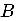), length of the sequence of tokens or frames (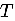), hidden dimension of the model ( or ) |
|  | Natural numbers  | Number of physical unique layers () and number of recurrent iterations in depth / loops ()3 |
|  | Natural numbers  | Number of query heads (), number of key-value heads ( in GQA/MQA) and the dimension of a single head (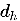)30 |
|  | Vectors 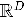 | Input vector at step  and hidden state in layer  at step  |
|  | Matrix  or vector  | Fixed-size recurrent state (fast weights / associative memory) in SSMs and linear attention25 |
|  | Binary tensor operators | Element-wise Hadamard product () and outer / Kronecker product () |
|  | Nonlinear activation functions | Logistic sigmoid  and the function  (Swish-1) |
|  | Functional  | Kullback–Leibler divergence  |

Below are the strict definitions of the key architectural and algorithmic mechanisms:

* **Reverse-Mode Automatic Differentiation (Reverse-Mode AD / Backpropagation)** — an algorithm for the exact computation of the gradient of a scalar loss function  with respect to all nodes of an acyclic computational graph in time proportional to one forward pass, by recursively propagating the adjoint derivatives 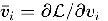 from output to input7.  
* **Adaptive Computation Time (ACT / Early Exit Gate)** — a mechanism for dynamically allocating the number of recurrent iterations  to each token through a learnable halting gate , which makes it possible to spend more arithmetic operations on logically difficult positions41.  
* **Fast Weights and Test-Time Training (Fast Weights / Test-Time Training, TTT)** — the parameters of an inner subnetwork or of the associative-memory matrix , which are updated dynamically at inference time (through the Hebbian rule, the delta rule or a gradient-descent step on a self-supervised loss) in order to compress a long context into a fixed amount of memory44.  
* **Vector, Residual and Finite Scalar Quantization (VQ / RVQ / FSQ)** — discretization of a continuous latent vector  by searching for the nearest codebook entry (VQ), by cascaded quantization of residuals over  codebooks (Residual VQ in SoundStream, EnCodec, Mimi), or by direct coordinate-wise rounding on a bounded integer lattice without a learnable codebook (Finite Scalar Quantization in CosyVoice 3\)46.  
* **Grouped-Query Attention (GQA) and Multi-Query Attention (MQA)** — sharing a single set of key and value projections  among all  query heads (, MQA) or within  groups (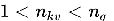, GQA) to cut the KV-cache size and the traffic from HBM video memory during decoding by a large factor39.  
* **Multi-Head Latent Attention (MLA)** — a mechanism that projects the hidden state into a single low-rank vector  () with a separate small-dimensional branch for Decoupled RoPE positional encoding; at inference only the compressed latent is cached, reducing KV-cache memory by 93.3% at the model level (up to 98.24% per layer relative to 128-head MHA)50.  
* **Group Relative Policy Optimization (GRPO)** — a reinforcement-learning algorithm without a separate critic network (value model), which estimates the advantage  by standardizing rewards within a group of  generated trajectories for a single prompt53.  
* **The delta rule in linear attention (DeltaNet / Gated DeltaNet / KDA)** — replacement of the additive write  with a generalized Householder reflection with decay , which erases the old value stored under the key  before writing the new value  (where  is the scalar  in GDN or the diagonal matrix  in KDA)24.  
* **Discrete text diffusion (Masked / Uniform Diffusion Language Models, dLLM / MDM / UDLM)** — non-autoregressive language models based on a bidirectional transformer that recover tokens in parallel from \[MASK\] masks (MDM: MDLM, LLaDA, Dream, Mercury) or from random vocabulary substitutions (UDLM) by minimizing a weighted variational likelihood bound35.  
* **Representation Alignment (REPA / JEPA)** — a family of training principles: in understanding the visual world (I-JEPA, V-JEPA), the network predicts the hidden representations of masked blocks in the space of an EMA encoder without generating pixels; in diffusion generation (REPA), the intermediate layers of a DiT are aligned, by cosine similarity, with the features of a pretrained visual teacher (for example, DINOv2)36.  
* **Manifold-Constrained Hyper-Connections (mHC)** — an expansion of the transformer's residual stream from a single vector  to  parallel lanes , where the lane-mixing matrix is projected by the Sinkhorn–Knopp algorithm onto the Birkhoff polytope of doubly stochastic matrices for non-expansive signal propagation (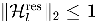) at arbitrary depth2.  
* **Structured State Space Models (SSM / S4 / Mamba)** — linear dynamical systems , discretized with step ; in selective SSMs (Mamba-1/2/3) the parameters  depend on the input, which provides parallel training linear in  and constant memory 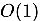 per step at inference32.  
* **Multi-Token Prediction (MTP)** — a training and self-speculative decoding architecture in which, on top of a shared model trunk, cascaded heads predict several future text tokens or the residual levels of RVQ audio codebooks29.  
* **Orthogonalized Matrix Momentum (Muon / MuonClip)** — an optimizer for two-dimensional matrix layers that replaces coordinate-wise gradient scaling with an approximate orthogonalization of the momentum matrix  by Newton–Schulz polynomial iterations (), flattening the singular-value spectrum of the update step65.  
* **Residual connections with attention over depth (Attention Residuals, AttnRes)** — replacement of the fixed summation of the outputs of all preceding layers with learnable softmax attention along the depth axis (over the preceding blocks), which eliminates the dilution of the feature norm in deep Pre-LN transformers34.  
* **Full-Duplex Speech-to-Speech models (Full-Duplex Speech-to-Speech, STS)** — architectures (Moshi, PersonaPlex, NemotronLabs VoiceChat) that synchronously process the incoming stream of the user's audio tokens and generate parallel streams of an "inner monologue" (text) and of response audio tokens, without segmentation into turn-taking utterances, which supports interruptions and backchannels with a latency of 160–205 ms68.  
* **Rotary Position Embedding (RoPE / p-RoPE / 3D-RoPE / TMRoPE)** — encoding of relative position by rotating pairs of query coordinates  and key coordinates  by angles , so that the dot product  depends only on the offset ; it generalizes to rotating a fraction of the subspace (\-RoPE) and to the spatio-temporal axes of video and audio (3D-RoPE, TMRoPE)71.  
* **Sparse Mixture-of-Experts (Sparse Mixture-of-Experts, MoE / LatentMoE)** — replacement of a dense FFN layer with a pool of  expert subnetworks, with 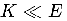 experts activated per token; in **LatentMoE** the input vector is first compressed into a low-dimensional latent to reduce weight-read traffic and inter-server All-to-All transfers27.  
* **Hardware-aligned sparse attention (NSA / DSA / CSA)** — learnable sparse-attention mechanisms (Native Sparse Attention, DeepSeek Sparse Attention, Compressed Sparse Attention) that use hierarchical block compression or a lightweight indexer (lightning indexer) to select the top\- keys per query, reducing the complexity of attention from  to 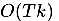31.  
* **Recurrent-depth (looped) transformer (Looped / Recurrent-Depth Transformer, PLT)** — an architecture with weight sharing across depth that passes the hidden state through a shared block of layers  times (Huginn, Ouro); in the **Parallel Loop Transformer (PLT)**, the sequential iterations of neighboring tokens are pipelined within one parallel pass (Cross-Loop Parallelism)3.  
* **Rectified flows and Flow Matching (Flow Matching / Rectified Flow)** — training of a generative ODE  by direct regression of a velocity field along the linear interpolation  between data and Gaussian noise, which enables fast deterministic generation in a small number of Euler steps5.  
* **Token-and-Duration Transducer (TDT)** — an extension of the streaming ASR decoder RNN-T that jointly predicts a subword token and the number of acoustic frames  that it covers, in order to skip stationary segments and pauses at inference79.

## **1958**

**Domains:** Foundations  
The starting point of parametric training of artificial neural networks was the publication by Frank Rosenblatt of *"The Perceptron: A Probabilistic Model for Information Storage and Organization in the Brain"* in the journal *Psychological Review* (No. 1\) and the hardware implementation of the Mark I Perceptron machine at the Cornell Aeronautical Laboratory (previously simulated on an IBM 704 mainframe\)82. Unlike the fixed logic elements of McCulloch and Pitts (1943), Rosenblatt's perceptron separated a sensory retina (the \-unit), a layer of random nonlinear associative projections (the \-unit, features ) and a trainable threshold adder (the \-unit) defining a separating hyperplane:  
  
The error-correction rule updated the weights  only on misclassified samples , where , by the formula 83. In the same year of 1958, John von Neumann's monograph *"The Computer and the Brain"* (No. 2) appeared posthumously; it was the first to contrast the massively parallel, low-frequency architecture of the brain's synaptic memory with the sequential bottleneck of digital computers. Although Rosenblatt already considered multilayer schemes in 1958, he lacked a differentiable credit-assignment algorithm for hidden layers7.

## **1959**

**Domains:** Encoder Foundations  
In 1959 three conceptual pillars of future deep networks emerged: the neurophysiological hierarchy of visual filters, parallel cascaded recognition, and the bootstrapping of an evaluation function over time. David Hubel and Torsten Wiesel, in a paper in *The Journal of Physiology* (No. 3\), discovered in the cat striate cortex local orientation-selective receptive fields, which became the biological prototype of convolutional kernels85. At the same time, Oliver Selfridge presented at the Teddington symposium the **Pandemonium** architecture (No. 4\) — a parallel hierarchy of "feature demons", "cognitive demons" that weight them, and a top "decision demon" that selects the maximum response 87. In the same year, Arthur Samuel published in the *IBM Journal of Research and Development* his famous work on a self-learning checkers player (No. 5), establishing the term *machine learning* and introducing an update of the weights of an evaluation polynomial by the difference between the evaluations of the current and the following positions — a direct prototype of the temporal-difference (TD learning) method and of the critic in reinforcement learning.

## **1960**

**Domains:** Foundations Optimization  
The transition from the discontinuous threshold rule of the perceptron to smooth gradient optimization was made by Bernard Widrow and Marcian Hoff, who presented the adaptive linear node **ADALINE** and the least-mean-squares algorithm **LMS** (Widrow–Hoff / Delta Rule, No. 6\)88. The key novelty of ADALINE was that the error was computed from the continuous linear output  *before* the binary threshold quantizer. Stochastic gradient descent on the instantaneous squared error  gave the classical delta rule:  
  
It is precisely this equation — rewritten for a matrix associative memory in the form  — that forms the foundation of the modern linear transformers **DeltaNet** and **Gated DeltaNet** (2024–2026)25. In the same year of 1960, Henry Kelley published in the *ARS Journal* the paper *"Gradient Theory of Optimal Flight Paths"* (No. 7), deriving the continuous adjoint-equation method for backpropagating derivatives of a cost functional along the trajectory of a dynamical system — an analytical precursor of both backpropagation and the Neural ODE7.

## **1961**

**Domains:** Loops Memory Foundations  
In 1961 the German cyberneticist Karl Steinbuch published in the first volume of the journal *Kybernetik* the paper *"Die Lernmatrix"* ("The Learning Matrix", No. 8\) — the first matrix architecture of heteroassociative memory on a crossbar lattice of conductors91. In Steinbuch's matrix, the input feature vector  and the class code  were bound by a local Hebbian-type rule , and retrieval was performed by a parallel matrix–vector multiplication  with competitive selection of the maximum. Algebraically, the "learning matrix" laid down the prototype of modern linear key–value associative memories 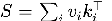. In the same year, Eduardo Caianiello, in the *Journal of Theoretical Biology* (No. 9\), divided neural-network dynamics into two coupled time scales: fast "neuronic equations" for the relaxation of activations and slow, adiabatic "mnemonic equations" for the plasticity of synaptic weights.

## **1962**

**Domains:** Foundations Encoder  
In April 1962 the mathematician Albert Novikoff presented a rigorous and concise proof of the **perceptron convergence theorem** (No. 10; related bounds were published in the same year by H. D. Block, No. 13\)92. Novikoff showed that if a sample  with bounded input norm  is linearly separable by a unit vector  () with a positive margin , then the perceptron algorithm started from the zero vector  terminates after at most  updates. On every mistake, the dot product with the oracle increases by at least  (), whereas the error condition  bounds the growth of the squared norm from above by  (), from which follows a bound that is completely independent of the dimension of the space 83:  
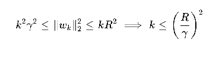  
In the same year there appeared Frank Rosenblatt's summary monograph *"Principles of Neurodynamics"* (No. 11), Bernard Widrow's piecewise-linear architecture **MADALINE** (No. 12\) and the classic paper of Hubel and Wiesel (No. 14), which described the alternation of *simple cells* (local linear edge detectors) and *complex cells* (spatially invariant pooling) in the visual cortex87.

## **1963**

**Domains:** Foundations Optimization  
Developing the geometry of the separating margin , Vladimir Vapnik and Alexander Lerner published in the journal *Avtomatika i Telemekhanika* (*Automation and Remote Control*) the paper *"Pattern Recognition Using Generalized Portraits"* (No. 15\)97. Instead of searching for an arbitrary separating hyperplane, the authors formulated a quadratic-optimization problem of finding the unique **maximum-margin hyperplane** (a linear prototype of the support vector method, SVM), whose normal vector is expanded only in terms of the extreme support vectors of the sample . Thus the principle of controlling the weight norm 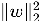 as a measure of classifier capacity entered learning theory. In the same year Steinbuch and Piske published in *IEEE Transactions on Electronic Computers* an analysis of continuous memory matrices under noisy signals (No. 16), and Stuart Dreyfus simplified the derivation of the chain rule of adjoint multipliers through dynamic programming (No. 17\)7.

## **1964**

**Domains:** Optimization Foundations  
In 1964 three mathematical tools were created that work directly in modern deep-learning frameworks. Boris Teodorovich Polyak published in the *Zhurnal Vychislitel'noi Matematiki i Matematicheskoi Fiziki* (*USSR Computational Mathematics and Mathematical Physics*) the inertial **"heavy ball" method (Heavy-Ball Momentum)** (No. 18\) for accelerating gradient descent in ill-conditioned ravine-like problems100:  
  
The inertial term 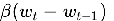 suppresses the transverse oscillations of the gradient and reduces the effective condition number of a quadratic problem from  to . At the same time, Mark Aizerman, Emmanuil Braverman and Lev Rozonoer introduced in *Avtomatika i Telemekhanika* the **method of potential functions** (No. 19\) — a rigorous justification of the *kernel trick* , directly related to the future kernel factorization of linear attention20. In the same year, Robert Wengert presented in *Communications of the ACM* (No. 20\) a program algorithm of **forward-mode automatic differentiation (Forward-Mode AD)** over a list of elementary operations.

## **1965**

**Domains:** Foundations Optimization  
In 1965 Alexey Grigorievich Ivakhnenko and Valentin Grigorievich Lapa published the monograph *"Cybernetic Predicting Devices"* (No. 21), describing the first working algorithms for layer-by-layer training of **deep multilayer perceptrons** with an arbitrary number of hidden layers7. Each node of the network computed a Kolmogorov–Gabor quadratic polynomial with multiplicative products of the inputs (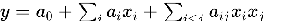 — an algebraic precursor of the gating blocks GLU and SwiGLU), the coefficients were found by the least-squares method, and a validation sample screened out overfitted neurons before the next layer was built7.  
In parallel, Thomas Cover proved in *IEEE Transactions on Electronic Computers* the fundamental **Cover's theorem on the capacity of linear separation** (No. 22): the number of linearly realizable binary partitions of  points in general position in 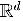 equals , which makes up exactly half of all  dichotomies when  and tends exponentially to zero when . This geometric fact explains the need for wide feature projections in the hidden layers of MLPs and MoEs. The year was complemented by Nils Nilsson's classic book *"Learning Machines"* (No. 23\)88 and the Ho–Kashyap gradient method for systems of linear inequalities (No. 24).

## **1966**

**Domains:** Optimization Foundations  
In 1966 Yakov Zalmanovich Tsypkin, in his work *"Adaptation, Learning and Self-Learning in Automatic Systems"* (*Avtomatika i Telemekhanika*, No. 25\), reduced the scattered rules of perceptrons, ADALINE and filtering to a single variational problem of **minimizing the expected value of a loss function (the average risk)**  by means of Robbins–Monro recurrent stochastic approximation 105. This formulation became the standard language of modern neural-network optimization theory. In the same year Emmanuil Braverman extended the method of potential functions to the problem of self-learning and unsupervised clustering (No. 26\)20, and Lawrence Fogel, Alvin Owens and Michael Walsh published the monograph *"Artificial Intelligence through Simulated Evolution"* (No. 27), which opened the direction of gradient-free evolutionary search.

## **1967**

**Domains:** Foundations Optimization  
In June 1967 Shun'ichi Amari published in *IEEE Transactions on Electronic Computers* the paper *"A Theory of Adaptive Pattern Classifiers"* (No. 28\) — the first work in history in which **end-to-end stochastic gradient descent (end-to-end SGD)** was applied to train a multilayer neural network with nonlinear hidden layers on linearly non-separable distributions7. Replacing the threshold step with smooth differentiable activation functions, Amari derived the chain rule for correcting the hidden weights  and experimentally trained a 5-layer classifier nineteen years before the 1986 publication in *Nature*7.  
In the same year two works of enormous prospective importance appeared: Thomas Cover and Peter Hart proved an asymptotic bound on the error of the nearest-neighbor rule (, No. 29), laying the theoretical basis of vector search and RAG systems, while Richard Sinkhorn and Paul Knopp published in the *Pacific Journal of Mathematics* a theorem and an iterative algorithm for alternately normalizing the rows and columns of a positive matrix to doubly stochastic form (No. 30\) — the very **Sinkhorn–Knopp** operator that at the turn of 2025–2026 provided the stability of the multi-lane **mHC** hyper-connections in DeepSeek architectures2.

## **1968**

**Domains:** Foundations Loops  
In 1968 Alexey Ivakhnenko formalized the **Group Method of Data Handling (GMDH)** in the journal *Avtomatika* (No. 31\)104, systematizing the automatic growth of deep polynomial networks with regular selection of the best neurons and early stopping of the depth on an independent validation set. In parallel, Stephen Grossberg published in *PNAS* the nonlinear associative-learning model **Outstar** and a system of differential equations for short-term (STM) and long-term (LTM) memory (No. 32\)109:  
  
proving the unconditional convergence of the synaptic weights to the spatial proportions of the input pattern. In the same year Vladimir Vapnik and Alexey Chervonenkis published in *Doklady Akademii Nauk SSSR* (*Proceedings of the USSR Academy of Sciences*) a theorem on the uniform convergence of empirical frequencies to probabilities over a class of events, introducing a combinatorial measure of the capacity of function families — the **Vapnik–Chervonenkis dimension (VC-dimension)** (No. 33).

## **1969**

**Domains:** Foundations Encoder Optimization  
In 1969 Marvin Minsky and Seymour Papert issued the analytical monograph *"Perceptrons: An Introduction to Computational Geometry"* (No. 34\)7. Using group-invariance theory, the authors rigorously proved that a single-layer perceptron with local features of bounded order cannot realize the parity predicate (including the two-bit **XOR**) or the topological connectedness predicate. Although the authors noted that multilayer networks are free of this limitation, the absence of an efficient algorithm for training hidden layers that was widely known in the West caused a cooling of interest in connectionism in the English-language academic community7.  
However, in the same year 1969 two key elements of modern deep learning were published. Arthur Bryson and Yu-Chi Ho, in the book *"Applied Optimal Control"* (No. 35\), wrote out explicit discrete formulas for backpropagating Lagrange multipliers through multistage cascades 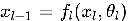7. At the same time, Kunihiko Fukushima, in the paper *"Visual Feature Extraction by a Multilayered Network of Analog Threshold Elements"* (*IEEE Transactions on Systems Science and Cybernetics*, No. 36\)85, introduced a multilayer visual network with **analog half-wave rectifiers**  — historically the first use of the **ReLU** activation function in multilayer neural networks7.

## **1970**

**Domains:** Foundations Optimization  
In 1970 the Finnish mathematician Seppo Linnainmaa defended a master's thesis at the University of Helsinki (No. 37\)7, in which he for the first time formulated and implemented in machine code a general algorithm of **reverse-mode automatic differentiation (Reverse-Mode Automatic Differentiation)** for arbitrary computational graphs. If the computation of the scalar loss function  is decomposed into elementary nodes 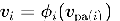 (), then the backward pass from  to  recursively accumulates the partial derivatives:  
  
Computing the full gradient vector  with respect to an arbitrary number of parameters  requires only a constant multiple of the number of operations of one forward pass114. In the same year 1970, Broyden, Fletcher, Goldfarb and Shanno independently derived the second-order quasi-Newton method **BFGS** (No. 38), and Ivakhnenko published in the international journal *Automatica* a review of the heuristic self-organization of deep networks (No. 39\)115.

## **1971**

**Domains:** Foundations Memory  
In October 1971 Alexey Ivakhnenko published in *IEEE Transactions on Systems, Man, and Cybernetics* the paper *"Polynomial Theory of Complex Systems"* (No. 40\)115, describing in detail the construction and training of an **8-layer deep** feedforward network by the GMDH method with regularized feature selection on a validation sample7. This publication became one of the first widely cited examples in the international literature of practical training of a deep eight-layer architecture7.  
In the same year David Marr published in the *Philosophical Transactions of the Royal Society B* a mathematical model of the hippocampus, *"Simple Memory: A Theory for Archicortex"* (No. 41\)7. Marr showed that sparse coding of input vectors in a high-dimensional space, combined with local Hebbian plasticity and an adaptive inhibitory threshold, makes it possible to store a large number of episodic associations in a single pass and to recover them without error from partial cues — a principle underlying modern sparse modules of external and parametric memory.

## **1972**

**Domains:** Loops Memory  
In November 1972 Shun'ichi Amari published in *IEEE Transactions on Computers* the paper *"Learning Patterns and Pattern Sequences by Self-Organizing Nets of Threshold Elements"* (No. 42), deriving, ten years before Hopfield's publication, the stability equations of discrete recurrent associative networks (the **Amari–Hopfield network**) both for static attractors with a symmetric weight matrix and for dynamic chains of sequences with an asymmetric matrix7:  
  
In the same year 1972, Teuvo Kohonen independently introduced correlation matrix memories in *IEEE Transactions on Computers* (No. 43\)118, James Anderson described a linear-threshold interactive memory in *Mathematical Biosciences* (No. 44), Kaoru Nakano built the associative system **Associatron** (No. 45\)7, and Hugh Wilson and Jack Cowan derived in the *Biophysical Journal* a nonlinear system of ODEs for coupled excitatory and inhibitory neural populations (, No. 46), analytically proving the connection between limit cycles of oscillations and multistable memory hysteresis119.

## **1973**

**Domains:** Encoder Loops  
In 1973 Christoph von der Malsburg published in *Kybernetik* the paper *"Self-Organization of Orientation Sensitive Cells in the Striate Cortex"* (No. 47\)115 — the first computer demonstration of **competitive learning** of local feature detectors. Combining short-range intracortical excitation, lateral inhibition and the Hebbian rule with **conservation of the \-norm of the input synapses of each neuron** (), von der Malsburg demonstrated the spontaneous formation of ordered maps of orientation columns without a teacher.  
At the same time, Stephen Grossberg published in *Studies in Applied Mathematics* a rigorous analysis of **shunting recurrent networks** with multiplicative saturation and divisive lateral inhibition (No. 48\)109: he proved that it is precisely the sigmoidal transfer characteristic that suppresses small-amplitude background noise and preserves the relative contrast of the pattern without saturation as the overall brightness of the input grows arbitrarily — the theoretical foundation of activation-normalization layers. Hugh Wilson and Jack Cowan generalized their population dynamics to spatially continuous neural fields of the cortex and thalamus (No. 49\)124.

## **1974**

**Domains:** Foundations Optimization Loops  
In 1974 Paul Werbos defended at Harvard University his doctoral dissertation *"Beyond Regression: New Tools for Prediction and Analysis in the Behavioral Sciences"* (No. 50\)7. Werbos formulated the method of "dynamic feedback" — explicit formulas for the chain backpropagation of derivatives of an objective function through arbitrary multilayer networks with nonlinear nodes, preparing the direct application of the method to neural networks in the early 1980s115.  
In the same year the physicist William Little published in *Mathematical Biosciences* the paper *"The Existence of Persistent States in the Brain"* (No. 51\)126, which established a direct correspondence between the statistical physics of **Ising spin systems** and stochastic recurrent neural networks. Introducing an effective temperature of synaptic noise  and a logistic firing probability of a neuron , Little described long-term memory as degenerate leading eigenstates of the Markov transition matrix — the foundation of Boltzmann machines and thermodynamic generative models.

## **1975**

**Domains:** Encoder Memory Foundations  
In 1975 Kunihiko Fukushima presented in *Biological Cybernetics* the multilayer self-organizing network **Cognitron** (No. 52\)86. In the Cognitron, local excitatory and inhibitory receptive fields were combined with a shunting divisive ratio  and competitive strengthening of the synapses of only the most active neuron in a neighborhood; the network, however, did not yet share weights across the whole plane and therefore remained sensitive to shifts of the image129.  
In parallel, three landmark works appeared in neighboring fields: James Albus created the fast locality-hashing architecture of the cerebellar controller **CMAC** with overlapping coarse receptive fields (No. 53\)130; David Sherrington and Scott Kirkpatrick introduced in *Physical Review Letters* the solvable **SK spin-glass** model with random sign-alternating couplings  (No. 54\)126, whose analytical replica method became the basis for computing phase transitions and the capacity of neural networks; and John Holland published the monograph *"Adaptation in Natural and Artificial Systems"* (No. 55), which laid the mathematics of genetic algorithms.

## **1976**

**Domains:** Optimization Loops Foundations  
In June 1976 Seppo Linnainmaa published in the international journal *BIT Numerical Mathematics* the English-language paper *"Taylor Expansion of the Accumulated Rounding Error"* (No. 56\)23. Besides the complete first- and higher-order algorithms of reverse differentiation on a computational graph, Linnainmaa was the first to analyze the fundamental memory problem of the backward pass — the need to store the intermediate states of all operations and ways of reducing peak memory consumption — anticipating modern techniques of selective recomputation of activations (**activation / gradient checkpointing**, used, in particular, in training Ring Attention and DeepSeek mHC2).  
In the same year Stephen Grossberg, in a two-part work in *Biological Cybernetics* (No. 57\)126, formulated the **stability–plasticity dilemma** (how to further train a network on new classes without catastrophic destruction of previously learned representations) and proposed a mechanism of resonant filtering of bottom-up features by top-down expectations (**Adaptive Resonance Theory, ART**), while David Willshaw and Christoph von der Malsburg built a synaptic model of the self-organization of continuous topographic projections of the retina (No. 58).

## **1977**

**Domains:** Loops Memory Optimization  
In 1977 James Anderson, Jack Silverstein, Stephen Ritz and Randall Jones published in *Psychological Review* the nonlinear recurrent model of categorical memory **Brain-State-in-a-Box (BSB)** (No. 59\)122, which confines the positive-feedback trajectory within the walls of a unit hypercube :  
  
The symmetric Hebbian coupling matrix  amplifies projections along the principal eigenvectors until the state settles at a vertex of the hypercube corresponding to a pure discrete memory prototype. In the same year Shun'ichi Amari published the canonical mathematical theory of localized excitations ("bumps" of working memory) in continuous neural fields with lateral inhibition (No. 60\)124, Teuvo Kohonen issued the monograph *"Associative Memory"* (No. 61), and Arthur Dempster, Nan Laird and Donald Rubin formalized in *JRSS-B* the **EM algorithm** for likelihood maximization in models with latent variables through the Jensen variational bound (No. 62\) — the analytical foundation of training MoE and variational autoencoders.

## **1978**

**Domains:** Memory Loops Foundations  
In 1978 William Little and Gordon Shaw published in *Mathematical Biosciences* the work *"Analytic Study of the Memory Storage Capacity of a Neural Network"* (No. 63\)127. Solving analytically a linearized model of a stochastic neural network with plastic connections, the authors rigorously showed that the information capacity of a distributed neural memory scales in proportion to the **number of synapses** , and not to the number of neurons 127. In modern engineering, it is precisely this law that explains why storing world facts requires scaling the total number of weight parameters up to hundreds of billions and trillions in sparse MoE architectures, even when a small active subset of neurons suffices to process a single token.  
In the same year Gideon Schwarz introduced in the *Annals of Statistics* the Bayesian information criterion **BIC** for selecting the dimension of parametric models (No. 64), Stephen Grossberg presented a theory of hierarchical chunking of sequences in working memory (No. 65\)109, and Kunihiko Fukushima improved the mean-square-type synaptic rule for deep unsupervised self-learning (No. 66\)129.

## **1979**

**Domains:** Encoder Foundations  
In October 1979 Kunihiko Fukushima published in the Japanese journal *Transactions of the IECE of Japan* (vol. J62-A, No. 10, pp. 658–665) the first paper on the **Neocognitron** architecture — the first deep convolutional neural network invariant to spatial shifts of input patterns (No. 67\)7. Inspired by the discovery of Hubel and Wiesel, Fukushima organized the network as a multistage alternation of pairs of layers of two types: planes of **\-cells**, in which all the neurons of one plane have *identically equal shared weights* (weight sharing) and extract a local feature at every point of a two-dimensional field (the operation of 2D convolution with a ReLU rectifier), and planes of 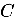**\-cells**, which aggregate the responses of the local neighborhood of \-cells with resolution reduction (the operation of spatial pooling), owing to which the tolerable shift error accumulates smoothly from layer to layer without loss of the mutual geometry of the details87. In the same year Leon Cooper, F. Liberman and Erkki Oja published in *Biological Cybernetics* a synaptic model of the formation of neuron selectivity in the visual cortex (No. 68).

## **1980**

**Domains:** Encoder Optimization  
In April 1980 the classic English-language publication by Kunihiko Fukushima, *"Neocognitron: A Self-Organizing Neural Network Model for a Mechanism of Pattern Recognition Unaffected by Shift in Position"* (No. 69\)86, appeared in *Biological Cybernetics* (vol. 36, pp. 193–202), making the convolution–pooling hierarchy known to the whole world community. The response of an \-cell at position  of the feature plane  of layer , under divisive inhibition by the root-mean-square activity  in a local window 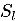, was given by the equation:  
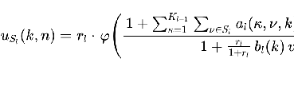  
Thus the entire structural topology of deep visual networks — multichannel 2D convolutions with weight sharing, rectification 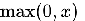, local root-mean-square normalization and spatial pooling — was fully constructed, awaiting the replacement of local self-organization rules by global gradient descent87. In the same year Stephen Grossberg published in *Psychological Review* a summarizing paper on resonant cognitive codes (No. 70), and Walter Baur and Volker Strassen proved the famous algebraic-complexity theorem (the Baur–Strassen Theorem, No. 71): computing the gradient of any rational function of many variables on an arithmetic circuit requires at most five times the number of operations needed to compute the function itself114.

## **1981**

**Domains:** Memory Loops Optimization  
In 1981 Geoffrey Hinton and James Anderson issued the programmatic collective monograph *"Parallel Models of Associative Memory"* (No. 72\)140, which justified the transition from symbolic localist nodes ("one concept — one cell") to dense **distributed vector representations** (distributed representations), in which each concept is encoded by an activity pattern of many elements, providing automatic generalization by similarity of microfeatures. In the same year James McClelland and David Rumelhart presented in *Psychological Review* the **interactive activation model** of letter and word perception with bidirectional inter-layer feedback (No. 73), and Andrew Barto, Richard Sutton and Peter Brouwer published in *Biological Cybernetics* the model of an **associative search network** (No. 74), uniting stochastic generation of actions with learning from a scalar reinforcement signal — a direct predecessor of gradient methods of reinforcement learning.

## **1982**

**Domains:** Loops Memory Encoder Foundations  
In April 1982 John Hopfield published in *PNAS* the famous paper *"Neural Networks and Physical Systems with Emergent Collective Computational Abilities"* (No. 75\)124. Assigning to a binary recurrent network  with a symmetric weight matrix 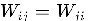 (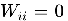) an explicit physical **Lyapunov energy function**:  
  
Hopfield proved the monotonic non-increase of the energy () under asynchronous threshold updates  and convergence to local minima — content-addressable memory attractors (the capacity of the classical binary version is about  uncorrelated patterns, whereas the modern exponential Hopfield networks of 2016–2020 have exponential capacity and are equivalent to the softmax attention of the transformer142).  
In the same year 1982 Paul Werbos at the IFIP conference for the first time explicitly published the application of backpropagation directly to artificial neural networks (No. 76\)7; Teuvo Kohonen created the topographic **self-organizing feature maps (SOM)** (No. 77); Erkki Oja derived the local normalized plasticity rule  (**Oja's rule**, No. 78), which extracts the principal eigenvector of the data covariance matrix (neural PCA); Bienenstock, Cooper and Munro proposed the nonlinear synaptic-modification rule with a sliding threshold, **BCM** (No. 79); and David Marr's fundamental book *"Vision"* (No. 80) appeared posthumously.

## **1983**

**Domains:** Optimization Loops  
In 1983 Yurii Evgenievich Nesterov published in *Doklady Akademii Nauk SSSR* (*Soviet Mathematics Doklady*, 27(2), 372–376) an optimal method for minimizing smooth convex functions with convergence rate 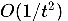 — the **Nesterov accelerated gradient method (NAG)** (No. 81\)143:  
  
Computing the gradient at the look-ahead inertial point  provided correction of the trajectory at sharp turns of the loss landscape and became standard in modern modifications of SGD, in NAdam and in the orthogonalized momentum of Muon. In the May issue of *Science*, Scott Kirkpatrick, Charles Gelatt and Mario Vecchi presented stochastic global optimization by the **Simulated Annealing** method with a Metropolis transition probability  (No. 82\)144, and Andrew Barto, Richard Sutton and Charles Anderson published in *IEEE TSMC* the neural **Actor–Critic** architecture on the pole-balancing (inverted pendulum) task (No. 83\)144.

## **1984**

**Domains:** Foundations Loops Diffusion  
In November 1984 Leslie Valiant published in *Communications of the ACM* the paper *"A Theory of the Learnable"* (No. 84\)146, which laid the rigorous computational-statistical foundation of **Probably Approximately Correct learning (PAC Learning)**: a formalization of the sample and computational complexity of achieving a generalization error  with confidence . In the same year John Hopfield generalized his model to continuous dynamical circuits with a smooth monotone sigmoid 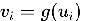 and a continuous Lyapunov functional (No. 85), the brothers Stuart and Donald Geman introduced in *IEEE TPAMI* **Gibbs Sampling** on Markov random fields with the Gibbs distribution 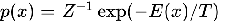 for Bayesian restoration of noisy images (No. 86), and Teuvo Kohonen issued the expanded monograph *"Self-Organization and Associative Memory"* (No. 87).

## **1985**

**Domains:** Foundations Memory Diffusion  
In 1985 David Ackley, Geoffrey Hinton and Terrence Sejnowski published in *Cognitive Science* the training algorithm for **Boltzmann machines** (No. 88\)146 — stochastic energy-based networks with *hidden variables* , modeling the distribution of visible vectors  by marginalization 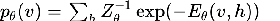. The gradient of the Kullback–Leibler divergence with respect to a symmetric weight  reduced to a difference of pairwise correlations in two thermodynamic regimes:  
  
Although long MCMC annealing limited the size of fully connected Boltzmann machines, this was the first theoretically rigorous demonstration of learning deep distributed representations in generative networks150. In the same year 1985 Yann LeCun at the *Cognitiva 85* conference in Paris (No. 89\) and David Parker in an MIT report, *"Learning-Logic"* (No. 90\), independently published gradient backpropagation schemes for multilayer networks, and David Rumelhart and David Zipser systematized competitive feature clustering (No. 91).

## **1986**

**Domains:** Foundations Loops Optimization  
In October 1986 David Rumelhart, Geoffrey Hinton and Ronald Williams published in *Nature* the famous paper *"Learning Representations by Back-Propagating Errors"* (No. 92), simultaneously with the appearance of the two-volume fundamental work of the PDP group, *"Parallel Distributed Processing"* (MIT Press, No. 93\)7. The authors showed that a multilayer perceptron (MLP) with smooth activations , trained by recursive propagation of the sensitivity vector:  
  
constructs nontrivial semantic representations in the intermediate layers and solves nonlinearly separable predicates151. In the same PDP edition Paul Smolensky introduced the bipartite energy network without intra-layer connections, the **Harmonium** — mathematically equivalent to the **restricted Boltzmann machine (RBM)** with exact one-step conditional inference  (No. 94); Michael Jordan proposed a recurrent network with feedback from the output into a context state vector  (**Jordan RNN**, No. 95); and Terrence Sejnowski and Charles Rosenberg demonstrated the phonemic transcription synthesizer of English text **NETtalk** (No. 96).

## **1987**

**Domains:** STT Loops Encoder  
In 1987 Alexander Waibel, Toshiyuki Hanazawa, Geoffrey Hinton, Kiyohiro Shikano and Kevin Lang created the **Time-Delay Neural Network (TDNN)** for recognizing speech phonemes (No. 97\)87 — the first one-dimensional convolutional network along the time axis with shared weights, invariant to shifts of acoustic formants and trainable by backpropagation. In the same year Geoffrey Hinton and David Plaut published the work *"Using Fast Weights to Deblur Old Memories"* (No. 98\)45, supplying each connection with a pair consisting of a slow long-term weight and a rapidly decaying contextual weight (**Fast Weights**) — a direct conceptual source of modern layers of linear attention and test-time training (TTT and Titans). In parallel Dana Ballard at the AAAI conference proposed modular layer-wise pretraining of deep hierarchies with a **stack of autoencoders** (No. 99), Gail Carpenter and Stephen Grossberg formalized the adaptive resonance architecture **ART 1** (No. 100\)110, and Fernando Pineda derived in *Physical Review Letters* continuous backpropagation of gradients for fixed points of recurrent attractors  (**Recurrent Backpropagation**, No. 101\) — an analytical predecessor of the equilibrium networks DEQ.

## **1988**

**Domains:** Encoder Optimization Loops  
In 1988 Wei Zhang and coauthors published the first **two-dimensional shift-invariant convolutional neural network (Shift-Invariant 2D CNN)** for character recognition, trained directly by the backpropagation method (No. 102\)20. David Broomhead and David Lowe introduced in *Complex Systems* **radial basis function networks (RBF Networks)**  (No. 103). In learning theory, Richard Sutton published in the journal *Machine Learning* the fundamental work on **temporal-difference learning TD()** (No. 104\)152, which updates the predictor's parameters by the Bellman residual  before the end of the episode. At the same time Hervé Bourlard and Yves Kamp proved that a linear autoencoder with a narrow bottleneck of dimension  learns an orthogonal projector onto the principal singular subspaces of the SVD (No. 105), and Bart Kosko introduced the bidirectional heteroassociative memory **BAM** (No. 106).

## **1989**

**Domains:** Encoder Foundations Optimization Loops  
In 1989 Yann LeCun, Bernhard Boser, John Denker, Donnie Henderson, Richard Howard, Wayne Hubbard and Lawrence Jackel published in *Neural Computation* the paper *"Backpropagation Applied to Handwritten Zip Code Recognition"* (No. 107\)87, training a deep convolutional network with shared 5×5 filters and subsampling (stride 2\) directly on normalized pixels of handwritten USPS zip codes and demonstrating a sharp improvement in generalization owing to the spatial sharing of weights. In the same year George Cybenko (No. 108\) and, independently, Kurt Hornik, Maxwell Stinchcombe and Halbert White (No. 109\) proved the **universal approximation theorem** for continuous functions on compact sets by two-layer perceptrons with a non-polynomial activation. The year was also marked by the online training algorithm for recurrent networks **RTRL** by Ronald Williams and David Zipser (No. 110), the creation of **Q-learning** in the dissertation of Christopher Watkins (No. 111), the limited-memory method **L-BFGS** by Dong Liu and Jorge Nocedal (No. 112\)153 and the probabilistic interpretation of the **Softmax** function by John Bridle (No. 113).

## **1990**

**Domains:** Loops Optimization Foundations  
In 1990 Jeffrey Elman published in *Cognitive Science* the paper *"Finding Structure in Time"* (No. 114\)154, which made the **simple recurrent network (Simple RNN / Elman Network)**  the basic tool for sequence modeling and showed the spontaneous emergence of syntactic-semantic clusters in the hidden space when predicting the next word. Paul Werbos in the *Proceedings of the IEEE* fixed the general formulation of **backpropagation through time (BPTT)** by step-by-step unrolling of the graph (No. 115). At the NIPS conference Yann LeCun, John Denker and Sara Solla presented the method of second-order sparse weight pruning **Optimal Brain Damage (OBD)** based on the diagonal of the Hessian  (No. 116\) — a direct predecessor of modern LLM compression algorithms. In parallel Jürgen Schmidhuber proposed a minimax game of two networks within **adversarial artificial curiosity** (No. 117\)7, and Lars Hansen and Peter Salamon justified the reduction of error variance in **neural-network ensembles** (No. 118).

## **1991**

**Domains:** MoE Loops Attention/LLM Foundations  
In 1991 three fundamental mechanisms were laid down that determine the architecture of the flagship models of 2024–2027. Robert Jacobs, Michael Jordan, Steven Nowlan and Geoffrey Hinton published in *Neural Computation* the paper *"Adaptive Mixtures of Local Experts"* (the **first MoE**, No. 119\)156. Replacing the averaging of squared error with maximization of the log-likelihood of a Gaussian mixture governed by a gating network :  
  
the authors achieved competitive specialization of the experts  on different regions of the input space, since the gradient is received predominantly by the expert with the largest posterior responsibility for the example.  
In June of the same year 1991 Sepp Hochreiter defended, under the supervision of Jürgen Schmidhuber, a diploma thesis (No. 120\)7, giving for the first time a rigorous analysis of the **vanishing and exploding of gradients** in deep and recurrent networks through the product of Jacobians . And in the spring of 1991 Schmidhuber proposed the **Fast Weight Programmers** architecture (No. 121; journal publication 1992\)7, in which a slow network dynamically generates key and value vectors for additive overwriting of the fast-weight matrix  and for readout  — a construction mathematically isomorphic to unnormalized linear self-attention22. The year was completed by Mark Kramer's five-layer nonlinear autoencoders (No. 122\) and the classic textbook on the statistical mechanics of neural networks by Hertz, Krogh and Palmer (No. 123).

## **1992**

**Domains:** Optimization Loops Foundations  
In 1992 Ronald Williams published in *Machine Learning* the **REINFORCE** policy-gradient estimator with a subtracted baseline  for variance reduction (No. 124):  
  
which became the direct basis for the optimization of reasoning language models by the PPO and GRPO methods53. At the same time Jürgen Schmidhuber introduced in *Neural Computation* the **neural history compressor** (No. 125\)22 — hierarchical self-supervised pretraining of RNNs that passes to the upper level only unpredictable ("surprising") tokens, followed by compression ("distillation") of a deep teacher into a compact student network7. Boris Polyak and Anatoli Juditsky proved the asymptotic optimality of **averaging the SGD weight trajectory**  (No. 126\) — the theoretical basis of EMA targets in DINO, JEPA and diffusion; Anders Krogh and John Hertz justified regularization by weight decay (**Weight Decay**, No. 127); and Boser, Guyon and Vapnik combined the hyperplane margin with the kernel trick at COLT (No. 128).

## **1993**

**Domains:** Encoder Foundations Optimization  
In 1993 Jane Bromley, Isabelle Guyon, Yann LeCun and coauthors presented at NIPS **Siamese neural networks (Siamese Networks)** (No. 129): two identical convolutional towers with shared weights map a pair of inputs into a common metric space of cosine proximity — the paradigm underlying all modern contrastive encoders (CLIP, SigLIP, dense retrieval). At the COLT conference Geoffrey Hinton and Drew van Camp formulated the principle of minimum description length of weights through minimization of the variational free energy  (**variational Bayesian inference in neural networks**, No. 130), which anticipated the ELBO functional. In the same year Andrew Barron proved that the approximation rate  of a two-layer network is independent of the dimension of the space  for functions with bounded Fourier spectral norm (No. 131), and Babak Hassibi and David Stork generalized Hessian pruning to the full non-diagonal **Optimal Brain Surgeon (OBS)** (No. 132\) — the mathematical basis of modern LLM weight quantizers (GPTQ).

## **1994**

**Domains:** Loops MoE Optimization  
In 1994 Yoshua Bengio, Patrice Simard and Paolo Frasconi published in *IEEE Transactions on Neural Networks* the rigorous theorem *"Learning Long-Term Dependencies with Gradient Descent is Difficult"* (No. 133), proving a fundamental conflict of nonlinear dynamical systems: noise-robust storage of a bit in a hyperbolic attractor requires Jacobian eigenvalues , which automatically causes an exponential decay of the error gradient over time. In the same year Michael Jordan and Robert Jacobs generalized the mixture of experts to the tree-structured **hierarchical mixture of experts (HME)** with fast EM training (No. 134), Barak Pearlmutter derived the differential operator  for exact Hessian–vector multiplication in 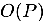 operations without storing the matrix of second derivatives (No. 135), and the first edition of Simon Haykin's fundamental course *"Neural Networks: A Comprehensive Foundation"* (No. 136) appeared.

## **1995**

**Domains:** Foundations Diffusion Encoder  
In May 1995 Geoffrey Hinton, Peter Dayan, Brendan Frey and Radford Neal published in *Science* the architecture of the **Helmholtz machine** and the two-phase **Wake–Sleep** algorithm (No. 137), pairing a directed generative model  with a fast recognition inference network  — a direct structural predecessor of the variational autoencoder. Anthony Bell and Terrence Sejnowski created the blind signal separation algorithm **InfoMax ICA** by maximizing the entropy of a nonlinear output (No. 138); Corinna Cortes and Vladimir Vapnik introduced the soft-margin classifier **Support-Vector Networks** (No. 139\)149; Yann LeCun and Yoshua Bengio systematized 1D/2D convolutional architectures for speech and images (No. 140); and Christopher Bishop issued the classic monograph *"Neural Networks for Pattern Recognition"* (Oxford University Press, No. 141\)88, which established the Bayesian and probabilistic treatment of loss functions and regularization.

## **1996**

**Domains:** Encoder Foundations Loops  
In June 1996 Bruno Olshausen and David Field showed in the journal *Nature* (*"Emergence of Simple-Cell Receptive Field Properties by Learning a Sparse Code for Natural Images"*, No. 142) that minimizing the squared reconstruction error of natural images with an overcomplete dictionary and an \-sparsity penalty  spontaneously forms localized oriented Gabor wavelets — the mathematical basis of both sparse coding and the modern Sparse Autoencoders (SAE) for LLM interpretability. In the same year Radford Neal in the monograph *"Bayesian Learning for Neural Networks"* (No. 143\) proved the convergence of randomly initialized neural networks of infinite width () to **Gaussian processes (NNGP)**, Christoph Goller and Andreas Küchler introduced backpropagation through acyclic graphs and syntax trees (No. 144), and Brian Ripley's book *"Pattern Recognition and Neural Networks"* (No. 145) appeared.

## **1997**

**Domains:** Loops Memory Optimization  
In November 1997 Sepp Hochreiter and Jürgen Schmidhuber published in *Neural Computation* the **Long Short-Term Memory (LSTM)** architecture (No. 146\)7. To overcome vanishing gradients, the authors replaced the contracting nonlinear state transformation with a linear **Constant Error Carousel (CEC)**  with a unit Jacobian over time, protecting writing and reading with multiplicative input (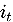) and output () gates:  
  
In the same year 1997 Mike Schuster and Kuldip Paliwal created in *IEEE TSP* **bidirectional recurrent networks (BiRNN)** (No. 147), combining forward and backward temporal unrollings for full contextual encoding; Hochreiter and Schmidhuber introduced the criterion of seeking **flat minima (Flat Minima)** of low Hessian curvature for improving generalization (No. 148); and Yoav Freund and Robert Schapire published the weighted boosting algorithm **AdaBoost** (No. 149).

## **1998**

**Domains:** Encoder Optimization Foundations  
In November 1998 Yann LeCun, Léon Bottou, Yoshua Bengio and Patrick Haffner published in the *Proceedings of the IEEE* the monumental paper *"Gradient-Based Learning Applied to Document Recognition"* (No. 150), fixing the reference 7-layer convolutional network **LeNet-5** (0.8% error on the MNIST dataset) and the globally trainable **graph transformer networks (GTN)** for reading multi-character documents without preliminary segmentation, supplemented by the practical guide to activation scaling and initialization *"Efficient BackProp"* (No. 151). At the same time Shun'ichi Amari derived in *Neural Computation* the **natural gradient (Natural Gradient)**  in the Riemannian metric of the Fisher information matrix  (No. 152\)159 — the parametrization-invariant foundation of the second-order algorithms K-FAC, Shampoo, SOAP and of the trust regions of PPO160. In the same year the classic monographs by Richard Sutton and Andrew Barto on reinforcement learning (No. 153\)152 and by Vladimir Vapnik, *"Statistical Learning Theory"* (No. 154\)99, appeared.

## **1999**

**Domains:** Loops Memory Foundations  
In continuous streams without reset markers, the linear memory cell  of the original 1997 LSTM saturated without bound. Felix Gers, Jürgen Schmidhuber and Fred Cummins solved this problem at the ICANN 1999 conference (No. 155\)155 by introducing the multiplicative **forget gate (Forget Gate)** , which allowed the cell to dynamically erase outdated state. Remarkably, the transition from linear DeltaNet to **Gated DeltaNet** and **KDA** in 2024–2025 reproduced exactly the same mathematical idea of introducing an input-dependent decay factor  in front of the matrix memory24. In the same year Daniel Lee and Sebastian Seung published in *Nature* **non-negative matrix factorization (NMF)** (No. 156), showing that prohibiting mutual subtraction of features when  extracts interpretable additive components (a principle carried over in 2025 into the non-negative projections  of the DeepSeek **mHC** architecture2), and Ning Qian gave an exact spectral analysis of momentum in gradient descent (No. 157).

## **2000**

**Domains:** Loops Memory Foundations  
In 2000 Gers, Schmidhuber and Cummins published the full journal version of the **LSTM with forget gate** in *Neural Computation* (No. 158\) and supplemented it with **peephole connections (Peephole Connections)** from the cell state  directly to the gates for precise counting of time intervals (No. 159):  
  
At the NIPS 2000 conference Charles Dugas, Yoshua Bengio and coauthors introduced the smooth strictly positive activation function **Softplus**  (No. 160\)161, the antiderivative of the logistic sigmoid, which in modern SSMs (Mamba-1/2/3) and delta networks is the standard parametrizer of the discretization step 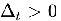24. At the same time the journal *Science* carried the geometric algorithms for nonlinear unfolding of data manifolds, **Isomap** by Tenenbaum et al. (No. 161\) and **LLE** by Roweis and Saul (No. 162).

## **2001**

**Domains:** Loops Encoder Foundations  
In 2001 Herbert Jaeger presented the concept of reservoir computing in a report on **Echo State Networks (ESN)** (No. 163): a large fixed recurrent reservoir with spectral radius  nonlinearly projects the input history into a high-dimensional state 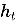, on top of which only the output readout matrix is trained by linear regression, without BPTT. At the ICML 2001 conference John Lafferty, Andrew McCallum and Fernando Pereira introduced **Conditional Random Fields (CRF)** (No. 164), which globally normalize the probabilities of the entire output sequence  and eliminated the label bias of locally normalized Markov models. In the same year the first edition of the fundamental statistical monograph by Hastie, Tibshirani and Friedman, *"The Elements of Statistical Learning"* (No. 165), appeared.

## **2002**

**Domains:** Diffusion Foundations Loops  
In 2002 Geoffrey Hinton published in *Neural Computation* the algorithm of **contrastive divergence (\-step Contrastive Divergence, CD\-)** (No. 166\)142, which radically accelerated the training of energy-based models and RBMs: instead of lengthy convergence of a Markov chain to the equilibrium modeled density, the negative phase of the gradient is approximated with only 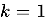 Gibbs sampling step, starting from a real data vector. Wolfgang Maass, Thomas Natschläger and Henry Markram presented the spiking analogue of reservoir networks — **liquid state machines (LSM)** (No. 167); Michael Collins at EMNLP generalized the perceptron and Novikoff's theorem to structured sequence-prediction tasks with Viterbi decoding (No. 168); and Ronan Collobert, Samy Bengio and Johnny Mariéthoz released the open modular C++ library **Torch** (No. 169), which became the progenitor of modern PyTorch.

## **2003**

**Domains:** Foundations Attention/LLM Encoder  
In 2003 Yoshua Bengio, Réjean Ducharme, Pascal Vincent and Christian Jauvin published in *JMLR* the paper *"A Neural Probabilistic Language Model"* (No. 170), which replaced the discrete counts of \-grams with a trainable matrix of **dense word embeddings**  and a smooth perceptron over a concatenated window of preceding tokens :  
  
Joint training of the embeddings and the hidden layer transferred probability mass to semantically close word combinations that never occurred literally in the corpus, opening the direct road to modern LLMs. In the same year Patrice Simard, Dave Steinkraus and John Platt introduced elastic distortions of data and standardized simple convolutional practices at ICDAR (0.4% error on MNIST, No. 171), and David MacKay issued the fundamental work *"Information Theory, Inference, and Learning Algorithms"* (No. 172).

## **2004**

**Domains:** Optimization Foundations  
In 2004 Kyoung-Su Oh and Keechul Jung published in *Pattern Recognition* the paper *"GPU Implementation of Neural Networks"* (No. 173), which for the first time recast the matrix multiplications of a fully connected neural network onto the pixel-shader pipeline of a graphics card (ATI Radeon 9700 Pro) with a **20× speedup** relative to the central processor7. At the ICML 2004 conference Andrew Ng rigorously proved that, in the presence of an exponential number of noise features, the sample complexity of \-regularization grows only logarithmically , whereas for rotationally invariant methods with an \-penalty it grows linearly 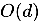 (No. 174). At NIPS Max Welling, Michal Rosen-Zvi and Geoffrey Hinton extended the RBM architecture to continuous distributions of the exponential family (**Exponential Family Harmoniums**, No. 175\)162.

## **2005**

**Domains:** Diffusion STT Encoder Foundations  
In 2005 Aapo Hyvärinen published in *JMLR* the **score matching (Score Matching)** method (No. 176\)161, which made it possible to train unnormalized energy-based densities  without computing the partition function  by minimizing the discrepancy of the gradients of the log-density with respect to the data vector  (eliminating the unknown  by integration by parts):  
  
In the same year Alex Graves and Jürgen Schmidhuber combined the gated LSTM with bidirectional unrolling in time (**BiLSTM**) and full backpropagation through the gates for phoneme classification of speech (No. 177); Sumit Chopra, Raia Hadsell and Yann LeCun introduced at CVPR the metric loss function **Contrastive Loss** (No. 178); Marco Gori, Gabriele Monfardini and Franco Scarselli proposed the first formulation of **graph neural networks (GNN)** (No. 179); and Frederic Morin and Yoshua Bengio sped up the output layer of language models from  to  by means of **hierarchical Softmax** over a binary tree of words (No. 180).

## **2006**

**Domains:** STT Foundations Encoder  
At the ICML 2006 conference Alex Graves, Santiago Fernández, Faustino Gomez and Jürgen Schmidhuber presented the **Connectionist Temporal Classification (CTC)** mechanism (No. 181), which freed speech and handwriting recognition from the need for frame-by-frame phoneme labeling. Extending the alphabet with an empty symbol  (blank) and introducing an operator that collapses repeats and blanks , CTC computes the exact probability of the target transcription 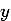 by summing over all admissible alignment paths of length  with a forward–backward dynamic-programming method in :  
  
At the same time Geoffrey Hinton, Simon Osindero and Yee-Whye Teh published layer-wise pretraining of **Deep Belief Nets** from a stack of RBMs (No. 182\)142, and Hinton and Ruslan Salakhutdinov demonstrated in the journal *Science* nonlinear data compression by deep autoencoders with fine-tuning by backpropagation (No. 183), returning deep networks to the center of scientific attention. The year was completed by a fundamental survey of energy-based models by Yann LeCun and coauthors (No. 184\) and the classic textbook by Christopher Bishop, *"Pattern Recognition and Machine Learning"* (No. 185\)164.

## **2007**

**Domains:** Foundations Optimization Encoder  
In 2007 Yoshua Bengio, Pascal Lamblin, Dan Popovici and Hugo Larochelle showed at NIPS (*"Greedy Layer-Wise Training of Deep Networks"*, No. 186\)163 that greedy layer-wise pretraining of deterministic autoencoders initializes deep networks just as successfully as stochastic RBMs. At the same conference Léon Bottou and Olivier Bousquet published the work *"The Tradeoffs of Large Scale Learning"* (No. 187), proving that, for a fixed computation-time budget in the large-sample regime, simple first-order stochastic gradient descent (SGD) minimizes the expected generalization risk asymptotically more efficiently than heavy second-order optimizers. Andriy Mnih and Geoffrey Hinton introduced the **Log-Bilinear Language Model** (No. 188), and Ruslan Salakhutdinov, Andriy Mnih and Geoffrey Hinton applied RBMs to matrix-factorization-style recommendation filtering on the Netflix Prize (No. 189).

## **2008**

**Domains:** Encoder Diffusion Attention/LLM  
At the ICML 2008 conference Pascal Vincent, Hugo Larochelle, Yoshua Bengio and Pierre-Antoine Manzagol presented **denoising autoencoders (Denoising Autoencoders, DAE)** (No. 190\)161: the input vector is deliberately corrupted by random zeroing of components (masking) or by Gaussian noise , and the network is trained to project the noisy point back onto the manifold of clean data 165. This simple replacement of identity reconstruction by denoising became a direct conceptual bridge both to masked language modeling (BERT, LLaDA) and to diffusion score matching. At the same ICML Ronan Collobert and Jason Weston trained a single convolutional architecture with word embeddings pretrained on Wikipedia to solve six NLP tasks jointly without manual feature engineering (No. 191), and Laurens van der Maaten and Geoffrey Hinton introduced in *JMLR* the manifold visualization algorithm **t-SNE** (No. 192).

## **2009**

**Domains:** Encoder Optimization Foundations  
In 2009 three events coincided that prepared the scaling of modern deep learning. Jia Deng, Fei-Fei Li and coauthors presented at CVPR the hierarchical corpus **ImageNet** (more than 14 million labeled images, No. 193\)167; Rajat Raina, Anand Madhavan and Andrew Ng at ICML trained deep networks of 100 million parameters on the programmable cores of a **CUDA GPU** with a **70× speedup** over multicore CPUs (No. 194); and Yoshua Bengio, Jérôme Louradour, Ronan Collobert and Jason Weston formalized **curriculum learning (Curriculum Learning)** (No. 195\) — the gradual increase of the difficulty and length of training examples, which became a mandatory stage of progressive training for long context and high resolution in all modern LLMs and video generators59. In the same year Salakhutdinov and Hinton created **deep Boltzmann machines (DBM)** with bidirectional inter-layer connections (No. 196), and Franco Scarselli et al. established the mathematical convergence of **GNN** graph networks in *IEEE TNN* (No. 197).

## **2010**

**Domains:** Foundations Optimization Loops  
In 2010 the main obstacles to training deep feedforward networks from scratch without layer-wise pretraining were removed. Xavier Glorot and Yoshua Bengio at the AISTATS conference (No. 198\) showed that, in order to preserve simultaneously the variance of the signal in the forward pass and the variance of the gradients in the backward pass, the layer weights must be initialized with the **Glorot (Xavier Initialization)** variance:  
  
At the ICML 2010 conference Vinod Nair and Geoffrey Hinton published the work *"Rectified Linear Units Improve Restricted Boltzmann Machines"* (No. 199), bringing into wide practice the piecewise-linear activation **ReLU**  with unit derivative on the positive half-axis. In the same year Tomáš Mikolov and coauthors presented at Interspeech the **recurrent neural network language model (RNNLM)** for speech recognition (No. 200), Michael Gutmann and Aapo Hyvärinen derived **noise-contrastive estimation (NCE)** (No. 201), James Martens trained deep networks without pretraining by the second-order **Hessian-Free** method (No. 202), and the symbolic-tensor GPU automatic-differentiation compiler **Theano** by James Bergstra and Bengio's group appeared (No. 203).

## **2011**

**Domains:** Optimization Diffusion Foundations STT  
In 2011 John Duchi, Elad Hazan and Yoram Singer published in *JMLR* the adaptive optimizer **AdaGrad** (No. 204\)168, which normalizes the step of each coordinate by the square root of the accumulated sum of squares of its past gradients , which started the whole family of adaptive optimization methods for deep networks.  
In the summer of 2011 Pascal Vincent published in *Neural Computation* the fundamental theoretical paper *"A Connection Between Score Matching and Denoising Autoencoders"* (**Denoising Score Matching, DSM**, No. 205\)161. Vincent rigorously proved that training an autoencoder to suppress Gaussian noise  is equivalent to estimating the score function of the Parzen-smoothed density  *without computing second derivatives of the Jacobian*166:  
  
Given that , this formula is the direct mathematical core of all continuous diffusion models (NCSN, DDPM, Score SDE)142. In the same year Glorot, Bordes and Bengio justified the sparsity of deep ReLU networks (No. 206), Max Welling and Yee-Whye Teh joined stochastic gradient with Langevin dynamics in **SGLD** (No. 207), Frank Seide, Gang Li and Dong Yu made a breakthrough in industrial conversational speech recognition with the **CD-DNN-HMM** hybrid (No. 208), and Collobert et al. published the summary paper *"Natural Language Processing (Almost) from Scratch"* in *JMLR* (No. 209).

## **2012**

**Domains:** Encoder STT Optimization Loops  
In December 2012 Alex Krizhevsky, Ilya Sutskever and Geoffrey Hinton presented at NIPS the eight-layer convolutional network **AlexNet** (No. 210\)96, which reduced the Top-5 error on ImageNet ILSVRC-2012 from 26.2% to **15.3%** (Top-1 accuracy 63.3%). The success of AlexNet combined 60 million parameters, the **ReLU** nonlinearity (which accelerated convergence 6× compared with ), stochastic dropping of neurons, **Dropout**, to suppress feature co-adaptation (Hinton et al., 2012, No. 212\) and model-parallel training on two NVIDIA GTX 580 graphics cards167.  
At the same time, in November 2012, Alex Graves published the **RNN-Transducer (RNN-T)** architecture (No. 211), which removed the conditional-independence assumption of the CTC outputs by combining an acoustic encoder  and an autoregressive text prediction network  in a joint **Joiner** network  with marginalization over the two-dimensional lattice 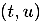 — the standard of all streaming speech-recognition systems up to the modern TDT170. In the same year there appeared the moving root-mean-square step scaling **RMSProp** by Hinton and the dimensionless method **Adadelta** by Matthew Zeiler (No. 213), the distributed cluster framework **DistBelief** by Jeff Dean et al. (No. 214), the GPU-CNN ensembles of Dan Cireşan, Ueli Meier and Jürgen Schmidhuber with the first superhuman accuracy on traffic-sign recognition (No. 215\)155 and the proof of the effectiveness of random hyperparameter search by Bergstra and Bengio (No. 216).

## **2013**

**Domains:** Encoder Diffusion Foundations Optimization  
In December 2013 Diederik Kingma and Max Welling published the **Variational Autoencoder (VAE)** (*"Auto-Encoding Variational Bayes"*, No. 217; independently Danilo Rezende, Shakir Mohamed and Daan Wierstra, No. 218), which maximizes the variational lower bound on the likelihood (**ELBO**):  
  
The **reparameterization trick**  introduced by the authors moved the randomness into external noise and made it possible to train arbitrary deep probabilistic encoders by ordinary backpropagation; it is precisely the compressed VAE spaces that today form the latent substrate of all flagship generators of images, video and long speech74.  
In parallel Tomáš Mikolov and coauthors at Google presented the contrastive architectures **Word2Vec** (Skip-Gram and CBOW with negative sampling, No. 219), which scaled the training of word vector representations to billion-word corpora with a linear semantic structure. Min Lin, Qiang Chen and Shuicheng Yan introduced pointwise 1×1 convolutions and global average pooling in **Network in Network** (No. 220), Ian Goodfellow et al. proposed the **Maxout** activation (No. 221), Volodymyr Mnih and the DeepMind team combined a convolutional network with Q-learning and an experience buffer in **DQN** on Atari games (No. 222), Andrew Saxe, James McClelland and Surya Ganguli proved the preservation of the singular values of the Jacobian under **orthogonal initialization** of deep networks (No. 223\)175, and Rie Johnson and Tong Zhang introduced the gradient variance reduction **SVRG** (No. 224).

## **2014**

**Domains:** Attention/LLM Loops Diffusion Encoder Optimization  
In 2014 soft differentiable attention, generative adversarial networks and the main optimizer of modern deep learning were born. Following the **Seq2Seq** model of Ilya Sutskever, Oriol Vinyals and Quoc Le (No. 225), which compressed the input phrase into a single fixed LSTM vector, Dzmitry Bahdanau, Kyunghyun Cho and Yoshua Bengio (*"Neural Machine Translation by Jointly Learning to Align and Translate"*, No. 226\) removed the information bottleneck of the fixed vector, allowing the decoder at each step  to dynamically weight all hidden states of the encoder  (**additive attention**):  
  
In the same year Kyunghyun Cho et al. simplified the gated recurrent cell to two gates in the **GRU** (, No. 227), and Alex Graves, Greg Wayne and Ivo Danihelka equipped a neural network with a differentiable external matrix memory in the **Neural Turing Machine (NTM)** (No. 228). At NIPS 2014 Ian Goodfellow and coauthors formulated the minimax game of generator and discriminator, the **GAN** (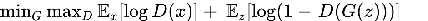, No. 229), and in December Diederik Kingma and Jimmy Ba published the **Adam** optimizer (No. 230), which combined exponential moving estimates of the first and second moments of the gradient with correction of the zero bias. In computer vision and embeddings there appeared the cascades of narrow 3×3 kernels, **VGG**, by Simonyan and Zisserman (No. 231\)176, the multiscale **GoogLeNet / Inception** blocks by Szegedy et al. (No. 232), the word co-occurrence matrix factorization **GloVe** by Pennington et al. (No. 233), the work by Goodfellow et al. on the linear nature of **adversarial perturbations (FGSM)** (No. 234\) and the **Caffe** library by Yangqing Jia (No. 235).

## **2015**

**Domains:** Foundations Diffusion Encoder Optimization STT  
In 2015 the barrier of network depth degradation was overcome and, at the same time, thermodynamic diffusion was formulated. Developing the gated highways of the **Highway Networks** of Rupesh Srivastava, Klaus Greff and Jürgen Schmidhuber (, No. 236\)7, Kaiming He, Xiangyu Zhang, Shaoqing Ren and Jian Sun simplified signal passing to pure identity addition in **ResNet-152** (No. 237; together with the **Kaiming Init** initialization  for ReLU, No. 238\)61:  
  
The additive unit  in the Jacobian ensured a non-vanishing gradient flow through hundreds of layers and brought victory at ILSVRC-2015 with an ensemble error of 3.57%34.  
In the same year Sergey Ioffe and Christian Szegedy introduced **Batch Normalization** (No. 239\)178; Olaf Ronneberger, Philipp Fischer and Thomas Brox created the symmetric convolutional encoder–decoder architecture with skip-passing of spatial feature maps, the **U-Net** (No. 240\)179; and Jascha Sohl-Dickstein, Eric Weiss, Niru Maheswaranathan and Surya Ganguli published at ICML 2015 the pioneering paper *"Deep Unsupervised Learning using Nonequilibrium Thermodynamics"* (No. 241), introducing a forward Markov chain of diffusion noising  and a trainable reverse chain of generative restoration . The year was complemented by the temperature-based **knowledge distillation** of Hinton, Vinyals and Dean (No. 242), the Fisher approximation **K-FAC** of Martens and Grosse (No. 243), Luong's scalar attention (No. 244), the end-to-end speech architectures **LAS** by Chan et al. (No. 245\) and **DeepSpeech 2** by Amodei et al. (No. 246), the subword segmentation **BPE** by Sennrich et al. (No. 247\) and the open release of the **TensorFlow** framework (No. 248).

## **2016**

**Domains:** TTS Loops Foundations Optimization Encoder  
In 2016 the mechanisms of per-token normalization, adaptive recurrent loops and autoregressive audio synthesis took shape. Jimmy Ba, Jamie Kiros and Geoffrey Hinton proposed **Layer Normalization (LayerNorm)** (No. 249), which normalizes the feature vector of each individual token independently of the batch size, and Kaiming He et al. proved that moving the normalization inside the residual branch (**Pre-LN ResNet**: , No. 250\) preserves a pure identity trunk at a depth of over 1000 layers61. Alex Graves introduced the **Adaptive Computation Time (ACT)** mechanism (No. 251\)41, which allows a network to perform a variable learnable number of inner iterations over each token under the control of a sigmoid halting gate (ponder cost) — the direct foundation of adaptive depth in the Universal Transformer, Ouro and Huginn41. Dan Hendrycks and Kevin Gimpel proposed the smooth probabilistic nonlinearity **GELU**  (No. 252).  
In speech synthesis Aäron van den Oord and the DeepMind team presented **WaveNet** (No. 253\) — a stack of causal dilated 1D convolutions with exponential growth of the dilation  and gated nonlinearities , which for the first time brought waveform synthesis close to a natural voice. In the same year Laurent Dinh, Jascha Sohl-Dickstein and Samy Bengio created the invertible normalizing flows **RealNVP** (No. 254); Eric Jang et al. derived the differentiable categorical relaxation **Gumbel-Softmax** (No. 255\)54; Thomas Kipf and Max Welling formalized the spectral **graph convolutional networks (GCN)** (No. 256); Gao Huang et al. presented **DenseNet** (No. 257\)180; Ilya Loshchilov and Frank Hutter introduced the cosine learning-rate schedule **SGDR / Cosine Annealing** (No. 258); and the classic textbook by Goodfellow, Bengio and Courville, *"Deep Learning"* (MIT Press, No. 259\)8, appeared.

## **2017**

**Domains:** Attention/LLM MoE TTS Encoder Optimization  
In June 2017 Ashish Vaswani, Noam Shazeer, Niki Parmar, Jakob Uszkoreit, Llion Jones, Aidan Gomez, Łukasz Kaiser and Illia Polosukhin published the paper *"Attention Is All You Need"* (No. 260\)182, replacing recurrent chains and convolutions with the **Transformer** architecture based on scaled dot-product multi-head self-attention (**Multi-Head Attention, MHA**):  
  
The factor  stabilizes the variance of the logits before the softmax, the signal path length between any two positions of the sequence is reduced to , and full parallelism over all  tokens at training time maps ideally onto GPU tensor multiplications, at the price of quadratic complexity .  
In the same year 2017 five more works appeared that shaped the look of modern multimodal and sparse systems. Noam Shazeer and coauthors presented at ICLR the **Sparsely-Gated Mixture-of-Experts** (No. 261\)184, scaling a language model to 137 billion parameters by means of sparse routing  with an auxiliary expert-load balancing penalty. Aäron van den Oord, Oriol Vinyals and Koray Kavukcuoglu created the **VQ-VAE** (No. 262), introducing vector quantization of the latent space into a discrete codebook with end-to-end gradient estimation by the Straight-Through Estimator — the base mechanism of all modern neural audio codecs. Yuxuan Wang et al. (**Tacotron**, No. 263\) and Jonathan Shen et al. (**Tacotron 2**, No. 264\) built end-to-end speech synthesis "text  mel spectrogram  neural vocoder". In optimization Ilya Loshchilov and Frank Hutter decoupled weight decay from the adaptive second moment in **AdamW** (, No. 265), John Schulman et al. created the clipped surrogate policy gradient **PPO** (No. 266\)158, and Martin Arjovsky, Soumith Chintala and Léon Bottou stabilized adversarial networks with the Wasserstein metric, **WGAN** (No. 267). The architectural arsenal was supplemented by the depthwise-separable convolutions **MobileNets** of Howard et al. (No. 268), the channel attention **SENet** of Hu et al. (No. 269), the activation **Swish / SiLU**  of Ramachandran et al. (No. 270\) and the graph attention **GAT** of Veličković et al. (No. 271).

## **2018**

**Domains:** Encoder Attention/LLM Loops TTS Optimization  
In 2018 the pretraining of transformers on large unlabeled corpora split into two complementary branches. Following the contextual BiLSTM representations of **ELMo** by Matthew Peters et al. (No. 272), Alec Radford and coauthors at OpenAI presented the autoregressive causal decoder **GPT-1** (No. 273), and Jacob Devlin, Ming-Wei Chang, Kenton Lee and Kristina Toutanova at Google created the deep bidirectional encoder **BERT** (No. 274\)186, trained to recover 15% of randomly masked tokens (**Masked Language Modeling, MLM**) from the full left and right context.  
At the same time Mostafa Dehghani and coauthors introduced the **Universal Transformer** (No. 275\)187 — the first looped transformer with weight sharing across depth and per-token ACT halting, proving its computational universality at variable depth and laying the direct foundation of the modern Huginn and Ouro models. Ricky Chen, Yulia Rubanova, Jesse Bettencourt and David Duvenaud passed to the continuous limit of the residual network 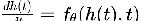 in the **Neural ODE**, with training by the adjoint-equation method in  memory with respect to depth (No. 276\)190. In the same year Aäron van den Oord, Yazhe Li and Oriol Vinyals formulated the contrastive functional **InfoNCE** within **CPC** (No. 277\)191; Kingma and Dhariwal created the invertible generator **Glow** (No. 278), adapted by Ryan Prenger et al. into the fast flow-based speech vocoder **WaveGlow** (No. 279); Yuxin Wu and Kaiming He introduced **GroupNorm** (No. 280); in optimization there appeared the low-rank **Adafactor** by Shazeer and Stern (No. 281\)192 and the matrix curvature preconditioner **Shampoo** by Gupta, Koren and Singer (No. 282\)160; Arthur Jacot et al. described the **neural tangent kernel (NTK)** regime (No. 283); and Taku Kudo and John Richardson released the **SentencePiece** tokenizer (No. 284\)73.

## **2019**

**Domains:** Attention/LLM Loops TTS Diffusion Optimization  
In 2019 the engineering framework of the modern LLM decoder and of the infrastructure for its distributed training took shape. Alec Radford and coauthors in **GPT-2** (1.5B parameters, No. 285\)1 established the **Pre-LN** scheme and zero-shot task execution by language continuation. Biao Zhang and Rico Sennrich presented **RMSNorm** (No. 286\)28, discarding the mean centering of LayerNorm and leaving only scale-invariant normalization by the root-mean-square amplitude:  
  
which sped up normalization on GPUs and became the standard of practically all open architectures of 2023–2026196. In November Noam Shazeer published **Multi-Query Attention (MQA)** (No. 287\)49, pointing out the limitation of autoregressive decoding by the HBM memory bandwidth when reading the KV cache and proposing shared projections  for all query heads.  
In looped and long-context models Shaojie Bai, Zico Kolter and Vladlen Koltun created **Deep Equilibrium Models (DEQ)** (No. 288), which find the fixed point of the loop  with a numerical root solver and differentiate it analytically through the implicit function theorem in  memory; Zhenzhong Lan et al. applied end-to-end sharing of layer weights in **ALBERT** (No. 289\)189; Colin Raffel et al. introduced a tabular relative attention bias in **T5** (No. 290\)72; and Zihang Dai et al. combined segment recurrence with relative positions in **Transformer-XL** (No. 291\)190. In speech synthesis Yi Ren et al. created the non-autoregressive transformer **FastSpeech** with an explicit phoneme duration regulator (**Length Regulator**, No. 292), accelerating the generation of mel spectrograms by two orders of magnitude without loss of stability. Yang Song and Stefano Ermon revived generative modeling by score on a multiscale grid of noises in **NCSN** (No. 293). The year was completed by the compound scaling of CNNs, **EfficientNet**, by Tan and Le (No. 294\)178, the self-supervised audio encoder **wav2vec** by Schneider et al. (No. 295), the intra-layer tensor parallelism **Megatron-LM** from NVIDIA (No. 296\)198, the sharding of optimizer states and weights **ZeRO** from Microsoft DeepSpeed (No. 297\)73 and the reference paper by Adam Paszke et al. on **PyTorch** (No. 298).

## **2020**

**Domains:** Attention/LLM Diffusion Encoder STT TTS Loops/SSM  
In 2020, language models, diffusion-based generation, computer vision and speech technology were all transformed at once. Jared Kaplan and co-authors established the power-law **scaling laws** of the language-model loss as a function of parameter count, data and FLOPs budget  (No. 299\)4, which Tom Brown and the OpenAI team realized in the 175-billion-parameter **GPT-3** with emergent in-context learning (No. 300). Noam Shazeer introduced the gated family of fully connected blocks **SwiGLU**  (No. 301\)199, which replaced the ordinary two-layer MLP in modern LLMs, while Angelos Katharopoulos et al. factorized attention through a positive feature kernel  in **Linear Attention** (No. 302\)25, showing the duality between a linear transformer and an RNN with matrix memory  of complexity .  
In generative models, Jonathan Ho, Ajay Jain and Pieter Abbeel published **DDPM** (No. 303\)37, reducing variational training of the reverse Markov chain to predicting the added Gaussian noise ; Jiaming Song, Chenlin Meng and Stefano Ermon constructed the deterministic non-Markovian accelerated-sampling trajectories of **DDIM** (No. 304\)5; and Yang Song et al. unified diffusion and score estimation into continuous stochastic differential equations (**Score SDE**) and the deterministic **Probability Flow ODE** (No. 305\)5. In computer vision, Alexey Dosovitskiy, Lucas Beyer et al. presented the pure patch transformer **ViT** (the image split into 16×16 patches with no convolutions, 88.55% Top-1 on ImageNet for ViT-H/14, No. 306\)73, alongside the breakthrough of contrastive self-supervised learning **SimCLR** (No. 311\)202, **MoCo** (No. 312\) and the negative-free **BYOL** (No. 313).  
In audio processing, three basic components of the modern speech stack appeared: the convolution-transformer hybrid **Conformer** by Anmol Gulati et al. (Macaron-FFN \+ MHSA \+ DepthwiseConv, which reached **1.9% / 3.9% WER** on LibriSpeech test-clean / test-other, No. 307\)203, the self-supervised quantizing raw-waveform encoder **wav2vec 2.0** by Alexei Baevski et al. (No. 308\)191 and the multi-period generative adversarial vocoder **HiFi-GAN** by Jungil Kong et al. (No. 309\)206. Finally, Albert Gu, Tri Dao and co-authors derived the operators of orthogonal polynomial projection of the continuous signal history, **HiPPO** (No. 310\)62 (the theoretical basis of S4 and Mamba), Patrick Lewis et al. created the **RAG** architecture (No. 314), and Dmitry Lepikhin et al. scaled MoE to 600B parameters in the **GShard** system (No. 315\)27.

## **2021**

**Domains:** Attention/LLM MoE Encoder Loops/SSM TTS Diffusion Optimization  
In 2021, the standards of relative positional encoding, low-rank adaptation, structured state spaces and latent diffusion took shape. Jianlin Su and co-authors introduced **rotary position embedding (RoPE)** in **RoFormer** (No. 316\)72, multiplying pairs of query and key coordinates by orthogonal rotation matrices in the complex plane with a geometric frequency spectrum :  
  
Ofir Press et al. proposed the linear attention positional penalties **ALiBi** (No. 317); William Fedus, Barret Zoph and Noam Shazeer simplified MoE to **Top-1** routing in the 1.6-trillion-parameter **Switch Transformer** (No. 318); and Edward Hu et al. created the **LoRA** method (No. 319\)210, which freezes the pretrained matrices  and trains only a low-rank update  of rank , with no inference latency.  
Among multimodal and visual encoders, Alec Radford et al. aligned image and text spaces on 400M pairs in **CLIP** (No. 320\)212, Kaiming He et al. created the asymmetric masked patch autoencoder **MAE** (75% of patches masked, No. 321), Mathilde Caron et al. discovered label-free self-distillation of vision transformers, **DINO** (No. 322\)213, and Ze Liu et al. introduced hierarchical shifted windows in the **Swin Transformer** (No. 323). In long-sequence modeling, Albert Gu, Karan Goel and Christopher Ré published **S4 (Structured State Spaces)** (No. 324\)62: by decomposing the HiPPO matrix into the sum of a normal and a low-rank matrix (**NPLR**: ), they reduced the computation of a convolution kernel of length  to a Cauchy kernel and an FFT in , solving for the first time the Path-X task of length 16,384 on Long Range Arena (average score 86.09)216; in parallel, Imanol Schlag, Kazuki Irie and Jürgen Schmidhuber introduced the overwriting delta rule into linear transformers at ICML 2021 (**Fast Weight Programmers**, No. 325\)157, which became the direct theoretical source of DeltaNet.  
In the speech and generative domains, Jaehyeon Kim, Jungil Kong and Juhee Son combined variational inference, normalizing flows and adversarial waveform synthesis in **VITS** (No. 326\)217; Neil Zeghidour et al. created the first end-to-end neural audio codec with **residual vector quantization (RVQ)**, **SoundStream** (No. 327\)47; Wei-Ning Hsu et al. presented the masked speech encoder **HuBERT** (No. 328\)191; Prafulla Dhariwal and Alex Nichol demonstrated the superiority of diffusion over GANs in image quality in **ADM** (No. 329\)219; Jacob Austin et al. formalized discrete diffusion with an absorbing \[MASK\] token in **D3PM** (No. 330\)35; and in December Robin Rombach, Andreas Blattmann, Dominik Lorenz, Patrick Esser and Björn Ommer moved diffusion into the compressed space of a perceptual autoencoder with text cross-attention in **Latent Diffusion Models (LDM / Stable Diffusion)** (No. 331\)179.

## **2022**

**Domains:** Attention/LLM Optimization Diffusion STT TTS  
In 2022, hardware-aware memory algorithms, compute-optimal scaling laws and straight-line ODE flows changed the economics of large models. Tri Dao, Daniel Fu, Stefano Ermon, Atri Rudra and Christopher Ré published **FlashAttention** (No. 332\)199: by splitting the matrices  into blocks in the fast on-chip GPU memory **SRAM** and applying exact blockwise rescaling with the **online softmax** (going back to Milakov and Gimelshein, No. 333):  
  
the authors computed mathematically exact attention without writing the matrix  to global HBM memory, reducing memory consumption to 223. Jordan Hoffmann et al. in **Chinchilla** (No. 334\)224 showed that, at a fixed FLOPs budget, the optimal training regime requires proportional scaling of the number of parameters and training tokens (), while Greg Yang, Edward Hu et al. derived the **P** parametrization for zero-shot transfer of hyperparameters from small models to giant runs (No. 335).  
In generative modeling, Jonathan Ho and Tim Salimans introduced **classifier-free guidance (CFG)** (No. 336), Tero Karras et al. systematized noise preconditioning and second-order samplers in **EDM** (No. 337\)37, and in the fall of 2022 Xingchao Liu, Chengyue Gong and Qiang Liu (**Rectified Flow**, No. 338), Yaron Lipman, Ricky Chen et al. (**Flow Matching**, No. 339\) and Michael Albergo with Eric Vanden-Eijnden (**Stochastic Interpolants**, No. 340\) moved generation to training straight-line ODE velocity vector fields  along the linear interpolation , with the trajectory-straightening procedure **Reflow**5. In December, William Peebles and Saining Xie replaced the U-Net in latent diffusion with a scalable transformer with adaptive normalization **adaLN-Zero**, the **Diffusion Transformer (DiT)** (FID 2.27 on ImageNet 256×256, No. 341\)219. In audio and post-training, there appeared the multilingual ASR transformer **Whisper** by Alec Radford et al., trained on 680,000 hours of weakly labeled data (No. 342\)229, the open 24 kHz RVQ codec **EnCodec** by Alexandre Défossez et al. (No. 343\)231, the three-stage alignment with human preferences **InstructGPT (RLHF)** by Long Ouyang et al. (No. 344), **Chain-of-Thought** reasoning prompting by Jason Wei et al. (No. 345\) and the block-wise quantized 8-bit optimizers of Tim Dettmers et al. (No. 346\)169.

## **2023**

**Domains:** Attention/LLM MoE Loops/SSM Encoder Video STT TTS STS Optimization  
In 2023, the open LLM ecosystem received a standard for efficient decoding, and linear-recurrent models for the first time challenged transformers on language tasks. Joshua Ainslie et al. introduced **Grouped-Query Attention (GQA)** (No. 347\)39, sharing  groups of keys and values among  query heads (adopted in **Llama 2 70B** by Touvron et al., No. 348194); Woosuk Kwon et al. eliminated KV-cache GPU-memory fragmentation with the paging mechanism **PagedAttention** in the **vLLM** engine (No. 349\)232; Tri Dao optimized warp-level parallelism in **FlashAttention-2** (No. 350\)198; Hao Liu, Matei Zaharia and Pieter Abbeel created **Ring Attention**, attention distributed over a ring of accelerators for million-token contexts (No. 351\)132; the Mistral AI team released the open sparse mixture of experts **Mixtral 8x7B** (Top-2 of 8, No. 352\)234; and Rafael Rafailov et al. derived a closed form of policy alignment without a reward model, **Direct Preference Optimization (DPO)** (No. 353\)158:  
  
At the same time, an offensive of subquadratic architectures with constant inference memory  unfolded: **RWKV-4** by Bo Peng et al. (No. 354\)236, the multi-scale retention network **RetNet** by Yutao Sun et al. (No. 355\)49 and, in December, **Mamba (S6)** by Albert Gu and Tri Dao (No. 356\)25. By making the state-space parameters  functions of the current input token (**Selective SSM**) and implementing a hardware-aware parallel associative scan in SRAM, Mamba solved the problem of content-dependent filtering of context at linear complexity .  
In the vision, text-diffusion and speech domains there appeared the non-generative latent image predictor **I-JEPA** by Assran, LeCun et al. (No. 357), the softmax-free pairwise sigmoid contrastive encoder **SigLIP** by Zhai et al. (No. 358\)212, the visual foundation model **DINOv2** by Oquab et al. (No. 359\)176, the video generator **Stable Video Diffusion** by Blattmann et al. (No. 360), discrete diffusion with probability-ratio estimation **SEDD** by Lou, Meng and Ermon (No. 361\)57, the first codec language model for zero-shot speech synthesis from a 3-second sample, **VALL-E** by Wang et al. (No. 362\)218, the improved audio codec **DAC** by Kumar et al. (No. 363\)55, the conversational speech model **SpeechGPT** by Zhang et al. (No. 364\)240, the encoder with an 80-ms frame accelerated 2.8×, **FastConformer**, by Rekesh et al. (No. 365\)171, the transducer that skips empty frames, **Token-and-Duration Transducer (TDT)**, by Xu, Majumdar and Ginsburg (No. 366\)79, the 4-bit adaptation **QLoRA** by Dettmers et al. (No. 367), the RoPE window extension **YaRN** by Peng et al. (No. 368\)30 and Simon Prince's textbook *"Understanding Deep Learning"* (MIT Press, No. 369\)8.

## **2024**

**Domains:** Attention/LLM MoE Loops/SSM Diffusion Video Encoder STT TTS STS Optimization

### **Latent attention MLA, penalty-free MoE balancing and quantized pretraining**

In 2024, a series of works by the DeepSeek-AI lab revisited the architecture of attention and expert routing. In **DeepSeekMoE** (arXiv:2401.06066, No. 370\)29 the experts were split into small specialized subnetworks combined with isolated, always-active *shared experts*. In May, **DeepSeek-V2** (arXiv:2405.04434, 236B total / 21B active parameters, No. 371\)50 introduced the **Multi-Head Latent Attention (MLA)** mechanism:  
  
Thanks to absorbing the decompression matrices  into the query and output projections at inference time, only the compressed vector  of  elements per layer is stored in memory, instead of the 32,768 of a 128-head MHA, a KV-cache reduction of 98.24% per layer (and of 93.3% at the level of the whole V2 model versus the dense DeepSeek 67B)50. In December, **DeepSeek-V3** (arXiv:2412.19437, 671B total / 37B active parameters, 14.8T tokens, No. 372\)29 combined **auxiliary-loss-free expert load balancing** through a dynamic bias  in Top\- selection (developing the Loss-Free Balancing of Wang et al., No. 37327), the cascaded **Multi-Token Prediction (MTP)** module (motivated earlier, in April, by Fabian Gloeckle et al. from Meta, arXiv:2404.19737, No. 37464), the communication-overlap pipeline **DualPipe**, and stable training in **FP8** precision in 2.788 million H800 GPU-hours (about \$5.576M at the assumed rate of \$2/hour, excluding preliminary research runs and ablations; MMLU 88.5%, MATH-500 90.2%)29. Back in February, Zhihong Shao et al. presented the critic-free RL algorithm **GRPO** in **DeepSeekMath** (arXiv:2402.03300, No. 375\)53. In parallel, Shuming Ma et al. showed the viability of ternary weights 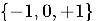 in **BitNet b1.58** (arXiv:2402.17764, No. 376\)51, while the open line of dense transformers was led by **Llama 3.1 405B** (No. 377\)246 and **Qwen2.5** (No. 378\)247.

### **SSM duality, Gated DeltaNet, TTT and second-generation optimizers**

On the axis of recurrent sequence models, Tri Dao and Albert Gu proved in **Mamba-2** (arXiv:2405.21060, No. 379\)32 a rigorous structural duality (**SSD**) between selective SSMs with a scalar transition 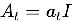 and semiseparable linear attention , moving SSM training onto matrix blocks of Tensor Cores. Maximilian Beck and Sepp Hochreiter scaled an LSTM with exponential gates and a covariance matrix memory, **mLSTM**, in **xLSTM** (arXiv:2405.04517, No. 380\)183; Songlin Yang et al. parallelized the linear transformer with the delta rule through the chunkwise Householder WY representation (**DeltaNet**, No. 381248) and in December, jointly with Jan Kautz and Ali Hatamizadeh, combined the delta rule with the adaptive decay of Mamba-2 in **Gated DeltaNet** (arXiv:2412.06464, No. 382\)157:  
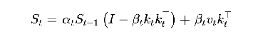  
The same year saw the matrix-recurrent **RWKV-5/6 (Eagle & Finch)** by Bo Peng et al. (No. 383\)249, the hybrid Mamba–Transformer–MoE **Jamba** by Opher Lieber et al. (No. 384\)184, the multi-lane residual streams **Hyper-Connections (HC)** by Defa Zhu et al. (arXiv:2409.19606, No. 385\)61 and the **Test-Time Training (TTT-Linear / TTT-MLP)** layers of Yu Sun, Karan Dalal et al. (arXiv:2407.04620, No. 386\)44, which turned the hidden state itself into a two-layer perceptron trained on the test context. In hardware and numerical optimization there appeared the asynchronous **FlashAttention-3** for Hopper H100 chips (740 TFLOPs/s in FP16, No. 387\)252, the preconditioner **SOAP** by Nikhil Vyas, Sham Kakade et al. (arXiv:2409.11321, running AdamW in the eigenbasis of the Shampoo matrices, with a reduction of more than 35% in large-batch training time, No. 388\)168 and the orthogonalizing matrix momentum **Muon** by Keller Jordan (No. 389\)65.

### **Multimodal DiT, video VAEs, REPA and the full-duplex dialogue of Moshi**

In image and video generation, Patrick Esser et al. in **Stable Diffusion 3** (arXiv:2403.03206, No. 390\)174 and the Black Forest Labs team in **FLUX.1** (12B parameters, No. 391\)174 established the two-stream **MMDiT** architecture with Rectified Flow. Convolutional video models were superseded by spatiotemporal 3D-DiTs over causal 3D-VAEs (4×8×8 compression): **CogVideoX** by Zhuoyi Yang et al. (No. 392\)255, **Mochi 1** (No. 393\)254, the 13-billion-parameter **HunyuanVideo** by Weijie Kong et al. with MLLM prompt encoding and 3D-RoPE (arXiv:2412.03603, No. 394\)256 and the ultra-fast **LTX-Video** from Lightricks with 1:192 Video-VAE compression (arXiv:2501.00103, No. 395\)258. Sihyun Yu et al. accelerated the convergence of diffusion transformers by more than **17.5×** by aligning latent patches with DINOv2 features (**REPA**, arXiv:2410.06940, FID 1.42 on ImageNet 256×256, No. 396\)36; Subham Sahoo et al. derived the continuous limit of masked text diffusion in **MDLM** (arXiv:2406.07524, No. 397\)222; Adrien Bardes et al. presented the video feature-prediction encoder **V-JEPA** (arXiv:2404.08471, No. 398\)60; and Benjamin Warner et al. upgraded bidirectional text-and-code encoders to an 8,192-token window in **ModernBERT** (arXiv:2412.13663, alternating global and sliding-window attention at 1:2, RoPE, GeGLU, unpadding, No. 399\)186.  
In speech interaction, Alexandre Défossez et al. from the Kyutai lab released **Moshi** and the streaming neural codec **Mimi** (arXiv:2410.00037, No. 400\)26, the first open full-duplex speech LLM with a theoretical latency of **160 ms** (200 ms in practice, versus the ~230 ms average pause in human speech). The Mimi codec compresses a 24 kHz waveform to a rate of **12.5 Hz** (80 ms step) into 8 RVQ codebooks of 2,048 entries each (**1.1 kbit/s**) with distillation of WavLM semantics into the first codebook, while a hierarchy of a 7B Temporal Transformer and a small Depth Transformer predicts in parallel the text "inner monologue" (Inner Monologue) and two audio streams without dividing the conversation into turns26. The 2024 stack was complemented by the non-autoregressive encoder **SenseVoice** (15× faster than Whisper-Large) and the synthesizer **CosyVoice** (FunAudioLLM, No. 401\)263, the streaming **F5-TTS** (No. 402\)264, the two-cascade **Fish-Speech** (No. 403\)265, as well as new foundational textbooks by Christopher and Hugh Bishop, *"Deep Learning: Foundations and Concepts"* (Springer, No. 404\)266, and by Sebastian Raschka, *"Build a Large Language Model (From Scratch)"* (Manning, No. 405\)267.

## **2025**

**Domains:** Attention/LLM MoE Loops/SSM Diffusion Video Encoder STT TTS STS Optimization

### **Verifiable reasoning RL, sparse attention, mHC and trillion-parameter Muon models**

In January 2025, the publication of **DeepSeek-R1** (arXiv:2501.12948, published in the journal *Nature* in September 2025, No. 406\)50 showed, in the **DeepSeek-R1-Zero** experiment, that pure scaling of **GRPO** reinforcement learning on verifiable rules, without an initial SFT stage, spontaneously forms long chains of self-verification and reflection, raising accuracy on AIME 2024 from 15.6% to 71.0%, while the full multistage **DeepSeek-R1** reached **79.8% Pass@1 on AIME 2024** and **97.3% on MATH-500**, with successful distillation of reasoning into dense models of 1.5B–70B269. In February, Jingyang Yuan et al. presented **Native Sparse Attention (NSA)** (arXiv:2502.11089, ACL 2025 Best Paper, No. 407\)50, splitting attention into compressed, selective and local-window branches with decoding speedup of up to 11.6×76. In December came **DeepSeek-V3.2** (arXiv:2512.02556, No. 408\)10, which built into MLA the **DeepSeek Sparse Attention (DSA)** mechanism with a fast (lightning) indexer and top\- token selection of complexity  (the high-budget V3.2-Speciale variant showed gold-level results at IMO 2025 and IOI 2025 according to the authors' report)10, and the work of Zhenda Xie, Shengding Hu et al. on **Manifold-Constrained Hyper-Connections (mHC)** (arXiv:2512.24880, No. 409\)2, which projected the lane-mixing matrices of the residual stream onto the Birkhoff polytope of doubly stochastic matrices with the Sinkhorn–Knopp algorithm (a guarantee of  and only 6.7% time overhead at )2.  
In parallel, the Moonshot AI team demonstrated the scalability of the matrix optimizer **Muon** (arXiv:2502.16982, No. 410\)65 and in July trained, on 15.5 trillion tokens without a single loss spike, the trillion-parameter agentic flagship **Kimi K2** (arXiv:2507.20534, 1.04T total / 32.6B active parameters, 8 of 384 experts \+ 1 shared, No. 411\) using the **MuonClip** combination (Newton–Schulz iterations \+ the attention maximum-logit constraint **QK-Clip**)66, complemented in October by the hybrid architecture **Kimi Linear** with per-channel delta decay **KDA** (arXiv:2510.26692, up to 6× decoding speedup at 1M context, No. 412\)278. The open frontier was expanded by the controllable-reasoning family **Qwen3** (up to 235B-A22B on 36T tokens, arXiv:2505.09388, No. 413\)247, the natively multimodal early-fusion models **Llama 4 Scout** (109B-A17B, 10-million-token context) and **Llama 4 Maverick** (400B-A17B, No. 414\)280, the agentic **GLM-4.5** (355B-A32B, arXiv:2508.06471, No. 415\)282 and the Mamba-2 \+ GQA \+ MoE hybrid in NVFP4 format **NVIDIA Nemotron 3 Nano** (31.6B-A3.2B, 1M context, arXiv:2512.20848, No. 416\)13.

### **Recurrent depth, inference-time memory, diffusion LLMs and MoE video**

In February 2025, Jonas Geiping, Tom Goldstein et al. scaled latent reasoning over depth in the model **Huginn-0125** (3.5B parameters, 800B tokens, arXiv:2502.05171, No. 417\)3: a sandwich scheme  repeatedly runs a 4-layer core with random initialization  and re-injection of the input  up to  times (132 effective layers), although subsequent probing studies (Lu et al., arXiv:2507.02199) pointed to the ambiguity of directly interpreting the intermediate hidden iterations as text and to a more modest reserve of factual memory (MMLU 31.4%) compared with models trained on 4T tokens187. In October, Rui-Jie Zhu et al. (ByteDance) trained, on 7.7T tokens, the fully looped models with adaptive exit **Ouro-1.4B and Ouro-2.6B** (arXiv:2510.25741, No. 418\)77, where the 2.6B model at  reached 90.8% on MATH-500 and matched dense models of up to 12B thanks to multi-step composition of knowledge, while Boheng Wu et al. removed the sequential latency penalty of loops with the pipelined schedule **Cross-Loop Parallelism** in the **Parallel Loop Transformer (PLT)** (arXiv:2510.24824, No. 419\)33. At the same time, Ali Behrouz et al. created the long-term neural memory **Titans**, updated at inference time by gradient with momentum (arXiv:2501.00663, No. 420\)288, Tianyuan Zhang et al. scaled fast-weight training in chunks to 1M tokens in **LaCT** (arXiv:2505.23884, No. 421\)289, Maximilian Beck and Sepp Hochreiter released **xLSTM 7B** (arXiv:2503.13427, No. 422\)183, and Bo Peng et al. released **RWKV-7 "Goose"** with dynamic low-rank state evolution (arXiv:2503.14456, No. 423\)236.  
In discrete text diffusion there appeared **LLaDA-8B** (and its MoE variant 7B-A1B) by Shen Nie et al., trained from scratch with the weighted  ELBO loss (arXiv:2502.09992, No. 424\)35, the commercial family **Mercury Coder** from Inception Labs with a parallel generation speed of **1,109 tokens/s** on an H100 (arXiv:2506.17298, No. 425\)58 and **Dream 7B** by Jiacheng Ye et al. (arXiv:2508.15487, No. 426\)294. In video generation, the Alibaba team open-sourced under the Apache 2.0 license the models **Wan 2.1** (arXiv:2503.20314, No. 427\) and **Wan 2.2** (No. 428\), the first video diffusion architecture with a **two-expert temporal MoE denoiser** (27B total / 14B active parameters, switching between a coarse-structure expert and a fine-detail expert by an SNR threshold with no growth in per-step cost, plus the compact **TI2V-5B** model with 4×16×16 VAE compression for a single RTX 4090\)172. Also released were **HunyuanVideo 1.5** (8.3B parameters, 75 s of rendering on an RTX 4090 in step-distilled mode, arXiv:2511.18870, No. 429\)297, the in-context editor and 32-billion-parameter generator **FLUX.1 Kontext / FLUX.2** (Mistral-3 24B \+ 128-channel VAE, No. 430\)174, the multilingual encoder **SigLIP 2** (arXiv:2502.14786, 85.0% zero-shot on ImageNet for ViT-g/16, No. 431\)239, the video world model with robot planning **V-JEPA 2** (arXiv:2506.09985, No. 432\)59 and the 7-billion-parameter visual encoder **DINOv3** with the **Gram Anchoring** mechanism for preserving dense segmentation maps during long training (arXiv:2508.10104, 55.9 mIoU on ADE20k, No. 433\)301.  
In the audio stack, Alibaba presented the omnimodal models **Qwen2.5-Omni** (arXiv:2503.20215, No. 434\) and **Qwen3-Omni** (arXiv:2509.17765, a **Thinker–Talker MoE** architecture \+ a 12.5 Hz **AuT** encoder trained on 20 million hours of audio \+ the instantaneous causal decoder Code2Wav, with no drop in text MMLU, No. 435\)303. Alongside them came the 130-billion-parameter **Step-Audio** (arXiv:2502.11946, No. 436\)306, the streaming **LLaMA-Omni2** (arXiv:2505.02625, No. 437\)308, the synthesizer with FSQ quantization **CosyVoice 3** (arXiv:2505.17589, No. 438\)46, the local open models **Kokoro-82M**, **Orpheus-3B** and **Chatterbox**311, the 90-minute dialogue generator on a continuous \-VAE **Microsoft VibeVoice** (arXiv:2508.19205, No. 439\)173, the continuous audio LMs of Kyutai (arXiv:2509.06926, No. 440\)315, the audio LLM **Mistral Voxtral** (arXiv:2507.13264, No. 441\)316, the ultra-fast **NVIDIA Canary-1B-v2 and Parakeet-TDT-0.6B-v3** (arXiv:2509.14128, 3,332.7 RTFx, No. 442\)229 and **GigaAM-v3**317.

## **2026**

**Domains:** Attention/LLM MoE Loops/SSM Diffusion Video Encoder STT TTS STS Optimization

### **Ultra-sparse flagships, attention over depth (AttnRes) and global KV-cache savings**

By November 2026, open architectures (systematized in Sebastian Raschka's *LLM Architecture Gallery* of 132 models and in his monograph *"Build a Reasoning Model (From Scratch)"*, June 2026, No. 445\)1 had moved to ultra-sparse weight activation (3–6% per token) and hybrid attention compression. The model **DeepSeek V4 Pro** (release 0813 in August 2026, MIT license) scaled MoE to **1.6 trillion parameters with ~49B active per token (~3.06%)** and a 1M-token window (trained on >32T tokens with the Muon optimizer): the combination of **Compressed Sparse Attention (CSA)** and **Heavily Compressed Attention (HCA)** cut computational cost at 1M context to 27% of the FLOPs and KV-cache memory to 10% of the V3.2 level (published reviews and release materials report 93–94% on LiveCodeBench, >90% on GPQA Diamond and 62.7 on DeepSWE)31.  
Following the visual-agentic **Kimi K2.5** (arXiv:2602.02276), the Moonshot AI team released the **Attention Residuals (AttnRes)** method (arXiv:2603.15031), which replaces uniform accumulation of the residual stream with learnable block softmax attention along the depth axis over preceding layers, and in July 2026 open-sourced the then-largest 2.8-trillion-parameter flagship **Kimi K3** (arXiv:2607.24653, 104B active parameters — 16 of 896 routed \+ 2 shared experts, 1M window, native MXFP4 checkpoint, No. 443\)4. Kimi K3 uses a 3:1 interleaving of linear **KDA** layers (with a lower-bounded sigmoid log-decay that fits within the BF16 dynamic range on dense Tensor Core matrix kernels) and global **Gated MLA layers with no positional encoding at all (NoPE)**, as well as **Normalized LatentMoE** with an RMSNorm layer before the up-projection4. The series of large MoEs with sparse attention was complemented by **GLM-5** (arXiv:2602.15763, 744B-A40B, MLA \+ DSA \+ the asynchronous agentic RL APRIL, 77.8% on SWE-bench Verified and 50.4 on AA Index v4.0)321, **Tencent Hy4** (770B-A49B, Gated MLA \+ DSA with a cross-layer IndexCache and 4-lane hyper-connections iHC)1 and **Meta Muse Spark Open** (816B-A42B)1.  
At the pole of compact local systems, **Google Gemma 4** (arXiv:2607.02770, Apache 2.0, sizes E2B, E4B, 12B Unified, 26B-A4B MoE and 31B Dense) introduced three architectural mechanisms at once: layer-wise embedding tables, **Per-Layer Embeddings (PLE)**, in the smaller models; a fully **encoder-free projection (Encoder-Free)** of raw 40-ms audio chunks and image patches directly into the decoder in the 12B Unified; and **reuse of keys as values ()** together with partial rotation, **\-RoPE ()**, in the global attention layers (local-to-global ratio of 5:1), which reduced the global KV cache by **37.5%**73. Despite high scores on mathematics and science benchmarks (89.2% on AIME 2026 and 84.3% on GPQA Diamond for the 31B in Thinking mode), the independent archive Artificial Analysis v5.0.1 noted that the 31B model lags behind large trillion-parameter systems on complex multi-step agentic scenarios324.

### **3:1 hybrids (Qwen 3.8, Nemotron 3/3.5), Mamba-3, FlashAttention-4 and looped diffusion models**

The hybridization of linear matrix memory with sparse full attention took hold in **Alibaba Qwen 3.8-27B** (August 2026, Apache 2.0, a dense VLM architecture of 64 layers: 16 blocks of 3 **Gated DeltaNet** layers and 1 **Gated Attention** layer, in parallel with the closed/flagship 2.4T-A95B Qwen 3.8-Max)11. The 48 Gated DeltaNet layers store fixed state matrices of 48 value heads , occupying a constant **72.0 MiB in BF16** (**144.0 MiB / 151.0 MB in FP32**) at any sequence length, whereas the 16 Gated Attention layers require four times less KV-cache memory than a uniform 64-layer transformer30. In the **NVIDIA Nemotron 3 Super** (120B-A12B, arXiv:2604.12374), **Nemotron 3 Ultra** (550B-A55B, 108 layers, arXiv:2606.15007) and **Nemotron 3.5 Super & Lightning** (arXiv:2610.38095) family, a Mamba-2 \+ GQA hybrid is combined with **LatentMoE** () and a recursive MTP drafter for speculative decoding at contexts of up to 1M tokens27.  
The core SSM and attention kernels themselves received a fundamental update. Aakash Lahoti, Tri Dao, Albert Gu et al. presented **Mamba-3** (arXiv:2603.15569, ICLR 2026\)32: the move to a second-order accurate **exponential-trapezoidal discretization**  removed the need for an external 1D convolution, **complex-valued state transitions** (equivalent to an input-dependent **RoPE** rotation) made it possible to track parity (Parity) with 100% accuracy, and the rank- **MIMO formulation** raised the arithmetic intensity of decoding 4× with no growth in latency, matching the state  to the earlier 329. Ali Hatamizadeh, Yejin Choi and Jan Kautz separated the erase and write gates in **Gated DeltaNet-2** (arXiv:2605.22791)248, and Tri Dao's lab released **FlashAttention-4** (arXiv:2603.05451) for the asymmetric scaling of **NVIDIA Blackwell (B200/GB200)** accelerators: polynomial emulation of the exponential on FMA units and **conditional skipping of the online-softmax rescaling** at  delivered 1,600 TFLOPs/s (71% of peak), while writing the kernel in the Python **CuTe-DSL** cut compilation time by a factor of 20–30 compared with C++ templates223. At the intersection of loops and diffusion, Sanghyun Lee et al. created **Looped Diffusion Language Models (LoopMDM)** (arXiv:2605.26106, NeurIPS 2026), looping the early-middle layers of a masked-diffusion LM with savings of up to **3.34× training FLOPs**188 (developed further in **Looped UDLMs**, arXiv:2610.3006656); also released were a study of the saturation of the 7B coder **LoopCoder-v2 (PLT-7B)** (arXiv:2606.18023)38, **Hyperloop Transformers** (arXiv:2604.21254)334, **LoopFold** (arXiv:2610.35556)194 and the open looped MoE model **Inkling 2 Mini** (Thinking Machines Lab, 26.4B-A3.4B, 3 passes through the middle layers \+ AttnRes)197.

### **Synchronous audio-video synthesis LTX-2.5 and full-duplex voice agents with tools**

In generative video, Lightricks published **LTX-2** (arXiv:2601.03233, an asymmetric two-stream DiT with a 14B video stream with 3D-RoPE and a 5B audio stream with 1D-RoPE, linked by bidirectional cross-attention over time)335 and in August 2026 released the 22-billion-parameter **LTX-2.5** (Gemma 4 12B text encoder, generation of synchronized video up to 4K and up to 20 s long together with 24 kHz stereo sound in a single pass, multi-shot scene continuity and IC-LoRA control)258, while in image generation the decoupled transformer **DDT-XL/2** by Wang et al. (CVPR 2026, arXiv:2504.05741) lowered FID on ImageNet 256×256 to **1.26**219. In full-duplex speech, the NVIDIA team presented **PersonaPlex 7B** (arXiv:2602.06053, a hybrid prompt of role and voice sample pinned in the context on top of the Moshi \+ Mimi architecture: naturalness DMOS **3.90 ± 0.15** and voice-cloning similarity SSIM **0.57**)68 and **NemotronLabs VoiceChat** (arXiv:2609.21967, the first open Full-Duplex STS model with native Tool Calling, auxiliary RNN-T transcription, 100% interruption handling and 93% speech continuation after listener interjections)69. The streaming voice stack was completed by **Qwen3-TTS** (arXiv:2601.15621, a causal 12.5 Hz branch with a 16-codebook MTP and a first-packet latency of about **97–100 ms**) and **Qwen-Audio-3.0-TTS** (arXiv:2607.23938)54, **Qwen3.5-Omni** (arXiv:2604.15804, ARIA alignment)342, **Fish Audio S2-Pro** (arXiv:2603.08823, TTFA ~100 ms, RTF 0.195) and **Drama 3** (arXiv:2610.18010)158, **Kyutai Pocket TTS** (100M parameters, MIT), which runs 6× faster than real time on two laptop CPU cores344, the streaming **Mistral Voxtral Realtime** (arXiv:2602.11298, 480 ms latency)345, **GigaAM Multilingual** (arXiv:2607.10371, Interspeech 2026\)346 and the two-branch **Nemotron 3.5 Transcribe** (TDT \+ Sortformer diarizer)348.

## **2027**

**Domains:** Attention/LLM Loops/SSM Diffusion Video Optimization  
The research program of **2027**, fixed by November 2026 through accepted publications of the winter–spring conferences **WACV 2027**, **AAAI / IAAI 2027**, **WSDM 2027**, **DATE 2027** and the open peer-review corpus of 37,028 **ICLR 2027** submissions on OpenReview, focuses on the theoretical unification of generative paradigms and on eliminating subtle numerical-phase pathologies of hybrid and looped networks15. In the paper accepted at WACV 2027 by Amandeep Kumar, Nithin Nair and Vishal Patel, *"Scale-wise VAR is Secretly Discrete Diffusion"* (No. 444\)17, it is rigorously proved that visual autoregressive next-scale prediction models (VAR) are functionally equivalent to scale-wise discrete masked diffusion in a multiscale latent space. The proceedings of WACV 2027 and AAAI/IAAI 2027 also present the video masked transformers for long-term segmentation **LVMT** (Norouzi et al.)16, one-step flow schemes (arXiv:2608.09579), the diffusion decoders **PixCell** (arXiv:2611.01141), structural attention biases (arXiv:2611.04657) and industrial architectures of bounded authoritative retrieval (arXiv:2611.20398)19.  
Three fundamental next-generation mechanisms were identified in the ICLR 2027 peer-review corpus. First, an analysis of chunked KV-cache compression (*"Periodic Weak Spots: Phase Sensitivity from Chunked KV-Cache Compression"*) showed that in models of the DeepSeek-V4 class, fact-retrieval accuracy varies by up to **40 percentage points** depending on the phase of the token position relative to the boundaries of the compression window, owing to the emergence of phase-specialized heads15. Second, a work on the numerical stability of the attention backward pass (OpenReview:LJvGaCWmFh) established that late gradient explosions in training with **BF16 FlashAttention-3** are caused by BF16 rounding violating the exact conservation law for the sum of gradients of a softmax row (median query-gradient error 219%), and proposed a correction of the backward kernel that reduces the error to **0.34% / 0.37%** (the FP32 level) at a cost of only 4.7% per step352. Third, the following were proposed: **Variable-Width ("Hourglass") Transformers** that narrow in the middle, nested **Matryoshka Language Model Suites** (36% savings in training compute for a family of sizes) and the **SafeBridge** method for aligning the safety of looped models at all recursion depths, in response to the discovery that halving the number of loops at inference in Ouro and Huginn preserves 89% accuracy on GSM8K but destroys the late-forming refusal vector, increasing vulnerability to harmful requests 5.3–9.9 times15.

## **Appendix A. Summary tables of architectures, benchmarks, statistics and repositories**

### **Table A.1. Complete chronological matrix of architectures and mechanisms (1958–2027, one-year step)**

| Year | Domain / Tags | Key architecture / algorithm | Core mathematical mechanism | Milestones, authors and Bibliography number |
| :---- | :---- | :---- | :---- | :---- |
| **1958** | Foundations | Perceptron Mark I | Hyperplane 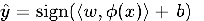, error correction | Rosenblatt (No. 1), von Neumann (No. 2\) |
| **1959** | Encoder Foundations | Pandemonium; TD checkers; V1 receptive fields | Parallel selection ; temporal difference of position evaluation | Hubel & Wiesel (No. 3), Selfridge (No. 4), Samuel (No. 5\) |
| **1960** | Foundations Optimization | ADALINE / LMS rule; Conjugate gradient | Delta rule ; continuous adjoint ODEs | Widrow & Hoff (No. 6), Kelley (No. 7\)7 |
| **1961** | Loops Memory | Die Lernmatrix; Mnemonic equations | Matrix heteroassociative memory  | Steinbuch (No. 8\)91, Caianiello (No. 9\) |
| **1962** | Foundations Encoder | Perceptron convergence theorem; MADALINE | Error bound 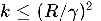; simple and complex cells of the cortex | Novikoff (No. 10\)93, Hubel & Wiesel (No. 14\) |
| **1963** | Foundations Optimization | Generalized portrait (linear SVM) | Maximum-margin hyperplane  | Vapnik & Lerner (No. 15\)98 |
| **1964** | Optimization Foundations | Polyak momentum method; Potential functions | Heavy-ball 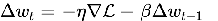; kernel trick; forward AD | Polyak (No. 18\)101, Aizerman et al. (No. 19), Wengert (No. 20\) |
| **1965** | Foundations | First deep MLPs; Cover's theorem | Layer-wise selection of Kolmogorov–Gabor polynomials; number of dichotomies  | Ivakhnenko & Lapa (No. 21\)7, Cover (No. 22\) |
| **1966** | Optimization Foundations | Average-risk minimization in learning | Stochastic approximation  | Tsypkin (No. 25\)106, Braverman (No. 26\) |
| **1967** | Foundations Optimization | End-to-end multilayer SGD; Sinkhorn–Knopp | Gradient descent in a 5-layer network; projection of doubly stochastic matrices | Amari (No. 28\)21, Sinkhorn & Knopp (No. 30\)61 |
| **1968** | Foundations Loops | GMDH; Outstar networks; VC theory | Validation regularization of depth; STM/LTM plasticity equations | Ivakhnenko (No. 31), Grossberg (No. 32), Vapnik (No. 33\) |
| **1969** | Foundations Encoder | Limits of perceptrons; Analog ReLU | Inseparability of XOR by a single layer; multilayer rectifier  | Minsky & Papert (No. 34), Bryson & Ho (No. 35), Fukushima (No. 36\)85 |
| **1970** | Foundations Optimization | Reverse-mode automatic differentiation; BFGS | Exact chain rule on a graph 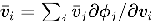; quasi-Newton | Linnainmaa (No. 37\)113, BFGS (No. 38\) |
| **1971** | Foundations Memory | 8-layer GMDH network; Archicortex theory | Deep polynomial network; sparse associative memory of the hippocampus | Ivakhnenko (No. 40\)115, Marr (No. 41\) |
| **1972** | Loops Memory | Amari–Hopfield network; Wilson–Cowan populations | Recurrent attractors 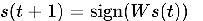; E–I limit cycles | Amari (No. 42\)115, Kohonen (No. 43), Wilson & Cowan (No. 46\)120 |
| **1973** | Encoder Loops | Self-organization of the V1 cortex; Shunting networks | Competitive Hebbian rule with \-normalization of weights; divisive contrast | von der Malsburg (No. 47\)123, Grossberg (No. 48\) |
| **1974** | Foundations Loops | Backprop for neural networks; Spin model of the brain | Dynamic feedback of derivatives; Ising distribution with temperature | Werbos (No. 50\)123, Little (No. 51\)127 |
| **1975** | Encoder Memory | Cognitron; CMAC; SK spin glass | Divisive inhibition of layers; local hash coding; SK Hamiltonian | Fukushima (No. 52\)122, Albus (No. 53), SK (No. 54\) |
| **1976** | Optimization Loops | Reverse AD in print (BIT); Precursor of ART | Taylor expansion with a memory trade-off; stability–plasticity dilemma | Linnainmaa (No. 56\)23, Grossberg (No. 57\) |
| **1977** | Loops Optimization | Brain-State-in-a-Box (BSB); EM algorithm | Attractors in the hypercube ; lower bound on the likelihood of latent variables | Anderson et al. (No. 59\)122, Dempster et al. (No. 62\) |
| **1978** | Memory Foundations | Synaptic memory capacity; BIC criterion | Scaling of memory capacity  with the number of synapses | Little & Shaw (No. 63\)127, Schwarz (No. 64\) |
| **1979** | Encoder | Neocognitron (original publication) | Cascade of shared planes of \-cells (convolution) and \-cells (pooling) | Fukushima (No. 67\)86 |
| **1980** | Encoder Optimization | Neocognitron (int'l); Baur–Strassen bound | Shift invariance through a cascade ; gradient complexity estimate  | Fukushima (No. 69\)129, Baur & Strassen (No. 71\) |
| **1981** | Memory Loops | Distributed representations; Associative RL | Interactive activation of features; search gradient by reinforcement | Hinton & Anderson (No. 72), Barto et al. (No. 74\) |
| **1982** | Loops Encoder | Hopfield network; Kohonen maps (SOM); Oja's rule | Lyapunov function ; topographic learning; neural PCA | Hopfield (No. 75), Werbos (No. 76), Kohonen (No. 77), Oja (No. 78\) |
| **1983** | Optimization Loops | Nesterov accelerated method; Simulated annealing | Optimal descent  at a look-ahead point; Actor–Critic RL | Nesterov (No. 81\)143, Kirkpatrick (No. 82), Barto (No. 83\) |
| **1984** | Foundations Diffusion | PAC learning; Continuous Hopfield; Gibbs sampler | Polynomial learnability 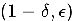; MCMC relaxation on MRF fields | Valiant (No. 84\)147, Hopfield (No. 85), Geman (No. 86\) |
| **1985** | Foundations Diffusion | Boltzmann machine; Independent derivations of Backprop | Gradient of the difference of phase correlations  | Ackley, Hinton & Sejnowski (No. 88\)150, LeCun (No. 89\) |
| **1986** | Foundations Loops | MLP \+ Backpropagation; RBM (Harmonium); Jordan RNN | Chain gradient of hidden representations ; bipartite energy without cycles | Rumelhart, Hinton & Williams (No. 92), Smolensky (No. 94), Jordan (No. 95\) |
| **1987** | STT Loops | TDNN; Fast Weights; Autoencoder stack | 1D convolution over time for speech; plastic contextual weight increment | Waibel (No. 97), Hinton & Plaut (No. 98), Ballard (No. 99), Pineda (No. 101\) |
| **1988** | Encoder Optimization | 2D CNN with backprop; RBF networks; TD() learning | Two-dimensional convolution with error-driven learning; bootstrapping of the Bellman residual | Zhang (No. 102\)20, Broomhead (No. 103), Sutton (No. 104\) |
| **1989** | Encoder Foundations | LeCun convolutional network (USPS); Approximation theorem | End-to-end backprop through 2D kernels with stride; density of MLPs in ; Q-learning | LeCun et al. (No. 107), Cybenko (No. 108), Hornik (No. 109), Watkins (No. 111\) |
| **1990** | Loops Optimization | Elman network (Simple RNN); BPTT; Optimal Brain Damage | Hidden context ; pruning by the diagonal of the Hessian | Elman (No. 114), Werbos (No. 115), LeCun et al. (No. 116), Schmidhuber (No. 117\) |
| **1991** | MoE Loops Attention | Mixture of Experts; Gradient vanishing; Fast Weights | Gating network ; analysis of ; linear self-attention | Jacobs et al. (No. 119), Hochreiter (No. 120), Schmidhuber (No. 121\)22 |
| **1992** | Optimization Loops | REINFORCE; Neural history compressor; Polyak averaging | Policy gradient ; RNN distillation; trajectory averaging of SGD | Williams (No. 124), Schmidhuber (No. 125), Polyak & Juditsky (No. 126\) |
| **1993** | Encoder Foundations | Siamese networks; Variational MDL; Barron bound | Metric towers with shared weights; free energy of weights; OBS pruning | Bromley & LeCun (No. 129), Hinton & van Camp (No. 130), Barron (No. 131\) |
| **1994** | Loops MoE | Long-term dependency theorem; Hierarchical MoE | Incompatibility of stable storage and the gradient in RNNs; operator  in  | Bengio et al. (No. 133), Jordan & Jacobs (No. 134), Pearlmutter (No. 135\) |
| **1995** | Foundations Diffusion | Helmholtz machine (Wake–Sleep); Soft-margin SVM | Generator/inference-network pair ; maximization of mutual information | Hinton et al. (No. 137), Cortes & Vapnik (No. 139), Bishop (No. 141\) |
| **1996** | Encoder Foundations | Sparse coding of V1; Gaussian limit of infinite width | \-reconstruction with an overcomplete dictionary; convergence of  to NNGP | Olshausen & Field (No. 142), Neal (No. 143), Goller & Küchler (No. 144\) |
| **1997** | Loops Memory | LSTM; Bidirectional RNN (BiRNN); Flat minima | Additive cell  (CEC); forward and backward branches of time | Hochreiter & Schmidhuber (No. 146), Schuster & Paliwal (No. 147\) |
| **1998** | Encoder Optimization | LeNet-5; Amari natural gradient | Conv–Pool–FC cascade \+ graph transformer network; Fisher metric  | LeCun et al. (No. 150), Amari (No. 152), Sutton & Barto (No. 153\) |
| **1999** | Loops Foundations | LSTM forget gate; Non-negative matrix factorization NMF | Multiplicative reset ; additive features  | Gers, Schmidhuber & Cummins (No. 155\)155, Lee & Seung (No. 156\) |
| **2000** | Loops Foundations | Peephole LSTM; Softplus; Manifold learning (Isomap/LLE) | Coupling of the cell  with the gates; smooth activation  | Gers et al. (No. 158, 159), Dugas et al. (No. 160), Tenenbaum (No. 161\) |
| **2001** | Loops Encoder | Echo State Networks (ESN); Conditional random fields (CRF) | Fading reservoir ; global normalization of paths  | Jaeger (No. 163), Lafferty et al. (No. 164), Hastie et al. (No. 165\) |
| **2002** | Diffusion Foundations | Contrastive divergence (CD\-); Structured perceptron | One-step MCMC estimate of the RBM gradient from data; Torch library | Hinton (No. 166), Collins (No. 168), Collobert et al. (No. 169\) |
| **2003** | Foundations Attention/LLM | Neural probabilistic language model (NPLM) | Dense learnable word embeddings ; elastic distortions for CNNs | Bengio et al. (No. 170), Simard et al. (No. 171), MacKay (No. 172\) |
| **2004** | Optimization Foundations | First GPU acceleration of neural networks;  vs  theory | Matrix operations in GPU shaders (20×); logarithmic complexity  | Oh & Jung (No. 173), Ng (No. 174), Welling et al. (No. 175\) |
| **2005** | Diffusion STT Foundations | Score Matching; BiLSTM for speech; Graph neural networks (GNN) | Estimation of  without the partition function ; hierarchical Softmax | Hyvärinen (No. 176\)163, Graves (No. 177), Gori et al. (No. 179\) |
| **2006** | STT Foundations | CTC; Deep belief networks (DBN) and autoencoders | Summation of alignments with the blank symbol ; layer-wise stack of RBMs | Graves et al. (No. 181), Hinton et al. (No. 182, 183), Bishop (No. 185\) |
| **2007** | Foundations Optimization | Asymptotics of SGD on big data; Autoencoder stack | Optimality of first-order SGD under a computation-time limit | Bengio et al. (No. 186), Bottou & Bousquet (No. 187), Mnih (No. 188\) |
| **2008** | Encoder Diffusion | Denoising autoencoders (DAE); Unified CNN-NLP | Reconstruction of clean  from noisy ; multitask embeddings; t-SNE | Vincent et al. (No. 190), Collobert & Weston (No. 191), t-SNE (No. 192\) |
| **2009** | Encoder Optimization | ImageNet; Deep learning on CUDA; Curriculum Learning | Scaling to 14M images and CUDA (70×); difficulty schedule | Deng et al. (No. 193), Raina, Madhavan & Ng (No. 194), Bengio (No. 195\) |
| **2010** | Foundations Optimization | Xavier initialization; ReLU in deep networks; RNNLM; NCE | Variance preservation ; piecewise linearity ; Theano | Glorot & Bengio (No. 198), Nair & Hinton (No. 199), Mikolov (No. 200\) |
| **2011** | Optimization Diffusion | AdaGrad; Denoising Score Matching (DSM); CD-DNN-HMM | Per-coordinate scaling ; equivalence of DAE and  | Duchi et al. (No. 204), Vincent (No. 205\)166, Seide et al. (No. 208\) |
| **2012** | Encoder STT | AlexNet; RNN-Transducer (RNN-T); Dropout; RMSProp | Deep GPU CNN with ReLU and Dropout; joint Joiner lattice  for online ASR | Krizhevsky et al. (No. 210\)167, Graves (No. 211), Hinton (No. 212\) |
| **2013** | Encoder Diffusion | Variational Autoencoder (VAE); Word2Vec; NiN; DQN | ELBO lower bound \+ reparameterization ; contrastive Skip-Gram | Kingma & Welling (No. 217), Mikolov (No. 219), Lin (No. 220), Mnih (No. 222\) |
| **2014** | Attention Diffusion | Seq2Seq \+ Bahdanau Attention; GRU; GAN; Adam optimizer | Soft alignment of context ; minimax ; adaptive moments | Sutskever (No. 225), Bahdanau (No. 226), Cho (No. 227), GAN (No. 229), Adam (No. 230\) |
| **2015** | Foundations Diffusion | ResNet \+ Kaiming Init; BatchNorm; U-Net; Diffusion | Identity shortcut ; skip encoder-decoder; inversion of a Markov chain | He et al. (No. 237), Ioffe (No. 239), U-Net (No. 240), Sohl-Dickstein (No. 241\) |
| **2016** | TTS Loops Foundations | LayerNorm; Pre-LN ResNet; ACT; GELU; WaveNet | Normalization over token features; learnable loop halting gate; dilated convolutions | Ba (No. 249), He (No. 250), Graves (No. 251), GELU (No. 252), WaveNet (No. 253\) |
| **2017** | Attention/LLM MoE TTS | Canonical Transformer; Sparse MoE; VQ-VAE; AdamW; PPO | 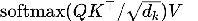; Top\- routing; discrete codebook; decoupled weight decay | Vaswani (No. 260), Shazeer (No. 261), VQ-VAE (No. 262), AdamW (No. 265), PPO (No. 266\) |
| **2018** | Encoder LLM Loops | BERT; GPT-1; Universal Transformer; Neural ODE; InfoNCE; Shampoo | Bidirectional MLM vs causal AR; transformer loop with ACT; continuous depth | Devlin (No. 274), Radford (No. 273), Dehghani (No. 275), Chen (No. 276), Shampoo (No. 282\) |
| **2019** | Attention/LLM Loops TTS | GPT-2; RMSNorm; MQA; DEQ; FastSpeech; NCSN; ZeRO/Megatron | Normalization without shift; a single KV head; implicit fixed point ; length regulator | Radford (No. 285), RMSNorm (No. 286), MQA (No. 287), DEQ (No. 288), FastSpeech (No. 292\) |
| **2020** | LLM Diffusion STT | GPT-3 & Scaling Laws; SwiGLU; Linear Attn; DDPM/SDE; ViT; Conformer | Gated FFN; kernel ; noise loss 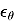; 16×16 patches; Conv+Attn hybrid | Brown (No. 300), SwiGLU (No. 301), DDPM (No. 303), ViT (No. 306), Conformer (No. 307\) |
| **2021** | LLM Loops/SSM TTS | RoPE; ALiBi; Switch MoE; LoRA; CLIP; S4; VITS; SoundStream; LDM | Complex rotation ; adapter  of rank ; NPLR SSM; RVQ audio codec; diffusion in a VAE | RoPE (No. 316), LoRA (No. 319), CLIP (No. 320), S4 (No. 324), SoundStream (No. 327), LDM (No. 331\) |
| **2022** | LLM Diffusion STT | FlashAttention; Chinchilla; DiT; Flow Matching / Rectified Flow; Whisper | Tiling in SRAM with online softmax; ; adaLN-Zero transformer; straight ODEs  | Dao (No. 332), Chinchilla (No. 334), Rectified Flow (No. 338), DiT (No. 341), Whisper (No. 342\) |
| **2023** | LLM Loops/SSM STS | GQA; vLLM; Mixtral 8x7B; Mamba (S6); RWKV/RetNet; SigLIP; VALL-E; TDT; DPO | Grouped KV; input-dependent ; sigmoid loss; frame skipping by duration | GQA (No. 347), Mamba (No. 356), SigLIP (No. 358), VALL-E (No. 362), TDT (No. 366), DPO (No. 353\) |
| **2024** | LLM MoE Loops STS | DeepSeek-V2/V3 (MLA, Aux-Free MoE, MTP); Mamba-2; xLSTM; GDN; MMDiT; Moshi | Low-rank KV cache of MLA; bias-based balancing ; delta rule ; Full-Duplex 160 ms (Mimi) | DeepSeek (No. 371, 372), Mamba-2 (No. 379), GDN (No. 382), HunyuanVideo (No. 394), Moshi (No. 400\) |
| **2025** | LLM Loops Diffusion Video | DeepSeek-R1 & V3.2 (DSA) & mHC; Kimi K2 (MuonClip) & KDA; Huginn/Ouro/PLT; LLaDA/Mercury; Wan 2.2 | Verifiable GRPO; Sinkhorn projection onto the Birkhoff polytope; latent loops; dLLM; MoE video | R1 (No. 406), V3.2 (No. 408), mHC (No. 409), K2 (No. 411), Huginn (No. 417), Ouro (No. 418), LLaDA (No. 424\) |
| **2026** | LLM Hybrids Video STS | DeepSeek V4 Pro; Kimi K3 (AttnRes); Gemma 4; Qwen 3.8; Nemotron 3/3.5; Mamba-3; FA-4; LTX-2.5; PersonaPlex | CSA+HCA (10% KV); attention over depth;  \+ \-RoPE; 3:1 GDN hybrid; complex MIMO SSM; audio-video DiT | K3 (No. 443\)4, Gemma 4156, Qwen 3.830, Mamba-332, LTX-2.5297 |
| **2027** | LLM Diffusion Optimization | Scale-wise VAR \= dLLM; Phase analysis of the DeepSeek-V4 KV; Exact BF16 FA-bwd; Hourglass LM; SafeBridge | Isomorphism of VAR and masked diffusion; softmax gradient conservation law; safety across loops | Kumar et al. (WACV'27, No. 444\)17, OpenReview ICLR'2715 |

Two defining systemic shifts in open language architectures of 2024–2026 lie in the plane of GPU memory management: radical compression of the context state (through the low-rank MLA cache and the replacement of 75% of attention layers by the length-independent constant matrix memory of Gated DeltaNet or KDA) and the transition to ultra-sparse weight activation, in which, out of a total knowledge capacity of 0.7–2.8 trillion parameters, only 3.1–10.0% of the network is activated for each token4.  
  
Comparing the memory volumes given explains the practical economics of long-context agentic inference: in uniform full-attention models, the linear growth of the KV cache quickly exceeds the size of the model weights themselves, forcing inference to be distributed across several nodes merely to store the dialogue history196. By contrast, the 3:1 hybrid architecture fully freezes memory growth in 75% of the network's layers (keeping it equal to 72 MiB in BF16 regardless of whether the context length is 32K or 1M tokens), and in combination with 3–5% active experts it makes it possible to serve multi-step trajectories an order of magnitude cheaper at equal quality30.

### **Table A.2. Architectural specifications and benchmarks of open flagship LLMs and hybrids (2024–2026)**

*Note on attribution (as of 25.11.2026):* The metrics are given according to the official technical reports and model cards of the developers; where independent measurements or reviews are available (Epoch AI, Artificial Analysis, technical digests), the source is explicitly indicated in the cell31. A dash (—) means that no comparable publication of the metric exists in the primary source.

| Model (Release, License) | Total / Active weights | Attention / SSM and expert architecture | Context window | MMLU-Pro (%) | GPQA Diamond (%) | AIME 24 / 25 / 26 (%) | LiveCodeBench (%) | SWE-bench Verified (%) |
| :---- | :---- | :---- | :---- | :---- | :---- | :---- | :---- | :---- |
| **DeepSeek-V3 / 0324** (Dec. 2024, MIT)29 | 671B / 37B (5.5%) | 61 layers: MLA \+ Aux-Loss-Free MoE (8/256 \+ 1 shared) \+ MTP | 128K | 75.9 (81.2 in 0324\) | 59.1 (68.4 in 0324\) | 39.2 ('24; 59.4 in 0324\) | 46.9 (v6, 0324\) | 38.8 (Agentic, 0324\) |
| **DeepSeek-R1 / 0528** (Jan./May 2025, MIT)268 | 671B / 37B (5.5%) | V3 base \+ multistage verifiable RL (GRPO) | 128K | 84.0 | 71.5 (81.0 in 0528\) | 79.8 ('24) / 70\.0$\rightarrow$87.5 ('25) | 63\.5$\rightarrow$73.3 (v6) | 49.2 |
| **Llama 4 Maverick** (Apr. 2025, Llama 4\)280 | 400B / 17B (4.3%) | Alternating dense and MoE layers (1/128 \+ 1 shared), early fusion | 1M (10M for Scout) | — | 67.0 (Epoch AI) | — | — | — |
| **Qwen3-235B-A22B** (May/July 2025, Apache 2.0)247 | 235B / 22B (9.4%) | 94 layers: GQA (64Q / 4KV) \+ MoE (8/128), Think/Non-Think mode | 128K–262K (1M DCA) | 77.3 (non-think) | 62.9 (non-think) | 85.7 ('24) / 81.5 ('25, think) | 70.7 (v5, think) | 34.4 (non-think) |
| **Kimi K2 Instruct** (July 2025, Mod. MIT)66 | 1.04T / 32.6B (3.1%) | 61 layers: MLA (64 heads) \+ MoE (8/384 \+ 1 shared), trained with MuonClip | 128K | 81.1 | 75.1 | 69.6 ('24) / 49.5 ('25) | 53.7 (v6, non-think) | 65.8 (71.6 multi) |
| **GLM-4.5** (July 2025, MIT)282 | 355B / 32B (9.0%) | Deep MoE \+ GQA \+ MTP, Thinking / Non-Thinking hybrid | 128K | 84.6 | 79.1 | 91.0 (AIME'24) | 72.9 | 64.2 |
| **DeepSeek-V3.2** (Dec. 2025, MIT)10 | 671B / 37B (5.5%) | MLA \+ **DeepSeek Sparse Attention (DSA)** \+ unified agentic GRPO | 128K | \~85.0 | 82.4 | 94.17 (AIME'26) | — | 70.2 (Multilingual) |
| **Nemotron 3 Nano** (Dec. 2025, OpenMDW)184 | 31.6B / 3.2B (10.1%) | Mamba-2 \+ GQA hybrid \+ granular MoE (6/128), NVFP4 | 1M (RULER 86.3) | 78.3 | 73.0 (75.0 tools) | 89.1 ('25) / 99.2 (tools) | 68.3 (v6) | 38.8 (OpenHands) |
| **GLM-5 / GLM-5.1** (Feb./Apr. 2026, MIT)321 | 744B / 40B (5.4%) | 80 layers: MLA \+ **DSA** \+ 256 experts \+ Muon \+ async RL APRIL | 200K–1M | — | — | 95.4 / 95.3 (AIME'26) | — | 77.8 |
| **Qwen3.5-397B-A17B** (spring 2026, Apache 2.0)353 | 397B / 17B (4.3%) | 3:1 hybrid (75% **Gated DeltaNet** \+ 25% GQA) \+ Sparse MoE | 256K | — | 88.4 (digest) | 91.3 (AIME'26) | 83.6 (v6) | — |
| **Gemma 4 31B Dense** (Apr./July 2026, Apache 2.0)324 | 30.7B / 30.7B (100%) | 60 layers: 5:1 SWA/Global,  **\+ \-RoPE** (37.5% KV savings), MTP | 256K | 85.2 | 84.3 (75.8 min Epoch) | 89.2 (AIME'26) | 80.0 (v6) | — |
| **Gemma 4 26B-A4B** (Apr./July 2026, Apache 2.0)324 | 25.2B / 3.8B (15.1%) | 30 layers: 5:1 SWA/Global (, \-RoPE) \+ MoE (8/128 \+ 1 shared) | 256K | 82.6 | 82.3 | 88.3 (AIME'26) | 77.1 (v6) | — |
| **Nemotron 3 Ultra** (June 2026, OpenMDW)326 | 550B / 55B (10.0%) | 108 layers: Mamba-2 \+ GQA (64Q/2KV) \+ **LatentMoE** (22/512) \+ 2 MTP | 1M | — | — (AA Index 56.4) | — | — | — |
| **Kimi K3** (July 2026, Kimi K3 Lic.)4 | 2.8T / 104B (3.7%) | 3:1 hybrid (**KDA** \+ Gated MLA NoPE) \+ **AttnRes** \+ Stable LatentMoE (16/896) | 1M | — | — | — | — | 81.2 (FrontierSWE) |
| **DeepSeek V4 Pro** (Aug. 2026, MIT)31 | 1.6T / \~49B (3.1%) | **CSA \+ HCA** hybrid (27% FLOPs and 10% KV relative to V3.2 at 1M) \+ Muon (\>32T tok.) | 1M | — | \>90.0 (release review) | — | 93–94 (release review) | 62.7 (DeepSWE) |
| **Qwen3.8-27B** (Aug. 2026, Apache 2.0)30 | 27B / 27B (100%, VLM) | 64 layers: **48 Gated DeltaNet** (48V/16QK) \+ **16 Gated Attn** (24Q/4KV) \+ MTP | 262K (1M YaRN) | — | — (AA v4.3.2: 33.7) | — | — | 42.2 (DeepSWE 1.1) |
| **Tencent Hy4** (Aug. 2026, Open)1 | 770B / 49B (6.4%) | 78 layers: Gated MLA \+ **DSA (IndexCache)** \+ 4-lane **iHC** \+ MoE (8/256 \+ 1\) | — | — | — | — | — | — |
| **Nemotron 3.5 Super** (Oct. 2026, OpenMDW)327 | 120B / 12B (10.0%) | Mamba-2 \+ GQA hybrid \+ LatentMoE (512 exp.) \+ recursive MTP drafter | 1M | — | — | — | — | 86\.9$\rightarrow$92.1 (Pro V2 \+ RL) |

The dynamics of intelligence density between the 2025 and 2026 generations is especially clear when comparing hard scientific and olympiad tasks (GPQA Diamond and AIME 2026\) with the parameter efficiency of recurrent-depth models10.  
  
The data given reveal an important regularity: in tasks of sequential deductive inference (AIME, MATH-500), the decisive factor is not the raw number of unique parameters but the *effective depth of sequential nonlinear transformations*, achieved either explicitly through an in-context reasoning mode (Thinking mode in Gemma 4 26B-A4B with 3.8B active parameters raises AIME 2026 to 88.3%, versus 20.8% for the non-reasoning Gemma 3 27B) or implicitly inside the hidden state through  recurrent passes over a shared stack of layers in Ouro-2.6B286.

### **Table A.3. Recurrent-depth (looped) and diffusion language models (2025–2026)**

| Model / Architecture | Paradigm and depth topology | Unique parameters / Training tokens | Key experimental metrics and speedups |
| :---- | :---- | :---- | :---- |
| **Huginn-0125** (arXiv:2502.05171)3 | Sandwich loop  with concat injection of the input  and ,  () | 3.5B / 800B tokens (4,096 MI250X) | As the number of loops grows : ARC-Easy 49.07%69.91%, HellaSwag 43.46%65.21%, GSM8K CoT 42.08%; zero-shot KV-sharing across 4 slots with no loss on MT-Bench (5.86)284 |
| **Ouro-1.4B & Ouro-2.6B** (arXiv:2510.25741)286 | Full-stack loop () with a learnable early-exit gate (ACT gate) | 1.4B and 2.6B / 7.7T tokens | **Ouro-1.4B**: MMLU 67.3%, GSM8K 78.9%, MATH-500 82.4%; **Ouro-2.6B**: MMLU 74.6%, MMLU-Pro 55.7%, BBH 80.5%, MATH-500 **90.8%** (comparable to dense models of up to 12B)286 |
| **PLT & LoopCoder-v2 7B** (arXiv:2510.24824, 2606.18023)33 | Cross-Loop Parallelism (CLP) pipeline \+ shared KV of the first loop \+ Gated SWA () | 1.7B act. / 7B dense (18T tokens of code and text) | Eliminates the sequential latency penalty (+96%\~4% overhead at ); \+5.0 pp accuracy at 2 loops, saturation diagnosed at  because of the CLP phase shift33 |
| **Inkling 2 Mini** (Thinking Machines, Nov. 2026\)197 | Sandwich of  applications of 24 layers \+ AttnRes \+ MoE (8/128) | 26.4B total / 3.4B unique active (5.4B activations) | Context of 1,048,576 tokens, Apache 2.0, 5 local SWA (1024) \+ 1 global GQA per block, KV cache 192 KiB/token197 |
| **LLaDA-8B / LLaDA-MoE** (arXiv:2502.09992)35 | Bidirectional masked diffusion transformer (MDM, weighted  ELBO) | 8B dense; 7B-A1B MoE | Parity with LLaMA-3 8B at equal FLOPs; Instruct (block unmasking): GSM8K **78.6%**, MATH **42.2%**, CMMLU 69.9%; overcomes the reversal curse57 |
| **Dream 7B** (arXiv:2508.15487)57 | Discrete diffusion LLM initialized from autoregressive weights | 7B dense | MATH **51.2%**, HumanEval **54.3%**, strong planning and bidirectional infilling57 |
| **Mercury Coder Mini / Small** (arXiv:2506.17298)58 | Commercial diffusion code LLM with parallel token generation | Closed scale (trillions of tokens) | Throughput on standard NVIDIA H100: **1,109 tok/s** (Mini) and **737 tok/s** (Small) as measured by Artificial Analysis (up to 10× faster than AR models)58 |
| **LoopMDM & Looped UDLM** (arXiv:2605.26106, 2610.30066)56 | Selective loop over early-middle layers inside a discrete-diffusion denoiser | 125M–170M (NeurIPS 2026\) | Reaches the same validation NLL with **3.34× fewer training FLOPs** on FineWeb-Edu; \+8.5 pp on GSM8K; adaptive exit saves up to 34.8% of loops56 |

### **Table A.4. Visual encoders and generative models for images and video (2012–2026)**

| Model (Year) | Type and key mechanism | Scale / Latent compression | Verified quality and speed metrics |
| :---- | :---- | :---- | :---- |
| **AlexNet** (2012)  **ResNet-152** (2015)  **ViT-H/14** (2020)167 | Evolution from 2D CNNs (ReLU+Dropout) to residual networks and patch transformers | 60M  60M  632M | ImageNet-1K Top-1 accuracy: **63.3%** (AlexNet)  **78.3%** (ResNet-152, ensemble 3.57% Top-5 err)  **88.55%** (ViT-H/14 JFT)177 |
| **SigLIP 2** (Feb. 2025, arXiv:2502.14786)300 | Multilingual ViT (109 lang.): Sigmoid loss \+ LocCa decoder \+ SILC/TIPS \+ NaFlex | 86M (B), 303M (L), 400M (So400m), 1B (g) | ImageNet-1K zero-shot Top-1: **84.3%** (So400m/16 @ 512px) and **85.0%** (ViT-g/16 @ 384px); COCO T2I R@1: 53.2% for B/16300 |
| **V-JEPA 2** (June 2025, arXiv:2506.09985)59 | Self-supervised prediction of video features without pixels and text \+ V-JEPA 2-AC | Trained on VideoMix22M (up to 64 frames of 384×384) | Something-Something v2: **77.3%** Top-1; PerceptionTest: **84.0%**; Epic-Kitchens-100 action anticipation: **39.7 R@5** (+44% rel.)59 |
| **DINOv3** (Aug. 2025, arXiv:2508.10104)301 | Self-distillation on 1.7B images \+ **Gram Anchoring** of dense patch maps | From 21.6M (ViT-S/16) to **7B** (ViT-7B/16) | Linear probing of frozen features: ImageNet-1K **88.0%**, ADE20k segmentation **55.9 mIoU** (versus 49.5 for DINOv2-g/14)301 |
| **ADM**  **LDM-4**  **DiT-XL/2**  **SiT-XL/2 \+ REPA**  **DDT-XL/2**36 | Evolution of ImageNet 256×256 generation: pixel U-Net  VAE U-Net  DiT  alignment with DINOv2  decoupled DiT | 554M / 400M / 675M / 675M / 675M | FID-50K on ImageNet 256×256 (with CFG, lower is better): **4.59** (ADM)  **3.60** (LDM-4)  **2.27** (DiT-XL/2)  **2.06** (SiT-XL/2)  **1.42** (+REPA, 17.5× faster convergence)  **1.26** (DDT-XL/2, 2025–2026)36 |
| **FLUX.1** (2024)  **FLUX.2** (Nov. 2025, BFL)174 | Latent Rectified Flow \+ MMDiT; in the 2nd version the VLM Mistral-3 24B \+ 128-channel VAE | 12B (FLUX.1)  32B (FLUX.2 \[dev\]) | Unified generation and multi-image editing up to 4 MP with a controllable number of steps and precise typography299 |
| **HunyuanVideo** (Dec. 2024\) & **1.5** (Nov. 2025\)257 | Dual-to-Single Stream DiT \+ MLLM text encoder \+ Causal 3D-VAE \+ 3D-RoPE | 13B (v1.0, 4×8×8 compression) / **8.3B** (v1.5) | v1.0: 66.5% motion quality in a blind test (60–80 GB VRAM); v1.5: rendering in **~75 s on a single RTX 4090** (step-distilled)297 |
| **Wan 2.1** (Feb. 2025\) & **Wan 2.2** (July 2025, Apache 2.0)172 | Flow-Matching DiT; in 2.2, a **2-expert temporal MoE by SNR** and a compressed VAE | **27B-A14B MoE** (4×8×8) and **TI2V-5B** (4×16×16) | Leader among open models in aesthetics (85.3 on Wan-Bench 2.0) and VBVR (0.371 versus 0.273 for CogVideoX-1.5); the 5B model renders 720p@24fps on a single RTX 4090172 |
| **LTX-Video**  **LTX-2**  **LTX-2.5** (Aug. 2026, Lightricks)259 | Ultra-compressed Video-VAE (1:192)  **asymmetric two-stream audio-video DiT** with 1D/3D-RoPE cross-attention | 2B/13B  19B (14B V \+ 5B A)  **22B** (+Gemma 4 12B) | Synchronous generation of video up to 4K (up to 20 s in Fast) and 24 kHz stereo sound (dialogue, foley, lip sync) in a single pass; runs from 12–24 GB VRAM in FP8297 |

By 2026, in the visual and speech domains simultaneously, generative models had come close to two fundamental physical limits: the reconstruction-accuracy limit of the latent autoencoder itself (rFID \= 1.20 for the standard SD-VAE on ImageNet 256×256) and the average duration of a natural pause between turns in live human conversation (230 ms according to cross-linguistic measurements)70.  
  
That denoisers reached an FID threshold of 1.26 against the 1.20 of the SD-VAE itself explains why the research focus in the second half of 2025–2026 shifted from modifying the diffusion transformer itself to redesigning the latent spaces of autoencoders, from end-to-end tuning of the VAE with REPA-E to the 128-channel space of the **FLUX.2-VAE** and the highly compressed video space of the **Wan2.2-VAE**36. In turn, in the speech stack, the transition to the ultra-low frame rate of **12.5 Hz** (an 80 ms step in Mimi, Qwen3-Omni and Qwen3-TTS) made it possible to fit the generation of the first audio packet into one or two steps of the autoregressive decoder, making live voice communication with interruptions indistinguishable in timing from a conversation between people48.

### **Table A.5. Summary characteristics and metrics of the speech stack: STT (ASR), TTS and Full-Duplex STS (2020–2026)**

| System (Developer, Year) | Class and architecture | Token rate / Codec | Verified accuracy, speed and latency metrics |
| :---- | :---- | :---- | :---- |
| **Conformer** (Google, 2020\)203 | STT Macaron FFN \+ MHSA \+ DepthwiseConv \+ RNN-T hybrid | 25 Hz (4× subsampling) | LibriSpeech test-clean / test-other WER: **2.1% / 4.3%** (no LM), **1.9% / 3.9%** (with LM); 10M version: 2.7% / 6.3%203 |
| **Whisper Large-v3** (OpenAI, 2022–2023)229 | STT 1.55B Encoder-Decoder Transformer (32+32 layers, 128-bin mel) | 50 Hz encoder (30 s window) | LibriSpeech test-clean **1.86–2.01% WER**, test-other **4.2–5.0% WER**; FLEURS average over 99 languages ~10.6% WER; speed ~145.5 RTFx229 |
| **SenseVoice-Small** (Alibaba, 2024\)263 | STT Non-autoregressive ASR encoder \+ emotions (SER) \+ events | NAR end-to-end | More than **15× faster** than Whisper-Large and **5× faster** than Whisper-Small, with recognition of emotions and sound events263 |
| **Parakeet-TDT-0.6B-v3 & Canary-1B-v2** (NVIDIA, Sep. 2025\)193 | STT FastConformer (8× stride) \+ **TDT** (skipping 0–4 frames) / AED | **12.5 Hz** (80 ms frame) | **Parakeet-TDT-0.6B-v3**: 6.32% avg. WER at a speed of **3,332.7 RTFx** (54× faster than LLM-ASR); **Canary-1B-v2**: 25 languages, 7.15% EN WER, 749 RTFx229 |
| **Voxtral / Voxtral Realtime** (Mistral, 2025–2026)316 | STT Native audio LLM (3B/24B, 32K context \= 40 min \+ function calling) | Streaming encoding | Apache 2.0; **Voxtral Realtime** at **480 ms** latency is comparable with offline Whisper, and at 960 ms outperforms the baselines316 |
| **GigaAM-v3 & Multilingual** (Sber, 2025–2026)317 | STT Conformer SSL (HuBERT-style on 2M h with graph balancing) | 25 Hz (40 ms step) | Outperforms Whisper Large-v3 and Omnilingual-1B on underrepresented Central Asian and spontaneous telephone corpora317 |
| **Nemotron 3.5 Transcribe** (NVIDIA, Oct. 2026\)348 | STT Parallel expert encoder (0.6B TDT \+ frozen Sortformer) \+ LLM | 30 s chunks (375 frames, 12.5 Hz) | Simultaneous verbatim and formatted transcription, word timestamps and end-to-end speaker diarization over 65K tokens (BF16/FP8/NVFP4)348 |
| **CosyVoice 3** (Alibaba, May 2025\)46 | TTS AR-LLM of speech tokens \+ Flow-Matching generator \+ DiffRO RL | **25 Hz** single-stream **FSQ** (MinMo) | Leader on the CV3-Eval "in-the-wild" reference benchmark, bidirectional bi\-streaming and cross-lingual voice cloning46 |
| **Qwen3-TTS** (Alibaba, Jan. 2026\)341 | TTS Dual-track LLM (0.6B/1.7B, 5M h) \+ 16-codebook **MTP** | **12.5 Hz** (16 RVQ) or **25 Hz** (DiT) | First audio packet in **~97–100 ms** on the causal 12.5 Hz path; 66% error reduction for ZH$\rightarrow$KO relative to CosyVoice 3 (4.82 versus 14.4 WER); \>10 min of stable speech63 |
| **Kyutai Pocket TTS** (Jan. 2026, MIT)315 | TTS Continuous audio LM with latent noising (100M parameters) | 24 kHz output without GPU | Runs **~6× faster than real time on 2 CPU cores** (MacBook Air M4), first-chunk latency ~200 ms, voice cloning, 6 languages344 |
| **Fish Audio S2-Pro** (Mar. 2026\)158 | TTS Sequential Dual-AR (Fast AR over codebooks) \+ GRPO \+ SGLang | 10-codebook RVQ (DAC base) | 80+ languages, **TTFA ~100 ms**, **RTF 0.195** on an H200 (\>3000 tok/s), 81.88% win on EmergentTTS-Eval (91.61% in paralinguistics)55 |
| **Moshi \+ Mimi** (Kyutai, Oct. 2024\)26 | STS Full-duplex RQ-Transformer (7B Helium \+ Depth Tr.) \+ Inner Monologue | **Mimi: 12.5 Hz**, 8 RVQ, **1.1 kbit/s** | First open Full-Duplex STS: **160 ms** theor. / **200 ms** pract. latency; streaming TTS WER 4.7%, ASR WER 5.7%26 |
| **Qwen3-Omni & 3.5-Omni** (Alibaba, 2025–2026)303 | STS Omnimodal **Thinker–Talker MoE** \+ **AuT** encoder \+ causal Code2Wav | **12.5 Hz** RVQ \+ MTP (ARIA in 3.5) | Audio-dialogue latency **234 ms** (547 ms audio+video), open SOTA on 32 of 36 audio benchmarks with no drop in text MMLU (81.69%)304 |
| **NVIDIA PersonaPlex 7B** (Jan. 2026\)68 | STS Full-Duplex (Moshi \+ Mimi base) with a pinned hybrid prompt (text+voice) | **12.5 Hz** Mimi (window of 2,048 frames) | Full-Duplex-Bench naturalness DMOS **3.90 ± 0.15** (versus 3.72 for Gemini and 3.11 for Moshi), cloned-voice similarity SSIM **0.57**68 |
| **NemotronLabs VoiceChat** (NVIDIA, Sep. 2026\)69 | STS Full-Duplex decoder \+ streaming encoder \+ auxiliary RNN-T branch \+ **Tool Calling** | Streaming parallel output | Full-Duplex-Bench 1.0: **100% interruption handling**, 4.33/5 response quality; FDB 1.5: **93% return to speech** after interjections; FDB 3.0: **82.5% tool-selection F1**69 |

### **Table A.6. Registry of key open repositories of neural-network architectures and kernels (Open-Source Ecosystem)**

| Domain | Repository (GitHub / Organization) | License | Implemented mechanisms and engineering value |
| :---- | :---- | :---- | :---- |
| **LLM architecture catalog** | rasbt/llm-architecture-gallery197 | Apache-2.0 | models.yml metadata, diagrams and a memory calculator for 132 modern LLM architectures (updated in November 2026\) |
| **Attention kernels (Hopper / Blackwell)** | Dao-AILab/flash-attention223 | BSD-3 | FlashAttention-1/2/3 and **FlashAttention-4** in Python CuTe-DSL (conditional online softmax, asynchronous B200 pipelines) |
| **Latent and sparse attention \+ MoE** | deepseek-ai/DeepSeek-V3, DeepSeek-V3.2-Exp, FlashMLA, DeepEP, DeepGEMM50 | MIT | Reference implementations of MLA, DeepSeek Sparse Attention (DSA), FP8 GEMM and cross-server expert routing |
| **Hyper-connections on the Birkhoff manifold** | tokenbender/mHC-manifold-constrained-hyper-connections384 | MIT | Research implementation of DeepSeek **mHC** (arXiv:2512.24880) with Sinkhorn–Knopp projection |
| **Linear attention and delta networks** | fla-org/flash-linear-attention9 | MIT | High-speed Triton / TileLang kernels for **Gated DeltaNet**, **GDN-2**, **Kimi Delta Attention (KDA)**, GLA, RetNet, RWKV-7 and **AttnRes** |
| **State space models (SSM)** | state-spaces/mamba (s4)207 | Apache-2.0 | Official CUDA scanners and blocks for **S4**, **S4D**, **Mamba-1**, **Mamba-2 (SSD)** and **Mamba-3 (MIMO \+ Complex RoPE)** |
| **Matrix LSTM and dynamic RNNs** | NX-AI/xlstm, mlstm\_kernels; BlinkDL/RWKV-LM175 | Apache-2.0 | Triton/CUDA kernels for **mLSTM / xLSTM 7B** and the dynamic state evolution of **RWKV-5/6/7 ("Goose")** |
| **Recurrent depth and looped LMs** | seal-rg/recurrent-pretraining (Huginn); rkstgr/LoopLM (Ouro)42 | Apache-2.0 | Recurrent-depth pretraining of **Huginn-0125** and adaptive exit in the looped **Ouro** models |
| **Fast-weight training at inference** | a1600012888/LaCT; nikhilvyas/SOAP192 | MIT | Large-chunk test-time training **LaCT** in pure PyTorch and the second-order preconditioner **SOAP** |
| **Diffusion LLMs and modern encoders** | ML-GSAI/LLaDA; AnswerDotAI/ModernBERT; google-research/big\_vision186 | MIT / Apache-2.0 | Masked text diffusion **LLaDA-8B / MoE**, the long-context encoder **ModernBERT** and **SigLIP 2** |
| **Image and audio-video DiT generation** | CompVis/latent-diffusion, black-forest-labs/flux, Wan-Video/Wan2.2, Tencent-Hunyuan/HunyuanVideo-1.5, Lightricks/LTX-2296 | Apache-2.0 / Comm. | The whole stack from the first LDM to the MoE video generator **Wan 2.2** and the synchronous audio-video **LTX-2 / LTX-2.5** |
| **Speech and full-duplex stack** | kyutai-labs/moshi, kyutai-labs/pocket-tts, NVIDIA/personaplex, NVIDIA/NeMo, QwenLM/Qwen3-Omni, QwenLM/Qwen3-TTS, FunAudioLLM/CosyVoice, fishaudio/fish-speech, salute-developers/GigaAM26 | MIT / Apache-2.0 | The **Mimi** codec, full-duplex **Moshi** and **PersonaPlex**, **FastConformer / TDT** decoders, the omni model **Qwen3-Omni** and CPU synthesis **Pocket TTS** |

## **Appendix B. Reference program listings of all key mechanisms**

Below are twelve self-contained Python (torch) modules implementing the core mathematical mechanisms of all ten domains covered in the chapters 1958–2027.

### **Listing B.1. Perceptron (1958) and the reverse-mode automatic differentiation engine (1970–1986)**

```python
import math
import torch
import torch.nn as nn
import torch.nn.functional as F

class RosenblattPerceptron:
    """1958–1962: Rosenblatt's linear perceptron with Novikoff's convergence bound (R/gamma)^2."""
    def __init__(self, dim: int, lr: float = 1.0):
        self.w = torch.zeros(dim)
        self.b = torch.zeros(1)
        self.lr = lr

    def fit_step(self, x: torch.Tensor, y: float) -> bool:
        margin = y * (torch.dot(self.w, x) + self.b)
        if margin <= 0.0:
            self.w = self.w + self.lr * y * x
            self.b = self.b + self.lr * y
            return True
        return False

class ScalarNode:
    """1970, 1976, 1986: Reverse-mode automatic differentiation (Linnainmaa / Rumelhart et al.)."""
    def __init__(self, val: float, parents: tuple = ()):
        self.val = float(val)
        self.grad = 0.0
        self._parents = parents

    def __add__(self, other: "ScalarNode") -> "ScalarNode":
        return ScalarNode(self.val + other.val, ((self, 1.0), (other, 1.0)))

    def __mul__(self, other: "ScalarNode") -> "ScalarNode":
        return ScalarNode(self.val * other.val, ((self, other.val), (other, self.val)))

    def tanh(self) -> "ScalarNode":
        t = math.tanh(self.val)
        return ScalarNode(t, ((self, 1.0 - t * t),))

    def backward(self) -> None:
        topo, visited = [], set()

        def build(node: "ScalarNode") -> None:
            if node not in visited:
                visited.add(node)
                for parent, _ in node._parents:
                    build(parent)
                topo.append(node)

        build(self)
        self.grad = 1.0
        for node in reversed(topo):
            for parent, local_deriv in node._parents:
                parent.grad += node.grad * local_deriv
```

### **Listing B.2. Basic blocks of Transformer++: RMSNorm (2019), SwiGLU (2020) and the Conformer block (2020)**

```python
class RMSNorm(nn.Module):
    """2019: Root Mean Square Layer Normalization without mean centering (Zhang & Sennrich)."""
    def __init__(self, dim: int, eps: float = 1e-6):
        super().__init__()
        self.eps = eps
        self.weight = nn.Parameter(torch.ones(dim))

    def forward(self, x: torch.Tensor) -> torch.Tensor:
        rms = torch.rsqrt(x.float().pow(2).mean(dim=-1, keepdim=True) + self.eps)
        return (x.float() * rms).to(x.dtype) * self.weight

class SwiGLUFFN(nn.Module):
    """2020: The gated fully connected subnetwork SwiGLU (Shazeer)."""
    def __init__(self, d_model: int, d_ff: int):
        super().__init__()
        self.w_gate = nn.Linear(d_model, d_ff, bias=False)
        self.w_up = nn.Linear(d_model, d_ff, bias=False)
        self.w_down = nn.Linear(d_ff, d_model, bias=False)

    def forward(self, x: torch.Tensor) -> torch.Tensor:
        return self.w_down(F.silu(self.w_gate(x)) * self.w_up(x))

class ConformerConvModule(nn.Module):
    """2020: Convolution module of Conformer / FastConformer (Pointwise GLU -> Depthwise Conv1d -> SiLU)."""
    def __init__(self, d_model: int, kernel_size: int = 15):
        super().__init__()
        self.norm = RMSNorm(d_model)
        self.pw_in = nn.Conv1d(d_model, 2 * d_model, kernel_size=1)
        self.dw = nn.Conv1d(d_model, d_model, kernel_size=kernel_size,
                            padding=kernel_size // 2, groups=d_model)
        self.gn = nn.GroupNorm(1, d_model)
        self.pw_out = nn.Conv1d(d_model, d_model, kernel_size=1)

    def forward(self, x: torch.Tensor) -> torch.Tensor:
        h = self.norm(x).transpose(1, 2)
        a, b = self.pw_in(h).chunk(2, dim=1)
        h = a * torch.sigmoid(b)
        h = self.pw_out(F.silu(self.gn(self.dw(h)))).transpose(1, 2)
        return x + h
```

### **Listing B.3. Evolution of gated memory: LSTM with a forget gate (1997–2000) versus mLSTM in xLSTM (2024–2025)**

```python
class ForgetGateLSTMCell(nn.Module):
    """1997–2000: Classic LSTM cell with the constant error carousel (CEC) and a forget gate."""
    def __init__(self, d_in: int, d_hid: int):
        super().__init__()
        self.proj = nn.Linear(d_in + d_hid, 4 * d_hid)

    def forward(self, x_t: torch.Tensor, state: tuple[torch.Tensor, torch.Tensor]):
        h_prev, c_prev = state
        i, f, o, g = self.proj(torch.cat([x_t, h_prev], dim=-1)).chunk(4, dim=-1)
        c_t = torch.sigmoid(f) * c_prev + torch.sigmoid(i) * torch.tanh(g)
        h_t = torch.sigmoid(o) * torch.tanh(c_t)
        return h_t, c_t

class MatrixLSTMCell(nn.Module):
    """2024–2025: mLSTM cell from xLSTM 7B with matrix memory C_t and soft-capping of the gates."""
    def __init__(self, d_model: int, d_head: int = 64, softcap: float = 15.0):
        super().__init__()
        self.scale = d_head ** -0.5
        self.softcap = softcap
        self.wq = nn.Linear(d_model, d_head, bias=False)
        self.wk = nn.Linear(d_model, d_head, bias=False)
        self.wv = nn.Linear(d_model, d_head, bias=False)
        self.gates = nn.Linear(d_model, 2)
        self.wo = nn.Linear(d_model, d_head, bias=False)

    def _cap(self, x: torch.Tensor) -> torch.Tensor:
        return self.softcap * torch.tanh(x / self.softcap)

    def step(self, x_t: torch.Tensor, C_prev: torch.Tensor, n_prev: torch.Tensor, m_prev: torch.Tensor):
        q = self.wq(x_t).unsqueeze(-1)
        k = (self.wk(x_t) * self.scale).unsqueeze(-1)
        v = self.wv(x_t).unsqueeze(-1)
        raw_i, raw_f = self._cap(self.gates(x_t)).chunk(2, dim=-1)
        log_f = -F.softplus(-raw_f).unsqueeze(-1)
        log_i = raw_i.unsqueeze(-1)

        m_t = torch.maximum(log_f + m_prev, log_i)
        i_t = torch.exp(log_i - m_t)
        f_t = torch.exp(log_f + m_prev - m_t)

        C_t = f_t * C_prev + i_t * (v @ k.transpose(-1, -2))
        n_t = f_t * n_prev + i_t * k
        denom = torch.clamp((n_t.transpose(-1, -2) @ q).abs(), min=1.0)
        h_tilde = (C_t @ q) / denom
        h_t = torch.sigmoid(self.wo(x_t)) * h_tilde.squeeze(-1)
        return h_t, C_t, n_t, m_t
```

### **Listing B.4. Matrix optimizers: Muon with Newton–Schulz iteration and QK-Clip (2024–2026) and SOAP (2024–2025)**

```python
def zeropower_via_newtonschulz5(G: torch.Tensor, steps: int = 5, eps: float = 1e-7) -> torch.Tensor:
    """2024–2026: Five-step polynomial orthogonalization of the momentum matrix in the Muon optimizer."""
    a, b, c = (3.4445, -4.7750, 2.0315)
    X = G.bfloat16() / (G.norm() + eps)
    transposed = X.size(0) > X.size(1)
    if transposed:
        X = X.T
    for _ in range(steps):
        A = X @ X.T
        B = b * A + c * (A @ A)
        X = a * X + B @ X
    return X.T if transposed else X

@torch.no_grad()
def apply_qk_clip(wq: torch.Tensor, wk: torch.Tensor, max_attn_logit: float, tau: float = 100.0) -> None:
    """2025: The QK-Clip attention-logit stabilizer from Kimi K2 (MuonClip)."""
    if max_attn_logit > tau:
        scale = (tau / max_attn_logit) ** 0.5
        wq.mul_(scale)
        wk.mul_(scale)

class MinimalSOAPStep:
    """2024–2025: The SOAP optimizer step — running Adam in the eigenbasis of the Shampoo preconditioner."""
    def __init__(self, shape: tuple[int, int], lr: float = 1e-3, beta1: float = 0.9,
                 beta2: float = 0.999, precond_freq: int = 10):
        m, n = shape
        self.lr, self.b1, self.b2, self.freq = lr, beta1, beta2, precond_freq
        self.step_idx = 0
        self.L, self.R = torch.zeros(m, m), torch.zeros(n, n)
        self.QL, self.QR = torch.eye(m), torch.eye(n)
        self.exp_avg, self.exp_avg_sq = torch.zeros(m, n), torch.zeros(m, n)

    @torch.no_grad()
    def step(self, W: torch.Tensor, G: torch.Tensor) -> torch.Tensor:
        self.step_idx += 1
        self.L.lerp_(G @ G.T, 1.0 - self.b2)
        self.R.lerp_(G.T @ G, 1.0 - self.b2)

        G_rot = self.QL.T @ G @ self.QR
        self.exp_avg.lerp_(G_rot, 1.0 - self.b1)
        self.exp_avg_sq.lerp_(G_rot.pow(2), 1.0 - self.b2)

        step_rot = self.exp_avg / (self.exp_avg_sq.sqrt() + 1e-8)
        W.sub_(self.lr * (self.QL @ step_rot @ self.QR.T))

        if self.step_idx % self.freq == 0:
            _, QL_new = torch.linalg.eigh(self.L + 1e-6 * torch.eye(self.L.size(0), device=G.device))
            _, QR_new = torch.linalg.eigh(self.R + 1e-6 * torch.eye(self.R.size(0), device=G.device))
            self.exp_avg = QL_new.T @ self.QL @ self.exp_avg @ self.QR.T @ QR_new
            self.QL, self.QR = QL_new, QR_new
        return W
```

### **Listing B.5. The modern attention stack: p-RoPE (2021/2026), FlashAttention-4 online softmax (2022–2026), MLA (2024) and DSA (2025)**

```python
def apply_partial_rope(x: torch.Tensor, cos: torch.Tensor, sin: torch.Tensor, p_ratio: float = 0.25) -> torch.Tensor:
    """2021, 2026: Partial rotary position embedding p-RoPE (RoFormer / Gemma 4 / Qwen 3.8)."""
    rot_dim = int(x.size(-1) * p_ratio) // 2 * 2
    x_rot, x_pass = x[..., :rot_dim], x[..., rot_dim:]
    x1, x2 = x_rot[..., ::2], x_rot[..., 1::2]
    rotated = torch.stack([x1 * cos - x2 * sin, x1 * sin + x2 * cos], dim=-1).flatten(-2)
    return torch.cat([rotated, x_pass], dim=-1)

def flash_attention_v4_tiled(Q: torch.Tensor, K: torch.Tensor, V: torch.Tensor,
                             block_size: int = 64, tau: float = 0.25) -> torch.Tensor:
    """2022–2026: Blockwise online softmax with conditional skipping of rescaling (FlashAttention-4)."""
    B, H, T, D = Q.shape
    scale = D ** -0.5
    O = torch.zeros_like(Q)
    m = torch.full((B, H, T, 1), -float("inf"), device=Q.device, dtype=Q.dtype)
    ell = torch.zeros((B, H, T, 1), device=Q.device, dtype=Q.dtype)

    for j in range(0, T, block_size):
        Kj = K[:, :, j:j + block_size]
        Vj = V[:, :, j:j + block_size]
        Sj = torch.matmul(Q, Kj.transpose(-1, -2)) * scale

        mj_cand = torch.maximum(m, Sj.amax(dim=-1, keepdim=True))
        need_rescale = (mj_cand - m) > tau
        mj = torch.where(need_rescale, mj_cand, m)
        alpha = torch.where(need_rescale, torch.exp(m - mj), torch.ones_like(m))

        Pj = torch.exp(Sj - mj)
        ell = alpha * ell + Pj.sum(dim=-1, keepdim=True)
        O = alpha * O + torch.matmul(Pj, Vj)
        m = mj
    return O / ell

class MultiHeadLatentAttentionDSA(nn.Module):
    """2024–2026: Compressed MLA cache (DeepSeek-V2/V3) with the lightweight top-k DSA indexer (DeepSeek-V3.2)."""
    def __init__(self, d_model: int = 512, n_heads: int = 8, d_head: int = 64,
                 d_latent_kv: int = 128, top_k_tokens: int = 64):
        super().__init__()
        self.n_heads, self.d_head, self.top_k = n_heads, d_head, top_k_tokens
        self.wq = nn.Linear(d_model, n_heads * d_head, bias=False)
        self.w_dkv = nn.Linear(d_model, d_latent_kv, bias=False)
        self.w_uk = nn.Linear(d_latent_kv, n_heads * d_head, bias=False)
        self.w_uv = nn.Linear(d_latent_kv, n_heads * d_head, bias=False)
        self.idx_q = nn.Linear(d_model, 32, bias=False)
        self.idx_k = nn.Linear(d_latent_kv, 32, bias=False)
        self.wo = nn.Linear(n_heads * d_head, d_model, bias=False)

    def forward(self, h: torch.Tensor) -> torch.Tensor:
        B, T, _ = h.shape
        c_kv = self.w_dkv(h)
        q = self.wq(h).view(B, T, self.n_heads, self.d_head)

        k_sel = min(self.top_k, T)
        idx_scores = torch.matmul(self.idx_q(h), self.idx_k(c_kv).transpose(-1, -2))
        causal = torch.triu(torch.full((T, T), -float("inf"), device=h.device), diagonal=1)
        _, top_indices = torch.topk(idx_scores + causal, k=k_sel, dim=-1)

        c_selected = c_kv.unsqueeze(1).expand(B, T, T, -1).gather(
            2, top_indices.unsqueeze(-1).expand(-1, -1, -1, c_kv.size(-1))
        )
        k = self.w_uk(c_selected).view(B, T, k_sel, self.n_heads, self.d_head)
        v = self.w_uv(c_selected).view(B, T, k_sel, self.n_heads, self.d_head)

        attn_logits = torch.einsum("bthd,btkhd->bthk", q, k) * (self.d_head ** -0.5)
        attn_weights = F.softmax(attn_logits, dim=-1)
        out = torch.einsum("bthk,btkhd->bthd", attn_weights, v).reshape(B, T, -1)
        return self.wo(out)
```

### **Listing B.6. Sparse Normalized LatentMoE with penalty-free loss balancing (2024–2026)**

```python
class NormalizedLatentMoE(nn.Module):
    """2024–2026: A synthesis of Aux-Loss-Free MoE (DeepSeek-V3) and Normalized LatentMoE (Nemotron 3 / Kimi K3)."""
    def __init__(self, d_model: int = 512, d_latent: int = 192, n_routed: int = 16,
                 top_k: int = 4, d_expert: int = 256, bias_lr: float = 1e-3):
        super().__init__()
        self.top_k, self.bias_lr = top_k, bias_lr
        self.down_proj = nn.Linear(d_model, d_latent, bias=False)
        self.up_proj = nn.Linear(d_latent, d_model, bias=False)
        self.post_agg_norm = RMSNorm(d_latent)

        self.router = nn.Linear(d_model, n_routed, bias=False)
        self.register_buffer("expert_bias", torch.zeros(n_routed))

        self.shared_expert = SwiGLUFFN(d_model, 2 * d_expert)
        self.experts = nn.ModuleList([SwiGLUFFN(d_latent, d_expert) for _ in range(n_routed)])

    def forward(self, x: torch.Tensor) -> torch.Tensor:
        B, T, D = x.shape
        x_flat = x.view(-1, D)
        z_flat = self.down_proj(x_flat)

        scores = torch.sigmoid(self.router(x_flat))
        _, top_idx = torch.topk(scores + self.expert_bias, k=self.top_k, dim=-1)
        weights = torch.gather(scores, 1, top_idx)
        weights = weights / (weights.sum(dim=-1, keepdim=True) + 1e-6)

        if self.training:
            with torch.no_grad():
                counts = torch.bincount(top_idx.reshape(-1), minlength=len(self.experts)).float()
                self.expert_bias.add_(self.bias_lr * torch.sign(counts.mean() - counts))

        agg_latent = torch.zeros_like(z_flat)
        for i, expert in enumerate(self.experts):
            tok_ids, slot_ids = torch.where(top_idx == i)
            if tok_ids.numel() > 0:
                agg_latent.index_add_(0, tok_ids, expert(z_flat[tok_ids]) * weights[tok_ids, slot_ids, None])

        routed_out = self.up_proj(self.post_agg_norm(agg_latent))
        return (routed_out + self.shared_expert(x_flat)).view(B, T, D)
```

### **Listing B.7. Linear delta networks and SSMs: Gated DeltaNet / KDA (2024–2026) and Mamba-3 MIMO RoPE-SSM (2026)**

```python
class KimiDeltaAttentionLayer(nn.Module):
    """2024–2026: Gated DeltaNet / Kimi Delta Attention (KDA) with bounded per-channel decay."""
    def __init__(self, d_model: int = 256, d_k: int = 64, d_v: int = 64, g_min: float = -4.0):
        super().__init__()
        self.d_k, self.d_v, self.g_min = d_k, d_v, g_min
        self.wq = nn.Linear(d_model, d_k, bias=False)
        self.wk = nn.Linear(d_model, d_k, bias=False)
        self.wv = nn.Linear(d_model, d_v, bias=False)
        self.w_beta = nn.Linear(d_model, 1)
        self.w_decay = nn.Linear(d_model, d_k)
        self.w_gate = nn.Linear(d_model, d_v)
        self.wo = nn.Linear(d_v, d_model, bias=False)

    def forward(self, x: torch.Tensor) -> tuple[torch.Tensor, torch.Tensor]:
        B, T, _ = x.shape
        q = F.normalize(self.wq(x), dim=-1)
        k = F.normalize(self.wk(x), dim=-1)
        v = self.wv(x)
        beta = torch.sigmoid(self.w_beta(x)).unsqueeze(-1)
        alpha = torch.exp(self.g_min * torch.sigmoid(self.w_decay(x)))

        S = torch.zeros(B, self.d_v, self.d_k, device=x.device, dtype=x.dtype)
        outputs = []
        for t in range(T):
            S_pred = S * alpha[:, t].unsqueeze(1)
            k_t = k[:, t].unsqueeze(-1)
            v_t = v[:, t].unsqueeze(-1)
            residual = v_t - torch.matmul(S_pred, k_t)
            S = S_pred + beta[:, t] * torch.matmul(residual, k_t.transpose(-1, -2))
            y_t = torch.matmul(S, q[:, t].unsqueeze(-1)).squeeze(-1)
            outputs.append(y_t)

        y = torch.stack(outputs, dim=1) * F.silu(self.w_gate(x))
        return self.wo(y), S

class Mamba3MIMOCell(nn.Module):
    """2026: The Mamba-3 core — trapezoidal discretization, RoPE rotation in the state and MIMO rank R."""
    def __init__(self, d_model: int = 256, state_dim: int = 64, mimo_rank: int = 4):
        super().__init__()
        self.N, self.R = state_dim, mimo_rank
        self.w_x = nn.Linear(d_model, d_model * mimo_rank, bias=False)
        self.w_bc = nn.Linear(d_model, 2 * state_dim * mimo_rank)
        self.w_dt_lam = nn.Linear(d_model, 2)
        self.w_theta = nn.Linear(d_model, state_dim // 2)
        self.wo = nn.Linear(d_model, d_model, bias=False)

    @staticmethod
    def _rotate(v: torch.Tensor, cos: torch.Tensor, sin: torch.Tensor) -> torch.Tensor:
        v1, v2 = v[..., ::2], v[..., 1::2]
        return torch.stack([v1 * cos - v2 * sin, v1 * sin + v2 * cos], dim=-1).flatten(-2)

    def forward(self, u: torch.Tensor) -> torch.Tensor:
        B, T, D = u.shape
        H = torch.zeros(B, D, self.N, device=u.device, dtype=u.dtype)
        prev_u_proj = torch.zeros(B, D, self.N, device=u.device, dtype=u.dtype)
        outs = []

        for t in range(T):
            ut = u[:, t]
            dt_raw, lam_raw = self.w_dt_lam(ut).chunk(2, dim=-1)
            dt = F.softplus(dt_raw).unsqueeze(-1)
            lam = torch.sigmoid(lam_raw).unsqueeze(-1)
            alpha = torch.exp(-dt)

            theta = self.w_theta(ut)
            cos, sin = torch.cos(theta).unsqueeze(1), torch.sin(theta).unsqueeze(1)

            x_r = self.w_x(ut).view(B, D, self.R)
            b_r, c_r = self.w_bc(ut).chunk(2, dim=-1)
            b_r = b_r.view(B, self.R, self.N)
            c_r = c_r.view(B, self.N, self.R)

            cur_u_proj = dt * torch.matmul(x_r, b_r)
            H_rot = self._rotate(H, cos, sin)
            H = alpha * H_rot + (1.0 - lam) * alpha * prev_u_proj + lam * cur_u_proj
            prev_u_proj = cur_u_proj

            yt = torch.matmul(H, c_r).mean(dim=-1)
            outs.append(yt)
        return self.wo(torch.stack(outs, dim=1))
```

### **Listing B.8. Depth topology: mHC hyper-connections (2025–2026), Attention Residuals (2026) and Test-Time Training (2024–2025)**

```python
def sinkhorn_knopp_birkhoff(logits: torch.Tensor, iters: int = 8, eps: float = 1e-6) -> torch.Tensor:
    """1967 / 2025: Projection of a matrix onto the Birkhoff polytope of doubly stochastic matrices (mHC)."""
    P = torch.exp(logits - logits.amax(dim=-1, keepdim=True))
    for _ in range(iters):
        P = P / (P.sum(dim=-1, keepdim=True) + eps)
        P = P / (P.sum(dim=-2, keepdim=True) + eps)
    return P

class ManifoldHyperConnectionBlock(nn.Module):
    """2025–2026: The Manifold-Constrained Hyper-Connections layer (DeepSeek mHC, arXiv:2512.24880)."""
    def __init__(self, d_model: int, n_streams: int = 4):
        super().__init__()
        self.h_res_logits = nn.Parameter(torch.eye(n_streams) * 2.0)
        self.h_pre_logits = nn.Parameter(torch.zeros(n_streams))
        self.h_post_logits = nn.Parameter(torch.zeros(n_streams))
        self.norm = RMSNorm(d_model)
        self.sublayer = SwiGLUFFN(d_model, 2 * d_model)

    def forward(self, streams: torch.Tensor) -> torch.Tensor:
        H_res = sinkhorn_knopp_birkhoff(self.h_res_logits)
        h_pre = F.softmax(self.h_pre_logits, dim=0)
        h_post = F.softplus(self.h_post_logits)

        layer_in = torch.einsum("n,btnd->btd", h_pre, streams)
        layer_out = self.sublayer(self.norm(layer_in))
        mixed = torch.einsum("mn,btnd->btmd", H_res, streams)
        return mixed + torch.einsum("m,btd->btmd", h_post, layer_out)

class AttentionResidualAggregator(nn.Module):
    """2026: Attention Residuals (AttnRes, Kimi K3, arXiv:2603.15031) — attention along the depth axis."""
    def __init__(self, d_model: int):
        super().__init__()
        self.q_proj = nn.Parameter(torch.randn(d_model) * 0.02)
        self.k_norm = RMSNorm(d_model)

    def forward(self, block_history: list[torch.Tensor]) -> torch.Tensor:
        stacked = torch.stack(block_history, dim=2)
        keys = self.k_norm(stacked)
        scores = torch.einsum("d,btmd->btm", self.q_proj, keys) * (stacked.size(-1) ** -0.5)
        weights = F.softmax(scores, dim=-1)
        return torch.einsum("btm,btmd->btd", weights, stacked)

class LargeChunkTTTLayer(nn.Module):
    """2024–2025: Chunkwise fast-weight training at inference (TTT / Titans / LaCT)."""
    def __init__(self, d_model: int = 256, inner_lr: float = 0.1):
        super().__init__()
        self.inner_lr = inner_lr
        self.wq = nn.Linear(d_model, d_model, bias=False)
        self.wk = nn.Linear(d_model, d_model, bias=False)
        self.wv = nn.Linear(d_model, d_model, bias=False)
        self.w_fast_init = nn.Parameter(torch.eye(d_model) * 0.1)

    def forward(self, x: torch.Tensor, chunk_size: int = 64) -> torch.Tensor:
        B, T, D = x.shape
        W_fast = self.w_fast_init.unsqueeze(0).expand(B, D, D).clone()
        outs = []
        for s in range(0, T, chunk_size):
            xc = x[:, s:s + chunk_size]
            qc, kc, vc = self.wq(xc), F.normalize(self.wk(xc), dim=-1), self.wv(xc)
            outs.append(torch.matmul(qc, W_fast.transpose(-1, -2)))
            err = torch.matmul(kc, W_fast.transpose(-1, -2)) - vc
            grad_w = torch.matmul(err.transpose(-1, -2), kc) / xc.size(1)
            W_fast = W_fast - self.inner_lr * grad_w
        return torch.cat(outs, dim=1)
```

### **Listing B.9. Recurrent-depth (looped) networks: Looped Transformer with ACT (2025) and the PLT pipeline (2025–2026)**

```python
class LoopedTransformerACT(nn.Module):
    """2025–2026: A model with recurrent depth, input injection and an ACT gate (Huginn / Ouro)."""
    def __init__(self, vocab_size: int, d_model: int = 256, n_heads: int = 4,
                 core_layers: int = 2, max_loops: int = 4):
        super().__init__()
        self.max_loops = max_loops
        self.emb = nn.Embedding(vocab_size, d_model)
        self.inject_proj = nn.Linear(2 * d_model, d_model)
        self.core = nn.ModuleList([
            nn.TransformerEncoderLayer(d_model, n_heads, 4 * d_model,
                                       activation="gelu", batch_first=True, norm_first=True)
            for _ in range(core_layers)
        ])
        self.exit_gate = nn.Linear(d_model, 1)
        self.norm = RMSNorm(d_model)
        self.head = nn.Linear(d_model, vocab_size)

    def forward(self, idx: torch.Tensor, n_loops: int | None = None) -> tuple[torch.Tensor, torch.Tensor]:
        B, T = idx.shape
        R = n_loops or self.max_loops
        e = self.emb(idx)
        s = e
        causal_mask = nn.Transformer.generate_square_subsequent_mask(T, device=idx.device)

        remaining_prob = torch.ones(B, T, 1, device=idx.device)
        weighted_state = torch.zeros_like(e)
        halt_probs = []

        for r in range(R):
            h = self.inject_proj(torch.cat([s, e], dim=-1))
            for layer in self.core:
                h = layer(h, src_mask=causal_mask, is_causal=True)
            s = h
            p_r = torch.sigmoid(self.exit_gate(s)) if r < R - 1 else torch.ones_like(remaining_prob)
            step_weight = remaining_prob * p_r
            weighted_state = weighted_state + step_weight * s
            remaining_prob = remaining_prob * (1.0 - p_r)
            halt_probs.append(step_weight)

        return self.head(self.norm(weighted_state)), torch.cat(halt_probs, dim=-1)

class ParallelLoopCoreSimulator(nn.Module):
    """2025–2026: The Cross-Loop Parallelism pipeline (PLT, Wu et al.): 1 pass per token for R loops."""
    def __init__(self, d_model: int = 256, n_loops: int = 3):
        super().__init__()
        self.R = n_loops
        self.shared_block = nn.Sequential(RMSNorm(d_model), SwiGLUFFN(d_model, 2 * d_model))

    def decode_pipeline(self, token_embs: torch.Tensor) -> torch.Tensor:
        B, T, _ = token_embs.shape
        states = [[None for _ in range(self.R + 1)] for _ in range(T)]
        for t in range(T):
            states[t][0] = token_embs[:, t]

        for s in range(T + self.R - 1):
            active_coords = [
                (s - r, r) for r in range(self.R) if 0 <= (s - r) < T and states[s - r][r] is not None
            ]
            if active_coords:
                batch_in = torch.stack([states[tok][lp] for tok, lp in active_coords], dim=1)
                batch_out = batch_in + self.shared_block(batch_in)
                for idx, (tok, lp) in enumerate(active_coords):
                    states[tok][lp + 1] = batch_out[:, idx]

        return torch.stack([states[t][self.R] for t in range(T)], dim=1)
```

### **Listing B.10. Continuous Rectified Flow with REPA (2022–2026) and discrete masked diffusion LLaDA (2025)**

```python
def rectified_flow_repa_loss(dit_step_fn, proj_mlp: nn.Module, x_0: torch.Tensor,
                             dino_clean_feats: torch.Tensor, repa_weight: float = 0.5) -> torch.Tensor:
    """2022–2026: Joint Flow Matching + REPA loss (alignment of a hidden layer with DINOv2/v3)."""
    B = x_0.size(0)
    t = torch.sigmoid(torch.randn(B, device=x_0.device))
    t_view = t.view(B, *([1] * (x_0.ndim - 1)))

    noise = torch.randn_like(x_0)
    x_t = (1.0 - t_view) * x_0 + t_view * noise
    v_pred, mid_hidden = dit_step_fn(x_t, t)

    fm_loss = F.mse_loss(v_pred, noise - x_0)
    aligned = F.normalize(proj_mlp(mid_hidden), dim=-1)
    target = F.normalize(dino_clean_feats.detach(), dim=-1)
    repa_loss = -(aligned * target).sum(dim=-1).mean()
    return fm_loss + repa_weight * repa_loss

def llada_masked_diffusion_loss(bidir_transformer: nn.Module, clean_ids: torch.Tensor,
                                mask_token_id: int, eps: float = 1e-3) -> torch.Tensor:
    """2024–2026: Strict 1/t-weighted ELBO loss of discrete masked diffusion (MDLM / LLaDA)."""
    B, L = clean_ids.shape
    t = eps + (1.0 - eps) * torch.rand(B, 1, device=clean_ids.device)
    mask = torch.rand(B, L, device=clean_ids.device) < t
    noisy_ids = torch.where(mask, mask_token_id, clean_ids)

    logits = bidir_transformer(noisy_ids)
    tok_nll = F.cross_entropy(logits.transpose(1, 2), clean_ids, reduction="none")
    weighted_nll = (tok_nll * mask.float()) / t
    return weighted_nll.sum(dim=-1).mean() / L
```

### **Listing B.11. Training for reasoning and critic-free alignment: DPO (2023) and GRPO (2024–2026)**

```python
def dpo_preference_loss(policy_w_logp: torch.Tensor, policy_l_logp: torch.Tensor,
                        ref_w_logp: torch.Tensor, ref_l_logp: torch.Tensor, beta: float = 0.1) -> torch.Tensor:
    """2023: Direct Preference Optimization, DPO (Rafailov et al.)."""
    logits = (policy_w_logp - ref_w_logp) - (policy_l_logp - ref_l_logp)
    return -F.logsigmoid(beta * logits).mean()

def grpo_policy_loss(logp_new: torch.Tensor, logp_old: torch.Tensor, logp_ref: torch.Tensor,
                     rewards: torch.Tensor, resp_mask: torch.Tensor,
                     clip_eps: float = 0.2, kl_beta: float = 0.04) -> torch.Tensor:
    """2024–2026: Group Relative Policy Optimization (DeepSeekMath / DeepSeek-R1 / Qwen3 / GLM-5)."""
    mean_r = rewards.mean(dim=-1, keepdim=True)
    std_r = rewards.std(dim=-1, keepdim=True) + 1e-6
    advantages = ((rewards - mean_r) / std_r).unsqueeze(-1)

    ratio = torch.exp(logp_new - logp_old.detach())
    surr1 = ratio * advantages
    surr2 = torch.clamp(ratio, 1.0 - clip_eps, 1.0 + clip_eps) * advantages

    log_ratio_ref = logp_ref.detach() - logp_new
    kl_per_tok = torch.exp(log_ratio_ref) - log_ratio_ref - 1.0

    per_tok_obj = torch.minimum(surr1, surr2) - kl_beta * kl_per_tok
    return -(per_tok_obj * resp_mask).sum() / (resp_mask.sum() + 1e-6)
```

### **Listing B.12. The complete speech stack: CTC (2006), RVQ and FSQ (2021–2025), TDT (2023) and the Full-Duplex step of Moshi / PersonaPlex (2024–2026)**

```python
def ctc_forward_log_likelihood(log_probs: torch.Tensor, targets: list[int], blank: int = 0) -> torch.Tensor:
    """2006: The exact dynamic-programming forward algorithm of CTC in log space (Graves et al.)."""
    ext = [blank]
    for y in targets:
        ext.extend([y, blank])
    L_ext, T_steps = len(ext), log_probs.size(0)
    alpha = log_probs.new_full((T_steps, L_ext), -float("inf"))
    alpha[0, 0] = log_probs[0, ext[0]]
    if L_ext > 1:
        alpha[0, 1] = log_probs[0, ext[1]]

    for t in range(1, T_steps):
        for s in range(L_ext):
            prev = [alpha[t - 1, s]]
            if s >= 1:
                prev.append(alpha[t - 1, s - 1])
            if s >= 2 and ext[s] != blank and ext[s] != ext[s - 2]:
                prev.append(alpha[t - 1, s - 2])
            alpha[t, s] = torch.logsumexp(torch.stack(prev), dim=0) + log_probs[t, ext[s]]

    end_terms = [alpha[-1, -1]] + ([alpha[-1, -2]] if L_ext > 1 else [])
    return torch.logsumexp(torch.stack(end_terms), dim=0)

class ResidualVQTokenizer(nn.Module):
    """2021–2026: Residual vector quantization of audio, RVQ (SoundStream / EnCodec / Mimi / Qwen3-TTS)."""
    def __init__(self, d_latent: int = 128, n_codebooks: int = 8, codebook_size: int = 2048):
        super().__init__()
        self.codebooks = nn.ModuleList([nn.Embedding(codebook_size, d_latent) for _ in range(n_codebooks)])

    def forward(self, z: torch.Tensor) -> tuple[torch.Tensor, torch.Tensor, torch.Tensor]:
        residual, z_q_total, codes_all, commit_loss = z, torch.zeros_like(z), [], z.new_zeros(())
        for cb in self.codebooks:
            dist = residual.pow(2).sum(-1, keepdim=True) - 2 * (residual @ cb.weight.t()) + cb.weight.pow(2).sum(-1)
            idx = dist.argmin(dim=-1)
            q = cb(idx)
            commit_loss = commit_loss + F.mse_loss(residual, q.detach()) + 0.25 * F.mse_loss(residual.detach(), q)
            z_q_total = z_q_total + (residual + (q - residual).detach())
            residual = residual - q.detach()
            codes_all.append(idx)
        return z_q_total, torch.stack(codes_all, dim=-1), commit_loss

class FiniteScalarQuantizer(nn.Module):
    """2023–2025: Codebook-free scalar quantization FSQ with a straight-through gradient (CosyVoice 3)."""
    def __init__(self, d_in: int = 256, levels: list[int] = [8, 5, 5, 5]):
        super().__init__()
        self.register_buffer("levels", torch.tensor(levels, dtype=torch.float32))
        self.proj_down = nn.Linear(d_in, len(levels))
        self.proj_up = nn.Linear(len(levels), d_in)

    def forward(self, h: torch.Tensor) -> tuple[torch.Tensor, torch.Tensor]:
        half_w = (self.levels - 1.0) * 0.5
        z = torch.tanh(self.proj_down(h)) * half_w
        z_q = z + (torch.round(z) - z).detach()
        bases = torch.cumprod(torch.cat([torch.ones(1, device=h.device), self.levels[:-1]]), dim=0)
        indices = ((torch.round(z) + half_w) * bases).long().sum(dim=-1)
        return self.proj_up(z_q), indices

@torch.no_grad()
def tdt_frame_skipping_greedy_decode(enc_frames: torch.Tensor, pred_step_fn, joiner_fn,
                                     blank_id: int = 0, durations: tuple = (0, 1, 2, 3, 4)) -> list[int]:
    """2023–2026: Token-and-Duration Transducer decoding with frame skipping (Parakeet-TDT)."""
    T_frames = enc_frames.size(0)
    t, pred_state, transcript, last_tok = 0, None, [], blank_id
    while t < T_frames:
        pred_vec, cand_state = pred_step_fn(last_tok, pred_state)
        tok_logits, dur_logits = joiner_fn(enc_frames[t], pred_vec)
        tok = int(tok_logits.argmax().item())
        skip = durations[int(dur_logits.argmax().item())]
        if tok != blank_id:
            transcript.append(tok)
            last_tok, pred_state = tok, cand_state
            t += max(1, skip) if skip > 0 else 1
        else:
            t += max(1, skip)
    return transcript

class FullDuplexRQStep(nn.Module):
    """2024–2026: A single 80-ms step (12.5 Hz) of the full-duplex Moshi / PersonaPlex model."""
    def __init__(self, d_temporal: int = 512, d_depth: int = 256, n_cb: int = 8,
                 text_vocab: int = 4096, audio_vocab: int = 2048):
        super().__init__()
        self.n_cb = n_cb
        self.user_embs = nn.ModuleList([nn.Embedding(audio_vocab, d_temporal) for _ in range(n_cb)])
        self.agent_embs = nn.ModuleList([nn.Embedding(audio_vocab, d_temporal) for _ in range(n_cb)])
        self.text_emb = nn.Embedding(text_vocab, d_temporal)

        self.temporal_cell = nn.GRUCell(d_temporal, d_temporal)
        self.inner_monologue_head = nn.Linear(d_temporal, text_vocab)
        self.to_depth = nn.Linear(d_temporal, d_depth)
        self.depth_cell = nn.GRUCell(d_depth, d_depth)
        self.cb_emb_depth = nn.ModuleList([nn.Embedding(audio_vocab, d_depth) for _ in range(n_cb)])
        self.cb_heads = nn.ModuleList([nn.Linear(d_depth, audio_vocab) for _ in range(n_cb)])

    def step_80ms(self, user_codes_t: torch.Tensor, prev_agent_codes: torch.Tensor,
                  prev_text_tok: torch.Tensor, h_temporal: torch.Tensor):
        u_sum = sum(emb(user_codes_t[:, q]) for q, emb in enumerate(self.user_embs))
        a_sum = sum(emb(prev_agent_codes[:, q]) for q, emb in enumerate(self.agent_embs))
        h_temporal = self.temporal_cell(u_sum + a_sum + self.text_emb(prev_text_tok), h_temporal)
        agent_text_tok = self.inner_monologue_head(h_temporal).argmax(dim=-1)

        h_d = self.to_depth(h_temporal)
        d_in = self.cb_emb_depth[0](agent_text_tok % self.cb_heads[0].out_features)
        agent_codes_out = []
        for q in range(self.n_cb):
            h_d = self.depth_cell(d_in, h_d)
            code_q = self.cb_heads[q](h_d).argmax(dim=-1)
            agent_codes_out.append(code_q)
            d_in = self.cb_emb_depth[q](code_q)

        return agent_text_tok, torch.stack(agent_codes_out, dim=-1), h_temporal
```

## **Appendix C. What from the monograph basalt already supports**

This appendix maps the model types and mechanisms the monograph treats as milestones (mostly 2012–2027, plus the foundations basalt relies on) onto basalt main as of 2026-11-27. A row is *supported* only when a registered `model_type`, an accepted flag or a routed endpoint reaches it with real weights. Standalone cores, refused or experimental-only flags, and modules that load weights best-effort over a seeded skeleton count as *partial*. Where basalt's README disagrees with the code or the CHANGELOG, the code and the CHANGELOG win.

Links to `https://github.com/goodmai/mlx-swift-lm/...` point at the pinned fork revision `8e76c2f` (`Package.swift`), which holds most architecture definitions.

The checklist of these rows for the monograph's problem book is tracked in issue [#816](https://github.com/goodmai/basalt/issues/816).

### Foundations (Basis)

| Mechanism / model type | Chapter (year) | Status in basalt | Where in basalt |
|---|---|---|---|
| Perceptron Mark I as a hardware machine | 1958; B.1 | out of scope | A physical device. The linear unit itself is `MLXNN.Linear`. |
| Reverse-mode autodiff and backpropagation | 1970–1986; B.1 | supported | MLX `valueAndGrad` in the adapter trainers: [`ADPOTrainer.swift`](../../Sources/BasaltInference/ADPOTrainer.swift), [`MLXInferenceEngine+LeJEPATrain.swift`](../../Sources/BasaltInference/MLXInferenceEngine+LeJEPATrain.swift), [`PVTuner+Steps.swift`](../../Sources/BasaltInference/PVTuner+Steps.swift) |
| Convolutional networks (LeNet, AlexNet, VGG, Inception) | 1989–2014 | partial | Convolutions appear only inside encoders and decoders: the SAM neck in [`DeepSeekOCRSAM.swift`](../../Sources/BasaltInference/DeepSeekOCRSAM.swift) and [`CausalConv3d.swift`](../../Sources/BasaltInference/Video/CausalConv3d.swift). No image-classification endpoint. |
| Residual connections and the Pre-LN branch (ResNet, Pre-LN ResNet, GPT-2) | 2015–2019 | supported | Every decoder block in the fork, e.g. [`Qwen35.swift`](https://github.com/goodmai/mlx-swift-lm/blob/8e76c2fb9322f9bccc2724fc7c4eebb19fe28f8a/Libraries/MLXLLM/Models/Qwen35.swift) and [`Gemma4Text.swift`](https://github.com/goodmai/mlx-swift-lm/blob/8e76c2fb9322f9bccc2724fc7c4eebb19fe28f8a/Libraries/MLXLLM/Models/Gemma4Text.swift) |
| LSTM and GRU | 1997, 2014; B.3 | partial | Only sLSTM, an LSTM cell with exponential gating, as an optional block of `xlstm` ([`XLSTMOps.swift`](../../Sources/BasaltInference/Models/XLSTM/XLSTMOps.swift), [#864](https://github.com/goodmai/basalt/pull/864)). It is synthetic: it has no public checkpoint layout and is tested only on a tiny fixture against a CPU reference. No classic LSTM or GRU. |
| Seq2Seq with additive (Bahdanau) attention | 2014 | partial | The encoder→decoder pattern exists only as audio encoder → LLM (Nemotron 3.5 Transcribe, [`NemotronTranscribeEncoder.swift`](../../Sources/BasaltInference/NemotronTranscribeEncoder.swift)) and as text cross-attention in the DiT scaffolds. Additive scoring is absent. |
| Transformer with multi-head attention, and the decoder-only causal LM (GPT-1…3) | 2017–2020 | supported | MLX fused SDPA in every fork model. Basalt's fused paths are in [`FusedTransformerKernels.swift`](../../Sources/BasaltInference/FusedTransformerKernels.swift). Served by `basalt serve` over the OpenAI and Anthropic APIs ([commands](../commands.md)). |
| Bidirectional encoder BERT and masked LM | 2018 | partial | BERT-family encoders serve `/v1/embeddings` and `/v1/rerank` ([`Bert.swift`](https://github.com/goodmai/mlx-swift-lm/blob/8e76c2fb9322f9bccc2724fc7c4eebb19fe28f8a/Libraries/MLXEmbedders/Models/Bert.swift), [#178](https://github.com/goodmai/basalt/issues/178)). There is no MLM head and no MLM training. |
| ModernBERT | 2024 | not yet | MLXEmbedders ships Bert, NomicBert, Qwen3, Gemma3 and LFM2Bidirectional, and no ModernBERT. |
| Scaling laws, Chinchilla, μP | 2020–2022 | out of scope | These govern pretraining compute allocation, and basalt does no pretraining. |

### Attention and positional encoding (Attention/LLM)

| Mechanism / model type | Chapter (year) | Status in basalt | Where in basalt |
|---|---|---|---|
| MQA and GQA | 2019, 2023 | supported | Shared KV heads in every fork attention. Qwen3.8-27B uses 4 KV heads. Gemma 4 12B global layers use `num_global_key_value_heads = 1`. KV sizing is in [models](../models.md). |
| FlashAttention: tiled attention with an online softmax | 2022; B.5 | supported | Fused Metal SDPA (`MLXFast.scaledDotProductAttention`). Unfused prefill chunks are capped by [`PrefillAttentionScratch.swift`](../../Sources/BasaltInference/PrefillAttentionScratch.swift) ([#762](https://github.com/goodmai/basalt/issues/762)). |
| FlashAttention-2/3/4 kernels | 2023–2026; B.5 | out of scope | CUDA kernels for Ampere, Hopper and Blackwell (warp specialisation, TMA, FMA-emulated exp). On Apple GPUs the MLX Metal SDPA fills this role. |
| RoPE | 2021 | supported | All served LLM families, e.g. [`Qwen35.swift`](https://github.com/goodmai/mlx-swift-lm/blob/8e76c2fb9322f9bccc2724fc7c4eebb19fe28f8a/Libraries/MLXLLM/Models/Qwen35.swift) |
| YaRN context extension | 2023 | supported | `--rope-yarn` for Qwen 3.5/3.6/3.8 ([`RopeYarnStage.swift`](../../Sources/BasaltInference/RopeYarnStage.swift), [#729](https://github.com/goodmai/basalt/issues/729)) |
| ALiBi | 2021 | not yet | No evidence found. |
| Relative position bias (T5) | 2019 | partial | Inkling 2 adds a learned relative bias (`d_rel` 16, `rel_extent` 1024) in [`Inkling2Attention.swift`](../../Sources/BasaltInference/Models/Inkling2/Inkling2Attention.swift). The T5-style bucketed bias is absent. |
| Local/global interleave with sliding windows (ModernBERT 1:2, Gemma 4 5:1) | 2024–2026 | supported | Gemma 4 uses a 1024-token window at 5:1. Batched decode goes through [`BatchRotatingKVCache.swift`](../../Sources/BasaltInference/BatchRotatingKVCache.swift) ([#255](https://github.com/goodmai/basalt/issues/255)). |
| p-RoPE partial rotation | 2026; B.5 | supported | `partial_rotary_factor` 0.25 on Gemma 4 global layers ([`Gemma4Text.swift`](https://github.com/goodmai/mlx-swift-lm/blob/8e76c2fb9322f9bccc2724fc7c4eebb19fe28f8a/Libraries/MLXLLM/Models/Gemma4Text.swift)). YaRN is refused on p-RoPE ([#729](https://github.com/goodmai/basalt/issues/729)). |
| Keys reused as values, K = V (Gemma 4) | 2026 | supported | The fork reads `attention_k_eq_v`. `--experimental-kv-shared-row` stores one 640-value row per head, 0.625× the global KV ([`KEqVRowKVCache.swift`](../../Sources/BasaltInference/KV/KEqVRowKVCache.swift), [#645](https://github.com/goodmai/basalt/issues/645)). |
| NoPE layers (Kimi K3 global layers) | 2026 | supported | `no_rope_layer_indices` in Flint ([`FlintConfiguration.swift`](../../Sources/BasaltInference/Models/Flint/FlintConfiguration.swift)). Ripple-65B uses NoPE with partial RoPE ([#520](https://github.com/goodmai/basalt/issues/520)). |
| Gated attention output (Qwen 3.8 Gated Attention) | 2026 | supported | `sigmoidMultiply(merged, gate)` in [`Qwen35.swift`](https://github.com/goodmai/mlx-swift-lm/blob/8e76c2fb9322f9bccc2724fc7c4eebb19fe28f8a/Libraries/MLXLLM/Models/Qwen35.swift), driven by config `attn_output_gate`. |
| MLA, multi-head latent attention | 2024; B.5 | supported | deepseek_v2/v3 ([`DeepseekV3.swift`](https://github.com/goodmai/mlx-swift-lm/blob/8e76c2fb9322f9bccc2724fc7c4eebb19fe28f8a/Libraries/MLXLLM/Models/DeepseekV3.swift)) keep the cache decompressed per head ([models](../models.md)). bailing_hybrid keeps an absorbed latent cache ([`BailingHybridMLAAbsorption.swift`](../../Sources/BasaltInference/Models/BailingHybrid/BailingHybridMLAAbsorption.swift), [#672](https://github.com/goodmai/basalt/issues/672)). |
| Gated MLA (Kimi K3, Tencent Hy4) | 2026 | partial | `GatedMLAAttention` with output and value gates and NoPE ([`GatedMLAAttention.swift`](../../Sources/BasaltInference/Attention/GatedMLAAttention.swift), [#864](https://github.com/goodmai/basalt/pull/864)) matches a CPU reference on tiny fixtures, but no model type uses it. bailing_hybrid's MLA also takes the NoPE and output-gate options, with no real-weight run yet ([#672](https://github.com/goodmai/basalt/issues/672)). No Kimi K3 or Tencent Hy4 checkpoint has been run. |
| Native Sparse Attention (NSA) | 2025 | partial | `--attention-backend nsa` with `--nsa-window` ([`KVCacheOptions.swift`](../../Sources/BasaltCLI/KVCacheOptions.swift), [`SageMXKVCache+NSA.swift`](../../Sources/BasaltInference/Attention/SageMXKVCache+NSA.swift), [#864](https://github.com/goodmai/basalt/pull/864)) runs an experimental approximation of the three branches: mean-pooled compression, top-k blocks through [`BlockSparseRoutingMetal.swift`](../../Sources/BasaltInference/Attention/BlockSparseRoutingMetal.swift) and a sliding window, mixed by fixed gates instead of trained ones. There is no real-model speed or perplexity table yet. |
| DeepSeek Sparse Attention (DSA) with a lightning indexer | 2025; B.5 | partial | The lightning indexer and its top-k sparse attention have Metal kernels that match a CPU reference on tiny fixtures ([`DSALightningIndexer.swift`](../../Sources/BasaltInference/Attention/DSALightningIndexer.swift), [`DSALightningIndexerMetal.swift`](../../Sources/BasaltInference/Attention/DSALightningIndexerMetal.swift), [#864](https://github.com/goodmai/basalt/pull/864)), and bailing_hybrid accepts an indexer through `dsa_*` config keys. No open checkpoint of 40B or less carries trained indexer weights, and `--attention-backend dsa` is not exposed. |
| CSA + HCA compressed attention (DeepSeek V4) | 2026 | not yet | No evidence found. |
| Encoder-free multimodal projection (Gemma 4 12B Unified) | 2026 | partial | `gemma4_unified` is registered, and image patches go straight to the decoder (`Gemma4UnifiedVisionEmbedder` in [`Gemma4.swift`](https://github.com/goodmai/mlx-swift-lm/blob/8e76c2fb9322f9bccc2724fc7c4eebb19fe28f8a/Libraries/MLXVLM/Models/Gemma4.swift)). Basalt sends audio through transcription ([`PipelineRunner.swift`](../../Sources/BasaltServer/REST/PipelineRunner.swift)), not as raw 40 ms chunks. |
| Per-Layer Embeddings (PLE, Gemma 4 E2B/E4B) | 2026 | supported | Per-layer inputs in [`Gemma4Text.swift`](https://github.com/goodmai/mlx-swift-lm/blob/8e76c2fb9322f9bccc2724fc7c4eebb19fe28f8a/Libraries/MLXLLM/Models/Gemma4Text.swift) and [`Gemma3nText.swift`](https://github.com/goodmai/mlx-swift-lm/blob/8e76c2fb9322f9bccc2724fc7c4eebb19fe28f8a/Libraries/MLXLLM/Models/Gemma3nText.swift). gemma-4-e2b and e4b are listed in [models](../models.md). |

### Mixture of experts and routing (MoE)

| Mechanism / model type | Chapter (year) | Status in basalt | Where in basalt |
|---|---|---|---|
| Sparsely-gated MoE with top-k routing (Jacobs MoE, Shazeer, Switch top-1, Mixtral top-2) | 1991, 2017, 2021, 2023 | supported | SwitchGLU routing in qwen3_moe, `mixtral` and Gemma 4 26B-A4B (golden, [`GoldenLogitsTests.swift`](../../Tests/BasaltTests/GoldenLogitsTests.swift)). The fused router is [`FusedMoERouterKernel.swift`](../../Sources/BasaltInference/FusedMoERouterKernel.swift). Mixtral is not in basalt's verified table, so its serve features stay off ([`ModelCapabilities.swift`](../../Sources/BasaltInference/ModelCapabilities.swift)). |
| Fine-grained routed experts plus shared experts (DeepSeekMoE) | 2024 | supported | deepseek_v3. Flint has 512 routed experts, top-10, plus 1 shared ([#518](https://github.com/goodmai/basalt/issues/518)). Gemma 4 has a shared MLP. |
| Load balancing: auxiliary loss, and loss-free bias (DeepSeek-V3) | 2017, 2024; B.6 | partial | Inference applies the trained `e_score_correction_bias` ([`DeepseekV3.swift`](https://github.com/goodmai/mlx-swift-lm/blob/8e76c2fb9322f9bccc2724fc7c4eebb19fe28f8a/Libraries/MLXLLM/Models/DeepseekV3.swift)). Basalt trains no routers. |
| LatentMoE (Nemotron 3/3.5; normalized variant in Kimi K3) | 2026; B.6 | supported | `NemotronLatentMoEMixer` with `fc1/fc2_latent_proj` ([`NemotronLightningModel.swift`](../../Sources/BasaltInference/Models/NemotronLightning/NemotronLightningModel.swift), [#521](https://github.com/goodmai/basalt/issues/521)). No evidence found for the variant with RMSNorm before the up-projection. |
| Ultra-sparse MoE inference, 3–6% of weights active | 2025–2026 | supported | SSD expert streaming, `--expert-streaming` ([`ExpertStreamingLoader.swift`](../../Sources/BasaltInference/ExpertStreamingLoader.swift), [#225](https://github.com/goodmai/basalt/issues/225), [#477](https://github.com/goodmai/basalt/issues/477), [#478](https://github.com/goodmai/basalt/issues/478)). Experts stream automatically when KV room is short ([#793](https://github.com/goodmai/basalt/issues/793)). |
| Expert parallelism across devices (GShard) | 2020 | partial | [`ZeroBubbleAndExpertParallel.swift`](../../Sources/BasaltInference/Distributed/ZeroBubbleAndExpertParallel.swift) ([#568](https://github.com/goodmai/basalt/issues/568)) is not referenced outside `Distributed/`. |

### State-space models, linear attention and delta rules (Loops/SSM)

| Mechanism / model type | Chapter (year) | Status in basalt | Where in basalt |
|---|---|---|---|
| Linear attention (Katharopoulos) | 2020 | partial | Present only through its gated delta descendants (Gated DeltaNet, KDA). There is no kernel-feature-map linear attention. |
| S4 and HiPPO | 2020–2021 | not yet | No evidence found. |
| Selective SSM, Mamba | 2023 | supported | The `jamba` model type has a Mamba mixer with `dt_proj` and `A_log` ([`Jamba.swift`](https://github.com/goodmai/mlx-swift-lm/blob/8e76c2fb9322f9bccc2724fc7c4eebb19fe28f8a/Libraries/MLXLLM/Models/Jamba.swift)). It is not in basalt's verified table. |
| Mamba-2 and SSD duality | 2024 | supported | nemotron_h (golden fixture), falcon_h1, mamba2 ([`NemotronH.swift`](https://github.com/goodmai/mlx-swift-lm/blob/8e76c2fb9322f9bccc2724fc7c4eebb19fe28f8a/Libraries/MLXLLM/Models/NemotronH.swift), [`Mamba2.swift`](https://github.com/goodmai/mlx-swift-lm/blob/8e76c2fb9322f9bccc2724fc7c4eebb19fe28f8a/Libraries/MLXLLM/Models/Mamba2.swift)) |
| Delta rule to Gated DeltaNet (Fast Weight Programmers, DeltaNet, GDN) | 1991, 2021, 2024; B.7 | supported | Only in gated form, in the qwen3_5/3.6/3.8 hybrids (Qwen3.8-27B is golden-tested). The Metal fast path is [`GatedDeltaFastPath.swift`](../../Sources/BasaltInference/Kernels/GatedDeltaFastPath.swift). |
| Kimi Delta Attention (KDA) | 2025; B.7 | partial | bailing_hybrid (Ling-3.0) with a per-channel KDA Metal kernel ([`BailingHybridKDAKernel.swift`](../../Sources/BasaltInference/Models/BailingHybrid/BailingHybridKDAKernel.swift), [#672](https://github.com/goodmai/basalt/issues/672)). The `kimi_linear` model type itself is not registered. The real-weight gate (P3, [#672](https://github.com/goodmai/basalt/issues/672)) is still open. |
| Second-generation SSM and delta cores: Mamba-3 (MIMO, complex transitions) and Gated DeltaNet-2 | 2026; B.7 | partial | `mamba3` ([`Mamba3Model.swift`](../../Sources/BasaltInference/Models/Mamba3/Mamba3Model.swift)) implements SISO and MIMO with RoPE-style complex transitions and matches the `state-spaces/mamba3-mimo-187m` config and layer-0 shapes, but no converted checkpoint has run end to end: the upstream `.bin` needs conversion first ([#868](https://github.com/goodmai/basalt/issues/868)). `gdn2` ([`GatedDeltaNet2Model.swift`](../../Sources/BasaltInference/Models/GatedDeltaNet2/GatedDeltaNet2Model.swift)) has a fused Metal kernel and is tested only on tiny fixtures, with no checkpoint to run. Both come from [#867](https://github.com/goodmai/basalt/pull/867). |
| Other recurrent LMs: RWKV-4…7, RetNet, xLSTM/mLSTM | 2023–2025; B.3 | partial | `rwkv7` ([`RWKV7Model.swift`](../../Sources/BasaltInference/Models/RWKV7/RWKV7Model.swift), [#840](https://github.com/goodmai/basalt/pull/840)) and `xlstm` ([`XLSTMModel.swift`](../../Sources/BasaltInference/Models/XLSTM/XLSTMModel.swift), [#864](https://github.com/goodmai/basalt/pull/864)) are registered model types tested only on tiny fixtures. Neither has been run on real weights. RetNet is absent. |
| Hybrid 3:1 of linear and full attention (Qwen 3.5/3.8) | 2026 | supported | Qwen3.8-27B has 48 GDN layers and 16 gated-attention layers and is golden-tested. Recurrent-state snapshots enable prompt-cache reuse ([`HybridPrefixSnapshot.swift`](../../Sources/BasaltInference/HybridPrefixSnapshot.swift), [#79](https://github.com/goodmai/basalt/issues/79)). |
| Hybrid of Mamba-2, GQA and MoE (Jamba, Nemotron 3/3.5) | 2024–2026 | supported | nemotron_h and Nemotron-3.5-Lightning ([#521](https://github.com/goodmai/basalt/issues/521)) |
| Test-time training layers: TTT, Titans, LaCT | 2024–2025; B.8 | partial | `ttt` (Linear and MLP), `titans` (MAC, MAG, MAL) and `lact` ([`TTTModel.swift`](../../Sources/BasaltInference/Models/FastWeights/TTTModel.swift), [`TitansModel.swift`](../../Sources/BasaltInference/Models/FastWeights/TitansModel.swift), [`LaCTModel.swift`](../../Sources/BasaltInference/Models/FastWeights/LaCTModel.swift), [#867](https://github.com/goodmai/basalt/pull/867)) update fast weights inside the layer at inference. They match scalar CPU references on tiny fixtures; no upstream checkpoint layout is mapped or run. |

### Depth topology (Loops)

| Mechanism / model type | Chapter (year) | Status in basalt | Where in basalt |
|---|---|---|---|
| Hyper-Connections (HC), mHC on the Birkhoff polytope, iHC | 2024–2026; B.8 | partial | `mhc`, `ihc` and `hyper_connection` ([`HyperConnectionModel.swift`](../../Sources/BasaltInference/Models/HyperConnection/HyperConnectionModel.swift), [#864](https://github.com/goodmai/basalt/pull/864)), with a Metal Sinkhorn–Knopp projection onto the Birkhoff polytope ([`HyperConnectionSinkhornKernel.swift`](../../Sources/BasaltInference/Kernels/HyperConnectionSinkhornKernel.swift)). Tested only on tiny fixtures; no open checkpoint of 40B or less uses mHC or iHC. |
| Attention Residuals (AttnRes), attention along depth | 2026; B.8 | supported | Inkling 2 attends over 6-layer residual blocks (`depthAttention` in [`Inkling2Layers.swift`](../../Sources/BasaltInference/Models/Inkling2/Inkling2Layers.swift)), with parity against mlx-lm ([#755](https://github.com/goodmai/basalt/issues/755)). |
| Looped shared-weight depth (Universal Transformer to looped LMs) | 2018–2026; B.9 | supported | The Inkling 2 loop driver runs layers 6–17 three times, for 48 layer visits ([`Inkling2Model.swift`](../../Sources/BasaltInference/Models/Inkling2/Inkling2Model.swift), [#650](https://github.com/goodmai/basalt/issues/650)). |
| Huginn-0125, Ouro and Parallel Loop Transformer (cross-loop parallelism) | 2025; B.9 | partial | Huginn-0125 (`huginn_raven`, [`HuginnModel.swift`](../../Sources/BasaltInference/Models/Huginn/HuginnModel.swift), [#838](https://github.com/goodmai/basalt/pull/838)), Ouro (`ouro`, [`OuroModel.swift`](../../Sources/BasaltInference/Models/Ouro/OuroModel.swift), [#832](https://github.com/goodmai/basalt/pull/832)) and LoopCoder-V2 (`iquestpltcoder`, [`PLTModel.swift`](../../Sources/BasaltInference/Models/PLT/PLTModel.swift), [#869](https://github.com/goodmai/basalt/pull/869)) run on real weights; LoopCoder-V2 reaches perplexity 1.93 on code with 2 loops against 15.5 with 1. PLT's shared loop-0 KV and gated sliding window are implemented, but the loops run one after another (about 1.6× the per-token cost), so cross-loop parallelism itself is absent. |
| Adaptive halting (ACT) and early-exit gates (Ouro) | 2016, 2025; B.9 | supported | `--experimental-loop-exit <threshold>` ([`LoopExit.swift`](../../Sources/BasaltInference/Models/LoopExit.swift), [#820](https://github.com/goodmai/basalt/issues/820)): Ouro uses its trained exit gate; Inkling 2 and Huginn use a training-free exit on the relative change of the residual between passes. On Huginn-0125, threshold 0.1 gives 2.3× decode speed at +1.9% perplexity ([#849](https://github.com/goodmai/basalt/pull/849)). |
| Hourglass variable-width transformers, Matryoshka suites, SafeBridge safety across loop depths | 2027 | not yet | No evidence found. Refusal-direction tools exist (`steer_search`, [research tools](../research-tools.md)) but work on nothing per loop depth. |

### Normalisation and activations (Basis)

| Mechanism / model type | Chapter (year) | Status in basalt | Where in basalt |
|---|---|---|---|
| ReLU, including squared ReLU | 2010–2012 | supported | The `relu2` MLP in [`NemotronH.swift`](https://github.com/goodmai/mlx-swift-lm/blob/8e76c2fb9322f9bccc2724fc7c4eebb19fe28f8a/Libraries/MLXLLM/Models/NemotronH.swift) |
| GELU/GeGLU, Swish/SiLU and SwiGLU | 2016, 2017, 2020; B.2 | supported | Gemma MLPs use GeGLU and Qwen MLPs use SwiGLU ([`Gemma4Text.swift`](https://github.com/goodmai/mlx-swift-lm/blob/8e76c2fb9322f9bccc2724fc7c4eebb19fe28f8a/Libraries/MLXLLM/Models/Gemma4Text.swift), [`Qwen35.swift`](https://github.com/goodmai/mlx-swift-lm/blob/8e76c2fb9322f9bccc2724fc7c4eebb19fe28f8a/Libraries/MLXLLM/Models/Qwen35.swift)). |
| LayerNorm and RMSNorm | 2016, 2019; B.2 | supported | LayerNorm in vision towers and BERT encoders. RMSNorm in every served decoder family. |

### Optimisers and training (Optimisation)

| Mechanism / model type | Chapter (year) | Status in basalt | Where in basalt |
|---|---|---|---|
| Adam and AdamW | 2014, 2017 | supported | Adam drives the distillation, corpus and on-policy LoRA trainers ([`MLXInferenceEngine+DistillTrain.swift`](../../Sources/BasaltInference/MLXInferenceEngine+DistillTrain.swift)). AdamW drives the LeJEPA and decision-bank trainers ([`MLXInferenceEngine+LeJEPATrain.swift`](../../Sources/BasaltInference/MLXInferenceEngine+LeJEPATrain.swift)). |
| Other optimisers: AdaGrad, RMSProp, Adafactor, Shampoo/SOAP, 8-bit optimisers | 2011–2024; B.4 | partial | `--optimizer soap` ([`SOAPOptimizer.swift`](../../Sources/BasaltInference/Training/SOAPOptimizer.swift), [#853](https://github.com/goodmai/basalt/pull/853)) trains LoRA adapters and was run on Gemma 4 12B (held-out NLL 5.954 → 3.010 in 20 steps). AdaGrad, RMSProp and Adafactor ship in [MLXOptimizers](https://github.com/ml-explore/mlx-swift/blob/0.33.0/Source/MLXOptimizers/Optimizers.swift), but basalt does not construct them. No evidence found for standalone Shampoo or 8-bit states. |
| Muon and MuonClip (Newton–Schulz, QK-Clip) | 2024–2025; B.4 | partial | `--optimizer muon` runs Matched-RMS Muon with Newton–Schulz ([`MatchedRMSMuonOptimizer.swift`](../../Sources/BasaltInference/Training/MatchedRMSMuonOptimizer.swift), [#840](https://github.com/goodmai/basalt/pull/840), [#853](https://github.com/goodmai/basalt/pull/853)) in the adapter trainers and was run on Gemma 4 12B (held-out NLL 5.954 → 3.530 in 20 steps). MuonClip's QK-Clip ([`QKClipController.swift`](../../Sources/BasaltInference/Training/QKClipController.swift)) is tested only on a tiny fixture: the adapter trainers, the only training path, refuse `--optimizer muonclip` because they freeze `W_q` and `W_k`. |
| LoRA | 2021 | supported | `--adapter name=dir` ([#179](https://github.com/goodmai/basalt/issues/179)), `models distill`, MCP `train_experts`, and PEFT import with fused export ([#675](https://github.com/goodmai/basalt/issues/675)) |
| QLoRA: LoRA over a quantised base | 2023 | supported | Adapters train and serve over 4-bit, mxfp4 and nvfp4 bases ([#746](https://github.com/goodmai/basalt/issues/746), [#675](https://github.com/goodmai/basalt/issues/675)). |
| Knowledge distillation, and reasoning distillation into dense models (R1) | 2015, 2025 | supported | `basalt models distill` from an API teacher, with sequence-level KD and `--on-policy` reverse KL ([commands](../commands.md), [#393](https://github.com/goodmai/basalt/issues/393), [#394](https://github.com/goodmai/basalt/issues/394)) |
| RLHF with PPO (InstructGPT) | 2017, 2022 | not yet | No evidence found. |
| DPO | 2023; B.11 | supported | `basalt models train --dpo-pairs` trains a LoRA with offline DPO ([`OfflineDPOTrainer.swift`](../../Sources/BasaltInference/Training/OfflineDPOTrainer.swift), [`ModelsTrainCommand.swift`](../../Sources/BasaltCLI/ModelsTrainCommand.swift), [#840](https://github.com/goodmai/basalt/pull/840)). On Gemma 4 12B, 4 steps took the preference margin from 0 to 4.74. A DPO-form loss also runs through MCP `train_experts` ([`ADPOTrainer.swift`](../../Sources/BasaltInference/ADPOTrainer.swift)). |
| GRPO | 2024; B.11 | partial | `basalt models train --grpo` ([`GRPOTrainer.swift`](../../Sources/BasaltInference/Training/GRPOTrainer.swift), [#840](https://github.com/goodmai/basalt/pull/840)) applies group-relative, PPO-clipped updates, verified on a tiny fixture. The Gemma 4 12B run solved every arithmetic rollout, so every group had zero advantage and no update was applied ([#822](https://github.com/goodmai/basalt/issues/822)). |
| RL with verifiable rewards (DeepSeek-R1-Zero) | 2025 | partial | `train_experts` keeps only answers the verifier accepts, trains a LoRA, and rolls back if held-out KL or PPL regresses ([`MLXInferenceEngine+LabTrain.swift`](../../Sources/BasaltInference/MLXInferenceEngine+LabTrain.swift), [research tools](../research-tools.md#self-training-train_experts)). Policy-gradient updates on verifiable rewards exist through `--grpo`, but have not yet changed real weights (see GRPO). |
| Chain-of-thought, thinking modes and test-time compute | 2022, 2025 | supported | `--reasoning-effort`, thinking budgets ([`ThinkingSplitter.swift`](../../Sources/BasaltInference/ThinkingSplitter.swift)) and `--experimental-adaptive-thinking-budget` ([#41](https://github.com/goodmai/basalt/issues/41)) |
| Data, tensor and pipeline parallel training (ZeRO, Megatron, DDP) | 2019 | partial | [`ZeRO2AdapterTrainer.swift`](../../Sources/BasaltInference/Distributed/ZeRO2AdapterTrainer.swift) and [`DiLoCoTrainer.swift`](../../Sources/BasaltInference/Distributed/DiLoCoTrainer.swift) ([#564](https://github.com/goodmai/basalt/issues/564)) are not referenced outside `Distributed/`. |
| FP8 pretraining and DualPipe (DeepSeek-V3) | 2024 | out of scope | Apple GPUs have no FP8 arithmetic, and DualPipe is multi-node pretraining communication. |
| Corrected BF16 FlashAttention backward pass (ICLR 2027 submission) | 2027 | not yet | No evidence found. Basalt trains adapters through MLX SDPA. |

### Quantisation and compression

| Mechanism / model type | Chapter (year) | Status in basalt | Where in basalt |
|---|---|---|---|
| NF4 weights (from QLoRA) | 2023 | supported | `models convert --quantize nf4:32`, experimental ([`NF4Linear.swift`](../../Sources/BasaltInference/NF4Linear.swift), [#357](https://github.com/goodmai/basalt/issues/357)) |
| Ternary weights, BitNet b1.58 | 2024 | supported | `bitnet_b1_58` is registered ([`ModelCapabilities.swift`](../../Sources/BasaltInference/ModelCapabilities.swift)). Ternary Bonsai 2 27B runs in 7.4 GB ([`PrismHadamard.swift`](../../Sources/BasaltInference/PrismHadamard.swift), [models](../models.md)). |
| FP8 and MXFP8 | 2024 | partial | ModelOpt FP8 layers import as affine 8-bit, and per-channel FP8 is refused ([`ModelOptImporter.swift`](../../Sources/BasaltInference/Quantization/ModelOptImporter.swift), [#677](https://github.com/goodmai/basalt/issues/677)). LoRA runs over mxfp8 bases ([#675](https://github.com/goodmai/basalt/issues/675)). There is no FP8 arithmetic. |
| MXFP4 (native in Kimi K3) | 2026 | supported | `mxfp4` and `macaq:mxfp4` targets ([`QuantizationTarget.swift`](../../Sources/BasaltCore/QuantizationTarget.swift)) |
| NVFP4 (Nemotron 3 Nano) | 2025 | supported | `models convert --to nvfp4` and lossless ModelOpt import ([#677](https://github.com/goodmai/basalt/issues/677)) |
| Quantisation-aware and low-precision training | 2024 | partial | There is an STE fake-quant core, [`QATFakeQuantizer.swift`](../../Sources/BasaltInference/Quantization/QATFakeQuantizer.swift) ([#616](https://github.com/goodmai/basalt/issues/616)), but the CLI refuses QAT convert ([CHANGELOG 0.13.0](../../CHANGELOG.md)). Existing QAT checkpoints such as Gemma 4 QAT do run. |
| Pruning with second-order saliency (OBD, OBS) | 1990, 1993 | partial | The OBR compensation core [`OBRAndSharedBasisMoE.swift`](../../Sources/BasaltInference/Quantization/OBRAndSharedBasisMoE.swift) ([#552](https://github.com/goodmai/basalt/issues/552)) has no `QuantizationTarget` case. |

### KV cache and long context

| Mechanism / model type | Chapter (year) | Status in basalt | Where in basalt |
|---|---|---|---|
| KV-cache quantisation and exact zones (saving global KV) | 2024–2026 | supported | `--kv-bits 4\|8\|auto\|k8v4` with `--kv-zones` ([`ZonedKVCache.swift`](../../Sources/BasaltInference/ZonedKVCache.swift), [commands](../commands.md)). `turbo*`, `polar4` and `kvarn` are experimental. |
| Paged KV memory (vLLM PagedAttention) | 2023 | partial | Prefix-tree KV sharing ([`PromptCacheTree.swift`](../../Sources/BasaltInference/PromptCacheTree.swift)) and batched KV (`--batch-slots`, [`BatchKVCache.swift`](../../Sources/BasaltInference/BatchKVCache.swift)). There is no block-paged allocator. |
| Ring Attention across devices | 2023 | not yet | No evidence found. |
| Phase sensitivity of chunked KV compression (ICLR 2027 submission) | 2027 | partial | Group-wise zoned KV and multi-depth passkey runs exist (`--kv-zones`). Nothing analyses token phase against compression-chunk boundaries. |

### Speculative, multi-token and diffusion decoding

| Mechanism / model type | Chapter (year) | Status in basalt | Where in basalt |
|---|---|---|---|
| Speculative decoding: draft and verify | 2023–2026 | supported | Prompt lookup with `--speculative-lookup` ([`PromptLookupTokenIterator.swift`](../../Sources/BasaltInference/PromptLookupTokenIterator.swift), [#239](https://github.com/goodmai/basalt/issues/239), [#265](https://github.com/goodmai/basalt/issues/265)) and `--speculative-recycling` |
| Multi-token prediction heads, including the recursive MTP drafter (Nemotron 3.5) | 2024, 2026 | supported | `--mtp` ([`MTPSidecar.swift`](../../Sources/BasaltInference/MTPSidecar.swift)) covers Qwen 3.5/3.8 MTP ([`Qwen35MTP.swift`](https://github.com/goodmai/mlx-swift-lm/blob/8e76c2fb9322f9bccc2724fc7c4eebb19fe28f8a/Libraries/MLXLLM/Models/Qwen35MTP.swift)), the Nemotron drafter ([`NemotronLightningMTP.swift`](../../Sources/BasaltInference/Models/NemotronLightning/NemotronLightningMTP.swift)) and Inkling 2 DSpark ([#728](https://github.com/goodmai/basalt/issues/728)). The fork's Gemma 4 drafter ([`Gemma4Assistant.swift`](https://github.com/goodmai/mlx-swift-lm/blob/8e76c2fb9322f9bccc2724fc7c4eebb19fe28f8a/Libraries/MLXVLM/Models/Gemma4Assistant.swift)) is not wired. |
| Masked discrete diffusion LMs (D3PM, SEDD, MDLM, LLaDA, Dream, Mercury) | 2021–2025; B.10 | supported | LLaDA-8B (`llada`, [`LLaDAModel.swift`](../../Sources/BasaltInference/Models/LLaDA/LLaDAModel.swift)) runs on real weights under `--experimental-dllm` through the Fast-dLLM runner ([`FastDLLMRunner.swift`](../../Sources/BasaltInference/DiffusionLLM/FastDLLMRunner.swift), [#832](https://github.com/goodmai/basalt/pull/832), [#833](https://github.com/goodmai/basalt/pull/833)) with a fused dual-block attention kernel ([#840](https://github.com/goodmai/basalt/pull/840)). Dream and Mercury are not supported. The fork's `nemotron_labs_diffusion` is driven only on its autoregressive path. |
| Looped diffusion LMs (LoopMDM, Looped UDLM) and scale-wise VAR as discrete diffusion (WACV 2027) | 2026–2027 | not yet | No evidence found. |

### Vision encoders and multimodality (Encoder)

| Mechanism / model type | Chapter (year) | Status in basalt | Where in basalt |
|---|---|---|---|
| ViT | 2020 | supported | VLM towers ([`Qwen3VL.swift`](https://github.com/goodmai/mlx-swift-lm/blob/8e76c2fb9322f9bccc2724fc7c4eebb19fe28f8a/Libraries/MLXVLM/Models/Qwen3VL.swift), [`Gemma4.swift`](https://github.com/goodmai/mlx-swift-lm/blob/8e76c2fb9322f9bccc2724fc7c4eebb19fe28f8a/Libraries/MLXVLM/Models/Gemma4.swift)) with a real-model test ([`VisionRealModelTests.swift`](../../Tests/BasaltTests/VisionRealModelTests.swift)) |
| Contrastive image–text encoders: CLIP, SigLIP, SigLIP 2 | 2021, 2023, 2025 | partial | They appear only as towers: CLIP-L inside DeepSeek-OCR ([`DeepSeekOCR.swift`](../../Sources/BasaltInference/DeepSeekOCR.swift)) and SigLIP inside PaliGemma and Idefics3 ([`Paligemma.swift`](https://github.com/goodmai/mlx-swift-lm/blob/8e76c2fb9322f9bccc2724fc7c4eebb19fe28f8a/Libraries/MLXVLM/Models/Paligemma.swift)). There is no image–text embedding or zero-shot endpoint and no contrastive training. |
| MAE and DINO / DINOv2 / DINOv3 | 2021–2025 | not yet | No evidence found. |
| JEPA family: I-JEPA, V-JEPA 2, LeJEPA | 2023–2026 | partial | `basalt models train-jepa` trains a LeJEPA LoRA and projector on multi-view text ([`LeJEPALoss.swift`](../../Sources/BasaltInference/LeJEPALoss.swift), [commands](../commands.md)). There is no image or video JEPA. |
| Native multimodal LLMs with multimodal/3D RoPE (Llama 4 early fusion, Qwen-VL M-RoPE, Kimi K2.5) | 2024–2026 | supported | MLXVLM families gemma4, qwen3_5, qwen3_vl, mistral3 and muse_glimmer. The Qwen3.8 `mrope_section` is handled in the fork. OCR runs on DeepSeek-OCR-2 and PaddleOCR-VL. Video uses [`Fractional3DMultimodalRoPE.swift`](../../Sources/BasaltInference/Video/Fractional3DMultimodalRoPE.swift). |

### Speech and full-duplex audio (STT / TTS / STS)

| Mechanism / model type | Chapter (year) | Status in basalt | Where in basalt |
|---|---|---|---|
| CTC | 2006; B.12 | partial | A CTC forced-alignment core (`Qwen3CTCAlignerCore` in [`SpeechEnhancementAndAligner.swift`](../../Sources/BasaltInference/Speech/SpeechEnhancementAndAligner.swift)) with no endpoint |
| RNN-Transducer and TDT | 2012, 2023; B.12 | not yet | Nemotron 3.5 Transcribe decodes with its LLM, not with a transducer head. |
| Conformer encoder and audio LLM with diarisation (Conformer, SALM / Voxtral, Nemotron 3.5 Transcribe) | 2020, 2025–2026; B.2 | supported | Nemotron 3.5 Transcribe combines a Conformer encoder ([`NemotronTranscribeEncoder.swift`](../../Sources/BasaltInference/NemotronTranscribeEncoder.swift)), a Sortformer diariser ([`NemotronTranscribeDiarizer.swift`](../../Sources/BasaltInference/NemotronTranscribeDiarizer.swift)) and a Nemotron-H LLM behind `/v1/audio/transcriptions` ([#230](https://github.com/goodmai/basalt/issues/230)). It has a real-model test ([`NemotronTranscribeTests.swift`](../../Tests/BasaltTests/NemotronTranscribeTests.swift)). |
| Whisper and fast ASR (Parakeet-TDT, Canary, SenseVoice, GigaAM, Voxtral Realtime) | 2022–2026 | supported | `/v1/audio/transcriptions` routes Whisper (`whisper`, [`Speech/Whisper`](../../Sources/BasaltInference/Speech/Whisper/), [#838](https://github.com/goodmai/basalt/pull/838)) and Parakeet-TDT ([`Speech/Parakeet`](../../Sources/BasaltInference/Speech/Parakeet/), [#839](https://github.com/goodmai/basalt/pull/839)) through `SpeechRecognitionModel`, measured on real weights in [#818](https://github.com/goodmai/basalt/issues/818). mlx-community Whisper repositories still need a `tokenizer.json` ([#851](https://github.com/goodmai/basalt/issues/851)). Canary, SenseVoice, GigaAM and Voxtral Realtime are not supported. |
| Self-supervised speech encoders (wav2vec 2.0, HuBERT, WavLM) | 2019–2021 | not yet | No evidence found. |
| Autoregressive and flow-based waveform models (WaveNet, RealNVP, Glow, WaveGlow) | 2016–2018 | not yet | No evidence found. |
| GAN-trained vocoder or codec decoder (HiFi-GAN, DAC) | 2020, 2023 | supported | ZONOS3-Mini decodes with a DAC-style decoder ([`Zonos3MiniCodec.swift`](../../Sources/BasaltInference/TTS/Zonos3MiniCodec.swift), [`Zonos3MiniTests.swift`](../../Tests/BasaltTests/Zonos3MiniTests.swift)). The iSTFTNet and Vocos modules in the other TTS backends are scaffolds. |
| Non-autoregressive TTS with a duration predictor (FastSpeech, VITS, Kokoro) | 2019, 2021, 2025 | partial | The Kokoro-82M module ([`KokoroMLXSynthesizer.swift`](../../Sources/BasaltInference/TTS/KokoroMLXSynthesizer.swift)) loads only weights whose key and shape match a seeded skeleton ([`TTSAudioConditioning.swift`](../../Sources/BasaltInference/TTS/TTSAudioConditioning.swift)). No parity test found. |
| RVQ neural codecs (SoundStream, EnCodec, Mimi), and Pocket TTS built on Mimi | 2021–2026; B.12 | partial | Mimi- and SNAC-style codec modules start from a random `.tiny` init ([`StreamingAudioCodecs.swift`](../../Sources/BasaltInference/Speech/StreamingAudioCodecs.swift)). `PocketTTSSynthesizer` is a placeholder that maps characters to codes through a random embedding ([`SopranoAndPocketSynthesizers.swift`](../../Sources/BasaltInference/Speech/SopranoAndPocketSynthesizers.swift)). |
| FSQ codebooks (CosyVoice 3) | 2025; B.12 | supported | ZONOS3-Mini uses a 32-codebook FSQ multi-head DAC ([#525](https://github.com/goodmai/basalt/issues/525), [#527](https://github.com/goodmai/basalt/issues/527)). |
| Codec language-model TTS (VALL-E, Fish-Speech, Qwen3-TTS) | 2023–2026 | supported | ZONOS3-Mini runs a 1.6B Llama backbone over codec tokens at RTF 0.23–0.26 ([`Zonos3MiniLM.swift`](../../Sources/BasaltInference/TTS/Zonos3MiniLM.swift), [#527](https://github.com/goodmai/basalt/issues/527)). The Qwen3-TTS module ([`Qwen3TTSSynthesizer.swift`](../../Sources/BasaltInference/TTS/Qwen3TTSSynthesizer.swift)) is a scaffold. |
| Flow-matching TTS (F5-TTS, CosyVoice 3) | 2024–2025 | partial | [`CosyVoice3Modules.swift`](../../Sources/BasaltInference/TTS/CosyVoice3Modules.swift) is a seeded scaffold that loads weights best-effort. |
| Full-duplex speech LM (Moshi with Mimi) | 2024; B.12 | partial | The LFM2.5-Audio duplex session runner loads no weights ([`LFM25AudioSessionRunner.swift`](../../Sources/BasaltInference/Speech/LFM25AudioSessionRunner.swift)). The Mac app's hands-free voice is a cascade of SpeechAnalyzer, LLM and TTS ([#604](https://github.com/goodmai/basalt/issues/604)). |
| Persona-prompted duplex, duplex with tool calls, and Omni Thinker–Talker (PersonaPlex, NemotronLabs VoiceChat, Qwen-Omni) | 2025–2026; B.12 | not yet | No evidence found. |

### Image and video generation (Diffusion / Video)

Image and video backends are routed (`/v1/images/*`, `/v1/videos/*` in [`RESTServer.swift`](../../Sources/BasaltServer/REST/RESTServer.swift)). Each builds a seeded skeleton and copies in only the safetensors whose key and shape match ([`ImageRunnerCore.swift`](../../Sources/BasaltInference/Image/ImageRunnerCore.swift), [`VideoDiTCheckpointCompat.swift`](../../Sources/BasaltInference/Video/VideoDiTCheckpointCompat.swift)). Image text conditioning is a Fourier hash embedder ([`SharedTextEncoderBridge.swift`](../../Sources/BasaltInference/Image/SharedTextEncoderBridge.swift)). No real-checkpoint parity test was found, so these mechanisms are rated partial.

| Mechanism / model type | Chapter (year) | Status in basalt | Where in basalt |
|---|---|---|---|
| VAE | 2013 | partial | VAE decoders in the image and video scaffolds ([`Causal3DVAE.swift`](../../Sources/BasaltInference/Video/Causal3DVAE.swift)) |
| GAN | 2014 | partial | Inference only, of GAN-trained decoders such as the ZONOS3 DAC. No adversarial training. |
| DDPM, DDIM, Score SDE and EDM | 2015–2022 | not yet | No ε-prediction or DDIM sampler found. The samplers integrate a velocity field. |
| Classifier-free guidance | 2022 | supported | ZONOS3 uses CFG 1.5 ([`Zonos3MiniSampling.swift`](../../Sources/BasaltInference/TTS/Zonos3MiniSampling.swift), [#527](https://github.com/goodmai/basalt/issues/527)). The image and video scaffolds also take a guidance scale. |
| Latent diffusion with a DiT and adaLN-Zero (LDM, DiT) | 2021–2022 | partial | [`ImageDiTModules.swift`](../../Sources/BasaltInference/Image/ImageDiTModules.swift) and [`PixelDiTModules.swift`](../../Sources/BasaltInference/Image/PixelDiTModules.swift) (scaffold) |
| Rectified flow and flow matching | 2022; B.10 | partial | Velocity-field samplers in [`S3DiTSynthesizer.swift`](../../Sources/BasaltInference/Image/S3DiTSynthesizer.swift) and [`FluxKleinSynthesizer.swift`](../../Sources/BasaltInference/Image/FluxKleinSynthesizer.swift) (scaffold) |
| MMDiT dual- and single-stream blocks, and in-context editing (SD3, FLUX.1, FLUX.1 Kontext / FLUX.2) | 2024–2025 | partial | `dualBlocks` and `singleBlocks` in [`FluxKleinSynthesizer.swift`](../../Sources/BasaltInference/Image/FluxKleinSynthesizer.swift). Reference-image edits go through `/v1/images/edits` ([`ReferenceImageKVCache.swift`](../../Sources/BasaltInference/Image/ReferenceImageKVCache.swift), [#605](https://github.com/goodmai/basalt/issues/605)) (scaffold). |
| REPA and the decoupled DDT | 2024–2026; B.10 | not yet | Both are training-time alignment with DINOv2 features. No evidence found. |
| Video DiT over a causal 3D VAE, including Wan 2.2's SNR-switched two-expert denoiser (CogVideoX, HunyuanVideo, LTX-Video, Wan) | 2024–2025 | partial | `serve --video-model` and `/v1/videos/generations` ([`PhasedVideoRunnerActor.swift`](../../Sources/BasaltInference/Video/PhasedVideoRunnerActor.swift), [#608](https://github.com/goodmai/basalt/issues/608)–[#611](https://github.com/goodmai/basalt/issues/611)). The video DiT routes tokens over generic experts (4 experts, top-2), with no SNR switch ([`AudioVisualVideoDiTModels.swift`](../../Sources/BasaltInference/Video/AudioVisualVideoDiTModels.swift)). |
| Audio–video dual-stream DiT (LTX-2, LTX-2.5) | 2026 | partial | An audio input stream in [`AudioVisualVideoDiTModels.swift`](../../Sources/BasaltInference/Video/AudioVisualVideoDiTModels.swift). `ltx_2_5_av` directories are detected by [`VideoDiTCheckpointCompat.swift`](../../Sources/BasaltInference/Video/VideoDiTCheckpointCompat.swift) (scaffold). |

### Tokenisation and embeddings

| Mechanism / model type | Chapter (year) | Status in basalt | Where in basalt |
|---|---|---|---|
| BPE and SentencePiece/Unigram tokenisers | 2015, 2018 | supported | swift-transformers tokenisers serve every model ([CHANGELOG 0.10.0](../../CHANGELOG.md)). |
| Contrastive text embeddings and retrieval (InfoNCE/CPC, RAG) | 2018, 2020 | partial | `/v1/embeddings` and `/v1/rerank` ([#178](https://github.com/goodmai/basalt/issues/178)), plus the LANTERN semantic cache ([#625](https://github.com/goodmai/basalt/issues/625)). No retrieval index or RAG pipeline found. |

### Flagship model families (Tables A.2–A.3)

| Mechanism / model type | Chapter (year) | Status in basalt | Where in basalt |
|---|---|---|---|
| Families already served: Qwen3 and Qwen 3.5/3.8, Gemma 4, Nemotron 3/3.5, GLM-4.5, Inkling 2 Mini | 2025–2026 | supported | Verified rows in [`ModelCapabilities.swift`](../../Sources/BasaltInference/ModelCapabilities.swift). Golden tests cover Gemma 4 26B-A4B, Qwen3.8-27B and nemotron_h. `glm4_moe` comes from the fork and is unverified. Inkling 2 has parity with mlx-lm ([#755](https://github.com/goodmai/basalt/issues/755)). |
| DeepSeek-V3 / R1 | 2024–2025 | supported | `deepseek_v3` ([`DeepseekV3.swift`](https://github.com/goodmai/mlx-swift-lm/blob/8e76c2fb9322f9bccc2724fc7c4eebb19fe28f8a/Libraries/MLXLLM/Models/DeepseekV3.swift)), unverified in basalt. At 671B it exceeds most Macs. |
| Kimi K2 | 2025 | partial | The DeepSeek-V3 layout loads, but the `kimi_k2` model type is not mapped. Only its tool-call parser exists ([`ToolCallFormat.swift`](https://github.com/goodmai/mlx-swift-lm/blob/8e76c2fb9322f9bccc2724fc7c4eebb19fe28f8a/Libraries/MLXLMCommon/Tool/ToolCallFormat.swift)). |
| Llama 4 Scout / Maverick | 2025 | not yet | There is no `llama4` model type in the fork factory ([`LLMModelFactory.swift`](https://github.com/goodmai/mlx-swift-lm/blob/8e76c2fb9322f9bccc2724fc7c4eebb19fe28f8a/Libraries/MLXLLM/LLMModelFactory.swift)). |
| Sparse-attention frontier models: DeepSeek-V3.2, GLM-5, DeepSeek V4 Pro, Kimi K3, Tencent Hy4 | 2025–2026 | not yet | No model type for these families. DSA, Gated MLA and iHC exist only as tiny-fixture mechanisms ([#864](https://github.com/goodmai/basalt/pull/864)), and CSA/HCA is absent. KDA and AttnRes exist separately (bailing_hybrid, Inkling 2). |

**Total: 120 rows — supported 54, partial 44, not yet 18, out of scope 4.**

## **Bibliography**

The bibliography includes **445 individually numbered primary sources** (scientific publications, fundamental monographs and open repositories for the period 1958–2027), arranged chronologically:

> 1. Rosenblatt, F. (1958). The perceptron: A probabilistic model for information storage and organization in the brain. *Psychological Review*, 65(6), 386–408.82  
> 2. von Neumann, J. (1958). *The Computer and the Brain*. Yale University Press.  
> 3. Hubel, D. H., & Wiesel, T. N. (1959). Receptive fields of single neurones in the cat's striate cortex. *The Journal of Physiology*, 148(3), 574–591.86  
> 4. Selfridge, O. G. (1959). Pandemonium: A paradigm for learning. *Proceedings of the Symposium on Mechanisation of Thought Processes*, HMSO, 511–529.87  
> 5. Samuel, A. L. (1959). Some studies in machine learning using the game of checkers. *IBM Journal of Research and Development*, 3(3), 210–229.  
> 6. Widrow, B., & Hoff, M. E. (1960). Adaptive switching circuits (ADALINE & LMS). *IRE WESCON Convention Record*, Part 4, 96–104.88  
> 7. Kelley, H. J. (1960). Gradient theory of optimal flight paths. *ARS Journal*, 30(10), 947–954.7  
> 8. Steinbuch, K. (1961). Die Lernmatrix. *Kybernetik*, 1(1), 36–45.91  
> 9. Caianiello, E. R. (1961). Outline of a theory of thought-processes and thinking machines. *Journal of Theoretical Biology*, 1(2), 204–235.  
> 10. Novikoff, A. B. J. (1962). On convergence proofs on perceptrons. *Proceedings of the Symposium on the Mathematical Theory of Automata*, 12, 615–622.92  
> 11. Rosenblatt, F. (1962). *Principles of Neurodynamics: Perceptrons and the Theory of Brain Mechanisms*. Spartan Books.  
> 12. Widrow, B. (1962). Generalization and information storage in networks of adaline "neurons" (MADALINE). *Self-Organizing Systems*, Spartan Books, 435–461.  
> 13. Block, H. D. (1962). The perceptron: A model for brain functioning. I. *Reviews of Modern Physics*, 34(1), 123–135.94  
> 14. Hubel, D. H., & Wiesel, T. N. (1962). Receptive fields, binocular interaction and functional architecture in the cat's visual cortex. *The Journal of Physiology*, 160(1), 106–154.96  
> 15. Vapnik, V. N., & Lerner, A. Y. (1963). Pattern recognition using generalized portraits. *Avtomatika i Telemekhanika*, 24(6), 774–780.98  
> 16. Steinbuch, K., & Piske, U. A. W. (1963). Learning matrices and their applications. *IEEE Transactions on Electronic Computers*, EC-12(6), 846–862.  
> 17. Dreyfus, S. E. (1962/1963). Variational problems with inequality constraints. *Journal of Mathematical Analysis and Applications*, 4(2), 297–308.7  
> 18. Polyak, B. T. (1964). Some methods of speeding up the convergence of iteration methods (Heavy-Ball Momentum). *USSR Computational Mathematics and Mathematical Physics*, 4(5), 1–17.100  
> 19. Aizerman, M. A., Braverman, E. M., & Rozonoer, L. I. (1964). Theoretical foundations of the potential function method in pattern recognition learning. *Automation and Remote Control*, 25, 821–837.20  
> 20. Wengert, R. E. (1964). A simple automatic derivative evaluation program. *Communications of the ACM*, 7(8), 463–464.  
> 21. Ivakhnenko, A. G., & Lapa, V. G. (1965). *Cybernetic Predicting Devices* (Кибернетические предсказывающие устройства). Наукова думка.7  
> 22. Cover, T. M. (1965). Geometrical and statistical properties of systems of linear inequalities with applications in pattern recognition. *IEEE Transactions on Electronic Computers*, EC-14(3), 326–334.  
> 23. Nilsson, N. J. (1965). *Learning Machines: Foundations of Trainable Pattern-Classifying Systems*. McGraw-Hill.88  
> 24. Ho, Y.-C., & Kashyap, R. L. (1965). An algorithm for linear inequalities and its applications. *IEEE Transactions on Electronic Computers*, EC-14(5), 683–688.  
> 25. Tsypkin, Y. Z. (1966). Adaptation, training and self-organization in automatic systems. *Avtomatika i Telemekhanika*, 27(1), 23–61.106  
> 26. Braverman, E. M. (1966). The method of potential functions in the problem of training machines to recognize patterns without a teacher. *Avtomatika i Telemekhanika*, 27(10), 100–121.103  
> 27. Fogel, L. J., Owens, A. J., & Walsh, M. J. (1966). *Artificial Intelligence through Simulated Evolution*. John Wiley & Sons.  
> 28. Amari, S.-I. (1967). A theory of adaptive pattern classifiers. *IEEE Transactions on Electronic Computers*, EC-16(3), 299–307.21  
> 29. Cover, T., & Hart, P. (1967). Nearest neighbor pattern classification. *IEEE Transactions on Information Theory*, 13(1), 21–27.  
> 30. Sinkhorn, R., & Knopp, P. (1967). Concerning nonnegative matrices and doubly stochastic matrices. *Pacific Journal of Mathematics*, 21(2), 343–348.61  
> 31. Ivakhnenko, A. G. (1968). The group method of data handling — a rival of the method of stochastic approximation. *Soviet Automatic Control*, 13(3), 43–55.104  
> 32. Grossberg, S. (1968). Some nonlinear networks capable of learning a spatial pattern of arbitrary complexity. *PNAS*, 59(2), 368–372.109  
> 33. Vapnik, V. N., & Chervonenkis, A. Y. (1968). On the uniform convergence of relative frequencies of events to their probabilities. *Doklady Akademii Nauk SSSR*, 181(4), 781–783.  
> 34. Minsky, M., & Papert, S. (1969). *Perceptrons: An Introduction to Computational Geometry*. MIT Press.82  
> 35. Bryson, A. E., & Ho, Y.-C. (1969). *Applied Optimal Control: Optimization, Estimation, and Control*. Blaisdell Publishing.7  
> 36. Fukushima, K. (1969). Visual feature extraction by a multilayered network of analog threshold elements. *IEEE Transactions on Systems Science and Cybernetics*, 5(4), 322–333.85  
> 37. Linnainmaa, S. (1970). *The representation of the cumulative rounding error of an algorithm as a Taylor expansion of the local rounding errors*. Master's Thesis, University of Helsinki.113  
> 38. Goldfarb, D. (1970). A family of variable-metric methods derived by variational means (BFGS). *Mathematics of Computation*, 24(109), 23–26.  
> 39. Ivakhnenko, A. G. (1970). Heuristic self-organization in problems of engineering cybernetics. *Automatica*, 6(2), 207–219.115  
> 40. Ivakhnenko, A. G. (1971). Polynomial theory of complex systems. *IEEE Transactions on Systems, Man, and Cybernetics*, SMC-1(4), 364–378.115  
> 41. Marr, D. (1971). Simple memory: A theory for archicortex. *Philosophical Transactions of the Royal Society of London B*, 262(841), 23–81.7  
> 42. Amari, S.-I. (1972). Learning patterns and pattern sequences by self-organizing nets of threshold elements. *IEEE Transactions on Computers*, C-21(11), 1197–1206.115  
> 43. Kohonen, T. (1972). Correlation matrix memories. *IEEE Transactions on Computers*, C-21(4), 353–359.118  
> 44. Anderson, J. A. (1972). A simple neural network generating an interactive memory. *Mathematical Biosciences*, 14(3–4), 197–220.  
> 45. Nakano, K. (1972). Associatron — A model of associative memory. *IEEE Transactions on Systems, Man, and Cybernetics*, SMC-2(3), 380–388.7  
> 46. Wilson, H. R., & Cowan, J. D. (1972). Excitatory and inhibitory interactions in localized populations of model neurons. *Biophysical Journal*, 12(1), 1–24.119  
> 47. von der Malsburg, C. (1973). Self-organization of orientation sensitive cells in the striate cortex. *Kybernetik*, 14(2), 85–100.123  
> 48. Grossberg, S. (1973). Contour enhancement, short term memory, and constancies in reverberating neural networks. *Studies in Applied Mathematics*, 52(3), 213–257.109  
> 49. Wilson, H. R., & Cowan, J. D. (1973). A mathematical theory of the functional dynamics of cortical and thalamic nervous tissue. *Kybernetik*, 13(2), 55–80.125  
> 50. Werbos, P. J. (1974). *Beyond Regression: New Tools for Prediction and Analysis in the Behavioral Sciences*. PhD Thesis, Harvard University.123  
> 51. Little, W. A. (1974). The existence of persistent states in the brain. *Mathematical Biosciences*, 19(1–2), 101–120.127  
> 52. Fukushima, K. (1975). Cognitron: A self-organizing multilayered neural network. *Biological Cybernetics*, 20(3–4), 121–136.86  
> 53. Albus, J. S. (1975). A new approach to manipulator control: The cerebellar model articulation controller (CMAC). *Transactions of the ASME, Journal of Dynamic Systems, Measurement, and Control*, 97(3), 220–227.130  
> 54. Sherrington, D., & Kirkpatrick, S. (1975). Solvable model of a spin-glass. *Physical Review Letters*, 35(26), 1792–1796.  
> 55. Holland, J. H. (1975). *Adaptation in Natural and Artificial Systems*. University of Michigan Press.  
> 56. Linnainmaa, S. (1976). Taylor expansion of the accumulated rounding error. *BIT Numerical Mathematics*, 16(2), 146–160.23  
> 57. Grossberg, S. (1976). Adaptive pattern classification and universal recoding: I & II. *Biological Cybernetics*, 23, 121–134 & 187–202.89  
> 58. Willshaw, D. J., & von der Malsburg, C. (1976). How patterned neural connections can be set up by self-organization. *Proceedings of the Royal Society of London B*, 194(1117), 431–445.  
> 59. Anderson, J. A., Silverstein, J. W., Ritz, S. A., & Jones, R. S. (1977). Distinctive features, categorical perception, and probability learning: Some applications of a neural model (BSB). *Psychological Review*, 84(5), 413–451.122  
> 60. Amari, S.-I. (1977). Dynamics of pattern formation in lateral-inhibition type neural fields. *Biological Cybernetics*, 27(2), 77–87.124  
> 61. Kohonen, T. (1977). *Associative Memory: A System-Theoretical Approach*. Springer-Verlag.  
> 62. Dempster, A. P., Laird, N. M., & Rubin, D. B. (1977). Maximum likelihood from incomplete data via the EM algorithm. *JRSS: Series B*, 39(1), 1–38.  
> 63. Little, W. A., & Shaw, G. L. (1978). Analytic study of the memory storage capacity of a neural network. *Mathematical Biosciences*, 39(3–4), 281–290.127  
> 64. Schwarz, G. (1978). Estimating the dimension of a model. *The Annals of Statistics*, 6(2), 461–464.  
> 65. Grossberg, S. (1978). A theory of human memory: Self-organization and performance of sensory-motor codes, maps, and plans. *Progress in Theoretical Biology*, 5, 233–374.  
> 66. Fukushima, K. (1979). Improved Cognitron with r.m.s.-type synapses. *Biological Cybernetics*, 32, 97–108.129  
> 67. Fukushima, K. (1979). Neural network model for a mechanism of pattern recognition unaffected by shift in position — Neocognitron (in Japanese). *Transactions of the IECE of Japan*, J62-A(10), 658–665.86  
> 68. Cooper, L. N., Liberman, F., & Oja, E. (1979). A theory for the acquisition and loss of neuron specificity in visual cortex. *Biological Cybernetics*, 33(1), 9–28.  
> 69. Fukushima, K. (1980). Neocognitron: A self-organizing neural network model for a mechanism of pattern recognition unaffected by shift in position. *Biological Cybernetics*, 36(4), 193–202.129  
> 70. Grossberg, S. (1980). How does a brain build a cognitive code? *Psychological Review*, 87(1), 1–51.  
> 71. Baur, W., & Strassen, V. (1983/1980). The complexity of partial derivatives. *Theoretical Computer Science*, 22(3), 317–330.114  
> 72. Hinton, G. E., & Anderson, J. A. (Eds.). (1981). *Parallel Models of Associative Memory*. Lawrence Erlbaum Associates.  
> 73. McClelland, J. L., & Rumelhart, D. E. (1981). An interactive activation model of context effects in letter perception: Part 1\. *Psychological Review*, 88(5), 375–407.  
> 74. Barto, A. G., Sutton, R. S., & Brouwer, P. S. (1981). Associative search network: A reinforcement learning associative memory. *Biological Cybernetics*, 40(3), 201–211.  
> 75. Hopfield, J. J. (1982). Neural networks and physical systems with emergent collective computational abilities. *PNAS*, 79(8), 2554–2558.124  
> 76. Werbos, P. J. (1982). Applications of advances in nonlinear sensitivity analysis. *System Modeling and Optimization (IFIP)*, Springer, 762–770.7  
> 77. Kohonen, T. (1982). Self-organized formation of topologically correct feature maps. *Biological Cybernetics*, 43(1), 59–69.  
> 78. Oja, E. (1982). Simplified neuron model as a principal component analyzer. *Journal of Mathematical Biology*, 15(3), 267–273.  
> 79. Bienenstock, E. L., Cooper, L. N., & Munro, P. W. (1982). Theory for the development of neuron selectivity: Orientation specificity and binocular interaction in visual cortex. *Journal of Neuroscience*, 2(1), 32–48.  
> 80. Marr, D. (1982). *Vision: A Computational Investigation into the Human Representation and Processing of Visual Information*. W. H. Freeman.  
> 81. Nesterov, Y. E. (1983). A method for solving the convex programming problem with convergence rate . *Doklady Akademii Nauk SSSR*, 269(3), 543–547 (*Soviet Math. Dokl.*, 27(2), 372–376).143  
> 82. Kirkpatrick, S., Gelatt, C. D., & Vecchi, M. P. (1983). Optimization by simulated annealing. *Science*, 220(4598), 671–680.144  
> 83. Barto, A. G., Sutton, R. S., & Anderson, C. W. (1983). Neuronlike adaptive elements that can solve difficult learning control problems. *IEEE TSMC*, SMC-13(5), 834–846.  
> 84. Valiant, L. G. (1984). A theory of the learnable. *Communications of the ACM*, 27(11), 1134–1142.147  
> 85. Hopfield, J. J. (1984). Neurons with graded response have collective computational properties like those of two-state neurons. *PNAS*, 81(10), 3088–3092.  
> 86. Geman, S., & Geman, D. (1984). Stochastic relaxation, Gibbs distributions, and the Bayesian restoration of images. *IEEE TPAMI*, 6(6), 721–741.  
> 87. Kohonen, T. (1984). *Self-Organization and Associative Memory*. Springer-Verlag.  
> 88. Ackley, D. H., Hinton, G. E., & Sejnowski, T. J. (1985). A learning algorithm for Boltzmann machines. *Cognitive Science*, 9(1), 147–169.149  
> 89. LeCun, Y. (1985). Une procédure d'apprentissage pour réseau à seuil asymétrique. *Proceedings of Cognitiva 85*, 599–604.  
> 90. Parker, D. B. (1985). *Learning-Logic*. Technical Report TR-47, Center for Computational Research in Economics and Management Science, MIT.  
> 91. Rumelhart, D. E., & Zipser, D. (1985). Feature discovery by competitive learning. *Cognitive Science*, 9(1), 75–112.  
> 92. Rumelhart, D. E., Hinton, G. E., & Williams, R. J. (1986). Learning representations by back-propagating errors. *Nature*, 323(6088), 533–536.115  
> 93. Rumelhart, D. E., McClelland, J. L., & the PDP Research Group. (1986). *Parallel Distributed Processing: Explorations in the Microstructure of Cognition* (Vols. 1 & 2). MIT Press.150  
> 94. Smolensky, P. (1986). Information processing in dynamical systems: Foundations of harmony theory. In *Parallel Distributed Processing* (Vol. 1, pp. 194–281). MIT Press.  
> 95. Jordan, M. I. (1986). *Attractor dynamics and parallelism in a connectionist sequential machine*. Proceedings of the 8th Annual Conference of the Cognitive Science Society, 531–546.  
> 96. Sejnowski, T. J., & Rosenberg, C. R. (1987/1986). Parallel networks that learn to pronounce English text (NETtalk). *Complex Systems*, 1(1), 145–168.  
> 97. Waibel, A., Hanazawa, T., Hinton, G., Shikano, K., & Lang, K. J. (1989/1987). Phoneme recognition using time-delay neural networks (TDNN). *IEEE TASSP*, 37(3), 328–339 (ATR TR-I-0006, 1987).87  
> 98. Hinton, G. E., & Plaut, D. C. (1987). Using fast weights to deblur old memories. *Proceedings of the 9th Annual Conference of the Cognitive Science Society*, 177–186.45  
> 99. Ballard, D. H. (1987). Modular learning in neural networks. *Proceedings of AAAI-87*, 279–284.  
> 100. Carpenter, G. A., & Grossberg, S. (1987). A massively parallel architecture for a self-organizing neural pattern recognition machine (ART 1). *Computer Vision, Graphics, and Image Processing*, 37(1), 54–115.  
> 101. Pineda, F. J. (1987). Generalization of back-propagation to recurrent neural networks. *Physical Review Letters*, 59(19), 2229–2232.  
> 102. Zhang, W., Tanida, J., Itoh, K., & Ichioka, Y. (1988). Shift-invariant pattern recognition neural network and its optical architecture. *Proceedings of Annual Conference of the Japan Society of Applied Physics*, 2147–2151.20  
> 103. Broomhead, D. S., & Lowe, D. (1988). Multivariable functional interpolation and adaptive networks (RBF). *Complex Systems*, 2, 321–355.  
> 104. Sutton, R. S. (1988). Learning to predict by the methods of temporal differences. *Machine Learning*, 3(1), 9–44.  
> 105. Bourlard, H., & Kamp, Y. (1988). Auto-association by multilayer perceptrons and singular value decomposition. *Biological Cybernetics*, 59(4–5), 291–294.  
> 106. Kosko, B. (1988). Bidirectional associative memories. *IEEE TSMC*, 18(1), 49–60.  
> 107. LeCun, Y., Boser, B., Denker, J. S., Henderson, D., Howard, R. E., Hubbard, W., & Jackel, L. D. (1989). Backpropagation applied to handwritten zip code recognition. *Neural Computation*, 1(4), 541–551.96  
> 108. Cybenko, G. (1989). Approximation by superpositions of a sigmoidal function. *Mathematics of Control, Signals, and Systems*, 2(4), 303–314.  
> 109. Hornik, K., Stinchcombe, M., & White, H. (1989). Multilayer feedforward networks are universal approximators. *Neural Networks*, 2(5), 359–366.  
> 110. Williams, R. J., & Zipser, D. (1989). A learning algorithm for continually running fully recurrent neural networks (RTRL). *Neural Computation*, 1(2), 270–280.  
> 111. Watkins, C. J. C. H. (1989). *Learning from Delayed Rewards*. PhD Thesis, King's College, University of Cambridge.  
> 112. Liu, D. C., & Nocedal, J. (1989). On the limited memory BFGS method for large scale optimization. *Mathematical Programming*, 45(1–3), 503–528.153  
> 113. Bridle, J. S. (1990/1989). Probabilistic interpretation of feedforward classification network outputs, with relationships to statistical pattern recognition (Softmax). *Neurocomputing*, Springer, 227–236.  
> 114. Elman, J. L. (1990). Finding structure in time. *Cognitive Science*, 14(2), 179–211.154  
> 115. Werbos, P. J. (1990). Backpropagation through time: What it does and how to do it. *Proceedings of the IEEE*, 78(10), 1550–1560.  
> 116. LeCun, Y., Denker, J. S., & Solla, S. A. (1990). Optimal brain damage. *NeurIPS*, 2, 598–605.  
> 117. Schmidhuber, J. (1990). Making the world differentiable: On using self-supervised fully recurrent neural networks for dynamic reinforcement learning and planning in non-stationary environments. Technical Report FKI-126-90, TU Munich.7  
> 118. Hansen, L. K., & Salamon, P. (1990). Neural network ensembles. *IEEE TPAMI*, 12(10), 993–1001.  
> 119. Jacobs, R. A., Jordan, M. I., Nowlan, S. J., & Hinton, G. E. (1991). Adaptive mixtures of local experts. *Neural Computation*, 3(1), 79–87.156  
> 120. Hochreiter, S. (1991). *Untersuchungen zu dynamischen neuronalen Netzen*. Diploma Thesis, Institut für Informatik, Technische Universität München.7  
> 121. Schmidhuber, J. (1992/1991). Learning to control fast-weight memories: An alternative to dynamic recurrent networks. *Neural Computation*, 4(1), 131–139 (TR FKI-147-91, March 1991).22  
> 122. Kramer, M. A. (1991). Nonlinear principal component analysis using autoassociative neural networks. *AIChE Journal*, 37(2), 233–243.  
> 123. Hertz, J., Krogh, A., & Palmer, R. G. (1991). *Introduction to the Theory of Neural Computation*. Addison-Wesley.  
> 124. Williams, R. J. (1992). Simple statistical gradient-following algorithms for connectionist reinforcement learning (REINFORCE). *Machine Learning*, 8(3–4), 229–256.  
> 125. Schmidhuber, J. (1992). Learning complex, extended sequences using the principle of history compression. *Neural Computation*, 4(2), 234–242.22  
> 126. Polyak, B. T., & Juditsky, A. B. (1992). Acceleration of stochastic approximation by averaging. *SIAM Journal on Control and Optimization*, 30(4), 838–855.  
> 127. Krogh, A., & Hertz, J. A. (1992). A simple weight decay can improve generalization. *NeurIPS*, 4, 950–957.  
> 128. Boser, B. E., Guyon, I. M., & Vapnik, V. N. (1992). A training algorithm for optimal margin classifiers. *Proceedings of COLT*, 144–152.  
> 129. Bromley, J., Guyon, I., LeCun, Y., Säckinger, E., & Shah, R. (1993). Signature verification using a "Siamese" time delay neural network. *NeurIPS*, 6, 737–744.  
> 130. Hinton, G. E., & van Camp, D. (1993). Keeping the neural networks simple by minimizing the description length of the weights. *Proceedings of COLT*, 5–13.  
> 131. Barron, A. R. (1993). Universal approximation bounds for superpositions of a sigmoidal function. *IEEE Transactions on Information Theory*, 39(3), 930–945.  
> 132. Hassibi, B., & Stork, D. G. (1993). Second order derivatives for network pruning: Optimal Brain Surgeon. *NeurIPS*, 5, 164–171.  
> 133. Bengio, Y., Simard, P., & Frasconi, P. (1994). Learning long-term dependencies with gradient descent is difficult. *IEEE Transactions on Neural Networks*, 5(2), 157–166.  
> 134. Jordan, M. I., & Jacobs, R. A. (1994). Hierarchical mixtures of experts and the EM algorithm. *Neural Computation*, 6(2), 181–214.  
> 135. Pearlmutter, B. A. (1994). Fast exact multiplication by the Hessian. *Neural Computation*, 6(1), 147–160.  
> 136. Haykin, S. (1994). *Neural Networks: A Comprehensive Foundation*. Macmillan / Prentice Hall.  
> 137. Hinton, G. E., Dayan, P., Frey, B. J., & Neal, R. M. (1995). The "wake-sleep" algorithm for unsupervised neural networks. *Science*, 268(5214), 1158–1161.  
> 138. Bell, A. J., & Sejnowski, T. J. (1995). An information-maximization approach to blind separation and blind deconvolution. *Neural Computation*, 7(6), 1129–1159.  
> 139. Cortes, C., & Vapnik, V. (1995). Support-vector networks. *Machine Learning*, 20(3), 273–297.149  
> 140. LeCun, Y., & Bengio, Y. (1995). Convolutional networks for images, speech, and time series. In *The Handbook of Brain Theory and Neural Networks* (pp. 255–258). MIT Press.  
> 141. Bishop, C. M. (1995). *Neural Networks for Pattern Recognition*. Oxford University Press.88  
> 142. Olshausen, B. A., & Field, D. J. (1996). Emergence of simple-cell receptive field properties by learning a sparse code for natural images. *Nature*, 381(6583), 607–609.  
> 143. Neal, R. M. (1996). *Bayesian Learning for Neural Networks*. Lecture Notes in Statistics, Vol. 118, Springer.  
> 144. Goller, C., & Küchler, A. (1996). Learning task-dependent distributed representations by backpropagation through structure. *Proceedings of IEEE ICNN*, 1, 347–352.  
> 145. Ripley, B. D. (1996). *Pattern Recognition and Neural Networks*. Cambridge University Press.  
> 146. Hochreiter, S., & Schmidhuber, J. (1997). Long short-term memory. *Neural Computation*, 9(8), 1735–1780.155  
> 147. Schuster, M., & Paliwal, K. K. (1997). Bidirectional recurrent neural networks. *IEEE Transactions on Signal Processing*, 45(11), 2673–2681.  
> 148. Hochreiter, S., & Schmidhuber, J. (1997). Flat minima. *Neural Computation*, 9(1), 1–42.  
> 149. Freund, Y., & Schapire, R. E. (1997). A decision-theoretic generalization of on-line learning and an application to boosting (AdaBoost). *Journal of Computer and System Sciences*, 55(1), 119–139.  
> 150. LeCun, Y., Bottou, L., Bengio, Y., & Haffner, P. (1998). Gradient-based learning applied to document recognition (LeNet-5). *Proceedings of the IEEE*, 86(11), 2278–2324.  
> 151. LeCun, Y., Bottou, L., Orr, G. B., & Müller, K.-R. (1998). Efficient BackProp. In *Neural Networks: Tricks of the Trade* (pp. 9–50). Springer.  
> 152. Amari, S.-I. (1998). Natural gradient works efficiently in learning. *Neural Computation*, 10(2), 251–276.159  
> 153. Sutton, R. S., & Barto, A. G. (1998/2018). *Reinforcement Learning: An Introduction*. MIT Press.152  
> 154. Vapnik, V. N. (1998). *Statistical Learning Theory*. John Wiley & Sons.99  
> 155. Gers, F. A., Schmidhuber, J., & Cummins, F. (1999). Learning to forget: Continual prediction with LSTM. *Proceedings of ICANN*, 2, 850–855.155  
> 156. Lee, D. D., & Seung, H. S. (1999). Learning the parts of objects by non-negative matrix factorization. *Nature*, 401(6755), 788–791.  
> 157. Qian, N. (1999). On the momentum term in gradient descent learning algorithms. *Neural Networks*, 12(1), 145–151.  
> 158. Gers, F. A., Schmidhuber, J., & Cummins, F. (2000). Learning to forget: Continual prediction with LSTM. *Neural Computation*, 12(10), 2451–2471.  
> 159. Gers, F. A., & Schmidhuber, J. (2000). Recurrent nets that time and count (Peephole LSTM). *Proceedings of IEEE IJCNN*, 3, 189–194.  
> 160. Dugas, C., Bengio, Y., Bélisle, F., Nadeau, C., & Garcia, R. (2000). Incorporating second-order functional knowledge for better option pricing (Softplus). *NeurIPS*, 13, 472–478.  
> 161. Tenenbaum, J. B., de Silva, V., & Langford, J. C. (2000). A global geometric framework for nonlinear dimensionality reduction (Isomap). *Science*, 290(5500), 2319–2323.  
> 162. Roweis, S. T., & Saul, L. K. (2000). Nonlinear dimensionality reduction by locally linear embedding (LLE). *Science*, 290(5500), 2323–2326.  
> 163. Jaeger, H. (2001). *The "echo state" approach to analysing and training recurrent neural networks*. GMD Report 148, German National Research Center for Information Technology.  
> 164. Lafferty, J., McCallum, A., & Pereira, F. C. N. (2001). Conditional random fields: Probabilistic models for segmenting and labeling sequence data. *ICML*, 282–289.  
> 165. Hastie, T., Tibshirani, R., & Friedman, J. (2001). *The Elements of Statistical Learning: Data Mining, Inference, and Prediction*. Springer.  
> 166. Hinton, G. E. (2002). Training products of experts by minimizing contrastive divergence. *Neural Computation*, 14(8), 1771–1800.142  
> 167. Maass, W., Natschläger, T., & Markram, H. (2002). Real-time computing without stable states: A new framework for neural computation based on perturbations (LSM). *Neural Computation*, 14(11), 2531–2560.  
> 168. Collins, M. (2002). Discriminative training methods for hidden Markov models: Theory and experiments with perceptron algorithms. *EMNLP*, 1–8.  
> 169. Collobert, R., Bengio, S., & Mariéthoz, J. (2002). *Torch: A modular machine learning software library*. Technical Report IDIAP-RR 02-46.  
> 170. Bengio, Y., Ducharme, R., Vincent, P., & Jauvin, C. (2003). A neural probabilistic language model. *Journal of Machine Learning Research*, 3, 1137–1155.  
> 171. Simard, P. Y., Steinkraus, D., & Platt, J. C. (2003). Best practices for convolutional neural networks applied to visual document analysis. *ICDAR*, 958–963.  
> 172. MacKay, D. J. C. (2003). *Information Theory, Inference, and Learning Algorithms*. Cambridge University Press.  
> 173. Oh, K.-S., & Jung, K. (2004). GPU implementation of neural networks. *Pattern Recognition*, 37(6), 1311–1314.  
> 174. Ng, A. Y. (2004). Feature selection,  vs.  regularization, and rotational invariance. *ICML*, 78\.  
> 175. Welling, M., Rosen-Zvi, M., & Hinton, G. E. (2004). Exponential family harmoniums with an application to information retrieval. *NeurIPS*, 17, 1481–1488.163  
> 176. Hyvärinen, A. (2005). Estimation of non-normalized statistical models by score matching. *Journal of Machine Learning Research*, 6, 695–709.163  
> 177. Graves, A., & Schmidhuber, J. (2005). Framewise phoneme classification with bidirectional LSTM and other neural network architectures. *Neural Networks*, 18(5–6), 602–610.  
> 178. Chopra, S., Hadsell, R., & LeCun, Y. (2005). Learning a similarity metric discriminatively, with application to face verification. *CVPR*, 1, 539–546.  
> 179. Gori, M., Monfardini, G., & Scarselli, F. (2005). A new model for learning in graph domains. *IEEE IJCNN*, 2, 729–734.  
> 180. Morin, F., & Bengio, Y. (2005). Hierarchical probabilistic neural network language model. *AISTATS*, 246–252.  
> 181. Graves, A., Fernández, S., Gomez, F., & Schmidhuber, J. (2006). Connectionist temporal classification: Labelling unsegmented sequence data with recurrent neural networks (CTC). *ICML*, 369–376.  
> 182. Hinton, G. E., Osindero, S., & Teh, Y.-W. (2006). A fast learning algorithm for deep belief nets. *Neural Computation*, 18(7), 1527–1554.142  
> 183. Hinton, G. E., & Salakhutdinov, R. R. (2006). Reducing the dimensionality of data with neural networks. *Science*, 313(5786), 504–507.  
> 184. LeCun, Y., Chopra, S., Hadsell, R., Ranzato, M., & Huang, F. J. (2006). A tutorial on energy-based learning. *Predicting Structured Data*, MIT Press, 1–59.  
> 185. Bishop, C. M. (2006). *Pattern Recognition and Machine Learning*. Springer.164  
> 186. Bengio, Y., Lamblin, P., Popovici, D., & Larochelle, H. (2007). Greedy layer-wise training of deep networks. *NeurIPS*, 19, 153–160.163  
> 187. Bottou, L., & Bousquet, O. (2007). The tradeoffs of large scale learning. *NeurIPS*, 20, 161–168.  
> 188. Mnih, A., & Hinton, G. (2007). Three new graphical models for statistical language modelling. *ICML*, 641–648.  
> 189. Salakhutdinov, R., Mnih, A., & Hinton, G. (2007). Restricted Boltzmann machines for collaborative filtering. *ICML*, 791–798.  
> 190. Vincent, P., Larochelle, H., Bengio, Y., & Manzagol, P.-A. (2008). Extracting and composing robust features with denoising autoencoders. *ICML*, 1096–1103.161  
> 191. Collobert, R., & Weston, J. (2008). A unified architecture for natural language processing: Deep neural networks with multitask learning. *ICML*, 160–167.  
> 192. van der Maaten, L., & Hinton, G. (2008). Visualizing data using t-SNE. *Journal of Machine Learning Research*, 9, 2579–2605.  
> 193. Deng, J., Dong, W., Socher, R., Li, L.-J., Li, K., & Fei-Fei, L. (2009). ImageNet: A large-scale hierarchical image database. *CVPR*, 248–255.  
> 194. Raina, R., Madhavan, A., & Ng, A. Y. (2009). Large-scale deep unsupervised learning using graphics processors. *ICML*, 873–880.  
> 195. Bengio, Y., Louradour, J., Collobert, R., & Weston, J. (2009). Curriculum learning. *ICML*, 41–48.  
> 196. Salakhutdinov, R., & Hinton, G. E. (2009). Deep Boltzmann machines. *AISTATS*, 448–455.  
> 197. Scarselli, F., Gori, M., Tsoi, A. C., Hagenbuchner, M., & Monfardini, G. (2009). The graph neural network model. *IEEE Transactions on Neural Networks*, 20(1), 61–80.  
> 198. Glorot, X., & Bengio, Y. (2010). Understanding the difficulty of training deep feedforward neural networks (Xavier Init). *AISTATS*, 249–256.  
> 199. Nair, V., & Hinton, G. E. (2010). Rectified linear units improve restricted Boltzmann machines (ReLU). *ICML*, 807–814.  
> 200. Mikolov, T., Karafiát, M., Burget, L., Černocký, J., & Khudanpur, S. (2010). Recurrent neural network based language model. *Interspeech*, 1045–1048.  
> 201. Gutmann, M., & Hyvärinen, A. (2010). Noise-contrastive estimation: A new estimation principle for unnormalized statistical models (NCE). *AISTATS*, 297–304.  
> 202. Martens, J. (2010). Deep learning via Hessian-free optimization. *ICML*, 735–742.  
> 203. Bergstra, J., Breuleux, O., Bastien, F., Lamblin, P., Pascanu, R., Desjardins, G., Turian, J., Warde-Farley, D., & Bengio, Y. (2010). Theano: A CPU and GPU math compiler in Python. *SciPy*, 3–10.  
> 204. Duchi, J., Hazan, E., & Singer, Y. (2011). Adaptive subgradient methods for online learning and stochastic optimization (AdaGrad). *Journal of Machine Learning Research*, 12, 2121–2159.168  
> 205. Vincent, P. (2011). A connection between score matching and denoising autoencoders (DSM). *Neural Computation*, 23(7), 1661–1674.161  
> 206. Glorot, X., Bordes, A., & Bengio, Y. (2011). Deep sparse rectifier neural networks. *AISTATS*, 315–323.  
> 207. Welling, M., & Teh, Y. W. (2011). Bayesian learning via stochastic gradient Langevin dynamics (SGLD). *ICML*, 681–688.  
> 208. Seide, F., Li, G., & Yu, D. (2011). Conversational speech transcription using context-dependent deep neural networks. *Interspeech*, 437–440.  
> 209. Collobert, R., Weston, J., Bottou, L., Karlen, M., Kavukcuoglu, K., & Kuksa, P. (2011). Natural language processing (almost) from scratch. *JMLR*, 12, 2493–2537.  
> 210. Krizhevsky, A., Sutskever, I., & Hinton, G. E. (2012). ImageNet classification with deep convolutional neural networks (AlexNet). *NeurIPS*, 25, 1097–1105.96  
> 211. Graves, A. (2012). Sequence transduction with recurrent neural networks (RNN-T). *arXiv preprint arXiv:1211.3711*.  
> 212. Hinton, G. E., Srivastava, N., Krizhevsky, A., Sutskever, I., & Salakhutdinov, R. R. (2012). Improving neural networks by preventing co-adaptation of feature detectors (Dropout). *arXiv:1207.0580* (*JMLR* 2014).  
> 213. Zeiler, M. D. (2012). ADADELTA: An adaptive learning rate method. *arXiv preprint arXiv:1212.5701*.  
> 214. Dean, J., Corrado, G., Monga, R., Chen, K., Devin, M., Mao, M., ... & Ng, A. Y. (2012). Large scale distributed deep networks (DistBelief). *NeurIPS*, 25, 1223–1231.  
> 215. Cireşan, D., Meier, U., & Schmidhuber, J. (2012). Multi-column deep neural networks for image classification. *CVPR*, 3642–3649.155  
> 216. Bergstra, J., & Bengio, Y. (2012). Random search for hyper-parameter optimization. *JMLR*, 13, 281–305.  
> 217. Kingma, D. P., & Welling, M. (2013). Auto-encoding variational Bayes (VAE). *arXiv preprint arXiv:1312.6114* (ICLR 2014).  
> 218. Rezende, D. J., Mohamed, S., & Wierstra, D. (2014/2013). Stochastic backpropagation and approximate inference in deep generative models. *ICML*, 1278–1286.  
> 219. Mikolov, T., Sutskever, I., Chen, K., Corrado, G. S., & Dean, J. (2013). Distributed representations of words and phrases and their compositionality (Word2Vec). *NeurIPS*, 26, 3111–3119.  
> 220. Lin, M., Chen, Q., & Yan, S. (2013). Network in network. *arXiv preprint arXiv:1312.4400*.  
> 221. Goodfellow, I. J., Warde-Farley, D., Mirza, M., Courville, A., & Bengio, Y. (2013). Maxout networks. *ICML*, 1319–1327.  
> 222. Mnih, V., Kavukcuoglu, K., Silver, D., Graves, A., Antonoglou, I., Wierstra, D., & Riedmiller, M. (2013/2015). Playing Atari with deep reinforcement learning (DQN). *arXiv:1312.5602* (*Nature* 2015).  
> 223. Saxe, A. M., McClelland, J. L., & Ganguli, S. (2013). Exact solutions to the nonlinear dynamics of learning in deep linear neural networks. *arXiv:1312.6120* (ICLR 2014).  
> 224. Johnson, R., & Zhang, T. (2013). Accelerating stochastic gradient descent using predictive variance reduction (SVRG). *NeurIPS*, 26, 315–323.  
> 225. Sutskever, I., Vinyals, O., & Le, Q. V. (2014). Sequence to sequence learning with neural networks. *NeurIPS*, 27, 3104–3112.  
> 226. Bahdanau, D., Cho, K., & Bengio, Y. (2014). Neural machine translation by jointly learning to align and translate. *arXiv preprint arXiv:1409.0473* (ICLR 2015).  
> 227. Cho, K., van Merriënboer, B., Gulcehre, C., Bahdanau, D., Bougares, F., Schwenk, H., & Bengio, Y. (2014). Learning phrase representations using RNN encoder-decoder for statistical machine translation (GRU). *EMNLP*, 1724–1734.  
> 228. Graves, A., Wayne, G., & Danihelka, I. (2014). Neural Turing machines. *arXiv preprint arXiv:1410.5401*.  
> 229. Goodfellow, I., Pouget-Abadie, J., Mirza, M., Xu, B., Warde-Farley, D., Ozair, S., Courville, A., & Bengio, Y. (2014). Generative adversarial nets (GAN). *NeurIPS*, 27, 2672–2680.  
> 230. Kingma, D. P., & Ba, J. (2014). Adam: A method for stochastic optimization. *arXiv preprint arXiv:1412.6980* (ICLR 2015).  
> 231. Simonyan, K., & Zisserman, A. (2014). Very deep convolutional networks for large-scale image recognition (VGG). *arXiv preprint arXiv:1409.1556*.176  
> 232. Szegedy, C., Liu, W., Jia, Y., Sermanet, P., Reed, S., Anguelov, D., ... & Rabinovich, A. (2015/2014). Going deeper with convolutions (GoogLeNet). *CVPR*, 1–9 (arXiv:1409.4842).  
> 233. Pennington, J., Socher, R., & Manning, C. D. (2014). GloVe: Global vectors for word representation. *EMNLP*, 1532–1543.  
> 234. Goodfellow, I. J., Shlens, J., & Szegedy, C. (2014). Explaining and harnessing adversarial examples. *arXiv preprint arXiv:1412.6572* (ICLR 2015).  
> 235. Jia, Y., Shelhamer, E., Donahue, J., Karayev, S., Long, J., Girshick, R., Guadarrama, S., & Darrell, T. (2014). Caffe: Convolutional architecture for fast feature embedding. *ACM Multimedia*, 675–678.  
> 236. Srivastava, R. K., Greff, K., & Schmidhuber, J. (2015). Highway networks. *arXiv preprint arXiv:1505.00387*.  
> 237. He, K., Zhang, X., Ren, S., & Sun, J. (2016/2015). Deep residual learning for image recognition (ResNet). *CVPR*, 770–778 (arXiv:1512.03385).61  
> 238. He, K., Zhang, X., Ren, S., & Sun, J. (2015). Delving deep into rectifiers: Surpassing human-level performance on ImageNet classification (Kaiming Init). *ICCV*, 1026–1034.  
> 239. Ioffe, S., & Szegedy, C. (2015). Batch normalization: Accelerating deep network training by reducing internal covariate shift. *ICML*, 448–456.178  
> 240. Ronneberger, O., Fischer, P., & Brox, T. (2015). U-Net: Convolutional networks for biomedical image segmentation. *MICCAI*, Springer, 234–241.179  
> 241. Sohl-Dickstein, J., Weiss, E., Maheswaranathan, N., & Ganguli, S. (2015). Deep unsupervised learning using nonequilibrium thermodynamics. *ICML*, 2256–2265.  
> 242. Hinton, G., Vinyals, O., & Dean, J. (2015). Distilling the knowledge in a neural network. *arXiv preprint arXiv:1503.02531*.  
> 243. Martens, J., & Grosse, R. (2015). Optimizing neural networks with Kronecker-factored approximate curvature (K-FAC). *ICML*, 2408–2417.  
> 244. Luong, M.-T., Pham, H., & Manning, C. D. (2015). Effective approaches to attention-based neural machine translation. *EMNLP*, 1412–1421.  
> 245. Chan, W., Jaitly, N., Le, Q., & Vinyals, O. (2016/2015). Listen, attend and spell (LAS). *ICASSP*, 4960–4964 (arXiv:1508.01211).  
> 246. Amodei, D., Ananthanarayanan, S., Anubhai, R., Bai, J., Battenberg, E., Case, C., ... & Zhu, Z. (2016/2015). Deep Speech 2: End-to-end speech recognition in English and Mandarin. *ICML*, 173–182 (arXiv:1512.02595).  
> 247. Sennrich, R., Haddow, B., & Birch, A. (2016/2015). Neural machine translation of rare words with subword units (BPE). *ACL*, 1715–1725 (arXiv:1508.07909).  
> 248. Abadi, M., Barham, P., Chen, J., Chen, Z., Davis, A., Dean, J., ... & Zheng, X. (2016/2015). TensorFlow: A system for large-scale machine learning. *OSDI*, 265–283 (github.com/tensorflow/tensorflow).  
> 249. Ba, J. L., Kiros, J. R., & Hinton, G. E. (2016). Layer normalization. *arXiv preprint arXiv:1607.06450*.  
> 250. He, K., Zhang, X., Ren, S., & Sun, J. (2016). Identity mappings in deep residual networks (Pre-LN ResNet). *ECCV*, 630–645.61  
> 251. Graves, A. (2016). Adaptive computation time for recurrent neural networks (ACT). *arXiv preprint arXiv:1603.08983*.41  
> 252. Hendrycks, D., & Gimpel, K. (2016). Gaussian error linear units (GELUs). *arXiv preprint arXiv:1606.08415*.  
> 253. van den Oord, A., Dieleman, S., Zen, H., Simonyan, K., Vinyals, O., Graves, A., Kalchbrenner, N., Senior, A., & Kavukcuoglu, K. (2016). WaveNet: A generative model for raw audio. *arXiv:1609.03499*.  
> 254. Dinh, L., Sohl-Dickstein, J., & Bengio, S. (2016). Density estimation using Real NVP. *arXiv preprint arXiv:1605.08803* (ICLR 2017).  
> 255. Jang, E., Gu, S., & Poole, B. (2016). Categorical reparameterization with Gumbel-Softmax. *arXiv preprint arXiv:1611.01144* (ICLR 2017).54  
> 256. Kipf, T. N., & Welling, M. (2016). Semi-supervised classification with graph convolutional networks (GCN). *arXiv preprint arXiv:1609.02907* (ICLR 2017).  
> 257. Huang, G., Liu, Z., Van Der Maaten, L., & Weinberger, K. Q. (2017/2016). Densely connected convolutional networks (DenseNet). *CVPR*, 4700–4708 (arXiv:1608.06993).180  
> 258. Loshchilov, I., & Hutter, F. (2016). SGDR: Stochastic gradient descent with warm restarts (Cosine Annealing). *arXiv:1608.03983* (ICLR 2017).  
> 259. Goodfellow, I., Bengio, Y., & Courville, A. (2016). *Deep Learning*. MIT Press.8  
> 260. Vaswani, A., Shazeer, N., Parmar, N., Uszkoreit, J., Jones, L., Gomez, A. N., Kaiser, Ł., & Polosukhin, I. (2017). Attention is all you need. *NeurIPS*, 30, 5998–6008.182  
> 261. Shazeer, N., Mirhoseini, A., Maziarz, K., Davis, A., Le, Q., Hinton, G., & Dean, J. (2017). Outrageously large neural networks: The sparsely-gated mixture-of-experts layer. *ICLR* (arXiv:1701.06538).184  
> 262. van den Oord, A., Vinyals, O., & Kavukcuoglu, K. (2017). Neural discrete representation learning (VQ-VAE). *NeurIPS*, 30, 6306–6315.  
> 263. Wang, Y., Skerry-Ryan, R., Stanton, D., Wu, Y., Weiss, R. J., Jaitly, N., ... & Saurous, R. A. (2017). Tacotron: Towards end-to-end speech synthesis. *Interspeech*, 4006–4010.  
> 264. Shen, J., Pang, R., Weiss, R. J., Schuster, M., Jaitly, N., Yang, Z., ... & Wu, Y. (2018/2017). Natural TTS synthesis by conditioning WaveNet on mel spectrogram predictions (Tacotron 2). *ICASSP*, 4779–4783 (arXiv:1712.05884).  
> 265. Loshchilov, I., & Hutter, F. (2017). Decoupled weight decay regularization (AdamW). *arXiv preprint arXiv:1711.05101* (ICLR 2019).  
> 266. Schulman, J., Wolski, F., Dhariwal, P., Radford, A., & Klimov, O. (2017). Proximal policy optimization algorithms (PPO). *arXiv preprint arXiv:1707.06347*.158  
> 267. Arjovsky, M., Chintala, S., & Bottou, L. (2017). Wasserstein generative adversarial networks (WGAN). *ICML*, 214–223.  
> 268. Howard, A. G., Zhu, M., Chen, B., Kalenichenko, D., Wang, W., Weyand, T., Andreetto, M., & Adam, H. (2017). MobileNets: Efficient convolutional neural networks for mobile vision applications. *arXiv:1704.04861*.  
> 269. Hu, J., Shen, L., & Sun, G. (2018/2017). Squeeze-and-excitation networks (SENet). *CVPR*, 7132–7141 (arXiv:1709.01507).  
> 270. Ramachandran, P., Zoph, B., & Le, Q. V. (2017). Searching for activation functions (Swish). *arXiv preprint arXiv:1710.05941*.  
> 271. Veličković, P., Cucurull, G., Casanova, A., Romero, A., Liò, P., & Bengio, Y. (2017). Graph attention networks (GAT). *arXiv:1710.10903* (ICLR 2018).  
> 272. Peters, M. E., Neumann, M., Iyyer, M., Gardner, M., Clark, C., Lee, K., & Zettlemoyer, L. (2018). Deep contextualized word representations (ELMo). *NAACL-HLT*, 2227–2237.  
> 273. Radford, A., Narasimhan, K., Salimans, T., & Sutskever, I. (2018). Improving language understanding by generative pre-training (GPT-1). *OpenAI Technical Report*.  
> 274. Devlin, J., Chang, M.-W., Lee, K., & Toutanova, K. (2019/2018). BERT: Pre-training of deep bidirectional transformers for language understanding. *NAACL-HLT*, 4171–4186 (arXiv:1810.04805).186  
> 275. Dehghani, M., Gouws, S., Vinyals, O., Uszkoreit, J., & Kaiser, Ł. (2018). Universal transformers. *arXiv preprint arXiv:1807.03819* (ICLR 2019).41  
> 276. Chen, R. T. Q., Rubanova, Y., Bettencourt, J., & Duvenaud, D. K. (2018). Neural ordinary differential equations. *NeurIPS*, 31, 6571–6583.  
> 277. van den Oord, A., Li, Y., & Vinyals, O. (2018). Representation learning with contrastive predictive coding (CPC / InfoNCE). *arXiv preprint arXiv:1807.03748*.191  
> 278. Kingma, D. P., & Dhariwal, P. (2018). Glow: Generative flow with invertible 1x1 convolutions. *NeurIPS*, 31, 10215–10224.  
> 279. Prenger, R., Valle, R., & Catanzaro, B. (2019/2018). WaveGlow: A flow-based generative network for speech synthesis. *ICASSP*, 3617–3621 (arXiv:1811.00002).  
> 280. Wu, Y., & He, K. (2018). Group normalization. *ECCV*, 3–19.  
> 281. Shazeer, N., & Stern, M. (2018). Adafactor: Adaptive learning rates with sublinear memory cost. *ICML*, 4596–4604.192  
> 282. Gupta, V., Koren, T., & Singer, Y. (2018). Shampoo: Preconditioned stochastic tensor optimization. *ICML*, 1842–1850.160  
> 283. Jacot, A., Gabriel, F., & Hongler, C. (2018). Neural tangent kernel: Convergence and generalization in neural networks. *NeurIPS*, 31, 8571–8580.  
> 284. Kudo, T., & Richardson, J. (2018). SentencePiece: A simple and language independent subword tokenizer and detokenizer for neural text processing. *EMNLP Demo*, 66–71 (github.com/google/sentencepiece).193  
> 285. Radford, A., Wu, J., Child, R., Luan, D., Amodei, D., & Sutskever, I. (2019). Language models are unsupervised multitask learners (GPT-2). *OpenAI Blog*, 1(8), 9\.194  
> 286. Zhang, B., & Sennrich, R. (2019). Root mean square layer normalization (RMSNorm). *NeurIPS*, 32, 12360–12371.73  
> 287. Shazeer, N. (2019). Fast transformer decoding: One write-head is all you need (MQA). *arXiv preprint arXiv:1911.02150*.156  
> 288. Bai, S., Kolter, J. Z., & Koltun, V. (2019). Deep equilibrium models (DEQ). *NeurIPS*, 32, 690–701.  
> 289. Lan, Z., Chen, M., Goodman, S., Gimpel, K., Sharma, P., & Soricut, R. (2019). ALBERT: A lite BERT for self-supervised learning of language representations. *arXiv:1909.11942* (ICLR 2020).189  
> 290. Raffel, C., Shazeer, N., Roberts, A., Lee, K., Narang, S., Matena, M., Zhou, Y., Li, W., & Liu, P. J. (2020/2019). Exploring the limits of transfer learning with a unified text-to-text transformer (T5). *JMLR*, 21(140), 1–67 (arXiv:1910.10683).72  
> 291. Dai, Z., Yang, Z., Yang, Y., Carbonell, J., Le, Q. V., & Salakhutdinov, R. (2019). Transformer-XL: Attentive language models beyond a fixed-length context. *ACL*, 2978–2988.190  
> 292. Ren, Y., Ruan, Y., Tan, X., Qin, T., Zhao, S., Zhao, Z., & Liu, T.-Y. (2019). FastSpeech: Fast, robust and controllable text to speech. *NeurIPS*, 32, 3171–3180.  
> 293. Song, Y., & Ermon, S. (2019). Generative modeling by estimating gradients of the data distribution (NCSN). *NeurIPS*, 32, 11895–11907.  
> 294. Tan, M., & Le, Q. (2019). EfficientNet: Rethinking model scaling for convolutional neural networks. *ICML*, 6105–6114.178  
> 295. Schneider, S., Baevski, A., Collobert, R., & Auli, M. (2019). wav2vec: Unsupervised pre-training for speech recognition. *Interspeech*, 3465–3469.  
> 296. Shoeybi, M., Patwary, M., Puri, R., LeGresley, P., Casper, J., & Catanzaro, B. (2019). Megatron-LM: Training multi-billion parameter language models using model parallelism. *arXiv:1909.08053* (github.com/NVIDIA/Megatron-LM).198  
> 297. Rajbhandari, S., Rasley, J., Ruwase, O., & He, Y. (2020/2019). ZeRO: Memory optimizations toward training trillion parameter models. *SC20* (arXiv:1910.02054, github.com/microsoft/DeepSpeed).73  
> 298. Paszke, A., Gross, S., Massa, F., Lerer, A., Bradbury, J., Chanan, G., ... & Chintala, S. (2019). PyTorch: An imperative style, high-performance deep learning library. *NeurIPS*, 32, 8024–8035 (github.com/pytorch/pytorch).  
> 299. Kaplan, J., McCandlish, S., Henighan, T., Brown, T. B., Chess, B., Child, R., ... & Amodei, D. (2020). Scaling laws for neural language models. *arXiv preprint arXiv:2001.08361*.4  
> 300. Brown, T., Mann, B., Ryder, N., Subbiah, M., Kaplan, J. D., Dhariwal, P., ... & Amodei, D. (2020). Language models are few-shot learners (GPT-3). *NeurIPS*, 33, 1877–1901.  
> 301. Shazeer, N. (2020). GLU variants improve transformer (SwiGLU / GeGLU). *arXiv preprint arXiv:2002.05202*.199  
> 302. Katharopoulos, A., Vyas, A., Pappas, N., & Fleuret, F. (2020). Transformers are RNNs: Fast autoregressive transformers with linear attention. *ICML*, 5156–5165.25  
> 303. Ho, J., Jain, A., & Abbeel, P. (2020). Denoising diffusion probabilistic models (DDPM). *NeurIPS*, 33, 6840–6851.37  
> 304. Song, J., Meng, C., & Ermon, S. (2020). Denoising diffusion implicit models (DDIM). *arXiv preprint arXiv:2010.02502* (ICLR 2021).5  
> 305. Song, Y., Sohl-Dickstein, J., Kingma, D. P., Kumar, A., Ermon, S., & Poole, B. (2020). Score-based generative modeling through stochastic differential equations (Score SDE). *arXiv:2011.13456* (ICLR 2021).37  
> 306. Dosovitskiy, A., Beyer, L., Kolesnikov, A., Weissenborn, D., Zhai, X., Unterthiner, T., ... & Houlsby, N. (2020). An image is worth 16x16 words: Transformers for image recognition at scale (ViT). *arXiv:2010.11929* (ICLR 2021).73  
> 307. Gulati, A., Qin, J., Chiu, C.-C., Parmar, N., Zhang, Y., Yu, J., ... & Pang, R. (2020). Conformer: Convolution-augmented transformer for speech recognition. *Interspeech*, 5036–5040 (arXiv:2005.08100).203  
> 308. Baevski, A., Zhou, Y., Mohamed, A., & Auli, M. (2020). wav2vec 2.0: A framework for self-supervised learning of speech representations. *NeurIPS*, 33, 12449–12460.191  
> 309. Kong, J., Kim, J., & Bae, J. (2020). HiFi-GAN: Generative adversarial networks for efficient and high fidelity speech synthesis. *NeurIPS*, 33, 17022–17033.206  
> 310. Gu, A., Dao, T., Ermon, S., Rudra, A., & Ré, C. (2020). HiPPO: Recurrent memory with optimal polynomial projections. *NeurIPS*, 33, 1474–1487 (arXiv:2008.07669).207  
> 311. Chen, T., Kornblith, S., Norouzi, M., & Hinton, G. (2020). A simple framework for contrastive learning of visual representations (SimCLR). *ICML*, 1597–1607.202  
> 312. He, K., Fan, H., Wu, Y., Xie, S., & Girshick, R. (2020). Momentum contrast for unsupervised visual representation learning (MoCo). *CVPR*, 9729–9738.  
> 313. Grill, J.-B., Strub, F., Altché, F., Tallec, C., Richemond, P., Buchatskaya, E., ... & Valko, M. (2020). Bootstrap your own latent — A new approach to self-supervised learning (BYOL). *NeurIPS*, 33, 21271–21284.  
> 314. Lewis, P., Perez, E., Piktus, A., Petroni, F., Karpukhin, V., Goyal, N., ... & Kiela, D. (2020). Retrieval-augmented generation for knowledge-intensive NLP tasks (RAG). *NeurIPS*, 33, 9459–9474.  
> 315. Lepikhin, D., Lee, H., Xu, Y., Chen, D., Firat, O., Huang, Y., ... & Chen, Z. (2020). GShard: Scaling giant models with conditional computation and automatic sharding. *arXiv:2006.16668* (ICLR 2021).27  
> 316. Su, J., Ahmed, M., Lu, Y., Pan, S., Bo, W., & Liu, Y. (2021). RoFormer: Enhanced transformer with rotary position embedding (RoPE). *arXiv:2104.09864* (*Neurocomputing*, 568, 2024).190  
> 317. Press, O., Smith, N. A., & Lewis, M. (2021). Train short, test long: Attention with linear biases enables input length extrapolation (ALiBi). *arXiv:2108.12409* (ICLR 2022).  
> 318. Fedus, W., Zoph, B., & Shazeer, N. (2021/2022). Switch transformers: Scaling to trillion parameter models with simple and efficient sparsity. *JMLR*, 23(120), 1–39 (arXiv:2101.03961).  
> 319. Hu, E. J., Shen, Y., Wallis, P., Allen-Zhu, Z., Li, Y., Wang, S., Wang, L., & Chen, W. (2021). LoRA: Low-rank adaptation of large language models. *arXiv:2106.09685* (ICLR 2022, github.com/microsoft/LoRA).210  
> 320. Radford, A., Kim, J. W., Hallacy, C., Ramesh, A., Goh, G., Agarwal, S., ... & Sutskever, I. (2021). Learning transferable visual models from natural language supervision (CLIP). *ICML*, 8748–8763 (github.com/openai/CLIP).212  
> 321. He, K., Chen, X., Xie, S., Li, Y., Dollár, P., & Girshick, R. (2022/2021). Masked autoencoders are scalable vision learners (MAE). *CVPR*, 16000–16009 (arXiv:2111.06377).  
> 322. Caron, M., Touvron, H., Misra, I., Jégou, H., Mairal, J., Bojanowski, P., & Joulin, A. (2021). Emerging properties in self-supervised vision transformers (DINO). *ICCV*, 9650–9660.214  
> 323. Liu, Z., Lin, Y., Cao, Y., Hu, H., Wei, Y., Zhang, Z., Lin, S., & Guo, B. (2021). Swin Transformer: Hierarchical vision transformer using shifted windows. *ICCV*, 10012–10022.  
> 324. Gu, A., Goel, K., & Ré, C. (2021). Efficiently modeling long sequences with structured state spaces (S4). *arXiv:2111.00396* (ICLR 2022, github.com/state-spaces/s4).62  
> 325. Schlag, I., Irie, K., & Schmidhuber, J. (2021). Linear transformers are secretly fast weight programmers. *ICML*, 9355–9366 (arXiv:2102.11174).157  
> 326. Kim, J., Kong, J., & Son, J. (2021). Conditional variational autoencoder with adversarial learning for end-to-end text-to-speech (VITS). *ICML*, 5530–5540 (arXiv:2106.06103).217  
> 327. Zeghidour, N., Luebs, A., Omran, A., Skoglund, J., & Tagliasacchi, M. (2021). SoundStream: An end-to-end neural audio codec. *IEEE/ACM TASLP*, 30, 495–507 (arXiv:2107.03312).47  
> 328. Hsu, W.-N., Bolte, B., Tsai, Y.-H. H., Lakhotia, K., Salakhutdinov, R., & Mohamed, A. (2021). HuBERT: Self-supervised speech representation learning by masked prediction of hidden units. *IEEE/ACM TASLP*, 29, 3451–3460.191  
> 329. Dhariwal, P., & Nichol, A. (2021). Diffusion models beat GANs on image synthesis (ADM). *NeurIPS*, 34, 8780–8794.219  
> 330. Austin, J., Johnson, D. D., Ho, J., Tarlow, D., & van den Berg, R. (2021). Structured denoising diffusion models in discrete state-spaces (D3PM). *NeurIPS*, 34, 17981–17993.35  
> 331. Rombach, R., Blattmann, A., Lorenz, D., Esser, P., & Ommer, B. (2022/2021). High-resolution image synthesis with latent diffusion models (LDM / Stable Diffusion). *CVPR*, 10684–10695 (arXiv:2112.10752, github.com/CompVis/latent-diffusion).179  
> 332. Dao, T., Fu, D. Y., Ermon, S., Rudra, A., & Ré, C. (2022). FlashAttention: Fast and memory-efficient exact attention with IO-awareness. *NeurIPS*, 35, 16344–16359 (github.com/Dao-AILab/flash-attention).199  
> 333. Milakov, M., & Gimelshein, N. (2018/2022). Online normalizer calculation for softmax. *arXiv preprint arXiv:1805.02867*.  
> 334. Hoffmann, J., Borgeaud, S., Mensch, A., Buchatskaya, E., Cai, T., Rutherford, E., ... & Sifre, L. (2022). Training compute-optimal large language models (Chinchilla). *NeurIPS*, 35, 30016–30030 (arXiv:2203.15556).  
> 335. Yang, G., Hu, E. J., Babuschkin, I., Sidor, S., Liu, X., Farhi, D., ... & Chen, J. (2022). Tensor programs V: Tuning large neural networks via zero-shot hyperparameter transfer (P). *NeurIPS*, 35, 17084–17097.  
> 336. Ho, J., & Salimans, T. (2022). Classifier-free diffusion guidance (CFG). *NeurIPS 2021 Workshop on Deep Generative Models* (arXiv:2207.12598).  
> 337. Karras, T., Aittala, M., Aila, T., & Laine, S. (2022). Elucidating the design space of diffusion-based generative models (EDM). *NeurIPS*, 35, 26565–26577 (arXiv:2206.00364).37  
> 338. Liu, X., Gong, C., & Liu, Q. (2022). Flow straight and fast: Learning to generate and transfer data with rectified flow. *arXiv:2209.03003* (ICLR 2023).5  
> 339. Lipman, Y., Chen, R. T. Q., Ben-Hamu, H., Nickel, M., & Le, M. (2022). Flow matching for generative modeling. *arXiv:2210.02747* (ICLR 2023).37  
> 340. Albergo, M. S., & Vanden-Eijnden, E. (2022). Building normalizing flows with stochastic interpolants. *arXiv:2209.15571* (ICLR 2023).78  
> 341. Peebles, W., & Xie, S. (2023/2022). Scalable diffusion models with transformers (DiT). *ICCV*, 4195–4205 (arXiv:2212.09748).219  
> 342. Radford, A., Kim, J. W., Xu, T., Brockman, G., McLeavey, C., & Sutskever, I. (2023/2022). Robust speech recognition via large-scale weak supervision (Whisper). *ICML*, 28492–28518 (arXiv:2212.04356, github.com/openai/whisper).229  
> 343. Défossez, A., Copet, J., Synnaeve, G., & Adi, Y. (2022). High fidelity neural audio compression (EnCodec). *arXiv:2210.13438* (*TMLR* 2023, github.com/facebookresearch/encodec).231  
> 344. Ouyang, L., Wu, J., Jiang, X., Almeida, D., Wainwright, C., Mishkin, P., ... & Lowe, R. (2022). Training language models to follow instructions with human feedback (InstructGPT). *NeurIPS*, 35, 27730–27744.  
> 345. Wei, J., Wang, X., Schuurmans, D., Bosma, M., Ichter, B., Xia, F., Chi, E., Le, Q., & Zhou, D. (2022). Chain-of-thought prompting elicits reasoning in large language models. *NeurIPS*, 35, 24824–24837.  
> 346. Dettmers, T., Lewis, M., Shleifer, S., & Zettlemoyer, L. (2022). 8-bit optimizers via block-wise quantization (bitsandbytes). *ICLR* (openreview.net/forum?id=shpkpVXzo3h).169  
> 347. Ainslie, J., Lee-Thorp, J., de Jong, M., Zemlyanskiy, Y., Lebrón, F., & Sanghai, S. (2023). GQA: Training generalized multi-query transformer models from multi-head checkpoints. *EMNLP*, 4895–4901 (arXiv:2305.13245).39  
> 348. Touvron, H., Martin, L., Stone, K., Albert, P., Almahairi, A., Babaei, Y., ... & Scialom, T. (2023). Llama 2: Open foundation and fine-tuned chat models. *arXiv:2307.09288*.194  
> 349. Kwon, W., Li, Z., Zhuang, S., Sheng, Y., Zheng, L., Yu, C. H., Gonzalez, J., Zhang, H., & Stoica, I. (2023). Efficient memory management for large language model serving with PagedAttention (vLLM). *SOSP*, 611–626 (github.com/vllm-project/vllm).232  
> 350. Dao, T. (2023). FlashAttention-2: Faster attention with better parallelism and work partitioning. *arXiv:2307.08691* (ICLR 2024).198  
> 351. Liu, H., Zaharia, M., & Abbeel, P. (2023). Ring Attention with blockwise transformers for near-infinite context. *arXiv:2310.01889* (ICLR 2024).132  
> 352. Jiang, A. Q., Sablayrolles, A., Roux, A., Mensch, A., Savary, B., Bamford, C., ... & Sayed, W. E. (2024/2023). Mixtral of experts. *arXiv:2401.04088* (open weights Dec 2023).234  
> 353. Rafailov, R., Sharma, A., Mitchell, E., Ermon, S., Manning, C. D., & Finn, C. (2023). Direct preference optimization: Your language model is secretly a reward model (DPO). *NeurIPS*, 36, 53728–53741 (arXiv:2305.18290).158  
> 354. Peng, B., Alcaide, E., Anthony, Q., Albalak, A., Arcadinho, S., Biderman, S., ... & Zhu, R.-J. (2023). RWKV: Reinventing RNNs for the transformer era. *Findings of EMNLP*, 14048–14077 (arXiv:2305.13048, github.com/BlinkDL/RWKV-LM).175  
> 355. Sun, Y., Dong, L., Huang, S., Ma, S., Xia, Y., Xue, J., Wang, J., & Wei, F. (2023). Retentive network: A successor to transformer for large language models (RetNet). *arXiv:2307.08621*.49  
> 356. Gu, A., & Dao, T. (2023). Mamba: Linear-time sequence modeling with selective state spaces. *arXiv:2312.00752* (COLM 2024, github.com/state-spaces/mamba).25  
> 357. Assran, M., Duval, Q., Misra, I., Bojanowski, P., Vincent, P., Rabbat, M., LeCun, Y., & Ballas, N. (2023). Self-supervised learning from images with a joint-embedding predictive architecture (I-JEPA). *CVPR*, 15619–15629 (arXiv:2301.08243).  
> 358. Zhai, X., Mustafa, B., Kolesnikov, A., & Beyer, L. (2023). Sigmoid loss for language image pre-training (SigLIP). *ICCV*, 11975–11986 (arXiv:2303.15343).212  
> 359. Oquab, M., Darcet, T., Moutakanni, T., Vo, H., Szafraniec, M., Khalidov, V., ... & Bojanowski, P. (2023). DINOv2: Learning robust visual features without supervision. *arXiv:2304.07193* (*TMLR* 2024, github.com/facebookresearch/dinov2).176  
> 360. Blattmann, A., Dockhorn, T., Kulal, S., Mendelevitch, D., Kilian, M., Lorenz, D., ... & Rombach, R. (2023). Stable Video Diffusion: Scaling latent video diffusion models to large datasets. *arXiv:2311.15127*.  
> 361. Lou, A., Meng, C., & Ermon, S. (2023). Discrete diffusion modeling by estimating the ratios of the data distribution (SEDD). *arXiv:2310.16834* (ICML 2024 Best Paper).56  
> 362. Wang, C., Chen, S., Wu, Y., Zhang, Z., Zhou, L., Liu, S., ... & Wei, F. (2023). Neural codec language models are zero-shot text to speech synthesizers (VALL-E). *arXiv:2301.02111*.218  
> 363. Kumar, R., Seetharaman, P., Luebs, A., Kumar, I., & Kumar, K. (2023). High-fidelity audio compression with improved RVQGAN (DAC). *NeurIPS*, 36 (arXiv:2306.06546).55  
> 364. Zhang, D., Li, S., Zhang, X., Zhan, J., Wang, P., Zhou, Y., & Qiu, X. (2023). SpeechGPT: Empowering large language models with intrinsic cross-modal conversational abilities. *Findings of EMNLP*, 15757–15773 (arXiv:2305.11000).240  
> 365. Rekesh, D., Koluguri, N. R., Kriman, S., Majumdar, S., Noroozi, V., Huang, H., ... & Ginsburg, B. (2023). Fast Conformer with linearly scalable attention for efficient speech recognition. *IEEE ASRU*, 1–8 (arXiv:2305.05084).81  
> 366. Xu, H., Jia, F., Majumdar, S., Huang, H., Watanabe, S., & Ginsburg, B. (2023). Efficient sequence transduction by jointly predicting tokens and durations (TDT). *ICML*, 38464–38484 (arXiv:2304.06795, github.com/NVIDIA/NeMo).79  
> 367. Dettmers, T., Pagnoni, A., Holtzman, A., & Zettlemoyer, L. (2023). QLoRA: Efficient finetuning of quantized LLMs. *NeurIPS*, 36, 10088–10115.  
> 368. Peng, B., Quesnelle, J., Fan, H., & Shippole, E. (2023). YaRN: Efficient context window extension of large language models. *arXiv:2309.00071* (ICLR 2024).30  
> 369. Prince, S. J. D. (2023). *Understanding Deep Learning*. MIT Press (udlbook.github.io/udlbook).8  
> 370. Dai, D., Deng, C., Zhao, C., Xu, R. X., Gao, H., Chen, D., ... & Liang, W. (2024). DeepSeekMoE: Towards ultimate expert specialization in mixture-of-experts language models. *ACL* (arXiv:2401.06066).29  
> 371. DeepSeek-AI. (2024). DeepSeek-V2: A strong, economical, and efficient mixture-of-experts language model (MLA). *arXiv:2405.04434*.51  
> 372. DeepSeek-AI, Liu, A., Feng, B., Xue, B., Wang, B., Wu, B., ... & Liang, W. (2024). DeepSeek-V3 Technical Report. *arXiv:2412.19437* (github.com/deepseek-ai/DeepSeek-V3).29  
> 373. Wang, L., Gao, H., Zhao, C., Sun, X., & Dai, D. (2024). Auxiliary-loss-free load balancing strategy for mixture-of-experts. *arXiv:2408.15664*.27  
> 374. Gloeckle, F., Idrissi, B. Y., Rozière, B., Lopez-Paz, D., & Synnaeve, G. (2024). Better & faster large language models via multi-token prediction (MTP). *ICML* (arXiv:2404.19737).13  
> 375. Shao, Z., Wang, P., Zhu, Q., Xu, R., Song, J., Bi, X., ... & Guo, D. (2024). DeepSeekMath: Pushing the limits of mathematical reasoning in open language models (GRPO). *arXiv:2402.03300*.53  
> 376. Ma, S., Wang, H., Ma, L., Wang, L., Wang, W., Huang, S., Dong, L., Wang, R., Xue, J., & Wei, F. (2024). The era of 1-bit LLMs: All large language models are in 1.58 bits (BitNet b1.58). *arXiv:2402.17764*.51  
> 377. Grattafiori, A., Dubey, A., Jauhri, A., Pandey, A., Kadian, A., Al-Dahle, A., ... & Meta Llama Team. (2024). The Llama 3 herd of models. *arXiv:2407.21783*.246  
> 378. Yang, A., Yang, B., Zhang, B., Hui, B., Zheng, B., Yu, B., ... & Qwen Team. (2024). Qwen2.5 technical report. *arXiv:2412.15115*.247  
> 379. Dao, T., & Gu, A. (2024). Transformers are SSMs: Generalized models and efficient algorithms through structured state space duality (Mamba-2). *ICML* (arXiv:2405.21060).184  
> 380. Beck, M., Pöppel, K., Spanring, M., Auer, A., Prudnikova, O., Kopp, M., Klambauer, G., Brandstetter, J., & Hochreiter, S. (2024). xLSTM: Extended long short-term memory. *NeurIPS* (arXiv:2405.04517, github.com/NX-AI/xlstm).183  
> 381. Yang, S., Wang, B., Zhang, Y., Shen, Y., & Kim, Y. (2024). Parallelizing linear transformers with the delta rule over sequence length (DeltaNet). *NeurIPS* (arXiv:2406.06484, github.com/fla-org/flash-linear-attention).9  
> 382. Yang, S., Kautz, J., & Hatamizadeh, A. (2024). Gated Delta Networks: Improving Mamba2 with delta rule. *arXiv:2412.06464* (ICLR 2025).157  
> 383. Peng, B., Goldstein, D., Anthony, Q., Albalak, A., Alcaide, E., Biderman, S., ... & Zhu, R.-J. (2024). Eagle and Finch: RWKV with matrix-valued states and dynamic recurrence (RWKV-5/6). *COLM* (arXiv:2404.05892).236  
> 384. Lieber, O., Lenz, B., Bata, H., Cohen, G., Osin, J., Dalmedigos, I., ... & Shoham, Y. (2024). Jamba: A hybrid Transformer-Mamba language model. *arXiv:2403.19887*.184  
> 385. Zhu, D., Huang, H., Huang, Z., Zeng, Y., Mao, Y., Wu, B., Min, Q., & Zhou, X. (2024). Hyper-Connections. *arXiv:2409.19606* (ICLR 2025).61  
> 386. Sun, Y., Li, X., Dalal, K., Xu, J., Vikram, A., Zhang, G., Dubois, Y., Chen, X., Wang, X., Koyejo, S., Hashimoto, T., & Guestrin, C. (2024). Learning to (learn at test time): RNNs with expressive hidden states (TTT). *arXiv:2407.04620* (ICML 2025).44  
> 387. Shah, J., Bikshandi, G., Zhang, Y., Thakkar, V., Ramani, P., & Dao, T. (2024). FlashAttention-3: Fast and accurate attention with asynchrony and low-precision. *NeurIPS* (arXiv:2407.08608).198  
> 388. Vyas, N., Morwani, D., Zhao, R., Kwun, M., Shapira, I., Brandfonbrener, D., Janson, L., & Kakade, S. (2024). SOAP: Improving and stabilizing Shampoo using Adam. *arXiv:2409.11321* (ICLR 2025, github.com/nikhilvyas/SOAP).192  
> 389. Jordan, K., Jin, Y., Boza, V., Jiacheng, Y., Cecista, F., Newhouse, L., & Bernstein, J. (2024). Muon: An optimizer for hidden layers in neural networks (github.com/KellerJordan/Muon).65  
> 390. Esser, P., Kulal, S., Blattmann, A., Entezari, R., Müller, J., Saini, H., ... & Rombach, R. (2024). Scaling rectified flow transformers for high-resolution image synthesis (Stable Diffusion 3 / MMDiT). *ICML* (arXiv:2403.03206).174  
> 391. Black Forest Labs. (2024). FLUX.1: 12B Rectified Flow Transformer (github.com/black-forest-labs/flux).254  
> 392. Yang, Z., Teng, J., Zheng, W., Ding, M., Huang, S., Xu, J., ... & Tang, J. (2024). CogVideoX: Text-to-video diffusion models with an expert transformer. *arXiv:2408.06072* (ICLR 2025).255  
> 393. Genmo Team. (2024). Mochi 1: Asymmetric Diffusion Transformer for Video Generation (github.com/genmoai/mochi).254  
> 394. Kong, W., Tian, Q., Zhang, Z., Min, R., Dai, Z., Zhou, J., ... & Zhong, Z. (2024). HunyuanVideo: A systematic framework for large video generative models. *arXiv:2412.03603* (github.com/Tencent-Hunyuan/HunyuanVideo).256  
> 395. HaCohen, Y., Chiprut, N., Brazowski, B., Shalem, D., Moshe, D., Richardson, E., ... & Lightricks Team. (2024). LTX-Video: Realtime video latent diffusion. *arXiv:2501.00103* (github.com/Lightricks/LTX-Video).258  
> 396. Yu, S., Kwak, S., Jang, H., Jeong, J., Huang, J., Shin, J., & Xie, S. (2024). Representation alignment for generation: Training diffusion transformers is easier than you think (REPA). *arXiv:2410.06940* (ICLR 2025).36  
> 397. Sahoo, S. S., Arriola, M., Schiff, Y., Gokaslan, A., Marroquin, E., Chiu, J. T., Rush, A., & Kuleshov, V. (2024). Simple and effective masked diffusion language models (MDLM). *NeurIPS* (arXiv:2406.07524).56  
> 398. Bardes, A., Garrido, Q., Ponce, J., Chen, X., Rabbat, M., LeCun, Y., Assran, M., & Ballas, N. (2024). Revisiting feature prediction for learning visual representations from video (V-JEPA). *TMLR* (arXiv:2404.08471).60  
> 399. Warner, B., Chaffin, A., Clavié, B., Weller, O., Hallström, O., Taghadouini, S., ... & Poli, I. (2024). Smarter, better, faster, longer: A modern bidirectional encoder for fast, memory efficient, and long context finetuning and inference (ModernBERT). *arXiv:2412.13663* (github.com/AnswerDotAI/ModernBERT).186  
> 400. Défossez, A., Mazaré, L., Orsini, M., Royer, A., Pérez, P., Jégou, H., Grave, E., & Zeghidour, N. (2024). Moshi: A speech-text foundation model for real-time dialogue (and Mimi codec). *arXiv:2410.00037* (github.com/kyutai-labs/moshi).26  
> 401. An, K., Chen, Q., Deng, C., Du, Z., Gao, C., Gao, Z., ... & FunAudioLLM Team. (2024). FunAudioLLM: Voice understanding and generation foundation models for natural interaction between humans and LLMs (SenseVoice & CosyVoice). *arXiv:2407.04051* (github.com/FunAudioLLM).407  
> 402. Chen, Y., Niu, Z., Ma, Z., Deng, K., Wang, C., Zhao, J., Yu, K., & Chen, X. (2024). F5-TTS: A fairytaler that fakes fluent and faithful speech with flow matching. *arXiv:2410.06885*.264  
> 403. Liao, S., Wang, Y., Li, T., Cheng, Y., Zhang, R., Zhou, R., & Xing, Y. (2024). Fish-Speech: Leveraging large language models for advanced multilingual text-to-speech synthesis. *arXiv:2411.01156* (github.com/fishaudio/fish-speech).265  
> 404. Bishop, C. M., & Bishop, H. (2024). *Deep Learning: Foundations and Concepts*. Springer Nature (bishopbook.com).8  
> 405. Raschka, S. (2024). *Build a Large Language Model (From Scratch)*. Manning Publications.196  
> 406. DeepSeek-AI, Guo, D., Yang, D., Zhang, H., Song, J., Zhang, R., ... & Liang, W. (2025). DeepSeek-R1: Incentivizing reasoning capability in LLMs via reinforcement learning. *arXiv:2501.12948* (*Nature*, Sept 2025).50  
> 407. Yuan, J., Gao, H., Dai, D., Luo, J., Zhao, L., Zhang, Z., Xie, Z., Wei, Y. X., Wang, L., Xiao, Z., Wang, Y., Ruan, C., Zhang, M., Liang, W., & Zeng, W. (2025). Native Sparse Attention: Hardware-aligned and natively trainable sparse attention (NSA). *ACL* (Best Paper), 23078–23097 (arXiv:2502.11089).50  
> 408. DeepSeek-AI. (2025). DeepSeek-V3.2: Pushing the frontier of open large language models (DeepSeek Sparse Attention, DSA). *arXiv:2512.02556* (github.com/deepseek-ai/DeepSeek-V3.2-Exp).10  
> 409. Xie, Z., Hu, S., Wang, Y., Yuan, J., Wang, L., & Liang, W. (2025/2026). Manifold-Constrained Hyper-Connections (mHC). *arXiv:2512.24880* (github.com/tokenbender/mHC-manifold-constrained-hyper-connections).61  
> 410. Liu, J., Su, J., Yao, X., Jiang, Z., Lai, G., Du, Y., ... & Moonshot AI. (2025). Muon is scalable for LLM training (Moonlight). *arXiv:2502.16982*.65  
> 411. Kimi Team, Bai, Y., Du, Y., ... & Moonshot AI. (2025). Kimi K2: Open agentic intelligence (MuonClip). *arXiv:2507.20534* (github.com/MoonshotAI/Kimi-K2).66  
> 412. Kimi Team, Moonshot AI. (2025). Kimi Linear: An expressive, efficient attention architecture (Kimi Delta Attention, KDA). *arXiv:2510.26692*.24  
> 413. Yang, A., ... & Qwen Team. (2025). Qwen3 technical report. *arXiv:2505.09388* (github.com/QwenLM/Qwen3).247  
> 414. Meta AI. (2025). The Llama 4 herd: Scout & Maverick natively multimodal MoE models (ai.meta.com/blog/llama-4-multimodal-intelligence, huggingface.co/meta-llama).280  
> 415. GLM-4.5 Team, Zhipu AI. (2025). GLM-4.5: Agentic, reasoning, and coding open-weight MoE models. *arXiv:2508.06471* (github.com/zai-org).282  
> 416. NVIDIA, Blakeman, A., et al. (2025). Nemotron 3 Nano: Open, efficient mixture-of-experts hybrid Mamba-Transformer model for agentic reasoning. *arXiv:2512.20848*.184  
> 417. Geiping, J., McLeish, S., Jain, N., Kirchenbauer, J., Singh, S., Bartoldson, B. R., Kailkhura, B., Bhatele, A., & Goldstein, T. (2025). Scaling up test-time compute with latent reasoning: A recurrent depth approach (Huginn-0125). *arXiv:2502.05171* (github.com/seal-rg/recurrent-pretraining).3  
> 418. Zhu, R.-J., Wang, Z., Hua, K., ... & ByteDance. (2025). Scaling latent reasoning via looped language models (Ouro-1.4B / 2.6B). *arXiv:2510.25741* (github.com/rkstgr/LoopLM).42  
> 419. Wu, B., Chen, M., Luo, X., ... & ByteDance Seed. (2025). Parallel Loop Transformer for efficient test-time computation scaling (PLT). *arXiv:2510.24824*.287  
> 420. Behrouz, A., Zhong, P., & Mirrokni, V. (2025). Titans: Learning to memorize at test time. *arXiv:2501.00663*.288  
> 421. Zhang, T., Bi, S., Hong, Y., Zhang, K., Luan, F., Yang, S., Sunkavalli, K., Freeman, W. T., & Tan, H. (2025/2026). Test-time training done right (LaCT). *arXiv:2505.23884* (ICLR 2026, github.com/a1600012888/LaCT).45  
> 422. Beck, M., Pöppel, K., Lippe, P., Kurle, R., Blies, P. M., Klambauer, G., Böck, S., & Hochreiter, S. (2025). xLSTM 7B: A recurrent LLM for fast and efficient inference. *arXiv:2503.13427* (github.com/NX-AI/xlstm-jax).183  
> 423. Peng, B., ... & RWKV Community. (2025). RWKV-7 "Goose" with expressive dynamic state evolution. *arXiv:2503.14456*.249  
> 424. Nie, S., Zhu, F., You, Z., Zhang, X., Ou, J., Hu, J., Zhou, J., Lin, Y., Wen, J.-R., & Li, C. (2025). Large language diffusion models (LLaDA). *arXiv:2502.09992* (github.com/ML-GSAI/LLaDA).35  
> 425. Khanna, S., Kharbanda, S., Li, S., Varma, H., Wang, E., Birnbaum, S., Luo, Z., Miraoui, Y., Palrecha, A., Ermon, S., Grover, A., & Kuleshov, V. (2025). Mercury: Ultra-fast language models based on diffusion. *arXiv:2506.17298*.58  
> 426. Ye, J., Xie, Z., Zheng, L., Gao, J., Wu, Z., Jiang, X., Li, Z., & Kong, L. (2025). Dream 7B: Diffusion large language models. *arXiv:2508.15487*.294  
> 427. Team Wan, Wang, A., Ai, B., Wen, B., ... & Alibaba Cloud. (2025). Wan: Open and advanced large-scale video generative models (Wan 2.1). *arXiv:2503.20314*.421  
> 428. Wan Team, Alibaba Cloud. (2025). Wan 2.2: Mixture-of-Experts video diffusion models & TI2V-5B (wan.video/blog/wan2.2, huggingface.co/Wan-AI).172  
> 429. Wu, B., ... & Tencent Hunyuan Foundation Model Team. (2025). HunyuanVideo 1.5 technical report. *arXiv:2511.18870* (github.com/Tencent-Hunyuan/HunyuanVideo-1.5).298  
> 430. Black Forest Labs. (2025). FLUX.1 Kontext & FLUX.2: Frontier visual intelligence (bfl.ai/blog/flux-2).174  
> 431. Tschannen, M., Gritsenko, A., Wang, X., Naeem, M. F., Alabdulmohsin, I., ... & Zhai, X. (2025). SigLIP 2: Multilingual vision-language encoders with improved semantic understanding, localization, and dense features. *arXiv:2502.14786* (github.com/google-research/big\_vision).212  
> 432. Assran, M., ... & Ballas, N., Rabbat, M. (2025). V-JEPA 2: Self-supervised video models enable understanding, prediction and planning. *arXiv:2506.09985*.59  
> 433. Siméoni, O., Vo, H. V., Seitzer, M., Baldassarre, F., Oquab, M., ... & Meta AI. (2025). DINOv3. *arXiv:2508.10104*.371  
> 434. Xu, J., Guo, Z., He, J., Hu, H., ... & Lin, J. (2025). Qwen2.5-Omni technical report. *arXiv:2503.20215* (github.com/QwenLM/Qwen2.5-Omni).305  
> 435. Xu, J., Guo, Z., Hu, H., Chu, Y., ... & Lin, J. (2025). Qwen3-Omni technical report. *arXiv:2509.17765* (github.com/QwenLM/Qwen3-Omni).303  
> 436. Huang, A., ... & StepFun. (2025). Step-Audio: Unified understanding and generation in intelligent speech interaction. *arXiv:2502.11946*.306  
> 437. Fang, Q., Zhou, Y., Guo, S., Zhang, S., & Feng, Y. (2025). LLaMA-Omni2: LLM-based real-time spoken chatbot with autoregressive streaming speech synthesis. *ACL* (arXiv:2505.02625, github.com/ictnlp/LLaMA-Omni2).308  
> 438. Du, Z., Gao, C., ... & Ye, J. (2025). CosyVoice 3: Towards in-the-wild speech generation via scaling-up and post-training. *arXiv:2505.17589*.310  
> 439. Microsoft VibeVoice Team. (2025). VibeVoice: Continuous speech tokenizers and long-form dialogue synthesis. *arXiv:2508.19205* (github.com/microsoft/VibeVoice).173  
> 440. Kyutai Labs. (2025/2026). Continuous audio language models & Pocket TTS. *arXiv:2509.06926* (github.com/kyutai-labs/pocket-tts).315  
> 441. Mistral AI. (2025/2026). Voxtral (arXiv:2507.13264) & Voxtral Realtime (arXiv:2602.11298).316  
> 442. NVIDIA NeMo Speech Team. (2025/2026). Canary-1B-v2 & Parakeet-TDT-0.6B-v3 (arXiv:2509.14128), PersonaPlex (arXiv:2602.06053, Roy et al., github.com/NVIDIA/personaplex), NemotronLabs VoiceChat (arXiv:2609.21967, Balam et al.) & Nemotron 3.5 Transcribe; Kuzmenko, A., et al. (2026). GigaAM Multilingual (*Interspeech 2026*, arXiv:2607.10371, github.com/salute-developers/GigaAM); Hu, H., et al. (2026). Qwen3-TTS (arXiv:2601.15621) & Qwen-Audio-3.0-TTS (arXiv:2607.23938); Liao, S., et al. (2026). Fish Audio S2 (arXiv:2603.08823) & Drama 3 (arXiv:2610.18010).54  
> 443. Kimi Team (2026). Kimi K2.5 (arXiv:2602.02276), Attention Residuals (arXiv:2603.15031) & Kimi K3: Open frontier intelligence (arXiv:2607.24653); GLM-5 Team (2026). GLM-5 (arXiv:2602.15763); Gemma Team (2026). Gemma 4 (arXiv:2607.02770); NVIDIA (2026). Nemotron 3 Super (arXiv:2604.12374), Ultra (arXiv:2606.15007) & Nemotron 3.5 (arXiv:2610.38095); Alibaba Qwen (2026). Qwen3.5-Omni (arXiv:2604.15804) & Qwen3.8-27B; DeepSeek-AI (2026). DeepSeek V4 Pro; Lahoti, A., Dao, T., Gu, A., et al. (2026). Mamba-3 (arXiv:2603.15569); Hatamizadeh, A., Choi, Y., & Kautz, J. (2026). Gated DeltaNet-2 (arXiv:2605.22791); Dao-AILab (2026). FlashAttention-4 (arXiv:2603.05451); Lee, S., et al. (2026). Looped Diffusion LMs (arXiv:2605.26106, NeurIPS 2026); HaCohen, Y., et al. (2026). LTX-2 (arXiv:2601.03233) & LTX-2.5; Wang, Z., et al. (2026). DDT (CVPR 2026, arXiv:2504.05741).4  
> 444. Kumar, A., Nair, N. G., & Patel, V. M. (2027). Scale-wise VAR is secretly discrete diffusion (*WACV 2027*); Norouzi, N., et al. (2027). LVMT: Video Mask Transformer (*WACV 2027*); Fu, Y., & Gabriel, N. (2027). Bounded retrieval control-logic LLM (*AAAI/IAAI 2027*, arXiv:2611.20398); OpenReview ICLR 2027 Corpus (Periodic Weak Spots in Chunked KV-Cache Compression, Variable-Width Transformers, Matryoshka Language Model Suites, SafeBridge: Aligning Safety Across Recurrent Depths, OpenReview:LJvGaCWmFh BF16 FlashAttention-3 backward conservation).15  
> 445. Raschka, S. (2026). *Build a Reasoning Model (From Scratch)* (Manning, ISBN 978-1-63343-467-7) & *LLM Architecture Gallery* (github.com/rasbt/llm-architecture-gallery); Schmidhuber, J. (2022/2025). Annotated history of modern AI and deep learning (arXiv:2212.11279); Канал «Скрытый слой» (2026). *Обучил 6 нейросетей из разных эпох на «Анне Карениной». От перцептрона до трансформера*.116

#### **Works cited**

> 1. LLM Architecture Gallery \| Sebastian Raschka, PhD, [https\://sebastianraschka.com/llm-architecture-gallery/](https://sebastianraschka.com/llm-architecture-gallery/)  
> 2. mHC: Manifold-Constrained Hyper-Connections \- arXiv, [https\://arxiv.org/html/2512.24880v2](https://arxiv.org/html/2512.24880v2)  
> 3. 1 Scaling by Thinking in Continuous Space \- arXiv, [https\://arxiv.org/html/2502.05171v1](https://arxiv.org/html/2502.05171v1)  
> 4. Kimi K3: Open Frontier Intelligence \- arXiv, [https\://arxiv.org/pdf/2607.24653](https://arxiv.org/pdf/2607.24653)  
> 5. Rectified Flow \- UT Austin Computer Science, [https\://www\.cs.utexas.edu/\~lqiang/rectflow/html/intro.html](https://www.cs.utexas.edu/~lqiang/rectflow/html/intro.html)  
> 6. Inside the LLM Architecture Gallery \| Sebastian Raschka, PhD, [https\://sebastianraschka.com/blog/2026/llm-architecture-gallery.html](https://sebastianraschka.com/blog/2026/llm-architecture-gallery.html)  
> 7. Annotated history of modern AI and deep neural networks, [https\://shuyuej.com/resources/Annotated-History-of-Modern-AI-and-Deep-Learning.pdf](https://shuyuej.com/resources/Annotated-History-of-Modern-AI-and-Deep-Learning.pdf)  
> 8. machinelearning/docs/02\_-\_resources.md at main \- GitHub, [https\://github.com/diegoandresalvarez/machinelearning/blob/main/docs/02\_-\_resources.md](https://github.com/diegoandresalvarez/machinelearning/blob/main/docs/02_-_resources.md)  
> 9. GitHub \- fla-org/flash-linear-attention: Efficient implementations for, [https\://github.com/fla-org/flash-linear-attention](https://github.com/fla-org/flash-linear-attention)  
> 10. Paper page \- DeepSeek-V3.2: Pushing the Frontier of Open Large, [https\://huggingface.co/papers/2512.02556](https://huggingface.co/papers/2512.02556)  
> 11. Qwen3.8 27B (eager) — Architecture, Evals & Inference Performance, [https\://inferencex.semianalysis.com/model/qwen-3-8-27b-eager](https://inferencex.semianalysis.com/model/qwen-3-8-27b-eager)  
> 12. Qwen 3.8 27B Release: A Deep Dive \- Kie.ai, [https\://kie.ai/blog/qwen-3-8-27b-27b-dense-multimodal-local-model](https://kie.ai/blog/qwen-3-8-27b-27b-dense-multimodal-local-model)  
> 13. NVIDIA Nemotron 3: Efficient and Open Intelligence, [https\://research.nvidia.com/labs/nemotron/files/NVIDIA-Nemotron-3-White-Paper.pdf](https://research.nvidia.com/labs/nemotron/files/NVIDIA-Nemotron-3-White-Paper.pdf)  
> 14. Kimi K3: Moonshot's 2.8T Flagship, Open Weights, 1M Context \- Morph, [https\://www\.morphllm.com/kimi-k3](https://www.morphllm.com/kimi-k3)  
> 15. Paper Digest: ICLR 2027 Top-Rated Submissions & Review Score, [https\://www\.paperdigest.org/2026/11/iclr-2027-papers-highlights/](https://www.paperdigest.org/2026/11/iclr-2027-papers-highlights/)  
> 16. Publications \- Daan de Geus, [https\://daandegeus.com/publications/](https://daandegeus.com/publications/)  
> 17. Nithin Gopalakrishnan Nair, [https\://nithin-gk.github.io/](https://nithin-gk.github.io/)  
> 18. Computer Science \- arXiv, [https\://arxiv.org/list/cs/new?skip=500](https://arxiv.org/list/cs/new?skip=500)  
> 19. Computer Science \- arXiv, [https\://www\.arxiv.org/list/cs/new?skip=875\&show=1000](https://www.arxiv.org/list/cs/new?skip=875&show=1000)  
> 20. Annotated History of Modern AI and Deep Learning, [https\://people.idsia.ch/\~juergen/deep-learning-history.html](https://people.idsia.ch/~juergen/deep-learning-history.html)  
> 21. Optimization Methods for Large-Scale Machine Learning, [https\://epubs.siam.org/doi/10.1137/16M1080173](https://epubs.siam.org/doi/10.1137/16M1080173)  
> 22. Who Invented Deep Learning?, [https\://people.idsia.ch/\~juergen/who-invented-deep-learning.html](https://people.idsia.ch/~juergen/who-invented-deep-learning.html)  
> 23. Taylor expansion of the accumulated rounding error, [https\://papers.baulab.info/papers/also/Linnainmaa-1976.pdf](https://papers.baulab.info/papers/also/Linnainmaa-1976.pdf)  
> 24. Inside Kimi K3 Technical Report \| Towards AI, [https\://towardsai.com/p/machine-learning/inside-kimi-k3-technical-report](https://towardsai.com/p/machine-learning/inside-kimi-k3-technical-report)  
> 25. Kalman Delta Networks: Uncertainty-aware Associative Memory, [https\://arxiv.org/pdf/2609.07816](https://arxiv.org/pdf/2609.07816)  
> 26. GitHub \- kyutai-labs/moshi: Moshi is a speech-text foundation model, [https\://github.com/kyutai-labs/moshi](https://github.com/kyutai-labs/moshi)  
> 27. Nemotron 3 Super: Open, Efficient Mixture-of-Experts Hybrid Mamba, [https\://arxiv.org/html/2604.12374v1](https://arxiv.org/html/2604.12374v1)  
> 28. Kimi K3: Open Frontier Intelligence \- arXiv, [https\://arxiv.org/html/2607.24653v2](https://arxiv.org/html/2607.24653v2)  
> 29. DeepSeek-V3 Technical Report \- arXiv, [https\://arxiv.org/pdf/2412.19437](https://arxiv.org/pdf/2412.19437)  
> 30. Qwen/Qwen3.8-27B \- Hugging Face, [https\://huggingface.co/Qwen/Qwen3.8-27B](https://huggingface.co/Qwen/Qwen3.8-27B)  
> 31. [https\://www\.eigent.ai/blog/deepseek-v4-pro](https://www.eigent.ai/blog/deepseek-v4-pro)  
> 32. Mamba-3: Improved Sequence Modeling using State Space Principles, [https\://arxiv.org/pdf/2603.15569](https://arxiv.org/pdf/2603.15569)  
> 33. Parallel Loop Transformer for Efficient Test-Time Computation Scaling, [https\://arxiv.org/pdf/2510.24824](https://arxiv.org/pdf/2510.24824)  
> 34. Attention Residuals \- arXiv, [https\://arxiv.org/pdf/2603.15031](https://arxiv.org/pdf/2603.15031)  
> 35. LLaDA \- Large Language Diffusion Models, [https\://ml-gsai.github.io/LLaDA-demo/](https://ml-gsai.github.io/LLaDA-demo/)  
> 36. Representation Alignment for Generation: Training Diffusion, [https\://www\.alphaxiv.org/abs/2410.06940](https://www.alphaxiv.org/abs/2410.06940)  
> 37. Rectified Diffusion: Straightness Is Not Your Need in Rectified Flow, [https\://arxiv.org/html/2410.07303v1](https://arxiv.org/html/2410.07303v1)  
> 38. LoopCoder-v2: Only Loop Once for Efficient Test-Time Computation, [https\://arxiv.org/html/2606.18023v1](https://arxiv.org/html/2606.18023v1)  
> 39. GQA: Training Generalized Multi-Query Transformer Models ... \- arXiv, [https\://arxiv.org/abs/2305.13245](https://arxiv.org/abs/2305.13245)  
> 40. MAMBA-3: IMPROVED SEQUENCE MODELING USING STATE, [https\://openreview.net/pdf?id=HwCvaJOiCj](https://openreview.net/pdf?id=HwCvaJOiCj)  
> 41. Depth-adaptive Inference of Looped Language Models via ... \- arXiv, [https\://arxiv.org/pdf/2608.09444](https://arxiv.org/pdf/2608.09444)  
> 42. rkstgr/LoopLM: Implementation of "Scaling Latent Reasoning via, [https\://github.com/rkstgr/LoopLM](https://github.com/rkstgr/LoopLM)  
> 43. Running Fewer Loops Removes Refusal Behaviour in Recurrent, [https\://www\.researchgate.net/publication/415749610\_Running\_Fewer\_Loops\_Removes\_Refusal\_Behaviour\_in\_Recurrent-Depth\_Language\_Models](https://www.researchgate.net/publication/415749610_Running_Fewer_Loops_Removes_Refusal_Behaviour_in_Recurrent-Depth_Language_Models)  
> 44. Learning to (Learn at Test Time): RNNs with Expressive Hidden States, [https\://icml.cc/virtual/2025/poster/43617](https://icml.cc/virtual/2025/poster/43617)  
> 45. TEST-TIME TRAINING DONE RIGHT \- ICLR Proceedings, [https\://proceedings.iclr.cc/paper\_files/paper/2026/file/ffbfff81fb78e4bb558273b91e12e318-Paper-Conference.pdf](https://proceedings.iclr.cc/paper_files/paper/2026/file/ffbfff81fb78e4bb558273b91e12e318-Paper-Conference.pdf)  
> 46. CosyVoice 3: Towards In-the-wild Speech Generation via Scaling, [https\://arxiv.org/html/2505.17589v1](https://arxiv.org/html/2505.17589v1)  
> 47. SoundStream: An End-to-End Neural Audio Codec \- arXiv, [https\://arxiv.org/abs/2107.03312](https://arxiv.org/abs/2107.03312)  
> 48. Full-Duplex Speech-to-Speech AI Explained: Audio Tokens and, [https\://safeguard.sh/resources/blog/full-duplex-speech-to-speech-ai-models-explained-audio-tokens-neural-codecs-why-they-sound-human-and-how-to-label-synthetic-speech](https://safeguard.sh/resources/blog/full-duplex-speech-to-speech-ai-models-explained-audio-tokens-neural-codecs-why-they-sound-human-and-how-to-label-synthetic-speech)  
> 49. A Survey of Techniques to Extend the Context Length in Large, [https\://arxiv.org/html/2402.02244v2](https://arxiv.org/html/2402.02244v2)  
> 50. Chinese AI Labs: The Complete Guide to DeepSeek, Qwen, Kimi, [https\://blog.prompt20.com/posts/chinese-ai-labs-complete-guide/](https://blog.prompt20.com/posts/chinese-ai-labs-complete-guide/)  
> 51. DeepSeek-V2: A Strong, Economical, and Efficient Mixture-of ... \- arXiv, [https\://arxiv.org/abs/2405.04434](https://arxiv.org/abs/2405.04434)  
> 52. [unknown\_url](http://docs.google.com/unknown_url)  
> 53. Boosting Long-Context Efficiency with DeepSeek Sparse Attention, [https\://aarnphm.xyz/thoughts/papers/DeepSeek\_V3\_2.pdf](https://aarnphm.xyz/thoughts/papers/DeepSeek_V3_2.pdf)  
> 54. Qwen-Audio-3.0-TTS: Freely Controllable and Highly Robust ... \- arXiv, [https\://arxiv.org/pdf/2607.23938](https://arxiv.org/pdf/2607.23938)  
> 55. Fish Audio S2 Technical Report \- alphaXiv, [https\://www\.alphaxiv.org/abs/2603.08823](https://www.alphaxiv.org/abs/2603.08823)  
> 56. Looped Uniform Diffusion Language Models \- arXiv, [https\://arxiv.org/pdf/2610.30066](https://arxiv.org/pdf/2610.30066)  
> 57. Diffusion Language Models: LLaDA, Masked Discrete Diffusion, [https\://iotdigitaltwinplm.com/diffusion-language-models-llada-masked-discrete-diffusion-vs-autoregressive-parallel-decoding-2026/](https://iotdigitaltwinplm.com/diffusion-language-models-llada-masked-discrete-diffusion-vs-autoregressive-parallel-decoding-2026/)  
> 58. arXiv:2506.17298v1 \[cs.CL\] 17 Jun 2025, [https\://arxiv.org/pdf/2506.17298](https://arxiv.org/pdf/2506.17298)  
> 59. V-JEPA 2: Self-Supervised Video Models Enable Understanding, [https\://arxiv.org/html/2506.09985v1](https://arxiv.org/html/2506.09985v1)  
> 60. Revisiting Feature Prediction for Learning Visual Representations, [https\://arxiv.org/abs/2404.08471](https://arxiv.org/abs/2404.08471)  
> 61. mHC: Manifold-Constrained Hyper-Connections \- arXiv, [https\://arxiv.org/pdf/2512.24880](https://arxiv.org/pdf/2512.24880)  
> 62. EFFICIENTLY MODELING LONG SEQUENCES WITH, [https\://openreview.net/pdf?id=uYLFoz1vlAC](https://openreview.net/pdf?id=uYLFoz1vlAC)  
> 63. (PDF) Qwen3-TTS Technical Report \- ResearchGate, [https\://www\.researchgate.net/publication/400002843\_Qwen3-TTS\_Technical\_Report](https://www.researchgate.net/publication/400002843_Qwen3-TTS_Technical_Report)  
> 64. Better & Faster Large Language Models via Multi-token Prediction, [https\://arxiv.org/pdf/2404.19737](https://arxiv.org/pdf/2404.19737)  
> 65. Muon is Scalable for LLM Training \- arXiv, [https\://arxiv.org/pdf/2502.16982](https://arxiv.org/pdf/2502.16982)  
> 66. Kimi K2: Open Agentic Intelligence \- arXiv, [https\://arxiv.org/html/2507.20534?ref=nextomoro.com](https://arxiv.org/html/2507.20534?ref=nextomoro.com)  
> 67. \[2603.15031\] Attention Residuals \- arXiv, [https\://arxiv.org/abs/2603.15031](https://arxiv.org/abs/2603.15031)  
> 68. personaplex: voice and role control for full duplex conversational, [https\://www\.rivista.ai/wp-content/uploads/2026/01/personaplex\_preprint.pdf](https://www.rivista.ai/wp-content/uploads/2026/01/personaplex_preprint.pdf)  
> 69. NemotronLabs VoiceChat: An Open Full-duplex Speech-to ... \- arXiv, [https\://arxiv.org/pdf/2609.21967](https://arxiv.org/pdf/2609.21967)  
> 70. Moshi: a speech-text foundation model for real-time dialogue, [https\://www\.researchgate.net/publication/384563750\_Moshi\_a\_speech-text\_foundation\_model\_for\_real-time\_dialogue](https://www.researchgate.net/publication/384563750_Moshi_a_speech-text_foundation_model_for_real-time_dialogue)  
> 71. Qwen2.5-Omni Technical Report \- alphaXiv, [https\://www\.alphaxiv.org/abs/2503.20215](https://www.alphaxiv.org/abs/2503.20215)  
> 72. roformer: enhanced transformer with rotary position embedding, [https\://zhanggroup.org/teaching/literature/Su\_2022\_RoFormer.pdf](https://zhanggroup.org/teaching/literature/Su_2022_RoFormer.pdf)  
> 73. Gemma 4 Technical Report \- arXiv, [https\://arxiv.org/pdf/2607.02770](https://arxiv.org/pdf/2607.02770)  
> 74. HunyuanVideo: A Systematic Framework For Large Video ... \- arXiv, [https\://arxiv.org/html/2412.03603v1](https://arxiv.org/html/2412.03603v1)  
> 75. DeepSeek-V3.2: Pushing the Frontier of Open Large Language, [https\://cocoxu.github.io/CS8803-LLM-spring2026/presentations/2026-03-02/deepseek-v3-2-pushing-the-frontier-of-open-large.pdf](https://cocoxu.github.io/CS8803-LLM-spring2026/presentations/2026-03-02/deepseek-v3-2-pushing-the-frontier-of-open-large.pdf)  
> 76. Optimizing Native Sparse Attention with Latent Attention and Local, [https\://arxiv.org/html/2511.00819v1](https://arxiv.org/html/2511.00819v1)  
> 77. Scaling Latent Reasoning via Looped Language Models, [https\://www\.farez.ai/papers/looped-language-models/](https://www.farez.ai/papers/looped-language-models/)  
> 78. Improving the Training of Rectified Flows \- arXiv, [https\://arxiv.org/html/2405.20320v1](https://arxiv.org/html/2405.20320v1)  
> 79. Efficient Sequence Transduction by Jointly Predicting Tokens and, [https\://huggingface.co/papers/2304.06795](https://huggingface.co/papers/2304.06795)  
> 80. arXiv:2409.05601v1 \[eess.AS\] 9 Sep 2024, [https\://arxiv.org/pdf/2409.05601?](https://arxiv.org/pdf/2409.05601)  
> 81. Parakeet TDT vs. Whisper on Apple Silicon \- Lapis, [https\://lapis.lvrpiz.com/en/blog/parakeet-vs-whisper-apple-silicon](https://lapis.lvrpiz.com/en/blog/parakeet-vs-whisper-apple-silicon)  
> 82. The Perceptron Convergence Theorem \| by dilli\_hangrae \- Medium, [https\://medium.com/@dillihangrae/the-perceptron-convergence-theorem-c71d0efbc334](https://medium.com/@dillihangrae/the-perceptron-convergence-theorem-c71d0efbc334)  
> 83. Novikoff 's Proof for Perceptron Convergence \- Math Stack Exchange, [https\://math.stackexchange.com/questions/2183227/novikoff-s-proof-for-perceptron-convergence](https://math.stackexchange.com/questions/2183227/novikoff-s-proof-for-perceptron-convergence)  
> 84. The Perceptron as a prototype for machine learning theory., [https\://archives.argmin.net/2021/11/04/perceptron/](https://archives.argmin.net/2021/11/04/perceptron/)  
> 85. Visual Feature Extraction by a Multilayered Network of Analog, [https\://www\.semanticscholar.org/paper/Visual-Feature-Extraction-by-a-Multilayered-Network-Fukushima/30ed843e8e1f4893f5885bdc419e1df67b01dde3](https://www.semanticscholar.org/paper/Visual-Feature-Extraction-by-a-Multilayered-Network-Fukushima/30ed843e8e1f4893f5885bdc419e1df67b01dde3)  
> 86. Neocognitron \- Wikipedia, [https\://en.wikipedia.org/wiki/Neocognitron](https://en.wikipedia.org/wiki/Neocognitron)  
> 87. The neocognitron (October 1979–April 1980\) \- The History of AI, [https\://thehistoryofai.com/en/timeline/papers?milestone=neocognitron\&pdf=schmidhuber-2022-historia](https://thehistoryofai.com/en/timeline/papers?milestone=neocognitron&pdf=schmidhuber-2022-historia)  
> 88. Neural Networks for Pattern Recognition, [https\://people.sabanciuniv.edu/berrin/cs512/lectures/Book-Bishop-Neural%20Networks%20for%20Pattern%20Recognition.pdf](https://people.sabanciuniv.edu/berrin/cs512/lectures/Book-Bishop-Neural%20Networks%20for%20Pattern%20Recognition.pdf)  
> 89. 30 years of adaptive neural networks \- Information Systems Laboratory, [https\://www-isl.stanford.edu/\~widrow/papers/j199030years.pdf](https://www-isl.stanford.edu/~widrow/papers/j199030years.pdf)  
> 90. UNIVERSITÉ DU QUÉBEC À RIMOUSKI \- UQAR, [https\://semaphore.uqar.ca/id/eprint/3305/1/Samira\_Mohammadi\_mars2025.pdf](https://semaphore.uqar.ca/id/eprint/3305/1/Samira_Mohammadi_mars2025.pdf)  
> 91. Neural Nets \| Quarterly Reviews of Biophysics \| Cambridge Core, [https\://www\.cambridge.org/core/journals/quarterly-reviews-of-biophysics/article/neural-nets/28E212CF4A4133332FD563BAE6DBAFEC](https://www.cambridge.org/core/journals/quarterly-reviews-of-biophysics/article/neural-nets/28E212CF4A4133332FD563BAE6DBAFEC)  
> 92. On Convergence proofs for perceptrons, [https\://cs.uwaterloo.ca/\~y328yu/classics/novikoff.pdf](https://cs.uwaterloo.ca/~y328yu/classics/novikoff.pdf)  
> 93. Exploration 2.4: Perceptron Convergence Theorem and Proof, [https\://web.engr.oregonstate.edu/\~huanlian/teaching/ML/2024fall/unit2/convergence.html](https://web.engr.oregonstate.edu/~huanlian/teaching/ML/2024fall/unit2/convergence.html)  
> 94. The Perceptron Mistake Bound, [https\://svivek.com/teaching/machine-learning/lectures/slides/perceptron/perceptron-mistake-bound.pdf](https://svivek.com/teaching/machine-learning/lectures/slides/perceptron/perceptron-mistake-bound.pdf)  
> 95. Perceptrons, [https\://academicweb.nd.edu/\~dchiang/teaching/tonn/2024/chapter2.pdf](https://academicweb.nd.edu/~dchiang/teaching/tonn/2024/chapter2.pdf)  
> 96. GitHub \- ishandutta2007/Awesome-Neocognitron, [https\://github.com/ishandutta2007/Awesome-Neocognitron](https://github.com/ishandutta2007/Awesome-Neocognitron)  
> 97. Early History of Support Vector Machines \- ResearchGate, [https\://www\.researchgate.net/publication/297645312\_Early\_History\_of\_Support\_Vector\_Machines](https://www.researchgate.net/publication/297645312_Early_History_of_Support_Vector_Machines)  
> 98. Master's Thesis \- LUTPub, [https\://lutpub.lut.fi/bitstream/handle/10024/163995/diplomityo\_lunttila\_jenni.pdf?sequence=1\&isAllowed=y](https://lutpub.lut.fi/bitstream/handle/10024/163995/diplomityo_lunttila_jenni.pdf?sequence=1&isAllowed=y)  
> 99. Support Vector Method for Novelty Detection, [http\://papers.neurips.cc/paper/1723-support-vector-method-for-novelty-detection.pdf](http://papers.neurips.cc/paper/1723-support-vector-method-for-novelty-detection.pdf)  
> 100. by James Martens A thesis submitted in conformity with ... \- toronto.edu, [https\://www\.cs.toronto.edu/\~jmartens/docs/thesis\_phd\_martens.pdf](https://www.cs.toronto.edu/~jmartens/docs/thesis_phd_martens.pdf)  
> 101. Optimization of Fast Deep Learning Models for Audio Analysis and, [https\://ai.honu.io/misc/Deep%20learning%20networks%20for%20audio%20analysis%20and%20synthesis.pdf](https://ai.honu.io/misc/Deep%20learning%20networks%20for%20audio%20analysis%20and%20synthesis.pdf)  
> 102. Deep Learning Architectures \- A Mathematical Approach \[1, [https\://dokumen.pub/deep-learning-architectures-a-mathematical-approach-1nbsped-9783030367206-9783030367213.html](https://dokumen.pub/deep-learning-architectures-a-mathematical-approach-1nbsped-9783030367206-9783030367213.html)  
> 103. On pattern classification algorithms introduction and survey \- SciSpace, [https\://scispace.com/pdf/on-pattern-classification-algorithms-introduction-and-survey-1zxhwc4y39.pdf](https://scispace.com/pdf/on-pattern-classification-algorithms-introduction-and-survey-1zxhwc4y39.pdf)  
> 104. Deep learning in neural networks: An overview, [https\://faculty.sites.iastate.edu/tesfatsi/archive/tesfatsi/DeepLearningInNeuralNetworksOverview.JSchmidhuber2015.pdf](https://faculty.sites.iastate.edu/tesfatsi/archive/tesfatsi/DeepLearningInNeuralNetworksOverview.JSchmidhuber2015.pdf)  
> 105. A Historical Perspective of Adaptive Control and Learning \- arXiv, [https\://arxiv.org/pdf/2108.11336](https://arxiv.org/pdf/2108.11336)  
> 106. A Historical Perspective of Adaptive Control and Learning \- arXiv, [https\://arxiv.org/html/2108.11336v2](https://arxiv.org/html/2108.11336v2)  
> 107. A Theory of Pattern Recognition \- J-Stage, [https\://www\.jstage.jst.go.jp/article/sicejl1962/7/3/7\_3\_180/\_article/-char/en](https://www.jstage.jst.go.jp/article/sicejl1962/7/3/7_3_180/_article/-char/en)  
> 108. Residual Networks, Neural Differential Equations and Transformers, [https\://hal.science/tel-04955468v1/file/Manuscript\_HAL.pdf](https://hal.science/tel-04955468v1/file/Manuscript_HAL.pdf)  
> 109. SELF-ORGANIZING NEURAL NETWORKS FOR STABLE, [https\://sites.bu.edu/steveg/files/2016/06/Gro1993SelfOrganNN.pdf](https://sites.bu.edu/steveg/files/2016/06/Gro1993SelfOrganNN.pdf)  
> 110. Neural Network Models for Pattern Recognition and Associative, [https\://papers.baulab.info/papers/also/Carpenter-1991.pdf](https://papers.baulab.info/papers/also/Carpenter-1991.pdf)  
> 111. Visual Feature Extraction by a Multilayered Network of Analog, [https\://colab.ws/articles/10.1109%2FTSSC.1969.300225](https://colab.ws/articles/10.1109%2FTSSC.1969.300225)  
> 112. Neural network (machine learning) \- Wikipedia, [https\://en.wikipedia.org/wiki/Neural\_network\_(machine\_learning)](https://en.wikipedia.org/wiki/Neural_network_\(machine_learning\))  
> 113. Seppo Linnainmaa \- Wikipedia, la enciclopedia libre, [https\://es.wikipedia.org/wiki/Seppo\_Linnainmaa](https://es.wikipedia.org/wiki/Seppo_Linnainmaa)  
> 114. Taylor expansion of the accumulated rounding error, [https\://www\.semanticscholar.org/paper/Taylor-expansion-of-the-accumulated-rounding-error-Linnainmaa/f49101078fb25f714a9813259ece149581017782](https://www.semanticscholar.org/paper/Taylor-expansion-of-the-accumulated-rounding-error-Linnainmaa/f49101078fb25f714a9813259ece149581017782)  
> 115. History of artificial neural networks \- Wikipedia, [https\://en.wikipedia.org/wiki/History\_of\_artificial\_neural\_networks](https://en.wikipedia.org/wiki/History_of_artificial_neural_networks)  
> 116. Modern Artificial Intelligence in the 1970s \- Bryant McGill \- Substack, [https\://bryantmcgill.substack.com/p/modern-artificial-intelligence-in](https://bryantmcgill.substack.com/p/modern-artificial-intelligence-in)  
> 117. devoted to the Group Method of Data Handling \- GMDH, [http\://www\.gmdh.net/articles/rus/list.pdf](http://www.gmdh.net/articles/rus/list.pdf)  
> 118. Deep Learning in Neural Networks: An Overview Technical Report, [https\://arxiv.org/html/1404.7828v4](https://arxiv.org/html/1404.7828v4)  
> 119. excitatory and inhibitory interactions in localized populations, [https\://case.edu/artsci/math/thomas/b378s08/WilsonCowan1972BiophysicalJournal.pdf](https://case.edu/artsci/math/thomas/b378s08/WilsonCowan1972BiophysicalJournal.pdf)  
> 120. Excitatory and inhibitory interactions in localized populations of, [https\://www\.semanticscholar.org/paper/Excitatory-and-inhibitory-interactions-in-localized-Wilson-Cowan/ebe6859ace06f9fde4edcb46e1c1612c7dd026e1](https://www.semanticscholar.org/paper/Excitatory-and-inhibitory-interactions-in-localized-Wilson-Cowan/ebe6859ace06f9fde4edcb46e1c1612c7dd026e1)  
> 121. Excitatory and Inhibitory Interactions in Localized Populations of, [https\://pmc.ncbi.nlm.nih.gov/articles/PMC1484078/](https://pmc.ncbi.nlm.nih.gov/articles/PMC1484078/)  
> 122. Perceptron PDF \| PDF \| Red neuronal artificial \- Scribd, [https\://es.scribd.com/document/96839153/Perceptron-pdf](https://es.scribd.com/document/96839153/Perceptron-pdf)  
> 123. Eine Einführung \- Literaturverzeichnis \- Neuronale Netze, [https\://www\.neuronalesnetz.de/literaturverzeichnis.html](https://www.neuronalesnetz.de/literaturverzeichnis.html)  
> 124. Excitatory and Inhibitory Interactions in Localized Populations of, [https\://scispace.com/papers/excitatory-and-inhibitory-interactions-in-localized-4861zp0jf0](https://scispace.com/papers/excitatory-and-inhibitory-interactions-in-localized-4861zp0jf0)  
> 125. Hugh R. Wilson \| alphaXiv, [https\://www\.alphaxiv.org/@hugh-r-wilson](https://www.alphaxiv.org/@hugh-r-wilson)  
> 126. Spiking Neuron Models \- Laboratory of Computational Neuroscience, [https\://lcnwww.epfl.ch/gerstner/PUBLICATIONS/SpikingNeuronM-extracts.pdf](https://lcnwww.epfl.ch/gerstner/PUBLICATIONS/SpikingNeuronM-extracts.pdf)  
> 127. Analytic study of the memory storage capacity of a neural network, [https\://www\.semanticscholar.org/paper/Analytic-study-of-the-memory-storage-capacity-of-a-Little-Shaw/55df761c57a71bc14ac36323d3ba49062d48243e](https://www.semanticscholar.org/paper/Analytic-study-of-the-memory-storage-capacity-of-a-Little-Shaw/55df761c57a71bc14ac36323d3ba49062d48243e)  
> 128. Demystifying Deep Learning \[1 ed.\] 9781394205608 \- dokumen.pub, [https\://dokumen.pub/demystifying-deep-learning-1nbsped-9781394205608.html](https://dokumen.pub/demystifying-deep-learning-1nbsped-9781394205608.html)  
> 129. Neocognitron: A self-organizing neural network model for a, [https\://www\.rctn.org/bruno/public/papers/Fukushima1980.pdf](https://www.rctn.org/bruno/public/papers/Fukushima1980.pdf)  
> 130. 过程神经元网络的若干理论问题, [http\://devp-service.oss-cn-beijing.aliyuncs.com/c1bef5bc349340ef8ae8faa19e39d47e/file\_1562050542944.pdf](http://devp-service.oss-cn-beijing.aliyuncs.com/c1bef5bc349340ef8ae8faa19e39d47e/file_1562050542944.pdf)  
> 131. Seppo Linnainmaa \- Wikipedia, [https\://en.wikipedia.org/wiki/Seppo\_Linnainmaa](https://en.wikipedia.org/wiki/Seppo_Linnainmaa)  
> 132. Ring Attention with Blockwise Transformers for Near-Infinite Context., [https\://arxiv.org/pdf/2310.01889](https://arxiv.org/pdf/2310.01889)  
> 133. artificial general intelligence systems challenges \- ResearchGate, [https\://www\.researchgate.net/publication/370818366\_ARTIFICIAL\_GENERAL\_INTELLIGENCE\_SYSTEMS\_CHALLENGES](https://www.researchgate.net/publication/370818366_ARTIFICIAL_GENERAL_INTELLIGENCE_SYSTEMS_CHALLENGES)  
> 134. Neural Networks and Statistical Learning \[2nd ed. 2019\] 978-1-4471, [https\://dokumen.pub/neural-networks-and-statistical-learning-2nd-ed-2019-978-1-4471-7451-6-978-1-4471-7452-3.html](https://dokumen.pub/neural-networks-and-statistical-learning-2nd-ed-2019-978-1-4471-7451-6-978-1-4471-7452-3.html)  
> 135. International Joint Conference on Neural Networks ... \- Gwern.net, [https\://gwern.net/doc/ai/nn/1990-caudill-internationaljointconferenceonneuralnetworks1990-v1.pdf](https://gwern.net/doc/ai/nn/1990-caudill-internationaljointconferenceonneuralnetworks1990-v1.pdf)  
> 136. The eigenvalues of a deterministic neural net \- ScienceDirect \- DOI, [https\://doi.org/10.1016/0025-5564(81)90003-1](https://doi.org/10.1016/0025-5564\(81\)90003-1)  
> 137. Active Filtering: A Predictive Function of Recurrent Circuits of, [https\://www\.annualreviews.org/content/journals/10.1146/annurev-vision-101922-041523?crawler=true](https://www.annualreviews.org/content/journals/10.1146/annurev-vision-101922-041523?crawler=true)  
> 138. Neocognitron \- Scholarpedia, [http\://www\.scholarpedia.org/article/Neocognitron](http://www.scholarpedia.org/article/Neocognitron)  
> 139. a self organizing neural network model for a mechanism of pattern, [https\://pubmed.ncbi.nlm.nih.gov/7370364/](https://pubmed.ncbi.nlm.nih.gov/7370364/)  
> 140. Neural associative memories and sparse coding \- MIT, [https\://www\.mit.edu/\~9.54/fall14/Classes/class07/Palm.pdf](https://www.mit.edu/~9.54/fall14/Classes/class07/Palm.pdf)  
> 141. Lagrangian Density Space-Time Deep Neural Network Topology, [https\://arxiv.org/pdf/2207.12209](https://arxiv.org/pdf/2207.12209)  
> 142. A Connection Between Score Matching and Denoising Autoencoders, [https\://portal.mardi4nfdi.de/wiki/A\_Connection\_Between\_Score\_Matching\_and\_Denoising\_Autoencoders](https://portal.mardi4nfdi.de/wiki/A_Connection_Between_Score_Matching_and_Denoising_Autoencoders)  
> 143. 「量子(68)アニーリングの基礎」の参考文献の参考文献 \- Qiita, [https\://qiita.com/kaizen\_nagoya/items/2b2fe08b5824c6c3c68d](https://qiita.com/kaizen_nagoya/items/2b2fe08b5824c6c3c68d)  
> 144. Untitled \- IIIA-CSIC, [https\://www\.iiia.csic.es/\~raquel.ros/publications/2024\_CCIA\_Sanz\_Proceedings.pdf](https://www.iiia.csic.es/~raquel.ros/publications/2024_CCIA_Sanz_Proceedings.pdf)  
> 145. Proceedings of Abstracts – ICRAMCS 2026 \- Sciencesconf.org, [https\://icramcs2026.sciencesconf.org/data/Proceedings\_Abstracts\_ICRAMCS\_2026.pdf](https://icramcs2026.sciencesconf.org/data/Proceedings_Abstracts_ICRAMCS_2026.pdf)  
> 146. \[PDF\] Learning Disjunction of Conjunctions \- Semantic Scholar, [https\://www\.semanticscholar.org/paper/Learning-Disjunction-of-Conjunctions-Valiant/6bee88f11407225011db66795bf0d74f9bedffad](https://www.semanticscholar.org/paper/Learning-Disjunction-of-Conjunctions-Valiant/6bee88f11407225011db66795bf0d74f9bedffad)  
> 147. Connectionist Learning Procedures \- University of Toronto, [https\://www\.cs.toronto.edu/\~hinton/absps/clp.pdf](https://www.cs.toronto.edu/~hinton/absps/clp.pdf)  
> 148. The Lagrangian Brain:A Constraint Mechanics of Mind and Machine, [https\://arxiv.org/html/2611.10737v1](https://arxiv.org/html/2611.10737v1)  
> 149. Important papers in the history of artificial intelligence \- GitHub, [https\://github.com/beamlab-hsph/journalclub](https://github.com/beamlab-hsph/journalclub)  
> 150. Scaling Relationships in Back-Propagation Learning \- Wolfram, [https\://content.wolfram.com/sites/13/2018/02/01-2-7.pdf](https://content.wolfram.com/sites/13/2018/02/01-2-7.pdf)  
> 151. DOCUMENT RESUME TM 011 451 Hinton, Geoffrey E ... \- ERIC, [https\://files.eric.ed.gov/fulltext/ED294889.pdf](https://files.eric.ed.gov/fulltext/ED294889.pdf)  
> 152. A Technical Review of Quantum Computing Use-Cases for Finance, [https\://www\.preprints.org/manuscript/202511.1802](https://www.preprints.org/manuscript/202511.1802)  
> 153. Numerical methods for large-scale minimization \- ECMWF, [https\://www\.ecmwf.int/sites/default/files/elibrary/1991/74609-numerical-methods-large-scale-minimization\_0.pdf](https://www.ecmwf.int/sites/default/files/elibrary/1991/74609-numerical-methods-large-scale-minimization_0.pdf)  
> 154. Systematic Generalization in Connectionist Models \- Róbert Csordás, [https\://robertcsordas.github.io/data/thesis.pdf](https://robertcsordas.github.io/data/thesis.pdf)  
> 155. Understanding Artificial Neural Networks \| PDF \| Deep Learning, [https\://www\.scribd.com/document/817384772/Neural-network-machine-learning](https://www.scribd.com/document/817384772/Neural-network-machine-learning)  
> 156. Gemma 4 Technical Report \- arXiv, [https\://arxiv.org/html/2607.02770v2](https://arxiv.org/html/2607.02770v2)  
> 157. Allocating Recurrent Compute in Looped Language Models, [https\://www\.researchgate.net/publication/412820914\_Allocating\_Recurrent\_Compute\_in\_Looped\_Language\_Models](https://www.researchgate.net/publication/412820914_Allocating_Recurrent_Compute_in_Looped_Language_Models)  
> 158. Fish Audio S2 Technical Report \- arXiv, [https\://arxiv.org/html/2603.08823v1](https://arxiv.org/html/2603.08823v1)  
> 159. Optimization Methods for Large-Scale Machine Learning \- arXiv, [https\://arxiv.org/pdf/1606.04838v1.pdf?source=post\_page---------------------------](https://arxiv.org/pdf/1606.04838v1.pdf?source=post_page---------------------------)  
> 160. \[PDF\] SOAP: Improving and Stabilizing Shampoo using Adam, [https\://www\.semanticscholar.org/paper/8c21832fb5a2294281d4190ec53e8bbc3bb74702](https://www.semanticscholar.org/paper/8c21832fb5a2294281d4190ec53e8bbc3bb74702)  
> 161. A Connection Between Score Matching and Denoising Autoencoders, [https\://www\.researchgate.net/publication/51050318\_A\_Connection\_Between\_Score\_Matching\_and\_Denoising\_Autoencoders](https://www.researchgate.net/publication/51050318_A_Connection_Between_Score_Matching_and_Denoising_Autoencoders)  
> 162. A Connection Between Score Matching and Denoising Autoencoders, [https\://www\.semanticscholar.org/paper/A-Connection-Between-Score-Matching-and-Denoising-Vincent/872bae24c109f7c30e052ac218b17a8b028d08a0](https://www.semanticscholar.org/paper/A-Connection-Between-Score-Matching-and-Denoising-Vincent/872bae24c109f7c30e052ac218b17a8b028d08a0)  
> 163. A Connection Between Score Matching and Denoising Autoencoders, [https\://www\.iro.umontreal.ca/\~vincentp/Publications/smdae\_techreport.pdf](https://www.iro.umontreal.ca/~vincentp/Publications/smdae_techreport.pdf)  
> 164. \[N\] New book by Bishop: Deep Learning Foundations and Concepts, [https\://www\.reddit.com/r/MachineLearning/comments/18pp37w/n\_new\_book\_by\_bishop\_deep\_learning\_foundations/](https://www.reddit.com/r/MachineLearning/comments/18pp37w/n_new_book_by_bishop_deep_learning_foundations/)  
> 165. A connection between Score Matching and Denoising Autoencoders, [https\://citeseerx.ist.psu.edu/document?repid=rep1\&type=pdf\&doi=00832729e722d619a8508190ee538ba0dd245946](https://citeseerx.ist.psu.edu/document?repid=rep1&type=pdf&doi=00832729e722d619a8508190ee538ba0dd245946)  
> 166. Score Matching and Denoising Autoencoders: A Connection, [https\://hunterheidenreich.com/notes/machine-learning/generative-models/score-matching-denoising-autoencoders/](https://hunterheidenreich.com/notes/machine-learning/generative-models/score-matching-denoising-autoencoders/)  
> 167. ImageNet Classification with Deep Convolutional Neural Networks, [https\://medium.com/@alriffaud/imagenet-classification-with-deep-convolutional-neural-networks-a-detailed-analysis-of-krizhevsky-d41d6fe418fd](https://medium.com/@alriffaud/imagenet-classification-with-deep-convolutional-neural-networks-a-detailed-analysis-of-krizhevsky-d41d6fe418fd)  
> 168. SOAP: Improving and Stabilizing Shampoo using Adam \- arXiv, [https\://arxiv.org/html/2409.11321v1](https://arxiv.org/html/2409.11321v1)  
> 169. SOAP: Improving and Stabilizing Shampoo using Adam, [https\://www\.researchgate.net/publication/384085944\_SOAP\_Improving\_and\_Stabilizing\_Shampoo\_using\_Adam](https://www.researchgate.net/publication/384085944_SOAP_Improving_and_Stabilizing_Shampoo_using_Adam)  
> 170. Label-Looping: Highly Efficient Decoding for Transducers \- arXiv, [https\://arxiv.org/html/2406.06220v1](https://arxiv.org/html/2406.06220v1)  
> 171. FastConformer, explained \| Quran Lab, [https\://fastconformer.com/](https://fastconformer.com/)  
> 172. Wan2.2 \- Wan AI: Leading AI Video Generation Model, [https\://wan.video/blog/wan2.2](https://wan.video/blog/wan2.2)  
> 173. VibeVoice Technical Report \- arXiv, [https\://arxiv.org/html/2508.19205v1](https://arxiv.org/html/2508.19205v1)  
> 174. FLUX.2 latent-space representation comparison \- Black Forest Labs, [https\://bfl.ai/research/representation-comparison](https://bfl.ai/research/representation-comparison)  
> 175. RWKV (pronounced RwaKuv) is an RNN with great LLM ... \- GitHub, [https\://github.com/blinkdl/rwkv-lm](https://github.com/blinkdl/rwkv-lm)  
> 176. Comparative Analysis of ImageNet Pre-Trained Deep Learning, [https\://arxiv.org/pdf/2402.07595](https://arxiv.org/pdf/2402.07595)  
> 177. Daily Papers \- Hugging Face, [https\://huggingface.co/papers?q=32-layer%20ResNet](https://huggingface.co/papers?q=32-layer+ResNet)  
> 178. High-Performance Large-Scale Image Recognition Without ... \- arXiv, [https\://arxiv.org/pdf/2102.06171](https://arxiv.org/pdf/2102.06171)  
> 179. High-Resolution Image Synthesis With Latent Diffusion Models, [https\://openaccess.thecvf.com/content/CVPR2022/papers/Rombach\_High-Resolution\_Image\_Synthesis\_With\_Latent\_Diffusion\_Models\_CVPR\_2022\_paper.pdf](https://openaccess.thecvf.com/content/CVPR2022/papers/Rombach_High-Resolution_Image_Synthesis_With_Latent_Diffusion_Models_CVPR_2022_paper.pdf)  
> 180. Model Zoo — FiftyOne Docs, [https\://docs.voxel51.com/model\_zoo/](https://docs.voxel51.com/model_zoo/)  
> 181. Foundations of Deep Learning \- Penn State, [https\://www\.cse.psu.edu/\~mzm616/courses/cse580/slides/cse580\_syllabus\_spring2025.pdf](https://www.cse.psu.edu/~mzm616/courses/cse580/slides/cse580_syllabus_spring2025.pdf)  
> 182. TRANSFORMERS AS IN-CONTEXT SAMPLERS \- OpenReview, [https\://openreview.net/pdf?id=Ga6UG3NWAE](https://openreview.net/pdf?id=Ga6UG3NWAE)  
> 183. xLSTM 7B: A Recurrent LLM for Fast and Efficient Inference \- arXiv, [https\://arxiv.org/html/2503.13427v1](https://arxiv.org/html/2503.13427v1)  
> 184. Nemotron 3 Nano: Open, Efficient Mixture-of-Experts Hybrid Mamba, [https\://research.nvidia.com/labs/nemotron/files/NVIDIA-Nemotron-3-Nano-Technical-Report.pdf](https://research.nvidia.com/labs/nemotron/files/NVIDIA-Nemotron-3-Nano-Technical-Report.pdf)  
> 185. Fish Audio Drama 3 Technical Report \- arXiv, [https\://arxiv.org/html/2610.18010v1](https://arxiv.org/html/2610.18010v1)  
> 186. arXiv:2412.13663v2 \[cs.CL\] 19 Dec 2024, [https\://arxiv.org/pdf/2412.13663](https://arxiv.org/pdf/2412.13663)  
> 187. Research Library \| RecurrentDepth.org, [https\://recurrentdepth.org/research](https://recurrentdepth.org/research)  
> 188. Looped Diffusion Language Models \- arXiv, [https\://arxiv.org/pdf/2605.26106](https://arxiv.org/pdf/2605.26106)  
> 189. Parallel Loop Transformer for Efficient Test-Time Computation Scaling, [https\://arxiv.org/html/2510.24824v1](https://arxiv.org/html/2510.24824v1)  
> 190. RoFormer: Enhanced Transformer with Rotary Position Embedding, [https\://www\.semanticscholar.org/paper/RoFormer%3A-Enhanced-Transformer-with-Rotary-Position-Su-Ahmed/66c10bf1f11bc1b2d92204d8f8391d087f6de1c4](https://www.semanticscholar.org/paper/RoFormer%3A-Enhanced-Transformer-with-Rotary-Position-Su-Ahmed/66c10bf1f11bc1b2d92204d8f8391d087f6de1c4)  
> 191. Recent Advances in Speech Language Models: A Survey, [https\://aclanthology.org/2025.acl-long.682.pdf](https://aclanthology.org/2025.acl-long.682.pdf)  
> 192. Soap: Improving and stabilizing shampoo using adam. \- arXiv, [https\://arxiv.org/pdf/2409.11321](https://arxiv.org/pdf/2409.11321)  
> 193. nvidia/canary-1b-v2 · Hugging Face, [https\://huggingface.co/nvidia/canary-1b-v2](https://huggingface.co/nvidia/canary-1b-v2)  
> 194. LoopFold: Parallelizing Recurrent Depth in Looped Transformers, [https\://arxiv.org/html/2610.35556v1](https://arxiv.org/html/2610.35556v1)  
> 195. xLSTM 7B: A Recurrent LLM for Fast and Efficient Inference \| alphaXiv, [https\://www\.alphaxiv.org/abs/2503.13427](https://www.alphaxiv.org/abs/2503.13427)  
> 196. LLM Architecture in 2026: What You Need to Know with Sebastian, [https\://podcasts.apple.com/ie/podcast/llm-architecture-in-2026-what-you-need-to-know-with/id1610318868?i=1000761022875](https://podcasts.apple.com/ie/podcast/llm-architecture-in-2026-what-you-need-to-know-with/id1610318868?i=1000761022875)  
> 197. rasbt/llm-architecture-gallery \- GitHub, [https\://github.com/rasbt/llm-architecture-gallery](https://github.com/rasbt/llm-architecture-gallery)  
> 198. A Modern Bidirectional Encoder for Fast, Memory Efficient, and Long, [https\://www\.semanticscholar.org/paper/Smarter%2C-Better%2C-Faster%2C-Longer%3A-A-Modern-Encoder-Warner-Chaffin/8dc5a5f57b5a4564536badf3ca98e5680f313314](https://www.semanticscholar.org/paper/Smarter%2C-Better%2C-Faster%2C-Longer%3A-A-Modern-Encoder-Warner-Chaffin/8dc5a5f57b5a4564536badf3ca98e5680f313314)  
> 199. TabiBERT:A Large-Scale ModernBERT Foundation Model and A, [https\://arxiv.org/html/2512.23065v2](https://arxiv.org/html/2512.23065v2)  
> 200. Kimi K2 Explained: Agentic Architecture & MCP Integration \- Cirra AI, [https\://cirra.ai/articles/kimi-k2-agentic-llm-mcp](https://cirra.ai/articles/kimi-k2-agentic-llm-mcp)  
> 201. when diffusion recommenders stop sampling: preserving generative di, [https\://arxiv.org/pdf/2610.36954](https://arxiv.org/pdf/2610.36954)  
> 202. arXiv:2003.10580v4 \[cs.LG\] 1 Mar 2021, [https\://arxiv.org/pdf/2003.10580](https://arxiv.org/pdf/2003.10580)  
> 203. Convolution-augmented Transformer for Speech Recognition \- arXiv, [https\://arxiv.org/abs/2005.08100](https://arxiv.org/abs/2005.08100)  
> 204. Convolution-augmented Transformer for Speech Recognition \- GptGet, [https\://gptget.net/papers/2005.08100?lang=en](https://gptget.net/papers/2005.08100?lang=en)  
> 205. Audio Representation Learning and Downstream Task Modeling, [https\://openreview.net/pdf/257c18c46a6e177d783e176a6cf6e792b72e58ff.pdf](https://openreview.net/pdf/257c18c46a6e177d783e176a6cf6e792b72e58ff.pdf)  
> 206. LLaMA-Omni2: LLM-based Real-time Spoken Chatbot with ... \- arXiv, [https\://arxiv.org/pdf/2505.02625](https://arxiv.org/pdf/2505.02625)  
> 207. raminmh/l-state-spaces: Sequence Modeling with Structured State, [https\://github.com/raminmh/l-state-spaces](https://github.com/raminmh/l-state-spaces)  
> 208. RoFormer: Enhanced Transformer with Rotary Position Embedding, [https\://arxiv.org/abs/2104.09864](https://arxiv.org/abs/2104.09864)  
> 209. RoFormer: Enhanced Transformer with Rotary Position Embedding, [https\://www\.researchgate.net/publication/351019664\_RoFormer\_Enhanced\_Transformer\_with\_Rotary\_Position\_Embedding](https://www.researchgate.net/publication/351019664_RoFormer_Enhanced_Transformer_with_Rotary_Position_Embedding)  
> 210. LoRA: Low-Rank Adaptation of Large Language Models \- arXiv, [https\://arxiv.org/abs/2106.09685](https://arxiv.org/abs/2106.09685)  
> 211. ON MULTI-TOKEN PREDICTION FOR EFFICIENT LLM INFERENCE, [https\://openreview.net/pdf?id=gKInyC9nlQ](https://openreview.net/pdf?id=gKInyC9nlQ)  
> 212. SigLIP 2: Enhanced Multilingual Encoders \| PDF \- Scribd, [https\://www\.scribd.com/document/863972086/SigLIP-2-Multilingual-Vision-Language-Encoders-with-Improved-Semantic-Understanding-Localization-and-Dense-Features](https://www.scribd.com/document/863972086/SigLIP-2-Multilingual-Vision-Language-Encoders-with-Improved-Semantic-Understanding-Localization-and-Dense-Features)  
> 213. DINOv3 Guide: Train Meta's Self-Supervised Vision Model \- Roboflow, [https\://roboflow.com/blog/train-dinov3](https://roboflow.com/blog/train-dinov3)  
> 214. PABLO GOMEZ ARENILLAS \| Procesado Avanzado de Señales y, [https\://blogs.upm.es/pasd/perfil/8133a865-9acc-4a76-b68b-626327ac6919/](https://blogs.upm.es/pasd/perfil/8133a865-9acc-4a76-b68b-626327ac6919/)  
> 215. Efficiently Modeling Long Sequences with Structured State Spaces, [https\://arxiv.org/abs/2111.00396](https://arxiv.org/abs/2111.00396)  
> 216. Efficiently Modeling Long Sequences with Structured State Spaces, [https\://research.rudrite.com/s4](https://research.rudrite.com/s4)  
> 217. Conditional Variational Autoencoder with Adversarial Learning for, [https\://arxiv.org/abs/2106.06103](https://arxiv.org/abs/2106.06103)  
> 218. Qwen3-TTS Technical Report \- Scilit, [https\://www\.scilit.com/publications/4846dcfdba06efd8bf7fa6a37d5d61ee](https://www.scilit.com/publications/4846dcfdba06efd8bf7fa6a37d5d61ee)  
> 219. Decoupled Diffusion Transformer for Enhanced Image Generation, [https\://www\.studocu.vn/vn/document/truong-dai-hoc-an-giang/assessment-in-education/ddt-decoupled-diffusion-transformer-for-enhanced-image-generation/167900363](https://www.studocu.vn/vn/document/truong-dai-hoc-an-giang/assessment-in-education/ddt-decoupled-diffusion-transformer-for-enhanced-image-generation/167900363)  
> 220. High-Resolution Image Synthesis with Latent Diffusion Models \- arXiv, [https\://arxiv.org/abs/2112.10752](https://arxiv.org/abs/2112.10752)  
> 221. High-Resolution Image Synthesis with Latent Diffusion Models, [https\://research.rudrite.com/latent-diffusion](https://research.rudrite.com/latent-diffusion)  
> 222. Language Models Can Control Their Own Attention \- arXiv, [https\://arxiv.org/html/2609.02737v1](https://arxiv.org/html/2609.02737v1)  
> 223. FlashAttention-4: Algorithm and Kernel Pipelining Co-Design ... \- arXiv, [https\://arxiv.org/html/2603.05451v1](https://arxiv.org/html/2603.05451v1)  
> 224. LEARNING TO COPY, LEARNING TO DEPEND \- OpenReview, [https\://openreview.net/pdf?id=wTZ679dxjO](https://openreview.net/pdf?id=wTZ679dxjO)  
> 225. Elucidating the Design Space of Diffusion-Based Generative Models, [https\://arxiv.org/abs/2206.00364](https://arxiv.org/abs/2206.00364)  
> 226. Learning to Generate and Transfer Data with Rectified Flow \- arXiv, [https\://arxiv.org/abs/2209.03003](https://arxiv.org/abs/2209.03003)  
> 227. Representation Entanglement for Generation: Training Diffusion, [https\://www\.alphaxiv.org/abs/2507.01467](https://www.alphaxiv.org/abs/2507.01467)  
> 228. A U-Shaped Transformer for Efficient End-to-End Pixel Diffusion \- arXiv, [https\://arxiv.org/html/2606.27760v1](https://arxiv.org/html/2606.27760v1)  
> 229. Canary-1B-v2 & Parakeet-TDT-0.6B-v3 \- alphaXiv, [https\://www\.alphaxiv.org/abs/2509.14128](https://www.alphaxiv.org/abs/2509.14128)  
> 230. WHISPER LARGE V3 Speech Recognition Model \- Local AI Master, [https\://localaimaster.com/models/whisper-large-v3](https://localaimaster.com/models/whisper-large-v3)  
> 231. Better & Faster Large Language Models via Multi-token Prediction, [https\://arxiv.org/html/2404.19737](https://arxiv.org/html/2404.19737)  
> 232. Hybrid Latent Attention for Looped Language Models \- ResearchGate, [https\://www\.researchgate.net/publication/415321441\_Hybrid\_Latent\_Attention\_for\_Looped\_Language\_Models](https://www.researchgate.net/publication/415321441_Hybrid_Latent_Attention_for_Looped_Language_Models)  
> 233. Ring Attention with Blockwise Transformers for Near-Infinite Context, [https\://arxiv.org/abs/2310.01889](https://arxiv.org/abs/2310.01889)  
> 234. Moshi: a speech-text foundation model for real-time dialogue, [https\://research.rudrite.com/moshi](https://research.rudrite.com/moshi)  
> 235. Direct Preference Optimization: Your Language Model is Secretly a, [https\://arxiv.org/abs/2305.18290](https://arxiv.org/abs/2305.18290)  
> 236. EmbeddingRWKV: State-Centric Retrieval with Reusable States, [https\://arxiv.org/html/2601.07861v1](https://arxiv.org/html/2601.07861v1)  
> 237. BRIDGING TRANSFORMERS AND RWKV: TOWARDS EFFICIENT, [https\://openreview.net/pdf?id=kmNqnwA4aV](https://openreview.net/pdf?id=kmNqnwA4aV)  
> 238. paperwave/mamba-3: Mamba SSM architecture \- GitHub, [https\://github.com/paperwave/mamba-3](https://github.com/paperwave/mamba-3)  
> 239. SigLIP 2: Multilingual Vision-Language Encoders with Improved, [https\://arxiv.org/pdf/2502.14786?](https://arxiv.org/pdf/2502.14786)  
> 240. LLaMA-Omni: Seamless Speech Interaction with Large Language, [https\://www\.researchgate.net/publication/383918535\_LLaMA-Omni\_Seamless\_Speech\_Interaction\_with\_Large\_Language\_Models](https://www.researchgate.net/publication/383918535_LLaMA-Omni_Seamless_Speech_Interaction_with_Large_Language_Models)  
> 241. Deep Learning – Foundations and Concepts (Chris Bishop), [https\://news.ycombinator.com/item?id=38605453](https://news.ycombinator.com/item?id=38605453)  
> 242. Hardware-Aligned and Natively Trainable Sparse Attention, [https\://www\.researchgate.net/publication/389091440\_Native\_Sparse\_Attention\_Hardware-Aligned\_and\_Natively\_Trainable\_Sparse\_Attention](https://www.researchgate.net/publication/389091440_Native_Sparse_Attention_Hardware-Aligned_and_Natively_Trainable_Sparse_Attention)  
> 243. \[2412.19437\] DeepSeek-V3 Technical Report \- arXiv, [https\://arxiv.org/abs/2412.19437](https://arxiv.org/abs/2412.19437)  
> 244. DeepSeek-V3 Technical Report \- alphaXiv, [https\://www\.alphaxiv.org/abs/2412.19437](https://www.alphaxiv.org/abs/2412.19437)  
> 245. Better & Faster Large Language Models via Multi-token Prediction, [https\://arxiv.org/abs/2404.19737](https://arxiv.org/abs/2404.19737)  
> 246. Hyperloop Transformers \- arXiv, [https\://arxiv.org/html/2604.21254v1](https://arxiv.org/html/2604.21254v1)  
> 247. Qwen3 Technical Report \- arXiv, [https\://arxiv.org/html/2505.09388v1](https://arxiv.org/html/2505.09388v1)  
> 248. 1 Introduction \- arXiv, [https\://arxiv.org/html/2610.00232v1](https://arxiv.org/html/2610.00232v1)  
> 249. RWKV Language Model, [https\://wiki.rwkv.com/](https://wiki.rwkv.com/)  
> 250. \[2409.19606\] Hyper-Connections \- arXiv, [https\://arxiv.org/abs/2409.19606](https://arxiv.org/abs/2409.19606)  
> 251. Learning to (Learn at Test Time): RNNs with Expressive Hidden States, [https\://arxiv.org/abs/2407.04620](https://arxiv.org/abs/2407.04620)  
> 252. (PDF) FlashAttention-3: Fast and Accurate Attention with Asynchrony, [https\://www\.researchgate.net/publication/382178162\_FlashAttention-3\_Fast\_and\_Accurate\_Attention\_with\_Asynchrony\_and\_Low-precision](https://www.researchgate.net/publication/382178162_FlashAttention-3_Fast_and_Accurate_Attention_with_Asynchrony_and_Low-precision)  
> 253. Scaling Rectified Flow Transformers for High-Resolution Image, [https\://arxiv.org/abs/2403.03206](https://arxiv.org/abs/2403.03206)  
> 254. 视频与世界模型· 一个产品经理的观察笔记, [https\://www\.yukipeng.com/research/video-model-survey-reader.html](https://www.yukipeng.com/research/video-model-survey-reader.html)  
> 255. \[2408.06072\] CogVideoX: Text-to-Video Diffusion Models with An, [https\://arxiv.org/abs/2408.06072](https://arxiv.org/abs/2408.06072)  
> 256. A Systematic Framework For Large Video Generative Models \- arXiv, [https\://arxiv.org/abs/2412.03603](https://arxiv.org/abs/2412.03603)  
> 257. HunyuanVideo: A Systematic Framework For Large Video ... \- GitHub, [https\://github.com/Tencent-Hunyuan/HunyuanVideo](https://github.com/Tencent-Hunyuan/HunyuanVideo)  
> 258. GitHub \- Lightricks/LTX-Video: Official repository for LTX-Video, [https\://github.com/Lightricks/ltx-video](https://github.com/Lightricks/ltx-video)  
> 259. LTX-Video : Realtime Video Latent Diffusion \| LTX Research, [https\://ltx.io/publications/ltx-video-realtime-video-latent-diffusion](https://ltx.io/publications/ltx-video-realtime-video-latent-diffusion)  
> 260. Training Diffusion Transformers Is Easier Than You Think, [https\://www\.researchgate.net/publication/384770224\_Representation\_Alignment\_for\_Generation\_Training\_Diffusion\_Transformers\_Is\_Easier\_Than\_You\_Think](https://www.researchgate.net/publication/384770224_Representation_Alignment_for_Generation_Training_Diffusion_Transformers_Is_Easier_Than_You_Think)  
> 261. Looped Diffusion Language Models (NeurIPS 2026\) \- scime atlas, [https\://atlas.scime.ai/paper/95446/looped-diffusion-language-models](https://atlas.scime.ai/paper/95446/looped-diffusion-language-models)  
> 262. Smarter, Better, Faster, Longer: A Modern Bidirectional Encoder for, [https\://arxiv.org/abs/2412.13663](https://arxiv.org/abs/2412.13663)  
> 263. FunAudioLLM: Voice Understanding and Generation Foundation, [https\://arxiv.org/html/2407.04051v1](https://arxiv.org/html/2407.04051v1)  
> 264. VoiceAssistant-Eval: Benchmarking AI Assistants ... \- OpenReview, [https\://openreview.net/attachment?id=PLWFoRWVci\&name=pdf](https://openreview.net/attachment?id=PLWFoRWVci&name=pdf)  
> 265. Fish-Speech: Leveraging Large Language Models for Advanced, [https\://www\.researchgate.net/publication/385529582\_Fish-Speech\_Leveraging\_Large\_Language\_Models\_for\_Advanced\_Multilingual\_Text-to-Speech\_Synthesis](https://www.researchgate.net/publication/385529582_Fish-Speech_Leveraging_Large_Language_Models_for_Advanced_Multilingual_Text-to-Speech_Synthesis)  
> 266. Ready to Read Deep Learning Foundations and Concepts \- Scribd, [https\://www\.scribd.com/document/1077973245/Ready-to-Read-Deep-Learning-Foundations-and-Concepts](https://www.scribd.com/document/1077973245/Ready-to-Read-Deep-Learning-Foundations-and-Concepts)  
> 267. Machine Learning and Data Science Experts to Follow \- Engatica, [https\://engatica.com/blog/machine-learning-experts-to-follow/](https://engatica.com/blog/machine-learning-experts-to-follow/)  
> 268. DeepSeek-R1: Incentivizing Reasoning Capability in LLMs via, [https\://www\.beri.net/learning/deepseek-r1-paper](https://www.beri.net/learning/deepseek-r1-paper)  
> 269. DeepSeek-R1: Incentivizing Reasoning Capability in LLMs ... \- arXiv, [https\://arxiv.org/html/2501.12948v1](https://arxiv.org/html/2501.12948v1)  
> 270. DeepSeek R1 Just Got Eyes with Fireworks Document Inlining, [https\://fireworks.ai/blog/deepseek-r1-got-eyes](https://fireworks.ai/blog/deepseek-r1-got-eyes)  
> 271. AI-Knowledge/sources/frontier-reasoning/md/deepseek-r1 ... \- GitHub, [https\://github.com/frederictriquet/AI-Knowledge/blob/master/sources/frontier-reasoning/md/deepseek-r1.md](https://github.com/frederictriquet/AI-Knowledge/blob/master/sources/frontier-reasoning/md/deepseek-r1.md)  
> 272. Hardware-Aligned and Natively Trainable Sparse Attention, [https\://aclanthology.org/2025.acl-long.1126.pdf](https://aclanthology.org/2025.acl-long.1126.pdf)  
> 273. Foreign Sparse Attention: Effective Distillation into ... \- OpenReview, [https\://openreview.net/pdf?id=SUupmv3fn4](https://openreview.net/pdf?id=SUupmv3fn4)  
> 274. DeepSeek-V3.2: Pushing the Frontier of Open Large Language, [https\://arxiv.org/abs/2512.02556](https://arxiv.org/abs/2512.02556)  
> 275. deepseek-ai/DeepSeek-V3.2 \- Hugging Face, [https\://huggingface.co/deepseek-ai/DeepSeek-V3.2](https://huggingface.co/deepseek-ai/DeepSeek-V3.2)  
> 276. \[2502.16982\] Muon is Scalable for LLM Training \- arXiv, [https\://arxiv.org/abs/2502.16982](https://arxiv.org/abs/2502.16982)  
> 277. Kimi K2 is the large language model series developed by Moonshot, [https\://github.com/moonshotai/kimi-k2](https://github.com/moonshotai/kimi-k2)  
> 278. Kimi Linear: An Attention Architecture That Outperforms Full Attention, [https\://www\.developersdigest.tech/blog/kimi-linear-attention-architecture-hn-analysis](https://www.developersdigest.tech/blog/kimi-linear-attention-architecture-hn-analysis)  
> 279. Qwen3 · LLM Wiki, [https\://vivarium.sh/wiki/wiki/Qwen3.html](https://vivarium.sh/wiki/wiki/Qwen3.html)  
> 280. The Llama 4 herd: The beginning of a new era of natively ... \- Meta AI, [https\://ai.meta.com/blog/llama-4-multimodal-intelligence/](https://ai.meta.com/blog/llama-4-multimodal-intelligence/)  
> 281. Llama 4 Scout / Maverick — Base / pretrained models \- AI Potluck, [https\://www\.aipotluck.org/product/llama](https://www.aipotluck.org/product/llama)  
> 282. GLM-4.5: Agentic, Reasoning, and Coding (ARC) Foundation Models, [https\://arxiv.org/html/2508.06471v1](https://arxiv.org/html/2508.06471v1)  
> 283. Nemotron 3 Nano: Open, Efficient Mixture-of-Experts Hybrid Mamba, [https\://arxiv.org/abs/2512.20848](https://arxiv.org/abs/2512.20848)  
> 284. Report 02 · Scaling up Test-Time Compute with Latent Reasoning, [https\://github.com/asimfish/awesome\_loop\_transformer/blob/main/reports/en/02\_recurrent\_depth\_huginn.md](https://github.com/asimfish/awesome_loop_transformer/blob/main/reports/en/02_recurrent_depth_huginn.md)  
> 285. What Is a Looped Transformer? Complete Guide to Recurrent Depth, [https\://tosea.ai/blog/looped-transformer-recurrent-depth-astra-guide](https://tosea.ai/blog/looped-transformer-recurrent-depth-astra-guide)  
> 286. Looped Language Models: Ouro, [https\://ouro-llm.github.io/](https://ouro-llm.github.io/)  
> 287. Parallel Loop Transformer for Efficient Test-Time Computation Scaling, [https\://arxiv.org/abs/2510.24824](https://arxiv.org/abs/2510.24824)  
> 288. Titans: Learning to Memorize at Test Time \- arXiv, [https\://arxiv.org/html/2501.00663v1](https://arxiv.org/html/2501.00663v1)  
> 289. \[2505.23884\] Test-Time Training Done Right \- arXiv, [https\://arxiv.org/abs/2505.23884](https://arxiv.org/abs/2505.23884)  
> 290. Test-Time Training Done Right \- OpenReview, [https\://openreview.net/forum?id=Tb9qAxT3xv](https://openreview.net/forum?id=Tb9qAxT3xv)  
> 291. xLSTM 7B: A Recurrent LLM for Fast and Efficient Inference \- arXiv, [https\://arxiv.org/abs/2503.13427](https://arxiv.org/abs/2503.13427)  
> 292. GitHub \- ML-GSAI/LLaDA: Official PyTorch implementation for, [https\://github.com/ML-GSAI/LLaDA](https://github.com/ML-GSAI/LLaDA)  
> 293. (PDF) Mercury: Ultra-Fast Language Models Based on Diffusion, [https\://www\.researchgate.net/publication/392941742\_Mercury\_Ultra-Fast\_Language\_Models\_Based\_on\_Diffusion](https://www.researchgate.net/publication/392941742_Mercury_Ultra-Fast_Language_Models_Based_on_Diffusion)  
> 294. \[2508.15487\] Dream 7B: Diffusion Large Language Models \- arXiv, [https\://arxiv.org/abs/2508.15487](https://arxiv.org/abs/2508.15487)  
> 295. Alibaba's Wan 2.2 Video Models Adopt a New Architecture To Sort, [https\://www\.deeplearning.ai/the-batch/alibabas-wan-2-2-video-models-adopt-a-new-architecture-to-sort-noisy-from-less-noisy-inputs](https://www.deeplearning.ai/the-batch/alibabas-wan-2-2-video-models-adopt-a-new-architecture-to-sort-noisy-from-less-noisy-inputs)  
> 296. Wan2.2: Alibaba's Open‑Source Breakthrough in AI Video Generation, [https\://rits.shanghai.nyu.edu/ai/wan2-2-alibabas-open%E2%80%91source-breakthrough-in-ai-video-generation/](https://rits.shanghai.nyu.edu/ai/wan2-2-alibabas-open%E2%80%91source-breakthrough-in-ai-video-generation/)  
> 297. Best Video Generation AI Models in 2026 \| Pinggy Blog, [https\://pinggy.io/blog/best\_video\_generation\_ai\_models/](https://pinggy.io/blog/best_video_generation_ai_models/)  
> 298. Paper page \- HunyuanVideo 1.5 Technical Report \- Hugging Face, [https\://huggingface.co/papers/2511.18870](https://huggingface.co/papers/2511.18870)  
> 299. FLUX.2: Frontier Visual Intelligence \| Black Forest Labs, [https\://bfl.ai/blog/flux-2](https://bfl.ai/blog/flux-2)  
> 300. SigLIP 2 Explained: ImageNet Zero-Shot Accuracy & Benchmarks, [https\://biff.ai/releases-under-the-radar-siglip-2/](https://biff.ai/releases-under-the-radar-siglip-2/)  
> 301. DINOv3 \- alphaXiv, [https\://www\.alphaxiv.org/abs/2508.10104](https://www.alphaxiv.org/abs/2508.10104)  
> 302. \[2508.10104\] DINOv3 \- arXiv, [https\://arxiv.org/abs/2508.10104](https://arxiv.org/abs/2508.10104)  
> 303. Qwen3-Omni Technical Report \- arXiv, [https\://arxiv.org/html/2509.17765v1](https://arxiv.org/html/2509.17765v1)  
> 304. Qwen3-Omni Technical Report \| alphaXiv, [https\://www\.alphaxiv.org/abs/2509.17765](https://www.alphaxiv.org/abs/2509.17765)  
> 305. \[2503.20215\] Qwen2.5-Omni Technical Report \- arXiv, [https\://arxiv.org/abs/2503.20215](https://arxiv.org/abs/2503.20215)  
> 306. Step-Audio: Unified Understanding and Generation in Intelligent, [https\://arxiv.org/html/2502.11946v2](https://arxiv.org/html/2502.11946v2)  
> 307. VoiceAssistant-Eval: Benchmarking AI Assistants across Listening, [https\://arxiv.org/html/2509.22651v1](https://arxiv.org/html/2509.22651v1)  
> 308. \[2505.02625\] LLaMA-Omni2: LLM-based Real-time Spoken Chatbot, [https\://arxiv.org/abs/2505.02625](https://arxiv.org/abs/2505.02625)  
> 309. LLaMA-Omni2: LLM-based Real-time Spoken Chatbot with, [https\://www\.chapterpal.com/s/m3i8y4lz/llama-omni2-llm-based-real-time-spoken-chatbot-with-autoregressive-streaming-speech-synthesis](https://www.chapterpal.com/s/m3i8y4lz/llama-omni2-llm-based-real-time-spoken-chatbot-with-autoregressive-streaming-speech-synthesis)  
> 310. CosyVoice 3: Towards In-the-wild Speech Generation via Scaling, [https\://arxiv.org/abs/2505.17589](https://arxiv.org/abs/2505.17589)  
> 311. GitHub \- ai4s-research/awesome-text-to-speech: A curated list of the, [https\://github.com/ai4s-research/awesome-text-to-speech](https://github.com/ai4s-research/awesome-text-to-speech)  
> 312. Open-source text to speech compared (2026) \- Bland AI, [https\://www\.bland.ai/blog/open-source-tts-compared](https://www.bland.ai/blog/open-source-tts-compared)  
> 313. 10 Best Open Source TTS Models in 2026 (License-Checked), [https\://www\.cekura.ai/blogs/open-source-tts](https://www.cekura.ai/blogs/open-source-tts)  
> 314. \[2508.19205\] VibeVoice Technical Report \- arXiv, [https\://arxiv.org/abs/2508.19205](https://arxiv.org/abs/2508.19205)  
> 315. Continuous Audio Language Models \- arXiv, [https\://arxiv.org/html/2509.06926v3](https://arxiv.org/html/2509.06926v3)  
> 316. Voxtral \- arXiv, [https\://arxiv.org/html/2507.13264v1](https://arxiv.org/html/2507.13264v1)  
> 317. GitHub \- salute-developers/GigaAM: Foundational Model for Speech, [https\://github.com/salute-developers/GigaAM](https://github.com/salute-developers/GigaAM)  
> 318. DeepSeek V4 Pro Hardware Requirements: RAM, VRAM & GPU, [https\://shop.zimaspace.com/pages/deepseek-v4-pro-hardware-requirements](https://shop.zimaspace.com/pages/deepseek-v4-pro-hardware-requirements)  
> 319. deepseek-v4-pro-0813-2026-en.md \- GitHub Gist, [https\://gist.github.com/sing1ee/4a9df17182e25b176416b6c99cf76555](https://gist.github.com/sing1ee/4a9df17182e25b176416b6c99cf76555)  
> 320. \[2602.02276\] Kimi K2.5: Visual Agentic Intelligence \- arXiv, [https\://arxiv.org/abs/2602.02276](https://arxiv.org/abs/2602.02276)  
> 321. GLM-5: from Vibe Coding to Agentic Engineering \- arXiv, [https\://arxiv.org/pdf/2602.15763](https://arxiv.org/pdf/2602.15763)  
> 322. GLM-5 / GLM-5.1 — Architecture, Evals & Inference Performance, [https\://inferencex.semianalysis.com/model/glm-5-1](https://inferencex.semianalysis.com/model/glm-5-1)  
> 323. GLM-5: Zhipu AI's Agentic Engineering Breakthrough \- LLM Stats, [https\://llm-stats.com/blog/research/glm-5-launch](https://llm-stats.com/blog/research/glm-5-launch)  
> 324. google/gemma-4-31B · Hugging Face, [https\://huggingface.co/google/gemma-4-31B](https://huggingface.co/google/gemma-4-31B)  
> 325. Gemma 4 — Base / pretrained models — Open Source AI Map, [https\://www\.aipotluck.org/product/gemma](https://www.aipotluck.org/product/gemma)  
> 326. Nemotron 3 Ultra: Open, Efficient Mixture-of-Experts Hybrid Mamba, [https\://research.nvidia.com/labs/nemotron/files/NVIDIA-Nemotron-3-Ultra-Technical-Report.pdf](https://research.nvidia.com/labs/nemotron/files/NVIDIA-Nemotron-3-Ultra-Technical-Report.pdf)  
> 327. Nemotron 3.5 Super and Lightning: Open, Efficient Mixture-of ... \- arXiv, [https\://arxiv.org/html/2610.38095v1](https://arxiv.org/html/2610.38095v1)  
> 328. Mamba-3: Improved Sequence Modeling using State Space Principles, [https\://arxiv.org/abs/2603.15569](https://arxiv.org/abs/2603.15569)  
> 329. Mamba-3: Improved Sequence Modeling using State Space Principles, [https\://arxiv.org/html/2603.15569v1](https://arxiv.org/html/2603.15569v1)  
> 330. Mamba-3: Improved Sequence Modeling using State Space Principles, [https\://www\.wispaper.ai/en/blog/mamba-3-improved-sequence-modeling-using-state-space-principles-20260320/eng](https://www.wispaper.ai/en/blog/mamba-3-improved-sequence-modeling-using-state-space-principles-20260320/eng)  
> 331. Allocating Recurrent Compute in Looped Language Models \- arXiv, [https\://arxiv.org/html/2608.18230v1](https://arxiv.org/html/2608.18230v1)  
> 332. (PDF) FlashAttention-4: Algorithm and Kernel Pipelining Co-Design, [https\://www\.researchgate.net/publication/401599856\_FlashAttention-4\_Algorithm\_and\_Kernel\_Pipelining\_Co-Design\_for\_Asymmetric\_Hardware\_Scaling](https://www.researchgate.net/publication/401599856_FlashAttention-4_Algorithm_and_Kernel_Pipelining_Co-Design_for_Asymmetric_Hardware_Scaling)  
> 333. \[2605.26106\] Looped Diffusion Language Models \- arXiv, [https\://arxiv.org/abs/2605.26106](https://arxiv.org/abs/2605.26106)  
> 334. Hyperloop Transformers \- arXiv, [https\://arxiv.org/pdf/2604.21254](https://arxiv.org/pdf/2604.21254)  
> 335. LTX-2: Efficient Joint Audio-Visual Foundation Model \- arXiv, [https\://arxiv.org/html/2601.03233v1](https://arxiv.org/html/2601.03233v1)  
> 336. (PDF) LTX-2: Efficient Joint Audio-Visual Foundation Model, [https\://www\.researchgate.net/publication/399522516\_LTX-2\_Efficient\_Joint\_Audio-Visual\_Foundation\_Model](https://www.researchgate.net/publication/399522516_LTX-2_Efficient_Joint_Audio-Visual_Foundation_Model)  
> 337. LTX 2.5: video con IA y sonido, hasta 4K \- Morphic, [https\://morphic.com/es/resources/models/ltx-2-5](https://morphic.com/es/resources/models/ltx-2-5)  
> 338. DDT: Decoupled Diffusion Transformer \| CVF Open Access, [https\://openaccess.thecvf.com/content/CVPR2026/papers/Wang\_DDT\_Decoupled\_Diffusion\_Transformer\_CVPR\_2026\_paper.pdf](https://openaccess.thecvf.com/content/CVPR2026/papers/Wang_DDT_Decoupled_Diffusion_Transformer_CVPR_2026_paper.pdf)  
> 339. GitHub \- NVIDIA/personaplex, [https\://github.com/NVIDIA/personaplex](https://github.com/NVIDIA/personaplex)  
> 340. NemotronLabs VoiceChat: An Open Full-duplex Speech-to ... \- arXiv, [https\://arxiv.org/abs/2609.21967](https://arxiv.org/abs/2609.21967)  
> 341. Qwen3-TTS Technical Report \- alphaXiv, [https\://www\.alphaxiv.org/abs/2601.15621](https://www.alphaxiv.org/abs/2601.15621)  
> 342. Qwen3.5-Omni Technical Report \- arXiv, [https\://arxiv.org/html/2604.15804v2](https://arxiv.org/html/2604.15804v2)  
> 343. Fish Audio Drama 3 Technical Report \- arXiv, [https\://arxiv.org/pdf/2610.18010](https://arxiv.org/pdf/2610.18010)  
> 344. kyutai/pocket-tts \- Hugging Face, [https\://huggingface.co/kyutai/pocket-tts](https://huggingface.co/kyutai/pocket-tts)  
> 345. Voxtral Realtime \- arXiv, [https\://arxiv.org/pdf/2602.11298](https://arxiv.org/pdf/2602.11298)  
> 346. \[2607.10371\] GigaAM Multilingual: Foundation Model for ... \- arXiv, [https\://arxiv.org/abs/2607.10371](https://arxiv.org/abs/2607.10371)  
> 347. GigaAM Multilingual \- arXiv, [https\://arxiv.org/pdf/2607.10371](https://arxiv.org/pdf/2607.10371)  
> 348. Nemotron 3.5 Transcribe Technical Report \- Research at NVIDIA, [https\://research.nvidia.com/labs/nemotron/files/NVIDIA-Nemotron-3.5-Transcribe-Technical-Report.pdf](https://research.nvidia.com/labs/nemotron/files/NVIDIA-Nemotron-3.5-Transcribe-Technical-Report.pdf)  
> 349. Exploiting Biases in Attention for Transformers \- arXiv, [https\://arxiv.org/html/2611.04657](https://arxiv.org/html/2611.04657)  
> 350. You Only Flow Once: Calibrated and Real-Time Radar Pose ... \- arXiv, [https\://arxiv.org/abs/2608.09579](https://arxiv.org/abs/2608.09579)  
> 351. GESTALT: Fast, Generalizable Histopathology Image Synthesis from, [https\://arxiv.org/abs/2611.01141](https://arxiv.org/abs/2611.01141)  
> 352. WHY FLASHATTENTION GRADIENTS BLOW UP LATE IN TRAINING, [https\://openreview.net/pdf?id=LJvGaCWmFh](https://openreview.net/pdf?id=LJvGaCWmFh)  
> 353. Qwen 3.5 to 3.8: Alibaba Open-Weights Guide (2026) \- Codersera, [https\://codersera.com/blog/qwen-3-5-complete-guide-2026/](https://codersera.com/blog/qwen-3-5-complete-guide-2026/)  
> 354. DeepSeek-V3: The 671B MoE Model You Can Run Locally in 2026, [https\://dev.to/rams901/deepseek-v3-the-671b-moe-model-you-can-run-locally-in-2026-30o4](https://dev.to/rams901/deepseek-v3-the-671b-moe-model-you-can-run-locally-in-2026-30o4)  
> 355. DeepSeek R1: Reasoning Model Benchmarks & How to Use, [https\://deepseekai.guide/models/deepseek-r1/](https://deepseekai.guide/models/deepseek-r1/)  
> 356. meta-llama/Llama-4-Maverick-17B-128E-Instruct \- Hugging Face, [https\://huggingface.co/meta-llama/Llama-4-Maverick-17B-128E-Instruct](https://huggingface.co/meta-llama/Llama-4-Maverick-17B-128E-Instruct)  
> 357. Qwen/Qwen3-235B-A22B-Instruct-2507 \- Hugging Face, [https\://huggingface.co/Qwen/Qwen3-235B-A22B-Instruct-2507](https://huggingface.co/Qwen/Qwen3-235B-A22B-Instruct-2507)  
> 358. GLM-4.5 by Z.ai — Specs, Benchmarks, Pricing \| AI/TLDR, [https\://ai-tldr.dev/models/glm-4-5/](https://ai-tldr.dev/models/glm-4-5/)  
> 359. DeepSeek V3.2 Explained: How Data, RL, and Sparse Attention, [https\://kili-technology.com/blog/data-story-deepseek-v3-2](https://kili-technology.com/blog/data-story-deepseek-v3-2)  
> 360. nvidia / nemotron-3-nano-30b-a3b, [https\://docs.api.nvidia.com/nim/reference/nvidia-nemotron-3-nano-30b-a3b](https://docs.api.nvidia.com/nim/reference/nvidia-nemotron-3-nano-30b-a3b)  
> 361. Gemma 4 Technical Report \- arXiv, [https\://arxiv.org/html/2607.02770v1](https://arxiv.org/html/2607.02770v1)  
> 362. AI Models database \- Epoch AI, [https\://epoch.ai/data/all\_ai\_models.csv](https://epoch.ai/data/all_ai_models.csv)  
> 363. qwen3-8-27b-2026-en.md \- GitHub Gist, [https\://gist.github.com/sing1ee/4864458ec409d10d7accaa5c3a0e31ad](https://gist.github.com/sing1ee/4864458ec409d10d7accaa5c3a0e31ad)  
> 364. (PDF) What RL on Expert-Built Tasks Teaches Nemotron 3.5 Super, [https\://www\.researchgate.net/publication/418027056\_What\_RL\_on\_Expert-Built\_Tasks\_Teaches\_Nemotron\_35\_Super](https://www.researchgate.net/publication/418027056_What_RL_on_Expert-Built_Tasks_Teaches_Nemotron_35_Super)  
> 365. 2-3x parameter efficiency achieved by Looped Language Models, [https\://note.com/ainest/n/na07f61d4b3f9?hl=en](https://note.com/ainest/n/na07f61d4b3f9?hl=en)  
> 366. Large Language Diffusion Models \- arXiv, [https\://arxiv.org/html/2502.09992v3](https://arxiv.org/html/2502.09992v3)  
> 367. Continuous-Space Diffusion and Flow Language Models: A Survey, [https\://www\.preprints.org/frontend/manuscript/08712a3d1efdbe2664ab275bca8a4f0a/download\_pub](https://www.preprints.org/frontend/manuscript/08712a3d1efdbe2664ab275bca8a4f0a/download_pub)  
> 368. \[2502.14786\] SigLIP 2: Multilingual Vision-Language Encoders with, [https\://arxiv.org/abs/2502.14786](https://arxiv.org/abs/2502.14786)  
> 369. SigLIP 2 review: pricing and verdict (2026) \- ReviewRamble, [https\://www\.reviewramble.com/models/siglip-2](https://www.reviewramble.com/models/siglip-2)  
> 370. V-JEPA 2: Self-Supervised Video Models Enable Understanding, [https\://arxiv.org/abs/2506.09985](https://arxiv.org/abs/2506.09985)  
> 371. Paper page \- DINOv3 \- Hugging Face, [https\://huggingface.co/papers/2508.10104](https://huggingface.co/papers/2508.10104)  
> 372. HunyuanVideo: A Systematic Framework For Large Video ... \- alphaXiv, [https\://www\.alphaxiv.org/abs/2412.03603](https://www.alphaxiv.org/abs/2412.03603)  
> 373. Wan 2.2, HunyuanVideo & LTX-2.3 GPU VRAM Requirements, [https\://www\.spheron.network/blog/ai-video-generation-gpu-guide/](https://www.spheron.network/blog/ai-video-generation-gpu-guide/)  
> 374. A Very Big Video Reasoning Suite \- arXiv, [https\://arxiv.org/html/2602.20159v1](https://arxiv.org/html/2602.20159v1)  
> 375. whisper-large-v3.md \- transcribe.cpp \- GitHub, [https\://github.com/handy-computer/transcribe.cpp/blob/main/docs/models/whisper-large-v3.md](https://github.com/handy-computer/transcribe.cpp/blob/main/docs/models/whisper-large-v3.md)  
> 376. Multi-Emotion Modeling for Instruction-Following TTS \- arXiv, [https\://arxiv.org/html/2608.30325v1](https://arxiv.org/html/2608.30325v1)  
> 377. Qwen3-TTS Technical Report \- arXiv, [https\://arxiv.org/html/2601.15621v1](https://arxiv.org/html/2601.15621v1)  
> 378. Fish Speech \- Fish Audio, [https\://speech.fish.audio/](https://speech.fish.audio/)  
> 379. (PDF) Qwen3-Omni Technical Report \- ResearchGate, [https\://www\.researchgate.net/publication/395725723\_Qwen3-Omni\_Technical\_Report](https://www.researchgate.net/publication/395725723_Qwen3-Omni_Technical_Report)  
> 380. PersonaPlex: Voice and Role Control for Full Duplex Conversational, [https\://www\.alphaxiv.org/abs/2602.06053](https://www.alphaxiv.org/abs/2602.06053)  
> 381. DeepSeek-V3.2-Exp/DeepSeek\_V3\_2.pdf at main ... \- GitHub, [https\://github.com/deepseek-ai/DeepSeek-V3.2-Exp/blob/main/DeepSeek\_V3\_2.pdf](https://github.com/deepseek-ai/DeepSeek-V3.2-Exp/blob/main/DeepSeek_V3_2.pdf)  
> 382. TILELANG: BRIDGE PROGRAMMABILITY AND PERFORMANCE IN, [https\://proceedings.iclr.cc/paper\_files/paper/2026/file/76fb92288bf90360c527efb0d1c2aba6-Paper-Conference.pdf](https://proceedings.iclr.cc/paper_files/paper/2026/file/76fb92288bf90360c527efb0d1c2aba6-Paper-Conference.pdf)  
> 383. DeepSeek-V3/README.md at main \- GitHub, [https\://github.com/deepseek-ai/DeepSeek-V3/blob/main/README.md](https://github.com/deepseek-ai/DeepSeek-V3/blob/main/README.md)  
> 384. mHC-manifold-constrained-hyper-connections \- GitHub, [https\://github.com/tokenbender/mHC-manifold-constrained-hyper-connections](https://github.com/tokenbender/mHC-manifold-constrained-hyper-connections)  
> 385. Releases · fla-org/flash-linear-attention \- GitHub, [https\://github.com/fla-org/flash-linear-attention/releases](https://github.com/fla-org/flash-linear-attention/releases)  
> 386. Mamba-3 public release · state-spaces/mamba3-mimo-187m at, [https\://huggingface.co/state-spaces/mamba3-mimo-187m/commit/8fd6e9eb7b795f2e15d7f6353251d0137980c43e](https://huggingface.co/state-spaces/mamba3-mimo-187m/commit/8fd6e9eb7b795f2e15d7f6353251d0137980c43e)  
> 387. tomg-group-umd/huginn-0125 \- Hugging Face, [https\://huggingface.co/tomg-group-umd/huginn-0125](https://huggingface.co/tomg-group-umd/huginn-0125)  
> 388. a1600012888/LaCT: Code release for paper "Test-Time ... \- GitHub, [https\://github.com/a1600012888/LaCT](https://github.com/a1600012888/LaCT)  
> 389. Paper page \- SigLIP 2: Multilingual Vision-Language Encoders with, [https\://huggingface.co/papers/2502.14786](https://huggingface.co/papers/2502.14786)  
> 390. Revealing Massive Activations in Diffusion Transformers \- arXiv, [https\://arxiv.org/html/2605.13974v2](https://arxiv.org/html/2605.13974v2)  
> 391. High-Resolution Image Synthesis with Latent Diffusion Models, [https\://github.com/compvis/latent-diffusion](https://github.com/compvis/latent-diffusion)  
> 392. Qwen3-TTS is an open-source series of TTS models ... \- GitHub, [https\://github.com/QwenLM/Qwen3-TTS](https://github.com/QwenLM/Qwen3-TTS)  
> 393. Steering intonational tunes in text-to-speech synthesis \- arXiv, [https\://arxiv.org/html/2610.27403v1](https://arxiv.org/html/2610.27403v1)  
> 394. Qwen3-omni is a natively end-to-end, omni-modal LLM ... \- GitHub, [https\://github.com/QwenLM/Qwen3-Omni](https://github.com/QwenLM/Qwen3-Omni)  
> 395. (PDF) Step size self-adaptation for SGD \- ResearchGate, [https\://www\.researchgate.net/publication/350699516\_Step\_size\_self-adaptation\_for\_SGD](https://www.researchgate.net/publication/350699516_Step_size_self-adaptation_for_SGD)  
> 396. Pascal Vincent \- DBLP, [https\://dblp.org/pid/43/861](https://dblp.org/pid/43/861)  
> 397. A Systematic Framework For Large Video Generative Models, [https\://www\.chapterpal.com/s/3p2aksnp/hunyuanvideo-a-systematic-framework-for-large-video-generative-models](https://www.chapterpal.com/s/3p2aksnp/hunyuanvideo-a-systematic-framework-for-large-video-generative-models)  
> 398. A Survey of Linear Attention: Algorithm, Theory, Application, and, [https\://www\.techrxiv.org/doi/pdf/10.36227/techrxiv.177032877.70562626](https://www.techrxiv.org/doi/pdf/10.36227/techrxiv.177032877.70562626)  
> 399. Titans: Learning to Memorize at Test Time \- NeurIPS 2026, [https\://neurips.cc/virtual/2025/poster/119639](https://neurips.cc/virtual/2025/poster/119639)  
> 400. \[2409.11321\] SOAP: Improving and Stabilizing Shampoo using Adam, [https\://arxiv.org/abs/2409.11321](https://arxiv.org/abs/2409.11321)  
> 401. SOAP: Improving and Stabilizing Shampoo using Adam for, [https\://openreview.net/forum?id=IDxZhXrpNf](https://openreview.net/forum?id=IDxZhXrpNf)  
> 402. tencent/HunyuanVideo-I2V \- Byte Goose AI, [https\://bytegoose.com/models/518](https://bytegoose.com/models/518)  
> 403. LTX-2: Efficient Joint Audio-Visual Foundation Model \| alphaXiv, [https\://www\.alphaxiv.org/abs/2601.03233](https://www.alphaxiv.org/abs/2601.03233)  
> 404. \[PDF\] Large Language Diffusion Models \- Semantic Scholar, [https\://www\.semanticscholar.org/paper/Large-Language-Diffusion-Models-Nie-Zhu/0d11a9674b68216b92e08cf7617a93fbd3fb91f4](https://www.semanticscholar.org/paper/Large-Language-Diffusion-Models-Nie-Zhu/0d11a9674b68216b92e08cf7617a93fbd3fb91f4)  
> 405. Smarter, Better, Faster, Longer: A Modern Bidirectional Encoder for, [https\://portkey.ai/blog/smarter-better-faster-longer-a-modern-bidirectional-encoder-for-fast-memory-efficient-and-long-context-finetuning-and-inference-summary-2/](https://portkey.ai/blog/smarter-better-faster-longer-a-modern-bidirectional-encoder-for-fast-memory-efficient-and-long-context-finetuning-and-inference-summary-2/)  
> 406. STT Kyutai Operator \- LOPs, [https\://docs.dotsimulate.com/operators/pipelines/stt\_kyutai/](https://docs.dotsimulate.com/operators/pipelines/stt_kyutai/)  
> 407. FunAudioLLM: Voice Understanding and Generation Foundation, [https\://arxiv.org/abs/2407.04051](https://arxiv.org/abs/2407.04051)  
> 408. Voice Understanding and Generation Foundation Models for Natural, [https\://huggingface.co/papers/2407.04051](https://huggingface.co/papers/2407.04051)  
> 409. NeurIPS Poster Jailbreak-AudioBench: In-Depth Evaluation and, [https\://neurips.cc/virtual/2025/poster/121592](https://neurips.cc/virtual/2025/poster/121592)  
> 410. CosyVoice 3: Towards In-the-wild Speech Generation via Scaling, [https\://www\.semanticscholar.org/paper/CosyVoice-3%3A-Towards-In-the-wild-Speech-Generation-Du-Gao/138a2de840af1726ec5daa51c43e44825b51f528](https://www.semanticscholar.org/paper/CosyVoice-3%3A-Towards-In-the-wild-Speech-Generation-Du-Gao/138a2de840af1726ec5daa51c43e44825b51f528)  
> 411. ‪Zhengyan Zhang‬ \- ‪Google 学术搜索‬, [https\://scholar.google.com/citations?user=GJ0K8HEAAAAJ\&hl=zh-CN](https://scholar.google.com/citations?user=GJ0K8HEAAAAJ&hl=zh-CN)  
> 412. \[2512.24880\] mHC: Manifold-Constrained Hyper-Connections \- arXiv, [https\://arxiv.org/abs/2512.24880](https://arxiv.org/abs/2512.24880)  
> 413. \[2507.20534\] Kimi K2: Open Agentic Intelligence \- arXiv, [https\://arxiv.org/abs/2507.20534](https://arxiv.org/abs/2507.20534)  
> 414. (PDF) Kimi Linear: An Expressive, Efficient Attention Architecture, [https\://www\.researchgate.net/publication/397088634\_Kimi\_Linear\_An\_Expressive\_Efficient\_Attention\_Architecture](https://www.researchgate.net/publication/397088634_Kimi_Linear_An_Expressive_Efficient_Attention_Architecture)  
> 415. Qwen3 is the large language model series developed by ... \- GitHub, [https\://github.com/qwenLM/qwen3](https://github.com/qwenLM/qwen3)  
> 416. Paper page \- Scaling Latent Reasoning via Looped Language Models, [https\://huggingface.co/papers/2510.25741](https://huggingface.co/papers/2510.25741)  
> 417. ‪Bohong Wu‬ \- ‪Google Scholar‬, [https\://scholar.google.com/citations?user=iVx8sqAAAAAJ\&hl=en](https://scholar.google.com/citations?user=iVx8sqAAAAAJ&hl=en)  
> 418. RWKV-7 ”Goose” with Expressive Dynamic State Evolution \- arXiv, [https\://arxiv.org/html/2503.14456v2](https://arxiv.org/html/2503.14456v2)  
> 419. \[2502.09992\] Large Language Diffusion Models \- arXiv, [https\://arxiv.org/abs/2502.09992](https://arxiv.org/abs/2502.09992)  
> 420. Revision History for Mercury: Ultra-Fast Language Models, [https\://openreview.net/revisions?id=9pvOtC5Cuj](https://openreview.net/revisions?id=9pvOtC5Cuj)  
> 421. Wan-AI/Wan2.2-TI2V-5B \- Hugging Face, [https\://huggingface.co/Wan-AI/Wan2.2-TI2V-5B](https://huggingface.co/Wan-AI/Wan2.2-TI2V-5B)  
> 422. Wan: Open and Advanced Large-Scale Video Generative Models, [https\://arxiv.org/abs/2503.20314](https://arxiv.org/abs/2503.20314)  
> 423. Wan-AI/Wan2.2-T2V-A14B \- Hugging Face, [https\://huggingface.co/Wan-AI/Wan2.2-T2V-A14B](https://huggingface.co/Wan-AI/Wan2.2-T2V-A14B)  
> 424. \[2511.18870\] HunyuanVideo 1.5 Technical Report \- arXiv, [https\://arxiv.org/abs/2511.18870](https://arxiv.org/abs/2511.18870)  
> 425. Revision History for DINOv3 \- OpenReview, [https\://openreview.net/revisions?id=3osoGC7A6B](https://openreview.net/revisions?id=3osoGC7A6B)  
> 426. Paper page \- Qwen2.5-Omni Technical Report \- Hugging Face, [https\://huggingface.co/papers/2503.20215](https://huggingface.co/papers/2503.20215)  
> 427. \[PDF\] Qwen3-Omni Technical Report \- Semantic Scholar, [https\://www\.semanticscholar.org/paper/Qwen3-Omni-Technical-Report-Xu-Guo/edfa18a4dd07afe54d18bab5c0dd3e24596ef9ef](https://www.semanticscholar.org/paper/Qwen3-Omni-Technical-Report-Xu-Guo/edfa18a4dd07afe54d18bab5c0dd3e24596ef9ef)  
> 428. Paper page \- LLaMA-Omni2: LLM-based Real-time Spoken Chatbot, [https\://huggingface.co/papers/2505.02625](https://huggingface.co/papers/2505.02625)  
> 429. ‪Qingkai Fang‬ \- ‪Google Scholar‬, [https\://scholar.google.com/citations?user=n2lRntoAAAAJ\&hl=en](https://scholar.google.com/citations?user=n2lRntoAAAAJ&hl=en)  
> 430. \[2601.15621\] Qwen3-TTS Technical Report \- arXiv, [https\://arxiv.org/abs/2601.15621](https://arxiv.org/abs/2601.15621)  
> 431. KIT's Submission to Cross-Lingual Voice Cloning in IWSLT 2026, [https\://arxiv.org/pdf/2606.07240](https://arxiv.org/pdf/2606.07240)  
> 432. \[2509.14128\] Canary-1B-v2 & Parakeet-TDT-0.6B-v3: Efficient and, [https\://arxiv.org/abs/2509.14128](https://arxiv.org/abs/2509.14128)  
> 433. Nemotron 3 Ultra: Open, Efficient Mixture-of-Experts Hybrid Mamba, [https\://arxiv.org/abs/2606.15007](https://arxiv.org/abs/2606.15007)  
> 434. Nemotron 3 Super: Open, Efficient Mixture-of-Experts Hybrid Mamba, [https\://arxiv.org/abs/2604.12374](https://arxiv.org/abs/2604.12374)  
> 435. Nemotron 3.5 Super and Lightning: Open, Efficient Mixture-of ... \- arXiv, [https\://arxiv.org/abs/2610.38095](https://arxiv.org/abs/2610.38095)  
> 436. Build a Reasoning Model (from Scratch) von Sebastian Raschka, [https\://www\.lehmanns.de/shop/technik/86731182-9781633434677-build-a-reasoning-model-from-scratch](https://www.lehmanns.de/shop/technik/86731182-9781633434677-build-a-reasoning-model-from-scratch)  
> 437. The Basics of AI Essentials \- YouTube, [https\://www\.youtube.com/watch?v=KqkIMU-0aSU](https://www.youtube.com/watch?v=KqkIMU-0aSU)
