# **Evolución de las arquitecturas, los mecanismos matemáticos y los algoritmos de entrenamiento de las redes neuronales (1958–2027): monografía cronológica, puntos de referencia, implementaciones de referencia y bibliografía**

**Autor:** Aleksei Boklag · **Licencia:** texto [CC BY 4.0](https://creativecommons.org/licenses/by/4.0/deed.es), listados de código MIT · Publicado en [basalt](https://github.com/goodmai/basalt), 26 de noviembre de 2026 · Traducido del original ruso con ayuda de IA; la [versión rusa](evo.ru.md) es la de referencia.

A lo largo de siete décadas de desarrollo —desde el perceptrón por hardware Mark I (1958) hasta los modelos híbridos dispersos de billones de parámetros, los sistemas de habla full-duplex y los transformadores de difusión recurrentes en profundidad de finales de 2026 y 2027—, la teoría y la ingeniería de las redes neuronales han evolucionado a lo largo de cuatro ejes matemáticos fundamentales: la **topología del enrutamiento de pesos** (de las matrices densas a la Mixture-of-Experts de grano fino en el subespacio latente), la **compresión del contexto temporal** (de las RNN no lineales y la atención cuadrática 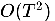 a los modelos duales de espacio de estados, la regla delta y la atención dispersa alineada con el hardware), la **profundidad iterativa del cómputo** (de las conexiones residuales a la proyección de hiperconexiones sobre la variedad de Birkhoff y a los bucles latentes de razonamiento) y el **transporte probabilístico continuo y discreto** (de las cotas variacionales a los flujos rectificados de Flow Matching, los autocodificadores causales 3D y la cuantización vectorial residual del audio)1. Esta monografía presenta una reconstrucción continua, año a año, de dicha evolución, con una granularidad de exactamente un año por capítulo a lo largo de todo el período de 70 años, de **1958 a 2027**; se abre con una guía de lectura y un riguroso glosario de notación tensorial, y se cierra con las tablas resumen de puntos de referencia verificados (Apéndice A), las implementaciones de referencia ejecutables de todos los mecanismos fundamentales en PyTorch (Apéndice B) y una bibliografía sistematizada de **445 artículos científicos, libros fundamentales y repositorios abiertos**6.  
Al interpretar las métricas empíricas deben tenerse en cuenta dos limitaciones metodológicas vigentes a fecha de **25 de noviembre de 2026**. En primer lugar, los resultados de las arquitecturas insignia de 2025–2026 (DeepSeek-V3.2 y V4 Pro, Kimi K2.5 y K3, Qwen3.8, Gemma 4, GLM-5, Nemotron 3 y 3.5, Wan 2.2, LTX-2.5, PersonaPlex) dependen de manera sustancial del presupuesto de razonamiento asignado en la inferencia (reasoning\_effort, longitud de la trayectoria CoT), del formato de cuantización (BF16, FP8, MXFP4, NVFP4) y de los protocolos de evaluación; por ello, en el texto y en las tablas del Apéndice A se distinguen los datos de los informes técnicos de los desarrolladores de las mediciones independientes (Artificial Analysis, Epoch AI, InferenceX, Full-Duplex-Bench)10. En segundo lugar, el capítulo de **2027** se apoya exclusivamente en trabajos documentados a noviembre de 2026 que han sido seleccionados para las actas de las conferencias de invierno-primavera de 2027 (WACV 2027, AAAI/IAAI 2027, WSDM 2027, DATE 2027) y en las presentaciones abiertas con revisión por pares de la conferencia ICLR 2027 en la plataforma OpenReview, sin pronósticos especulativos15.

## **Introducción: la arquitectónica de la evolución neuronal y guía de lectura**

La historia del aprendizaje profundo se expone con frecuencia como una sucesión de «inviernos» inconexos y de saltos empíricos repentinos; sin embargo, el análisis de las fuentes primarias revela una continuidad matemática ininterrumpida de ideas7. El método continuo de las ecuaciones adjuntas de Henry Kelley (1960), el descenso de gradiente estocástico de extremo a extremo de Shun'ichi Amari para redes de cinco capas (1967), las redes polinomiales de ocho capas de Alekséi Ivajnenko (1965–1971) y la diferenciación automática en modo inverso de Seppo Linnainmaa (1970, 1976\) formaron el aparato analítico completo del entrenamiento mucho antes de que se difundiera ampliamente la retropropagación del error (1986)7. Un vínculo genético igualmente directo une la regla de corrección del error de Widrow—Hoff (1960) y las redes de programación de «pesos rápidos» (Fast Weight Programmers, 1991–1992, 2021\) con los transformadores lineales modernos basados en la regla delta (DeltaNet, Gated DeltaNet, Kimi Delta Attention, RWKV-7), trasladados a operaciones matriciales paralelas por bloques en los núcleos tensoriales de las GPU9.  
A escala macroscópica, la trayectoria de 70 años se reduce a la fusión de cuatro líneas históricamente aisladas, a través de tres épocas tecnológicas, en una única pila multimodal (2026–2027)1:

| Eje de diseño | Fundamento clásico (1958–2011) | Era de las redes profundas y la atención (2012–2023) | Núcleo convergente (2024–2027) |
| :---- | :---- | :---- | :---- |
| **Capacidad y enrutamiento de pesos** | Perceptrón, MLP, mezcla local de expertos MoE (1991) | Sparsely-Gated MoE, Switch Top-1, Mixtral Top-2 | **LatentMoE** de grano fino con expertos compartidos \+ enrutados y balanceo sin penalizaciones en la función de pérdida27 |
| **Memoria del contexto temporal** | Redes de Amari—Hopfield, RNN, LSTM con compuerta de olvido, Fast Weights | Atención escalada , RoPE, GQA, FlashAttention, S4, Mamba | Híbridos 3:1 (**Gated DeltaNet / KDA / Mamba-3** \+ **MLA / DSA / CSA**) con ventana de más de 1M de tokens4 |
| **Topología y profundidad del cómputo** | Neocognitron, LeNet, autocodificadores por capas, normalización de pesos | ResNet, Pre-LN, RMSNorm, ACT, Universal Transformer, DEQ, ViT | Hiperconexiones sobre el polítopo de Birkhoff (**mHC**), **Attention Residuals** y redes en bucle (**Huginn, Ouro, PLT**)2 |
| **Transporte probabilístico y códecs** | Máquinas de Boltzmann, RBM (CD\-), Score Matching y DSM (2005–2011) | VAE, GAN, VQ-VAE, DDPM/SDE, SoundStream/EnCodec (RVQ), LDM, DiT | **Rectified Flow / MMDiT**, alineamiento **REPA**, difusión enmascarada de texto (**dLLM**) y el códec full-duplex **Mimi** (12.5 Hz)26 |

Para trabajar de manera eficaz con el manual se recomienda el siguiente orden de lectura:

> 1. **Sistema único de notación (sección siguiente):** antes de leer las fórmulas y el código, contraste los símbolos con el glosario de dimensiones tensoriales y de los veintidós mecanismos básicos; esto elimina las discrepancias entre la terminología de la teoría del control (SSM), de la física estadística (difusión) y del procesamiento del habla (transductores y códecs).  
> 2. **Búsqueda cronológica y por dominios entre los capítulos (1958–2027):** cada uno de los 70 capítulos lleva por título un año y va acompañado, en la primera línea, de etiquetas de filtrado por dominio (Base, Optimización, Codificador, Atención/LLM, MoE, Bucles/SSM, Difusión, Vídeo, STT, TTS, STS). Dentro del capítulo se ofrecen la derivación matemática del mecanismo clave del año, sus compromisos computacionales y referencias del tipo (n.º 1)–(n.º 445\) al índice bibliográfico completo.  
> 3. **Verificación cuantitativa (Apéndice A):** para comparar rápidamente los modelos, utilice la Tabla A.1 (índice anual de 70 años) y las tablas temáticas A.2–A.6 (arquitecturas y puntos de referencia de LLM, de modelos en bucle y de difusión, de generadores de vídeo, de sistemas de habla y de bibliotecas de código abierto).  
> 4. **Implementación de ingeniería (Apéndice B):** doce listados modulares en PyTorch (B.1–B.12) permiten pasar de las ecuaciones analíticas directamente a código tensorial funcional de cada mecanismo.

## **Glosario de términos y notación matemática**

En la tabla siguiente se fijan las dimensiones y los operadores transversales utilizados en todos los capítulos y listados de la monografía:

| Notación | Objeto matemático y dimensión | Significado físico / algorítmico |
| :---- | :---- | :---- |
| **** | Números naturales  | Tamaño del minilote (), longitud de la secuencia de tokens o de fotogramas (), dimensión oculta del modelo ( o ) |
| 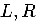 | Números naturales  | Número de capas físicas únicas () y número de iteraciones recurrentes en profundidad / bucles ()3 |
|  | Números naturales  | Número de cabezas de consulta (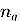), número de cabezas de clave-valor ( en GQA/MQA) y dimensión de una cabeza ()30 |
|  | Vectores  | Vector de entrada en el paso  y estado oculto en la capa  en el paso  |
|  | Matriz 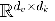 o vector  | Estado recurrente de tamaño fijo (pesos rápidos / memoria asociativa) en los SSM y en la atención lineal25 |
| 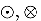 | Operadores tensoriales binarios | Producto de Hadamard elemento a elemento () y producto externo/de Kronecker () |
|  | Funciones de activación no lineales | Sigmoide logística  y función  (Swish-1) |
|  | Funcional  | Divergencia de Kullback—Leibler  |

A continuación se presentan las definiciones estrictas de los mecanismos arquitectónicos y algorítmicos fundamentales:

* **Autodiferenciación en modo inverso (Reverse-Mode AD / Backpropagation)** — algoritmo para el cálculo exacto del gradiente de una función de pérdida escalar  respecto de todos los nodos de un grafo computacional acíclico en un tiempo proporcional al de una sola pasada hacia delante, mediante la propagación recursiva de las derivadas adjuntas  de la salida hacia la entrada7.  
* **Tiempo de cómputo adaptativo (Adaptive Computation Time, ACT / Early Exit Gate)** — mecanismo de asignación dinámica del número de iteraciones recurrentes  a cada token mediante una compuerta de parada entrenable , que permite gastar más operaciones aritméticas en las posiciones lógicamente complejas41.  
* **Pesos rápidos y entrenamiento en tiempo de prueba (Fast Weights / Test-Time Training, TTT)** — parámetros de una subred interna o matriz de memoria asociativa  que se actualizan dinámicamente durante la inferencia (mediante la regla de Hebb, la regla delta o un paso de descenso de gradiente sobre una pérdida autosupervisada) para comprimir un contexto largo en un volumen fijo de memoria44.  
* **Cuantización vectorial, residual y escalar finita (VQ / RVQ / FSQ)** — discretización de un vector latente continuo  mediante la búsqueda del elemento más cercano del libro de códigos (VQ), la cuantización en cascada de los residuos con 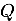 libros de códigos (Residual VQ en SoundStream, EnCodec, Mimi) o el redondeo directo coordenada a coordenada en una retícula entera acotada, sin libro de códigos entrenable (Finite Scalar Quantization en CosyVoice 3\)46.  
* **Atención con consultas agrupadas (Grouped-Query Attention, GQA) y atención multiconsulta (MQA)** — compartición de un único conjunto de proyecciones de claves y valores 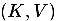 entre las  cabezas de consulta (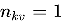, MQA) o dentro de  grupos (, GQA) para reducir varias veces el tamaño de la caché KV y el tráfico desde la memoria de vídeo HBM durante la decodificación39.  
* **Atención con caché latente comprimida (Multi-Head Latent Attention, MLA)** — mecanismo que proyecta el estado oculto en un único vector de bajo rango  (), con una rama aparte de baja dimensión para la codificación posicional Decoupled RoPE; en la inferencia solo se almacena en caché el latente comprimido, lo que reduce la memoria de la caché KV en un 93.3% a nivel de modelo (hasta un 98.24% por capa respecto a MHA de 128 cabezas)50.  
* **Optimización de políticas relativa al grupo (Group Relative Policy Optimization, GRPO)** — algoritmo de aprendizaje por refuerzo sin una red crítica independiente (value model) que estima la ventaja  estandarizando las recompensas dentro de un grupo de  trayectorias generadas para un mismo prompt53.  
* **Regla delta en la atención lineal (DeltaNet / Gated DeltaNet / KDA)** — sustitución de la escritura aditiva  por una reflexión de Householder generalizada con atenuación , que borra el valor antiguo asociado a la clave  antes de escribir el nuevo valor  (donde  es el escalar  en GDN o la matriz diagonal  en KDA)24.  
* **Difusión discreta de texto (Masked / Uniform Diffusion Language Models, dLLM / MDM / UDLM)** — modelos de lenguaje no autorregresivos basados en un transformador bidireccional que restauran los tokens en paralelo a partir de máscaras \[MASK\] (MDM: MDLM, LLaDA, Dream, Mercury) o de sustituciones aleatorias del vocabulario (UDLM), minimizando una cota variacional ponderada de la verosimilitud35.  
* **Alineamiento latente de representaciones (Representation Alignment, REPA / JEPA)** — familia de principios de entrenamiento: en la comprensión del mundo visual (I-JEPA, V-JEPA), la red predice las representaciones ocultas de bloques enmascarados en el espacio del codificador EMA sin generar píxeles; en la generación por difusión (REPA), las capas intermedias del DiT se alinean, por similitud coseno, con las características de un maestro visual preentrenado (por ejemplo, DINOv2)36.  
* **Hiperconexiones restringidas a la variedad (Manifold-Constrained Hyper-Connections, mHC)** — ampliación del flujo residual del transformador de un único vector  a  carriles paralelos , donde la matriz de mezcla de carriles se proyecta, mediante el algoritmo de Sinkhorn—Knopp, sobre el polítopo de Birkhoff de las matrices doblemente estocásticas, para una propagación de la señal no expansiva () a cualquier profundidad2.  
* **Modelos de espacio de estados (Structured State Space Models, SSM / S4 / Mamba)** — sistemas dinámicos lineales , discretizados con el paso ; en los SSM selectivos (Mamba-1/2/3) los parámetros 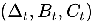 dependen de la entrada, lo que proporciona un entrenamiento paralelo lineal en  y una memoria constante  por paso en la inferencia32.  
* **Predicción multitoken (Multi-Token Prediction, MTP)** — arquitectura de entrenamiento y de decodificación autoespeculativa en la que, sobre el tronco común del modelo, cabezas en cascada predicen varios tokens de texto futuros o los niveles residuales de los libros de códigos de audio RVQ29.  
* **Impulso matricial ortogonalizado (Muon / MuonClip)** — optimizador para capas matriciales bidimensionales que sustituye el escalado coordenada a coordenada del gradiente por una ortogonalización aproximada de la matriz de momento  mediante iteraciones polinomiales de Newton—Schulz (), lo que nivela el espectro de valores singulares del paso de actualización65.  
* **Conexiones residuales con atención en profundidad (Attention Residuals, AttnRes)** — sustitución de la suma fija de las salidas de todas las capas anteriores por una atención softmax entrenable a lo largo del eje de profundidad (sobre los bloques precedentes), que elimina la dilución de la norma de las características en los transformadores Pre-LN profundos34.  
* **Modelos de habla full-duplex (Full-Duplex Speech-to-Speech, STS)** — arquitecturas (Moshi, PersonaPlex, NemotronLabs VoiceChat) que procesan de forma síncrona el flujo entrante de tokens de audio del usuario y generan flujos paralelos de «monólogo interno» (texto) y de tokens de audio de respuesta, sin segmentación en turnos alternos, lo que admite interrupciones e interjecciones con una latencia de 160–205 ms68.  
* **Incrustaciones posicionales rotatorias (Rotary Position Embedding, RoPE / p-RoPE / 3D-RoPE / TMRoPE)** — codificación de la posición relativa mediante la rotación de pares de coordenadas de las consultas  y de las claves 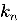 en los ángulos , de modo que el producto escalar  depende únicamente del desplazamiento ; se generaliza a la rotación de una fracción del subespacio (\-RoPE) y a los ejes espaciotemporales del vídeo y del audio (3D-RoPE, TMRoPE)71.  
* **Mezcla dispersa de expertos (Sparse Mixture-of-Experts, MoE / LatentMoE)** — sustitución de la capa FFN densa por un conjunto de  subredes expertas con activación de  expertos por token; en **LatentMoE** el vector de entrada se comprime previamente en un latente de baja dimensión para reducir el tráfico de lectura de pesos y el envío All-to-All entre servidores27.  
* **Atención dispersa alineada con el hardware (NSA / DSA / CSA)** — mecanismos entrenables de atención dispersa (Native Sparse Attention, DeepSeek Sparse Attention, Compressed Sparse Attention) que emplean una compresión jerárquica por bloques o un indexador ligero (lightning indexer) para seleccionar las top\- claves por consulta, reduciendo la complejidad de la atención de  a 31.
* **Transformador recurrente en profundidad (en bucle) (Looped / Recurrent-Depth Transformer, PLT)** — arquitectura con compartición de pesos en profundidad que hace pasar el estado oculto  veces por un mismo bloque de capas (Huginn, Ouro); en el **Parallel Loop Transformer (PLT)**, las iteraciones sucesivas de tokens contiguos se ejecutan segmentadas (en pipeline) en una única pasada paralela (Cross-Loop Parallelism)3.  
* **Flujos rectificados y emparejamiento de flujos (Flow Matching / Rectified Flow)** — entrenamiento de una EDO generativa  mediante la regresión directa del campo de velocidades a lo largo de la interpolación lineal  entre los datos y el ruido gaussiano, lo que permite una generación determinista rápida con un pequeño número de pasos de Euler5.  
* **Transductor de tokens y duraciones (Token-and-Duration Transducer, TDT)** — extensión del decodificador ASR en flujo continuo RNN-T que predice conjuntamente el token de subpalabra y el número de fotogramas acústicos  que este cubre, para omitir en la inferencia los tramos estacionarios y las pausas79.

## **1958**

**Dominios:** Base  
El punto de partida del aprendizaje paramétrico de las redes neuronales artificiales fue la publicación de Frank Rosenblatt *«The Perceptron: A Probabilistic Model for Information Storage and Organization in the Brain»* en la revista *Psychological Review* (n.º 1\) y la implementación por hardware de la máquina Mark I Perceptron en el Laboratorio Aeronáutico de Cornell (simulada previamente en el mainframe IBM 704\)82. A diferencia de las puertas lógicas fijas de McCulloch y Pitts (1943), el perceptrón de Rosenblatt separaba la retina sensorial (bloque \), una capa de proyecciones asociativas no lineales aleatorias (bloque \, características ) y un sumador umbral entrenable (bloque \) que define el hiperplano separador:  
  
La regla de corrección por error actualizaba los pesos 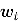 solo en los objetos mal clasificados , donde 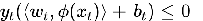, según la fórmula 83. En ese mismo año 1958 se publicó póstumamente la monografía de John von Neumann *«The Computer and the Brain»* (n.º 2), que por primera vez contrastó la arquitectura masivamente paralela y de baja frecuencia de la memoria sináptica del cerebro con el cuello de botella secuencial de las máquinas de cómputo digitales. Aunque ya en 1958 Rosenblatt consideraba esquemas multicapa, carecía de un algoritmo diferenciable de asignación de crédito para las capas ocultas7.

## **1959**

**Dominios:** Codificador Base  
En 1959 surgieron tres pilares conceptuales de las futuras redes profundas: la jerarquía neurofisiológica de los filtros visuales, el reconocimiento paralelo en cascada y el bootstrapping de la función de evaluación a lo largo del tiempo. David Hubel y Torsten Wiesel, en un artículo de *The Journal of Physiology* (n.º 3\), descubrieron en la corteza estriada del gato campos receptivos locales selectivos a la orientación, que se convirtieron en el prototipo biológico de los núcleos convolucionales85. Simultáneamente, Oliver Selfridge presentó en el simposio de Teddington la arquitectura **Pandemonium** (n.º 4\), una jerarquía paralela de «demonios de características», de «demonios cognitivos» que las ponderan y de un «demonio de decisión» superior que selecciona el máximo de la respuesta 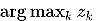87. Ese mismo año Arthur Samuel publicó en *IBM Journal of Research and Development* su célebre trabajo sobre el juego autodidacta de damas (n.º 5), con el que consolidó el término *machine learning* e introdujo la actualización de los pesos del polinomio de evaluación a partir de la diferencia entre las evaluaciones de la posición actual y de la siguiente, un prototipo directo del método de diferencias temporales (TD learning) y del crítico en el aprendizaje por refuerzo.

## **1960**

**Dominios:** Base Optimización  
La transición de la regla umbral discontinua del perceptrón a la optimización suave por gradiente la llevaron a cabo Bernard Widrow y Marcian Hoff, quienes presentaron el nodo lineal adaptativo **ADALINE** y el algoritmo de mínimos cuadrados **LMS** (Widrow–Hoff / Delta Rule, n.º 6\)88. La novedad esencial de ADALINE consistía en calcular el error a partir de la salida lineal continua  *antes* del cuantizador umbral binario. El descenso de gradiente estocástico sobre el error cuadrático instantáneo  dio lugar a la regla delta clásica:  
  
Precisamente esta ecuación —reescrita para una memoria asociativa matricial en la forma 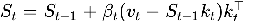— constituye el fundamento de los transformadores lineales modernos **DeltaNet** y **Gated DeltaNet** (2024–2026)25. Ese mismo año 1960, Henry Kelley publicó en *ARS Journal* el artículo *«Gradient Theory of Optimal Flight Paths»* (n.º 7), en el que dedujo el método continuo de las ecuaciones adjuntas para la retropropagación de las derivadas del funcional de coste a lo largo de la trayectoria de un sistema dinámico, precursor analítico tanto de la retropropagación del error como de las Neural ODE7.

## **1961**

**Dominios:** Bucles Memoria Base  
En 1961 el cibernético alemán Karl Steinbuch publicó en el primer volumen de la revista *Kybernetik* el trabajo *«Die Lernmatrix»* («La matriz de aprendizaje», n.º 8\), la primera arquitectura matricial de memoria heteroasociativa sobre una rejilla cruzada de conductores91. En la matriz de Steinbuch, el vector de características de entrada  y el código de clase  se asociaban mediante una regla local de tipo Hebb , y la recuperación se realizaba mediante una multiplicación matriz-vector paralela  con selección competitiva del máximo. Algebraicamente, la «matriz de aprendizaje» sentó el prototipo de las memorias asociativas lineales modernas de clave–valor . Ese mismo año, Eduardo Caianiello, en el *Journal of Theoretical Biology* (n.º 9\), dividió la dinámica de las redes neuronales en dos escalas de tiempo acopladas: las rápidas «ecuaciones neuronales» de relajación de las activaciones y las lentas «ecuaciones mnémicas» adiabáticas de plasticidad de los pesos sinápticos.

## **1962**

**Dominios:** Base Codificador  
En abril de 1962, el matemático Albert Novikoff presentó una demostración rigurosa y concisa del **teorema de convergencia del perceptrón** (n.º 10; H. D. Block publicó ese mismo año cotas afines, n.º 13\)92. Novikoff mostró que, si una muestra  con norma de entradas acotada  es linealmente separable por un vector unitario  () con un margen positivo , el algoritmo del perceptrón, partiendo del vector nulo , terminará en a lo sumo  actualizaciones. En cada ejemplo erróneo el producto escalar con el oráculo crece como mínimo en  (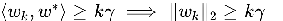), mientras que la condición de error  acota superiormente el incremento del cuadrado de la norma por el valor  (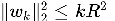), de lo cual se sigue una cota totalmente independiente de la dimensión del espacio 83:  
  
Ese mismo año aparecieron la monografía final de Frank Rosenblatt *«Principles of Neurodynamics»* (n.º 11), la arquitectura lineal a trozos **MADALINE** de Bernard Widrow (n.º 12\) y el artículo clásico de Hubel y Wiesel (n.º 14), que describía la alternancia de *células simples* (detectores lineales locales de bordes) y *células complejas* (pooling espacialmente invariante) en la corteza visual87.

## **1963**

**Dominios:** Base Optimización  
Desarrollando la geometría del margen de separación , Vladimir Vapnik y Alexander Lerner publicaron en la revista *«Automática y Telemecánica»* el artículo *«Reconocimiento de patrones mediante retratos generalizados»* (n.º 15\)97. En lugar de buscar un hiperplano separador arbitrario, los autores formularon el problema de optimización cuadrática de hallar el único **hiperplano de margen máximo** (prototipo lineal del método de máquinas de vectores de soporte, SVM), cuyo vector normal se descompone solo en términos de los vectores de soporte extremos de la muestra . Con ello entró en la teoría del aprendizaje el principio del control de la norma de los pesos  como medida de la capacidad del clasificador. Ese mismo año Steinbuch y Piske publicaron en *IEEE Transactions on Electronic Computers* un análisis de las matrices de memoria continuas con señales ruidosas (n.º 16), y Stuart Dreyfus simplificó la deducción de la regla de la cadena de los multiplicadores adjuntos mediante programación dinámica (n.º 17\)7.

## **1964**

**Dominios:** Optimización Base  
En 1964 se crearon tres herramientas matemáticas que funcionan directamente en los marcos modernos de aprendizaje profundo. Borís Teodórovich Poliak publicó en la *«Revista de Matemática Computacional y Física Matemática»* el método inercial de la **«bola pesada» (Heavy-Ball Momentum)** (n.º 18\) para acelerar el descenso de gradiente en problemas de barranco mal condicionados100:  
  
El término inercial  suprime las oscilaciones transversales del gradiente y reduce el número de condición efectivo del problema cuadrático de  a . Simultáneamente, Mark Aizerman, Emmanuil Braverman y Lev Rozonoér introdujeron en *«Automática y Telemecánica»* el **método de las funciones potenciales** (n.º 19\), una fundamentación rigurosa del *truco del núcleo* , directamente vinculada a la futura factorización por núcleos de la atención lineal20. Ese mismo año Robert Wengert presentó en *Communications of the ACM* (n.º 20\) un algoritmo programático de **diferenciación automática en modo directo (Forward-Mode AD)** sobre la lista de operaciones elementales.

## **1965**

**Dominios:** Base Optimización  
En 1965 Alekséi Grigórievich Ivajnenko y Valentín Grigórievich Lapa publicaron la monografía *«Dispositivos cibernéticos de predicción»* (n.º 21), en la que describieron los primeros algoritmos operativos de entrenamiento por capas de **perceptrones multicapa profundos** con un número arbitrario de capas ocultas7. Cada nodo de la red calculaba un polinomio cuadrático de Kolmogórov—Gabor con productos multiplicativos de las entradas (, precursor algebraico de los bloques con compuerta GLU y SwiGLU); los coeficientes se hallaban por mínimos cuadrados, y una muestra de validación descartaba las neuronas sobreajustadas antes de construir la capa siguiente7.  
Paralelamente, Thomas Cover demostró en *IEEE Transactions on Electronic Computers* el fundamental **teorema de Cover sobre la capacidad de separación lineal** (n.º 22): el número de particiones binarias linealmente realizables de  puntos en posición general en  es igual a 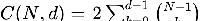, lo que constituye exactamente la mitad de las  dicotomías cuando  y tiende exponencialmente a cero cuando . Este hecho geométrico explica la necesidad de proyecciones anchas de características en las capas ocultas de los MLP y de las MoE. El año se completó con el libro clásico de Nils Nilsson *«Learning Machines»* (n.º 23\)88 y el método de gradiente de Ho—Kashyap para sistemas de desigualdades lineales (n.º 24).

## **1966**

**Dominios:** Optimización Base  
En 1966 Yákov Zalmánovich Tsypkin, en el trabajo *«Adaptación, aprendizaje y autoaprendizaje en sistemas automáticos»* (*Automática y Telemecánica*, n.º 25\), redujo las reglas dispersas de los perceptrones, de ADALINE y del filtrado a un único problema variacional de **minimización de la esperanza matemática de la función de pérdida (riesgo medio)** 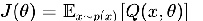 mediante la aproximación estocástica recurrente de Robbins—Monro 105. Este planteamiento se convirtió en el lenguaje estándar de la teoría moderna de la optimización de redes neuronales. Ese mismo año, Emmanuil Braverman extendió el método de las funciones potenciales al problema del autoaprendizaje y del agrupamiento sin supervisión (n.º 26\)20, y Lawrence Fogel, Alvin Owens y Michael Walsh publicaron la monografía *«Artificial Intelligence through Simulated Evolution»* (n.º 27), que inauguró la línea de la búsqueda evolutiva sin gradientes.

## **1967**

**Dominios:** Base Optimización  
En junio de 1967, Shun'ichi Amari publicó en *IEEE Transactions on Electronic Computers* el artículo *«A Theory of Adaptive Pattern Classifiers»* (n.º 28\), el primer trabajo de la historia en el que el **descenso de gradiente estocástico de extremo a extremo (end-to-end SGD)** se aplicó al entrenamiento de una red neuronal multicapa con capas ocultas no lineales sobre distribuciones linealmente no separables7. Al sustituir el escalón umbral por funciones de activación suaves y diferenciables, Amari dedujo la regla en cadena de corrección de los pesos ocultos  y entrenó experimentalmente un clasificador de 5 capas diecinueve años antes de la publicación de 1986 en *Nature*7.  
Ese mismo año aparecieron dos trabajos de enorme importancia prospectiva: Thomas Cover y Peter Hart demostraron la estimación asintótica del error de la regla del vecino más cercano (, n.º 29), sentando la base teórica de la búsqueda vectorial y de los sistemas RAG, y Richard Sinkhorn y Paul Knopp publicaron en *Pacific Journal of Mathematics* el teorema y el algoritmo iterativo de normalización alterna de las filas y las columnas de una matriz positiva hasta su forma doblemente estocástica (n.º 30\), precisamente el operador **Sinkhorn–Knopp** que a caballo entre 2025 y 2026 aseguró la estabilidad de las hiperconexiones multicarril **mHC** en las arquitecturas de DeepSeek2.

## **1968**

**Dominios:** Base Bucles  
En 1968 Alekséi Ivajnenko formalizó el **Método de contabilización grupal de argumentos (MGUA / Group Method of Data Handling, GMDH)** en la revista *«Automática»* (n.º 31\)104, sistematizando el crecimiento automático de redes polinomiales profundas con selección regular de las mejores neuronas y detención temprana de la profundidad sobre un conjunto de validación independiente. Paralelamente, Stephen Grossberg publicó en *PNAS* el modelo no lineal de aprendizaje asociativo **Outstar** y un sistema de ecuaciones diferenciales de la memoria a corto plazo (STM) y a largo plazo (LTM) (n.º 32\)109:  
  
demostrando la convergencia incondicional de los pesos sinápticos a las proporciones espaciales del patrón de entrada. Ese mismo año Vladimir Vapnik y Alexey Chervonenkis publicaron en los *«Doklady de la Academia de Ciencias de la URSS»* el teorema sobre la convergencia uniforme de las frecuencias empíricas a las probabilidades sobre una clase de sucesos, introduciendo una medida combinatoria de la capacidad de las familias de funciones, la **dimensión de Vapnik—Chervonenkis (dimensión VC)** (n.º 33).

## **1969**

**Dominios:** Base Codificador Optimización  
En 1969 Marvin Minsky y Seymour Papert publicaron la monografía analítica *«Perceptrons: An Introduction to Computational Geometry»* (n.º 34\)7. Con ayuda de la teoría de invariantes de grupos, los autores demostraron rigurosamente la imposibilidad de realizar el predicado de paridad (incluido el **XOR** de dos bits) y el predicado topológico de conectividad mediante un perceptrón monocapa con características locales de orden acotado. Aunque los autores señalaron que las redes multicapa están libres de esta limitación, la ausencia de un algoritmo eficaz de entrenamiento de las capas ocultas ampliamente conocido en Occidente provocó un enfriamiento del interés por el conexionismo en el ámbito académico anglófono7.  
Sin embargo, ese mismo año 1969 se publicaron dos elementos clave del aprendizaje profundo moderno. Arthur Bryson y Yu-Chi Ho, en el libro *«Applied Optimal Control»* (n.º 35\), escribieron fórmulas discretas explícitas de la retropropagación de los multiplicadores de Lagrange a través de cascadas multipaso 7. Simultáneamente, Kunihiko Fukushima, en el artículo *«Visual Feature Extraction by a Multilayered Network of Analog Threshold Elements»* (*IEEE Transactions on Systems Science and Cybernetics*, n.º 36\)85, introdujo una red visual multicapa con **rectificadores analógicos de media onda** , históricamente la primera aplicación de la función de activación **ReLU** en redes neuronales multicapa7.

## **1970**

**Dominios:** Base Optimización  
En 1970 el matemático finlandés Seppo Linnainmaa defendió en la Universidad de Helsinki su tesis de maestría (n.º 37\)7, en la que formuló por primera vez, e implementó en código de máquina, el algoritmo general de **diferenciación automática en modo inverso (Reverse-Mode Automatic Differentiation)** para grafos computacionales arbitrarios. Si el cálculo de la función de pérdida escalar  se descompone en nodos elementales  (), la pasada inversa de  a  acumula recursivamente las derivadas parciales:  
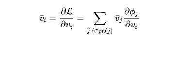  
El cálculo del vector gradiente completo  respecto de un número arbitrario de parámetros  requiere un factor constante del número de operaciones de una sola pasada hacia delante114. Ese mismo año 1970, Broyden, Fletcher, Goldfarb y Shanno dedujeron de forma independiente el método cuasi-Newton de segundo orden **BFGS** (n.º 38), e Ivajnenko publicó en la revista internacional *Automatica* una reseña sobre la autoorganización heurística de las redes profundas (n.º 39\)115.

## **1971**

**Dominios:** Base Memoria  
En octubre de 1971 Alekséi Ivajnenko publicó en *IEEE Transactions on Systems, Man, and Cybernetics* el artículo *«Polynomial Theory of Complex Systems»* (n.º 40\)115, en el que describió con detalle la construcción y el entrenamiento de una **red profunda de 8 capas** de propagación hacia delante mediante el método GMDH, con selección regularizada de características sobre una muestra de validación7. Esta publicación se convirtió en uno de los primeros ejemplos, ampliamente citados en la literatura internacional, de entrenamiento práctico de una arquitectura profunda de ocho capas7.  
Ese mismo año David Marr publicó en *Philosophical Transactions of the Royal Society B* un modelo matemático del hipocampo, *«Simple Memory: A Theory for Archicortex»* (n.º 41\)7. Marr mostró que la codificación dispersa de vectores de entrada en un espacio de alta dimensión, combinada con la plasticidad local de Hebb y un umbral inhibitorio adaptativo, permite registrar un gran volumen de asociaciones episódicas en una sola pasada y recuperarlas sin errores a partir de indicios parciales, principio que subyace en los módulos dispersos modernos de memoria externa y paramétrica.

## **1972**

**Dominios:** Bucles Memoria  
En noviembre de 1972 Shun'ichi Amari publicó en *IEEE Transactions on Computers* el artículo *«Learning Patterns and Pattern Sequences by Self-Organizing Nets of Threshold Elements»* (n.º 42), en el que, diez años antes de la publicación de Hopfield, dedujo las ecuaciones de estabilidad de las redes asociativas recurrentes discretas (**red de Amari—Hopfield**), tanto para atractores estáticos con matriz de pesos simétrica como para cadenas dinámicas de secuencias con matriz asimétrica7:  
  
Ese mismo año 1972 Teuvo Kohonen introdujo de forma independiente, en *IEEE Transactions on Computers*, las memorias matriciales de correlación (n.º 43\)118, James Anderson describió una memoria interactiva lineal con umbral en *Mathematical Biosciences* (n.º 44), Kaoru Nakano construyó el sistema asociativo **Associatron** (n.º 45\)7, y Hugh Wilson y Jack Cowan dedujeron en *Biophysical Journal* un sistema no lineal de EDO para poblaciones neuronales excitadoras e inhibidoras acopladas (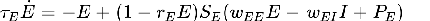, n.º 46), demostrando analíticamente el vínculo entre los ciclos límite de las oscilaciones y la histéresis multiestable de la memoria119.

## **1973**

**Dominios:** Codificador Bucles  
En 1973 Christoph von der Malsburg publicó en *Kybernetik* el artículo *«Self-Organization of Orientation Sensitive Cells in the Striate Cortex»* (n.º 47\)115, la primera demostración computacional del **aprendizaje competitivo (competitive learning)** de detectores de características locales. Combinando la excitación intracortical de corto alcance, la inhibición lateral y la regla de Hebb con la **conservación de la norma  de las sinapsis de entrada de cada neurona** (), von der Malsburg mostró la formación espontánea, sin supervisión, de mapas ordenados de columnas de orientación.  
Simultáneamente, Stephen Grossberg publicó en *Studies in Applied Mathematics* un riguroso análisis de las **redes recurrentes de derivación (shunting)** con saturación multiplicativa e inhibición lateral divisiva (n.º 48\)109: demostró que precisamente la característica de transferencia sigmoidal suprime el ruido de fondo de pequeña amplitud y conserva el contraste relativo del patrón sin saturación aun con un crecimiento arbitrario del brillo total de la entrada, fundamento teórico de las capas de normalización de activaciones. Hugh Wilson y Jack Cowan generalizaron su dinámica de poblaciones a campos neuronales espacialmente continuos de la corteza y el tálamo (n.º 49\)124.

## **1974**

**Dominios:** Base Optimización Bucles  
En 1974 Paul Werbos defendió en la Universidad de Harvard su tesis doctoral *«Beyond Regression: New Tools for Prediction and Analysis in the Behavioral Sciences»* (n.º 50\)7. Werbos formuló el método de la «retroalimentación dinámica», con fórmulas explícitas de retropropagación en cadena de las derivadas de la función objetivo a través de redes multicapa arbitrarias con nodos no lineales, preparando la aplicación directa del método a las redes neuronales a comienzos de la década de 1980115.  
Ese mismo año el físico William Little publicó en *Mathematical Biosciences* el artículo *«The Existence of Persistent States in the Brain»* (n.º 51\)126, que estableció una correspondencia directa entre la física estadística de los **sistemas de espines de Ising** y las redes neuronales recurrentes estocásticas. Al introducir la temperatura efectiva del ruido sináptico  y la probabilidad logística de disparo de la neurona 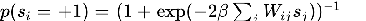, Little describió la memoria a largo plazo como los estados propios superiores degenerados de la matriz de transición de Markov, fundamento de las máquinas de Boltzmann y de los modelos generativos termodinámicos.

## **1975**

**Dominios:** Codificador Memoria Base  
En 1975 Kunihiko Fukushima presentó en *Biological Cybernetics* la red multicapa autoorganizada **Cognitron** (n.º 52\)86. En el Cognitron, los campos receptivos locales excitadores e inhibidores se combinaban con una razón divisiva de derivación  y con el refuerzo competitivo de las sinapsis únicamente de la neurona más activa del entorno; con todo, la red aún no compartía los pesos en todo el plano y por ello seguía siendo sensible a los desplazamientos de la imagen129.  
Paralelamente aparecieron tres trabajos emblemáticos en áreas afines: James Albus creó la arquitectura de hashing local rápido del controlador cerebeloso **CMAC**, con campos receptivos gruesos superpuestos (n.º 53\)130; David Sherrington y Scott Kirkpatrick introdujeron en *Physical Review Letters* el modelo resoluble de **vidrio de espín SK** con enlaces aleatorios de signo alternante  (n.º 54\)126, cuyo método analítico de réplicas sirvió de base para el cálculo de las transiciones de fase y de la capacidad de las redes neuronales; y John Holland publicó la monografía *«Adaptation in Natural and Artificial Systems»* (n.º 55), que sentó las matemáticas de los algoritmos genéticos.

## **1976**

**Dominios:** Optimización Bucles Base  
En junio de 1976 Seppo Linnainmaa publicó en la revista internacional *BIT Numerical Mathematics* el artículo en inglés *«Taylor Expansion of the Accumulated Rounding Error»* (n.º 56\)23. Además de los algoritmos completos de primer orden y de órdenes superiores de diferenciación inversa sobre el grafo computacional, Linnainmaa analizó por primera vez el problema fundamental de la memoria de la pasada inversa —la necesidad de conservar los estados intermedios de todas las operaciones— y los modos de reducir el consumo máximo de memoria, anticipando las técnicas modernas de recómputo selectivo de activaciones (**activation / gradient checkpointing**, empleado, en particular, en el entrenamiento de Ring Attention y de DeepSeek mHC2).  
Ese mismo año Stephen Grossberg, en un trabajo en dos partes en *Biological Cybernetics* (n.º 57\)126, formuló el **dilema estabilidad—plasticidad** (cómo reentrenar una red con nuevas clases sin destruir catastróficamente las representaciones aprendidas previamente) y propuso un mecanismo de filtrado resonante de las características ascendentes mediante expectativas descendentes (**Adaptive Resonance Theory, ART**), mientras que David Willshaw y Christoph von der Malsburg construyeron un modelo sináptico de autoorganización de proyecciones topográficas continuas de la retina (n.º 58).

## **1977**

**Dominios:** Bucles Memoria Optimización  
En 1977 James Anderson, Jack Silverstein, Stephen Ritz y Randall Jones publicaron en *Psychological Review* el modelo recurrente no lineal de memoria categorial **Brain-State-in-a-Box (BSB)** (n.º 59\)122, que limita la trayectoria de la retroalimentación positiva a las paredes del hipercubo unitario :  
  
La matriz simétrica de conexiones de Hebb 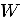 refuerza las proyecciones a lo largo de los vectores propios principales hasta que el estado se estabiliza en un vértice del hipercubo correspondiente a un prototipo discreto puro de la memoria. Ese mismo año Shun'ichi Amari publicó la teoría matemática canónica de las excitaciones localizadas («bumps» de la memoria de trabajo) en campos neuronales continuos con inhibición lateral (n.º 60\)124, Teuvo Kohonen publicó la monografía *«Associative Memory»* (n.º 61), y Arthur Dempster, Nan Laird y Donald Rubin formalizaron en *JRSS-B* el **algoritmo EM** de maximización de la verosimilitud de modelos con variables latentes mediante la cota variacional de Jensen (n.º 62\), fundamento analítico del entrenamiento de las MoE y de los autocodificadores variacionales.

## **1978**

**Dominios:** Memoria Bucles Base  
En 1978 William Little y Gordon Shaw publicaron en *Mathematical Biosciences* el trabajo *«Analytic Study of the Memory Storage Capacity of a Neural Network»* (n.º 63\)127. Resolviendo analíticamente un modelo linealizado de red neuronal estocástica con conexiones plásticas, los autores mostraron rigurosamente que la capacidad informacional de la memoria neuronal distribuida escala proporcionalmente al **número de sinapsis**  y no al número de neuronas 127. En la ingeniería actual, esta ley explica precisamente por qué el almacenamiento de los hechos del mundo exige escalar el número total de parámetros de pesos hasta cientos de miles de millones y billones en las arquitecturas MoE dispersas, incluso cuando para procesar un token basta un pequeño subconjunto activo de neuronas.  
Ese mismo año Gideon Schwarz introdujo en *Annals of Statistics* el criterio de información bayesiano **BIC** para seleccionar la dimensión de los modelos paramétricos (n.º 64), Stephen Grossberg presentó la teoría del chunking jerárquico de secuencias en la memoria de trabajo (n.º 65\)109, y Kunihiko Fukushima perfeccionó la regla sináptica de tipo cuadrático medio para el autoaprendizaje profundo sin supervisión (n.º 66\)129.

## **1979**

**Dominios:** Codificador Base  
En octubre de 1979 Kunihiko Fukushima publicó en la revista japonesa *Transactions of the IECE of Japan* (volumen J62-A, n.º 10, pp. 658–665) el primer artículo sobre la arquitectura **Neocognitron**, la primera red neuronal convolucional profunda invariante al desplazamiento espacial de los patrones de entrada (n.º 67\)7. Inspirándose en el descubrimiento de Hubel y Wiesel, Fukushima organizó la red como una alternancia de varias etapas de pares de capas de dos tipos: planos de **células **, en los que todas las neuronas de un mismo plano tienen *pesos compartidos idénticamente iguales* (weight sharing) y extraen una característica local en cada punto del campo bidimensional (operación de convolución 2D con rectificador ReLU), y planos de **células **, que agregan las respuestas del entorno local de las células  con reducción de la resolución (operación de pooling espacial), gracias a lo cual la tolerancia al error de desplazamiento se acumula suavemente de capa en capa sin perder la geometría mutua de los detalles87. Ese mismo año Leon Cooper, F. Liberman y Erkki Oja publicaron en *Biological Cybernetics* un modelo sináptico de formación de la selectividad de las neuronas de la corteza visual (n.º 68).

## **1980**

**Dominios:** Codificador Optimización  
En abril de 1980 apareció en *Biological Cybernetics* (vol. 36, pp. 193–202) la clásica publicación en inglés de Kunihiko Fukushima *«Neocognitron: A Self-Organizing Neural Network Model for a Mechanism of Pattern Recognition Unaffected by Shift in Position»* (n.º 69\)86, que dio a conocer a toda la comunidad mundial la jerarquía de convolución y pooling. La respuesta de la célula  en la posición 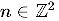 del plano de características  de la capa , con inhibición divisiva por la actividad cuadrática media 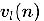 en la ventana local , venía dada por la ecuación:  
  
Con ello quedó construida por completo toda la topología estructural de las redes visuales profundas —convoluciones 2D multicanal con compartición de pesos, rectificación , normalización local cuadrática media y pooling espacial—, a la espera de que las reglas locales de autoorganización fueran sustituidas por el descenso de gradiente global87. Ese mismo año Stephen Grossberg publicó en *Psychological Review* un artículo de síntesis sobre los códigos cognitivos resonantes (n.º 70), y Walter Baur y Volker Strassen demostraron el célebre teorema de complejidad algebraica (Baur–Strassen Theorem, n.º 71): el cálculo del gradiente de cualquier función racional de varias variables sobre un circuito aritmético requiere como máximo cinco veces el número de operaciones del cálculo de la propia función114.

## **1981**

**Dominios:** Memoria Bucles Optimización  
En 1981 Geoffrey Hinton y James Anderson publicaron la monografía colectiva programática *«Parallel Models of Associative Memory»* (n.º 72\)140, que fundamentó la transición de los nodos simbólicos localistas («un concepto, una celda») a las **representaciones vectoriales distribuidas** densas (distributed representations), en las que cada concepto se codifica mediante un patrón de actividad de muchos elementos, lo que garantiza una generalización automática por similitud de microcaracterísticas. Ese mismo año James McClelland y David Rumelhart presentaron en *Psychological Review* el **modelo de activación interactiva** de la percepción de letras y palabras, con retroalimentaciones bidireccionales entre capas (n.º 73), y Andrew Barto, Richard Sutton y Peter Brouwer publicaron en *Biological Cybernetics* el modelo de la **red asociativa de búsqueda** (n.º 74), que unía la generación estocástica de acciones con el aprendizaje a partir de una señal escalar de refuerzo, precursor directo de los métodos de gradiente del aprendizaje por refuerzo.

## **1982**

**Dominios:** Bucles Memoria Codificador Base  
En abril de 1982 John Hopfield publicó en *PNAS* el célebre artículo *«Neural Networks and Physical Systems with Emergent Collective Computational Abilities»* (n.º 75\)124. Asociando a una red recurrente binaria  con matriz de pesos simétrica  () una **función de energía de Lyapunov** física explícita:  
  
Hopfield demostró que la energía no crece de manera monótona () bajo actualizaciones umbral asíncronas  y que la dinámica converge a mínimos locales, los atractores de memoria direccionables por contenido (la capacidad de la variante binaria clásica es de aproximadamente  patrones no correlacionados, mientras que las redes de Hopfield exponenciales modernas de 2016–2020 tienen capacidad exponencial y son equivalentes a la atención softmax del transformador142).  
Ese mismo año 1982 Paul Werbos publicó por primera vez de forma explícita, en la conferencia IFIP, la aplicación de la retropropagación del error directamente a las redes neuronales artificiales (n.º 76\)7; Teuvo Kohonen creó los **mapas autoorganizados de características (SOM)** topográficos (n.º 77); Erkki Oja dedujo la regla de plasticidad local normalizada  (**regla de Oja**, n.º 78), que extrae el vector propio principal de la matriz de covarianza de los datos (PCA neuronal); Bienenstock, Cooper y Munro propusieron la regla no lineal de modificación sináptica con umbral deslizante **BCM** (n.º 79); y se publicó póstumamente el libro fundamental de David Marr *«Vision»* (n.º 80).

## **1983**

**Dominios:** Optimización Bucles  
En 1983 Yuri Evguénievich Nesterov publicó en los *«Doklady de la Academia de Ciencias de la URSS»* (*Soviet Mathematics Doklady*, 27(2), 372–376) un método óptimo de minimización de funciones convexas suaves con velocidad de convergencia , el **método de gradiente acelerado de Nesterov (NAG)** (n.º 81\)143:  
  
El cálculo del gradiente en el punto inercial anticipado  permitió corregir la trayectoria en los giros bruscos del paisaje de pérdida y se convirtió en un estándar en las modificaciones modernas de SGD, en NAdam y en el momento ortogonalizado de Muon. En el número de mayo de *Science*, Scott Kirkpatrick, Charles Gelatt y Mario Vecchi presentaron la optimización global estocástica por el método de **recocido simulado (Simulated Annealing)** con la probabilidad de transición de Metropolis 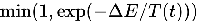 (n.º 82\)144, y Andrew Barto, Richard Sutton y Charles Anderson publicaron en *IEEE TSMC* la arquitectura neuronal **Actor–Critic** sobre la tarea de mantener en equilibrio un péndulo invertido (n.º 83\)144.

## **1984**

**Dominios:** Base Bucles Difusión  
En noviembre de 1984 Leslie Valiant publicó en *Communications of the ACM* el artículo *«A Theory of the Learnable»* (n.º 84\)146, que sentó el riguroso fundamento computacional-estadístico del **aprendizaje probablemente aproximadamente correcto (PAC Learning)**: la formalización de la complejidad muestral y computacional de alcanzar un error de generalización  con confianza . Ese mismo año John Hopfield generalizó su modelo a circuitos dinámicos continuos con una sigmoide monótona suave  y un funcional de Lyapunov continuo (n.º 85), los hermanos Stuart y Donald Geman introdujeron en *IEEE TPAMI* el **muestreo de Gibbs (Gibbs Sampling)** sobre campos aleatorios de Markov con distribución de Gibbs  para la restauración bayesiana de imágenes ruidosas (n.º 86), y Teuvo Kohonen publicó la monografía ampliada *«Self-Organization and Associative Memory»* (n.º 87).

## **1985**

**Dominios:** Base Memoria Difusión  
En 1985 David Ackley, Geoffrey Hinton y Terrence Sejnowski publicaron en *Cognitive Science* el algoritmo de entrenamiento de las **máquinas de Boltzmann** (n.º 88\)146, redes energéticas estocásticas con *variables ocultas*  que modelan la distribución de los vectores visibles  mediante la marginalización . El gradiente de la divergencia de Kullback—Leibler respecto del peso simétrico  se reducía a la diferencia de las correlaciones por pares en dos regímenes termodinámicos:  
  
Aunque el prolongado recocido MCMC limitaba el tamaño de las máquinas de Boltzmann totalmente conectadas, esta fue la primera demostración teóricamente rigurosa del aprendizaje de representaciones distribuidas profundas en redes generativas150. Ese mismo año 1985 Yann LeCun, en la conferencia *Cognitiva 85* de París (n.º 89\), y David Parker, en el informe del MIT *«Learning-Logic»* (n.º 90\), publicaron de forma independiente esquemas de gradiente de la retropropagación del error para redes multicapa, y David Rumelhart y David Zipser sistematizaron el agrupamiento competitivo de características (n.º 91).

## **1986**

**Dominios:** Base Bucles Optimización  
En octubre de 1986 David Rumelhart, Geoffrey Hinton y Ronald Williams publicaron en *Nature* el célebre artículo *«Learning Representations by Back-Propagating Errors»* (n.º 92), simultáneamente con la aparición de la obra fundamental en dos volúmenes del grupo PDP *«Parallel Distributed Processing»* (MIT Press, n.º 93\)7. Los autores mostraron que un perceptrón multicapa (MLP) con activaciones suaves , entrenado mediante la propagación recursiva del vector de sensibilidad:  
  
construye en las capas intermedias representaciones semánticas no triviales y resuelve predicados no linealmente separables151. En esa misma edición de PDP, Paul Smolensky introdujo la red energética bipartita sin conexiones intracapa **Harmonium**, matemáticamente equivalente a la **máquina de Boltzmann restringida (RBM)**, con inferencia condicional exacta en un paso  (n.º 94); Michael Jordan propuso una red recurrente con retroalimentación de la salida al vector de estado de contexto  (**Jordan RNN**, n.º 95); y Terrence Sejnowski y Charles Rosenberg demostraron el sintetizador de transcripción fonémica de texto inglés **NETtalk** (n.º 96).

## **1987**

**Dominios:** STT Bucles Codificador  
En 1987 Alexander Waibel, Toshiyuki Hanazawa, Geoffrey Hinton, Kiyohiro Shikano y Kevin Lang crearon la **Time-Delay Neural Network (TDNN)** para el reconocimiento de fonemas del habla (n.º 97\)87, la primera red convolucional unidimensional a lo largo del eje temporal con pesos compartidos, invariante al desplazamiento de los formantes acústicos y entrenable mediante retropropagación del error. Ese mismo año Geoffrey Hinton y David Plaut publicaron el trabajo *«Using Fast Weights to Deblur Old Memories»* (n.º 98\)45, dotando a cada conexión de un par formado por un peso lento de largo plazo y un peso de contexto de rápida atenuación (**Fast Weights**), fuente conceptual directa de las capas modernas de atención lineal y del aprendizaje en tiempo de prueba (TTT y Titans). Paralelamente, Dana Ballard propuso en la conferencia AAAI el preentrenamiento modular por capas de jerarquías profundas mediante una **pila de autocodificadores** (n.º 99), Gail Carpenter y Stephen Grossberg formalizaron la arquitectura de resonancia adaptativa **ART 1** (n.º 100\)110, y Fernando Pineda dedujo en *Physical Review Letters* la retropropagación continua de gradientes para los puntos fijos de atractores recurrentes  (**Recurrent Backpropagation**, n.º 101\), precursor analítico de las redes de equilibrio DEQ.

## **1988**

**Dominios:** Codificador Optimización Bucles  
En 1988 Wei Zhang y sus coautores publicaron la primera **red neuronal convolucional bidimensional invariante al desplazamiento (Shift-Invariant 2D CNN)** para el reconocimiento de caracteres, entrenada directamente mediante retropropagación del error (n.º 102\)20. David Broomhead y David Lowe introdujeron en *Complex Systems* las **redes de funciones de base radial (RBF Networks)**  (n.º 103). En la teoría del aprendizaje, Richard Sutton publicó en la revista *Machine Learning* el trabajo fundamental sobre el **aprendizaje por diferencias temporales TD()** (n.º 104\)152, que actualiza los parámetros del predictor según el residuo de Bellman  antes de que concluya el episodio. Simultáneamente, Hervé Bourlard e Yves Kamp demostraron que un autocodificador lineal con cuello de botella de dimensión  aprende un proyector ortogonal sobre los subespacios singulares principales de la SVD (n.º 105), y Bart Kosko introdujo la memoria heteroasociativa bidireccional **BAM** (n.º 106).

## **1989**

**Dominios:** Codificador Base Optimización Bucles  
En 1989 Yann LeCun, Bernhard Boser, John Denker, Donnie Henderson, Richard Howard, Wayne Hubbard y Lawrence Jackel publicaron en *Neural Computation* el artículo *«Backpropagation Applied to Handwritten Zip Code Recognition»* (n.º 107\)87, en el que entrenaron una red convolucional profunda con filtros compartidos de 5×5 y submuestreo (stride 2\) directamente sobre los píxeles normalizados de los códigos postales manuscritos de USPS, y demostraron una mejora drástica de la generalización gracias a la compartición espacial de pesos. Ese mismo año George Cybenko (n.º 108\) y, de forma independiente, Kurt Hornik, Maxwell Stinchcombe y Halbert White (n.º 109\) demostraron el **teorema de aproximación universal** de funciones continuas sobre compactos mediante perceptrones de dos capas con activación no polinomial. El año quedó marcado también por el algoritmo de entrenamiento en línea de redes recurrentes **RTRL** de Ronald Williams y David Zipser (n.º 110), por la creación del **Q-learning** en la tesis de Christopher Watkins (n.º 111), por el método de memoria limitada **L-BFGS** de Dong Liu y Jorge Nocedal (n.º 112\)153 y por la interpretación probabilística de la función **Softmax** de John Bridle (n.º 113).

## **1990**

**Dominios:** Bucles Optimización Base  
En 1990 Jeffrey Elman publicó en *Cognitive Science* el artículo *«Finding Structure in Time»* (n.º 114\)154, que convirtió la **red recurrente simple (Simple RNN / Elman Network)** 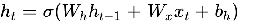 en la herramienta básica de modelado de secuencias y mostró la aparición espontánea de agrupamientos sintáctico-semánticos en el espacio oculto al predecir la palabra siguiente. Paul Werbos fijó en *Proceedings of the IEEE* la formulación general de la **retropropagación a través del tiempo (BPTT)** mediante el desdoblamiento paso a paso del grafo (n.º 115). En la conferencia NIPS, Yann LeCun, John Denker y Sara Solla presentaron el método de poda dispersa de pesos de segundo orden **Optimal Brain Damage (OBD)** basado en la diagonal del hessiano  (n.º 116\), precursor directo de los algoritmos modernos de compresión de LLM. Paralelamente, Jürgen Schmidhuber propuso un juego minimax de dos redes en el marco de la **curiosidad artificial adversarial** (n.º 117\)7, y Lars Hansen y Peter Salamon fundamentaron la reducción de la varianza del error en los **conjuntos (ensembles) de redes neuronales** (n.º 118).

## **1991**

**Dominios:** MoE Bucles Atención/LLM Base  
En 1991 se sentaron tres mecanismos fundamentales que determinan la arquitectura de los modelos insignia de 2024–2027. Robert Jacobs, Michael Jordan, Steven Nowlan y Geoffrey Hinton publicaron en *Neural Computation* el artículo *«Adaptive Mixtures of Local Experts»* (**la primera MoE**, n.º 119\)156. Al sustituir el promedio del error cuadrático por la maximización del logaritmo de la verosimilitud de una mezcla gaussiana bajo el control de una red de compuerta :  
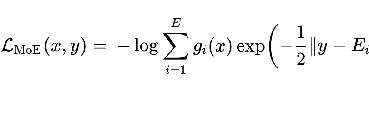  
los autores lograron una especialización competitiva de los expertos 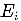 en distintas regiones del espacio de entrada, ya que el gradiente lo recibe preferentemente el experto con mayor responsabilidad a posteriori sobre el ejemplo.  
En junio de ese mismo año 1991 Sepp Hochreiter defendió, bajo la dirección de Jürgen Schmidhuber, su trabajo de diploma (n.º 120\)7, en el que ofreció por primera vez un análisis riguroso del **desvanecimiento y la explosión de los gradientes** en redes profundas y recurrentes mediante el producto de jacobianos . Y en la primavera de 1991 Schmidhuber propuso la arquitectura **Fast Weight Programmers** (n.º 121; publicación en revista en 1992\)7, en la que una red lenta genera dinámicamente vectores de claves y valores para la reescritura aditiva de la matriz de pesos rápidos  y su lectura , una construcción matemáticamente isomorfa a la autoatención lineal sin normalizar22. El año se cerró con los autocodificadores no lineales de cinco capas de Mark Kramer (n.º 122\) y con el manual clásico de mecánica estadística de las redes neuronales de Hertz, Krogh y Palmer (n.º 123).

## **1992**

**Dominios:** Optimización Bucles Base  
En 1992 Ronald Williams publicó en *Machine Learning* la estimación del gradiente de política **REINFORCE** con una línea base sustraída  para reducir la varianza (n.º 124):  
  
que se convirtió en la base directa de la optimización de los modelos de lenguaje con razonamiento mediante los métodos PPO y GRPO53. Simultáneamente, Jürgen Schmidhuber introdujo en *Neural Computation* el **compresor neuronal de la historia** (n.º 125\)22, un preentrenamiento autosupervisado jerárquico de RNN que transmite al nivel superior solo los tokens impredecibles («sorprendentes»), con la posterior compresión («destilación») de un maestro profundo en una red alumna compacta7. Boris Poliak y Anatoli Yuditski demostraron la optimalidad asintótica del **promediado de la trayectoria de los pesos de SGD** 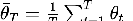 (n.º 126\), fundamento teórico de los objetivos EMA en DINO, JEPA y la difusión; Anders Krogh y John Hertz fundamentaron la regularización por decaimiento de pesos (**Weight Decay**, n.º 127); y Boser, Guyon y Vapnik unieron el margen del hiperplano con el truco del núcleo en COLT (n.º 128).

## **1993**

**Dominios:** Codificador Base Optimización  
En 1993 Jane Bromley, Isabelle Guyon, Yann LeCun y sus coautores presentaron en NIPS las **redes neuronales siamesas (Siamese Networks)** (n.º 129): dos torres convolucionales idénticas con pesos compartidos proyectan un par de entradas a un espacio métrico común de similitud coseno, paradigma que subyace en todos los codificadores contrastivos modernos (CLIP, SigLIP, recuperación densa). En la conferencia COLT, Geoffrey Hinton y Drew van Camp formularon el principio de la longitud mínima de descripción de los pesos mediante la minimización de la energía libre variacional  (**inferencia bayesiana variacional en redes neuronales**, n.º 130), que anticipó el funcional ELBO. Ese mismo año Andrew Barron demostró la independencia de la velocidad de aproximación 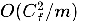 por una red de dos capas respecto de la dimensión del espacio  para funciones con norma espectral de Fourier acotada (n.º 131), y Babak Hassibi y David Stork generalizaron la poda por hessiano al **Optimal Brain Surgeon (OBS)** completo, no diagonal (n.º 132\), base matemática de los cuantizadores de pesos de LLM modernos (GPTQ).

## **1994**

**Dominios:** Bucles MoE Optimización  
En 1994 Yoshua Bengio, Patrice Simard y Paolo Frasconi publicaron en *IEEE Transactions on Neural Networks* el riguroso teorema *«Learning Long-Term Dependencies with Gradient Descent is Difficult»* (n.º 133), demostrando un conflicto fundamental de los sistemas dinámicos no lineales: el almacenamiento de un bit resistente a las perturbaciones en un atractor hiperbólico exige valores propios del jacobiano , lo que provoca automáticamente un decaimiento exponencial del gradiente del error en el tiempo. Ese mismo año Michael Jordan y Robert Jacobs generalizaron la mezcla de expertos a una **mezcla jerárquica de expertos (HME)** en forma de árbol, con entrenamiento EM rápido (n.º 134), Barak Pearlmutter dedujo el operador diferencial  para la multiplicación exacta del hessiano por un vector en  operaciones sin almacenar la matriz de segundas derivadas (n.º 135), y apareció la primera edición del curso fundamental de Simon Haykin *«Neural Networks: A Comprehensive Foundation»* (n.º 136).

## **1995**

**Dominios:** Base Difusión Codificador  
En mayo de 1995 Geoffrey Hinton, Peter Dayan, Brendan Frey y Radford Neal publicaron en *Science* la arquitectura de la **máquina de Helmholtz** y el algoritmo bifásico **Wake–Sleep** (n.º 137), que emparejaba un modelo generativo dirigido  con una red de inferencia de reconocimiento rápida , precursor estructural directo del autocodificador variacional. Anthony Bell y Terrence Sejnowski crearon el algoritmo de separación ciega de señales **InfoMax ICA** mediante la maximización de la entropía de la salida no lineal (n.º 138); Corinna Cortes y Vladimir Vapnik introdujeron el clasificador de margen blando **Support-Vector Networks** (n.º 139\)149; Yann LeCun y Yoshua Bengio sistematizaron las arquitecturas convolucionales 1D/2D para el habla y las imágenes (n.º 140); y Christopher Bishop publicó la clásica monografía *«Neural Networks for Pattern Recognition»* (Oxford University Press, n.º 141\)88, que consolidó la interpretación bayesiana y probabilística de las funciones de pérdida y de la regularización.

## **1996**

**Dominios:** Codificador Base Bucles  
En junio de 1996 Bruno Olshausen y David Field mostraron en la revista *Nature* (*«Emergence of Simple-Cell Receptive Field Properties by Learning a Sparse Code for Natural Images»*, n.º 142) que la minimización del error cuadrático de reconstrucción de imágenes naturales con un diccionario sobrecompleto y una penalización de dispersión (norma )  forma espontáneamente wavelets de Gabor localizados y orientados, base matemática tanto de la codificación dispersa como de los Sparse Autoencoders (SAE) modernos para la interpretabilidad de los LLM. Ese mismo año Radford Neal, en la monografía *«Bayesian Learning for Neural Networks»* (n.º 143\), demostró la convergencia de las redes neuronales de anchura infinita () inicializadas al azar a **procesos gaussianos (NNGP)**, Christoph Goller y Andreas Küchler introdujeron la retropropagación a través de grafos acíclicos y árboles sintácticos (n.º 144), y apareció el libro de Brian Ripley *«Pattern Recognition and Neural Networks»* (n.º 145).

## **1997**

**Dominios:** Bucles Memoria Optimización  
En noviembre de 1997 Sepp Hochreiter y Jürgen Schmidhuber publicaron en *Neural Computation* la arquitectura **Long Short-Term Memory (LSTM)** (n.º 146\)7. Para superar el desvanecimiento de los gradientes, los autores sustituyeron la transformación no lineal contractiva del estado por un **carrusel de error constante (Constant Error Carousel, CEC)** lineal  con jacobiano unitario en el tiempo, protegiendo la escritura y la lectura mediante compuertas multiplicativas de entrada () y de salida ():  
  
Ese mismo año 1997 Mike Schuster y Kuldip Paliwal crearon en *IEEE TSP* las **redes recurrentes bidireccionales (BiRNN)** (n.º 147), que combinan los desdoblamientos temporales hacia delante y hacia atrás para una codificación contextual completa; Hochreiter y Schmidhuber introdujeron el criterio de búsqueda de **mínimos planos (Flat Minima)**, de baja curvatura del hessiano, para mejorar la generalización (n.º 148); y Yoav Freund y Robert Schapire publicaron el algoritmo de boosting ponderado **AdaBoost** (n.º 149).

## **1998**

**Dominios:** Codificador Optimización Base  
En noviembre de 1998 Yann LeCun, Léon Bottou, Yoshua Bengio y Patrick Haffner publicaron en *Proceedings of the IEEE* el monumental artículo *«Gradient-Based Learning Applied to Document Recognition»* (n.º 150), que fijó la red convolucional de referencia de 7 capas **LeNet-5** (error del 0.8% en el conjunto de datos MNIST) y las **redes de transductores de grafos (GTN)** entrenables globalmente para leer documentos de varios caracteres sin segmentación previa, complementándolo con la guía práctica sobre el escalado de las activaciones y la inicialización *«Efficient BackProp»* (n.º 151). Simultáneamente, Shun'ichi Amari dedujo en *Neural Computation* el **gradiente natural (Natural Gradient)** 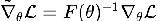 en la métrica riemanniana de la matriz de información de Fisher  (n.º 152\)159, fundamento invariante a la parametrización de los algoritmos de segundo orden K-FAC, Shampoo, SOAP y de las regiones de confianza de PPO160. Ese mismo año aparecieron las monografías clásicas de Richard Sutton y Andrew Barto sobre el aprendizaje por refuerzo (n.º 153\)152 y de Vladimir Vapnik *«Statistical Learning Theory»* (n.º 154\)99.

## **1999**

**Dominios:** Bucles Memoria Base  
En flujos continuos sin marcadores de reinicio, la celda de memoria lineal  de la LSTM original de 1997 se saturaba sin límite. Felix Gers, Jürgen Schmidhuber y Fred Cummins resolvieron este problema en la conferencia ICANN 1999 (n.º 155\)155, introduciendo la **compuerta de olvido (Forget Gate)** multiplicativa , que permitió a la celda borrar dinámicamente el estado obsoleto. Es notable que la transición del DeltaNet lineal a **Gated DeltaNet** y **KDA** en 2024–2025 reprodujo exactamente la misma idea matemática de introducir un factor de atenuación dependiente de la entrada  antes de la memoria matricial24. Ese mismo año Daniel Lee y Sebastian Seung publicaron en *Nature* la **factorización matricial no negativa (NMF)** (n.º 156), mostrando que la prohibición de sustracción mutua de características con  extrae componentes aditivos interpretables (principio trasladado en 2025 a las proyecciones no negativas 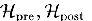 de la arquitectura DeepSeek **mHC**2), y Ning Qian ofreció un análisis espectral exacto del momento en el descenso de gradiente (n.º 157).

## **2000**

**Dominios:** Bucles Memoria Base  
En 2000 Gers, Schmidhuber y Cummins publicaron la versión completa en revista de la **LSTM con compuerta de olvido** en *Neural Computation* (n.º 158\) y la complementaron con **conexiones de mirilla (Peephole Connections)** desde el estado de la celda  directamente a las compuertas, para el conteo preciso de intervalos de tiempo (n.º 159):  
  
En la conferencia NIPS 2000 Charles Dugas, Yoshua Bengio y sus coautores introdujeron la función de activación suave y estrictamente positiva **Softplus**  (n.º 160\)161, la primitiva de la sigmoide logística, que en los SSM modernos (Mamba-1/2/3) y en las redes delta es el parametrizador estándar del paso de discretización 24. Simultáneamente, en la revista *Science* aparecieron los algoritmos geométricos de enderezamiento no lineal de las variedades de datos **Isomap** de Tenenbaum et al. (n.º 161\) y **LLE** de Roweis y Saul (n.º 162).

## **2001**

**Dominios:** Bucles Codificador Base  
En 2001 Herbert Jaeger presentó el concepto de cómputo de reservorio en el informe sobre las **redes de estados de eco (Echo State Networks, ESN)** (n.º 163): un gran reservorio recurrente fijo con radio espectral  proyecta de forma no lineal la historia de entrada a un estado de alta dimensión , sobre el cual, mediante regresión lineal, solo se entrena la matriz de lectura de salida, sin BPTT. En la conferencia ICML 2001 John Lafferty, Andrew McCallum y Fernando Pereira introdujeron los **campos aleatorios condicionales (Conditional Random Fields, CRF)** (n.º 164), que normalizan globalmente las probabilidades de toda la secuencia de salida  y eliminaron el sesgo de los modelos de Markov normalizados localmente. Ese mismo año apareció la primera edición de la fundamental monografía estadística de Hastie, Tibshirani y Friedman *«The Elements of Statistical Learning»* (n.º 165).

## **2002**

**Dominios:** Difusión Base Bucles  
En 2002 Geoffrey Hinton publicó en *Neural Computation* el algoritmo de **divergencia contrastiva (\-step Contrastive Divergence, CD\-)** (n.º 166\)142, que aceleró radicalmente el entrenamiento de los modelos basados en energía y de las RBM: en lugar de la prolongada convergencia de la cadena de Markov a la densidad de equilibrio modelada, la fase negativa del gradiente se aproxima con tan solo  paso de muestreo de Gibbs que parte de un vector de datos real. Wolfgang Maass, Thomas Natschläger y Henry Markram presentaron el análogo impulsivo de las redes de reservorio, las **máquinas de estados líquidos (LSM)** (n.º 167); Michael Collins generalizó en EMNLP el perceptrón y el teorema de Novikoff a tareas de predicción estructurada de secuencias con decodificación de Viterbi (n.º 168); y Ronan Collobert, Samy Bengio y Johnny Mariéthoz publicaron la biblioteca modular abierta en C++ **Torch** (n.º 169), progenitora del PyTorch actual.

## **2003**

**Dominios:** Base Atención/LLM Codificador  
En 2003 Yoshua Bengio, Réjean Ducharme, Pascal Vincent y Christian Jauvin publicaron en *JMLR* el artículo *«A Neural Probabilistic Language Model»* (n.º 170), que sustituyó los contadores discretos de -gramas por una matriz entrenable de **embeddings vectoriales densos de palabras**  y un perceptrón suave sobre la ventana concatenada de tokens precedentes :  
  
El entrenamiento conjunto de los embeddings y de la capa oculta trasladó la masa de probabilidad a combinaciones de palabras semánticamente próximas que nunca aparecieron literalmente en el corpus, abriendo el camino directo a los LLM modernos. Ese mismo año Patrice Simard, Dave Steinkraus y John Platt introdujeron las deformaciones elásticas de los datos y estandarizaron las prácticas convolucionales sencillas en ICDAR (0.4% de error en MNIST, n.º 171), y David MacKay publicó la obra fundamental *«Information Theory, Inference, and Learning Algorithms»* (n.º 172).

## **2004**

**Dominios:** Optimización Base  
En 2004 Kyoung-Su Oh y Keechul Jung publicaron en *Pattern Recognition* el artículo *«GPU Implementation of Neural Networks»* (n.º 173), que por primera vez trasladó las multiplicaciones matriciales de una red neuronal totalmente conectada al cauce de sombreadores de píxeles de una tarjeta de vídeo (ATI Radeon 9700 Pro), con una **aceleración de 20×** respecto del procesador central7. En la conferencia ICML 2004 Andrew Ng demostró rigurosamente que, con un número exponencial de características ruidosas, la complejidad muestral de la regularización  crece solo de forma logarítmica 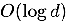, mientras que la de los métodos invariantes por rotación con penalización  crece linealmente  (n.º 174). En NIPS, Max Welling, Michal Rosen-Zvi y Geoffrey Hinton extendieron la arquitectura RBM a distribuciones continuas de la familia exponencial (**Exponential Family Harmoniums**, n.º 175\)162.

## **2005**

**Dominios:** Difusión STT Codificador Base  
En 2005 Aapo Hyvärinen publicó en *JMLR* el método de **emparejamiento de la función de puntuación (Score Matching)** (n.º 176\)161, que permitió entrenar densidades energéticas sin normalizar  sin calcular la función de partición , minimizando la discrepancia de los gradientes del logaritmo de la densidad respecto del vector de datos  (eliminando la incógnita  mediante integración por partes):  
  
Ese mismo año Alex Graves y Jürgen Schmidhuber combinaron la LSTM con compuertas con el desdoblamiento bidireccional en el tiempo (**BiLSTM**) y la retropropagación completa a través de las compuertas para la clasificación fonémica del habla (n.º 177); Sumit Chopra, Raia Hadsell y Yann LeCun introdujeron en CVPR la función de pérdida métrica **Contrastive Loss** (n.º 178); Marco Gori, Gabriele Monfardini y Franco Scarselli propusieron la primera formulación de las **redes neuronales de grafos (GNN)** (n.º 179); y Frederic Morin y Yoshua Bengio aceleraron la capa de salida de los modelos de lenguaje de  a  mediante el **Softmax jerárquico** sobre un árbol binario de palabras (n.º 180).

## **2006**

**Dominios:** STT Base Codificador  
En la conferencia ICML 2006 Alex Graves, Santiago Fernández, Faustino Gomez y Jürgen Schmidhuber presentaron el mecanismo **Connectionist Temporal Classification (CTC)** (n.º 181), que liberó el reconocimiento del habla y del texto manuscrito de la necesidad de un etiquetado fotograma a fotograma de los fonemas. Al ampliar el alfabeto con un símbolo vacío 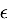 (blank) e introducir un operador de colapso de repeticiones y vacíos 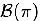, CTC calcula la probabilidad exacta de la transcripción objetivo  sumando sobre todos los caminos de alineamiento admisibles de longitud  mediante programación dinámica de pasada hacia delante y hacia atrás en :  
  
Simultáneamente, Geoffrey Hinton, Simon Osindero y Yee-Whye Teh publicaron el preentrenamiento por capas de las **redes de creencia profundas (Deep Belief Nets)** a partir de una pila de RBM (n.º 182\)142, y Hinton y Ruslan Salakhutdinov demostraron en la revista *Science* la compresión no lineal de datos mediante autocodificadores profundos con ajuste fino por retropropagación (n.º 183), devolviendo las redes profundas al centro de la atención científica. El año se cerró con la reseña fundamental de los modelos basados en energía de Yann LeCun y sus coautores (n.º 184\) y con el manual clásico de Christopher Bishop *«Pattern Recognition and Machine Learning»* (n.º 185\)164.

## **2007**

**Dominios:** Base Optimización Codificador  
En 2007 Yoshua Bengio, Pascal Lamblin, Dan Popovici y Hugo Larochelle mostraron en NIPS (*«Greedy Layer-Wise Training of Deep Networks»*, n.º 186\)163 que el preentrenamiento voraz por capas de autocodificadores deterministas inicializa las redes profundas con tanto éxito como las RBM estocásticas. En esa misma conferencia Léon Bottou y Olivier Bousquet publicaron el trabajo *«The Tradeoffs of Large Scale Learning»* (n.º 187), demostrando que, con un presupuesto fijo de tiempo de cómputo en el régimen de muestras grandes, el simple descenso de gradiente estocástico de primer orden (SGD) minimiza el riesgo de generalización esperado de forma asintóticamente más eficiente que los pesados optimizadores de segundo orden. Andriy Mnih y Geoffrey Hinton introdujeron el **Log-Bilinear Language Model** (n.º 188), y Ruslan Salakhutdinov, Andriy Mnih y Geoffrey Hinton aplicaron las RBM al filtrado matricial de recomendaciones en el Netflix Prize (n.º 189).

## **2008**

**Dominios:** Codificador Difusión Atención/LLM  
En la conferencia ICML 2008 Pascal Vincent, Hugo Larochelle, Yoshua Bengio y Pierre-Antoine Manzagol presentaron los **autocodificadores con eliminación de ruido (Denoising Autoencoders, DAE)** (n.º 190\)161: el vector de entrada se corrompe deliberadamente mediante la puesta a cero aleatoria de componentes (enmascaramiento) o con ruido gaussiano , y la red se entrena para proyectar el punto ruidoso de vuelta sobre la variedad de los datos limpios 165. Esta sencilla sustitución de la reconstrucción idéntica por la eliminación de ruido se convirtió en un puente conceptual directo tanto hacia el modelado de lenguaje enmascarado (BERT, LLaDA) como hacia el emparejamiento de la puntuación en la difusión. En esa misma ICML Ronan Collobert y Jason Weston entrenaron una única arquitectura convolucional con embeddings de palabras preentrenados en Wikipedia para resolver conjuntamente seis tareas de PLN sin ingeniería manual de características (n.º 191), y Laurens van der Maaten y Geoffrey Hinton introdujeron en *JMLR* el algoritmo de visualización de variedades **t-SNE** (n.º 192).

## **2009**

**Dominios:** Codificador Optimización Base  
En 2009 coincidieron tres acontecimientos que prepararon el escalado del aprendizaje profundo moderno. Jia Deng, Fei-Fei Li y sus coautores presentaron en CVPR el corpus jerárquico **ImageNet** (más de 14 millones de imágenes etiquetadas, n.º 193\)167; Rajat Raina, Anand Madhavan y Andrew Ng entrenaron en ICML redes profundas de 100 millones de parámetros en núcleos programables **CUDA GPU** con una **aceleración de 70×** sobre las CPU multinúcleo (n.º 194); y Yoshua Bengio, Jérôme Louradour, Ronan Collobert y Jason Weston formalizaron el **aprendizaje por currículo (Curriculum Learning)** (n.º 195\), el aumento gradual de la dificultad y la longitud de los ejemplos de entrenamiento, etapa obligada del entrenamiento progresivo de contexto largo y de alta resolución en todos los LLM y generadores de vídeo modernos59. Ese mismo año Salakhutdinov y Hinton crearon las **máquinas de Boltzmann profundas (DBM)** con conexiones bidireccionales entre capas (n.º 196), y Franco Scarselli y otros consolidaron la convergencia matemática de las redes **GNN** en *IEEE TNN* (n.º 197).

## **2010**

**Dominios:** Base Optimización Bucles  
En 2010 se eliminaron los principales obstáculos para entrenar desde cero redes profundas de propagación hacia delante sin preentrenamiento por capas. Xavier Glorot y Yoshua Bengio mostraron en la conferencia AISTATS (n.º 198\) que, para conservar simultáneamente la varianza de la señal en la pasada hacia delante y la varianza de los gradientes en la pasada hacia atrás, los pesos de la capa deben inicializarse con la varianza de **Glorot (Xavier Initialization)**:  
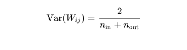  
En la conferencia ICML 2010 Vinod Nair y Geoffrey Hinton publicaron el trabajo *«Rectified Linear Units Improve Restricted Boltzmann Machines»* (n.º 199), introduciendo en la práctica general la activación lineal a trozos **ReLU** 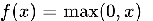 con derivada unitaria en el semieje positivo. Ese mismo año Tomáš Mikolov y sus coautores presentaron en Interspeech el **modelo de lenguaje recurrente (RNNLM)** para el reconocimiento del habla (n.º 200), Michael Gutmann y Aapo Hyvärinen dedujeron la **estimación contrastiva de ruido (NCE)** (n.º 201), James Martens entrenó redes profundas sin preentrenamiento mediante el método de segundo orden **Hessian-Free** (n.º 202), y apareció el compilador simbólico-tensorial de autodiferenciación en GPU **Theano**, de James Bergstra y el grupo de Bengio (n.º 203).

## **2011**

**Dominios:** Optimización Difusión Base STT  
En 2011 John Duchi, Elad Hazan y Yoram Singer publicaron en *JMLR* el optimizador adaptativo **AdaGrad** (n.º 204\)168, que normaliza el paso de cada coordenada por la raíz de la suma acumulada de los cuadrados de sus gradientes pasados , lo que dio origen a toda la familia de métodos adaptativos de optimización de redes profundas.  
En el verano de 2011 Pascal Vincent publicó en *Neural Computation* el artículo teórico fundamental *«A Connection Between Score Matching and Denoising Autoencoders»* (**Denoising Score Matching, DSM**, n.º 205\)161. Vincent demostró rigurosamente que entrenar un autocodificador para suprimir el ruido gaussiano  equivale a estimar la función de puntuación de la densidad suavizada de Parzen  *sin calcular las segundas derivadas del jacobiano*166:  
  
Dado que 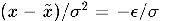, esta fórmula es el núcleo matemático directo de todos los modelos de difusión continuos (NCSN, DDPM, Score SDE)142. Ese mismo año Glorot, Bordes y Bengio fundamentaron la dispersión de las redes profundas con ReLU (n.º 206), Max Welling y Yee-Whye Teh unieron el gradiente estocástico con la dinámica de Langevin en **SGLD** (n.º 207), Frank Seide, Gang Li y Dong Yu lograron un avance en el reconocimiento industrial del habla conversacional con el híbrido **CD-DNN-HMM** (n.º 208), y Collobert y otros publicaron el artículo de síntesis *«Natural Language Processing (Almost) from Scratch»* en *JMLR* (n.º 209).

## **2012**

**Dominios:** Codificador STT Optimización Bucles  
En diciembre de 2012 Alex Krizhevsky, Ilya Sutskever y Geoffrey Hinton presentaron en NIPS la red convolucional de ocho capas **AlexNet** (n.º 210\)96, que redujo el error Top-5 en ImageNet ILSVRC-2012 del 26.2% al **15.3%** (precisión Top-1 del 63.3%). El éxito de AlexNet combinó 60 millones de parámetros, la no linealidad **ReLU** (que aceleró la convergencia 6× en comparación con ), la desactivación estocástica de neuronas **Dropout** para suprimir la coadaptación de las características (Hinton et al., 2012, n.º 212\) y el entrenamiento paralelo por modelo en dos tarjetas gráficas NVIDIA GTX 580167.  
Simultáneamente, en noviembre de 2012 Alex Graves publicó la arquitectura **RNN-Transducer (RNN-T)** (n.º 211), que eliminó el supuesto de independencia condicional de las salidas de CTC al unir el codificador acústico  y la red autorregresiva de predicción de texto  en una red conjunta **Joiner**  con marginalización sobre la rejilla bidimensional , estándar de todos los sistemas de reconocimiento del habla en flujo continuo hasta los TDT modernos170. Ese mismo año aparecieron el escalado cuadrático medio móvil del paso **RMSProp** de Hinton y el método adimensional **Adadelta** de Matthew Zeiler (n.º 213), el marco de clúster distribuido **DistBelief** de Jeff Dean y otros (n.º 214), los ensambles GPU-CNN de Dan Cireşan, Ueli Meier y Jürgen Schmidhuber con la primera precisión sobrehumana en el reconocimiento de señales (n.º 215\)155 y la demostración de la eficacia de la búsqueda aleatoria de hiperparámetros de Bergstra y Bengio (n.º 216).

## **2013**

**Dominios:** Codificador Difusión Base Optimización  
En diciembre de 2013 Diederik Kingma y Max Welling publicaron el **Variational Autoencoder (VAE)** (*«Auto-Encoding Variational Bayes»*, n.º 217; de forma independiente Danilo Rezende, Shakir Mohamed y Daan Wierstra, n.º 218), que maximiza la cota inferior variacional de la verosimilitud (**ELBO**):  
  
El **truco de reparametrización** 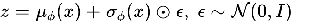 introducido por los autores trasladó la aleatoriedad a un ruido externo y permitió entrenar codificadores probabilísticos profundos arbitrarios mediante la retropropagación habitual del error; precisamente los espacios comprimidos de los VAE constituyen hoy el sustrato latente de todos los generadores insignia de imágenes, vídeo y habla de larga duración74.  
Paralelamente, Tomáš Mikolov y sus coautores en Google presentaron las arquitecturas contrastivas **Word2Vec** (Skip-Gram y CBOW con muestreo negativo, n.º 219), que escalaron el entrenamiento de representaciones vectoriales de palabras a corpus de miles de millones con una estructura semántica lineal. Min Lin, Qiang Chen y Shuicheng Yan introdujeron las convoluciones puntuales 1×1 y el pooling promedio global en **Network in Network** (n.º 220), Ian Goodfellow y otros propusieron la activación **Maxout** (n.º 221), Volodymyr Mnih y el equipo de DeepMind unieron una red convolucional con Q-learning y un búfer de experiencia en **DQN** sobre juegos de Atari (n.º 222), Andrew Saxe, James McClelland y Surya Ganguli demostraron la conservación de los valores singulares del jacobiano con la **inicialización ortogonal** de redes profundas (n.º 223\)175, y Rie Johnson y Tong Zhang introdujeron la reducción de la varianza del gradiente **SVRG** (n.º 224).

## **2014**

**Dominios:** Atención/LLM Bucles Difusión Codificador Optimización  
En 2014 nacieron la atención suave diferenciable, las redes generativas antagónicas y el principal optimizador del aprendizaje profundo moderno. Tras el modelo **Seq2Seq** de Ilya Sutskever, Oriol Vinyals y Quoc Le (n.º 225), que comprimía la frase de entrada en un único vector fijo mediante una LSTM, Dzmitry Bahdanau, Kyunghyun Cho y Yoshua Bengio (*«Neural Machine Translation by Jointly Learning to Align and Translate»*, n.º 226\) eliminaron el cuello de botella informacional del vector fijo, permitiendo al decodificador ponderar dinámicamente, en cada paso , todos los estados ocultos del codificador  (**atención aditiva**):  
  
Ese mismo año Kyunghyun Cho y otros simplificaron la celda recurrente con compuertas a dos compuertas en la **GRU** (, n.º 227), y Alex Graves, Greg Wayne e Ivo Danihelka dotaron a la red neuronal de una memoria matricial externa diferenciable en la **Neural Turing Machine (NTM)** (n.º 228). En NIPS 2014 Ian Goodfellow y sus coautores formularon el juego minimax entre el generador y el discriminador de las **GAN** (, n.º 229), y en diciembre Diederik Kingma y Jimmy Ba publicaron el optimizador **Adam** (n.º 230), que combinó las estimaciones de medias móviles exponenciales de los momentos de primer y segundo orden del gradiente con la corrección del sesgo hacia cero. En visión por computador y en embeddings aparecieron las cascadas de núcleos estrechos de 3×3 **VGG** de Simonyan y Zisserman (n.º 231\)176, los bloques multiescala **GoogLeNet / Inception** de Szegedy y otros (n.º 232), la factorización matricial de la coocurrencia de palabras **GloVe** de Pennington y otros (n.º 233), el trabajo de Goodfellow y otros sobre la naturaleza lineal de las **perturbaciones antagónicas (FGSM)** (n.º 234\) y la biblioteca **Caffe** de Yangqing Jia (n.º 235).

## **2015**

**Dominios:** Base Difusión Codificador Optimización STT  
En 2015 se superó la barrera de la degradación de la profundidad de las redes y, simultáneamente, se formuló la difusión termodinámica. Desarrollando las autopistas con compuertas de las **Highway Networks** de Rupesh Srivastava, Klaus Greff y Jürgen Schmidhuber (, n.º 236\)7, Kaiming He, Xiangyu Zhang, Shaoqing Ren y Jian Sun simplificaron el atajo de la señal a una suma identidad pura en **ResNet-152** (n.º 237; junto con la inicialización **Kaiming Init**  para ReLU, n.º 238\)61:  
  
La unidad aditiva  en el jacobiano aseguró un flujo de gradiente sin atenuación a través de cientos de capas y dio la victoria en ILSVRC-2015 con un error del ensamble del 3.57%34.  
Ese mismo año Sergey Ioffe y Christian Szegedy introdujeron la **Batch Normalization** (n.º 239\)178; Olaf Ronneberger, Philipp Fischer y Thomas Brox crearon la arquitectura convolucional simétrica codificador–decodificador con transmisión directa de los mapas espaciales de características **U-Net** (n.º 240\)179; y Jascha Sohl-Dickstein, Eric Weiss, Niru Maheswaranathan y Surya Ganguli publicaron en ICML 2015 el artículo pionero *«Deep Unsupervised Learning using Nonequilibrium Thermodynamics»* (n.º 241), introduciendo la cadena de Markov directa de ruido por difusión  y la cadena inversa entrenable de restauración generativa . El año se completó con la **destilación de conocimiento** con temperatura de Hinton, Vinyals y Dean (n.º 242), la aproximación de Fisher **K-FAC** de Martens y Grosse (n.º 243), la atención escalar de Luong (n.º 244), las arquitecturas de habla de extremo a extremo **LAS** de Chan y otros (n.º 245\) y **DeepSpeech 2** de Amodei y otros (n.º 246), la segmentación en subpalabras **BPE** de Sennrich y otros (n.º 247\) y el lanzamiento abierto del marco **TensorFlow** (n.º 248).

## **2016**

**Dominios:** TTS Bucles Base Optimización Codificador  
En 2016 cobraron forma los mecanismos de normalización por token, de bucles recurrentes adaptativos y de síntesis autorregresiva de audio. Jimmy Ba, Jamie Kiros y Geoffrey Hinton propusieron la **Layer Normalization (LayerNorm)** (n.º 249), que normaliza el vector de características de cada token por separado, independientemente del tamaño del lote, y Kaiming He y otros demostraron que trasladar la normalización al interior de la rama residual (**Pre-LN ResNet**: , n.º 250\) conserva la autopista identidad pura a profundidades superiores a 1000 capas61. Alex Graves introdujo el mecanismo **Adaptive Computation Time (ACT)** (n.º 251\)41, que permite a la red ejecutar un número variable y entrenable de iteraciones internas sobre cada token bajo el control de una compuerta sigmoidea de parada (ponder cost), fundamento directo de la profundidad adaptativa en Universal Transformer, Ouro y Huginn41. Dan Hendrycks y Kevin Gimpel propusieron la no linealidad probabilística suave **GELU**  (n.º 252).  
En la síntesis del habla, Aäron van den Oord y el equipo de DeepMind presentaron **WaveNet** (n.º 253\), una pila de convoluciones 1D causales dilatadas con crecimiento exponencial de la dilatación  y no linealidades con compuertas , que por primera vez acercó la síntesis de la onda a la voz natural. Ese mismo año Laurent Dinh, Jascha Sohl-Dickstein y Samy Bengio crearon los flujos normalizadores invertibles **RealNVP** (n.º 254); Eric Jang y otros dedujeron la relajación categórica diferenciable **Gumbel-Softmax** (n.º 255\)54; Thomas Kipf y Max Welling formalizaron las **redes convolucionales de grafos (GCN)** espectrales (n.º 256); Gao Huang y otros presentaron **DenseNet** (n.º 257\)180; Ilya Loshchilov y Frank Hutter introdujeron el calendario coseno de la tasa de aprendizaje **SGDR / Cosine Annealing** (n.º 258); y apareció el manual clásico de Goodfellow, Bengio y Courville *«Deep Learning»* (MIT Press, n.º 259\)8.

## **2017**

**Dominios:** Atención/LLM MoE TTS Codificador Optimización  
En junio de 2017 Ashish Vaswani, Noam Shazeer, Niki Parmar, Jakob Uszkoreit, Llion Jones, Aidan Gomez, Łukasz Kaiser e Illia Polosukhin publicaron el artículo *«Attention Is All You Need»* (n.º 260\)182, que sustituyó las cadenas recurrentes y las convoluciones por la arquitectura **Transformer**, basada en la autoatención multicabeza de producto escalar escalado (**Multi-Head Attention, MHA**):  
  
El factor  estabiliza la varianza de los logits antes del softmax, la longitud del camino de transmisión de la señal entre dos posiciones cualesquiera de la secuencia se reduce a , y el paralelismo completo sobre los  tokens en el entrenamiento encaja idealmente con las multiplicaciones tensoriales de la GPU, al precio de una complejidad cuadrática .  
Ese mismo año 2017 aparecieron otros cinco trabajos que configuraron el aspecto de los sistemas multimodales y dispersos modernos. Noam Shazeer y sus coautores presentaron en ICLR la **Sparsely-Gated Mixture-of-Experts** (n.º 261\)184, que escaló el modelo de lenguaje hasta 137 mil millones de parámetros mediante un enrutamiento disperso  con una penalización auxiliar de balanceo de la carga de los expertos. Aäron van den Oord, Oriol Vinyals y Koray Kavukcuoglu crearon el **VQ-VAE** (n.º 262), que introdujo la cuantización vectorial del espacio latente en un libro de códigos discreto con estimación de gradiente de extremo a extremo mediante el Straight-Through Estimator, mecanismo básico de todos los códecs de audio neuronales modernos. Yuxuan Wang y otros (**Tacotron**, n.º 263\) y Jonathan Shen y otros (**Tacotron 2**, n.º 264\) construyeron una síntesis de habla de extremo a extremo «texto  espectrograma mel  vocoder neuronal». En optimización, Ilya Loshchilov y Frank Hutter desacoplaron el decaimiento de pesos del segundo momento adaptativo en **AdamW** (, n.º 265), John Schulman y otros crearon el gradiente de política sustituto recortado **PPO** (n.º 266\)158, y Martin Arjovsky, Soumith Chintala y Léon Bottou estabilizaron las redes antagónicas con la métrica de Wasserstein **WGAN** (n.º 267). El arsenal arquitectónico se enriqueció con las convoluciones separables en profundidad **MobileNets** de Howard y otros (n.º 268), la atención por canales **SENet** de Hu y otros (n.º 269), la activación **Swish / SiLU**  de Ramachandran y otros (n.º 270\) y la atención en grafos **GAT** de Veličković y otros (n.º 271).

## **2018**

**Dominios:** Codificador Atención/LLM Bucles TTS Optimización  
En 2018 el preentrenamiento de transformadores sobre grandes corpus sin etiquetar se dividió en dos ramas complementarias. Tras las representaciones contextuales de BiLSTM **ELMo** de Matthew Peters y otros (n.º 272), Alec Radford y sus coautores en OpenAI presentaron el decodificador causal autorregresivo **GPT-1** (n.º 273), y Jacob Devlin, Ming-Wei Chang, Kenton Lee y Kristina Toutanova en Google crearon el codificador bidireccional profundo **BERT** (n.º 274\)186, entrenado para restaurar el 15% de los tokens enmascarados al azar (**Masked Language Modeling, MLM**) a partir del contexto completo izquierdo y derecho.  
Simultáneamente, Mostafa Dehghani y sus coautores introdujeron el **Universal Transformer** (n.º 275\)187, el primer transformador en bucle con compartición de pesos en profundidad y parada ACT por token, demostrando su universalidad computacional con profundidad variable y sentando la base directa de los modelos modernos Huginn y Ouro. Ricky Chen, Yulia Rubanova, Jesse Bettencourt y David Duvenaud pasaron al límite continuo de la red residual  en las **Neural ODE**, con entrenamiento por el método de las ecuaciones adjuntas con memoria  en profundidad (n.º 276\)190. Ese mismo año Aäron van den Oord, Yazhe Li y Oriol Vinyals formularon el funcional contrastivo **InfoNCE** en el marco de **CPC** (n.º 277\)191; Kingma y Dhariwal crearon el generador invertible **Glow** (n.º 278), adaptado por Ryan Prenger y otros en el rápido vocoder de habla en flujo continuo **WaveGlow** (n.º 279); Yuxin Wu y Kaiming He introdujeron **GroupNorm** (n.º 280); en optimización aparecieron el **Adafactor** de bajo rango de Shazeer y Stern (n.º 281\)192 y el precondicionador matricial de curvatura **Shampoo** de Gupta, Koren y Singer (n.º 282\)160; Arthur Jacot y otros describieron el régimen del **núcleo tangente neuronal (NTK)** (n.º 283); y Taku Kudo y John Richardson publicaron el tokenizador **SentencePiece** (n.º 284\)73.

## **2019**

**Dominios:** Atención/LLM Bucles TTS Difusión Optimización  
En 2019 cobró forma el armazón de ingeniería del decodificador LLM moderno y de la infraestructura de su entrenamiento distribuido. Alec Radford y sus coautores, con **GPT-2** (1.5B de parámetros, n.º 285\)1, consolidaron el esquema **Pre-LN** y la ejecución zero-shot de tareas mediante la continuación del lenguaje. Biao Zhang y Rico Sennrich presentaron **RMSNorm** (n.º 286\)28, que descartó el centrado de la media de LayerNorm y conservó solo la normalización invariante a la escala por la amplitud cuadrática media:  
  
lo que aceleró la normalización en la GPU y se convirtió en el estándar de prácticamente todas las arquitecturas abiertas de 2023–2026196. En noviembre Noam Shazeer publicó la **Multi-Query Attention (MQA)** (n.º 287\)49, señalando la limitación de la decodificación autorregresiva por el ancho de banda de la memoria HBM al leer la caché KV y proponiendo proyecciones compartidas  para todas las cabezas de consulta.  
En los modelos en bucle y de contexto largo, Shaojie Bai, Zico Kolter y Vladlen Koltun crearon los **Deep Equilibrium Models (DEQ)** (n.º 288), que hallan el punto fijo del bucle  con un solver numérico de raíces y lo diferencian analíticamente mediante el teorema de la función implícita con memoria ; Zhenzhong Lan y otros aplicaron la compartición de pesos de capas de extremo a extremo en **ALBERT** (n.º 289\)189; Colin Raffel y otros introdujeron el sesgo relativo tabular de la atención en **T5** (n.º 290\)72; y Zihang Dai y otros combinaron la recurrencia por segmentos con posiciones relativas en **Transformer-XL** (n.º 291\)190. En la síntesis del habla, Yi Ren y otros crearon el transformador no autorregresivo **FastSpeech** con un regulador explícito de la duración de los fonemas (**Length Regulator**, n.º 292), que aceleró en dos órdenes de magnitud la generación de espectrogramas mel sin pérdida de estabilidad. Yang Song y Stefano Ermon revivieron el modelado generativo por puntuación sobre una rejilla multiescala de ruidos en **NCSN** (n.º 293). El año se cerró con el escalado compuesto de CNN **EfficientNet** de Tan y Le (n.º 294\)178, el codificador de audio autosupervisado **wav2vec** de Schneider y otros (n.º 295), el paralelismo tensorial intracapa **Megatron-LM** de NVIDIA (n.º 296\)198, la fragmentación de los estados del optimizador y de los pesos **ZeRO** de Microsoft DeepSpeed (n.º 297\)73 y el artículo de referencia de Adam Paszke y otros sobre **PyTorch** (n.º 298).

## **2020**

**Dominios:** Atención/LLM Difusión Codificador STT TTS Bucles/SSM  
En 2020 se transformaron simultáneamente los modelos de lenguaje, la generación por difusión, la visión por computador y las tecnologías del habla. Jared Kaplan y sus coautores establecieron las **leyes de escalado (Scaling Laws)** en forma de potencia de la pérdida del modelo de lenguaje en función del número de parámetros, los datos y el presupuesto de FLOPs  (n.º 299\)4, que Tom Brown y el equipo de OpenAI llevaron a la práctica en **GPT-3**, de 175 000 millones de parámetros, con aprendizaje en contexto emergente (n.º 300). Noam Shazeer introdujo la familia de bloques totalmente conectados con compuertas **SwiGLU**  (n.º 301\)199, que sustituyó al MLP ordinario de dos capas en los LLM modernos, mientras que Angelos Katharopoulos et al. factorizaron la atención mediante un núcleo de características positivo  en **Linear Attention** (n.º 302\)25, mostrando la dualidad entre el transformador lineal y una RNN con memoria matricial  de complejidad .  
En los modelos generativos, Jonathan Ho, Ajay Jain y Pieter Abbeel publicaron **DDPM** (n.º 303\)37, que redujo el entrenamiento variacional de la cadena de Márkov inversa a la predicción del ruido gaussiano añadido ; Jiaming Song, Chenlin Meng y Stefano Ermon construyeron las trayectorias deterministas no markovianas de muestreo acelerado de **DDIM** (n.º 304\)5; y Yang Song et al. unificaron la difusión y la estimación de la puntuación (score) en ecuaciones diferenciales estocásticas continuas, **Score SDE**, y en el flujo de probabilidad determinista, **Probability Flow ODE** (n.º 305\)5. En visión por computador, Alexey Dosovitskiy, Lucas Beyer et al. presentaron el transformador puro de parches **ViT** (división de la imagen en parches de 16×16 sin convoluciones, 88.55 % Top-1 en ImageNet para ViT-H/14, n.º 306\)73, junto con el avance del autoaprendizaje contrastivo **SimCLR** (n.º 311\)202, **MoCo** (n.º 312\) y **BYOL**, sin negativos (n.º 313).  
En el procesamiento de audio aparecieron tres componentes básicos de la pila moderna del habla: el híbrido convolucional-transformador **Conformer** de Anmol Gulati et al. (Macaron-FFN \+ MHSA \+ DepthwiseConv, que alcanzó **1.9 % / 3.9 % de WER** en LibriSpeech test-clean / test-other, n.º 307\)203, el codificador cuantizador autosupervisado de forma de onda cruda **wav2vec 2.0** de Alexei Baevski et al. (n.º 308\)191 y el vocoder generativo adversarial multiperiodo **HiFi-GAN** de Jungil Kong et al. (n.º 309\)206. Por último, Albert Gu, Tri Dao y sus coautores derivaron los operadores de proyección polinómica ortogonal de la historia continua de la señal, **HiPPO** (n.º 310\)62 (base teórica de S4 y Mamba), Patrick Lewis et al. crearon la arquitectura **RAG** (n.º 314), y Dmitry Lepikhin et al. escalaron la MoE hasta 600B de parámetros en el sistema **GShard** (n.º 315\)27.

## **2021**

**Dominios:** Atención/LLM MoE Codificador Bucles/SSM TTS Difusión Optimización  
En 2021 se consolidaron los estándares de la codificación posicional relativa, la adaptación de bajo rango, los espacios de estados estructurados y la difusión latente. Jianlin Su y sus coautores introdujeron en **RoFormer** la **codificación posicional rotatoria (RoPE)** (n.º 316\)72, que multiplica los pares de coordenadas de consultas y claves por matrices ortogonales de rotación en el plano complejo con un espectro geométrico de frecuencias :  
  
Ofir Press et al. propusieron las penalizaciones posicionales lineales de la atención **ALiBi** (n.º 317); William Fedus, Barret Zoph y Noam Shazeer simplificaron la MoE hasta el enrutamiento **Top-1** en el **Switch Transformer** de 1.6 billones de parámetros (n.º 318); y Edward Hu et al. crearon el método **LoRA** (n.º 319\)210, que congela las matrices preentrenadas  y entrena únicamente un término aditivo de bajo rango 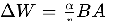 de rango 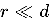, sin latencia adicional en la inferencia.  
En los codificadores multimodales y visuales, Alec Radford et al. alinearon los espacios de imágenes y textos con 400 millones de pares en **CLIP** (n.º 320\)212, Kaiming He et al. crearon el autocodificador enmascarado asimétrico de parches **MAE** (enmascaramiento del 75 % de los parches, n.º 321), Mathilde Caron et al. descubrieron la autodestilación de transformadores visuales sin etiquetas **DINO** (n.º 322\)213, y Ze Liu et al. introdujeron ventanas desplazadas jerárquicas en **Swin Transformer** (n.º 323). En el modelado de secuencias largas, Albert Gu, Karan Goel y Christopher Ré publicaron **S4 (Structured State Spaces)** (n.º 324\)62: al descomponer la matriz HiPPO en la suma de una normal y una de bajo rango (**NPLR**: ), redujeron el cálculo del núcleo convolucional de longitud  a un núcleo de Cauchy y una FFT en , resolviendo por primera vez la tarea Path-X de longitud 16,384 en Long Range Arena (puntuación media 86.09)216; en paralelo, Imanol Schlag, Kazuki Irie y Jürgen Schmidhuber introdujeron en ICML 2021 la regla delta de sobrescritura en los transformadores lineales (**Fast Weight Programmers**, n.º 325\)157, que se convirtió en la fuente teórica directa de DeltaNet.  
En los dominios del habla y generativo, Jaehyeon Kim, Jungil Kong y Juhee Son combinaron la inferencia variacional, los flujos normalizadores y la síntesis adversarial de la forma de onda en **VITS** (n.º 326\)217; Neil Zeghidour et al. crearon el primer códec de audio neuronal de extremo a extremo con **cuantización vectorial residual (RVQ)**, **SoundStream** (n.º 327\)47; Wei-Ning Hsu et al. presentaron el codificador de habla enmascarado **HuBERT** (n.º 328\)191; Prafulla Dhariwal y Alex Nichol demostraron la superioridad de la difusión sobre las GAN en calidad de imagen en **ADM** (n.º 329\)219; Jacob Austin et al. formalizaron la difusión discreta con el token absorbente \[MASK\] en **D3PM** (n.º 330\)35; y en diciembre Robin Rombach, Andreas Blattmann, Dominik Lorenz, Patrick Esser y Björn Ommer trasladaron la difusión al espacio comprimido de un autocodificador perceptual, con atención cruzada (cross-attention) de texto, en los **Latent Diffusion Models (LDM / Stable Diffusion)** (n.º 331\)179.

## **2022**

**Dominios:** Atención/LLM Optimización Difusión STT TTS  
En 2022, los algoritmos de memoria conscientes del hardware, las leyes de escalado óptimo en cómputo y los flujos rectilíneos de EDO cambiaron la economía de los grandes modelos. Tri Dao, Daniel Fu, Stefano Ermon, Atri Rudra y Christopher Ré publicaron **FlashAttention** (n.º 332\)199: al dividir las matrices  en bloques en la memoria rápida integrada en el chip de la GPU, **SRAM**, y aplicar el reescalado exacto por bloques del **softmax en línea** (que se remonta a Milakov y Gimelshein, n.º 333):  
  
los autores calcularon una atención matemáticamente exacta sin escribir la matriz  en la memoria global HBM, reduciendo el consumo de memoria a 223. Jordan Hoffmann et al., en el trabajo **Chinchilla** (n.º 334\)224, mostraron que, con un presupuesto fijo de FLOPs, el régimen óptimo de entrenamiento exige escalar proporcionalmente el número de parámetros y de tokens de entrenamiento (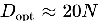), y Greg Yang, Edward Hu et al. derivaron la parametrización **P** para la transferencia zero-shot de hiperparámetros desde modelos pequeños a ejecuciones gigantescas (n.º 335).  
En el modelado generativo, Jonathan Ho y Tim Salimans introdujeron la **guía sin clasificador (CFG)** (n.º 336), Tero Karras et al. sistematizaron el preacondicionamiento del ruido y los muestreadores de segundo orden en **EDM** (n.º 337\)37, y en otoño de 2022 Xingchao Liu, Chengyue Gong y Qiang Liu (**Rectified Flow**, n.º 338), Yaron Lipman, Ricky Chen et al. (**Flow Matching**, n.º 339\) y Michael Albergo con Eric Vanden-Eijnden (**Stochastic Interpolants**, n.º 340\) trasladaron la generación al entrenamiento de campos vectoriales rectilíneos de velocidad de la EDO  a lo largo de la interpolación lineal , con el procedimiento de enderezamiento de trayectorias **Reflow**5. En diciembre, William Peebles y Saining Xie sustituyeron la U-Net de la difusión latente por un transformador escalable con normalización adaptativa **adaLN-Zero**: el **Diffusion Transformer (DiT)** (FID 2.27 en ImageNet 256×256, n.º 341\)219. En audio y posentrenamiento aparecieron el transformador ASR multilingüe **Whisper** de Alec Radford et al., con 680,000 horas de supervisión débil (n.º 342\)229, el códec RVQ abierto de 24 kHz **EnCodec** de Alexandre Défossez et al. (n.º 343\)231, la alineación en tres etapas con preferencias humanas **InstructGPT (RLHF)** de Long Ouyang et al. (n.º 344), el prompting de cadenas de razonamiento **Chain-of-Thought** de Jason Wei et al. (n.º 345\) y los optimizadores de 8 bits con cuantización por bloques de Tim Dettmers et al. (n.º 346\)169.

## **2023**

**Dominios:** Atención/LLM MoE Bucles/SSM Codificador Vídeo STT TTS STS Optimización  
En 2023, el ecosistema abierto de LLM obtuvo un estándar de decodificación eficiente, y los modelos lineales recurrentes desafiaron por primera vez a los transformadores en tareas de lenguaje. Joshua Ainslie et al. introdujeron la **Grouped-Query Attention (GQA)** (n.º 347\)39, que reparte  grupos de claves-valores entre  cabezas de consulta (adoptada en **Llama 2 70B** de Touvron et al., n.º 348194); Woosuk Kwon et al. eliminaron la fragmentación de la memoria de vídeo del caché KV con el mecanismo de paginación **PagedAttention** en el motor **vLLM** (n.º 349\)232; Tri Dao optimizó el paralelismo a nivel de warp en **FlashAttention-2** (n.º 350\)198; Hao Liu, Matei Zaharia y Pieter Abbeel crearon la atención distribuida en anillo de aceleradores **Ring Attention** para contextos de millones de tokens (n.º 351\)132; el equipo de Mistral AI publicó la mezcla de expertos dispersa abierta **Mixtral 8x7B** (Top-2 de 8, n.º 352\)234; y Rafael Rafailov et al. derivaron una forma cerrada de alineación de la política sin modelo de recompensa, la **Direct Preference Optimization (DPO)** (n.º 353\)158:  
  
Al mismo tiempo se desplegó la ofensiva de las arquitecturas subcuadráticas con memoria constante de inferencia : **RWKV-4** de Bo Peng et al. (n.º 354\)236, la red de retención multiescala **RetNet** de Yutao Sun et al. (n.º 355\)49 y, en diciembre, **Mamba (S6)** de Albert Gu y Tri Dao (n.º 356\)25. Al convertir los parámetros del espacio de estados  en funciones del token de entrada actual (**Selective SSM**) e implementar un escáner asociativo paralelo consciente del hardware en SRAM, Mamba resolvió el problema del filtrado del contexto dependiente del contenido con complejidad lineal .  
En los dominios visual, de difusión de texto y del habla aparecieron el predictor latente no generativo de imágenes **I-JEPA** de Assran, LeCun et al. (n.º 357), el codificador contrastivo sigmoide por pares y sin softmax **SigLIP** de Zhai et al. (n.º 358\)212, el modelo fundacional visual **DINOv2** de Oquab et al. (n.º 359\)176, el generador de vídeo **Stable Video Diffusion** de Blattmann et al. (n.º 360), la difusión discreta con estimación de razones de probabilidad **SEDD** de Lou, Meng y Ermon (n.º 361\)57, el primer modelo de lenguaje de códec para la síntesis de habla zero-shot a partir de una muestra de 3 segundos, **VALL-E**, de Wang et al. (n.º 362\)218, el códec de audio mejorado **DAC** de Kumar et al. (n.º 363\)55, el modelo conversacional de habla **SpeechGPT** de Zhang et al. (n.º 364\)240, el codificador **FastConformer** de Rekesh et al., 2.8× más rápido y con trama de 80 ms (n.º 365\)171, el transductor **Token-and-Duration Transducer (TDT)** de Xu, Majumdar y Ginsburg, que omite las tramas vacías (n.º 366\)79, la adaptación de 4 bits **QLoRA** de Dettmers et al. (n.º 367), la extensión de la ventana de RoPE **YaRN** de Peng et al. (n.º 368\)30 y el manual de Simon Prince *«Understanding Deep Learning»* (MIT Press, n.º 369\)8.

## **2024**

**Dominios:** Atención/LLM MoE Bucles/SSM Difusión Vídeo Codificador STT TTS STS Optimización

### **Atención latente MLA, equilibrado de MoE sin penalizaciones y preentrenamiento cuantizado**

En 2024, una serie de trabajos del laboratorio DeepSeek-AI revisó la arquitectura de la atención y del enrutamiento de expertos. En **DeepSeekMoE** (arXiv:2401.06066, n.º 370\)29 los expertos se fragmentaron en subredes pequeñas especializadas, combinadas con *expertos compartidos* aislados y siempre activos. En mayo, en **DeepSeek-V2** (arXiv:2405.04434, 236B de parámetros totales / 21B activos, n.º 371\)50 se introdujo el mecanismo **Multi-Head Latent Attention (MLA)**:  
  
Gracias a la absorción de las matrices de descompresión  en las proyecciones de consulta y de salida en la etapa de inferencia, en memoria se almacena solo el vector comprimido  de  elementos por capa, en lugar de los 32,768 de una MHA de 128 cabezas: una reducción del caché KV del 98.24 % por capa (y del 93.3 % a nivel del modelo V2 completo frente al DeepSeek 67B denso)50. En diciembre, en **DeepSeek-V3** (arXiv:2412.19437, 671B de parámetros totales / 37B activos, 14.8T tokens, n.º 372\)29 se combinaron el **equilibrado de la carga de expertos sin pérdida auxiliar**, mediante un sesgo dinámico  en la selección Top\- (que desarrolla el Loss-Free Balancing de Wang et al., n.º 37327), el módulo en cascada de **Multi-Token Prediction (MTP)** (fundamentado antes, en abril, por Fabian Gloeckle et al. de Meta, arXiv:2404.19737, n.º 37464), la canalización de solapamiento de comunicaciones **DualPipe** y el entrenamiento estable en precisión **FP8** con 2.788 millones de horas de GPU H800 (unos \$5.576M a la tarifa estimada de \$2/h, sin contar las ejecuciones de investigación previas ni las ablaciones; MMLU 88.5 %, MATH-500 90.2 %)29. Ya en febrero, Zhihong Shao et al., en **DeepSeekMath** (arXiv:2402.03300, n.º 375\)53, presentaron el algoritmo de RL sin crítico **GRPO**. En paralelo, Shuming Ma et al. mostraron la viabilidad de los pesos ternarios  en **BitNet b1.58** (arXiv:2402.17764, n.º 376\)51, y la línea abierta de transformadores densos fue encabezada por **Llama 3.1 405B** (n.º 377\)246 y **Qwen2.5** (n.º 378\)247.

### **Dualidad de los SSM, Gated DeltaNet, TTT y optimizadores de segunda generación**

En el eje de las secuencias recurrentes, Tri Dao y Albert Gu demostraron en **Mamba-2** (arXiv:2405.21060, n.º 379\)32 una dualidad estructural estricta (**SSD**) entre los SSM selectivos con transición escalar  y la atención lineal semiseparable , trasladando el entrenamiento de los SSM a bloques matriciales de los Tensor Cores. Maximilian Beck y Sepp Hochreiter escalaron la LSTM con compuertas exponenciales y memoria matricial de covarianza **mLSTM** en **xLSTM** (arXiv:2405.04517, n.º 380\)183; Songlin Yang et al. paralelizaron el transformador lineal con regla delta mediante la representación WY de Householder por bloques (chunks) (**DeltaNet**, n.º 381248) y en diciembre, junto con Jan Kautz y Ali Hatamizadeh, combinaron la regla delta con el decaimiento adaptativo de Mamba-2 en **Gated DeltaNet** (arXiv:2412.06464, n.º 382\)157:  
  
Ese mismo año aparecieron los **RWKV-5/6 (Eagle & Finch)** matricial-recurrentes de Bo Peng et al. (n.º 383\)249, el híbrido Mamba–Transformer–MoE **Jamba** de Opher Lieber et al. (n.º 384\)184, los flujos residuales multibanda **Hyper-Connections (HC)** de Defa Zhu et al. (arXiv:2409.19606, n.º 385\)61 y las capas **Test-Time Training (TTT-Linear / TTT-MLP)** de Yu Sun, Karan Dalal et al. (arXiv:2407.04620, n.º 386\)44, que convirtieron el propio estado oculto en un perceptrón de dos capas entrenable sobre el contexto de prueba. En la optimización de hardware y numérica surgieron el **FlashAttention-3** asíncrono para los chips Hopper H100 (740 TFLOPs/s en FP16, n.º 387\)252, el preacondicionador **SOAP** de Nikhil Vyas, Sham Kakade et al. (arXiv:2409.11321, ejecución de AdamW en la base propia de las matrices de Shampoo, con una reducción del tiempo de entrenamiento con lotes grandes de más del 35 %, n.º 388\)168 y el impulso matricial ortogonalizante **Muon** de Keller Jordan (n.º 389\)65.

### **DiT multimodal, VAE de vídeo, REPA y el diálogo de dúplex completo Moshi**

En la generación de imágenes y vídeo, Patrick Esser et al. en **Stable Diffusion 3** (arXiv:2403.03206, n.º 390\)174 y el equipo de Black Forest Labs en **FLUX.1** (12B de parámetros, n.º 391\)174 consolidaron la arquitectura de doble flujo **MMDiT** con Rectified Flow. A los modelos de vídeo convolucionales los sustituyeron los 3D-DiT espaciotemporales sobre VAE 3D causales (compresión 4×8×8): **CogVideoX** de Zhuoyi Yang et al. (n.º 392\)255, **Mochi 1** (n.º 393\)254, el **HunyuanVideo** de 13 mil millones de parámetros de Weijie Kong et al., con codificación de prompts mediante MLLM y 3D-RoPE (arXiv:2412.03603, n.º 394\)256, y el ultrarrápido **LTX-Video** de Lightricks, con compresión Video-VAE de 1:192 (arXiv:2501.00103, n.º 395\)258. Sihyun Yu et al. aceleraron la convergencia de los transformadores de difusión más de **17.5×** con el método de alineación de los parches latentes con las características de DINOv2 (**REPA**, arXiv:2410.06940, FID 1.42 en ImageNet 256×256, n.º 396\)36; Subham Sahoo et al. derivaron el límite continuo de la difusión enmascarada de texto en **MDLM** (arXiv:2406.07524, n.º 397\)222; Adrien Bardes et al. presentaron el codificador de vídeo de predicción de características **V-JEPA** (arXiv:2404.08471, n.º 398\)60; y Benjamin Warner et al. actualizaron los codificadores bidireccionales de texto y código a una ventana de 8,192 tokens en **ModernBERT** (arXiv:2412.13663, alternancia de atención global y deslizante 1:2, RoPE, GeGLU, unpadding, n.º 399\)186.  
En la interacción oral, Alexandre Défossez et al. del laboratorio Kyutai publicaron **Moshi** y el códec neuronal en streaming **Mimi** (arXiv:2410.00037, n.º 400\)26: el primer LLM de habla de dúplex completo abierto, con una latencia teórica de **160 ms** (200 ms en la práctica, frente a una pausa media de ~230 ms en el habla humana). El códec Mimi comprime la forma de onda de 24 kHz a una frecuencia de **12.5 Hz** (paso de 80 ms) en 8 libros de códigos RVQ de 2,048 entradas (**1.1 kbit/s**), con destilación de la semántica de WavLM en el primer libro de códigos, y una jerarquía formada por un Temporal Transformer de 7B y un pequeño Depth Transformer predice en paralelo el «monólogo interno» de texto (Inner Monologue) y dos flujos de audio, sin dividir la conversación en turnos26. La pila de 2024 se completó con el codificador no autorregresivo **SenseVoice** (15× más rápido que Whisper-Large) y el sintetizador **CosyVoice** (FunAudioLLM, n.º 401\)263, el **F5-TTS** en streaming (n.º 402\)264, el **Fish-Speech** de dos cascadas (n.º 403\)265, así como los nuevos manuales fundamentales de Christopher y Hugh Bishop *«Deep Learning: Foundations and Concepts»* (Springer, n.º 404\)266 y de Sebastian Raschka *«Build a Large Language Model (From Scratch)»* (Manning, n.º 405\)267.

## **2025**

**Dominios:** Atención/LLM MoE Bucles/SSM Difusión Vídeo Codificador STT TTS STS Optimización

### **RL verificable de razonamiento, atención dispersa, mHC y modelos de billones de parámetros con Muon**

En enero de 2025, la publicación de **DeepSeek-R1** (arXiv:2501.12948, aparecida en septiembre de 2025 en la revista *Nature*, n.º 406\)50 mostró, con el experimento **DeepSeek-R1-Zero**, que el escalado puro del aprendizaje por refuerzo **GRPO** con reglas verificables, sin SFT inicial, forma espontáneamente largas cadenas de autoverificación y reflexión, elevando la precisión en AIME 2024 del 15.6 % al 71.0 %, y que el **DeepSeek-R1** completo, multietapa, alcanzó un **79.8 % de Pass@1 en AIME 2024** y un **97.3 % en MATH-500**, con una destilación exitosa del razonamiento en modelos densos de 1.5B–70B269. En febrero, Jingyang Yuan et al. presentaron **Native Sparse Attention (NSA)** (arXiv:2502.11089, Best Paper de ACL 2025, n.º 407\)50, que divide la atención en ramas comprimida, selectiva y de ventana local, con una aceleración de la decodificación de hasta 11.6×76. En diciembre aparecieron **DeepSeek-V3.2** (arXiv:2512.02556, n.º 408\)10, que incorporó sobre MLA el mecanismo **DeepSeek Sparse Attention (DSA)** con un indexador rápido (lightning indexer) y selección de top\- tokens de complejidad  (la variante de alto presupuesto V3.2-Speciale mostró resultados de nivel oro en IMO 2025 e IOI 2025 según el informe de los autores)10, y el trabajo de Zhenda Xie, Shengding Hu et al. sobre **Manifold-Constrained Hyper-Connections (mHC)** (arXiv:2512.24880, n.º 409\)2, que proyectó las matrices de mezcla de las bandas del flujo residual sobre el politopo de Birkhoff de las matrices doblemente estocásticas mediante el algoritmo de Sinkhorn—Knopp (garantía  y solo un 6.7 % de sobrecarga de tiempo con )2.  
En paralelo, el equipo de Moonshot AI demostró la escalabilidad del optimizador matricial **Muon** (arXiv:2502.16982, n.º 410\)65 y en julio entrenó con 15.5 billones de tokens, sin un solo pico de pérdida, el buque insignia agéntico de un billón de parámetros **Kimi K2** (arXiv:2507.20534, 1.04T de parámetros totales / 32.6B activos, 8 de 384 expertos \+ 1 compartido, n.º 411\), gracias a la combinación **MuonClip** (iteraciones de Newton—Schulz \+ limitación del logit máximo de atención **QK-Clip**)66, y la complementó en octubre con la arquitectura híbrida **Kimi Linear**, con decaimiento delta por canal **KDA** (arXiv:2510.26692, hasta 6× de aceleración de la decodificación con un contexto de 1M, n.º 412\)278. El frente abierto lo ampliaron la familia de razonamiento controlable **Qwen3** (hasta 235B-A22B con 36T tokens, arXiv:2505.09388, n.º 413\)247, los modelos nativamente multimodales de fusión temprana **Llama 4 Scout** (109B-A17B, contexto de 10 millones de tokens) y **Llama 4 Maverick** (400B-A17B, n.º 414\)280, el agéntico **GLM-4.5** (355B-A32B, arXiv:2508.06471, n.º 415\)282 y el híbrido Mamba-2 \+ GQA \+ MoE en formato NVFP4 **NVIDIA Nemotron 3 Nano** (31.6B-A3.2B, contexto de 1M, arXiv:2512.20848, n.º 416\)13.

### **Profundidad recurrente, memoria en inferencia, LLM de difusión y vídeo MoE**

En febrero de 2025, Jonas Geiping, Tom Goldstein et al. escalaron el razonamiento latente en profundidad en el modelo **Huginn-0125** (3.5B de parámetros, 800B tokens, arXiv:2502.05171, n.º 417\)3: el esquema sándwich 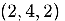 vuelve a ejecutar un núcleo de 4 capas con inicialización aleatoria  y reinyección de la entrada  hasta 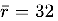 veces (132 capas efectivas), aunque investigaciones posteriores mediante sondeo (Lu et al., arXiv:2507.02199) señalaron la ambigüedad de la interpretación textual directa de las iteraciones ocultas intermedias y una reserva de memoria factual más modesta (MMLU 31.4 %) en comparación con los modelos entrenados con 4T tokens187. En octubre, Rui-Jie Zhu et al. (ByteDance) entrenaron con 7.7T tokens los modelos de bucle de pila completa con salida adaptativa **Ouro-1.4B y Ouro-2.6B** (arXiv:2510.25741, n.º 418\)77, donde el modelo de 2.6B con  alcanzó un 90.8 % en MATH-500 y se equiparó a modelos densos de hasta 12B gracias a la composición multipaso del conocimiento, y Boheng Wu et al. eliminaron la penalización secuencial de latencia de los bucles con el calendario segmentado **Cross-Loop Parallelism** en el **Parallel Loop Transformer (PLT)** (arXiv:2510.24824, n.º 419\)33. Al mismo tiempo, Ali Behrouz et al. crearon la neuromemoria a largo plazo **Titans**, actualizada en inferencia por gradiente con momento (arXiv:2501.00663, n.º 420\)288, Tianyuan Zhang et al. escalaron el entrenamiento de pesos rápidos por bloques hasta 1M de tokens en **LaCT** (arXiv:2505.23884, n.º 421\)289, Maximilian Beck y Sepp Hochreiter publicaron **xLSTM 7B** (arXiv:2503.13427, n.º 422\)183, y Bo Peng et al., **RWKV-7 "Goose"**, con evolución dinámica de bajo rango del estado (arXiv:2503.14456, n.º 423\)236.  
En la difusión discreta de texto aparecieron **LLaDA-8B** de Shen Nie et al. (y su variante MoE 7B-A1B), entrenada desde cero con una pérdida ELBO ponderada 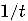 (arXiv:2502.09992, n.º 424\)35, la familia comercial **Mercury Coder** de Inception Labs, con una velocidad de generación paralela de **1,109 tokens/s** en H100 (arXiv:2506.17298, n.º 425\)58 y **Dream 7B** de Jiacheng Ye et al. (arXiv:2508.15487, n.º 426\)294. En la generación de vídeo, el equipo de Alibaba liberó bajo licencia Apache 2.0 los modelos **Wan 2.1** (arXiv:2503.20314, n.º 427\) y **Wan 2.2** (n.º 428\): la primera arquitectura de difusión de vídeo con un **eliminador de ruido MoE temporal de dos expertos** (27B de parámetros totales / 14B activos, con conmutación entre el experto de estructura gruesa y el de detalles finos según un umbral de SNR sin aumento del coste por paso, más el modelo compacto **TI2V-5B** con compresión VAE 4×16×16 para una sola RTX 4090\)172. También aparecieron **HunyuanVideo 1.5** (8.3B de parámetros, 75 s de renderizado en una RTX 4090 en modo step-distilled, arXiv:2511.18870, n.º 429\)297, el editor contextual y generador de 32 mil millones de parámetros **FLUX.1 Kontext / FLUX.2** (Mistral-3 24B \+ VAE de 128 canales, n.º 430\)174, el codificador multilingüe **SigLIP 2** (arXiv:2502.14786, 85.0 % zero-shot en ImageNet para ViT-g/16, n.º 431\)239, el modelo de mundo en vídeo con planificación para robots **V-JEPA 2** (arXiv:2506.09985, n.º 432\)59 y el codificador visual de 7 mil millones de parámetros **DINOv3**, con el mecanismo **Gram Anchoring** para conservar los mapas densos de segmentación durante un entrenamiento prolongado (arXiv:2508.10104, 55.9 mIoU en ADE20k, n.º 433\)301.  
En la pila de audio, Alibaba presentó los modelos omnimodales **Qwen2.5-Omni** (arXiv:2503.20215, n.º 434\) y **Qwen3-Omni** (arXiv:2509.17765, arquitectura **Thinker–Talker MoE** \+ codificador **AuT** de 12.5 Hz con 20 millones de horas de audio \+ decodificador causal instantáneo Code2Wav, sin caída del MMLU de texto, n.º 435\)303. Junto a ellos aparecieron el **Step-Audio** de 130 mil millones de parámetros (arXiv:2502.11946, n.º 436\)306, el **LLaMA-Omni2** en streaming (arXiv:2505.02625, n.º 437\)308, el sintetizador con cuantización FSQ **CosyVoice 3** (arXiv:2505.17589, n.º 438\)46, los modelos abiertos locales **Kokoro-82M**, **Orpheus-3B** y **Chatterbox**311, el generador de diálogos de 90 minutos sobre un 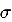\-VAE continuo **Microsoft VibeVoice** (arXiv:2508.19205, n.º 439\)173, los LM de audio continuos de Kyutai (arXiv:2509.06926, n.º 440\)315, el LLM de audio **Mistral Voxtral** (arXiv:2507.13264, n.º 441\)316, los ultrarrápidos **NVIDIA Canary-1B-v2 y Parakeet-TDT-0.6B-v3** (arXiv:2509.14128, 3,332.7 RTFx, n.º 442\)229 y **GigaAM-v3**317.

## **2026**

**Dominios:** Atención/LLM MoE Bucles/SSM Difusión Vídeo Codificador STT TTS STS Optimización

### **Buques insignia ultradispersos, atención en profundidad (AttnRes) y ahorro del caché KV global**

Hacia noviembre de 2026, las arquitecturas abiertas (sistematizadas en el catálogo *LLM Architecture Gallery* de Sebastian Raschka, con 132 modelos, y en su monografía *«Build a Reasoning Model (From Scratch)»*, junio de 2026, n.º 445\)1 pasaron a la activación ultradispersa de los pesos (3–6 % por token) y a la compresión híbrida de la atención. El modelo **DeepSeek V4 Pro** (versión 0813 de agosto de 2026, licencia MIT) escaló la MoE hasta **1.6 billones de parámetros con ~49B activos por token (~3.06 %)** y una ventana de 1M de tokens (entrenamiento con >32T tokens con el optimizador Muon): la combinación de **Compressed Sparse Attention (CSA)** y **Heavily Compressed Attention (HCA)** redujo el coste computacional con contexto de 1M al 27 % de los FLOPs, y la memoria del caché KV, al 10 % del nivel de V3.2 (según reseñas publicadas y materiales de la versión, se informa de un 93–94 % en LiveCodeBench, >90 % en GPQA Diamond y 62.7 en DeepSWE)31.  
El equipo de Moonshot AI, tras el visual-agéntico **Kimi K2.5** (arXiv:2602.02276), publicó el método **Attention Residuals (AttnRes)** (arXiv:2603.15031), que sustituye la acumulación uniforme del flujo residual por una atención softmax por bloques, aprendida, a lo largo del eje de profundidad de las capas precedentes, y en julio de 2026 liberó el entonces mayor buque insignia, de 2.8 billones de parámetros, **Kimi K3** (arXiv:2607.24653, 104B de parámetros activos — 16 de 896 expertos enrutados \+ 2 compartidos, ventana de 1M, punto de control nativo MXFP4, n.º 443\)4. En Kimi K3 se aplican la alternancia 3:1 de capas lineales **KDA** (con un logaritmo del decaimiento sigmoide acotado inferiormente, que cabe en el rango dinámico de BF16 sobre los núcleos matriciales densos de los Tensor Cores) y de capas globales **Gated MLA sin ninguna codificación posicional (NoPE)**, así como **Normalized LatentMoE**, con una capa RMSNorm antes de la proyección ascendente4. La serie de grandes MoE con atención dispersa se completó con **GLM-5** (arXiv:2602.15763, 744B-A40B, MLA \+ DSA \+ RL agéntico asíncrono APRIL, 77.8 % en SWE-bench Verified y 50.4 en AA Index v4.0)321, **Tencent Hy4** (770B-A49B, Gated MLA \+ DSA con IndexCache entre capas e hiperconexiones iHC de 4 bandas)1 y **Meta Muse Spark Open** (816B-A42B)1.  
En el polo de los sistemas locales compactos, **Google Gemma 4** (arXiv:2607.02770, Apache 2.0, tamaños E2B, E4B, 12B Unified, 26B-A4B MoE y 31B Dense) incorporó de una vez tres mecanismos arquitectónicos: las tablas de embeddings por capa **Per-Layer Embeddings (PLE)** en los modelos menores, la **proyección totalmente libre de codificador (Encoder-Free)** de fragmentos de audio crudo de 40 ms y de parches de imagen directamente al decodificador en el 12B Unified, y la **reutilización de las claves como valores ()** junto con la rotación parcial **\-RoPE ()** en las capas de atención global (proporción de locales a globales de 5:1), que redujo el caché KV global en un **37.5 %**73. Pese a las altas puntuaciones en pruebas de matemáticas y ciencias (89.2 % en AIME 2026 y 84.3 % en GPQA Diamond para el 31B en modo Thinking), el archivo independiente Artificial Analysis v5.0.1 señaló el rezago del modelo de 31B en escenarios agénticos complejos de varios pasos frente a los grandes sistemas de billones de parámetros324.

### **Híbridos 3:1 (Qwen 3.8, Nemotron 3/3.5), Mamba-3, FlashAttention-4 y modelos de difusión con bucles**

La hibridación de la memoria matricial lineal con una atención completa escasa se consolidó en **Alibaba Qwen 3.8-27B** (agosto de 2026, Apache 2.0, arquitectura VLM densa de 64 capas: 16 bloques de 3 capas **Gated DeltaNet** y 1 capa **Gated Attention**, en paralelo con el modelo cerrado/insignia 2.4T-A95B Qwen 3.8-Max)11. En las 48 capas Gated DeltaNet se almacenan matrices de estado de tamaño fijo de 48 cabezas de valores , que ocupan **72.0 MiB constantes en BF16** (**144.0 MiB / 151.0 MB en FP32**) para cualquier longitud de secuencia, mientras que las 16 capas Gated Attention requieren cuatro veces menos memoria de caché KV que un transformador homogéneo de 64 capas30. En la familia **NVIDIA Nemotron 3 Super** (120B-A12B, arXiv:2604.12374), **Nemotron 3 Ultra** (550B-A55B, 108 capas, arXiv:2606.15007) y **Nemotron 3.5 Super & Lightning** (arXiv:2610.38095), el híbrido Mamba-2 \+ GQA se combina con **LatentMoE** () y un borrador MTP recursivo para la decodificación especulativa con contexto de hasta 1M de tokens27.  
Los propios núcleos básicos de los SSM y de la atención recibieron una actualización fundamental. Aakash Lahoti, Tri Dao, Albert Gu et al. presentaron **Mamba-3** (arXiv:2603.15569, ICLR 2026\)32: la transición a la **discretización exponencial-trapezoidal** de segundo orden de precisión  eliminó la necesidad de una convolución 1D externa, las **transiciones de estado de valores complejos** (equivalentes a una **RoPE** dependiente de la entrada) permitieron seguir la paridad (Parity) con un 100 % de precisión, y la **formulación MIMO** de rango  elevó 4× la intensidad aritmética de la decodificación sin aumentar la latencia, igualando el estado  con el anterior 329. Ali Hatamizadeh, Yejin Choi y Jan Kautz separaron las compuertas de borrado y de escritura en **Gated DeltaNet-2** (arXiv:2605.22791)248, y el laboratorio de Tri Dao publicó **FlashAttention-4** (arXiv:2603.05451) para el escalado asimétrico de los aceleradores **NVIDIA Blackwell (B200/GB200)**: la emulación polinómica de la exponencial en las unidades FMA y la **omisión condicional del reescalado del softmax en línea** con  lograron 1,600 TFLOPs/s (71 % del pico), y la escritura del núcleo en Python con **CuTe-DSL** redujo el tiempo de compilación entre 20 y 30 veces en comparación con las plantillas de C++223. En la intersección de los bucles y la difusión, Sanghyun Lee et al. crearon los **Looped Diffusion Language Models (LoopMDM)** (arXiv:2605.26106, NeurIPS 2026), que ponen en bucle las capas tempranas y medias de un LM de difusión enmascarada, con un ahorro de hasta **3.34× en FLOPs de entrenamiento**188 (desarrollado en **Looped UDLMs**, arXiv:2610.3006656); aparecieron también el estudio de saturación del codificador de 7B **LoopCoder-v2 (PLT-7B)** (arXiv:2606.18023)38, los **Hyperloop Transformers** (arXiv:2604.21254)334, **LoopFold** (arXiv:2610.35556)194 y el modelo MoE abierto con bucles **Inkling 2 Mini** (Thinking Machines Lab, 26.4B-A3.4B, 3 pasadas de las capas medias \+ AttnRes)197.

### **Síntesis síncrona de audio y vídeo LTX-2.5 y agentes de voz de dúplex completo con herramientas**

En el vídeo generativo, Lightricks publicó **LTX-2** (arXiv:2601.03233, DiT asimétrico de dos flujos, con 14B para el flujo de vídeo con 3D-RoPE y 5B para el flujo de audio con 1D-RoPE, conectados por atención cruzada bidireccional en el tiempo)335 y en agosto de 2026 lanzó el **LTX-2.5** de 22 mil millones de parámetros (codificador de texto Gemma 4 12B, generación de vídeo síncrono de hasta 4K con una duración de hasta 20 s y sonido estéreo de 24 kHz en una sola pasada, continuidad de escenas multiplano y control IC-LoRA)258, mientras que en la generación de imágenes el transformador desacoplado **DDT-XL/2** de Wang et al. (CVPR 2026, arXiv:2504.05741) redujo el FID en ImageNet 256×256 hasta **1.26**219. En el habla de dúplex completo, el equipo de NVIDIA presentó **PersonaPlex 7B** (arXiv:2602.06053, prompt híbrido de rol y de muestra de voz fijado en el contexto sobre la arquitectura Moshi \+ Mimi: naturalidad DMOS **3.90 ± 0.15** y similitud de clonación de voz SSIM **0.57**)68 y **NemotronLabs VoiceChat** (arXiv:2609.21967, el primer modelo STS Full-Duplex abierto con llamada nativa a herramientas (Tool Calling), transcripción auxiliar RNN-T, 100 % de intercepción ante interrupciones y 93 % de continuación del habla tras las interjecciones del oyente)69. La pila de voz en streaming la completaron **Qwen3-TTS** (arXiv:2601.15621, rama causal de 12.5 Hz con MTP de 16 libros de códigos y una latencia del primer paquete de unos **97–100 ms**) y **Qwen-Audio-3.0-TTS** (arXiv:2607.23938)54, **Qwen3.5-Omni** (arXiv:2604.15804, alineación ARIA)342, **Fish Audio S2-Pro** (arXiv:2603.08823, TTFA ~100 ms, RTF 0.195) y **Drama 3** (arXiv:2610.18010)158, el **Kyutai Pocket TTS**, que funciona a 6× la velocidad del tiempo real en dos núcleos de CPU de un portátil (100M de parámetros, MIT)344, el **Mistral Voxtral Realtime** en streaming (arXiv:2602.11298, latencia de 480 ms)345, **GigaAM Multilingual** (arXiv:2607.10371, Interspeech 2026\)346 y el **Nemotron 3.5 Transcribe** de dos ramas (TDT \+ diarizador Sortformer)348.

## **2027**

**Dominios:** Atención/LLM Bucles/SSM Difusión Vídeo Optimización  
El programa científico de **2027**, fijado a noviembre de 2026 por las publicaciones aceptadas de las conferencias de invierno y primavera **WACV 2027**, **AAAI / IAAI 2027**, **WSDM 2027**, **DATE 2027** y por el corpus abierto sometido a revisión por pares de 37,028 envíos de **ICLR 2027** en OpenReview, se centra en la unificación teórica de los paradigmas generativos y en la eliminación de las sutiles patologías numérico-fásicas de las redes híbridas y con bucles15. En el artículo de Amandeep Kumar, Nithin Nair y Vishal Patel *«Scale-wise VAR is Secretly Discrete Diffusion»* (n.º 444\)17, aceptado en WACV 2027, se demuestra con rigor que los modelos autorregresivos visuales de predicción de la siguiente escala (VAR) son funcionalmente equivalentes a la difusión enmascarada discreta por escalas en un espacio latente multiescala. En las actas de WACV 2027 y AAAI/IAAI 2027 se presentan además los transformadores enmascarados de vídeo para segmentación de largo plazo **LVMT** (Norouzi et al.)16, esquemas de flujo de un solo paso (arXiv:2608.09579), los decodificadores de difusión **PixCell** (arXiv:2611.01141), sesgos estructurales de la atención (arXiv:2611.04657) y arquitecturas industriales de recuperación con autoridad acotada (arXiv:2611.20398)19.  
En el corpus revisado por pares de ICLR 2027 se han identificado tres mecanismos fundamentales de la próxima generación. En primer lugar, el análisis de la compresión del caché KV por bloques (*«Periodic Weak Spots: Phase Sensitivity from Chunked KV-Cache Compression»*) mostró que, en modelos de la clase DeepSeek-V4, la precisión de recuperación de hechos varía hasta **40 puntos porcentuales** según la fase de la posición del token respecto de los límites de la ventana de compresión, debido a la aparición de cabezas especializadas por fase15. En segundo lugar, un trabajo sobre la estabilidad numérica del paso inverso de la atención (OpenReview:LJvGaCWmFh) estableció que las explosiones tardías de gradientes en el entrenamiento con **BF16 FlashAttention-3** se deben a la violación, por el redondeo BF16, de la ley exacta de conservación de la suma de gradientes de las filas del softmax (error mediano del gradiente de las consultas del 219%), y propuso una corrección del núcleo inverso que reduce el error hasta **0.34% / 0.37%** (nivel FP32) con un encarecimiento del paso de solo un 4.7%352. En tercer lugar, se propusieron los **Variable-Width («Hourglass») Transformers**, estrechados en el medio, las **Matryoshka Language Model Suites** anidadas (ahorro del 36% de cómputo en el entrenamiento de la gama de tamaños) y el método **SafeBridge** para alinear la seguridad de los modelos con bucles en todas las profundidades de recursión, en respuesta al descubrimiento de que reducir a la mitad el número de bucles en inferencia en Ouro y Huginn conserva el 89% de la precisión en GSM8K, pero destruye el vector de rechazo, de formación tardía, aumentando la vulnerabilidad a las solicitudes maliciosas entre 5.3 y 9.9 veces15.

## **Apéndice A. Tablas resumen de arquitecturas, benchmarks, estadísticas y repositorios**

### **Tabla A.1. Matriz cronológica completa de arquitecturas y mecanismos (1958–2027, paso de 1 año)**

| Año | Dominio / Etiquetas | Arquitectura / algoritmo clave | Mecanismo matemático de referencia | Hitos, autores y número en la Bibliografía |
| :---- | :---- | :---- | :---- | :---- |
| **1958** | Base | Perceptrón Mark I | Hiperplano , corrección de errores | Rosenblatt (n.º 1), von Neumann (n.º 2\) |
| **1959** | Codificador Base | Pandemonium; TD-damas; Campos receptivos de V1 | Selección paralela ; diferencia temporal de la evaluación de la posición | Hubel & Wiesel (n.º 3), Selfridge (n.º 4), Samuel (n.º 5\) |
| **1960** | Base Optimización | ADALINE / regla LMS; Gradiente conjugado | Regla delta ; EDO conjugadas continuas | Widrow & Hoff (n.º 6), Kelley (n.º 7\)7 |
| **1961** | Bucles Memoria | Die Lernmatrix; Ecuaciones mnemónicas | Memoria heteroasociativa matricial  | Steinbuch (n.º 8\)91, Caianiello (n.º 9\) |
| **1962** | Base Codificador | Teorema de convergencia del perceptrón; MADALINE | Cota de errores ; células simples y complejas de la corteza | Novikoff (n.º 10\)93, Hubel & Wiesel (n.º 14\) |
| **1963** | Base Optimización | Retrato generalizado (SVM lineal) | Hiperplano de margen máximo  | Vapnik & Lerner (n.º 15\)98 |
| **1964** | Optimización Base | Método del momento de Polyak; Funciones potenciales | Heavy-ball ; truco del núcleo; AD directa | Polyak (n.º 18\)101, Aizerman et al. (n.º 19), Wengert (n.º 20\) |
| **1965** | Base | Primeros MLP profundos; Teorema de Cover | Selección por capas de polinomios de Kolmogórov—Gabor; número de dicotomías 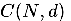 | Ivakhnenko & Lapa (n.º 21\)7, Cover (n.º 22\) |
| **1966** | Optimización Base | Minimización del riesgo medio en el aprendizaje | Aproximación estocástica  | Tsypkin (n.º 25\)106, Braverman (n.º 26\) |
| **1967** | Base Optimización | SGD multicapa de extremo a extremo; Sinkhorn–Knopp | Descenso de gradiente en una red de 5 capas; proyección de matrices doblemente estocásticas | Amari (n.º 28\)21, Sinkhorn & Knopp (n.º 30\)61 |
| **1968** | Base Bucles | GMDH; Redes Outstar; Teoría VC | Regularización de validación de la profundidad; ecuaciones de plasticidad STM/LTM | Ivakhnenko (n.º 31), Grossberg (n.º 32), Vapnik (n.º 33\) |
| **1969** | Base Codificador | Límites de los perceptrones; ReLU analógica | Inseparabilidad de XOR con una sola capa; rectificador multicapa 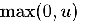 | Minsky & Papert (n.º 34), Bryson & Ho (n.º 35), Fukushima (n.º 36\)85 |
| **1970** | Base Optimización | Modo inverso de la autodiferenciación; BFGS | Regla de la cadena exacta sobre un grafo ; cuasi-Newton | Linnainmaa (n.º 37\)113, BFGS (n.º 38\) |
| **1971** | Base Memoria | Red GMDH de 8 capas; Teoría del arquicórtex | Red polinómica profunda; memoria asociativa dispersa del hipocampo | Ivakhnenko (n.º 40\)115, Marr (n.º 41\) |
| **1972** | Bucles Memoria | Red de Amari—Hopfield; Poblaciones de Wilson–Cowan | Atractores recurrentes ; ciclos límite E–I | Amari (n.º 42\)115, Kohonen (n.º 43), Wilson & Cowan (n.º 46\)120 |
| **1973** | Codificador Bucles | Autoorganización de la corteza V1; Redes de derivación (shunting) | Regla competitiva de Hebb con normalización  de los pesos; contraste divisivo | von der Malsburg (n.º 47\)123, Grossberg (n.º 48\) |
| **1974** | Base Bucles | Backprop para redes neuronales; Modelo de espines del cerebro | Retroalimentación dinámica de las derivadas; distribución de Ising con temperatura | Werbos (n.º 50\)123, Little (n.º 51\)127 |
| **1975** | Codificador Memoria | Cognitron; CMAC; Vidrio de espín SK | Inhibición divisiva de las capas; codificación hash local; hamiltoniano SK | Fukushima (n.º 52\)122, Albus (n.º 53), SK (n.º 54\) |
| **1976** | Optimización Bucles | Reverse AD en publicación (BIT); Prototipo de ART | Desarrollo de Taylor con compromiso de memoria; dilema estabilidad—plasticidad | Linnainmaa (n.º 56\)23, Grossberg (n.º 57\) |
| **1977** | Bucles Optimización | Brain-State-in-a-Box (BSB); Algoritmo EM | Atractores en el hipercubo 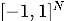; cota inferior de la verosimilitud de variables latentes | Anderson et al. (n.º 59\)122, Dempster et al. (n.º 62\) |
| **1978** | Memoria Base | Capacidad sináptica de la memoria; Criterio BIC | Escalado de la capacidad de memoria  según el número de sinapsis | Little & Shaw (n.º 63\)127, Schwarz (n.º 64\) |
| **1979** | Codificador | Neocognitron (publicación original) | Cascada de planos compartidos de células  (convolución) y células  (pooling) | Fukushima (n.º 67\)86 |
| **1980** | Codificador Optimización | Neocognitron (internac.); Cota de Baur—Strassen | Invarianza a desplazamientos mediante la cascada ; estimación de la complejidad del gradiente  | Fukushima (n.º 69\)129, Baur & Strassen (n.º 71\) |
| **1981** | Memoria Bucles | Representaciones distribuidas; RL asociativo | Activación interactiva de características; gradiente de búsqueda por refuerzo | Hinton & Anderson (n.º 72), Barto et al. (n.º 74\) |
| **1982** | Bucles Codificador | Red de Hopfield; Mapas de Kohonen (SOM); Regla de Oja | Función de Lyapunov ; aprendizaje topográfico; PCA neuronal | Hopfield (n.º 75), Werbos (n.º 76), Kohonen (n.º 77), Oja (n.º 78\) |
| **1983** | Optimización Bucles | Método acelerado de Nesterov; Recocido simulado | Descenso óptimo  en el punto de anticipación; Actor–Critic RL | Nesterov (n.º 81\)143, Kirkpatrick (n.º 82), Barto (n.º 83\) |
| **1984** | Base Difusión | Aprendizaje PAC; Hopfield continuo; Muestreador de Gibbs | Aprendibilidad polinómica ; relajación MCMC sobre campos MRF | Valiant (n.º 84\)147, Hopfield (n.º 85), Geman (n.º 86\) |
| **1985** | Base Difusión | Máquina de Boltzmann; Deducciones independientes de Backprop | Gradiente de la diferencia de correlaciones de fases 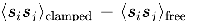 | Ackley, Hinton & Sejnowski (n.º 88\)150, LeCun (n.º 89\) |
| **1986** | Base Bucles | MLP \+ Backpropagation; RBM (Harmonium); RNN de Jordan | Gradiente en cadena de las representaciones ocultas ; energía bipartita sin ciclos | Rumelhart, Hinton & Williams (n.º 92), Smolensky (n.º 94), Jordan (n.º 95\) |
| **1987** | STT Bucles | TDNN; Pesos rápidos (Fast Weights); Autoencoder stack | Convolución 1D en el tiempo para el habla; adición plástica de contexto a los pesos | Waibel (n.º 97), Hinton & Plaut (n.º 98), Ballard (n.º 99), Pineda (n.º 101\) |
| **1988** | Codificador Optimización | CNN 2D con backprop; Redes RBF; Aprendizaje TD() | Convolución bidimensional con aprendizaje por error; bootstrapping del residuo de Bellman | Zhang (n.º 102\)20, Broomhead (n.º 103), Sutton (n.º 104\) |
| **1989** | Codificador Base | Red convolucional de LeCun (USPS); Teorema de aproximación | Backprop de extremo a extremo sobre núcleos 2D con stride; densidad de los MLP en ; Q-learning | LeCun et al. (n.º 107), Cybenko (n.º 108), Hornik (n.º 109), Watkins (n.º 111\) |
| **1990** | Bucles Optimización | Red de Elman (Simple RNN); BPTT; Optimal Brain Damage | Contexto oculto ; poda por la diagonal del hessiano | Elman (n.º 114), Werbos (n.º 115), LeCun et al. (n.º 116), Schmidhuber (n.º 117\) |
| **1991** | MoE Bucles Atención | Mixture of Experts; Desvanecimiento del gradiente; Fast Weights | Red de compuerta ; análisis de ; autoatención lineal | Jacobs et al. (n.º 119), Hochreiter (n.º 120), Schmidhuber (n.º 121\)22 |
| **1992** | Optimización Bucles | REINFORCE; Compresor neuronal de historia; Promediado de Polyak | Gradiente de política ; destilación de RNN; promedio de trayectoria de SGD | Williams (n.º 124), Schmidhuber (n.º 125), Polyak & Juditsky (n.º 126\) |
| **1993** | Codificador Base | Redes siamesas; MDL variacional; Cota de Barron | Torres métricas con pesos compartidos; energía libre de los pesos; poda OBS | Bromley & LeCun (n.º 129), Hinton & van Camp (n.º 130), Barron (n.º 131\) |
| **1994** | Bucles MoE | Teorema de las dependencias de largo alcance; MoE jerárquica | Incompatibilidad entre el almacenamiento estable y el gradiente en las RNN; operador  en  | Bengio et al. (n.º 133), Jordan & Jacobs (n.º 134), Pearlmutter (n.º 135\) |
| **1995** | Base Difusión | Máquina de Helmholtz (Wake–Sleep); SVM de margen blando | Par generador/red de inferencia ; maximización de la información mutua | Hinton et al. (n.º 137), Cortes & Vapnik (n.º 139), Bishop (n.º 141\) |
| **1996** | Codificador Base | Codificación dispersa de V1; Límite gaussiano de ancho infinito | Reconstrucción  con un diccionario sobrecompleto; convergencia de  a NNGP | Olshausen & Field (n.º 142), Neal (n.º 143), Goller & Küchler (n.º 144\) |
| **1997** | Bucles Memoria | LSTM; RNN bidireccional (BiRNN); Mínimos planos | Celda aditiva  (CEC); ramas directa e inversa del tiempo | Hochreiter & Schmidhuber (n.º 146), Schuster & Paliwal (n.º 147\) |
| **1998** | Codificador Optimización | LeNet-5; Gradiente natural de Amari | Cascada Conv–Pool–FC \+ transductor de grafos; métrica de Fisher  | LeCun et al. (n.º 150), Amari (n.º 152), Sutton & Barto (n.º 153\) |
| **1999** | Bucles Base | Compuerta de olvido de LSTM; Factorización no negativa NMF | Reinicio multiplicativo ; características aditivas  | Gers, Schmidhuber & Cummins (n.º 155\)155, Lee & Seung (n.º 156\) |
| **2000** | Bucles Base | LSTM con peephole; Softplus; Aprendizaje de variedades (Isomap/LLE) | Conexión de la celda  con las compuertas; activación suave  | Gers et al. (n.º 158, 159), Dugas et al. (n.º 160), Tenenbaum (n.º 161\) |
| **2001** | Bucles Codificador | Echo State Networks (ESN); Campos aleatorios condicionales (CRF) | Reservorio con decaimiento ; normalización global de caminos  | Jaeger (n.º 163), Lafferty et al. (n.º 164), Hastie et al. (n.º 165\) |
| **2002** | Difusión Base | Divergencia contrastiva (CD\-); Perceptrón estructural | Estimación MCMC de un paso del gradiente de la RBM a partir de los datos; biblioteca Torch | Hinton (n.º 166), Collins (n.º 168), Collobert et al. (n.º 169\) |
| **2003** | Base Atención/LLM | Modelo de lenguaje probabilístico neuronal (NPLM) | Embeddings de palabras densos y entrenables ; distorsiones elásticas de CNN | Bengio et al. (n.º 170), Simard et al. (n.º 171), MacKay (n.º 172\) |
| **2004** | Optimización Base | Primera aceleración de redes neuronales en GPU; Teoría  vs  | Operaciones matriciales en shaders de GPU (20×); complejidad logarítmica  | Oh & Jung (n.º 173), Ng (n.º 174), Welling et al. (n.º 175\) |
| **2005** | Difusión STT Base | Score Matching; BiLSTM para el habla; Redes de grafos (GNN) | Estimación de  sin la función de partición ; Softmax jerárquico | Hyvärinen (n.º 176\)163, Graves (n.º 177), Gori et al. (n.º 179\) |
| **2006** | STT Base | CTC; Redes de creencia profundas (DBN) y autocodificadores | Suma de alineamientos con símbolo vacío ; pila de RBM por capas | Graves et al. (n.º 181), Hinton et al. (n.º 182, 183), Bishop (n.º 185\) |
| **2007** | Base Optimización | Asintótica de SGD con grandes datos; Pila de autocodificadores | Optimalidad de SGD de primer orden con límite de tiempo de cómputo | Bengio et al. (n.º 186), Bottou & Bousquet (n.º 187), Mnih (n.º 188\) |
| **2008** | Codificador Difusión | Autocodificadores con eliminación de ruido (DAE); CNN-NLP unificada | Reconstrucción del  limpio a partir del  ruidoso; embeddings multitarea; t-SNE | Vincent et al. (n.º 190), Collobert & Weston (n.º 191), t-SNE (n.º 192\) |
| **2009** | Codificador Optimización | ImageNet; Aprendizaje profundo en CUDA; Curriculum Learning | Escalado a 14M de imágenes y CUDA (70×); calendario de dificultad | Deng et al. (n.º 193), Raina, Madhavan & Ng (n.º 194), Bengio (n.º 195\) |
| **2010** | Base Optimización | Inicialización Xavier; ReLU en redes profundas; RNNLM; NCE | Conservación de la varianza ; linealidad por tramos ; Theano | Glorot & Bengio (n.º 198), Nair & Hinton (n.º 199), Mikolov (n.º 200\) |
| **2011** | Optimización Difusión | AdaGrad; Denoising Score Matching (DSM); CD-DNN-HMM | Escalado por coordenada ; equivalencia entre DAE y  | Duchi et al. (n.º 204), Vincent (n.º 205\)166, Seide et al. (n.º 208\) |
| **2012** | Codificador STT | AlexNet; RNN-Transducer (RNN-T); Dropout; RMSProp | CNN profunda en GPU con ReLU y Dropout; retícula conjunta del Joiner  para ASR en línea | Krizhevsky et al. (n.º 210\)167, Graves (n.º 211), Hinton (n.º 212\) |
| **2013** | Codificador Difusión | Variational Autoencoder (VAE); Word2Vec; NiN; DQN | Cota inferior ELBO \+ reparametrización ; Skip-Gram contrastivo | Kingma & Welling (n.º 217), Mikolov (n.º 219), Lin (n.º 220), Mnih (n.º 222\) |
| **2014** | Atención Difusión | Seq2Seq \+ Bahdanau Attention; GRU; GAN; Optimizador Adam | Alineamiento suave del contexto ; minimax ; momentos adaptativos | Sutskever (n.º 225), Bahdanau (n.º 226), Cho (n.º 227), GAN (n.º 229), Adam (n.º 230\) |
| **2015** | Base Difusión | ResNet \+ Kaiming Init; BatchNorm; U-Net; Difusión | Conexión identidad ; codificador-decodificador con skip; inversión de la cadena de Márkov | He et al. (n.º 237), Ioffe (n.º 239), U-Net (n.º 240), Sohl-Dickstein (n.º 241\) |
| **2016** | TTS Bucles Base | LayerNorm; Pre-LN ResNet; ACT; GELU; WaveNet | Normalización por las características del token; compuerta de parada de bucle entrenable; convoluciones dilatadas | Ba (n.º 249), He (n.º 250), Graves (n.º 251), GELU (n.º 252), WaveNet (n.º 253\) |
| **2017** | Atención/LLM MoE TTS | Transformer canónico; Sparse MoE; VQ-VAE; AdamW; PPO | ; enrutamiento Top\-; libro de códigos discreto; weight decay desacoplado | Vaswani (n.º 260), Shazeer (n.º 261), VQ-VAE (n.º 262), AdamW (n.º 265), PPO (n.º 266\) |
| **2018** | Codificador LLM Bucles | BERT; GPT-1; Universal Transformer; Neural ODE; InfoNCE; Shampoo | MLM bidireccional vs AR causal; bucle del transformador con ACT; profundidad continua | Devlin (n.º 274), Radford (n.º 273), Dehghani (n.º 275), Chen (n.º 276), Shampoo (n.º 282\) |
| **2019** | Atención/LLM Bucles TTS | GPT-2; RMSNorm; MQA; DEQ; FastSpeech; NCSN; ZeRO/Megatron | Normalización sin desplazamiento; una sola cabeza KV; punto fijo implícito ; regulador de longitudes | Radford (n.º 285), RMSNorm (n.º 286), MQA (n.º 287), DEQ (n.º 288), FastSpeech (n.º 292\) |
| **2020** | LLM Difusión STT | GPT-3 & Scaling Laws; SwiGLU; Linear Attn; DDPM/SDE; ViT; Conformer | FFN con compuertas; núcleo ; pérdida de ruido ; parches 16×16; híbrido Conv+Attn | Brown (n.º 300), SwiGLU (n.º 301), DDPM (n.º 303), ViT (n.º 306), Conformer (n.º 307\) |
| **2021** | LLM Bucles/SSM TTS | RoPE; ALiBi; Switch MoE; LoRA; CLIP; S4; VITS; SoundStream; LDM | Rotación compleja ; adaptador  de rango ; SSM NPLR; códec de audio RVQ; difusión en VAE | RoPE (n.º 316), LoRA (n.º 319), CLIP (n.º 320), S4 (n.º 324), SoundStream (n.º 327), LDM (n.º 331\) |
| **2022** | LLM Difusión STT | FlashAttention; Chinchilla; DiT; Flow Matching / Rectified Flow; Whisper | Tiling en SRAM con softmax en línea; ; transformador adaLN-Zero; EDO rectilíneas  | Dao (n.º 332), Chinchilla (n.º 334), Rectified Flow (n.º 338), DiT (n.º 341), Whisper (n.º 342\) |
| **2023** | LLM Bucles/SSM STS | GQA; vLLM; Mixtral 8x7B; Mamba (S6); RWKV/RetNet; SigLIP; VALL-E; TDT; DPO | KV agrupado;  dependientes de la entrada; pérdida sigmoide; omisión de tramas por duración | GQA (n.º 347), Mamba (n.º 356), SigLIP (n.º 358), VALL-E (n.º 362), TDT (n.º 366), DPO (n.º 353\) |
| **2024** | LLM MoE Bucles STS | DeepSeek-V2/V3 (MLA, Aux-Free MoE, MTP); Mamba-2; xLSTM; GDN; MMDiT; Moshi | Caché KV de bajo rango MLA; equilibrio mediante sesgo ; regla delta ; Full-Duplex 160 ms (Mimi) | DeepSeek (n.º 371, 372), Mamba-2 (n.º 379), GDN (n.º 382), HunyuanVideo (n.º 394), Moshi (n.º 400\) |
| **2025** | LLM Bucles Difusión Vídeo | DeepSeek-R1 & V3.2 (DSA) & mHC; Kimi K2 (MuonClip) & KDA; Huginn/Ouro/PLT; LLaDA/Mercury; Wan 2.2 | GRPO verificable; proyección de Sinkhorn sobre el politopo de Birkhoff; bucles latentes; dLLM; MoE de vídeo | R1 (n.º 406), V3.2 (n.º 408), mHC (n.º 409), K2 (n.º 411), Huginn (n.º 417), Ouro (n.º 418), LLaDA (n.º 424\) |
| **2026** | LLM Híbridos Vídeo STS | DeepSeek V4 Pro; Kimi K3 (AttnRes); Gemma 4; Qwen 3.8; Nemotron 3/3.5; Mamba-3; FA-4; LTX-2.5; PersonaPlex | CSA+HCA (10% KV); atención en profundidad;  \+ \-RoPE; híbrido 3:1 GDN; SSM MIMO complejo; DiT de audio y vídeo | K3 (n.º 443\)4, Gemma 4156, Qwen 3.830, Mamba-332, LTX-2.5297 |
| **2027** | LLM Difusión Optimización | Scale-wise VAR \= dLLM; Análisis de fases del KV de DeepSeek-V4; FA-bwd exacto en BF16; Hourglass LM; SafeBridge | Isomorfismo entre VAR y la difusión enmascarada; ley de conservación del gradiente del softmax; seguridad por bucles | Kumar et al. (WACV'27, n.º 444\)17, OpenReview ICLR'2715 |

Dos cambios sistémicos determinantes de las arquitecturas de lenguaje abiertas de 2024–2026 se sitúan en el plano de la gestión de la memoria de las tarjetas de vídeo: la compresión radical del estado del contexto (mediante el caché de bajo rango MLA y la sustitución del 75% de las capas de atención por la memoria matricial de tamaño constante respecto de la longitud de Gated DeltaNet o KDA) y la transición a la activación ultradispersa de los pesos, en la que, con un volumen total de conocimiento de 0.7–2.8 billones de parámetros, por cada token se activa solo el 3.1–10.0% de la red4.  
  
La comparación de los volúmenes de memoria citados explica la economía práctica de la inferencia agéntica de contexto largo: en los modelos homogéneos de atención completa, el crecimiento lineal del caché KV supera rápidamente el tamaño de los propios pesos del modelo, lo que obliga a distribuir la inferencia entre varios nodos solo para almacenar el historial del diálogo196. En cambio, la arquitectura híbrida 3:1 congela por completo el crecimiento de la memoria en el 75% de las capas de la red (dejándola en 72 MiB en BF16 independientemente de que la longitud del contexto sea de 32K o de 1M de tokens) y, combinada con un 3–5% de expertos activos, permite atender trayectorias de varios pasos un orden de magnitud más barato con igual calidad30.

### **Tabla A.2. Especificaciones arquitectónicas y benchmarks de los LLM insignia abiertos y de los híbridos (2024–2026)**

*Nota sobre la atribución (a fecha de 25.11.2026):* Las métricas se dan según los informes técnicos oficiales y las fichas de modelo de los desarrolladores; cuando existen mediciones o reseñas independientes (Epoch AI, Artificial Analysis, resúmenes técnicos), la fuente se indica explícitamente en la celda31. El guion (—) significa que en la fuente primaria no hay una publicación comparable de la métrica.

| Modelo (Lanzamiento, Licencia) | Pesos totales / activos | Arquitectura de atención / SSM y de expertos | Ventana de contexto | MMLU-Pro (%) | GPQA Diamond (%) | AIME 24 / 25 / 26 (%) | LiveCodeBench (%) | SWE-bench Verified (%) |
| :---- | :---- | :---- | :---- | :---- | :---- | :---- | :---- | :---- |
| **DeepSeek-V3 / 0324** (dic. 2024, MIT)29 | 671B / 37B (5.5%) | 61 capas: MLA \+ Aux-Loss-Free MoE (8/256 \+ 1 shared) \+ MTP | 128K | 75.9 (81.2 en 0324\) | 59.1 (68.4 en 0324\) | 39.2 ('24; 59.4 en 0324\) | 46.9 (v6, 0324\) | 38.8 (Agentic, 0324\) |
| **DeepSeek-R1 / 0528** (ene./may. 2025, MIT)268 | 671B / 37B (5.5%) | Base V3 \+ RL verificable multietapa (GRPO) | 128K | 84.0 | 71.5 (81.0 en 0528\) | 79.8 ('24) / 70\.0$\rightarrow$87.5 ('25) | 63\.5$\rightarrow$73.3 (v6) | 49.2 |
| **Llama 4 Maverick** (abr. 2025, Llama 4\)280 | 400B / 17B (4.3%) | Alternancia de capas densas y MoE (1/128 \+ 1 shared), fusión temprana | 1M (10M en Scout) | — | 67.0 (Epoch AI) | — | — | — |
| **Qwen3-235B-A22B** (may./jul. 2025, Apache 2.0)247 | 235B / 22B (9.4%) | 94 capas: GQA (64Q / 4KV) \+ MoE (8/128), modo Think/Non-Think | 128K–262K (1M DCA) | 77.3 (non-think) | 62.9 (non-think) | 85.7 ('24) / 81.5 ('25, think) | 70.7 (v5, think) | 34.4 (non-think) |
| **Kimi K2 Instruct** (jul. 2025, Mod. MIT)66 | 1.04T / 32.6B (3.1%) | 61 capas: MLA (64 cabezas) \+ MoE (8/384 \+ 1 shared), entrenada con MuonClip | 128K | 81.1 | 75.1 | 69.6 ('24) / 49.5 ('25) | 53.7 (v6, non-think) | 65.8 (71.6 multi) |
| **GLM-4.5** (jul. 2025, MIT)282 | 355B / 32B (9.0%) | MoE profunda \+ GQA \+ MTP, híbrido Thinking / Non-Thinking | 128K | 84.6 | 79.1 | 91.0 (AIME'24) | 72.9 | 64.2 |
| **DeepSeek-V3.2** (dic. 2025, MIT)10 | 671B / 37B (5.5%) | MLA \+ **DeepSeek Sparse Attention (DSA)** \+ GRPO agéntico unificado | 128K | \~85.0 | 82.4 | 94.17 (AIME'26) | — | 70.2 (Multilingual) |
| **Nemotron 3 Nano** (dic. 2025, OpenMDW)184 | 31.6B / 3.2B (10.1%) | Híbrido Mamba-2 \+ GQA \+ MoE granular (6/128), NVFP4 | 1M (RULER 86.3) | 78.3 | 73.0 (75.0 tools) | 89.1 ('25) / 99.2 (tools) | 68.3 (v6) | 38.8 (OpenHands) |
| **GLM-5 / GLM-5.1** (feb./abr. 2026, MIT)321 | 744B / 40B (5.4%) | 80 capas: MLA \+ **DSA** \+ 256 expertos \+ Muon \+ RL asínc. APRIL | 200K–1M | — | — | 95.4 / 95.3 (AIME'26) | — | 77.8 |
| **Qwen3.5-397B-A17B** (primavera 2026, Apache 2.0)353 | 397B / 17B (4.3%) | Híbrido 3:1 (75% **Gated DeltaNet** \+ 25% GQA) \+ Sparse MoE | 256K | — | 88.4 (resumen) | 91.3 (AIME'26) | 83.6 (v6) | — |
| **Gemma 4 31B Dense** (abr./jul. 2026, Apache 2.0)324 | 30.7B / 30.7B (100%) | 60 capas: 5:1 SWA/Global,  **\+ \-RoPE** (ahorro del 37.5% de KV), MTP | 256K | 85.2 | 84.3 (75.8 min Epoch) | 89.2 (AIME'26) | 80.0 (v6) | — |
| **Gemma 4 26B-A4B** (abr./jul. 2026, Apache 2.0)324 | 25.2B / 3.8B (15.1%) | 30 capas: 5:1 SWA/Global (, \-RoPE) \+ MoE (8/128 \+ 1 shared) | 256K | 82.6 | 82.3 | 88.3 (AIME'26) | 77.1 (v6) | — |
| **Nemotron 3 Ultra** (jun. 2026, OpenMDW)326 | 550B / 55B (10.0%) | 108 capas: Mamba-2 \+ GQA (64Q/2KV) \+ **LatentMoE** (22/512) \+ 2 MTP | 1M | — | — (AA Index 56.4) | — | — | — |
| **Kimi K3** (jul. 2026, Kimi K3 Lic.)4 | 2.8T / 104B (3.7%) | Híbrido 3:1 (**KDA** \+ Gated MLA NoPE) \+ **AttnRes** \+ Stable LatentMoE (16/896) | 1M | — | — | — | — | 81.2 (FrontierSWE) |
| **DeepSeek V4 Pro** (ago. 2026, MIT)31 | 1.6T / \~49B (3.1%) | Híbrido **CSA \+ HCA** (27% de FLOPs y 10% de KV respecto de V3.2 con 1M) \+ Muon (\>32T tok.) | 1M | — | \>90.0 (reseña de la versión) | — | 93–94 (reseña de la versión) | 62.7 (DeepSWE) |
| **Qwen3.8-27B** (ago. 2026, Apache 2.0)30 | 27B / 27B (100%, VLM) | 64 capas: **48 Gated DeltaNet** (48V/16QK) \+ **16 Gated Attn** (24Q/4KV) \+ MTP | 262K (1M YaRN) | — | — (AA v4.3.2: 33.7) | — | — | 42.2 (DeepSWE 1.1) |
| **Tencent Hy4** (ago. 2026, Open)1 | 770B / 49B (6.4%) | 78 capas: Gated MLA \+ **DSA (IndexCache)** \+ **iHC** de 4 bandas \+ MoE (8/256 \+ 1\) | — | — | — | — | — | — |
| **Nemotron 3.5 Super** (oct. 2026, OpenMDW)327 | 120B / 12B (10.0%) | Híbrido Mamba-2 \+ GQA \+ LatentMoE (512 exp.) \+ MTP drafter recursivo | 1M | — | — | — | — | 86\.9$\rightarrow$92.1 (Pro V2 \+ RL) |

La dinámica de la densidad intelectual entre las generaciones de 2025 y 2026 se manifiesta con especial claridad al comparar problemas científicos y de olimpiada complejos (GPQA Diamond y AIME 2026\) con la eficiencia paramétrica de los modelos de profundidad recurrente10.  
  
Los datos presentados revelan una regularidad importante: en las tareas de deducción secuencial (AIME, MATH-500) el factor decisivo no es el número bruto de parámetros únicos, sino la *profundidad efectiva de las transformaciones no lineales secuenciales*, alcanzada bien explícitamente mediante el modo de razonamiento en contexto (el modo Thinking de Gemma 4 26B-A4B, con 3.8B de parámetros activos, eleva AIME 2026 hasta el 88.3% frente al 20.8% de Gemma 3 27B sin razonamiento), bien implícitamente dentro del estado oculto mediante  pasadas recurrentes por la pila compartida de capas en Ouro-2.6B286.

### **Tabla A.3. Modelos de lenguaje de profundidad recurrente (con bucles) y de difusión (2025–2026)**

| Modelo / Arquitectura | Paradigma y topología de la profundidad | Parámetros únicos / Tokens de entrenamiento | Métricas experimentales clave y aceleraciones |
| :---- | :---- | :---- | :---- |
| **Huginn-0125** (arXiv:2502.05171)3 | Bucle sándwich  con inyección por concat de la entrada  y ,  () | 3.5B / 800B tokens (4,096 MI250X) | Al aumentar los bucles : ARC-Easy 49.07%69.91%, HellaSwag 43.46%65.21%, GSM8K CoT 42.08%; zero-shot KV-sharing en 4 ranuras sin pérdidas en MT-Bench (5.86)284 |
| **Ouro-1.4B & Ouro-2.6B** (arXiv:2510.25741)286 | Bucle de pila completa () con compuerta de salida temprana entrenable (ACT gate) | 1.4B y 2.6B / 7.7T tokens | **Ouro-1.4B**: MMLU 67.3%, GSM8K 78.9%, MATH-500 82.4%; **Ouro-2.6B**: MMLU 74.6%, MMLU-Pro 55.7%, BBH 80.5%, MATH-500 **90.8%** (comparable a los densos de hasta 12B)286 |
| **PLT & LoopCoder-v2 7B** (arXiv:2510.24824, 2606.18023)33 | Canalización Cross-Loop Parallelism (CLP) \+ KV común del primer bucle \+ Gated SWA () | 1.7B act. / 7B densa (18T tokens de código y texto) | Elimina la penalización secuencial de latencia (+96%\~4% de sobrecarga con ); \+5.0 p.p. de precisión con 2 bucles, se diagnosticó saturación con  por el desfase de fase de CLP33 |
| **Inkling 2 Mini** (Thinking Machines, nov. 2026\)197 | Sándwich  aplicaciones de 24 capas \+ AttnRes \+ MoE (8/128) | 26.4B en total / 3.4B únicos activos (5.4B de activaciones) | Contexto de 1,048,576 tokens, Apache 2.0, 5 SWA locales (1024) \+ 1 GQA global por bloque, caché KV de 192 KiB/token197 |
| **LLaDA-8B / LLaDA-MoE** (arXiv:2502.09992)35 | Transformador de difusión enmascarada bidireccional (MDM, ELBO  ponderado) | 8B densa; 7B-A1B MoE | Paridad con LLaMA-3 8B a igualdad de FLOPs; Instruct (desenmascaramiento por bloques): GSM8K **78.6%**, MATH **42.2%**, CMMLU 69.9%; supera la reversal curse57 |
| **Dream 7B** (arXiv:2508.15487)57 | LLM de difusión discreta inicializada a partir de pesos autorregresivos | 7B densa | MATH **51.2%**, HumanEval **54.3%**, sólida planificación y relleno bidireccional de huecos57 |
| **Mercury Coder Mini / Small** (arXiv:2506.17298)58 | LLM de código de difusión comercial con generación paralela de tokens | Escala cerrada (billones de tokens) | Rendimiento en NVIDIA H100 estándar: **1,109 tok./s** (Mini) y **737 tok./s** (Small) según la medición de Artificial Analysis (hasta 10× más rápido que los modelos AR)58 |
| **LoopMDM & Looped UDLM** (arXiv:2605.26106, 2610.30066)56 | Bucle selectivo sobre las capas temprano-medias dentro del eliminador de ruido de la difusión discreta | 125M–170M (NeurIPS 2026\) | Alcanza el mismo NLL de validación con **3.34× menos FLOPs de entrenamiento** en FineWeb-Edu; \+8.5 p.p. en GSM8K; la salida adaptativa ahorra hasta un 34.8% de bucles56 |

### **Tabla A.4. Codificadores visuales y modelos generativos de imágenes y vídeo (2012–2026)**

| Modelo (Año) | Tipo y mecanismo clave | Escala / Compresión latente | Métricas verificadas de calidad y velocidad |
| :---- | :---- | :---- | :---- |
| **AlexNet** (2012)  **ResNet-152** (2015)  **ViT-H/14** (2020)167 | Evolución desde las CNN 2D (ReLU+Dropout) hacia las redes residuales y los transformadores de parches | 60M  60M  632M | Precisión Top-1 en ImageNet-1K: **63.3%** (AlexNet)  **78.3%** (ResNet-152, conjunto con 3.57% de error Top-5)  **88.55%** (ViT-H/14 JFT)177 |
| **SigLIP 2** (feb. 2025, arXiv:2502.14786)300 | ViT multilingüe (109 idiomas): Sigmoid loss \+ decodificador LocCa \+ SILC/TIPS \+ NaFlex | 86M (B), 303M (L), 400M (So400m), 1B (g) | Top-1 zero-shot en ImageNet-1K: **84.3%** (So400m/16 @ 512px) y **85.0%** (ViT-g/16 @ 384px); COCO T2I R@1: 53.2% en B/16300 |
| **V-JEPA 2** (jun. 2025, arXiv:2506.09985)59 | Predicción autosupervisada de características de vídeo sin píxeles ni texto \+ V-JEPA 2-AC | Entrenado en VideoMix22M (hasta 64 fotogramas de 384×384) | Something-Something v2: **77.3%** Top-1; PerceptionTest: **84.0%**; anticipación de acciones en Epic-Kitchens-100: **39.7 R@5** (+44% rel.)59 |
| **DINOv3** (ago. 2025, arXiv:2508.10104)301 | Autodestilación con 1.7B de imágenes \+ **Gram Anchoring** de los mapas densos de parches | Desde 21.6M (ViT-S/16) hasta **7B** (ViT-7B/16) | Sondeo lineal de características congeladas: ImageNet-1K **88.0%**, segmentación ADE20k **55.9 mIoU** (frente a 49.5 de DINOv2-g/14)301 |
| **ADM**  **LDM-4**  **DiT-XL/2**  **SiT-XL/2 \+ REPA**  **DDT-XL/2**36 | Evolución de la generación de ImageNet 256×256: U-Net en píxeles  U-Net en VAE  DiT  alineación con DINOv2  DiT desacoplado | 554M / 400M / 675M / 675M / 675M | FID-50K en ImageNet 256×256 (con CFG, menor es mejor): **4.59** (ADM)  **3.60** (LDM-4)  **2.27** (DiT-XL/2)  **2.06** (SiT-XL/2)  **1.42** (+REPA, convergencia 17.5× más rápida)  **1.26** (DDT-XL/2, 2025–2026)36 |
| **FLUX.1** (2024)  **FLUX.2** (nov. 2025, BFL)174 | Rectified Flow latente \+ MMDiT; en la 2.ª versión, VLM Mistral-3 24B \+ VAE de 128 canales | 12B (FLUX.1)  32B (FLUX.2 \[dev\]) | Generación unificada y edición multiimagen de hasta 4 Mpx con número de pasos controlable y tipografía precisa299 |
| **HunyuanVideo** (dic. 2024\) & **1.5** (nov. 2025\)257 | DiT Dual-to-Single Stream \+ codificador de texto MLLM \+ Causal 3D-VAE \+ 3D-RoPE | 13B (v1.0, compresión 4×8×8) / **8.3B** (v1.5) | v1.0: 66.5% de calidad de movimiento en prueba ciega (60–80 GB de VRAM); v1.5: renderizado en **\~75 s en una sola RTX 4090** (step-distilled)297 |
| **Wan 2.1** (feb. 2025\) & **Wan 2.2** (jul. 2025, Apache 2.0)172 | DiT de Flow-Matching; en 2.2, **MoE temporal de 2 expertos según el SNR** y VAE comprimido | **27B-A14B MoE** (4×8×8) y **TI2V-5B** (4×16×16) | Líder de los modelos abiertos en estética (85.3 en Wan-Bench 2.0) y en VBVR (0.371 frente a 0.273 de CogVideoX-1.5); el 5B renderiza 720p@24fps en una sola RTX 4090172 |
| **LTX-Video**  **LTX-2**  **LTX-2.5** (ago. 2026, Lightricks)259 | Video-VAE superconprimido (1:192)  **DiT asimétrico de audio y vídeo de dos flujos** con atención cruzada 1D/3D-RoPE | 2B/13B  19B (14B V \+ 5B A)  **22B** (+Gemma 4 12B) | Generación síncrona de vídeo de hasta 4K (hasta 20 s en Fast) y sonido estéreo de 24 kHz (diálogos, foley, sincronización labial) en una sola pasada; ejecución desde 12–24 GB de VRAM en FP8297 |

Simultáneamente, en los dominios visual y del habla, hacia 2026 los modelos generativos se acercaron mucho a dos límites físicos fundamentales: el límite de precisión de reconstrucción del propio autocodificador latente (rFID \= 1.20 en el SD-VAE estándar en ImageNet 256×256) y la duración media de la pausa natural entre turnos en una conversación humana en vivo (230 ms según mediciones translingüísticas)70.  
  
Que los eliminadores de ruido alcancen un umbral de FID de 1.26 frente al 1.20 del propio SD-VAE explica por qué el foco de investigación en la segunda mitad de 2025–2026 se desplazó de la modificación del propio transformador de difusión al rediseño de los espacios latentes de los autocodificadores: desde el ajuste de extremo a extremo del VAE con REPA-E hasta el espacio de 128 canales **FLUX.2-VAE** y el espacio de vídeo muy comprimido **Wan2.2-VAE**36. Por su parte, en la pila del habla, el paso a una frecuencia de tramas ultrabaja de **12.5 Hz** (paso de 80 ms en Mimi, Qwen3-Omni y Qwen3-TTS) permitió encajar la generación del primer paquete de audio en uno o dos pasos del decodificador autorregresivo, haciendo que la comunicación de voz en vivo con interrupciones fuera indistinguible por su temporización de un diálogo entre personas48.

### **Tabla A.5. Características y métricas resumidas de la pila del habla: STT (ASR), TTS y Full-Duplex STS (2020–2026)**

| Sistema (Desarrollador, Año) | Clase y arquitectura | Frecuencia de tokens / Códec | Métricas verificadas de precisión, velocidad y latencia |
| :---- | :---- | :---- | :---- |
| **Conformer** (Google, 2020\)203 | STT Híbrido Macaron FFN \+ MHSA \+ DepthwiseConv \+ RNN-T | 25 Hz (submuestreo 4×) | WER en LibriSpeech test-clean / test-other: **2.1% / 4.3%** (sin LM), **1.9% / 3.9%** (con LM); versión de 10M: 2.7% / 6.3%203 |
| **Whisper Large-v3** (OpenAI, 2022–2023)229 | STT Transformer Encoder-Decoder de 1.55B (32+32 capas, mel de 128 bins) | Codificador a 50 Hz (ventana de 30 s) | LibriSpeech test-clean **1.86–2.01% WER**, test-other **4.2–5.0% WER**; media en 99 idiomas de FLEURS \~10.6% WER; velocidad \~145.5 RTFx229 |
| **SenseVoice-Small** (Alibaba, 2024\)263 | STT Codificador ASR no autorregresivo \+ emociones (SER) \+ eventos | NAR end-to-end | Más de **15× más rápido** que Whisper-Large y **5× más rápido** que Whisper-Small, con reconocimiento de emociones y de eventos sonoros263 |
| **Parakeet-TDT-0.6B-v3 & Canary-1B-v2** (NVIDIA, sep. 2025\)193 | STT FastConformer (stride 8×) \+ **TDT** (omisión de 0–4 tramas) / AED | **12.5 Hz** (trama de 80 ms) | **Parakeet-TDT-0.6B-v3**: 6.32% de WER medio con una velocidad de **3,332.7 RTFx** (54× más rápido que los LLM-ASR); **Canary-1B-v2**: 25 idiomas, 7.15% de WER en EN, 749 RTFx229 |
| **Voxtral / Voxtral Realtime** (Mistral, 2025–2026)316 | STT LLM de audio nativo (3B/24B, contexto de 32K \= 40 min \+ llamada a funciones) | Codificación en streaming | Apache 2.0; **Voxtral Realtime**, con una latencia de **480 ms**, se equipara a Whisper sin conexión, y con 960 ms supera a las líneas base316 |
| **GigaAM-v3 & Multilingual** (Sber, 2025–2026)317 | STT Conformer SSL (estilo HuBERT con 2 millones de h y equilibrado por grafos) | 25 Hz (paso de 40 ms) | Supera a Whisper Large-v3 y a Omnilingual-1B en corpus centroasiáticos infrarrepresentados y de telefonía espontánea317 |
| **Nemotron 3.5 Transcribe** (NVIDIA, oct. 2026\)348 | STT Codificador paralelo de expertos (0.6B TDT \+ Sortformer congelado) \+ LLM | Bloques de 30 s (375 tramas, 12.5 Hz) | Transcripción simultánea literal y con formato, marcas de tiempo de palabras y diarización de hablantes de extremo a extremo con 65K tokens (BF16/FP8/NVFP4)348 |
| **CosyVoice 3** (Alibaba, may. 2025\)46 | TTS AR-LLM de tokens de habla \+ generador Flow-Matching \+ DiffRO RL | **25 Hz** monoflujo **FSQ** (MinMo) | Líder en el benchmark de referencias «en el mundo real» CV3-Eval, bi-streaming bilateral y clonación de voz entre idiomas46 |
| **Qwen3-TTS** (Alibaba, ene. 2026\)341 | TTS LLM de dos pistas (0.6B/1.7B, 5M h) \+ **MTP** de 16 libros de códigos | **12.5 Hz** (16 RVQ) o **25 Hz** (DiT) | Primer paquete de audio en **\~97–100 ms** por el camino causal de 12.5 Hz; reducción del error ZH$\rightarrow$KO del 66% respecto de CosyVoice 3 (4.82 frente a 14.4 WER); \>10 min de habla estable63 |
| **Kyutai Pocket TTS** (ene. 2026, MIT)315 | TTS LM de audio continuo con ruido en los latentes (100M de parámetros) | Salida de 24 kHz sin GPU | Funciona a **\~6× la velocidad del tiempo real en 2 núcleos de CPU** (MacBook Air M4), latencia del primer bloque \~200 ms, clonación de voz, 6 idiomas344 |
| **Fish Audio S2-Pro** (mar. 2026\)158 | TTS Dual-AR secuencial (Fast AR por libros de códigos) \+ GRPO \+ SGLang | RVQ de 10 libros de códigos (base DAC) | Más de 80 idiomas, **TTFA \~100 ms**, **RTF 0.195** en H200 (\>3000 tok./s), victoria del 81.88% en EmergentTTS-Eval (91.61% en paralingüística)55 |
| **Moshi \+ Mimi** (Kyutai, oct. 2024\)26 | STS RQ-Transformer de dúplex completo (7B Helium \+ Depth Tr.) \+ Inner Monologue | **Mimi: 12.5 Hz**, 8 RVQ, **1.1 kbit/s** | Primer Full-Duplex STS abierto: latencia **160 ms** teór. / **200 ms** prác.; TTS en streaming con WER 4.7%, ASR con WER 5.7%26 |
| **Qwen3-Omni & 3.5-Omni** (Alibaba, 2025–2026)303 | STS **Thinker–Talker MoE** omnimodal \+ codificador **AuT** \+ Code2Wav causal | **12.5 Hz** RVQ \+ MTP (ARIA en 3.5) | Latencia del diálogo de audio **234 ms** (547 ms audio+vídeo), SOTA abierto en 32 de 36 benchmarks de audio sin caída del MMLU de texto (81.69%)304 |
| **NVIDIA PersonaPlex 7B** (ene. 2026\)68 | STS Full-Duplex (base Moshi \+ Mimi) con prompt híbrido fijado (texto+voz) | **12.5 Hz** Mimi (ventana de 2,048 tramas) | Full-Duplex-Bench naturalidad DMOS **3.90 ± 0.15** (frente a 3.72 de Gemini y 3.11 de Moshi), similitud de la voz clonada SSIM **0.57**68 |
| **NemotronLabs VoiceChat** (NVIDIA, sep. 2026\)69 | STS Decodificador Full-Duplex \+ codificador en streaming \+ rama adicional RNN-T \+ **Tool Calling** | Salida paralela en streaming | Full-Duplex-Bench 1.0: **100% de intercepción ante interrupciones**, calidad de respuesta 4.33/5; FDB 1.5: **93% de retorno al habla** tras las interjecciones; FDB 3.0: **82.5% de F1 en la selección de herramientas**69 |

### **Tabla A.6. Registro de los principales repositorios abiertos de arquitecturas neuronales y núcleos (Open-Source Ecosystem)**

| Dominio | Repositorio (GitHub / Organización) | Licencia | Mecanismos implementados y valor de ingeniería |
| :---- | :---- | :---- | :---- |
| **Catálogo de arquitecturas LLM** | rasbt/llm-architecture-gallery197 | Apache-2.0 | Metadatos models.yml, esquemas y calculadora de memoria para 132 arquitecturas LLM modernas (actualizado en noviembre de 2026\) |
| **Núcleos de atención (Hopper / Blackwell)** | Dao-AILab/flash-attention223 | BSD-3 | FlashAttention-1/2/3 y **FlashAttention-4** en Python CuTe-DSL (softmax en línea condicional, canalizaciones asíncronas B200) |
| **Atención latente y dispersa \+ MoE** | deepseek-ai/DeepSeek-V3, DeepSeek-V3.2-Exp, FlashMLA, DeepEP, DeepGEMM50 | MIT | Implementaciones de referencia de MLA, DeepSeek Sparse Attention (DSA), FP8 GEMM y enrutamiento de expertos entre servidores |
| **Hiperconexiones sobre la variedad de Birkhoff** | tokenbender/mHC-manifold-constrained-hyper-connections384 | MIT | Implementación de investigación de DeepSeek **mHC** (arXiv:2512.24880) con proyección de Sinkhorn—Knopp |
| **Atención lineal y redes delta** | fla-org/flash-linear-attention9 | MIT | Núcleos de alta velocidad Triton / TileLang para **Gated DeltaNet**, **GDN-2**, **Kimi Delta Attention (KDA)**, GLA, RetNet, RWKV-7 y **AttnRes** |
| **Modelos de espacio de estados (SSM)** | state-spaces/mamba (s4)207 | Apache-2.0 | Escáneres CUDA oficiales y bloques **S4**, **S4D**, **Mamba-1**, **Mamba-2 (SSD)** y **Mamba-3 (MIMO \+ Complex RoPE)** |
| **LSTM matricial y RNN dinámicas** | NX-AI/xlstm, mlstm\_kernels; BlinkDL/RWKV-LM175 | Apache-2.0 | Núcleos Triton/CUDA para **mLSTM / xLSTM 7B** y la evolución dinámica del estado de **RWKV-5/6/7 ("Goose")** |
| **Profundidad recurrente y LM con bucles** | seal-rg/recurrent-pretraining (Huginn); rkstgr/LoopLM (Ouro)42 | Apache-2.0 | Preentrenamiento con profundidad recurrente **Huginn-0125** y salida adaptativa en los modelos con bucles **Ouro** |
| **Entrenamiento de pesos rápidos en inferencia** | a1600012888/LaCT; nikhilvyas/SOAP192 | MIT | Entrenamiento en tiempo de prueba por bloques grandes **LaCT** en PyTorch puro y preacondicionador de segundo orden **SOAP** |
| **LLM de difusión y codificadores modernos** | ML-GSAI/LLaDA; AnswerDotAI/ModernBERT; google-research/big\_vision186 | MIT / Apache-2.0 | Difusión enmascarada de texto **LLaDA-8B / MoE**, codificador de contexto largo **ModernBERT** y **SigLIP 2** |
| **Generación de imágenes y DiT de audio y vídeo** | CompVis/latent-diffusion, black-forest-labs/flux, Wan-Video/Wan2.2, Tencent-Hunyuan/HunyuanVideo-1.5, Lightricks/LTX-2296 | Apache-2.0 / Comm. | Toda la pila, desde el primer LDM hasta el generador de vídeo MoE **Wan 2.2** y el audio-vídeo síncrono **LTX-2 / LTX-2.5** |
| **Pila de habla y de dúplex completo** | kyutai-labs/moshi, kyutai-labs/pocket-tts, NVIDIA/personaplex, NVIDIA/NeMo, QwenLM/Qwen3-Omni, QwenLM/Qwen3-TTS, FunAudioLLM/CosyVoice, fishaudio/fish-speech, salute-developers/GigaAM26 | MIT / Apache-2.0 | Códec **Mimi**, **Moshi** y **PersonaPlex** de dúplex completo, decodificadores **FastConformer / TDT**, modelo omni **Qwen3-Omni** y síntesis en CPU **Pocket TTS** |

## **Apéndice B. Listados de programas de referencia de todos los mecanismos clave**

A continuación se presentan doce módulos autocontenidos en el lenguaje Python (torch) que implementan los mecanismos matemáticos de referencia de los diez dominios tratados en los capítulos 1958–2027.

### **Listado B.1. Perceptrón (1958) y motor de autodiferenciación inversa (1970–1986)**

```python
import math
import torch
import torch.nn as nn
import torch.nn.functional as F

class RosenblattPerceptron:
    """1958–1962: Perceptrón lineal de Rosenblatt con la cota de convergencia de Novikoff (R/gamma)^2."""
    def __init__(self, dim: int, lr: float = 1.0):
        self.w = torch.zeros(dim)
        self.b = torch.zeros(1)
        self.lr = lr

    def fit_step(self, x: torch.Tensor, y: float) -> bool:
        margin = y * (torch.dot(self.w, x) + self.b)
        if margin <= 0.0:
            self.w = self.w + self.lr * y * x
            self.b = self.b + self.lr * y
            return True
        return False

class ScalarNode:
    """1970, 1976, 1986: Modo inverso de la autodiferenciación (Linnainmaa / Rumelhart et al.)."""
    def __init__(self, val: float, parents: tuple = ()):
        self.val = float(val)
        self.grad = 0.0
        self._parents = parents

    def __add__(self, other: "ScalarNode") -> "ScalarNode":
        return ScalarNode(self.val + other.val, ((self, 1.0), (other, 1.0)))

    def __mul__(self, other: "ScalarNode") -> "ScalarNode":
        return ScalarNode(self.val * other.val, ((self, other.val), (other, self.val)))

    def tanh(self) -> "ScalarNode":
        t = math.tanh(self.val)
        return ScalarNode(t, ((self, 1.0 - t * t),))

    def backward(self) -> None:
        topo, visited = [], set()

        def build(node: "ScalarNode") -> None:
            if node not in visited:
                visited.add(node)
                for parent, _ in node._parents:
                    build(parent)
                topo.append(node)

        build(self)
        self.grad = 1.0
        for node in reversed(topo):
            for parent, local_deriv in node._parents:
                parent.grad += node.grad * local_deriv
```

### **Listado B.2. Bloques básicos de Transformer++: RMSNorm (2019), SwiGLU (2020) y bloque Conformer (2020)**

```python
class RMSNorm(nn.Module):
    """2019: Root Mean Square Layer Normalization sin centrado de la media (Zhang & Sennrich)."""
    def __init__(self, dim: int, eps: float = 1e-6):
        super().__init__()
        self.eps = eps
        self.weight = nn.Parameter(torch.ones(dim))

    def forward(self, x: torch.Tensor) -> torch.Tensor:
        rms = torch.rsqrt(x.float().pow(2).mean(dim=-1, keepdim=True) + self.eps)
        return (x.float() * rms).to(x.dtype) * self.weight

class SwiGLUFFN(nn.Module):
    """2020: Subred totalmente conectada con compuertas SwiGLU (Shazeer)."""
    def __init__(self, d_model: int, d_ff: int):
        super().__init__()
        self.w_gate = nn.Linear(d_model, d_ff, bias=False)
        self.w_up = nn.Linear(d_model, d_ff, bias=False)
        self.w_down = nn.Linear(d_ff, d_model, bias=False)

    def forward(self, x: torch.Tensor) -> torch.Tensor:
        return self.w_down(F.silu(self.w_gate(x)) * self.w_up(x))

class ConformerConvModule(nn.Module):
    """2020: Módulo convolucional de Conformer / FastConformer (Pointwise GLU -> Depthwise Conv1d -> SiLU)."""
    def __init__(self, d_model: int, kernel_size: int = 15):
        super().__init__()
        self.norm = RMSNorm(d_model)
        self.pw_in = nn.Conv1d(d_model, 2 * d_model, kernel_size=1)
        self.dw = nn.Conv1d(d_model, d_model, kernel_size=kernel_size,
                            padding=kernel_size // 2, groups=d_model)
        self.gn = nn.GroupNorm(1, d_model)
        self.pw_out = nn.Conv1d(d_model, d_model, kernel_size=1)

    def forward(self, x: torch.Tensor) -> torch.Tensor:
        h = self.norm(x).transpose(1, 2)
        a, b = self.pw_in(h).chunk(2, dim=1)
        h = a * torch.sigmoid(b)
        h = self.pw_out(F.silu(self.gn(self.dw(h)))).transpose(1, 2)
        return x + h
```

### **Listado B.3. Evolución de la memoria con compuertas: LSTM con compuerta de olvido (1997–2000) frente a mLSTM en xLSTM (2024–2025)**

```python
class ForgetGateLSTMCell(nn.Module):
    """1997–2000: Celda LSTM clásica con el carrusel de error CEC y compuerta de olvido."""
    def __init__(self, d_in: int, d_hid: int):
        super().__init__()
        self.proj = nn.Linear(d_in + d_hid, 4 * d_hid)

    def forward(self, x_t: torch.Tensor, state: tuple[torch.Tensor, torch.Tensor]):
        h_prev, c_prev = state
        i, f, o, g = self.proj(torch.cat([x_t, h_prev], dim=-1)).chunk(4, dim=-1)
        c_t = torch.sigmoid(f) * c_prev + torch.sigmoid(i) * torch.tanh(g)
        h_t = torch.sigmoid(o) * torch.tanh(c_t)
        return h_t, c_t

class MatrixLSTMCell(nn.Module):
    """2024–2025: Celda mLSTM de xLSTM 7B con memoria matricial C_t y soft-capping de las compuertas."""
    def __init__(self, d_model: int, d_head: int = 64, softcap: float = 15.0):
        super().__init__()
        self.scale = d_head ** -0.5
        self.softcap = softcap
        self.wq = nn.Linear(d_model, d_head, bias=False)
        self.wk = nn.Linear(d_model, d_head, bias=False)
        self.wv = nn.Linear(d_model, d_head, bias=False)
        self.gates = nn.Linear(d_model, 2)
        self.wo = nn.Linear(d_model, d_head, bias=False)

    def _cap(self, x: torch.Tensor) -> torch.Tensor:
        return self.softcap * torch.tanh(x / self.softcap)

    def step(self, x_t: torch.Tensor, C_prev: torch.Tensor, n_prev: torch.Tensor, m_prev: torch.Tensor):
        q = self.wq(x_t).unsqueeze(-1)
        k = (self.wk(x_t) * self.scale).unsqueeze(-1)
        v = self.wv(x_t).unsqueeze(-1)
        raw_i, raw_f = self._cap(self.gates(x_t)).chunk(2, dim=-1)
        log_f = -F.softplus(-raw_f).unsqueeze(-1)
        log_i = raw_i.unsqueeze(-1)

        m_t = torch.maximum(log_f + m_prev, log_i)
        i_t = torch.exp(log_i - m_t)
        f_t = torch.exp(log_f + m_prev - m_t)

        C_t = f_t * C_prev + i_t * (v @ k.transpose(-1, -2))
        n_t = f_t * n_prev + i_t * k
        denom = torch.clamp((n_t.transpose(-1, -2) @ q).abs(), min=1.0)
        h_tilde = (C_t @ q) / denom
        h_t = torch.sigmoid(self.wo(x_t)) * h_tilde.squeeze(-1)
        return h_t, C_t, n_t, m_t
```

### **Listado B.4. Optimizadores matriciales: Muon con iteración de Newton—Schulz y QK-Clip (2024–2026) y SOAP (2024–2025)**

```python
def zeropower_via_newtonschulz5(G: torch.Tensor, steps: int = 5, eps: float = 1e-7) -> torch.Tensor:
    """2024–2026: Ortogonalización polinómica de cinco pasos de la matriz de momento en el optimizador Muon."""
    a, b, c = (3.4445, -4.7750, 2.0315)
    X = G.bfloat16() / (G.norm() + eps)
    transposed = X.size(0) > X.size(1)
    if transposed:
        X = X.T
    for _ in range(steps):
        A = X @ X.T
        B = b * A + c * (A @ A)
        X = a * X + B @ X
    return X.T if transposed else X

@torch.no_grad()
def apply_qk_clip(wq: torch.Tensor, wk: torch.Tensor, max_attn_logit: float, tau: float = 100.0) -> None:
    """2025: Estabilizador de logits de atención QK-Clip de Kimi K2 (MuonClip)."""
    if max_attn_logit > tau:
        scale = (tau / max_attn_logit) ** 0.5
        wq.mul_(scale)
        wk.mul_(scale)

class MinimalSOAPStep:
    """2024–2025: Paso del optimizador SOAP: ejecución de Adam en la base propia del preacondicionador de Shampoo."""
    def __init__(self, shape: tuple[int, int], lr: float = 1e-3, beta1: float = 0.9,
                 beta2: float = 0.999, precond_freq: int = 10):
        m, n = shape
        self.lr, self.b1, self.b2, self.freq = lr, beta1, beta2, precond_freq
        self.step_idx = 0
        self.L, self.R = torch.zeros(m, m), torch.zeros(n, n)
        self.QL, self.QR = torch.eye(m), torch.eye(n)
        self.exp_avg, self.exp_avg_sq = torch.zeros(m, n), torch.zeros(m, n)

    @torch.no_grad()
    def step(self, W: torch.Tensor, G: torch.Tensor) -> torch.Tensor:
        self.step_idx += 1
        self.L.lerp_(G @ G.T, 1.0 - self.b2)
        self.R.lerp_(G.T @ G, 1.0 - self.b2)

        G_rot = self.QL.T @ G @ self.QR
        self.exp_avg.lerp_(G_rot, 1.0 - self.b1)
        self.exp_avg_sq.lerp_(G_rot.pow(2), 1.0 - self.b2)

        step_rot = self.exp_avg / (self.exp_avg_sq.sqrt() + 1e-8)
        W.sub_(self.lr * (self.QL @ step_rot @ self.QR.T))

        if self.step_idx % self.freq == 0:
            _, QL_new = torch.linalg.eigh(self.L + 1e-6 * torch.eye(self.L.size(0), device=G.device))
            _, QR_new = torch.linalg.eigh(self.R + 1e-6 * torch.eye(self.R.size(0), device=G.device))
            self.exp_avg = QL_new.T @ self.QL @ self.exp_avg @ self.QR.T @ QR_new
            self.QL, self.QR = QL_new, QR_new
        return W
```

### **Listado B.5. Pila moderna de atención: p-RoPE (2021/2026), softmax en línea de FlashAttention-4 (2022–2026), MLA (2024) y DSA (2025)**

```python
def apply_partial_rope(x: torch.Tensor, cos: torch.Tensor, sin: torch.Tensor, p_ratio: float = 0.25) -> torch.Tensor:
    """2021, 2026: Codificación posicional rotatoria parcial p-RoPE (RoFormer / Gemma 4 / Qwen 3.8)."""
    rot_dim = int(x.size(-1) * p_ratio) // 2 * 2
    x_rot, x_pass = x[..., :rot_dim], x[..., rot_dim:]
    x1, x2 = x_rot[..., ::2], x_rot[..., 1::2]
    rotated = torch.stack([x1 * cos - x2 * sin, x1 * sin + x2 * cos], dim=-1).flatten(-2)
    return torch.cat([rotated, x_pass], dim=-1)

def flash_attention_v4_tiled(Q: torch.Tensor, K: torch.Tensor, V: torch.Tensor,
                             block_size: int = 64, tau: float = 0.25) -> torch.Tensor:
    """2022–2026: Softmax en línea por bloques con omisión condicional del reescalado (FlashAttention-4)."""
    B, H, T, D = Q.shape
    scale = D ** -0.5
    O = torch.zeros_like(Q)
    m = torch.full((B, H, T, 1), -float("inf"), device=Q.device, dtype=Q.dtype)
    ell = torch.zeros((B, H, T, 1), device=Q.device, dtype=Q.dtype)

    for j in range(0, T, block_size):
        Kj = K[:, :, j:j + block_size]
        Vj = V[:, :, j:j + block_size]
        Sj = torch.matmul(Q, Kj.transpose(-1, -2)) * scale

        mj_cand = torch.maximum(m, Sj.amax(dim=-1, keepdim=True))
        need_rescale = (mj_cand - m) > tau
        mj = torch.where(need_rescale, mj_cand, m)
        alpha = torch.where(need_rescale, torch.exp(m - mj), torch.ones_like(m))

        Pj = torch.exp(Sj - mj)
        ell = alpha * ell + Pj.sum(dim=-1, keepdim=True)
        O = alpha * O + torch.matmul(Pj, Vj)
        m = mj
    return O / ell

class MultiHeadLatentAttentionDSA(nn.Module):
    """2024–2026: Caché comprimido MLA (DeepSeek-V2/V3) con indexador top-k ligero DSA (DeepSeek-V3.2)."""
    def __init__(self, d_model: int = 512, n_heads: int = 8, d_head: int = 64,
                 d_latent_kv: int = 128, top_k_tokens: int = 64):
        super().__init__()
        self.n_heads, self.d_head, self.top_k = n_heads, d_head, top_k_tokens
        self.wq = nn.Linear(d_model, n_heads * d_head, bias=False)
        self.w_dkv = nn.Linear(d_model, d_latent_kv, bias=False)
        self.w_uk = nn.Linear(d_latent_kv, n_heads * d_head, bias=False)
        self.w_uv = nn.Linear(d_latent_kv, n_heads * d_head, bias=False)
        self.idx_q = nn.Linear(d_model, 32, bias=False)
        self.idx_k = nn.Linear(d_latent_kv, 32, bias=False)
        self.wo = nn.Linear(n_heads * d_head, d_model, bias=False)

    def forward(self, h: torch.Tensor) -> torch.Tensor:
        B, T, _ = h.shape
        c_kv = self.w_dkv(h)
        q = self.wq(h).view(B, T, self.n_heads, self.d_head)

        k_sel = min(self.top_k, T)
        idx_scores = torch.matmul(self.idx_q(h), self.idx_k(c_kv).transpose(-1, -2))
        causal = torch.triu(torch.full((T, T), -float("inf"), device=h.device), diagonal=1)
        _, top_indices = torch.topk(idx_scores + causal, k=k_sel, dim=-1)

        c_selected = c_kv.unsqueeze(1).expand(B, T, T, -1).gather(
            2, top_indices.unsqueeze(-1).expand(-1, -1, -1, c_kv.size(-1))
        )
        k = self.w_uk(c_selected).view(B, T, k_sel, self.n_heads, self.d_head)
        v = self.w_uv(c_selected).view(B, T, k_sel, self.n_heads, self.d_head)

        attn_logits = torch.einsum("bthd,btkhd->bthk", q, k) * (self.d_head ** -0.5)
        attn_weights = F.softmax(attn_logits, dim=-1)
        out = torch.einsum("bthk,btkhd->bthd", attn_weights, v).reshape(B, T, -1)
        return self.wo(out)
```

### **Listado B.6. Normalized LatentMoE disperso con equilibrado sin penalización en la pérdida (2024–2026)**

```python
class NormalizedLatentMoE(nn.Module):
    """2024–2026: Síntesis de Aux-Loss-Free MoE (DeepSeek-V3) y Normalized LatentMoE (Nemotron 3 / Kimi K3)."""
    def __init__(self, d_model: int = 512, d_latent: int = 192, n_routed: int = 16,
                 top_k: int = 4, d_expert: int = 256, bias_lr: float = 1e-3):
        super().__init__()
        self.top_k, self.bias_lr = top_k, bias_lr
        self.down_proj = nn.Linear(d_model, d_latent, bias=False)
        self.up_proj = nn.Linear(d_latent, d_model, bias=False)
        self.post_agg_norm = RMSNorm(d_latent)

        self.router = nn.Linear(d_model, n_routed, bias=False)
        self.register_buffer("expert_bias", torch.zeros(n_routed))

        self.shared_expert = SwiGLUFFN(d_model, 2 * d_expert)
        self.experts = nn.ModuleList([SwiGLUFFN(d_latent, d_expert) for _ in range(n_routed)])

    def forward(self, x: torch.Tensor) -> torch.Tensor:
        B, T, D = x.shape
        x_flat = x.view(-1, D)
        z_flat = self.down_proj(x_flat)

        scores = torch.sigmoid(self.router(x_flat))
        _, top_idx = torch.topk(scores + self.expert_bias, k=self.top_k, dim=-1)
        weights = torch.gather(scores, 1, top_idx)
        weights = weights / (weights.sum(dim=-1, keepdim=True) + 1e-6)

        if self.training:
            with torch.no_grad():
                counts = torch.bincount(top_idx.reshape(-1), minlength=len(self.experts)).float()
                self.expert_bias.add_(self.bias_lr * torch.sign(counts.mean() - counts))

        agg_latent = torch.zeros_like(z_flat)
        for i, expert in enumerate(self.experts):
            tok_ids, slot_ids = torch.where(top_idx == i)
            if tok_ids.numel() > 0:
                agg_latent.index_add_(0, tok_ids, expert(z_flat[tok_ids]) * weights[tok_ids, slot_ids, None])

        routed_out = self.up_proj(self.post_agg_norm(agg_latent))
        return (routed_out + self.shared_expert(x_flat)).view(B, T, D)
```

### **Listado B.7. Redes delta lineales y SSM: Gated DeltaNet / KDA (2024–2026) y Mamba-3 MIMO RoPE-SSM (2026)**

```python
class KimiDeltaAttentionLayer(nn.Module):
    """2024–2026: Gated DeltaNet / Kimi Delta Attention (KDA) con decaimiento por canal acotado."""
    def __init__(self, d_model: int = 256, d_k: int = 64, d_v: int = 64, g_min: float = -4.0):
        super().__init__()
        self.d_k, self.d_v, self.g_min = d_k, d_v, g_min
        self.wq = nn.Linear(d_model, d_k, bias=False)
        self.wk = nn.Linear(d_model, d_k, bias=False)
        self.wv = nn.Linear(d_model, d_v, bias=False)
        self.w_beta = nn.Linear(d_model, 1)
        self.w_decay = nn.Linear(d_model, d_k)
        self.w_gate = nn.Linear(d_model, d_v)
        self.wo = nn.Linear(d_v, d_model, bias=False)

    def forward(self, x: torch.Tensor) -> tuple[torch.Tensor, torch.Tensor]:
        B, T, _ = x.shape
        q = F.normalize(self.wq(x), dim=-1)
        k = F.normalize(self.wk(x), dim=-1)
        v = self.wv(x)
        beta = torch.sigmoid(self.w_beta(x)).unsqueeze(-1)
        alpha = torch.exp(self.g_min * torch.sigmoid(self.w_decay(x)))

        S = torch.zeros(B, self.d_v, self.d_k, device=x.device, dtype=x.dtype)
        outputs = []
        for t in range(T):
            S_pred = S * alpha[:, t].unsqueeze(1)
            k_t = k[:, t].unsqueeze(-1)
            v_t = v[:, t].unsqueeze(-1)
            residual = v_t - torch.matmul(S_pred, k_t)
            S = S_pred + beta[:, t] * torch.matmul(residual, k_t.transpose(-1, -2))
            y_t = torch.matmul(S, q[:, t].unsqueeze(-1)).squeeze(-1)
            outputs.append(y_t)

        y = torch.stack(outputs, dim=1) * F.silu(self.w_gate(x))
        return self.wo(y), S

class Mamba3MIMOCell(nn.Module):
    """2026: Núcleo de Mamba-3: discretización trapezoidal, rotación RoPE en el estado y rango MIMO R."""
    def __init__(self, d_model: int = 256, state_dim: int = 64, mimo_rank: int = 4):
        super().__init__()
        self.N, self.R = state_dim, mimo_rank
        self.w_x = nn.Linear(d_model, d_model * mimo_rank, bias=False)
        self.w_bc = nn.Linear(d_model, 2 * state_dim * mimo_rank)
        self.w_dt_lam = nn.Linear(d_model, 2)
        self.w_theta = nn.Linear(d_model, state_dim // 2)
        self.wo = nn.Linear(d_model, d_model, bias=False)

    @staticmethod
    def _rotate(v: torch.Tensor, cos: torch.Tensor, sin: torch.Tensor) -> torch.Tensor:
        v1, v2 = v[..., ::2], v[..., 1::2]
        return torch.stack([v1 * cos - v2 * sin, v1 * sin + v2 * cos], dim=-1).flatten(-2)

    def forward(self, u: torch.Tensor) -> torch.Tensor:
        B, T, D = u.shape
        H = torch.zeros(B, D, self.N, device=u.device, dtype=u.dtype)
        prev_u_proj = torch.zeros(B, D, self.N, device=u.device, dtype=u.dtype)
        outs = []

        for t in range(T):
            ut = u[:, t]
            dt_raw, lam_raw = self.w_dt_lam(ut).chunk(2, dim=-1)
            dt = F.softplus(dt_raw).unsqueeze(-1)
            lam = torch.sigmoid(lam_raw).unsqueeze(-1)
            alpha = torch.exp(-dt)

            theta = self.w_theta(ut)
            cos, sin = torch.cos(theta).unsqueeze(1), torch.sin(theta).unsqueeze(1)

            x_r = self.w_x(ut).view(B, D, self.R)
            b_r, c_r = self.w_bc(ut).chunk(2, dim=-1)
            b_r = b_r.view(B, self.R, self.N)
            c_r = c_r.view(B, self.N, self.R)

            cur_u_proj = dt * torch.matmul(x_r, b_r)
            H_rot = self._rotate(H, cos, sin)
            H = alpha * H_rot + (1.0 - lam) * alpha * prev_u_proj + lam * cur_u_proj
            prev_u_proj = cur_u_proj

            yt = torch.matmul(H, c_r).mean(dim=-1)
            outs.append(yt)
        return self.wo(torch.stack(outs, dim=1))
```

### **Listado B.8. Topología de la profundidad: hiperconexiones mHC (2025–2026), Attention Residuals (2026) y Test-Time Training (2024–2025)**

```python
def sinkhorn_knopp_birkhoff(logits: torch.Tensor, iters: int = 8, eps: float = 1e-6) -> torch.Tensor:
    """1967 / 2025: Proyección de una matriz sobre el politopo de Birkhoff de las matrices doblemente estocásticas (mHC)."""
    P = torch.exp(logits - logits.amax(dim=-1, keepdim=True))
    for _ in range(iters):
        P = P / (P.sum(dim=-1, keepdim=True) + eps)
        P = P / (P.sum(dim=-2, keepdim=True) + eps)
    return P

class ManifoldHyperConnectionBlock(nn.Module):
    """2025–2026: Capa Manifold-Constrained Hyper-Connections (DeepSeek mHC, arXiv:2512.24880)."""
    def __init__(self, d_model: int, n_streams: int = 4):
        super().__init__()
        self.h_res_logits = nn.Parameter(torch.eye(n_streams) * 2.0)
        self.h_pre_logits = nn.Parameter(torch.zeros(n_streams))
        self.h_post_logits = nn.Parameter(torch.zeros(n_streams))
        self.norm = RMSNorm(d_model)
        self.sublayer = SwiGLUFFN(d_model, 2 * d_model)

    def forward(self, streams: torch.Tensor) -> torch.Tensor:
        H_res = sinkhorn_knopp_birkhoff(self.h_res_logits)
        h_pre = F.softmax(self.h_pre_logits, dim=0)
        h_post = F.softplus(self.h_post_logits)

        layer_in = torch.einsum("n,btnd->btd", h_pre, streams)
        layer_out = self.sublayer(self.norm(layer_in))
        mixed = torch.einsum("mn,btnd->btmd", H_res, streams)
        return mixed + torch.einsum("m,btd->btmd", h_post, layer_out)

class AttentionResidualAggregator(nn.Module):
    """2026: Attention Residuals (AttnRes, Kimi K3, arXiv:2603.15031): atención a lo largo del eje de profundidad."""
    def __init__(self, d_model: int):
        super().__init__()
        self.q_proj = nn.Parameter(torch.randn(d_model) * 0.02)
        self.k_norm = RMSNorm(d_model)

    def forward(self, block_history: list[torch.Tensor]) -> torch.Tensor:
        stacked = torch.stack(block_history, dim=2)
        keys = self.k_norm(stacked)
        scores = torch.einsum("d,btmd->btm", self.q_proj, keys) * (stacked.size(-1) ** -0.5)
        weights = F.softmax(scores, dim=-1)
        return torch.einsum("btm,btmd->btd", weights, stacked)

class LargeChunkTTTLayer(nn.Module):
    """2024–2025: Entrenamiento de pesos rápidos en inferencia por bloques (TTT / Titans / LaCT)."""
    def __init__(self, d_model: int = 256, inner_lr: float = 0.1):
        super().__init__()
        self.inner_lr = inner_lr
        self.wq = nn.Linear(d_model, d_model, bias=False)
        self.wk = nn.Linear(d_model, d_model, bias=False)
        self.wv = nn.Linear(d_model, d_model, bias=False)
        self.w_fast_init = nn.Parameter(torch.eye(d_model) * 0.1)

    def forward(self, x: torch.Tensor, chunk_size: int = 64) -> torch.Tensor:
        B, T, D = x.shape
        W_fast = self.w_fast_init.unsqueeze(0).expand(B, D, D).clone()
        outs = []
        for s in range(0, T, chunk_size):
            xc = x[:, s:s + chunk_size]
            qc, kc, vc = self.wq(xc), F.normalize(self.wk(xc), dim=-1), self.wv(xc)
            outs.append(torch.matmul(qc, W_fast.transpose(-1, -2)))
            err = torch.matmul(kc, W_fast.transpose(-1, -2)) - vc
            grad_w = torch.matmul(err.transpose(-1, -2), kc) / xc.size(1)
            W_fast = W_fast - self.inner_lr * grad_w
        return torch.cat(outs, dim=1)
```

### **Listado B.9. Redes de profundidad recurrente (con bucles): Looped Transformer con ACT (2025) y canalización PLT (2025–2026)**

```python
class LoopedTransformerACT(nn.Module):
    """2025–2026: Modelo con profundidad recurrente, inyección de la entrada y compuerta ACT (Huginn / Ouro)."""
    def __init__(self, vocab_size: int, d_model: int = 256, n_heads: int = 4,
                 core_layers: int = 2, max_loops: int = 4):
        super().__init__()
        self.max_loops = max_loops
        self.emb = nn.Embedding(vocab_size, d_model)
        self.inject_proj = nn.Linear(2 * d_model, d_model)
        self.core = nn.ModuleList([
            nn.TransformerEncoderLayer(d_model, n_heads, 4 * d_model,
                                       activation="gelu", batch_first=True, norm_first=True)
            for _ in range(core_layers)
        ])
        self.exit_gate = nn.Linear(d_model, 1)
        self.norm = RMSNorm(d_model)
        self.head = nn.Linear(d_model, vocab_size)

    def forward(self, idx: torch.Tensor, n_loops: int | None = None) -> tuple[torch.Tensor, torch.Tensor]:
        B, T = idx.shape
        R = n_loops or self.max_loops
        e = self.emb(idx)
        s = e
        causal_mask = nn.Transformer.generate_square_subsequent_mask(T, device=idx.device)

        remaining_prob = torch.ones(B, T, 1, device=idx.device)
        weighted_state = torch.zeros_like(e)
        halt_probs = []

        for r in range(R):
            h = self.inject_proj(torch.cat([s, e], dim=-1))
            for layer in self.core:
                h = layer(h, src_mask=causal_mask, is_causal=True)
            s = h
            p_r = torch.sigmoid(self.exit_gate(s)) if r < R - 1 else torch.ones_like(remaining_prob)
            step_weight = remaining_prob * p_r
            weighted_state = weighted_state + step_weight * s
            remaining_prob = remaining_prob * (1.0 - p_r)
            halt_probs.append(step_weight)

        return self.head(self.norm(weighted_state)), torch.cat(halt_probs, dim=-1)

class ParallelLoopCoreSimulator(nn.Module):
    """2025–2026: Canalización Cross-Loop Parallelism (PLT, Wu et al.): 1 pasada por token para R bucles."""
    def __init__(self, d_model: int = 256, n_loops: int = 3):
        super().__init__()
        self.R = n_loops
        self.shared_block = nn.Sequential(RMSNorm(d_model), SwiGLUFFN(d_model, 2 * d_model))

    def decode_pipeline(self, token_embs: torch.Tensor) -> torch.Tensor:
        B, T, _ = token_embs.shape
        states = [[None for _ in range(self.R + 1)] for _ in range(T)]
        for t in range(T):
            states[t][0] = token_embs[:, t]

        for s in range(T + self.R - 1):
            active_coords = [
                (s - r, r) for r in range(self.R) if 0 <= (s - r) < T and states[s - r][r] is not None
            ]
            if active_coords:
                batch_in = torch.stack([states[tok][lp] for tok, lp in active_coords], dim=1)
                batch_out = batch_in + self.shared_block(batch_in)
                for idx, (tok, lp) in enumerate(active_coords):
                    states[tok][lp + 1] = batch_out[:, idx]

        return torch.stack([states[t][self.R] for t in range(T)], dim=1)
```

### **Listado B.10. Rectified Flow continuo con REPA (2022–2026) y difusión enmascarada discreta LLaDA (2025)**

```python
def rectified_flow_repa_loss(dit_step_fn, proj_mlp: nn.Module, x_0: torch.Tensor,
                             dino_clean_feats: torch.Tensor, repa_weight: float = 0.5) -> torch.Tensor:
    """2022–2026: Pérdida conjunta de Flow Matching + REPA (alineación de la capa oculta con DINOv2/v3)."""
    B = x_0.size(0)
    t = torch.sigmoid(torch.randn(B, device=x_0.device))
    t_view = t.view(B, *([1] * (x_0.ndim - 1)))

    noise = torch.randn_like(x_0)
    x_t = (1.0 - t_view) * x_0 + t_view * noise
    v_pred, mid_hidden = dit_step_fn(x_t, t)

    fm_loss = F.mse_loss(v_pred, noise - x_0)
    aligned = F.normalize(proj_mlp(mid_hidden), dim=-1)
    target = F.normalize(dino_clean_feats.detach(), dim=-1)
    repa_loss = -(aligned * target).sum(dim=-1).mean()
    return fm_loss + repa_weight * repa_loss

def llada_masked_diffusion_loss(bidir_transformer: nn.Module, clean_ids: torch.Tensor,
                                mask_token_id: int, eps: float = 1e-3) -> torch.Tensor:
    """2024–2026: Pérdida ELBO estricta ponderada por 1/t de la difusión enmascarada discreta (MDLM / LLaDA)."""
    B, L = clean_ids.shape
    t = eps + (1.0 - eps) * torch.rand(B, 1, device=clean_ids.device)
    mask = torch.rand(B, L, device=clean_ids.device) < t
    noisy_ids = torch.where(mask, mask_token_id, clean_ids)

    logits = bidir_transformer(noisy_ids)
    tok_nll = F.cross_entropy(logits.transpose(1, 2), clean_ids, reduction="none")
    weighted_nll = (tok_nll * mask.float()) / t
    return weighted_nll.sum(dim=-1).mean() / L
```

### **Listado B.11. Entrenamiento del razonamiento y alineación sin crítico: DPO (2023) y GRPO (2024–2026)**

```python
def dpo_preference_loss(policy_w_logp: torch.Tensor, policy_l_logp: torch.Tensor,
                        ref_w_logp: torch.Tensor, ref_l_logp: torch.Tensor, beta: float = 0.1) -> torch.Tensor:
    """2023: Optimización directa de preferencias DPO (Rafailov et al.)."""
    logits = (policy_w_logp - ref_w_logp) - (policy_l_logp - ref_l_logp)
    return -F.logsigmoid(beta * logits).mean()

def grpo_policy_loss(logp_new: torch.Tensor, logp_old: torch.Tensor, logp_ref: torch.Tensor,
                     rewards: torch.Tensor, resp_mask: torch.Tensor,
                     clip_eps: float = 0.2, kl_beta: float = 0.04) -> torch.Tensor:
    """2024–2026: Group Relative Policy Optimization (DeepSeekMath / DeepSeek-R1 / Qwen3 / GLM-5)."""
    mean_r = rewards.mean(dim=-1, keepdim=True)
    std_r = rewards.std(dim=-1, keepdim=True) + 1e-6
    advantages = ((rewards - mean_r) / std_r).unsqueeze(-1)

    ratio = torch.exp(logp_new - logp_old.detach())
    surr1 = ratio * advantages
    surr2 = torch.clamp(ratio, 1.0 - clip_eps, 1.0 + clip_eps) * advantages

    log_ratio_ref = logp_ref.detach() - logp_new
    kl_per_tok = torch.exp(log_ratio_ref) - log_ratio_ref - 1.0

    per_tok_obj = torch.minimum(surr1, surr2) - kl_beta * kl_per_tok
    return -(per_tok_obj * resp_mask).sum() / (resp_mask.sum() + 1e-6)
```

### **Listado B.12. Pila completa del habla: CTC (2006), RVQ y FSQ (2021–2025), TDT (2023) y el ciclo Full-Duplex de Moshi / PersonaPlex (2024–2026)**

```python
def ctc_forward_log_likelihood(log_probs: torch.Tensor, targets: list[int], blank: int = 0) -> torch.Tensor:
    """2006: Algoritmo exacto de programación dinámica hacia delante de CTC en el espacio logarítmico (Graves et al.)."""
    ext = [blank]
    for y in targets:
        ext.extend([y, blank])
    L_ext, T_steps = len(ext), log_probs.size(0)
    alpha = log_probs.new_full((T_steps, L_ext), -float("inf"))
    alpha[0, 0] = log_probs[0, ext[0]]
    if L_ext > 1:
        alpha[0, 1] = log_probs[0, ext[1]]

    for t in range(1, T_steps):
        for s in range(L_ext):
            prev = [alpha[t - 1, s]]
            if s >= 1:
                prev.append(alpha[t - 1, s - 1])
            if s >= 2 and ext[s] != blank and ext[s] != ext[s - 2]:
                prev.append(alpha[t - 1, s - 2])
            alpha[t, s] = torch.logsumexp(torch.stack(prev), dim=0) + log_probs[t, ext[s]]

    end_terms = [alpha[-1, -1]] + ([alpha[-1, -2]] if L_ext > 1 else [])
    return torch.logsumexp(torch.stack(end_terms), dim=0)

class ResidualVQTokenizer(nn.Module):
    """2021–2026: Cuantización vectorial residual de audio RVQ (SoundStream / EnCodec / Mimi / Qwen3-TTS)."""
    def __init__(self, d_latent: int = 128, n_codebooks: int = 8, codebook_size: int = 2048):
        super().__init__()
        self.codebooks = nn.ModuleList([nn.Embedding(codebook_size, d_latent) for _ in range(n_codebooks)])

    def forward(self, z: torch.Tensor) -> tuple[torch.Tensor, torch.Tensor, torch.Tensor]:
        residual, z_q_total, codes_all, commit_loss = z, torch.zeros_like(z), [], z.new_zeros(())
        for cb in self.codebooks:
            dist = residual.pow(2).sum(-1, keepdim=True) - 2 * (residual @ cb.weight.t()) + cb.weight.pow(2).sum(-1)
            idx = dist.argmin(dim=-1)
            q = cb(idx)
            commit_loss = commit_loss + F.mse_loss(residual, q.detach()) + 0.25 * F.mse_loss(residual.detach(), q)
            z_q_total = z_q_total + (residual + (q - residual).detach())
            residual = residual - q.detach()
            codes_all.append(idx)
        return z_q_total, torch.stack(codes_all, dim=-1), commit_loss

class FiniteScalarQuantizer(nn.Module):
    """2023–2025: Cuantización escalar FSQ sin libro de códigos, con gradiente de extremo a extremo (CosyVoice 3)."""
    def __init__(self, d_in: int = 256, levels: list[int] = [8, 5, 5, 5]):
        super().__init__()
        self.register_buffer("levels", torch.tensor(levels, dtype=torch.float32))
        self.proj_down = nn.Linear(d_in, len(levels))
        self.proj_up = nn.Linear(len(levels), d_in)

    def forward(self, h: torch.Tensor) -> tuple[torch.Tensor, torch.Tensor]:
        half_w = (self.levels - 1.0) * 0.5
        z = torch.tanh(self.proj_down(h)) * half_w
        z_q = z + (torch.round(z) - z).detach()
        bases = torch.cumprod(torch.cat([torch.ones(1, device=h.device), self.levels[:-1]]), dim=0)
        indices = ((torch.round(z) + half_w) * bases).long().sum(dim=-1)
        return self.proj_up(z_q), indices

@torch.no_grad()
def tdt_frame_skipping_greedy_decode(enc_frames: torch.Tensor, pred_step_fn, joiner_fn,
                                     blank_id: int = 0, durations: tuple = (0, 1, 2, 3, 4)) -> list[int]:
    """2023–2026: Decodificación del Token-and-Duration Transducer con omisión de tramas (Parakeet-TDT)."""
    T_frames = enc_frames.size(0)
    t, pred_state, transcript, last_tok = 0, None, [], blank_id
    while t < T_frames:
        pred_vec, cand_state = pred_step_fn(last_tok, pred_state)
        tok_logits, dur_logits = joiner_fn(enc_frames[t], pred_vec)
        tok = int(tok_logits.argmax().item())
        skip = durations[int(dur_logits.argmax().item())]
        if tok != blank_id:
            transcript.append(tok)
            last_tok, pred_state = tok, cand_state
            t += max(1, skip) if skip > 0 else 1
        else:
            t += max(1, skip)
    return transcript

class FullDuplexRQStep(nn.Module):
    """2024–2026: Un ciclo de 80 ms (12.5 Hz) del modelo de dúplex completo Moshi / PersonaPlex."""
    def __init__(self, d_temporal: int = 512, d_depth: int = 256, n_cb: int = 8,
                 text_vocab: int = 4096, audio_vocab: int = 2048):
        super().__init__()
        self.n_cb = n_cb
        self.user_embs = nn.ModuleList([nn.Embedding(audio_vocab, d_temporal) for _ in range(n_cb)])
        self.agent_embs = nn.ModuleList([nn.Embedding(audio_vocab, d_temporal) for _ in range(n_cb)])
        self.text_emb = nn.Embedding(text_vocab, d_temporal)

        self.temporal_cell = nn.GRUCell(d_temporal, d_temporal)
        self.inner_monologue_head = nn.Linear(d_temporal, text_vocab)
        self.to_depth = nn.Linear(d_temporal, d_depth)
        self.depth_cell = nn.GRUCell(d_depth, d_depth)
        self.cb_emb_depth = nn.ModuleList([nn.Embedding(audio_vocab, d_depth) for _ in range(n_cb)])
        self.cb_heads = nn.ModuleList([nn.Linear(d_depth, audio_vocab) for _ in range(n_cb)])

    def step_80ms(self, user_codes_t: torch.Tensor, prev_agent_codes: torch.Tensor,
                  prev_text_tok: torch.Tensor, h_temporal: torch.Tensor):
        u_sum = sum(emb(user_codes_t[:, q]) for q, emb in enumerate(self.user_embs))
        a_sum = sum(emb(prev_agent_codes[:, q]) for q, emb in enumerate(self.agent_embs))
        h_temporal = self.temporal_cell(u_sum + a_sum + self.text_emb(prev_text_tok), h_temporal)
        agent_text_tok = self.inner_monologue_head(h_temporal).argmax(dim=-1)

        h_d = self.to_depth(h_temporal)
        d_in = self.cb_emb_depth[0](agent_text_tok % self.cb_heads[0].out_features)
        agent_codes_out = []
        for q in range(self.n_cb):
            h_d = self.depth_cell(d_in, h_d)
            code_q = self.cb_heads[q](h_d).argmax(dim=-1)
            agent_codes_out.append(code_q)
            d_in = self.cb_emb_depth[q](code_q)

        return agent_text_tok, torch.stack(agent_codes_out, dim=-1), h_temporal
```

## **Apéndice C. Qué de la monografía ya admite basalt**

Este apéndice asigna los tipos de modelo y los mecanismos que la monografía trata como hitos (sobre todo 2012–2027, más los fundamentos en los que se apoya basalt) a basalt main a fecha de 2026-11-27. Una fila está *admitida* solo si un `model_type` registrado, una opción aceptada o un endpoint enrutado la alcanza con pesos reales. Los núcleos autónomos, las opciones rechazadas o solo experimentales, y los módulos que cargan pesos en la medida de lo posible sobre un esqueleto con semilla cuentan como *parciales*. Cuando el README de basalt discrepa del código o del CHANGELOG, prevalecen el código y el CHANGELOG.

Los enlaces a `https://github.com/goodmai/mlx-swift-lm/...` apuntan a la revisión fijada del fork `8e76c2f` (`Package.swift`), que contiene la mayoría de las definiciones de arquitecturas.

La lista de comprobación de estas filas para el libro de problemas de la monografía se sigue en la issue [#816](https://github.com/goodmai/basalt/issues/816).

### Fundamentos (Basis)

| Mecanismo / tipo de modelo | Capítulo (año) | Estado en basalt | Dónde en basalt |
|---|---|---|---|
| Perceptrón Mark I como máquina de hardware | 1958; B.1 | fuera de alcance | Un dispositivo físico. La unidad lineal en sí es `MLXNN.Linear`. |
| Autodiferenciación en modo inverso y retropropagación | 1970–1986; B.1 | admitido | `valueAndGrad` de MLX en los entrenadores de adaptadores: [`ADPOTrainer.swift`](../../Sources/BasaltInference/ADPOTrainer.swift), [`MLXInferenceEngine+LeJEPATrain.swift`](../../Sources/BasaltInference/MLXInferenceEngine+LeJEPATrain.swift), [`PVTuner+Steps.swift`](../../Sources/BasaltInference/PVTuner+Steps.swift) |
| Redes convolucionales (LeNet, AlexNet, VGG, Inception) | 1989–2014 | parcial | Las convoluciones aparecen solo dentro de codificadores y decodificadores: el cuello SAM en [`DeepSeekOCRSAM.swift`](../../Sources/BasaltInference/DeepSeekOCRSAM.swift) y [`CausalConv3d.swift`](../../Sources/BasaltInference/Video/CausalConv3d.swift). No hay endpoint de clasificación de imágenes. |
| Conexiones residuales y la rama Pre-LN (ResNet, Pre-LN ResNet, GPT-2) | 2015–2019 | admitido | Todos los bloques decodificadores del fork, p. ej. [`Qwen35.swift`](https://github.com/goodmai/mlx-swift-lm/blob/8e76c2fb9322f9bccc2724fc7c4eebb19fe28f8a/Libraries/MLXLLM/Models/Qwen35.swift) y [`Gemma4Text.swift`](https://github.com/goodmai/mlx-swift-lm/blob/8e76c2fb9322f9bccc2724fc7c4eebb19fe28f8a/Libraries/MLXLLM/Models/Gemma4Text.swift) |
| LSTM y GRU | 1997, 2014; B.3 | todavía no | No hay ningún modelo con celdas recurrentes. No se encontraron pruebas. |
| Seq2Seq con atención aditiva (Bahdanau) | 2014 | parcial | El patrón codificador→decodificador existe solo como codificador de audio → LLM (Nemotron 3.5 Transcribe, [`NemotronTranscribeEncoder.swift`](../../Sources/BasaltInference/NemotronTranscribeEncoder.swift)) y como atención cruzada de texto en los esqueletos DiT. La puntuación aditiva no existe. |
| Transformer con atención multicabeza, y LM causal solo decodificador (GPT-1…3) | 2017–2020 | admitido | SDPA fusionada de MLX en cada modelo del fork. Las rutas fusionadas de basalt están en [`FusedTransformerKernels.swift`](../../Sources/BasaltInference/FusedTransformerKernels.swift). Servido por `basalt serve` mediante las API de OpenAI y Anthropic ([comandos](../commands.md)). |
| Codificador bidireccional BERT y LM enmascarado | 2018 | parcial | Los codificadores de la familia BERT sirven `/v1/embeddings` y `/v1/rerank` ([`Bert.swift`](https://github.com/goodmai/mlx-swift-lm/blob/8e76c2fb9322f9bccc2724fc7c4eebb19fe28f8a/Libraries/MLXEmbedders/Models/Bert.swift), [#178](https://github.com/goodmai/basalt/issues/178)). No hay cabeza MLM ni entrenamiento MLM. |
| ModernBERT | 2024 | todavía no | MLXEmbedders incluye Bert, NomicBert, Qwen3, Gemma3 y LFM2Bidirectional, y no incluye ModernBERT. |
| Leyes de escala, Chinchilla, μP | 2020–2022 | fuera de alcance | Rigen la asignación de cómputo de preentrenamiento, y basalt no preentrena. |

### Atención y codificación posicional (Attention/LLM)

| Mecanismo / tipo de modelo | Capítulo (año) | Estado en basalt | Dónde en basalt |
|---|---|---|---|
| MQA y GQA | 2019, 2023 | admitido | Cabezas KV compartidas en toda atención del fork. Qwen3.8-27B usa 4 cabezas KV. Las capas globales de Gemma 4 12B usan `num_global_key_value_heads = 1`. El dimensionado del KV está en [modelos](../models.md). |
| FlashAttention: atención por teselas con softmax en línea | 2022; B.5 | admitido | SDPA Metal fusionada (`MLXFast.scaledDotProductAttention`). Los bloques de prellenado no fusionados quedan limitados por [`PrefillAttentionScratch.swift`](../../Sources/BasaltInference/PrefillAttentionScratch.swift) ([#762](https://github.com/goodmai/basalt/issues/762)). |
| Núcleos FlashAttention-2/3/4 | 2023–2026; B.5 | fuera de alcance | Núcleos CUDA para Ampere, Hopper y Blackwell (especialización de warps, TMA, exp emulada con FMA). En las GPU de Apple, la SDPA Metal de MLX cumple ese papel. |
| RoPE | 2021 | admitido | Todas las familias de LLM servidas, p. ej. [`Qwen35.swift`](https://github.com/goodmai/mlx-swift-lm/blob/8e76c2fb9322f9bccc2724fc7c4eebb19fe28f8a/Libraries/MLXLLM/Models/Qwen35.swift) |
| Extensión de contexto YaRN | 2023 | admitido | `--rope-yarn` para Qwen 3.5/3.6/3.8 ([`RopeYarnStage.swift`](../../Sources/BasaltInference/RopeYarnStage.swift), [#729](https://github.com/goodmai/basalt/issues/729)) |
| ALiBi | 2021 | todavía no | No se encontraron pruebas. |
| Sesgo de posición relativa (T5) | 2019 | parcial | Inkling 2 añade un sesgo relativo aprendido (`d_rel` 16, `rel_extent` 1024) en [`Inkling2Attention.swift`](../../Sources/BasaltInference/Models/Inkling2/Inkling2Attention.swift). El sesgo por cubos al estilo T5 no existe. |
| Alternancia local/global con ventanas deslizantes (ModernBERT 1:2, Gemma 4 5:1) | 2024–2026 | admitido | Gemma 4 usa una ventana de 1024 tokens a 5:1. La decodificación por lotes pasa por [`BatchRotatingKVCache.swift`](../../Sources/BasaltInference/BatchRotatingKVCache.swift) ([#255](https://github.com/goodmai/basalt/issues/255)). |
| Rotación parcial p-RoPE | 2026; B.5 | admitido | `partial_rotary_factor` 0,25 en las capas globales de Gemma 4 ([`Gemma4Text.swift`](https://github.com/goodmai/mlx-swift-lm/blob/8e76c2fb9322f9bccc2724fc7c4eebb19fe28f8a/Libraries/MLXLLM/Models/Gemma4Text.swift)). YaRN se rechaza sobre p-RoPE ([#729](https://github.com/goodmai/basalt/issues/729)). |
| Claves reutilizadas como valores, K = V (Gemma 4) | 2026 | admitido | El fork lee `attention_k_eq_v`. `--experimental-kv-shared-row` guarda una fila de 640 valores por cabeza, 0,625× el KV global ([`KEqVRowKVCache.swift`](../../Sources/BasaltInference/KV/KEqVRowKVCache.swift), [#645](https://github.com/goodmai/basalt/issues/645)). |
| Capas NoPE (capas globales de Kimi K3) | 2026 | admitido | `no_rope_layer_indices` en Flint ([`FlintConfiguration.swift`](../../Sources/BasaltInference/Models/Flint/FlintConfiguration.swift)). Ripple-65B usa NoPE con RoPE parcial ([#520](https://github.com/goodmai/basalt/issues/520)). |
| Salida de atención con compuerta (Gated Attention de Qwen 3.8) | 2026 | admitido | `sigmoidMultiply(merged, gate)` en [`Qwen35.swift`](https://github.com/goodmai/mlx-swift-lm/blob/8e76c2fb9322f9bccc2724fc7c4eebb19fe28f8a/Libraries/MLXLLM/Models/Qwen35.swift), controlado por la configuración `attn_output_gate`. |
| MLA, atención latente multicabeza | 2024; B.5 | admitido | deepseek_v2/v3 ([`DeepseekV3.swift`](https://github.com/goodmai/mlx-swift-lm/blob/8e76c2fb9322f9bccc2724fc7c4eebb19fe28f8a/Libraries/MLXLLM/Models/DeepseekV3.swift)) mantienen la caché descomprimida por cabeza ([modelos](../models.md)). bailing_hybrid mantiene una caché latente absorbida ([`BailingHybridMLAAbsorption.swift`](../../Sources/BasaltInference/Models/BailingHybrid/BailingHybridMLAAbsorption.swift), [#672](https://github.com/goodmai/basalt/issues/672)). |
| MLA con compuerta (Kimi K3, Tencent Hy4) | 2026 | todavía no | No se encontraron pruebas. |
| Native Sparse Attention (NSA) | 2025 | parcial | [`BlockSparseRoutingMetal.swift`](../../Sources/BasaltInference/Attention/BlockSparseRoutingMetal.swift) ([#551](https://github.com/goodmai/basalt/issues/551)) es un núcleo usado solo por `SageMXKVCache`. `serve` expone el enrutamiento top-k por bloques de MoBA (`--attention-backend moba`, [`KVCacheOptions.swift`](../../Sources/BasaltCLI/KVCacheOptions.swift)), no las tres ramas de NSA. |
| DeepSeek Sparse Attention (DSA) con indexador relámpago | 2025; B.5 | todavía no | No hay código de indexador. La función más cercana es el top-k por páginas de Quest (`--quest-top-k`, [`QuestKVCache.swift`](../../Sources/BasaltInference/QuestKVCache.swift), [#33](https://github.com/goodmai/basalt/issues/33), [#280](https://github.com/goodmai/basalt/issues/280)). |
| Atención comprimida CSA + HCA (DeepSeek V4) | 2026 | todavía no | No se encontraron pruebas. |
| Proyección multimodal sin codificador (Gemma 4 12B Unified) | 2026 | parcial | `gemma4_unified` está registrado, y los parches de imagen van directos al decodificador (`Gemma4UnifiedVisionEmbedder` en [`Gemma4.swift`](https://github.com/goodmai/mlx-swift-lm/blob/8e76c2fb9322f9bccc2724fc7c4eebb19fe28f8a/Libraries/MLXVLM/Models/Gemma4.swift)). Basalt envía el audio mediante transcripción ([`PipelineRunner.swift`](../../Sources/BasaltServer/REST/PipelineRunner.swift)), no como bloques crudos de 40 ms. |
| Embeddings por capa (PLE, Gemma 4 E2B/E4B) | 2026 | admitido | Entradas por capa en [`Gemma4Text.swift`](https://github.com/goodmai/mlx-swift-lm/blob/8e76c2fb9322f9bccc2724fc7c4eebb19fe28f8a/Libraries/MLXLLM/Models/Gemma4Text.swift) y [`Gemma3nText.swift`](https://github.com/goodmai/mlx-swift-lm/blob/8e76c2fb9322f9bccc2724fc7c4eebb19fe28f8a/Libraries/MLXLLM/Models/Gemma3nText.swift). gemma-4-e2b y e4b figuran en [modelos](../models.md). |

### Mezcla de expertos y enrutamiento (MoE)

| Mecanismo / tipo de modelo | Capítulo (año) | Estado en basalt | Dónde en basalt |
|---|---|---|---|
| MoE de compuertas dispersas con enrutamiento top-k (MoE de Jacobs, Shazeer, Switch top-1, Mixtral top-2) | 1991, 2017, 2021, 2023 | admitido | Enrutamiento SwitchGLU en qwen3_moe, `mixtral` y Gemma 4 26B-A4B (golden, [`GoldenLogitsTests.swift`](../../Tests/BasaltTests/GoldenLogitsTests.swift)). El enrutador fusionado es [`FusedMoERouterKernel.swift`](../../Sources/BasaltInference/FusedMoERouterKernel.swift). Mixtral no está en la tabla verificada de basalt, así que sus funciones de servicio siguen desactivadas ([`ModelCapabilities.swift`](../../Sources/BasaltInference/ModelCapabilities.swift)). |
| Expertos enrutados de grano fino más expertos compartidos (DeepSeekMoE) | 2024 | admitido | deepseek_v3. Flint tiene 512 expertos enrutados, top-10, más 1 compartido ([#518](https://github.com/goodmai/basalt/issues/518)). Gemma 4 tiene un MLP compartido. |
| Equilibrio de carga: pérdida auxiliar y sesgo sin pérdida (DeepSeek-V3) | 2017, 2024; B.6 | parcial | La inferencia aplica el `e_score_correction_bias` entrenado ([`DeepseekV3.swift`](https://github.com/goodmai/mlx-swift-lm/blob/8e76c2fb9322f9bccc2724fc7c4eebb19fe28f8a/Libraries/MLXLLM/Models/DeepseekV3.swift)). Basalt no entrena enrutadores. |
| LatentMoE (Nemotron 3/3.5; variante normalizada en Kimi K3) | 2026; B.6 | admitido | `NemotronLatentMoEMixer` con `fc1/fc2_latent_proj` ([`NemotronLightningModel.swift`](../../Sources/BasaltInference/Models/NemotronLightning/NemotronLightningModel.swift), [#521](https://github.com/goodmai/basalt/issues/521)). No se encontraron pruebas de la variante con RMSNorm antes de la proyección ascendente. |
| Inferencia MoE ultradispersa, 3–6 % de los pesos activos | 2025–2026 | admitido | Streaming de expertos desde SSD, `--expert-streaming` ([`ExpertStreamingLoader.swift`](../../Sources/BasaltInference/ExpertStreamingLoader.swift), [#225](https://github.com/goodmai/basalt/issues/225), [#477](https://github.com/goodmai/basalt/issues/477), [#478](https://github.com/goodmai/basalt/issues/478)). Los expertos se transmiten automáticamente cuando falta espacio para el KV ([#793](https://github.com/goodmai/basalt/issues/793)). |
| Paralelismo de expertos entre dispositivos (GShard) | 2020 | parcial | [`ZeroBubbleAndExpertParallel.swift`](../../Sources/BasaltInference/Distributed/ZeroBubbleAndExpertParallel.swift) ([#568](https://github.com/goodmai/basalt/issues/568)) no se referencia fuera de `Distributed/`. |

### Modelos de espacio de estados, atención lineal y reglas delta (Loops/SSM)

| Mecanismo / tipo de modelo | Capítulo (año) | Estado en basalt | Dónde en basalt |
|---|---|---|---|
| Atención lineal (Katharopoulos) | 2020 | parcial | Presente solo a través de sus descendientes delta con compuerta (Gated DeltaNet, KDA). No hay atención lineal con mapa de características de núcleo. |
| S4 y HiPPO | 2020–2021 | todavía no | No se encontraron pruebas. |
| SSM selectivo, Mamba | 2023 | admitido | El tipo de modelo `jamba` tiene un mezclador Mamba con `dt_proj` y `A_log` ([`Jamba.swift`](https://github.com/goodmai/mlx-swift-lm/blob/8e76c2fb9322f9bccc2724fc7c4eebb19fe28f8a/Libraries/MLXLLM/Models/Jamba.swift)). No está en la tabla verificada de basalt. |
| Mamba-2 y dualidad SSD | 2024 | admitido | nemotron_h (fixture golden), falcon_h1, mamba2 ([`NemotronH.swift`](https://github.com/goodmai/mlx-swift-lm/blob/8e76c2fb9322f9bccc2724fc7c4eebb19fe28f8a/Libraries/MLXLLM/Models/NemotronH.swift), [`Mamba2.swift`](https://github.com/goodmai/mlx-swift-lm/blob/8e76c2fb9322f9bccc2724fc7c4eebb19fe28f8a/Libraries/MLXLLM/Models/Mamba2.swift)) |
| De la regla delta a Gated DeltaNet (Fast Weight Programmers, DeltaNet, GDN) | 1991, 2021, 2024; B.7 | admitido | Solo en forma con compuerta, en los híbridos qwen3_5/3.6/3.8 (Qwen3.8-27B tiene prueba golden). La ruta rápida Metal es [`GatedDeltaFastPath.swift`](../../Sources/BasaltInference/Kernels/GatedDeltaFastPath.swift). |
| Kimi Delta Attention (KDA) | 2025; B.7 | admitido | bailing_hybrid (Ling-3.0) con un núcleo Metal KDA por canal ([`BailingHybridKDAKernel.swift`](../../Sources/BasaltInference/Models/BailingHybrid/BailingHybridKDAKernel.swift), [#672](https://github.com/goodmai/basalt/issues/672)). El tipo de modelo `kimi_linear` en sí no está registrado. |
| Núcleos SSM y delta de segunda generación: Mamba-3 (MIMO, transiciones complejas) y Gated DeltaNet-2 | 2026; B.7 | todavía no | No se encontraron pruebas. |
| Otros LM recurrentes: RWKV-4…7, RetNet, xLSTM/mLSTM | 2023–2025; B.3 | todavía no | No se encontraron pruebas. |
| Híbrido 3:1 de atención lineal y completa (Qwen 3.5/3.8) | 2026 | admitido | Qwen3.8-27B tiene 48 capas GDN y 16 capas de atención con compuerta y tiene prueba golden. Las instantáneas del estado recurrente permiten reutilizar la caché de prompt ([`HybridPrefixSnapshot.swift`](../../Sources/BasaltInference/HybridPrefixSnapshot.swift), [#79](https://github.com/goodmai/basalt/issues/79)). |
| Híbrido de Mamba-2, GQA y MoE (Jamba, Nemotron 3/3.5) | 2024–2026 | admitido | nemotron_h y Nemotron-3.5-Lightning ([#521](https://github.com/goodmai/basalt/issues/521)) |
| Capas de entrenamiento en tiempo de prueba: TTT, Titans, LaCT | 2024–2025; B.8 | todavía no | No se encontraron pruebas. La autoescritura ([#676](https://github.com/goodmai/basalt/issues/676)) edita pesos entre turnos, no dentro de una capa. |

### Topología de la profundidad (Loops)

| Mecanismo / tipo de modelo | Capítulo (año) | Estado en basalt | Dónde en basalt |
|---|---|---|---|
| Hyper-Connections (HC), mHC sobre el politopo de Birkhoff, iHC | 2024–2026; B.8 | todavía no | No se encontraron pruebas. Sinkhorn–Knopp aparece solo en la normalización de pesos ([`SINQNormalizer.swift`](../../Sources/BasaltInference/Quantization/SINQNormalizer.swift)). |
| Attention Residuals (AttnRes), atención a lo largo de la profundidad | 2026; B.8 | admitido | Inkling 2 atiende sobre bloques residuales de 6 capas (`depthAttention` en [`Inkling2Layers.swift`](../../Sources/BasaltInference/Models/Inkling2/Inkling2Layers.swift)), con paridad frente a mlx-lm ([#755](https://github.com/goodmai/basalt/issues/755)). |
| Profundidad en bucle con pesos compartidos (del Universal Transformer a los LM en bucle) | 2018–2026; B.9 | admitido | El controlador de bucle de Inkling 2 ejecuta las capas 6–17 tres veces, para 48 visitas de capa ([`Inkling2Model.swift`](../../Sources/BasaltInference/Models/Inkling2/Inkling2Model.swift), [#650](https://github.com/goodmai/basalt/issues/650)). |
| Huginn-0125, Ouro y Parallel Loop Transformer (paralelismo entre bucles) | 2025; B.9 | parcial | Huginn-0125 (`huginn_raven`, [`HuginnModel.swift`](../../Sources/BasaltInference/Models/Huginn/HuginnModel.swift), [#838](https://github.com/goodmai/basalt/pull/838)) y Ouro (`ouro`, [`OuroModel.swift`](../../Sources/BasaltInference/Models/Ouro/OuroModel.swift), [#832](https://github.com/goodmai/basalt/pull/832)) funcionan con pesos reales. No hay segmentación en pipeline entre bucles (Parallel Loop Transformer). |
| Parada adaptativa (ACT) y compuertas de salida temprana (Ouro) | 2016, 2025; B.9 | admitido | `--experimental-loop-exit <threshold>` ([`LoopExit.swift`](../../Sources/BasaltInference/Models/LoopExit.swift), [#820](https://github.com/goodmai/basalt/issues/820)): Ouro usa su compuerta de salida entrenada; Inkling 2 y Huginn usan una salida sin entrenamiento basada en el cambio relativo del residual entre pasadas. En Huginn-0125, el umbral 0,1 da 2,3× de velocidad de decodificación con +1,9 % de perplejidad ([#849](https://github.com/goodmai/basalt/pull/849)). |
| Transformers de ancho variable en reloj de arena, suites Matryoshka, SafeBridge (seguridad a través de las profundidades de bucle) | 2027 | todavía no | No se encontraron pruebas. Existen herramientas de dirección de rechazo (`steer_search`, [herramientas de investigación](../research-tools.md)) pero no operan sobre nada por profundidad de bucle. |

### Normalización y activaciones (Basis)

| Mecanismo / tipo de modelo | Capítulo (año) | Estado en basalt | Dónde en basalt |
|---|---|---|---|
| ReLU, incluida la ReLU al cuadrado | 2010–2012 | admitido | El MLP `relu2` en [`NemotronH.swift`](https://github.com/goodmai/mlx-swift-lm/blob/8e76c2fb9322f9bccc2724fc7c4eebb19fe28f8a/Libraries/MLXLLM/Models/NemotronH.swift) |
| GELU/GeGLU, Swish/SiLU y SwiGLU | 2016, 2017, 2020; B.2 | admitido | Los MLP de Gemma usan GeGLU y los de Qwen usan SwiGLU ([`Gemma4Text.swift`](https://github.com/goodmai/mlx-swift-lm/blob/8e76c2fb9322f9bccc2724fc7c4eebb19fe28f8a/Libraries/MLXLLM/Models/Gemma4Text.swift), [`Qwen35.swift`](https://github.com/goodmai/mlx-swift-lm/blob/8e76c2fb9322f9bccc2724fc7c4eebb19fe28f8a/Libraries/MLXLLM/Models/Qwen35.swift)). |
| LayerNorm y RMSNorm | 2016, 2019; B.2 | admitido | LayerNorm en las torres de visión y los codificadores BERT. RMSNorm en toda familia de decodificadores servida. |

### Optimizadores y entrenamiento (Optimisation)

| Mecanismo / tipo de modelo | Capítulo (año) | Estado en basalt | Dónde en basalt |
|---|---|---|---|
| Adam y AdamW | 2014, 2017 | admitido | Adam impulsa los entrenadores LoRA de destilación, de corpus y on-policy ([`MLXInferenceEngine+DistillTrain.swift`](../../Sources/BasaltInference/MLXInferenceEngine+DistillTrain.swift)). AdamW impulsa los entrenadores LeJEPA y decision-bank ([`MLXInferenceEngine+LeJEPATrain.swift`](../../Sources/BasaltInference/MLXInferenceEngine+LeJEPATrain.swift)). |
| Otros optimizadores: AdaGrad, RMSProp, Adafactor, Shampoo/SOAP, optimizadores de 8 bits | 2011–2024; B.4 | todavía no | AdaGrad, RMSProp y Adafactor se incluyen en [MLXOptimizers](https://github.com/ml-explore/mlx-swift/blob/0.33.0/Source/MLXOptimizers/Optimizers.swift), pero basalt solo construye Adam y AdamW. No se encontraron pruebas de Shampoo, SOAP ni estados de 8 bits. |
| Muon y MuonClip (Newton–Schulz, QK-Clip) | 2024–2025; B.4 | todavía no | `Muon` existe en [MLXOptimizers](https://github.com/ml-explore/mlx-swift/blob/0.33.0/Source/MLXOptimizers/Optimizers.swift) pero ningún entrenador de basalt lo usa. Solo existe un recorte L2 de q/k en tiempo de inferencia, en Inkling 2 ([`Inkling2Attention.swift`](../../Sources/BasaltInference/Models/Inkling2/Inkling2Attention.swift)). |
| LoRA | 2021 | admitido | `--adapter name=dir` ([#179](https://github.com/goodmai/basalt/issues/179)), `models distill`, MCP `train_experts`, e importación PEFT con exportación fusionada ([#675](https://github.com/goodmai/basalt/issues/675)) |
| QLoRA: LoRA sobre una base cuantizada | 2023 | admitido | Los adaptadores se entrenan y se sirven sobre bases de 4 bits, mxfp4 y nvfp4 ([#746](https://github.com/goodmai/basalt/issues/746), [#675](https://github.com/goodmai/basalt/issues/675)). |
| Destilación de conocimiento, y destilación del razonamiento a modelos densos (R1) | 2015, 2025 | admitido | `basalt models distill` desde un profesor por API, con KD a nivel de secuencia y KL inversa `--on-policy` ([comandos](../commands.md), [#393](https://github.com/goodmai/basalt/issues/393), [#394](https://github.com/goodmai/basalt/issues/394)) |
| RLHF con PPO (InstructGPT) | 2017, 2022 | todavía no | No se encontraron pruebas. |
| DPO | 2023; B.11 | parcial | Una pérdida de forma DPO frente a un modelo de referencia está en [`ADPOTrainer.swift`](../../Sources/BasaltInference/ADPOTrainer.swift) y se ejecuta mediante MCP `train_experts`. El `--dpo-pairs` sin conexión se rechaza ([`ModelsTrainCommand.swift`](../../Sources/BasaltCLI/ModelsTrainCommand.swift), [#617](https://github.com/goodmai/basalt/issues/617)). |
| GRPO | 2024; B.11 | todavía no | Los despliegues (rollouts) estaban planificados en [#566](https://github.com/goodmai/basalt/issues/566). No hay código GRPO. |
| RL con recompensas verificables (DeepSeek-R1-Zero) | 2025 | parcial | `train_experts` conserva solo las respuestas que el verificador acepta, entrena un LoRA y revierte si la KL o la PPL en datos reservados empeora ([`MLXInferenceEngine+LabTrain.swift`](../../Sources/BasaltInference/MLXInferenceEngine+LabTrain.swift), [herramientas de investigación](../research-tools.md#self-training-train_experts)). No hay actualización por gradiente de política. |
| Cadena de pensamiento, modos de razonamiento y cómputo en tiempo de prueba | 2022, 2025 | admitido | `--reasoning-effort`, presupuestos de razonamiento ([`ThinkingSplitter.swift`](../../Sources/BasaltInference/ThinkingSplitter.swift)) y `--experimental-adaptive-thinking-budget` ([#41](https://github.com/goodmai/basalt/issues/41)) |
| Entrenamiento paralelo en datos, tensores y pipeline (ZeRO, Megatron, DDP) | 2019 | parcial | [`ZeRO2AdapterTrainer.swift`](../../Sources/BasaltInference/Distributed/ZeRO2AdapterTrainer.swift) y [`DiLoCoTrainer.swift`](../../Sources/BasaltInference/Distributed/DiLoCoTrainer.swift) ([#564](https://github.com/goodmai/basalt/issues/564)) no se referencian fuera de `Distributed/`. |
| Preentrenamiento FP8 y DualPipe (DeepSeek-V3) | 2024 | fuera de alcance | Las GPU de Apple no tienen aritmética FP8, y DualPipe es comunicación de preentrenamiento multinodo. |
| Pasada hacia atrás de FlashAttention BF16 corregida (envío a ICLR 2027) | 2027 | todavía no | No se encontraron pruebas. Basalt entrena adaptadores mediante la SDPA de MLX. |

### Cuantización y compresión

| Mecanismo / tipo de modelo | Capítulo (año) | Estado en basalt | Dónde en basalt |
|---|---|---|---|
| Pesos NF4 (de QLoRA) | 2023 | admitido | `models convert --quantize nf4:32`, experimental ([`NF4Linear.swift`](../../Sources/BasaltInference/NF4Linear.swift), [#357](https://github.com/goodmai/basalt/issues/357)) |
| Pesos ternarios, BitNet b1.58 | 2024 | admitido | `bitnet_b1_58` está registrado ([`ModelCapabilities.swift`](../../Sources/BasaltInference/ModelCapabilities.swift)). Ternary Bonsai 2 27B funciona en 7,4 GB ([`PrismHadamard.swift`](../../Sources/BasaltInference/PrismHadamard.swift), [modelos](../models.md)). |
| FP8 y MXFP8 | 2024 | parcial | Las capas FP8 de ModelOpt se importan como 8 bits afín, y el FP8 por canal se rechaza ([`ModelOptImporter.swift`](../../Sources/BasaltInference/Quantization/ModelOptImporter.swift), [#677](https://github.com/goodmai/basalt/issues/677)). LoRA funciona sobre bases mxfp8 ([#675](https://github.com/goodmai/basalt/issues/675)). No hay aritmética FP8. |
| MXFP4 (nativo en Kimi K3) | 2026 | admitido | Destinos `mxfp4` y `macaq:mxfp4` ([`QuantizationTarget.swift`](../../Sources/BasaltCore/QuantizationTarget.swift)) |
| NVFP4 (Nemotron 3 Nano) | 2025 | admitido | `models convert --to nvfp4` e importación ModelOpt sin pérdida ([#677](https://github.com/goodmai/basalt/issues/677)) |
| Entrenamiento consciente de la cuantización y de baja precisión | 2024 | parcial | Hay un núcleo de cuantización simulada STE, [`QATFakeQuantizer.swift`](../../Sources/BasaltInference/Quantization/QATFakeQuantizer.swift) ([#616](https://github.com/goodmai/basalt/issues/616)), pero la CLI rechaza la conversión QAT ([CHANGELOG 0.13.0](../../CHANGELOG.md)). Los puntos de control QAT existentes, como Gemma 4 QAT, sí funcionan. |
| Poda con saliencia de segundo orden (OBD, OBS) | 1990, 1993 | parcial | El núcleo de compensación OBR [`OBRAndSharedBasisMoE.swift`](../../Sources/BasaltInference/Quantization/OBRAndSharedBasisMoE.swift) ([#552](https://github.com/goodmai/basalt/issues/552)) no tiene caso en `QuantizationTarget`. |

### Caché KV y contexto largo

| Mecanismo / tipo de modelo | Capítulo (año) | Estado en basalt | Dónde en basalt |
|---|---|---|---|
| Cuantización de la caché KV y zonas exactas (ahorro del KV global) | 2024–2026 | admitido | `--kv-bits 4\|8\|auto\|k8v4` con `--kv-zones` ([`ZonedKVCache.swift`](../../Sources/BasaltInference/ZonedKVCache.swift), [comandos](../commands.md)). `turbo*`, `polar4` y `kvarn` son experimentales. |
| Memoria KV paginada (PagedAttention de vLLM) | 2023 | parcial | Compartición del KV por árbol de prefijos ([`PromptCacheTree.swift`](../../Sources/BasaltInference/PromptCacheTree.swift)) y KV por lotes (`--batch-slots`, [`BatchKVCache.swift`](../../Sources/BasaltInference/BatchKVCache.swift)). No hay asignador paginado por bloques. |
| Ring Attention entre dispositivos | 2023 | todavía no | No se encontraron pruebas. |
| Sensibilidad de fase de la compresión del KV por bloques (envío a ICLR 2027) | 2027 | parcial | Existen el KV zonificado por grupos y ejecuciones passkey a varias profundidades (`--kv-zones`). Nada analiza la fase de los tokens respecto a los límites de los bloques de compresión. |

### Decodificación especulativa, multitoken y por difusión

| Mecanismo / tipo de modelo | Capítulo (año) | Estado en basalt | Dónde en basalt |
|---|---|---|---|
| Decodificación especulativa: borrador y verificación | 2023–2026 | admitido | Búsqueda en el prompt con `--speculative-lookup` ([`PromptLookupTokenIterator.swift`](../../Sources/BasaltInference/PromptLookupTokenIterator.swift), [#239](https://github.com/goodmai/basalt/issues/239), [#265](https://github.com/goodmai/basalt/issues/265)) y `--speculative-recycling` |
| Cabezas de predicción multitoken, incluido el redactor MTP recursivo (Nemotron 3.5) | 2024, 2026 | admitido | `--mtp` ([`MTPSidecar.swift`](../../Sources/BasaltInference/MTPSidecar.swift)) cubre el MTP de Qwen 3.5/3.8 ([`Qwen35MTP.swift`](https://github.com/goodmai/mlx-swift-lm/blob/8e76c2fb9322f9bccc2724fc7c4eebb19fe28f8a/Libraries/MLXLLM/Models/Qwen35MTP.swift)), el redactor de Nemotron ([`NemotronLightningMTP.swift`](../../Sources/BasaltInference/Models/NemotronLightning/NemotronLightningMTP.swift)) y DSpark de Inkling 2 ([#728](https://github.com/goodmai/basalt/issues/728)). El redactor de Gemma 4 del fork ([`Gemma4Assistant.swift`](https://github.com/goodmai/mlx-swift-lm/blob/8e76c2fb9322f9bccc2724fc7c4eebb19fe28f8a/Libraries/MLXVLM/Models/Gemma4Assistant.swift)) no está conectado. |
| LM de difusión discreta enmascarada (D3PM, SEDD, MDLM, LLaDA, Dream, Mercury) | 2021–2025; B.10 | admitido | LLaDA-8B (`llada`, [`LLaDAModel.swift`](../../Sources/BasaltInference/Models/LLaDA/LLaDAModel.swift)) funciona con pesos reales bajo `--experimental-dllm` mediante el ejecutor Fast-dLLM ([`FastDLLMRunner.swift`](../../Sources/BasaltInference/DiffusionLLM/FastDLLMRunner.swift), [#832](https://github.com/goodmai/basalt/pull/832), [#833](https://github.com/goodmai/basalt/pull/833)) con un núcleo de atención fusionado de doble bloque ([#840](https://github.com/goodmai/basalt/pull/840)). Dream y Mercury no están admitidos. El `nemotron_labs_diffusion` del fork solo se ejecuta por su ruta autorregresiva. |
| LM de difusión en bucle (LoopMDM, Looped UDLM) y VAR por escalas como difusión discreta (WACV 2027) | 2026–2027 | todavía no | No se encontraron pruebas. |

### Codificadores de visión y multimodalidad (Encoder)

| Mecanismo / tipo de modelo | Capítulo (año) | Estado en basalt | Dónde en basalt |
|---|---|---|---|
| ViT | 2020 | admitido | Torres VLM ([`Qwen3VL.swift`](https://github.com/goodmai/mlx-swift-lm/blob/8e76c2fb9322f9bccc2724fc7c4eebb19fe28f8a/Libraries/MLXVLM/Models/Qwen3VL.swift), [`Gemma4.swift`](https://github.com/goodmai/mlx-swift-lm/blob/8e76c2fb9322f9bccc2724fc7c4eebb19fe28f8a/Libraries/MLXVLM/Models/Gemma4.swift)) con una prueba con modelo real ([`VisionRealModelTests.swift`](../../Tests/BasaltTests/VisionRealModelTests.swift)) |
| Codificadores contrastivos imagen–texto: CLIP, SigLIP, SigLIP 2 | 2021, 2023, 2025 | parcial | Aparecen solo como torres: CLIP-L dentro de DeepSeek-OCR ([`DeepSeekOCR.swift`](../../Sources/BasaltInference/DeepSeekOCR.swift)) y SigLIP dentro de PaliGemma e Idefics3 ([`Paligemma.swift`](https://github.com/goodmai/mlx-swift-lm/blob/8e76c2fb9322f9bccc2724fc7c4eebb19fe28f8a/Libraries/MLXVLM/Models/Paligemma.swift)). No hay endpoint de embeddings imagen–texto ni de zero-shot, ni entrenamiento contrastivo. |
| MAE y DINO / DINOv2 / DINOv3 | 2021–2025 | todavía no | No se encontraron pruebas. |
| Familia JEPA: I-JEPA, V-JEPA 2, LeJEPA | 2023–2026 | parcial | `basalt models train-jepa` entrena un LoRA LeJEPA y un proyector sobre texto multivista ([`LeJEPALoss.swift`](../../Sources/BasaltInference/LeJEPALoss.swift), [comandos](../commands.md)). No hay JEPA de imagen ni de vídeo. |
| LLM multimodales nativos con RoPE multimodal/3D (fusión temprana de Llama 4, M-RoPE de Qwen-VL, Kimi K2.5) | 2024–2026 | admitido | Familias MLXVLM gemma4, qwen3_5, qwen3_vl, mistral3 y muse_glimmer. El `mrope_section` de Qwen3.8 se gestiona en el fork. El OCR funciona con DeepSeek-OCR-2 y PaddleOCR-VL. El vídeo usa [`Fractional3DMultimodalRoPE.swift`](../../Sources/BasaltInference/Video/Fractional3DMultimodalRoPE.swift). |

### Voz y audio full-duplex (STT / TTS / STS)

| Mecanismo / tipo de modelo | Capítulo (año) | Estado en basalt | Dónde en basalt |
|---|---|---|---|
| CTC | 2006; B.12 | parcial | Un núcleo de alineación forzada CTC (`Qwen3CTCAlignerCore` en [`SpeechEnhancementAndAligner.swift`](../../Sources/BasaltInference/Speech/SpeechEnhancementAndAligner.swift)) sin endpoint |
| RNN-Transducer y TDT | 2012, 2023; B.12 | todavía no | Nemotron 3.5 Transcribe decodifica con su LLM, no con una cabeza transductora. |
| Codificador Conformer y LLM de audio con diarización (Conformer, SALM / Voxtral, Nemotron 3.5 Transcribe) | 2020, 2025–2026; B.2 | admitido | Nemotron 3.5 Transcribe combina un codificador Conformer ([`NemotronTranscribeEncoder.swift`](../../Sources/BasaltInference/NemotronTranscribeEncoder.swift)), un diarizador Sortformer ([`NemotronTranscribeDiarizer.swift`](../../Sources/BasaltInference/NemotronTranscribeDiarizer.swift)) y un LLM Nemotron-H tras `/v1/audio/transcriptions` ([#230](https://github.com/goodmai/basalt/issues/230)). Tiene una prueba con modelo real ([`NemotronTranscribeTests.swift`](../../Tests/BasaltTests/NemotronTranscribeTests.swift)). |
| Whisper y ASR rápido (Parakeet-TDT, Canary, SenseVoice, GigaAM, Voxtral Realtime) | 2022–2026 | admitido | `/v1/audio/transcriptions` enruta Whisper (`whisper`, [`Speech/Whisper`](../../Sources/BasaltInference/Speech/Whisper/), [#838](https://github.com/goodmai/basalt/pull/838)) y Parakeet-TDT ([`Speech/Parakeet`](../../Sources/BasaltInference/Speech/Parakeet/), [#839](https://github.com/goodmai/basalt/pull/839)) a través de `SpeechRecognitionModel`, medidos con pesos reales en [#818](https://github.com/goodmai/basalt/issues/818). Los repositorios Whisper de mlx-community aún necesitan un `tokenizer.json` ([#851](https://github.com/goodmai/basalt/issues/851)). Canary, SenseVoice, GigaAM y Voxtral Realtime no están admitidos. |
| Codificadores de voz autosupervisados (wav2vec 2.0, HuBERT, WavLM) | 2019–2021 | todavía no | No se encontraron pruebas. |
| Modelos de forma de onda autorregresivos y basados en flujos (WaveNet, RealNVP, Glow, WaveGlow) | 2016–2018 | todavía no | No se encontraron pruebas. |
| Vocoder o decodificador de códec entrenado con GAN (HiFi-GAN, DAC) | 2020, 2023 | admitido | ZONOS3-Mini decodifica con un decodificador de estilo DAC ([`Zonos3MiniCodec.swift`](../../Sources/BasaltInference/TTS/Zonos3MiniCodec.swift), [`Zonos3MiniTests.swift`](../../Tests/BasaltTests/Zonos3MiniTests.swift)). Los módulos iSTFTNet y Vocos de los otros backends TTS son esqueletos. |
| TTS no autorregresivo con predictor de duración (FastSpeech, VITS, Kokoro) | 2019, 2021, 2025 | parcial | El módulo Kokoro-82M ([`KokoroMLXSynthesizer.swift`](../../Sources/BasaltInference/TTS/KokoroMLXSynthesizer.swift)) carga solo los pesos cuya clave y forma coinciden con un esqueleto con semilla ([`TTSAudioConditioning.swift`](../../Sources/BasaltInference/TTS/TTSAudioConditioning.swift)). No se encontró prueba de paridad. |
| Códecs neuronales RVQ (SoundStream, EnCodec, Mimi), y Pocket TTS construido sobre Mimi | 2021–2026; B.12 | parcial | Los módulos de códec al estilo Mimi y SNAC parten de una inicialización `.tiny` aleatoria ([`StreamingAudioCodecs.swift`](../../Sources/BasaltInference/Speech/StreamingAudioCodecs.swift)). `PocketTTSSynthesizer` es un marcador de posición que asigna caracteres a códigos mediante un embedding aleatorio ([`SopranoAndPocketSynthesizers.swift`](../../Sources/BasaltInference/Speech/SopranoAndPocketSynthesizers.swift)). |
| Libros de códigos FSQ (CosyVoice 3) | 2025; B.12 | admitido | ZONOS3-Mini usa un DAC multicabeza FSQ de 32 libros de códigos ([#525](https://github.com/goodmai/basalt/issues/525), [#527](https://github.com/goodmai/basalt/issues/527)). |
| TTS con modelo de lenguaje de códec (VALL-E, Fish-Speech, Qwen3-TTS) | 2023–2026 | admitido | ZONOS3-Mini ejecuta un backbone Llama de 1,6B sobre tokens de códec con RTF 0,23–0,26 ([`Zonos3MiniLM.swift`](../../Sources/BasaltInference/TTS/Zonos3MiniLM.swift), [#527](https://github.com/goodmai/basalt/issues/527)). El módulo Qwen3-TTS ([`Qwen3TTSSynthesizer.swift`](../../Sources/BasaltInference/TTS/Qwen3TTSSynthesizer.swift)) es un esqueleto. |
| TTS por emparejamiento de flujo (F5-TTS, CosyVoice 3) | 2024–2025 | parcial | [`CosyVoice3Modules.swift`](../../Sources/BasaltInference/TTS/CosyVoice3Modules.swift) es un esqueleto con semilla que carga pesos en la medida de lo posible. |
| LM de voz full-duplex (Moshi con Mimi) | 2024; B.12 | parcial | El ejecutor de sesión dúplex de LFM2.5-Audio no carga pesos ([`LFM25AudioSessionRunner.swift`](../../Sources/BasaltInference/Speech/LFM25AudioSessionRunner.swift)). La voz manos libres de la app de Mac es una cascada de SpeechAnalyzer, LLM y TTS ([#604](https://github.com/goodmai/basalt/issues/604)). |
| Dúplex guiado por persona, dúplex con llamadas a herramientas, y Omni Thinker–Talker (PersonaPlex, NemotronLabs VoiceChat, Qwen-Omni) | 2025–2026; B.12 | todavía no | No se encontraron pruebas. |

### Generación de imágenes y vídeo (Diffusion / Video)

Los backends de imagen y vídeo están enrutados (`/v1/images/*`, `/v1/videos/*` en [`RESTServer.swift`](../../Sources/BasaltServer/REST/RESTServer.swift)). Cada uno construye un esqueleto con semilla y copia en él solo los safetensors cuya clave y forma coinciden ([`ImageRunnerCore.swift`](../../Sources/BasaltInference/Image/ImageRunnerCore.swift), [`VideoDiTCheckpointCompat.swift`](../../Sources/BasaltInference/Video/VideoDiTCheckpointCompat.swift)). El condicionamiento de texto de las imágenes es un embedder por hash de Fourier ([`SharedTextEncoderBridge.swift`](../../Sources/BasaltInference/Image/SharedTextEncoderBridge.swift)). No se encontró ninguna prueba de paridad con un punto de control real, por lo que estos mecanismos se califican como parciales.

| Mecanismo / tipo de modelo | Capítulo (año) | Estado en basalt | Dónde en basalt |
|---|---|---|---|
| VAE | 2013 | parcial | Decodificadores VAE en los esqueletos de imagen y vídeo ([`Causal3DVAE.swift`](../../Sources/BasaltInference/Video/Causal3DVAE.swift)) |
| GAN | 2014 | parcial | Solo inferencia, de decodificadores entrenados con GAN como el DAC de ZONOS3. Sin entrenamiento adversarial. |
| DDPM, DDIM, Score SDE y EDM | 2015–2022 | todavía no | No se encontró ningún muestreador de predicción ε ni DDIM. Los muestreadores integran un campo de velocidad. |
| Guía sin clasificador | 2022 | admitido | ZONOS3 usa CFG 1,5 ([`Zonos3MiniSampling.swift`](../../Sources/BasaltInference/TTS/Zonos3MiniSampling.swift), [#527](https://github.com/goodmai/basalt/issues/527)). Los esqueletos de imagen y vídeo también aceptan una escala de guía. |
| Difusión latente con un DiT y adaLN-Zero (LDM, DiT) | 2021–2022 | parcial | [`ImageDiTModules.swift`](../../Sources/BasaltInference/Image/ImageDiTModules.swift) y [`PixelDiTModules.swift`](../../Sources/BasaltInference/Image/PixelDiTModules.swift) (esqueleto) |
| Flujo rectificado y emparejamiento de flujo | 2022; B.10 | parcial | Muestreadores de campo de velocidad en [`S3DiTSynthesizer.swift`](../../Sources/BasaltInference/Image/S3DiTSynthesizer.swift) y [`FluxKleinSynthesizer.swift`](../../Sources/BasaltInference/Image/FluxKleinSynthesizer.swift) (esqueleto) |
| Bloques MMDiT de flujo doble y simple, y edición en contexto (SD3, FLUX.1, FLUX.1 Kontext / FLUX.2) | 2024–2025 | parcial | `dualBlocks` y `singleBlocks` en [`FluxKleinSynthesizer.swift`](../../Sources/BasaltInference/Image/FluxKleinSynthesizer.swift). Las ediciones con imagen de referencia pasan por `/v1/images/edits` ([`ReferenceImageKVCache.swift`](../../Sources/BasaltInference/Image/ReferenceImageKVCache.swift), [#605](https://github.com/goodmai/basalt/issues/605)) (esqueleto). |
| REPA y el DDT desacoplado | 2024–2026; B.10 | todavía no | Ambos son alineación en tiempo de entrenamiento con características de DINOv2. No se encontraron pruebas. |
| DiT de vídeo sobre un VAE 3D causal, incluido el eliminador de ruido de dos expertos de Wan 2.2 conmutado por SNR (CogVideoX, HunyuanVideo, LTX-Video, Wan) | 2024–2025 | parcial | `serve --video-model` y `/v1/videos/generations` ([`PhasedVideoRunnerActor.swift`](../../Sources/BasaltInference/Video/PhasedVideoRunnerActor.swift), [#608](https://github.com/goodmai/basalt/issues/608)–[#611](https://github.com/goodmai/basalt/issues/611)). El DiT de vídeo enruta tokens sobre expertos genéricos (4 expertos, top-2), sin conmutación por SNR ([`AudioVisualVideoDiTModels.swift`](../../Sources/BasaltInference/Video/AudioVisualVideoDiTModels.swift)). |
| DiT audio–vídeo de flujo doble (LTX-2, LTX-2.5) | 2026 | parcial | Un flujo de entrada de audio en [`AudioVisualVideoDiTModels.swift`](../../Sources/BasaltInference/Video/AudioVisualVideoDiTModels.swift). Los directorios `ltx_2_5_av` los detecta [`VideoDiTCheckpointCompat.swift`](../../Sources/BasaltInference/Video/VideoDiTCheckpointCompat.swift) (esqueleto). |

### Tokenización y embeddings

| Mecanismo / tipo de modelo | Capítulo (año) | Estado en basalt | Dónde en basalt |
|---|---|---|---|
| Tokenizadores BPE y SentencePiece/Unigram | 2015, 2018 | admitido | Los tokenizadores de swift-transformers sirven a todos los modelos ([CHANGELOG 0.10.0](../../CHANGELOG.md)). |
| Embeddings de texto contrastivos y recuperación (InfoNCE/CPC, RAG) | 2018, 2020 | parcial | `/v1/embeddings` y `/v1/rerank` ([#178](https://github.com/goodmai/basalt/issues/178)), más la caché semántica LANTERN ([#625](https://github.com/goodmai/basalt/issues/625)). No se encontró índice de recuperación ni pipeline RAG. |

### Familias de modelos insignia (Tablas A.2–A.3)

| Mecanismo / tipo de modelo | Capítulo (año) | Estado en basalt | Dónde en basalt |
|---|---|---|---|
| Familias ya servidas: Qwen3 y Qwen 3.5/3.8, Gemma 4, Nemotron 3/3.5, GLM-4.5, Inkling 2 Mini | 2025–2026 | admitido | Filas verificadas en [`ModelCapabilities.swift`](../../Sources/BasaltInference/ModelCapabilities.swift). Las pruebas golden cubren Gemma 4 26B-A4B, Qwen3.8-27B y nemotron_h. `glm4_moe` viene del fork y no está verificado. Inkling 2 tiene paridad con mlx-lm ([#755](https://github.com/goodmai/basalt/issues/755)). |
| DeepSeek-V3 / R1 | 2024–2025 | admitido | `deepseek_v3` ([`DeepseekV3.swift`](https://github.com/goodmai/mlx-swift-lm/blob/8e76c2fb9322f9bccc2724fc7c4eebb19fe28f8a/Libraries/MLXLLM/Models/DeepseekV3.swift)), no verificado en basalt. Con 671B supera a la mayoría de los Mac. |
| Kimi K2 | 2025 | parcial | La disposición de DeepSeek-V3 carga, pero el tipo de modelo `kimi_k2` no está asignado. Solo existe su analizador de llamadas a herramientas ([`ToolCallFormat.swift`](https://github.com/goodmai/mlx-swift-lm/blob/8e76c2fb9322f9bccc2724fc7c4eebb19fe28f8a/Libraries/MLXLMCommon/Tool/ToolCallFormat.swift)). |
| Llama 4 Scout / Maverick | 2025 | todavía no | No hay tipo de modelo `llama4` en la fábrica del fork ([`LLMModelFactory.swift`](https://github.com/goodmai/mlx-swift-lm/blob/8e76c2fb9322f9bccc2724fc7c4eebb19fe28f8a/Libraries/MLXLLM/LLMModelFactory.swift)). |
| Modelos de frontera de atención dispersa: DeepSeek-V3.2, GLM-5, DeepSeek V4 Pro, Kimi K3, Tencent Hy4 | 2025–2026 | todavía no | Necesitan DSA, CSA/HCA, MLA con compuerta o iHC. KDA y AttnRes existen por separado (bailing_hybrid, Inkling 2). |

**Total: 120 filas — admitido 54, parcial 34, todavía no 28, fuera de alcance 4.**

## **Bibliografía**

En el índice bibliográfico se incluyen **445 fuentes primarias numeradas individualmente** (publicaciones científicas, monografías fundamentales y repositorios abiertos del período 1958–2027), ordenadas cronológicamente:

> 1. Rosenblatt, F. (1958). The perceptron: A probabilistic model for information storage and organization in the brain. *Psychological Review*, 65(6), 386–408.82  
> 2. von Neumann, J. (1958). *The Computer and the Brain*. Yale University Press.  
> 3. Hubel, D. H., & Wiesel, T. N. (1959). Receptive fields of single neurones in the cat's striate cortex. *The Journal of Physiology*, 148(3), 574–591.86  
> 4. Selfridge, O. G. (1959). Pandemonium: A paradigm for learning. *Proceedings of the Symposium on Mechanisation of Thought Processes*, HMSO, 511–529.87  
> 5. Samuel, A. L. (1959). Some studies in machine learning using the game of checkers. *IBM Journal of Research and Development*, 3(3), 210–229.  
> 6. Widrow, B., & Hoff, M. E. (1960). Adaptive switching circuits (ADALINE & LMS). *IRE WESCON Convention Record*, Part 4, 96–104.88  
> 7. Kelley, H. J. (1960). Gradient theory of optimal flight paths. *ARS Journal*, 30(10), 947–954.7  
> 8. Steinbuch, K. (1961). Die Lernmatrix. *Kybernetik*, 1(1), 36–45.91  
> 9. Caianiello, E. R. (1961). Outline of a theory of thought-processes and thinking machines. *Journal of Theoretical Biology*, 1(2), 204–235.  
> 10. Novikoff, A. B. J. (1962). On convergence proofs on perceptrons. *Proceedings of the Symposium on the Mathematical Theory of Automata*, 12, 615–622.92  
> 11. Rosenblatt, F. (1962). *Principles of Neurodynamics: Perceptrons and the Theory of Brain Mechanisms*. Spartan Books.  
> 12. Widrow, B. (1962). Generalization and information storage in networks of adaline "neurons" (MADALINE). *Self-Organizing Systems*, Spartan Books, 435–461.  
> 13. Block, H. D. (1962). The perceptron: A model for brain functioning. I. *Reviews of Modern Physics*, 34(1), 123–135.94  
> 14. Hubel, D. H., & Wiesel, T. N. (1962). Receptive fields, binocular interaction and functional architecture in the cat's visual cortex. *The Journal of Physiology*, 160(1), 106–154.96  
> 15. Vapnik, V. N., & Lerner, A. Y. (1963). Pattern recognition using generalized portraits. *Avtomatika i Telemekhanika*, 24(6), 774–780.98  
> 16. Steinbuch, K., & Piske, U. A. W. (1963). Learning matrices and their applications. *IEEE Transactions on Electronic Computers*, EC-12(6), 846–862.  
> 17. Dreyfus, S. E. (1962/1963). Variational problems with inequality constraints. *Journal of Mathematical Analysis and Applications*, 4(2), 297–308.7  
> 18. Polyak, B. T. (1964). Some methods of speeding up the convergence of iteration methods (Heavy-Ball Momentum). *USSR Computational Mathematics and Mathematical Physics*, 4(5), 1–17.100  
> 19. Aizerman, M. A., Braverman, E. M., & Rozonoer, L. I. (1964). Theoretical foundations of the potential function method in pattern recognition learning. *Automation and Remote Control*, 25, 821–837.20  
> 20. Wengert, R. E. (1964). A simple automatic derivative evaluation program. *Communications of the ACM*, 7(8), 463–464.  
> 21. Ivakhnenko, A. G., & Lapa, V. G. (1965). *Cybernetic Predicting Devices* (Кибернетические предсказывающие устройства). Наукова думка.7  
> 22. Cover, T. M. (1965). Geometrical and statistical properties of systems of linear inequalities with applications in pattern recognition. *IEEE Transactions on Electronic Computers*, EC-14(3), 326–334.  
> 23. Nilsson, N. J. (1965). *Learning Machines: Foundations of Trainable Pattern-Classifying Systems*. McGraw-Hill.88  
> 24. Ho, Y.-C., & Kashyap, R. L. (1965). An algorithm for linear inequalities and its applications. *IEEE Transactions on Electronic Computers*, EC-14(5), 683–688.  
> 25. Tsypkin, Y. Z. (1966). Adaptation, training and self-organization in automatic systems. *Avtomatika i Telemekhanika*, 27(1), 23–61.106  
> 26. Braverman, E. M. (1966). The method of potential functions in the problem of training machines to recognize patterns without a teacher. *Avtomatika i Telemekhanika*, 27(10), 100–121.103  
> 27. Fogel, L. J., Owens, A. J., & Walsh, M. J. (1966). *Artificial Intelligence through Simulated Evolution*. John Wiley & Sons.  
> 28. Amari, S.-I. (1967). A theory of adaptive pattern classifiers. *IEEE Transactions on Electronic Computers*, EC-16(3), 299–307.21  
> 29. Cover, T., & Hart, P. (1967). Nearest neighbor pattern classification. *IEEE Transactions on Information Theory*, 13(1), 21–27.  
> 30. Sinkhorn, R., & Knopp, P. (1967). Concerning nonnegative matrices and doubly stochastic matrices. *Pacific Journal of Mathematics*, 21(2), 343–348.61  
> 31. Ivakhnenko, A. G. (1968). The group method of data handling — a rival of the method of stochastic approximation. *Soviet Automatic Control*, 13(3), 43–55.104  
> 32. Grossberg, S. (1968). Some nonlinear networks capable of learning a spatial pattern of arbitrary complexity. *PNAS*, 59(2), 368–372.109  
> 33. Vapnik, V. N., & Chervonenkis, A. Y. (1968). On the uniform convergence of relative frequencies of events to their probabilities. *Doklady Akademii Nauk SSSR*, 181(4), 781–783.  
> 34. Minsky, M., & Papert, S. (1969). *Perceptrons: An Introduction to Computational Geometry*. MIT Press.82  
> 35. Bryson, A. E., & Ho, Y.-C. (1969). *Applied Optimal Control: Optimization, Estimation, and Control*. Blaisdell Publishing.7  
> 36. Fukushima, K. (1969). Visual feature extraction by a multilayered network of analog threshold elements. *IEEE Transactions on Systems Science and Cybernetics*, 5(4), 322–333.85  
> 37. Linnainmaa, S. (1970). *The representation of the cumulative rounding error of an algorithm as a Taylor expansion of the local rounding errors*. Master's Thesis, University of Helsinki.113  
> 38. Goldfarb, D. (1970). A family of variable-metric methods derived by variational means (BFGS). *Mathematics of Computation*, 24(109), 23–26.  
> 39. Ivakhnenko, A. G. (1970). Heuristic self-organization in problems of engineering cybernetics. *Automatica*, 6(2), 207–219.115  
> 40. Ivakhnenko, A. G. (1971). Polynomial theory of complex systems. *IEEE Transactions on Systems, Man, and Cybernetics*, SMC-1(4), 364–378.115  
> 41. Marr, D. (1971). Simple memory: A theory for archicortex. *Philosophical Transactions of the Royal Society of London B*, 262(841), 23–81.7  
> 42. Amari, S.-I. (1972). Learning patterns and pattern sequences by self-organizing nets of threshold elements. *IEEE Transactions on Computers*, C-21(11), 1197–1206.115  
> 43. Kohonen, T. (1972). Correlation matrix memories. *IEEE Transactions on Computers*, C-21(4), 353–359.118  
> 44. Anderson, J. A. (1972). A simple neural network generating an interactive memory. *Mathematical Biosciences*, 14(3–4), 197–220.  
> 45. Nakano, K. (1972). Associatron — A model of associative memory. *IEEE Transactions on Systems, Man, and Cybernetics*, SMC-2(3), 380–388.7  
> 46. Wilson, H. R., & Cowan, J. D. (1972). Excitatory and inhibitory interactions in localized populations of model neurons. *Biophysical Journal*, 12(1), 1–24.119  
> 47. von der Malsburg, C. (1973). Self-organization of orientation sensitive cells in the striate cortex. *Kybernetik*, 14(2), 85–100.123  
> 48. Grossberg, S. (1973). Contour enhancement, short term memory, and constancies in reverberating neural networks. *Studies in Applied Mathematics*, 52(3), 213–257.109  
> 49. Wilson, H. R., & Cowan, J. D. (1973). A mathematical theory of the functional dynamics of cortical and thalamic nervous tissue. *Kybernetik*, 13(2), 55–80.125  
> 50. Werbos, P. J. (1974). *Beyond Regression: New Tools for Prediction and Analysis in the Behavioral Sciences*. PhD Thesis, Harvard University.123  
> 51. Little, W. A. (1974). The existence of persistent states in the brain. *Mathematical Biosciences*, 19(1–2), 101–120.127  
> 52. Fukushima, K. (1975). Cognitron: A self-organizing multilayered neural network. *Biological Cybernetics*, 20(3–4), 121–136.86  
> 53. Albus, J. S. (1975). A new approach to manipulator control: The cerebellar model articulation controller (CMAC). *Transactions of the ASME, Journal of Dynamic Systems, Measurement, and Control*, 97(3), 220–227.130  
> 54. Sherrington, D., & Kirkpatrick, S. (1975). Solvable model of a spin-glass. *Physical Review Letters*, 35(26), 1792–1796.  
> 55. Holland, J. H. (1975). *Adaptation in Natural and Artificial Systems*. University of Michigan Press.  
> 56. Linnainmaa, S. (1976). Taylor expansion of the accumulated rounding error. *BIT Numerical Mathematics*, 16(2), 146–160.23  
> 57. Grossberg, S. (1976). Adaptive pattern classification and universal recoding: I & II. *Biological Cybernetics*, 23, 121–134 & 187–202.89  
> 58. Willshaw, D. J., & von der Malsburg, C. (1976). How patterned neural connections can be set up by self-organization. *Proceedings of the Royal Society of London B*, 194(1117), 431–445.  
> 59. Anderson, J. A., Silverstein, J. W., Ritz, S. A., & Jones, R. S. (1977). Distinctive features, categorical perception, and probability learning: Some applications of a neural model (BSB). *Psychological Review*, 84(5), 413–451.122  
> 60. Amari, S.-I. (1977). Dynamics of pattern formation in lateral-inhibition type neural fields. *Biological Cybernetics*, 27(2), 77–87.124  
> 61. Kohonen, T. (1977). *Associative Memory: A System-Theoretical Approach*. Springer-Verlag.  
> 62. Dempster, A. P., Laird, N. M., & Rubin, D. B. (1977). Maximum likelihood from incomplete data via the EM algorithm. *JRSS: Series B*, 39(1), 1–38.  
> 63. Little, W. A., & Shaw, G. L. (1978). Analytic study of the memory storage capacity of a neural network. *Mathematical Biosciences*, 39(3–4), 281–290.127  
> 64. Schwarz, G. (1978). Estimating the dimension of a model. *The Annals of Statistics*, 6(2), 461–464.  
> 65. Grossberg, S. (1978). A theory of human memory: Self-organization and performance of sensory-motor codes, maps, and plans. *Progress in Theoretical Biology*, 5, 233–374.  
> 66. Fukushima, K. (1979). Improved Cognitron with r.m.s.-type synapses. *Biological Cybernetics*, 32, 97–108.129  
> 67. Fukushima, K. (1979). Neural network model for a mechanism of pattern recognition unaffected by shift in position — Neocognitron (in Japanese). *Transactions of the IECE of Japan*, J62-A(10), 658–665.86  
> 68. Cooper, L. N., Liberman, F., & Oja, E. (1979). A theory for the acquisition and loss of neuron specificity in visual cortex. *Biological Cybernetics*, 33(1), 9–28.  
> 69. Fukushima, K. (1980). Neocognitron: A self-organizing neural network model for a mechanism of pattern recognition unaffected by shift in position. *Biological Cybernetics*, 36(4), 193–202.129  
> 70. Grossberg, S. (1980). How does a brain build a cognitive code? *Psychological Review*, 87(1), 1–51.  
> 71. Baur, W., & Strassen, V. (1983/1980). The complexity of partial derivatives. *Theoretical Computer Science*, 22(3), 317–330.114  
> 72. Hinton, G. E., & Anderson, J. A. (Eds.). (1981). *Parallel Models of Associative Memory*. Lawrence Erlbaum Associates.  
> 73. McClelland, J. L., & Rumelhart, D. E. (1981). An interactive activation model of context effects in letter perception: Part 1\. *Psychological Review*, 88(5), 375–407.  
> 74. Barto, A. G., Sutton, R. S., & Brouwer, P. S. (1981). Associative search network: A reinforcement learning associative memory. *Biological Cybernetics*, 40(3), 201–211.  
> 75. Hopfield, J. J. (1982). Neural networks and physical systems with emergent collective computational abilities. *PNAS*, 79(8), 2554–2558.124  
> 76. Werbos, P. J. (1982). Applications of advances in nonlinear sensitivity analysis. *System Modeling and Optimization (IFIP)*, Springer, 762–770.7  
> 77. Kohonen, T. (1982). Self-organized formation of topologically correct feature maps. *Biological Cybernetics*, 43(1), 59–69.  
> 78. Oja, E. (1982). Simplified neuron model as a principal component analyzer. *Journal of Mathematical Biology*, 15(3), 267–273.  
> 79. Bienenstock, E. L., Cooper, L. N., & Munro, P. W. (1982). Theory for the development of neuron selectivity: Orientation specificity and binocular interaction in visual cortex. *Journal of Neuroscience*, 2(1), 32–48.  
> 80. Marr, D. (1982). *Vision: A Computational Investigation into the Human Representation and Processing of Visual Information*. W. H. Freeman.  
> 81. Nesterov, Y. E. (1983). A method for solving the convex programming problem with convergence rate . *Doklady Akademii Nauk SSSR*, 269(3), 543–547 (*Soviet Math. Dokl.*, 27(2), 372–376).143  
> 82. Kirkpatrick, S., Gelatt, C. D., & Vecchi, M. P. (1983). Optimization by simulated annealing. *Science*, 220(4598), 671–680.144  
> 83. Barto, A. G., Sutton, R. S., & Anderson, C. W. (1983). Neuronlike adaptive elements that can solve difficult learning control problems. *IEEE TSMC*, SMC-13(5), 834–846.  
> 84. Valiant, L. G. (1984). A theory of the learnable. *Communications of the ACM*, 27(11), 1134–1142.147  
> 85. Hopfield, J. J. (1984). Neurons with graded response have collective computational properties like those of two-state neurons. *PNAS*, 81(10), 3088–3092.  
> 86. Geman, S., & Geman, D. (1984). Stochastic relaxation, Gibbs distributions, and the Bayesian restoration of images. *IEEE TPAMI*, 6(6), 721–741.  
> 87. Kohonen, T. (1984). *Self-Organization and Associative Memory*. Springer-Verlag.  
> 88. Ackley, D. H., Hinton, G. E., & Sejnowski, T. J. (1985). A learning algorithm for Boltzmann machines. *Cognitive Science*, 9(1), 147–169.149  
> 89. LeCun, Y. (1985). Une procédure d'apprentissage pour réseau à seuil asymétrique. *Proceedings of Cognitiva 85*, 599–604.  
> 90. Parker, D. B. (1985). *Learning-Logic*. Technical Report TR-47, Center for Computational Research in Economics and Management Science, MIT.  
> 91. Rumelhart, D. E., & Zipser, D. (1985). Feature discovery by competitive learning. *Cognitive Science*, 9(1), 75–112.  
> 92. Rumelhart, D. E., Hinton, G. E., & Williams, R. J. (1986). Learning representations by back-propagating errors. *Nature*, 323(6088), 533–536.115  
> 93. Rumelhart, D. E., McClelland, J. L., & the PDP Research Group. (1986). *Parallel Distributed Processing: Explorations in the Microstructure of Cognition* (Vols. 1 & 2). MIT Press.150  
> 94. Smolensky, P. (1986). Information processing in dynamical systems: Foundations of harmony theory. In *Parallel Distributed Processing* (Vol. 1, pp. 194–281). MIT Press.  
> 95. Jordan, M. I. (1986). *Attractor dynamics and parallelism in a connectionist sequential machine*. Proceedings of the 8th Annual Conference of the Cognitive Science Society, 531–546.  
> 96. Sejnowski, T. J., & Rosenberg, C. R. (1987/1986). Parallel networks that learn to pronounce English text (NETtalk). *Complex Systems*, 1(1), 145–168.  
> 97. Waibel, A., Hanazawa, T., Hinton, G., Shikano, K., & Lang, K. J. (1989/1987). Phoneme recognition using time-delay neural networks (TDNN). *IEEE TASSP*, 37(3), 328–339 (ATR TR-I-0006, 1987).87  
> 98. Hinton, G. E., & Plaut, D. C. (1987). Using fast weights to deblur old memories. *Proceedings of the 9th Annual Conference of the Cognitive Science Society*, 177–186.45  
> 99. Ballard, D. H. (1987). Modular learning in neural networks. *Proceedings of AAAI-87*, 279–284.  
> 100. Carpenter, G. A., & Grossberg, S. (1987). A massively parallel architecture for a self-organizing neural pattern recognition machine (ART 1). *Computer Vision, Graphics, and Image Processing*, 37(1), 54–115.  
> 101. Pineda, F. J. (1987). Generalization of back-propagation to recurrent neural networks. *Physical Review Letters*, 59(19), 2229–2232.  
> 102. Zhang, W., Tanida, J., Itoh, K., & Ichioka, Y. (1988). Shift-invariant pattern recognition neural network and its optical architecture. *Proceedings of Annual Conference of the Japan Society of Applied Physics*, 2147–2151.20  
> 103. Broomhead, D. S., & Lowe, D. (1988). Multivariable functional interpolation and adaptive networks (RBF). *Complex Systems*, 2, 321–355.  
> 104. Sutton, R. S. (1988). Learning to predict by the methods of temporal differences. *Machine Learning*, 3(1), 9–44.  
> 105. Bourlard, H., & Kamp, Y. (1988). Auto-association by multilayer perceptrons and singular value decomposition. *Biological Cybernetics*, 59(4–5), 291–294.  
> 106. Kosko, B. (1988). Bidirectional associative memories. *IEEE TSMC*, 18(1), 49–60.  
> 107. LeCun, Y., Boser, B., Denker, J. S., Henderson, D., Howard, R. E., Hubbard, W., & Jackel, L. D. (1989). Backpropagation applied to handwritten zip code recognition. *Neural Computation*, 1(4), 541–551.96  
> 108. Cybenko, G. (1989). Approximation by superpositions of a sigmoidal function. *Mathematics of Control, Signals, and Systems*, 2(4), 303–314.  
> 109. Hornik, K., Stinchcombe, M., & White, H. (1989). Multilayer feedforward networks are universal approximators. *Neural Networks*, 2(5), 359–366.  
> 110. Williams, R. J., & Zipser, D. (1989). A learning algorithm for continually running fully recurrent neural networks (RTRL). *Neural Computation*, 1(2), 270–280.  
> 111. Watkins, C. J. C. H. (1989). *Learning from Delayed Rewards*. PhD Thesis, King's College, University of Cambridge.  
> 112. Liu, D. C., & Nocedal, J. (1989). On the limited memory BFGS method for large scale optimization. *Mathematical Programming*, 45(1–3), 503–528.153  
> 113. Bridle, J. S. (1990/1989). Probabilistic interpretation of feedforward classification network outputs, with relationships to statistical pattern recognition (Softmax). *Neurocomputing*, Springer, 227–236.  
> 114. Elman, J. L. (1990). Finding structure in time. *Cognitive Science*, 14(2), 179–211.154  
> 115. Werbos, P. J. (1990). Backpropagation through time: What it does and how to do it. *Proceedings of the IEEE*, 78(10), 1550–1560.  
> 116. LeCun, Y., Denker, J. S., & Solla, S. A. (1990). Optimal brain damage. *NeurIPS*, 2, 598–605.  
> 117. Schmidhuber, J. (1990). Making the world differentiable: On using self-supervised fully recurrent neural networks for dynamic reinforcement learning and planning in non-stationary environments. Technical Report FKI-126-90, TU Munich.7  
> 118. Hansen, L. K., & Salamon, P. (1990). Neural network ensembles. *IEEE TPAMI*, 12(10), 993–1001.  
> 119. Jacobs, R. A., Jordan, M. I., Nowlan, S. J., & Hinton, G. E. (1991). Adaptive mixtures of local experts. *Neural Computation*, 3(1), 79–87.156  
> 120. Hochreiter, S. (1991). *Untersuchungen zu dynamischen neuronalen Netzen*. Diploma Thesis, Institut für Informatik, Technische Universität München.7  
> 121. Schmidhuber, J. (1992/1991). Learning to control fast-weight memories: An alternative to dynamic recurrent networks. *Neural Computation*, 4(1), 131–139 (TR FKI-147-91, March 1991).22  
> 122. Kramer, M. A. (1991). Nonlinear principal component analysis using autoassociative neural networks. *AIChE Journal*, 37(2), 233–243.  
> 123. Hertz, J., Krogh, A., & Palmer, R. G. (1991). *Introduction to the Theory of Neural Computation*. Addison-Wesley.  
> 124. Williams, R. J. (1992). Simple statistical gradient-following algorithms for connectionist reinforcement learning (REINFORCE). *Machine Learning*, 8(3–4), 229–256.  
> 125. Schmidhuber, J. (1992). Learning complex, extended sequences using the principle of history compression. *Neural Computation*, 4(2), 234–242.22  
> 126. Polyak, B. T., & Juditsky, A. B. (1992). Acceleration of stochastic approximation by averaging. *SIAM Journal on Control and Optimization*, 30(4), 838–855.  
> 127. Krogh, A., & Hertz, J. A. (1992). A simple weight decay can improve generalization. *NeurIPS*, 4, 950–957.  
> 128. Boser, B. E., Guyon, I. M., & Vapnik, V. N. (1992). A training algorithm for optimal margin classifiers. *Proceedings of COLT*, 144–152.  
> 129. Bromley, J., Guyon, I., LeCun, Y., Säckinger, E., & Shah, R. (1993). Signature verification using a "Siamese" time delay neural network. *NeurIPS*, 6, 737–744.  
> 130. Hinton, G. E., & van Camp, D. (1993). Keeping the neural networks simple by minimizing the description length of the weights. *Proceedings of COLT*, 5–13.  
> 131. Barron, A. R. (1993). Universal approximation bounds for superpositions of a sigmoidal function. *IEEE Transactions on Information Theory*, 39(3), 930–945.  
> 132. Hassibi, B., & Stork, D. G. (1993). Second order derivatives for network pruning: Optimal Brain Surgeon. *NeurIPS*, 5, 164–171.  
> 133. Bengio, Y., Simard, P., & Frasconi, P. (1994). Learning long-term dependencies with gradient descent is difficult. *IEEE Transactions on Neural Networks*, 5(2), 157–166.  
> 134. Jordan, M. I., & Jacobs, R. A. (1994). Hierarchical mixtures of experts and the EM algorithm. *Neural Computation*, 6(2), 181–214.  
> 135. Pearlmutter, B. A. (1994). Fast exact multiplication by the Hessian. *Neural Computation*, 6(1), 147–160.  
> 136. Haykin, S. (1994). *Neural Networks: A Comprehensive Foundation*. Macmillan / Prentice Hall.  
> 137. Hinton, G. E., Dayan, P., Frey, B. J., & Neal, R. M. (1995). The "wake-sleep" algorithm for unsupervised neural networks. *Science*, 268(5214), 1158–1161.  
> 138. Bell, A. J., & Sejnowski, T. J. (1995). An information-maximization approach to blind separation and blind deconvolution. *Neural Computation*, 7(6), 1129–1159.  
> 139. Cortes, C., & Vapnik, V. (1995). Support-vector networks. *Machine Learning*, 20(3), 273–297.149  
> 140. LeCun, Y., & Bengio, Y. (1995). Convolutional networks for images, speech, and time series. In *The Handbook of Brain Theory and Neural Networks* (pp. 255–258). MIT Press.  
> 141. Bishop, C. M. (1995). *Neural Networks for Pattern Recognition*. Oxford University Press.88  
> 142. Olshausen, B. A., & Field, D. J. (1996). Emergence of simple-cell receptive field properties by learning a sparse code for natural images. *Nature*, 381(6583), 607–609.  
> 143. Neal, R. M. (1996). *Bayesian Learning for Neural Networks*. Lecture Notes in Statistics, Vol. 118, Springer.  
> 144. Goller, C., & Küchler, A. (1996). Learning task-dependent distributed representations by backpropagation through structure. *Proceedings of IEEE ICNN*, 1, 347–352.  
> 145. Ripley, B. D. (1996). *Pattern Recognition and Neural Networks*. Cambridge University Press.  
> 146. Hochreiter, S., & Schmidhuber, J. (1997). Long short-term memory. *Neural Computation*, 9(8), 1735–1780.155  
> 147. Schuster, M., & Paliwal, K. K. (1997). Bidirectional recurrent neural networks. *IEEE Transactions on Signal Processing*, 45(11), 2673–2681.  
> 148. Hochreiter, S., & Schmidhuber, J. (1997). Flat minima. *Neural Computation*, 9(1), 1–42.  
> 149. Freund, Y., & Schapire, R. E. (1997). A decision-theoretic generalization of on-line learning and an application to boosting (AdaBoost). *Journal of Computer and System Sciences*, 55(1), 119–139.  
> 150. LeCun, Y., Bottou, L., Bengio, Y., & Haffner, P. (1998). Gradient-based learning applied to document recognition (LeNet-5). *Proceedings of the IEEE*, 86(11), 2278–2324.  
> 151. LeCun, Y., Bottou, L., Orr, G. B., & Müller, K.-R. (1998). Efficient BackProp. In *Neural Networks: Tricks of the Trade* (pp. 9–50). Springer.  
> 152. Amari, S.-I. (1998). Natural gradient works efficiently in learning. *Neural Computation*, 10(2), 251–276.159  
> 153. Sutton, R. S., & Barto, A. G. (1998/2018). *Reinforcement Learning: An Introduction*. MIT Press.152  
> 154. Vapnik, V. N. (1998). *Statistical Learning Theory*. John Wiley & Sons.99  
> 155. Gers, F. A., Schmidhuber, J., & Cummins, F. (1999). Learning to forget: Continual prediction with LSTM. *Proceedings of ICANN*, 2, 850–855.155  
> 156. Lee, D. D., & Seung, H. S. (1999). Learning the parts of objects by non-negative matrix factorization. *Nature*, 401(6755), 788–791.  
> 157. Qian, N. (1999). On the momentum term in gradient descent learning algorithms. *Neural Networks*, 12(1), 145–151.  
> 158. Gers, F. A., Schmidhuber, J., & Cummins, F. (2000). Learning to forget: Continual prediction with LSTM. *Neural Computation*, 12(10), 2451–2471.  
> 159. Gers, F. A., & Schmidhuber, J. (2000). Recurrent nets that time and count (Peephole LSTM). *Proceedings of IEEE IJCNN*, 3, 189–194.  
> 160. Dugas, C., Bengio, Y., Bélisle, F., Nadeau, C., & Garcia, R. (2000). Incorporating second-order functional knowledge for better option pricing (Softplus). *NeurIPS*, 13, 472–478.  
> 161. Tenenbaum, J. B., de Silva, V., & Langford, J. C. (2000). A global geometric framework for nonlinear dimensionality reduction (Isomap). *Science*, 290(5500), 2319–2323.  
> 162. Roweis, S. T., & Saul, L. K. (2000). Nonlinear dimensionality reduction by locally linear embedding (LLE). *Science*, 290(5500), 2323–2326.  
> 163. Jaeger, H. (2001). *The "echo state" approach to analysing and training recurrent neural networks*. GMD Report 148, German National Research Center for Information Technology.  
> 164. Lafferty, J., McCallum, A., & Pereira, F. C. N. (2001). Conditional random fields: Probabilistic models for segmenting and labeling sequence data. *ICML*, 282–289.  
> 165. Hastie, T., Tibshirani, R., & Friedman, J. (2001). *The Elements of Statistical Learning: Data Mining, Inference, and Prediction*. Springer.  
> 166. Hinton, G. E. (2002). Training products of experts by minimizing contrastive divergence. *Neural Computation*, 14(8), 1771–1800.142  
> 167. Maass, W., Natschläger, T., & Markram, H. (2002). Real-time computing without stable states: A new framework for neural computation based on perturbations (LSM). *Neural Computation*, 14(11), 2531–2560.  
> 168. Collins, M. (2002). Discriminative training methods for hidden Markov models: Theory and experiments with perceptron algorithms. *EMNLP*, 1–8.  
> 169. Collobert, R., Bengio, S., & Mariéthoz, J. (2002). *Torch: A modular machine learning software library*. Technical Report IDIAP-RR 02-46.  
> 170. Bengio, Y., Ducharme, R., Vincent, P., & Jauvin, C. (2003). A neural probabilistic language model. *Journal of Machine Learning Research*, 3, 1137–1155.  
> 171. Simard, P. Y., Steinkraus, D., & Platt, J. C. (2003). Best practices for convolutional neural networks applied to visual document analysis. *ICDAR*, 958–963.  
> 172. MacKay, D. J. C. (2003). *Information Theory, Inference, and Learning Algorithms*. Cambridge University Press.  
> 173. Oh, K.-S., & Jung, K. (2004). GPU implementation of neural networks. *Pattern Recognition*, 37(6), 1311–1314.  
> 174. Ng, A. Y. (2004). Feature selection,  vs.  regularization, and rotational invariance. *ICML*, 78\.  
> 175. Welling, M., Rosen-Zvi, M., & Hinton, G. E. (2004). Exponential family harmoniums with an application to information retrieval. *NeurIPS*, 17, 1481–1488.163  
> 176. Hyvärinen, A. (2005). Estimation of non-normalized statistical models by score matching. *Journal of Machine Learning Research*, 6, 695–709.163  
> 177. Graves, A., & Schmidhuber, J. (2005). Framewise phoneme classification with bidirectional LSTM and other neural network architectures. *Neural Networks*, 18(5–6), 602–610.  
> 178. Chopra, S., Hadsell, R., & LeCun, Y. (2005). Learning a similarity metric discriminatively, with application to face verification. *CVPR*, 1, 539–546.  
> 179. Gori, M., Monfardini, G., & Scarselli, F. (2005). A new model for learning in graph domains. *IEEE IJCNN*, 2, 729–734.  
> 180. Morin, F., & Bengio, Y. (2005). Hierarchical probabilistic neural network language model. *AISTATS*, 246–252.  
> 181. Graves, A., Fernández, S., Gomez, F., & Schmidhuber, J. (2006). Connectionist temporal classification: Labelling unsegmented sequence data with recurrent neural networks (CTC). *ICML*, 369–376.  
> 182. Hinton, G. E., Osindero, S., & Teh, Y.-W. (2006). A fast learning algorithm for deep belief nets. *Neural Computation*, 18(7), 1527–1554.142  
> 183. Hinton, G. E., & Salakhutdinov, R. R. (2006). Reducing the dimensionality of data with neural networks. *Science*, 313(5786), 504–507.  
> 184. LeCun, Y., Chopra, S., Hadsell, R., Ranzato, M., & Huang, F. J. (2006). A tutorial on energy-based learning. *Predicting Structured Data*, MIT Press, 1–59.  
> 185. Bishop, C. M. (2006). *Pattern Recognition and Machine Learning*. Springer.164  
> 186. Bengio, Y., Lamblin, P., Popovici, D., & Larochelle, H. (2007). Greedy layer-wise training of deep networks. *NeurIPS*, 19, 153–160.163  
> 187. Bottou, L., & Bousquet, O. (2007). The tradeoffs of large scale learning. *NeurIPS*, 20, 161–168.  
> 188. Mnih, A., & Hinton, G. (2007). Three new graphical models for statistical language modelling. *ICML*, 641–648.  
> 189. Salakhutdinov, R., Mnih, A., & Hinton, G. (2007). Restricted Boltzmann machines for collaborative filtering. *ICML*, 791–798.  
> 190. Vincent, P., Larochelle, H., Bengio, Y., & Manzagol, P.-A. (2008). Extracting and composing robust features with denoising autoencoders. *ICML*, 1096–1103.161  
> 191. Collobert, R., & Weston, J. (2008). A unified architecture for natural language processing: Deep neural networks with multitask learning. *ICML*, 160–167.  
> 192. van der Maaten, L., & Hinton, G. (2008). Visualizing data using t-SNE. *Journal of Machine Learning Research*, 9, 2579–2605.  
> 193. Deng, J., Dong, W., Socher, R., Li, L.-J., Li, K., & Fei-Fei, L. (2009). ImageNet: A large-scale hierarchical image database. *CVPR*, 248–255.  
> 194. Raina, R., Madhavan, A., & Ng, A. Y. (2009). Large-scale deep unsupervised learning using graphics processors. *ICML*, 873–880.  
> 195. Bengio, Y., Louradour, J., Collobert, R., & Weston, J. (2009). Curriculum learning. *ICML*, 41–48.  
> 196. Salakhutdinov, R., & Hinton, G. E. (2009). Deep Boltzmann machines. *AISTATS*, 448–455.  
> 197. Scarselli, F., Gori, M., Tsoi, A. C., Hagenbuchner, M., & Monfardini, G. (2009). The graph neural network model. *IEEE Transactions on Neural Networks*, 20(1), 61–80.  
> 198. Glorot, X., & Bengio, Y. (2010). Understanding the difficulty of training deep feedforward neural networks (Xavier Init). *AISTATS*, 249–256.  
> 199. Nair, V., & Hinton, G. E. (2010). Rectified linear units improve restricted Boltzmann machines (ReLU). *ICML*, 807–814.  
> 200. Mikolov, T., Karafiát, M., Burget, L., Černocký, J., & Khudanpur, S. (2010). Recurrent neural network based language model. *Interspeech*, 1045–1048.  
> 201. Gutmann, M., & Hyvärinen, A. (2010). Noise-contrastive estimation: A new estimation principle for unnormalized statistical models (NCE). *AISTATS*, 297–304.  
> 202. Martens, J. (2010). Deep learning via Hessian-free optimization. *ICML*, 735–742.  
> 203. Bergstra, J., Breuleux, O., Bastien, F., Lamblin, P., Pascanu, R., Desjardins, G., Turian, J., Warde-Farley, D., & Bengio, Y. (2010). Theano: A CPU and GPU math compiler in Python. *SciPy*, 3–10.  
> 204. Duchi, J., Hazan, E., & Singer, Y. (2011). Adaptive subgradient methods for online learning and stochastic optimization (AdaGrad). *Journal of Machine Learning Research*, 12, 2121–2159.168  
> 205. Vincent, P. (2011). A connection between score matching and denoising autoencoders (DSM). *Neural Computation*, 23(7), 1661–1674.161  
> 206. Glorot, X., Bordes, A., & Bengio, Y. (2011). Deep sparse rectifier neural networks. *AISTATS*, 315–323.  
> 207. Welling, M., & Teh, Y. W. (2011). Bayesian learning via stochastic gradient Langevin dynamics (SGLD). *ICML*, 681–688.  
> 208. Seide, F., Li, G., & Yu, D. (2011). Conversational speech transcription using context-dependent deep neural networks. *Interspeech*, 437–440.  
> 209. Collobert, R., Weston, J., Bottou, L., Karlen, M., Kavukcuoglu, K., & Kuksa, P. (2011). Natural language processing (almost) from scratch. *JMLR*, 12, 2493–2537.  
> 210. Krizhevsky, A., Sutskever, I., & Hinton, G. E. (2012). ImageNet classification with deep convolutional neural networks (AlexNet). *NeurIPS*, 25, 1097–1105.96  
> 211. Graves, A. (2012). Sequence transduction with recurrent neural networks (RNN-T). *arXiv preprint arXiv:1211.3711*.  
> 212. Hinton, G. E., Srivastava, N., Krizhevsky, A., Sutskever, I., & Salakhutdinov, R. R. (2012). Improving neural networks by preventing co-adaptation of feature detectors (Dropout). *arXiv:1207.0580* (*JMLR* 2014).  
> 213. Zeiler, M. D. (2012). ADADELTA: An adaptive learning rate method. *arXiv preprint arXiv:1212.5701*.  
> 214. Dean, J., Corrado, G., Monga, R., Chen, K., Devin, M., Mao, M., ... & Ng, A. Y. (2012). Large scale distributed deep networks (DistBelief). *NeurIPS*, 25, 1223–1231.  
> 215. Cireşan, D., Meier, U., & Schmidhuber, J. (2012). Multi-column deep neural networks for image classification. *CVPR*, 3642–3649.155  
> 216. Bergstra, J., & Bengio, Y. (2012). Random search for hyper-parameter optimization. *JMLR*, 13, 281–305.  
> 217. Kingma, D. P., & Welling, M. (2013). Auto-encoding variational Bayes (VAE). *arXiv preprint arXiv:1312.6114* (ICLR 2014).  
> 218. Rezende, D. J., Mohamed, S., & Wierstra, D. (2014/2013). Stochastic backpropagation and approximate inference in deep generative models. *ICML*, 1278–1286.  
> 219. Mikolov, T., Sutskever, I., Chen, K., Corrado, G. S., & Dean, J. (2013). Distributed representations of words and phrases and their compositionality (Word2Vec). *NeurIPS*, 26, 3111–3119.  
> 220. Lin, M., Chen, Q., & Yan, S. (2013). Network in network. *arXiv preprint arXiv:1312.4400*.  
> 221. Goodfellow, I. J., Warde-Farley, D., Mirza, M., Courville, A., & Bengio, Y. (2013). Maxout networks. *ICML*, 1319–1327.  
> 222. Mnih, V., Kavukcuoglu, K., Silver, D., Graves, A., Antonoglou, I., Wierstra, D., & Riedmiller, M. (2013/2015). Playing Atari with deep reinforcement learning (DQN). *arXiv:1312.5602* (*Nature* 2015).  
> 223. Saxe, A. M., McClelland, J. L., & Ganguli, S. (2013). Exact solutions to the nonlinear dynamics of learning in deep linear neural networks. *arXiv:1312.6120* (ICLR 2014).  
> 224. Johnson, R., & Zhang, T. (2013). Accelerating stochastic gradient descent using predictive variance reduction (SVRG). *NeurIPS*, 26, 315–323.  
> 225. Sutskever, I., Vinyals, O., & Le, Q. V. (2014). Sequence to sequence learning with neural networks. *NeurIPS*, 27, 3104–3112.  
> 226. Bahdanau, D., Cho, K., & Bengio, Y. (2014). Neural machine translation by jointly learning to align and translate. *arXiv preprint arXiv:1409.0473* (ICLR 2015).  
> 227. Cho, K., van Merriënboer, B., Gulcehre, C., Bahdanau, D., Bougares, F., Schwenk, H., & Bengio, Y. (2014). Learning phrase representations using RNN encoder-decoder for statistical machine translation (GRU). *EMNLP*, 1724–1734.  
> 228. Graves, A., Wayne, G., & Danihelka, I. (2014). Neural Turing machines. *arXiv preprint arXiv:1410.5401*.  
> 229. Goodfellow, I., Pouget-Abadie, J., Mirza, M., Xu, B., Warde-Farley, D., Ozair, S., Courville, A., & Bengio, Y. (2014). Generative adversarial nets (GAN). *NeurIPS*, 27, 2672–2680.  
> 230. Kingma, D. P., & Ba, J. (2014). Adam: A method for stochastic optimization. *arXiv preprint arXiv:1412.6980* (ICLR 2015).  
> 231. Simonyan, K., & Zisserman, A. (2014). Very deep convolutional networks for large-scale image recognition (VGG). *arXiv preprint arXiv:1409.1556*.176  
> 232. Szegedy, C., Liu, W., Jia, Y., Sermanet, P., Reed, S., Anguelov, D., ... & Rabinovich, A. (2015/2014). Going deeper with convolutions (GoogLeNet). *CVPR*, 1–9 (arXiv:1409.4842).  
> 233. Pennington, J., Socher, R., & Manning, C. D. (2014). GloVe: Global vectors for word representation. *EMNLP*, 1532–1543.  
> 234. Goodfellow, I. J., Shlens, J., & Szegedy, C. (2014). Explaining and harnessing adversarial examples. *arXiv preprint arXiv:1412.6572* (ICLR 2015).  
> 235. Jia, Y., Shelhamer, E., Donahue, J., Karayev, S., Long, J., Girshick, R., Guadarrama, S., & Darrell, T. (2014). Caffe: Convolutional architecture for fast feature embedding. *ACM Multimedia*, 675–678.  
> 236. Srivastava, R. K., Greff, K., & Schmidhuber, J. (2015). Highway networks. *arXiv preprint arXiv:1505.00387*.  
> 237. He, K., Zhang, X., Ren, S., & Sun, J. (2016/2015). Deep residual learning for image recognition (ResNet). *CVPR*, 770–778 (arXiv:1512.03385).61  
> 238. He, K., Zhang, X., Ren, S., & Sun, J. (2015). Delving deep into rectifiers: Surpassing human-level performance on ImageNet classification (Kaiming Init). *ICCV*, 1026–1034.  
> 239. Ioffe, S., & Szegedy, C. (2015). Batch normalization: Accelerating deep network training by reducing internal covariate shift. *ICML*, 448–456.178  
> 240. Ronneberger, O., Fischer, P., & Brox, T. (2015). U-Net: Convolutional networks for biomedical image segmentation. *MICCAI*, Springer, 234–241.179  
> 241. Sohl-Dickstein, J., Weiss, E., Maheswaranathan, N., & Ganguli, S. (2015). Deep unsupervised learning using nonequilibrium thermodynamics. *ICML*, 2256–2265.  
> 242. Hinton, G., Vinyals, O., & Dean, J. (2015). Distilling the knowledge in a neural network. *arXiv preprint arXiv:1503.02531*.  
> 243. Martens, J., & Grosse, R. (2015). Optimizing neural networks with Kronecker-factored approximate curvature (K-FAC). *ICML*, 2408–2417.  
> 244. Luong, M.-T., Pham, H., & Manning, C. D. (2015). Effective approaches to attention-based neural machine translation. *EMNLP*, 1412–1421.  
> 245. Chan, W., Jaitly, N., Le, Q., & Vinyals, O. (2016/2015). Listen, attend and spell (LAS). *ICASSP*, 4960–4964 (arXiv:1508.01211).  
> 246. Amodei, D., Ananthanarayanan, S., Anubhai, R., Bai, J., Battenberg, E., Case, C., ... & Zhu, Z. (2016/2015). Deep Speech 2: End-to-end speech recognition in English and Mandarin. *ICML*, 173–182 (arXiv:1512.02595).  
> 247. Sennrich, R., Haddow, B., & Birch, A. (2016/2015). Neural machine translation of rare words with subword units (BPE). *ACL*, 1715–1725 (arXiv:1508.07909).  
> 248. Abadi, M., Barham, P., Chen, J., Chen, Z., Davis, A., Dean, J., ... & Zheng, X. (2016/2015). TensorFlow: A system for large-scale machine learning. *OSDI*, 265–283 (github.com/tensorflow/tensorflow).  
> 249. Ba, J. L., Kiros, J. R., & Hinton, G. E. (2016). Layer normalization. *arXiv preprint arXiv:1607.06450*.  
> 250. He, K., Zhang, X., Ren, S., & Sun, J. (2016). Identity mappings in deep residual networks (Pre-LN ResNet). *ECCV*, 630–645.61  
> 251. Graves, A. (2016). Adaptive computation time for recurrent neural networks (ACT). *arXiv preprint arXiv:1603.08983*.41  
> 252. Hendrycks, D., & Gimpel, K. (2016). Gaussian error linear units (GELUs). *arXiv preprint arXiv:1606.08415*.  
> 253. van den Oord, A., Dieleman, S., Zen, H., Simonyan, K., Vinyals, O., Graves, A., Kalchbrenner, N., Senior, A., & Kavukcuoglu, K. (2016). WaveNet: A generative model for raw audio. *arXiv:1609.03499*.  
> 254. Dinh, L., Sohl-Dickstein, J., & Bengio, S. (2016). Density estimation using Real NVP. *arXiv preprint arXiv:1605.08803* (ICLR 2017).  
> 255. Jang, E., Gu, S., & Poole, B. (2016). Categorical reparameterization with Gumbel-Softmax. *arXiv preprint arXiv:1611.01144* (ICLR 2017).54  
> 256. Kipf, T. N., & Welling, M. (2016). Semi-supervised classification with graph convolutional networks (GCN). *arXiv preprint arXiv:1609.02907* (ICLR 2017).  
> 257. Huang, G., Liu, Z., Van Der Maaten, L., & Weinberger, K. Q. (2017/2016). Densely connected convolutional networks (DenseNet). *CVPR*, 4700–4708 (arXiv:1608.06993).180  
> 258. Loshchilov, I., & Hutter, F. (2016). SGDR: Stochastic gradient descent with warm restarts (Cosine Annealing). *arXiv:1608.03983* (ICLR 2017).  
> 259. Goodfellow, I., Bengio, Y., & Courville, A. (2016). *Deep Learning*. MIT Press.8  
> 260. Vaswani, A., Shazeer, N., Parmar, N., Uszkoreit, J., Jones, L., Gomez, A. N., Kaiser, Ł., & Polosukhin, I. (2017). Attention is all you need. *NeurIPS*, 30, 5998–6008.182  
> 261. Shazeer, N., Mirhoseini, A., Maziarz, K., Davis, A., Le, Q., Hinton, G., & Dean, J. (2017). Outrageously large neural networks: The sparsely-gated mixture-of-experts layer. *ICLR* (arXiv:1701.06538).184  
> 262. van den Oord, A., Vinyals, O., & Kavukcuoglu, K. (2017). Neural discrete representation learning (VQ-VAE). *NeurIPS*, 30, 6306–6315.  
> 263. Wang, Y., Skerry-Ryan, R., Stanton, D., Wu, Y., Weiss, R. J., Jaitly, N., ... & Saurous, R. A. (2017). Tacotron: Towards end-to-end speech synthesis. *Interspeech*, 4006–4010.  
> 264. Shen, J., Pang, R., Weiss, R. J., Schuster, M., Jaitly, N., Yang, Z., ... & Wu, Y. (2018/2017). Natural TTS synthesis by conditioning WaveNet on mel spectrogram predictions (Tacotron 2). *ICASSP*, 4779–4783 (arXiv:1712.05884).  
> 265. Loshchilov, I., & Hutter, F. (2017). Decoupled weight decay regularization (AdamW). *arXiv preprint arXiv:1711.05101* (ICLR 2019).  
> 266. Schulman, J., Wolski, F., Dhariwal, P., Radford, A., & Klimov, O. (2017). Proximal policy optimization algorithms (PPO). *arXiv preprint arXiv:1707.06347*.158  
> 267. Arjovsky, M., Chintala, S., & Bottou, L. (2017). Wasserstein generative adversarial networks (WGAN). *ICML*, 214–223.  
> 268. Howard, A. G., Zhu, M., Chen, B., Kalenichenko, D., Wang, W., Weyand, T., Andreetto, M., & Adam, H. (2017). MobileNets: Efficient convolutional neural networks for mobile vision applications. *arXiv:1704.04861*.  
> 269. Hu, J., Shen, L., & Sun, G. (2018/2017). Squeeze-and-excitation networks (SENet). *CVPR*, 7132–7141 (arXiv:1709.01507).  
> 270. Ramachandran, P., Zoph, B., & Le, Q. V. (2017). Searching for activation functions (Swish). *arXiv preprint arXiv:1710.05941*.  
> 271. Veličković, P., Cucurull, G., Casanova, A., Romero, A., Liò, P., & Bengio, Y. (2017). Graph attention networks (GAT). *arXiv:1710.10903* (ICLR 2018).  
> 272. Peters, M. E., Neumann, M., Iyyer, M., Gardner, M., Clark, C., Lee, K., & Zettlemoyer, L. (2018). Deep contextualized word representations (ELMo). *NAACL-HLT*, 2227–2237.  
> 273. Radford, A., Narasimhan, K., Salimans, T., & Sutskever, I. (2018). Improving language understanding by generative pre-training (GPT-1). *OpenAI Technical Report*.  
> 274. Devlin, J., Chang, M.-W., Lee, K., & Toutanova, K. (2019/2018). BERT: Pre-training of deep bidirectional transformers for language understanding. *NAACL-HLT*, 4171–4186 (arXiv:1810.04805).186  
> 275. Dehghani, M., Gouws, S., Vinyals, O., Uszkoreit, J., & Kaiser, Ł. (2018). Universal transformers. *arXiv preprint arXiv:1807.03819* (ICLR 2019).41  
> 276. Chen, R. T. Q., Rubanova, Y., Bettencourt, J., & Duvenaud, D. K. (2018). Neural ordinary differential equations. *NeurIPS*, 31, 6571–6583.  
> 277. van den Oord, A., Li, Y., & Vinyals, O. (2018). Representation learning with contrastive predictive coding (CPC / InfoNCE). *arXiv preprint arXiv:1807.03748*.191  
> 278. Kingma, D. P., & Dhariwal, P. (2018). Glow: Generative flow with invertible 1x1 convolutions. *NeurIPS*, 31, 10215–10224.  
> 279. Prenger, R., Valle, R., & Catanzaro, B. (2019/2018). WaveGlow: A flow-based generative network for speech synthesis. *ICASSP*, 3617–3621 (arXiv:1811.00002).  
> 280. Wu, Y., & He, K. (2018). Group normalization. *ECCV*, 3–19.  
> 281. Shazeer, N., & Stern, M. (2018). Adafactor: Adaptive learning rates with sublinear memory cost. *ICML*, 4596–4604.192  
> 282. Gupta, V., Koren, T., & Singer, Y. (2018). Shampoo: Preconditioned stochastic tensor optimization. *ICML*, 1842–1850.160  
> 283. Jacot, A., Gabriel, F., & Hongler, C. (2018). Neural tangent kernel: Convergence and generalization in neural networks. *NeurIPS*, 31, 8571–8580.  
> 284. Kudo, T., & Richardson, J. (2018). SentencePiece: A simple and language independent subword tokenizer and detokenizer for neural text processing. *EMNLP Demo*, 66–71 (github.com/google/sentencepiece).193  
> 285. Radford, A., Wu, J., Child, R., Luan, D., Amodei, D., & Sutskever, I. (2019). Language models are unsupervised multitask learners (GPT-2). *OpenAI Blog*, 1(8), 9\.194  
> 286. Zhang, B., & Sennrich, R. (2019). Root mean square layer normalization (RMSNorm). *NeurIPS*, 32, 12360–12371.73  
> 287. Shazeer, N. (2019). Fast transformer decoding: One write-head is all you need (MQA). *arXiv preprint arXiv:1911.02150*.156  
> 288. Bai, S., Kolter, J. Z., & Koltun, V. (2019). Deep equilibrium models (DEQ). *NeurIPS*, 32, 690–701.  
> 289. Lan, Z., Chen, M., Goodman, S., Gimpel, K., Sharma, P., & Soricut, R. (2019). ALBERT: A lite BERT for self-supervised learning of language representations. *arXiv:1909.11942* (ICLR 2020).189  
> 290. Raffel, C., Shazeer, N., Roberts, A., Lee, K., Narang, S., Matena, M., Zhou, Y., Li, W., & Liu, P. J. (2020/2019). Exploring the limits of transfer learning with a unified text-to-text transformer (T5). *JMLR*, 21(140), 1–67 (arXiv:1910.10683).72  
> 291. Dai, Z., Yang, Z., Yang, Y., Carbonell, J., Le, Q. V., & Salakhutdinov, R. (2019). Transformer-XL: Attentive language models beyond a fixed-length context. *ACL*, 2978–2988.190  
> 292. Ren, Y., Ruan, Y., Tan, X., Qin, T., Zhao, S., Zhao, Z., & Liu, T.-Y. (2019). FastSpeech: Fast, robust and controllable text to speech. *NeurIPS*, 32, 3171–3180.  
> 293. Song, Y., & Ermon, S. (2019). Generative modeling by estimating gradients of the data distribution (NCSN). *NeurIPS*, 32, 11895–11907.  
> 294. Tan, M., & Le, Q. (2019). EfficientNet: Rethinking model scaling for convolutional neural networks. *ICML*, 6105–6114.178  
> 295. Schneider, S., Baevski, A., Collobert, R., & Auli, M. (2019). wav2vec: Unsupervised pre-training for speech recognition. *Interspeech*, 3465–3469.  
> 296. Shoeybi, M., Patwary, M., Puri, R., LeGresley, P., Casper, J., & Catanzaro, B. (2019). Megatron-LM: Training multi-billion parameter language models using model parallelism. *arXiv:1909.08053* (github.com/NVIDIA/Megatron-LM).198  
> 297. Rajbhandari, S., Rasley, J., Ruwase, O., & He, Y. (2020/2019). ZeRO: Memory optimizations toward training trillion parameter models. *SC20* (arXiv:1910.02054, github.com/microsoft/DeepSpeed).73  
> 298. Paszke, A., Gross, S., Massa, F., Lerer, A., Bradbury, J., Chanan, G., ... & Chintala, S. (2019). PyTorch: An imperative style, high-performance deep learning library. *NeurIPS*, 32, 8024–8035 (github.com/pytorch/pytorch).  
> 299. Kaplan, J., McCandlish, S., Henighan, T., Brown, T. B., Chess, B., Child, R., ... & Amodei, D. (2020). Scaling laws for neural language models. *arXiv preprint arXiv:2001.08361*.4  
> 300. Brown, T., Mann, B., Ryder, N., Subbiah, M., Kaplan, J. D., Dhariwal, P., ... & Amodei, D. (2020). Language models are few-shot learners (GPT-3). *NeurIPS*, 33, 1877–1901.  
> 301. Shazeer, N. (2020). GLU variants improve transformer (SwiGLU / GeGLU). *arXiv preprint arXiv:2002.05202*.199  
> 302. Katharopoulos, A., Vyas, A., Pappas, N., & Fleuret, F. (2020). Transformers are RNNs: Fast autoregressive transformers with linear attention. *ICML*, 5156–5165.25  
> 303. Ho, J., Jain, A., & Abbeel, P. (2020). Denoising diffusion probabilistic models (DDPM). *NeurIPS*, 33, 6840–6851.37  
> 304. Song, J., Meng, C., & Ermon, S. (2020). Denoising diffusion implicit models (DDIM). *arXiv preprint arXiv:2010.02502* (ICLR 2021).5  
> 305. Song, Y., Sohl-Dickstein, J., Kingma, D. P., Kumar, A., Ermon, S., & Poole, B. (2020). Score-based generative modeling through stochastic differential equations (Score SDE). *arXiv:2011.13456* (ICLR 2021).37  
> 306. Dosovitskiy, A., Beyer, L., Kolesnikov, A., Weissenborn, D., Zhai, X., Unterthiner, T., ... & Houlsby, N. (2020). An image is worth 16x16 words: Transformers for image recognition at scale (ViT). *arXiv:2010.11929* (ICLR 2021).73  
> 307. Gulati, A., Qin, J., Chiu, C.-C., Parmar, N., Zhang, Y., Yu, J., ... & Pang, R. (2020). Conformer: Convolution-augmented transformer for speech recognition. *Interspeech*, 5036–5040 (arXiv:2005.08100).203  
> 308. Baevski, A., Zhou, Y., Mohamed, A., & Auli, M. (2020). wav2vec 2.0: A framework for self-supervised learning of speech representations. *NeurIPS*, 33, 12449–12460.191  
> 309. Kong, J., Kim, J., & Bae, J. (2020). HiFi-GAN: Generative adversarial networks for efficient and high fidelity speech synthesis. *NeurIPS*, 33, 17022–17033.206  
> 310. Gu, A., Dao, T., Ermon, S., Rudra, A., & Ré, C. (2020). HiPPO: Recurrent memory with optimal polynomial projections. *NeurIPS*, 33, 1474–1487 (arXiv:2008.07669).207  
> 311. Chen, T., Kornblith, S., Norouzi, M., & Hinton, G. (2020). A simple framework for contrastive learning of visual representations (SimCLR). *ICML*, 1597–1607.202  
> 312. He, K., Fan, H., Wu, Y., Xie, S., & Girshick, R. (2020). Momentum contrast for unsupervised visual representation learning (MoCo). *CVPR*, 9729–9738.  
> 313. Grill, J.-B., Strub, F., Altché, F., Tallec, C., Richemond, P., Buchatskaya, E., ... & Valko, M. (2020). Bootstrap your own latent — A new approach to self-supervised learning (BYOL). *NeurIPS*, 33, 21271–21284.  
> 314. Lewis, P., Perez, E., Piktus, A., Petroni, F., Karpukhin, V., Goyal, N., ... & Kiela, D. (2020). Retrieval-augmented generation for knowledge-intensive NLP tasks (RAG). *NeurIPS*, 33, 9459–9474.  
> 315. Lepikhin, D., Lee, H., Xu, Y., Chen, D., Firat, O., Huang, Y., ... & Chen, Z. (2020). GShard: Scaling giant models with conditional computation and automatic sharding. *arXiv:2006.16668* (ICLR 2021).27  
> 316. Su, J., Ahmed, M., Lu, Y., Pan, S., Bo, W., & Liu, Y. (2021). RoFormer: Enhanced transformer with rotary position embedding (RoPE). *arXiv:2104.09864* (*Neurocomputing*, 568, 2024).190  
> 317. Press, O., Smith, N. A., & Lewis, M. (2021). Train short, test long: Attention with linear biases enables input length extrapolation (ALiBi). *arXiv:2108.12409* (ICLR 2022).  
> 318. Fedus, W., Zoph, B., & Shazeer, N. (2021/2022). Switch transformers: Scaling to trillion parameter models with simple and efficient sparsity. *JMLR*, 23(120), 1–39 (arXiv:2101.03961).  
> 319. Hu, E. J., Shen, Y., Wallis, P., Allen-Zhu, Z., Li, Y., Wang, S., Wang, L., & Chen, W. (2021). LoRA: Low-rank adaptation of large language models. *arXiv:2106.09685* (ICLR 2022, github.com/microsoft/LoRA).210  
> 320. Radford, A., Kim, J. W., Hallacy, C., Ramesh, A., Goh, G., Agarwal, S., ... & Sutskever, I. (2021). Learning transferable visual models from natural language supervision (CLIP). *ICML*, 8748–8763 (github.com/openai/CLIP).212  
> 321. He, K., Chen, X., Xie, S., Li, Y., Dollár, P., & Girshick, R. (2022/2021). Masked autoencoders are scalable vision learners (MAE). *CVPR*, 16000–16009 (arXiv:2111.06377).  
> 322. Caron, M., Touvron, H., Misra, I., Jégou, H., Mairal, J., Bojanowski, P., & Joulin, A. (2021). Emerging properties in self-supervised vision transformers (DINO). *ICCV*, 9650–9660.214  
> 323. Liu, Z., Lin, Y., Cao, Y., Hu, H., Wei, Y., Zhang, Z., Lin, S., & Guo, B. (2021). Swin Transformer: Hierarchical vision transformer using shifted windows. *ICCV*, 10012–10022.  
> 324. Gu, A., Goel, K., & Ré, C. (2021). Efficiently modeling long sequences with structured state spaces (S4). *arXiv:2111.00396* (ICLR 2022, github.com/state-spaces/s4).62  
> 325. Schlag, I., Irie, K., & Schmidhuber, J. (2021). Linear transformers are secretly fast weight programmers. *ICML*, 9355–9366 (arXiv:2102.11174).157  
> 326. Kim, J., Kong, J., & Son, J. (2021). Conditional variational autoencoder with adversarial learning for end-to-end text-to-speech (VITS). *ICML*, 5530–5540 (arXiv:2106.06103).217  
> 327. Zeghidour, N., Luebs, A., Omran, A., Skoglund, J., & Tagliasacchi, M. (2021). SoundStream: An end-to-end neural audio codec. *IEEE/ACM TASLP*, 30, 495–507 (arXiv:2107.03312).47  
> 328. Hsu, W.-N., Bolte, B., Tsai, Y.-H. H., Lakhotia, K., Salakhutdinov, R., & Mohamed, A. (2021). HuBERT: Self-supervised speech representation learning by masked prediction of hidden units. *IEEE/ACM TASLP*, 29, 3451–3460.191  
> 329. Dhariwal, P., & Nichol, A. (2021). Diffusion models beat GANs on image synthesis (ADM). *NeurIPS*, 34, 8780–8794.219  
> 330. Austin, J., Johnson, D. D., Ho, J., Tarlow, D., & van den Berg, R. (2021). Structured denoising diffusion models in discrete state-spaces (D3PM). *NeurIPS*, 34, 17981–17993.35  
> 331. Rombach, R., Blattmann, A., Lorenz, D., Esser, P., & Ommer, B. (2022/2021). High-resolution image synthesis with latent diffusion models (LDM / Stable Diffusion). *CVPR*, 10684–10695 (arXiv:2112.10752, github.com/CompVis/latent-diffusion).179  
> 332. Dao, T., Fu, D. Y., Ermon, S., Rudra, A., & Ré, C. (2022). FlashAttention: Fast and memory-efficient exact attention with IO-awareness. *NeurIPS*, 35, 16344–16359 (github.com/Dao-AILab/flash-attention).199  
> 333. Milakov, M., & Gimelshein, N. (2018/2022). Online normalizer calculation for softmax. *arXiv preprint arXiv:1805.02867*.  
> 334. Hoffmann, J., Borgeaud, S., Mensch, A., Buchatskaya, E., Cai, T., Rutherford, E., ... & Sifre, L. (2022). Training compute-optimal large language models (Chinchilla). *NeurIPS*, 35, 30016–30030 (arXiv:2203.15556).  
> 335. Yang, G., Hu, E. J., Babuschkin, I., Sidor, S., Liu, X., Farhi, D., ... & Chen, J. (2022). Tensor programs V: Tuning large neural networks via zero-shot hyperparameter transfer (P). *NeurIPS*, 35, 17084–17097.  
> 336. Ho, J., & Salimans, T. (2022). Classifier-free diffusion guidance (CFG). *NeurIPS 2021 Workshop on Deep Generative Models* (arXiv:2207.12598).  
> 337. Karras, T., Aittala, M., Aila, T., & Laine, S. (2022). Elucidating the design space of diffusion-based generative models (EDM). *NeurIPS*, 35, 26565–26577 (arXiv:2206.00364).37  
> 338. Liu, X., Gong, C., & Liu, Q. (2022). Flow straight and fast: Learning to generate and transfer data with rectified flow. *arXiv:2209.03003* (ICLR 2023).5  
> 339. Lipman, Y., Chen, R. T. Q., Ben-Hamu, H., Nickel, M., & Le, M. (2022). Flow matching for generative modeling. *arXiv:2210.02747* (ICLR 2023).37  
> 340. Albergo, M. S., & Vanden-Eijnden, E. (2022). Building normalizing flows with stochastic interpolants. *arXiv:2209.15571* (ICLR 2023).78  
> 341. Peebles, W., & Xie, S. (2023/2022). Scalable diffusion models with transformers (DiT). *ICCV*, 4195–4205 (arXiv:2212.09748).219  
> 342. Radford, A., Kim, J. W., Xu, T., Brockman, G., McLeavey, C., & Sutskever, I. (2023/2022). Robust speech recognition via large-scale weak supervision (Whisper). *ICML*, 28492–28518 (arXiv:2212.04356, github.com/openai/whisper).229  
> 343. Défossez, A., Copet, J., Synnaeve, G., & Adi, Y. (2022). High fidelity neural audio compression (EnCodec). *arXiv:2210.13438* (*TMLR* 2023, github.com/facebookresearch/encodec).231  
> 344. Ouyang, L., Wu, J., Jiang, X., Almeida, D., Wainwright, C., Mishkin, P., ... & Lowe, R. (2022). Training language models to follow instructions with human feedback (InstructGPT). *NeurIPS*, 35, 27730–27744.  
> 345. Wei, J., Wang, X., Schuurmans, D., Bosma, M., Ichter, B., Xia, F., Chi, E., Le, Q., & Zhou, D. (2022). Chain-of-thought prompting elicits reasoning in large language models. *NeurIPS*, 35, 24824–24837.  
> 346. Dettmers, T., Lewis, M., Shleifer, S., & Zettlemoyer, L. (2022). 8-bit optimizers via block-wise quantization (bitsandbytes). *ICLR* (openreview.net/forum?id=shpkpVXzo3h).169  
> 347. Ainslie, J., Lee-Thorp, J., de Jong, M., Zemlyanskiy, Y., Lebrón, F., & Sanghai, S. (2023). GQA: Training generalized multi-query transformer models from multi-head checkpoints. *EMNLP*, 4895–4901 (arXiv:2305.13245).39  
> 348. Touvron, H., Martin, L., Stone, K., Albert, P., Almahairi, A., Babaei, Y., ... & Scialom, T. (2023). Llama 2: Open foundation and fine-tuned chat models. *arXiv:2307.09288*.194  
> 349. Kwon, W., Li, Z., Zhuang, S., Sheng, Y., Zheng, L., Yu, C. H., Gonzalez, J., Zhang, H., & Stoica, I. (2023). Efficient memory management for large language model serving with PagedAttention (vLLM). *SOSP*, 611–626 (github.com/vllm-project/vllm).232  
> 350. Dao, T. (2023). FlashAttention-2: Faster attention with better parallelism and work partitioning. *arXiv:2307.08691* (ICLR 2024).198  
> 351. Liu, H., Zaharia, M., & Abbeel, P. (2023). Ring Attention with blockwise transformers for near-infinite context. *arXiv:2310.01889* (ICLR 2024).132  
> 352. Jiang, A. Q., Sablayrolles, A., Roux, A., Mensch, A., Savary, B., Bamford, C., ... & Sayed, W. E. (2024/2023). Mixtral of experts. *arXiv:2401.04088* (open weights Dec 2023).234  
> 353. Rafailov, R., Sharma, A., Mitchell, E., Ermon, S., Manning, C. D., & Finn, C. (2023). Direct preference optimization: Your language model is secretly a reward model (DPO). *NeurIPS*, 36, 53728–53741 (arXiv:2305.18290).158  
> 354. Peng, B., Alcaide, E., Anthony, Q., Albalak, A., Arcadinho, S., Biderman, S., ... & Zhu, R.-J. (2023). RWKV: Reinventing RNNs for the transformer era. *Findings of EMNLP*, 14048–14077 (arXiv:2305.13048, github.com/BlinkDL/RWKV-LM).175  
> 355. Sun, Y., Dong, L., Huang, S., Ma, S., Xia, Y., Xue, J., Wang, J., & Wei, F. (2023). Retentive network: A successor to transformer for large language models (RetNet). *arXiv:2307.08621*.49  
> 356. Gu, A., & Dao, T. (2023). Mamba: Linear-time sequence modeling with selective state spaces. *arXiv:2312.00752* (COLM 2024, github.com/state-spaces/mamba).25  
> 357. Assran, M., Duval, Q., Misra, I., Bojanowski, P., Vincent, P., Rabbat, M., LeCun, Y., & Ballas, N. (2023). Self-supervised learning from images with a joint-embedding predictive architecture (I-JEPA). *CVPR*, 15619–15629 (arXiv:2301.08243).  
> 358. Zhai, X., Mustafa, B., Kolesnikov, A., & Beyer, L. (2023). Sigmoid loss for language image pre-training (SigLIP). *ICCV*, 11975–11986 (arXiv:2303.15343).212  
> 359. Oquab, M., Darcet, T., Moutakanni, T., Vo, H., Szafraniec, M., Khalidov, V., ... & Bojanowski, P. (2023). DINOv2: Learning robust visual features without supervision. *arXiv:2304.07193* (*TMLR* 2024, github.com/facebookresearch/dinov2).176  
> 360. Blattmann, A., Dockhorn, T., Kulal, S., Mendelevitch, D., Kilian, M., Lorenz, D., ... & Rombach, R. (2023). Stable Video Diffusion: Scaling latent video diffusion models to large datasets. *arXiv:2311.15127*.  
> 361. Lou, A., Meng, C., & Ermon, S. (2023). Discrete diffusion modeling by estimating the ratios of the data distribution (SEDD). *arXiv:2310.16834* (ICML 2024 Best Paper).56  
> 362. Wang, C., Chen, S., Wu, Y., Zhang, Z., Zhou, L., Liu, S., ... & Wei, F. (2023). Neural codec language models are zero-shot text to speech synthesizers (VALL-E). *arXiv:2301.02111*.218  
> 363. Kumar, R., Seetharaman, P., Luebs, A., Kumar, I., & Kumar, K. (2023). High-fidelity audio compression with improved RVQGAN (DAC). *NeurIPS*, 36 (arXiv:2306.06546).55  
> 364. Zhang, D., Li, S., Zhang, X., Zhan, J., Wang, P., Zhou, Y., & Qiu, X. (2023). SpeechGPT: Empowering large language models with intrinsic cross-modal conversational abilities. *Findings of EMNLP*, 15757–15773 (arXiv:2305.11000).240  
> 365. Rekesh, D., Koluguri, N. R., Kriman, S., Majumdar, S., Noroozi, V., Huang, H., ... & Ginsburg, B. (2023). Fast Conformer with linearly scalable attention for efficient speech recognition. *IEEE ASRU*, 1–8 (arXiv:2305.05084).81  
> 366. Xu, H., Jia, F., Majumdar, S., Huang, H., Watanabe, S., & Ginsburg, B. (2023). Efficient sequence transduction by jointly predicting tokens and durations (TDT). *ICML*, 38464–38484 (arXiv:2304.06795, github.com/NVIDIA/NeMo).79  
> 367. Dettmers, T., Pagnoni, A., Holtzman, A., & Zettlemoyer, L. (2023). QLoRA: Efficient finetuning of quantized LLMs. *NeurIPS*, 36, 10088–10115.  
> 368. Peng, B., Quesnelle, J., Fan, H., & Shippole, E. (2023). YaRN: Efficient context window extension of large language models. *arXiv:2309.00071* (ICLR 2024).30  
> 369. Prince, S. J. D. (2023). *Understanding Deep Learning*. MIT Press (udlbook.github.io/udlbook).8  
> 370. Dai, D., Deng, C., Zhao, C., Xu, R. X., Gao, H., Chen, D., ... & Liang, W. (2024). DeepSeekMoE: Towards ultimate expert specialization in mixture-of-experts language models. *ACL* (arXiv:2401.06066).29  
> 371. DeepSeek-AI. (2024). DeepSeek-V2: A strong, economical, and efficient mixture-of-experts language model (MLA). *arXiv:2405.04434*.51  
> 372. DeepSeek-AI, Liu, A., Feng, B., Xue, B., Wang, B., Wu, B., ... & Liang, W. (2024). DeepSeek-V3 Technical Report. *arXiv:2412.19437* (github.com/deepseek-ai/DeepSeek-V3).29  
> 373. Wang, L., Gao, H., Zhao, C., Sun, X., & Dai, D. (2024). Auxiliary-loss-free load balancing strategy for mixture-of-experts. *arXiv:2408.15664*.27  
> 374. Gloeckle, F., Idrissi, B. Y., Rozière, B., Lopez-Paz, D., & Synnaeve, G. (2024). Better & faster large language models via multi-token prediction (MTP). *ICML* (arXiv:2404.19737).13  
> 375. Shao, Z., Wang, P., Zhu, Q., Xu, R., Song, J., Bi, X., ... & Guo, D. (2024). DeepSeekMath: Pushing the limits of mathematical reasoning in open language models (GRPO). *arXiv:2402.03300*.53  
> 376. Ma, S., Wang, H., Ma, L., Wang, L., Wang, W., Huang, S., Dong, L., Wang, R., Xue, J., & Wei, F. (2024). The era of 1-bit LLMs: All large language models are in 1.58 bits (BitNet b1.58). *arXiv:2402.17764*.51  
> 377. Grattafiori, A., Dubey, A., Jauhri, A., Pandey, A., Kadian, A., Al-Dahle, A., ... & Meta Llama Team. (2024). The Llama 3 herd of models. *arXiv:2407.21783*.246  
> 378. Yang, A., Yang, B., Zhang, B., Hui, B., Zheng, B., Yu, B., ... & Qwen Team. (2024). Qwen2.5 technical report. *arXiv:2412.15115*.247  
> 379. Dao, T., & Gu, A. (2024). Transformers are SSMs: Generalized models and efficient algorithms through structured state space duality (Mamba-2). *ICML* (arXiv:2405.21060).184  
> 380. Beck, M., Pöppel, K., Spanring, M., Auer, A., Prudnikova, O., Kopp, M., Klambauer, G., Brandstetter, J., & Hochreiter, S. (2024). xLSTM: Extended long short-term memory. *NeurIPS* (arXiv:2405.04517, github.com/NX-AI/xlstm).183  
> 381. Yang, S., Wang, B., Zhang, Y., Shen, Y., & Kim, Y. (2024). Parallelizing linear transformers with the delta rule over sequence length (DeltaNet). *NeurIPS* (arXiv:2406.06484, github.com/fla-org/flash-linear-attention).9  
> 382. Yang, S., Kautz, J., & Hatamizadeh, A. (2024). Gated Delta Networks: Improving Mamba2 with delta rule. *arXiv:2412.06464* (ICLR 2025).157  
> 383. Peng, B., Goldstein, D., Anthony, Q., Albalak, A., Alcaide, E., Biderman, S., ... & Zhu, R.-J. (2024). Eagle and Finch: RWKV with matrix-valued states and dynamic recurrence (RWKV-5/6). *COLM* (arXiv:2404.05892).236  
> 384. Lieber, O., Lenz, B., Bata, H., Cohen, G., Osin, J., Dalmedigos, I., ... & Shoham, Y. (2024). Jamba: A hybrid Transformer-Mamba language model. *arXiv:2403.19887*.184  
> 385. Zhu, D., Huang, H., Huang, Z., Zeng, Y., Mao, Y., Wu, B., Min, Q., & Zhou, X. (2024). Hyper-Connections. *arXiv:2409.19606* (ICLR 2025).61  
> 386. Sun, Y., Li, X., Dalal, K., Xu, J., Vikram, A., Zhang, G., Dubois, Y., Chen, X., Wang, X., Koyejo, S., Hashimoto, T., & Guestrin, C. (2024). Learning to (learn at test time): RNNs with expressive hidden states (TTT). *arXiv:2407.04620* (ICML 2025).44  
> 387. Shah, J., Bikshandi, G., Zhang, Y., Thakkar, V., Ramani, P., & Dao, T. (2024). FlashAttention-3: Fast and accurate attention with asynchrony and low-precision. *NeurIPS* (arXiv:2407.08608).198  
> 388. Vyas, N., Morwani, D., Zhao, R., Kwun, M., Shapira, I., Brandfonbrener, D., Janson, L., & Kakade, S. (2024). SOAP: Improving and stabilizing Shampoo using Adam. *arXiv:2409.11321* (ICLR 2025, github.com/nikhilvyas/SOAP).192  
> 389. Jordan, K., Jin, Y., Boza, V., Jiacheng, Y., Cecista, F., Newhouse, L., & Bernstein, J. (2024). Muon: An optimizer for hidden layers in neural networks (github.com/KellerJordan/Muon).65  
> 390. Esser, P., Kulal, S., Blattmann, A., Entezari, R., Müller, J., Saini, H., ... & Rombach, R. (2024). Scaling rectified flow transformers for high-resolution image synthesis (Stable Diffusion 3 / MMDiT). *ICML* (arXiv:2403.03206).174  
> 391. Black Forest Labs. (2024). FLUX.1: 12B Rectified Flow Transformer (github.com/black-forest-labs/flux).254  
> 392. Yang, Z., Teng, J., Zheng, W., Ding, M., Huang, S., Xu, J., ... & Tang, J. (2024). CogVideoX: Text-to-video diffusion models with an expert transformer. *arXiv:2408.06072* (ICLR 2025).255  
> 393. Genmo Team. (2024). Mochi 1: Asymmetric Diffusion Transformer for Video Generation (github.com/genmoai/mochi).254  
> 394. Kong, W., Tian, Q., Zhang, Z., Min, R., Dai, Z., Zhou, J., ... & Zhong, Z. (2024). HunyuanVideo: A systematic framework for large video generative models. *arXiv:2412.03603* (github.com/Tencent-Hunyuan/HunyuanVideo).256  
> 395. HaCohen, Y., Chiprut, N., Brazowski, B., Shalem, D., Moshe, D., Richardson, E., ... & Lightricks Team. (2024). LTX-Video: Realtime video latent diffusion. *arXiv:2501.00103* (github.com/Lightricks/LTX-Video).258  
> 396. Yu, S., Kwak, S., Jang, H., Jeong, J., Huang, J., Shin, J., & Xie, S. (2024). Representation alignment for generation: Training diffusion transformers is easier than you think (REPA). *arXiv:2410.06940* (ICLR 2025).36  
> 397. Sahoo, S. S., Arriola, M., Schiff, Y., Gokaslan, A., Marroquin, E., Chiu, J. T., Rush, A., & Kuleshov, V. (2024). Simple and effective masked diffusion language models (MDLM). *NeurIPS* (arXiv:2406.07524).56  
> 398. Bardes, A., Garrido, Q., Ponce, J., Chen, X., Rabbat, M., LeCun, Y., Assran, M., & Ballas, N. (2024). Revisiting feature prediction for learning visual representations from video (V-JEPA). *TMLR* (arXiv:2404.08471).60  
> 399. Warner, B., Chaffin, A., Clavié, B., Weller, O., Hallström, O., Taghadouini, S., ... & Poli, I. (2024). Smarter, better, faster, longer: A modern bidirectional encoder for fast, memory efficient, and long context finetuning and inference (ModernBERT). *arXiv:2412.13663* (github.com/AnswerDotAI/ModernBERT).186  
> 400. Défossez, A., Mazaré, L., Orsini, M., Royer, A., Pérez, P., Jégou, H., Grave, E., & Zeghidour, N. (2024). Moshi: A speech-text foundation model for real-time dialogue (and Mimi codec). *arXiv:2410.00037* (github.com/kyutai-labs/moshi).26  
> 401. An, K., Chen, Q., Deng, C., Du, Z., Gao, C., Gao, Z., ... & FunAudioLLM Team. (2024). FunAudioLLM: Voice understanding and generation foundation models for natural interaction between humans and LLMs (SenseVoice & CosyVoice). *arXiv:2407.04051* (github.com/FunAudioLLM).407  
> 402. Chen, Y., Niu, Z., Ma, Z., Deng, K., Wang, C., Zhao, J., Yu, K., & Chen, X. (2024). F5-TTS: A fairytaler that fakes fluent and faithful speech with flow matching. *arXiv:2410.06885*.264  
> 403. Liao, S., Wang, Y., Li, T., Cheng, Y., Zhang, R., Zhou, R., & Xing, Y. (2024). Fish-Speech: Leveraging large language models for advanced multilingual text-to-speech synthesis. *arXiv:2411.01156* (github.com/fishaudio/fish-speech).265  
> 404. Bishop, C. M., & Bishop, H. (2024). *Deep Learning: Foundations and Concepts*. Springer Nature (bishopbook.com).8  
> 405. Raschka, S. (2024). *Build a Large Language Model (From Scratch)*. Manning Publications.196  
> 406. DeepSeek-AI, Guo, D., Yang, D., Zhang, H., Song, J., Zhang, R., ... & Liang, W. (2025). DeepSeek-R1: Incentivizing reasoning capability in LLMs via reinforcement learning. *arXiv:2501.12948* (*Nature*, Sept 2025).50  
> 407. Yuan, J., Gao, H., Dai, D., Luo, J., Zhao, L., Zhang, Z., Xie, Z., Wei, Y. X., Wang, L., Xiao, Z., Wang, Y., Ruan, C., Zhang, M., Liang, W., & Zeng, W. (2025). Native Sparse Attention: Hardware-aligned and natively trainable sparse attention (NSA). *ACL* (Best Paper), 23078–23097 (arXiv:2502.11089).50  
> 408. DeepSeek-AI. (2025). DeepSeek-V3.2: Pushing the frontier of open large language models (DeepSeek Sparse Attention, DSA). *arXiv:2512.02556* (github.com/deepseek-ai/DeepSeek-V3.2-Exp).10  
> 409. Xie, Z., Hu, S., Wang, Y., Yuan, J., Wang, L., & Liang, W. (2025/2026). Manifold-Constrained Hyper-Connections (mHC). *arXiv:2512.24880* (github.com/tokenbender/mHC-manifold-constrained-hyper-connections).61  
> 410. Liu, J., Su, J., Yao, X., Jiang, Z., Lai, G., Du, Y., ... & Moonshot AI. (2025). Muon is scalable for LLM training (Moonlight). *arXiv:2502.16982*.65  
> 411. Kimi Team, Bai, Y., Du, Y., ... & Moonshot AI. (2025). Kimi K2: Open agentic intelligence (MuonClip). *arXiv:2507.20534* (github.com/MoonshotAI/Kimi-K2).66  
> 412. Kimi Team, Moonshot AI. (2025). Kimi Linear: An expressive, efficient attention architecture (Kimi Delta Attention, KDA). *arXiv:2510.26692*.24  
> 413. Yang, A., ... & Qwen Team. (2025). Qwen3 technical report. *arXiv:2505.09388* (github.com/QwenLM/Qwen3).247  
> 414. Meta AI. (2025). The Llama 4 herd: Scout & Maverick natively multimodal MoE models (ai.meta.com/blog/llama-4-multimodal-intelligence, huggingface.co/meta-llama).280  
> 415. GLM-4.5 Team, Zhipu AI. (2025). GLM-4.5: Agentic, reasoning, and coding open-weight MoE models. *arXiv:2508.06471* (github.com/zai-org).282  
> 416. NVIDIA, Blakeman, A., et al. (2025). Nemotron 3 Nano: Open, efficient mixture-of-experts hybrid Mamba-Transformer model for agentic reasoning. *arXiv:2512.20848*.184  
> 417. Geiping, J., McLeish, S., Jain, N., Kirchenbauer, J., Singh, S., Bartoldson, B. R., Kailkhura, B., Bhatele, A., & Goldstein, T. (2025). Scaling up test-time compute with latent reasoning: A recurrent depth approach (Huginn-0125). *arXiv:2502.05171* (github.com/seal-rg/recurrent-pretraining).3  
> 418. Zhu, R.-J., Wang, Z., Hua, K., ... & ByteDance. (2025). Scaling latent reasoning via looped language models (Ouro-1.4B / 2.6B). *arXiv:2510.25741* (github.com/rkstgr/LoopLM).42  
> 419. Wu, B., Chen, M., Luo, X., ... & ByteDance Seed. (2025). Parallel Loop Transformer for efficient test-time computation scaling (PLT). *arXiv:2510.24824*.287  
> 420. Behrouz, A., Zhong, P., & Mirrokni, V. (2025). Titans: Learning to memorize at test time. *arXiv:2501.00663*.288  
> 421. Zhang, T., Bi, S., Hong, Y., Zhang, K., Luan, F., Yang, S., Sunkavalli, K., Freeman, W. T., & Tan, H. (2025/2026). Test-time training done right (LaCT). *arXiv:2505.23884* (ICLR 2026, github.com/a1600012888/LaCT).45  
> 422. Beck, M., Pöppel, K., Lippe, P., Kurle, R., Blies, P. M., Klambauer, G., Böck, S., & Hochreiter, S. (2025). xLSTM 7B: A recurrent LLM for fast and efficient inference. *arXiv:2503.13427* (github.com/NX-AI/xlstm-jax).183  
> 423. Peng, B., ... & RWKV Community. (2025). RWKV-7 "Goose" with expressive dynamic state evolution. *arXiv:2503.14456*.249  
> 424. Nie, S., Zhu, F., You, Z., Zhang, X., Ou, J., Hu, J., Zhou, J., Lin, Y., Wen, J.-R., & Li, C. (2025). Large language diffusion models (LLaDA). *arXiv:2502.09992* (github.com/ML-GSAI/LLaDA).35  
> 425. Khanna, S., Kharbanda, S., Li, S., Varma, H., Wang, E., Birnbaum, S., Luo, Z., Miraoui, Y., Palrecha, A., Ermon, S., Grover, A., & Kuleshov, V. (2025). Mercury: Ultra-fast language models based on diffusion. *arXiv:2506.17298*.58  
> 426. Ye, J., Xie, Z., Zheng, L., Gao, J., Wu, Z., Jiang, X., Li, Z., & Kong, L. (2025). Dream 7B: Diffusion large language models. *arXiv:2508.15487*.294  
> 427. Team Wan, Wang, A., Ai, B., Wen, B., ... & Alibaba Cloud. (2025). Wan: Open and advanced large-scale video generative models (Wan 2.1). *arXiv:2503.20314*.421  
> 428. Wan Team, Alibaba Cloud. (2025). Wan 2.2: Mixture-of-Experts video diffusion models & TI2V-5B (wan.video/blog/wan2.2, huggingface.co/Wan-AI).172  
> 429. Wu, B., ... & Tencent Hunyuan Foundation Model Team. (2025). HunyuanVideo 1.5 technical report. *arXiv:2511.18870* (github.com/Tencent-Hunyuan/HunyuanVideo-1.5).298  
> 430. Black Forest Labs. (2025). FLUX.1 Kontext & FLUX.2: Frontier visual intelligence (bfl.ai/blog/flux-2).174  
> 431. Tschannen, M., Gritsenko, A., Wang, X., Naeem, M. F., Alabdulmohsin, I., ... & Zhai, X. (2025). SigLIP 2: Multilingual vision-language encoders with improved semantic understanding, localization, and dense features. *arXiv:2502.14786* (github.com/google-research/big\_vision).212  
> 432. Assran, M., ... & Ballas, N., Rabbat, M. (2025). V-JEPA 2: Self-supervised video models enable understanding, prediction and planning. *arXiv:2506.09985*.59  
> 433. Siméoni, O., Vo, H. V., Seitzer, M., Baldassarre, F., Oquab, M., ... & Meta AI. (2025). DINOv3. *arXiv:2508.10104*.371  
> 434. Xu, J., Guo, Z., He, J., Hu, H., ... & Lin, J. (2025). Qwen2.5-Omni technical report. *arXiv:2503.20215* (github.com/QwenLM/Qwen2.5-Omni).305  
> 435. Xu, J., Guo, Z., Hu, H., Chu, Y., ... & Lin, J. (2025). Qwen3-Omni technical report. *arXiv:2509.17765* (github.com/QwenLM/Qwen3-Omni).303  
> 436. Huang, A., ... & StepFun. (2025). Step-Audio: Unified understanding and generation in intelligent speech interaction. *arXiv:2502.11946*.306  
> 437. Fang, Q., Zhou, Y., Guo, S., Zhang, S., & Feng, Y. (2025). LLaMA-Omni2: LLM-based real-time spoken chatbot with autoregressive streaming speech synthesis. *ACL* (arXiv:2505.02625, github.com/ictnlp/LLaMA-Omni2).308  
> 438. Du, Z., Gao, C., ... & Ye, J. (2025). CosyVoice 3: Towards in-the-wild speech generation via scaling-up and post-training. *arXiv:2505.17589*.310  
> 439. Microsoft VibeVoice Team. (2025). VibeVoice: Continuous speech tokenizers and long-form dialogue synthesis. *arXiv:2508.19205* (github.com/microsoft/VibeVoice).173  
> 440. Kyutai Labs. (2025/2026). Continuous audio language models & Pocket TTS. *arXiv:2509.06926* (github.com/kyutai-labs/pocket-tts).315  
> 441. Mistral AI. (2025/2026). Voxtral (arXiv:2507.13264) & Voxtral Realtime (arXiv:2602.11298).316  
> 442. NVIDIA NeMo Speech Team. (2025/2026). Canary-1B-v2 & Parakeet-TDT-0.6B-v3 (arXiv:2509.14128), PersonaPlex (arXiv:2602.06053, Roy et al., github.com/NVIDIA/personaplex), NemotronLabs VoiceChat (arXiv:2609.21967, Balam et al.) & Nemotron 3.5 Transcribe; Kuzmenko, A., et al. (2026). GigaAM Multilingual (*Interspeech 2026*, arXiv:2607.10371, github.com/salute-developers/GigaAM); Hu, H., et al. (2026). Qwen3-TTS (arXiv:2601.15621) & Qwen-Audio-3.0-TTS (arXiv:2607.23938); Liao, S., et al. (2026). Fish Audio S2 (arXiv:2603.08823) & Drama 3 (arXiv:2610.18010).54  
> 443. Kimi Team (2026). Kimi K2.5 (arXiv:2602.02276), Attention Residuals (arXiv:2603.15031) & Kimi K3: Open frontier intelligence (arXiv:2607.24653); GLM-5 Team (2026). GLM-5 (arXiv:2602.15763); Gemma Team (2026). Gemma 4 (arXiv:2607.02770); NVIDIA (2026). Nemotron 3 Super (arXiv:2604.12374), Ultra (arXiv:2606.15007) & Nemotron 3.5 (arXiv:2610.38095); Alibaba Qwen (2026). Qwen3.5-Omni (arXiv:2604.15804) & Qwen3.8-27B; DeepSeek-AI (2026). DeepSeek V4 Pro; Lahoti, A., Dao, T., Gu, A., et al. (2026). Mamba-3 (arXiv:2603.15569); Hatamizadeh, A., Choi, Y., & Kautz, J. (2026). Gated DeltaNet-2 (arXiv:2605.22791); Dao-AILab (2026). FlashAttention-4 (arXiv:2603.05451); Lee, S., et al. (2026). Looped Diffusion LMs (arXiv:2605.26106, NeurIPS 2026); HaCohen, Y., et al. (2026). LTX-2 (arXiv:2601.03233) & LTX-2.5; Wang, Z., et al. (2026). DDT (CVPR 2026, arXiv:2504.05741).4  
> 444. Kumar, A., Nair, N. G., & Patel, V. M. (2027). Scale-wise VAR is secretly discrete diffusion (*WACV 2027*); Norouzi, N., et al. (2027). LVMT: Video Mask Transformer (*WACV 2027*); Fu, Y., & Gabriel, N. (2027). Bounded retrieval control-logic LLM (*AAAI/IAAI 2027*, arXiv:2611.20398); OpenReview ICLR 2027 Corpus (Periodic Weak Spots in Chunked KV-Cache Compression, Variable-Width Transformers, Matryoshka Language Model Suites, SafeBridge: Aligning Safety Across Recurrent Depths, OpenReview:LJvGaCWmFh BF16 FlashAttention-3 backward conservation).15  
> 445. Raschka, S. (2026). *Build a Reasoning Model (From Scratch)* (Manning, ISBN 978-1-63343-467-7) & *LLM Architecture Gallery* (github.com/rasbt/llm-architecture-gallery); Schmidhuber, J. (2022/2025). Annotated history of modern AI and deep learning (arXiv:2212.11279); Канал «Скрытый слой» (2026). *Обучил 6 нейросетей из разных эпох на «Анне Карениной». От перцептрона до трансформера*.116

#### **Works cited**

> 1. LLM Architecture Gallery \| Sebastian Raschka, PhD, [https\://sebastianraschka.com/llm-architecture-gallery/](https://sebastianraschka.com/llm-architecture-gallery/)  
> 2. mHC: Manifold-Constrained Hyper-Connections \- arXiv, [https\://arxiv.org/html/2512.24880v2](https://arxiv.org/html/2512.24880v2)  
> 3. 1 Scaling by Thinking in Continuous Space \- arXiv, [https\://arxiv.org/html/2502.05171v1](https://arxiv.org/html/2502.05171v1)  
> 4. Kimi K3: Open Frontier Intelligence \- arXiv, [https\://arxiv.org/pdf/2607.24653](https://arxiv.org/pdf/2607.24653)  
> 5. Rectified Flow \- UT Austin Computer Science, [https\://www\.cs.utexas.edu/\~lqiang/rectflow/html/intro.html](https://www.cs.utexas.edu/~lqiang/rectflow/html/intro.html)  
> 6. Inside the LLM Architecture Gallery \| Sebastian Raschka, PhD, [https\://sebastianraschka.com/blog/2026/llm-architecture-gallery.html](https://sebastianraschka.com/blog/2026/llm-architecture-gallery.html)  
> 7. Annotated history of modern AI and deep neural networks, [https\://shuyuej.com/resources/Annotated-History-of-Modern-AI-and-Deep-Learning.pdf](https://shuyuej.com/resources/Annotated-History-of-Modern-AI-and-Deep-Learning.pdf)  
> 8. machinelearning/docs/02\_-\_resources.md at main \- GitHub, [https\://github.com/diegoandresalvarez/machinelearning/blob/main/docs/02\_-\_resources.md](https://github.com/diegoandresalvarez/machinelearning/blob/main/docs/02_-_resources.md)  
> 9. GitHub \- fla-org/flash-linear-attention: Efficient implementations for, [https\://github.com/fla-org/flash-linear-attention](https://github.com/fla-org/flash-linear-attention)  
> 10. Paper page \- DeepSeek-V3.2: Pushing the Frontier of Open Large, [https\://huggingface.co/papers/2512.02556](https://huggingface.co/papers/2512.02556)  
> 11. Qwen3.8 27B (eager) — Architecture, Evals & Inference Performance, [https\://inferencex.semianalysis.com/model/qwen-3-8-27b-eager](https://inferencex.semianalysis.com/model/qwen-3-8-27b-eager)  
> 12. Qwen 3.8 27B Release: A Deep Dive \- Kie.ai, [https\://kie.ai/blog/qwen-3-8-27b-27b-dense-multimodal-local-model](https://kie.ai/blog/qwen-3-8-27b-27b-dense-multimodal-local-model)  
> 13. NVIDIA Nemotron 3: Efficient and Open Intelligence, [https\://research.nvidia.com/labs/nemotron/files/NVIDIA-Nemotron-3-White-Paper.pdf](https://research.nvidia.com/labs/nemotron/files/NVIDIA-Nemotron-3-White-Paper.pdf)  
> 14. Kimi K3: Moonshot's 2.8T Flagship, Open Weights, 1M Context \- Morph, [https\://www\.morphllm.com/kimi-k3](https://www.morphllm.com/kimi-k3)  
> 15. Paper Digest: ICLR 2027 Top-Rated Submissions & Review Score, [https\://www\.paperdigest.org/2026/11/iclr-2027-papers-highlights/](https://www.paperdigest.org/2026/11/iclr-2027-papers-highlights/)  
> 16. Publications \- Daan de Geus, [https\://daandegeus.com/publications/](https://daandegeus.com/publications/)  
> 17. Nithin Gopalakrishnan Nair, [https\://nithin-gk.github.io/](https://nithin-gk.github.io/)  
> 18. Computer Science \- arXiv, [https\://arxiv.org/list/cs/new?skip=500](https://arxiv.org/list/cs/new?skip=500)  
> 19. Computer Science \- arXiv, [https\://www\.arxiv.org/list/cs/new?skip=875\&show=1000](https://www.arxiv.org/list/cs/new?skip=875&show=1000)  
> 20. Annotated History of Modern AI and Deep Learning, [https\://people.idsia.ch/\~juergen/deep-learning-history.html](https://people.idsia.ch/~juergen/deep-learning-history.html)  
> 21. Optimization Methods for Large-Scale Machine Learning, [https\://epubs.siam.org/doi/10.1137/16M1080173](https://epubs.siam.org/doi/10.1137/16M1080173)  
> 22. Who Invented Deep Learning?, [https\://people.idsia.ch/\~juergen/who-invented-deep-learning.html](https://people.idsia.ch/~juergen/who-invented-deep-learning.html)  
> 23. Taylor expansion of the accumulated rounding error, [https\://papers.baulab.info/papers/also/Linnainmaa-1976.pdf](https://papers.baulab.info/papers/also/Linnainmaa-1976.pdf)  
> 24. Inside Kimi K3 Technical Report \| Towards AI, [https\://towardsai.com/p/machine-learning/inside-kimi-k3-technical-report](https://towardsai.com/p/machine-learning/inside-kimi-k3-technical-report)  
> 25. Kalman Delta Networks: Uncertainty-aware Associative Memory, [https\://arxiv.org/pdf/2609.07816](https://arxiv.org/pdf/2609.07816)  
> 26. GitHub \- kyutai-labs/moshi: Moshi is a speech-text foundation model, [https\://github.com/kyutai-labs/moshi](https://github.com/kyutai-labs/moshi)  
> 27. Nemotron 3 Super: Open, Efficient Mixture-of-Experts Hybrid Mamba, [https\://arxiv.org/html/2604.12374v1](https://arxiv.org/html/2604.12374v1)  
> 28. Kimi K3: Open Frontier Intelligence \- arXiv, [https\://arxiv.org/html/2607.24653v2](https://arxiv.org/html/2607.24653v2)  
> 29. DeepSeek-V3 Technical Report \- arXiv, [https\://arxiv.org/pdf/2412.19437](https://arxiv.org/pdf/2412.19437)  
> 30. Qwen/Qwen3.8-27B \- Hugging Face, [https\://huggingface.co/Qwen/Qwen3.8-27B](https://huggingface.co/Qwen/Qwen3.8-27B)  
> 31. [https\://www\.eigent.ai/blog/deepseek-v4-pro](https://www.eigent.ai/blog/deepseek-v4-pro)  
> 32. Mamba-3: Improved Sequence Modeling using State Space Principles, [https\://arxiv.org/pdf/2603.15569](https://arxiv.org/pdf/2603.15569)  
> 33. Parallel Loop Transformer for Efficient Test-Time Computation Scaling, [https\://arxiv.org/pdf/2510.24824](https://arxiv.org/pdf/2510.24824)  
> 34. Attention Residuals \- arXiv, [https\://arxiv.org/pdf/2603.15031](https://arxiv.org/pdf/2603.15031)  
> 35. LLaDA \- Large Language Diffusion Models, [https\://ml-gsai.github.io/LLaDA-demo/](https://ml-gsai.github.io/LLaDA-demo/)  
> 36. Representation Alignment for Generation: Training Diffusion, [https\://www\.alphaxiv.org/abs/2410.06940](https://www.alphaxiv.org/abs/2410.06940)  
> 37. Rectified Diffusion: Straightness Is Not Your Need in Rectified Flow, [https\://arxiv.org/html/2410.07303v1](https://arxiv.org/html/2410.07303v1)  
> 38. LoopCoder-v2: Only Loop Once for Efficient Test-Time Computation, [https\://arxiv.org/html/2606.18023v1](https://arxiv.org/html/2606.18023v1)  
> 39. GQA: Training Generalized Multi-Query Transformer Models ... \- arXiv, [https\://arxiv.org/abs/2305.13245](https://arxiv.org/abs/2305.13245)  
> 40. MAMBA-3: IMPROVED SEQUENCE MODELING USING STATE, [https\://openreview.net/pdf?id=HwCvaJOiCj](https://openreview.net/pdf?id=HwCvaJOiCj)  
> 41. Depth-adaptive Inference of Looped Language Models via ... \- arXiv, [https\://arxiv.org/pdf/2608.09444](https://arxiv.org/pdf/2608.09444)  
> 42. rkstgr/LoopLM: Implementation of "Scaling Latent Reasoning via, [https\://github.com/rkstgr/LoopLM](https://github.com/rkstgr/LoopLM)  
> 43. Running Fewer Loops Removes Refusal Behaviour in Recurrent, [https\://www\.researchgate.net/publication/415749610\_Running\_Fewer\_Loops\_Removes\_Refusal\_Behaviour\_in\_Recurrent-Depth\_Language\_Models](https://www.researchgate.net/publication/415749610_Running_Fewer_Loops_Removes_Refusal_Behaviour_in_Recurrent-Depth_Language_Models)  
> 44. Learning to (Learn at Test Time): RNNs with Expressive Hidden States, [https\://icml.cc/virtual/2025/poster/43617](https://icml.cc/virtual/2025/poster/43617)  
> 45. TEST-TIME TRAINING DONE RIGHT \- ICLR Proceedings, [https\://proceedings.iclr.cc/paper\_files/paper/2026/file/ffbfff81fb78e4bb558273b91e12e318-Paper-Conference.pdf](https://proceedings.iclr.cc/paper_files/paper/2026/file/ffbfff81fb78e4bb558273b91e12e318-Paper-Conference.pdf)  
> 46. CosyVoice 3: Towards In-the-wild Speech Generation via Scaling, [https\://arxiv.org/html/2505.17589v1](https://arxiv.org/html/2505.17589v1)  
> 47. SoundStream: An End-to-End Neural Audio Codec \- arXiv, [https\://arxiv.org/abs/2107.03312](https://arxiv.org/abs/2107.03312)  
> 48. Full-Duplex Speech-to-Speech AI Explained: Audio Tokens and, [https\://safeguard.sh/resources/blog/full-duplex-speech-to-speech-ai-models-explained-audio-tokens-neural-codecs-why-they-sound-human-and-how-to-label-synthetic-speech](https://safeguard.sh/resources/blog/full-duplex-speech-to-speech-ai-models-explained-audio-tokens-neural-codecs-why-they-sound-human-and-how-to-label-synthetic-speech)  
> 49. A Survey of Techniques to Extend the Context Length in Large, [https\://arxiv.org/html/2402.02244v2](https://arxiv.org/html/2402.02244v2)  
> 50. Chinese AI Labs: The Complete Guide to DeepSeek, Qwen, Kimi, [https\://blog.prompt20.com/posts/chinese-ai-labs-complete-guide/](https://blog.prompt20.com/posts/chinese-ai-labs-complete-guide/)  
> 51. DeepSeek-V2: A Strong, Economical, and Efficient Mixture-of ... \- arXiv, [https\://arxiv.org/abs/2405.04434](https://arxiv.org/abs/2405.04434)  
> 52. [unknown\_url](http://docs.google.com/unknown_url)  
> 53. Boosting Long-Context Efficiency with DeepSeek Sparse Attention, [https\://aarnphm.xyz/thoughts/papers/DeepSeek\_V3\_2.pdf](https://aarnphm.xyz/thoughts/papers/DeepSeek_V3_2.pdf)  
> 54. Qwen-Audio-3.0-TTS: Freely Controllable and Highly Robust ... \- arXiv, [https\://arxiv.org/pdf/2607.23938](https://arxiv.org/pdf/2607.23938)  
> 55. Fish Audio S2 Technical Report \- alphaXiv, [https\://www\.alphaxiv.org/abs/2603.08823](https://www.alphaxiv.org/abs/2603.08823)  
> 56. Looped Uniform Diffusion Language Models \- arXiv, [https\://arxiv.org/pdf/2610.30066](https://arxiv.org/pdf/2610.30066)  
> 57. Diffusion Language Models: LLaDA, Masked Discrete Diffusion, [https\://iotdigitaltwinplm.com/diffusion-language-models-llada-masked-discrete-diffusion-vs-autoregressive-parallel-decoding-2026/](https://iotdigitaltwinplm.com/diffusion-language-models-llada-masked-discrete-diffusion-vs-autoregressive-parallel-decoding-2026/)  
> 58. arXiv:2506.17298v1 \[cs.CL\] 17 Jun 2025, [https\://arxiv.org/pdf/2506.17298](https://arxiv.org/pdf/2506.17298)  
> 59. V-JEPA 2: Self-Supervised Video Models Enable Understanding, [https\://arxiv.org/html/2506.09985v1](https://arxiv.org/html/2506.09985v1)  
> 60. Revisiting Feature Prediction for Learning Visual Representations, [https\://arxiv.org/abs/2404.08471](https://arxiv.org/abs/2404.08471)  
> 61. mHC: Manifold-Constrained Hyper-Connections \- arXiv, [https\://arxiv.org/pdf/2512.24880](https://arxiv.org/pdf/2512.24880)  
> 62. EFFICIENTLY MODELING LONG SEQUENCES WITH, [https\://openreview.net/pdf?id=uYLFoz1vlAC](https://openreview.net/pdf?id=uYLFoz1vlAC)  
> 63. (PDF) Qwen3-TTS Technical Report \- ResearchGate, [https\://www\.researchgate.net/publication/400002843\_Qwen3-TTS\_Technical\_Report](https://www.researchgate.net/publication/400002843_Qwen3-TTS_Technical_Report)  
> 64. Better & Faster Large Language Models via Multi-token Prediction, [https\://arxiv.org/pdf/2404.19737](https://arxiv.org/pdf/2404.19737)  
> 65. Muon is Scalable for LLM Training \- arXiv, [https\://arxiv.org/pdf/2502.16982](https://arxiv.org/pdf/2502.16982)  
> 66. Kimi K2: Open Agentic Intelligence \- arXiv, [https\://arxiv.org/html/2507.20534?ref=nextomoro.com](https://arxiv.org/html/2507.20534?ref=nextomoro.com)  
> 67. \[2603.15031\] Attention Residuals \- arXiv, [https\://arxiv.org/abs/2603.15031](https://arxiv.org/abs/2603.15031)  
> 68. personaplex: voice and role control for full duplex conversational, [https\://www\.rivista.ai/wp-content/uploads/2026/01/personaplex\_preprint.pdf](https://www.rivista.ai/wp-content/uploads/2026/01/personaplex_preprint.pdf)  
> 69. NemotronLabs VoiceChat: An Open Full-duplex Speech-to ... \- arXiv, [https\://arxiv.org/pdf/2609.21967](https://arxiv.org/pdf/2609.21967)  
> 70. Moshi: a speech-text foundation model for real-time dialogue, [https\://www\.researchgate.net/publication/384563750\_Moshi\_a\_speech-text\_foundation\_model\_for\_real-time\_dialogue](https://www.researchgate.net/publication/384563750_Moshi_a_speech-text_foundation_model_for_real-time_dialogue)  
> 71. Qwen2.5-Omni Technical Report \- alphaXiv, [https\://www\.alphaxiv.org/abs/2503.20215](https://www.alphaxiv.org/abs/2503.20215)  
> 72. roformer: enhanced transformer with rotary position embedding, [https\://zhanggroup.org/teaching/literature/Su\_2022\_RoFormer.pdf](https://zhanggroup.org/teaching/literature/Su_2022_RoFormer.pdf)  
> 73. Gemma 4 Technical Report \- arXiv, [https\://arxiv.org/pdf/2607.02770](https://arxiv.org/pdf/2607.02770)  
> 74. HunyuanVideo: A Systematic Framework For Large Video ... \- arXiv, [https\://arxiv.org/html/2412.03603v1](https://arxiv.org/html/2412.03603v1)  
> 75. DeepSeek-V3.2: Pushing the Frontier of Open Large Language, [https\://cocoxu.github.io/CS8803-LLM-spring2026/presentations/2026-03-02/deepseek-v3-2-pushing-the-frontier-of-open-large.pdf](https://cocoxu.github.io/CS8803-LLM-spring2026/presentations/2026-03-02/deepseek-v3-2-pushing-the-frontier-of-open-large.pdf)  
> 76. Optimizing Native Sparse Attention with Latent Attention and Local, [https\://arxiv.org/html/2511.00819v1](https://arxiv.org/html/2511.00819v1)  
> 77. Scaling Latent Reasoning via Looped Language Models, [https\://www\.farez.ai/papers/looped-language-models/](https://www.farez.ai/papers/looped-language-models/)  
> 78. Improving the Training of Rectified Flows \- arXiv, [https\://arxiv.org/html/2405.20320v1](https://arxiv.org/html/2405.20320v1)  
> 79. Efficient Sequence Transduction by Jointly Predicting Tokens and, [https\://huggingface.co/papers/2304.06795](https://huggingface.co/papers/2304.06795)  
> 80. arXiv:2409.05601v1 \[eess.AS\] 9 Sep 2024, [https\://arxiv.org/pdf/2409.05601?](https://arxiv.org/pdf/2409.05601)  
> 81. Parakeet TDT vs. Whisper on Apple Silicon \- Lapis, [https\://lapis.lvrpiz.com/en/blog/parakeet-vs-whisper-apple-silicon](https://lapis.lvrpiz.com/en/blog/parakeet-vs-whisper-apple-silicon)  
> 82. The Perceptron Convergence Theorem \| by dilli\_hangrae \- Medium, [https\://medium.com/@dillihangrae/the-perceptron-convergence-theorem-c71d0efbc334](https://medium.com/@dillihangrae/the-perceptron-convergence-theorem-c71d0efbc334)  
> 83. Novikoff 's Proof for Perceptron Convergence \- Math Stack Exchange, [https\://math.stackexchange.com/questions/2183227/novikoff-s-proof-for-perceptron-convergence](https://math.stackexchange.com/questions/2183227/novikoff-s-proof-for-perceptron-convergence)  
> 84. The Perceptron as a prototype for machine learning theory., [https\://archives.argmin.net/2021/11/04/perceptron/](https://archives.argmin.net/2021/11/04/perceptron/)  
> 85. Visual Feature Extraction by a Multilayered Network of Analog, [https\://www\.semanticscholar.org/paper/Visual-Feature-Extraction-by-a-Multilayered-Network-Fukushima/30ed843e8e1f4893f5885bdc419e1df67b01dde3](https://www.semanticscholar.org/paper/Visual-Feature-Extraction-by-a-Multilayered-Network-Fukushima/30ed843e8e1f4893f5885bdc419e1df67b01dde3)  
> 86. Neocognitron \- Wikipedia, [https\://en.wikipedia.org/wiki/Neocognitron](https://en.wikipedia.org/wiki/Neocognitron)  
> 87. The neocognitron (October 1979–April 1980\) \- The History of AI, [https\://thehistoryofai.com/en/timeline/papers?milestone=neocognitron\&pdf=schmidhuber-2022-historia](https://thehistoryofai.com/en/timeline/papers?milestone=neocognitron&pdf=schmidhuber-2022-historia)  
> 88. Neural Networks for Pattern Recognition, [https\://people.sabanciuniv.edu/berrin/cs512/lectures/Book-Bishop-Neural%20Networks%20for%20Pattern%20Recognition.pdf](https://people.sabanciuniv.edu/berrin/cs512/lectures/Book-Bishop-Neural%20Networks%20for%20Pattern%20Recognition.pdf)  
> 89. 30 years of adaptive neural networks \- Information Systems Laboratory, [https\://www-isl.stanford.edu/\~widrow/papers/j199030years.pdf](https://www-isl.stanford.edu/~widrow/papers/j199030years.pdf)  
> 90. UNIVERSITÉ DU QUÉBEC À RIMOUSKI \- UQAR, [https\://semaphore.uqar.ca/id/eprint/3305/1/Samira\_Mohammadi\_mars2025.pdf](https://semaphore.uqar.ca/id/eprint/3305/1/Samira_Mohammadi_mars2025.pdf)  
> 91. Neural Nets \| Quarterly Reviews of Biophysics \| Cambridge Core, [https\://www\.cambridge.org/core/journals/quarterly-reviews-of-biophysics/article/neural-nets/28E212CF4A4133332FD563BAE6DBAFEC](https://www.cambridge.org/core/journals/quarterly-reviews-of-biophysics/article/neural-nets/28E212CF4A4133332FD563BAE6DBAFEC)  
> 92. On Convergence proofs for perceptrons, [https\://cs.uwaterloo.ca/\~y328yu/classics/novikoff.pdf](https://cs.uwaterloo.ca/~y328yu/classics/novikoff.pdf)  
> 93. Exploration 2.4: Perceptron Convergence Theorem and Proof, [https\://web.engr.oregonstate.edu/\~huanlian/teaching/ML/2024fall/unit2/convergence.html](https://web.engr.oregonstate.edu/~huanlian/teaching/ML/2024fall/unit2/convergence.html)  
> 94. The Perceptron Mistake Bound, [https\://svivek.com/teaching/machine-learning/lectures/slides/perceptron/perceptron-mistake-bound.pdf](https://svivek.com/teaching/machine-learning/lectures/slides/perceptron/perceptron-mistake-bound.pdf)  
> 95. Perceptrons, [https\://academicweb.nd.edu/\~dchiang/teaching/tonn/2024/chapter2.pdf](https://academicweb.nd.edu/~dchiang/teaching/tonn/2024/chapter2.pdf)  
> 96. GitHub \- ishandutta2007/Awesome-Neocognitron, [https\://github.com/ishandutta2007/Awesome-Neocognitron](https://github.com/ishandutta2007/Awesome-Neocognitron)  
> 97. Early History of Support Vector Machines \- ResearchGate, [https\://www\.researchgate.net/publication/297645312\_Early\_History\_of\_Support\_Vector\_Machines](https://www.researchgate.net/publication/297645312_Early_History_of_Support_Vector_Machines)  
> 98. Master's Thesis \- LUTPub, [https\://lutpub.lut.fi/bitstream/handle/10024/163995/diplomityo\_lunttila\_jenni.pdf?sequence=1\&isAllowed=y](https://lutpub.lut.fi/bitstream/handle/10024/163995/diplomityo_lunttila_jenni.pdf?sequence=1&isAllowed=y)  
> 99. Support Vector Method for Novelty Detection, [http\://papers.neurips.cc/paper/1723-support-vector-method-for-novelty-detection.pdf](http://papers.neurips.cc/paper/1723-support-vector-method-for-novelty-detection.pdf)  
> 100. by James Martens A thesis submitted in conformity with ... \- toronto.edu, [https\://www\.cs.toronto.edu/\~jmartens/docs/thesis\_phd\_martens.pdf](https://www.cs.toronto.edu/~jmartens/docs/thesis_phd_martens.pdf)  
> 101. Optimization of Fast Deep Learning Models for Audio Analysis and, [https\://ai.honu.io/misc/Deep%20learning%20networks%20for%20audio%20analysis%20and%20synthesis.pdf](https://ai.honu.io/misc/Deep%20learning%20networks%20for%20audio%20analysis%20and%20synthesis.pdf)  
> 102. Deep Learning Architectures \- A Mathematical Approach \[1, [https\://dokumen.pub/deep-learning-architectures-a-mathematical-approach-1nbsped-9783030367206-9783030367213.html](https://dokumen.pub/deep-learning-architectures-a-mathematical-approach-1nbsped-9783030367206-9783030367213.html)  
> 103. On pattern classification algorithms introduction and survey \- SciSpace, [https\://scispace.com/pdf/on-pattern-classification-algorithms-introduction-and-survey-1zxhwc4y39.pdf](https://scispace.com/pdf/on-pattern-classification-algorithms-introduction-and-survey-1zxhwc4y39.pdf)  
> 104. Deep learning in neural networks: An overview, [https\://faculty.sites.iastate.edu/tesfatsi/archive/tesfatsi/DeepLearningInNeuralNetworksOverview.JSchmidhuber2015.pdf](https://faculty.sites.iastate.edu/tesfatsi/archive/tesfatsi/DeepLearningInNeuralNetworksOverview.JSchmidhuber2015.pdf)  
> 105. A Historical Perspective of Adaptive Control and Learning \- arXiv, [https\://arxiv.org/pdf/2108.11336](https://arxiv.org/pdf/2108.11336)  
> 106. A Historical Perspective of Adaptive Control and Learning \- arXiv, [https\://arxiv.org/html/2108.11336v2](https://arxiv.org/html/2108.11336v2)  
> 107. A Theory of Pattern Recognition \- J-Stage, [https\://www\.jstage.jst.go.jp/article/sicejl1962/7/3/7\_3\_180/\_article/-char/en](https://www.jstage.jst.go.jp/article/sicejl1962/7/3/7_3_180/_article/-char/en)  
> 108. Residual Networks, Neural Differential Equations and Transformers, [https\://hal.science/tel-04955468v1/file/Manuscript\_HAL.pdf](https://hal.science/tel-04955468v1/file/Manuscript_HAL.pdf)  
> 109. SELF-ORGANIZING NEURAL NETWORKS FOR STABLE, [https\://sites.bu.edu/steveg/files/2016/06/Gro1993SelfOrganNN.pdf](https://sites.bu.edu/steveg/files/2016/06/Gro1993SelfOrganNN.pdf)  
> 110. Neural Network Models for Pattern Recognition and Associative, [https\://papers.baulab.info/papers/also/Carpenter-1991.pdf](https://papers.baulab.info/papers/also/Carpenter-1991.pdf)  
> 111. Visual Feature Extraction by a Multilayered Network of Analog, [https\://colab.ws/articles/10.1109%2FTSSC.1969.300225](https://colab.ws/articles/10.1109%2FTSSC.1969.300225)  
> 112. Neural network (machine learning) \- Wikipedia, [https\://en.wikipedia.org/wiki/Neural\_network\_(machine\_learning)](https://en.wikipedia.org/wiki/Neural_network_\(machine_learning\))  
> 113. Seppo Linnainmaa \- Wikipedia, la enciclopedia libre, [https\://es.wikipedia.org/wiki/Seppo\_Linnainmaa](https://es.wikipedia.org/wiki/Seppo_Linnainmaa)  
> 114. Taylor expansion of the accumulated rounding error, [https\://www\.semanticscholar.org/paper/Taylor-expansion-of-the-accumulated-rounding-error-Linnainmaa/f49101078fb25f714a9813259ece149581017782](https://www.semanticscholar.org/paper/Taylor-expansion-of-the-accumulated-rounding-error-Linnainmaa/f49101078fb25f714a9813259ece149581017782)  
> 115. History of artificial neural networks \- Wikipedia, [https\://en.wikipedia.org/wiki/History\_of\_artificial\_neural\_networks](https://en.wikipedia.org/wiki/History_of_artificial_neural_networks)  
> 116. Modern Artificial Intelligence in the 1970s \- Bryant McGill \- Substack, [https\://bryantmcgill.substack.com/p/modern-artificial-intelligence-in](https://bryantmcgill.substack.com/p/modern-artificial-intelligence-in)  
> 117. devoted to the Group Method of Data Handling \- GMDH, [http\://www\.gmdh.net/articles/rus/list.pdf](http://www.gmdh.net/articles/rus/list.pdf)  
> 118. Deep Learning in Neural Networks: An Overview Technical Report, [https\://arxiv.org/html/1404.7828v4](https://arxiv.org/html/1404.7828v4)  
> 119. excitatory and inhibitory interactions in localized populations, [https\://case.edu/artsci/math/thomas/b378s08/WilsonCowan1972BiophysicalJournal.pdf](https://case.edu/artsci/math/thomas/b378s08/WilsonCowan1972BiophysicalJournal.pdf)  
> 120. Excitatory and inhibitory interactions in localized populations of, [https\://www\.semanticscholar.org/paper/Excitatory-and-inhibitory-interactions-in-localized-Wilson-Cowan/ebe6859ace06f9fde4edcb46e1c1612c7dd026e1](https://www.semanticscholar.org/paper/Excitatory-and-inhibitory-interactions-in-localized-Wilson-Cowan/ebe6859ace06f9fde4edcb46e1c1612c7dd026e1)  
> 121. Excitatory and Inhibitory Interactions in Localized Populations of, [https\://pmc.ncbi.nlm.nih.gov/articles/PMC1484078/](https://pmc.ncbi.nlm.nih.gov/articles/PMC1484078/)  
> 122. Perceptron PDF \| PDF \| Red neuronal artificial \- Scribd, [https\://es.scribd.com/document/96839153/Perceptron-pdf](https://es.scribd.com/document/96839153/Perceptron-pdf)  
> 123. Eine Einführung \- Literaturverzeichnis \- Neuronale Netze, [https\://www\.neuronalesnetz.de/literaturverzeichnis.html](https://www.neuronalesnetz.de/literaturverzeichnis.html)  
> 124. Excitatory and Inhibitory Interactions in Localized Populations of, [https\://scispace.com/papers/excitatory-and-inhibitory-interactions-in-localized-4861zp0jf0](https://scispace.com/papers/excitatory-and-inhibitory-interactions-in-localized-4861zp0jf0)  
> 125. Hugh R. Wilson \| alphaXiv, [https\://www\.alphaxiv.org/@hugh-r-wilson](https://www.alphaxiv.org/@hugh-r-wilson)  
> 126. Spiking Neuron Models \- Laboratory of Computational Neuroscience, [https\://lcnwww.epfl.ch/gerstner/PUBLICATIONS/SpikingNeuronM-extracts.pdf](https://lcnwww.epfl.ch/gerstner/PUBLICATIONS/SpikingNeuronM-extracts.pdf)  
> 127. Analytic study of the memory storage capacity of a neural network, [https\://www\.semanticscholar.org/paper/Analytic-study-of-the-memory-storage-capacity-of-a-Little-Shaw/55df761c57a71bc14ac36323d3ba49062d48243e](https://www.semanticscholar.org/paper/Analytic-study-of-the-memory-storage-capacity-of-a-Little-Shaw/55df761c57a71bc14ac36323d3ba49062d48243e)  
> 128. Demystifying Deep Learning \[1 ed.\] 9781394205608 \- dokumen.pub, [https\://dokumen.pub/demystifying-deep-learning-1nbsped-9781394205608.html](https://dokumen.pub/demystifying-deep-learning-1nbsped-9781394205608.html)  
> 129. Neocognitron: A self-organizing neural network model for a, [https\://www\.rctn.org/bruno/public/papers/Fukushima1980.pdf](https://www.rctn.org/bruno/public/papers/Fukushima1980.pdf)  
> 130. 过程神经元网络的若干理论问题, [http\://devp-service.oss-cn-beijing.aliyuncs.com/c1bef5bc349340ef8ae8faa19e39d47e/file\_1562050542944.pdf](http://devp-service.oss-cn-beijing.aliyuncs.com/c1bef5bc349340ef8ae8faa19e39d47e/file_1562050542944.pdf)  
> 131. Seppo Linnainmaa \- Wikipedia, [https\://en.wikipedia.org/wiki/Seppo\_Linnainmaa](https://en.wikipedia.org/wiki/Seppo_Linnainmaa)  
> 132. Ring Attention with Blockwise Transformers for Near-Infinite Context., [https\://arxiv.org/pdf/2310.01889](https://arxiv.org/pdf/2310.01889)  
> 133. artificial general intelligence systems challenges \- ResearchGate, [https\://www\.researchgate.net/publication/370818366\_ARTIFICIAL\_GENERAL\_INTELLIGENCE\_SYSTEMS\_CHALLENGES](https://www.researchgate.net/publication/370818366_ARTIFICIAL_GENERAL_INTELLIGENCE_SYSTEMS_CHALLENGES)  
> 134. Neural Networks and Statistical Learning \[2nd ed. 2019\] 978-1-4471, [https\://dokumen.pub/neural-networks-and-statistical-learning-2nd-ed-2019-978-1-4471-7451-6-978-1-4471-7452-3.html](https://dokumen.pub/neural-networks-and-statistical-learning-2nd-ed-2019-978-1-4471-7451-6-978-1-4471-7452-3.html)  
> 135. International Joint Conference on Neural Networks ... \- Gwern.net, [https\://gwern.net/doc/ai/nn/1990-caudill-internationaljointconferenceonneuralnetworks1990-v1.pdf](https://gwern.net/doc/ai/nn/1990-caudill-internationaljointconferenceonneuralnetworks1990-v1.pdf)  
> 136. The eigenvalues of a deterministic neural net \- ScienceDirect \- DOI, [https\://doi.org/10.1016/0025-5564(81)90003-1](https://doi.org/10.1016/0025-5564\(81\)90003-1)  
> 137. Active Filtering: A Predictive Function of Recurrent Circuits of, [https\://www\.annualreviews.org/content/journals/10.1146/annurev-vision-101922-041523?crawler=true](https://www.annualreviews.org/content/journals/10.1146/annurev-vision-101922-041523?crawler=true)  
> 138. Neocognitron \- Scholarpedia, [http\://www\.scholarpedia.org/article/Neocognitron](http://www.scholarpedia.org/article/Neocognitron)  
> 139. a self organizing neural network model for a mechanism of pattern, [https\://pubmed.ncbi.nlm.nih.gov/7370364/](https://pubmed.ncbi.nlm.nih.gov/7370364/)  
> 140. Neural associative memories and sparse coding \- MIT, [https\://www\.mit.edu/\~9.54/fall14/Classes/class07/Palm.pdf](https://www.mit.edu/~9.54/fall14/Classes/class07/Palm.pdf)  
> 141. Lagrangian Density Space-Time Deep Neural Network Topology, [https\://arxiv.org/pdf/2207.12209](https://arxiv.org/pdf/2207.12209)  
> 142. A Connection Between Score Matching and Denoising Autoencoders, [https\://portal.mardi4nfdi.de/wiki/A\_Connection\_Between\_Score\_Matching\_and\_Denoising\_Autoencoders](https://portal.mardi4nfdi.de/wiki/A_Connection_Between_Score_Matching_and_Denoising_Autoencoders)  
> 143. 「量子(68)アニーリングの基礎」の参考文献の参考文献 \- Qiita, [https\://qiita.com/kaizen\_nagoya/items/2b2fe08b5824c6c3c68d](https://qiita.com/kaizen_nagoya/items/2b2fe08b5824c6c3c68d)  
> 144. Untitled \- IIIA-CSIC, [https\://www\.iiia.csic.es/\~raquel.ros/publications/2024\_CCIA\_Sanz\_Proceedings.pdf](https://www.iiia.csic.es/~raquel.ros/publications/2024_CCIA_Sanz_Proceedings.pdf)  
> 145. Proceedings of Abstracts – ICRAMCS 2026 \- Sciencesconf.org, [https\://icramcs2026.sciencesconf.org/data/Proceedings\_Abstracts\_ICRAMCS\_2026.pdf](https://icramcs2026.sciencesconf.org/data/Proceedings_Abstracts_ICRAMCS_2026.pdf)  
> 146. \[PDF\] Learning Disjunction of Conjunctions \- Semantic Scholar, [https\://www\.semanticscholar.org/paper/Learning-Disjunction-of-Conjunctions-Valiant/6bee88f11407225011db66795bf0d74f9bedffad](https://www.semanticscholar.org/paper/Learning-Disjunction-of-Conjunctions-Valiant/6bee88f11407225011db66795bf0d74f9bedffad)  
> 147. Connectionist Learning Procedures \- University of Toronto, [https\://www\.cs.toronto.edu/\~hinton/absps/clp.pdf](https://www.cs.toronto.edu/~hinton/absps/clp.pdf)  
> 148. The Lagrangian Brain:A Constraint Mechanics of Mind and Machine, [https\://arxiv.org/html/2611.10737v1](https://arxiv.org/html/2611.10737v1)  
> 149. Important papers in the history of artificial intelligence \- GitHub, [https\://github.com/beamlab-hsph/journalclub](https://github.com/beamlab-hsph/journalclub)  
> 150. Scaling Relationships in Back-Propagation Learning \- Wolfram, [https\://content.wolfram.com/sites/13/2018/02/01-2-7.pdf](https://content.wolfram.com/sites/13/2018/02/01-2-7.pdf)  
> 151. DOCUMENT RESUME TM 011 451 Hinton, Geoffrey E ... \- ERIC, [https\://files.eric.ed.gov/fulltext/ED294889.pdf](https://files.eric.ed.gov/fulltext/ED294889.pdf)  
> 152. A Technical Review of Quantum Computing Use-Cases for Finance, [https\://www\.preprints.org/manuscript/202511.1802](https://www.preprints.org/manuscript/202511.1802)  
> 153. Numerical methods for large-scale minimization \- ECMWF, [https\://www\.ecmwf.int/sites/default/files/elibrary/1991/74609-numerical-methods-large-scale-minimization\_0.pdf](https://www.ecmwf.int/sites/default/files/elibrary/1991/74609-numerical-methods-large-scale-minimization_0.pdf)  
> 154. Systematic Generalization in Connectionist Models \- Róbert Csordás, [https\://robertcsordas.github.io/data/thesis.pdf](https://robertcsordas.github.io/data/thesis.pdf)  
> 155. Understanding Artificial Neural Networks \| PDF \| Deep Learning, [https\://www\.scribd.com/document/817384772/Neural-network-machine-learning](https://www.scribd.com/document/817384772/Neural-network-machine-learning)  
> 156. Gemma 4 Technical Report \- arXiv, [https\://arxiv.org/html/2607.02770v2](https://arxiv.org/html/2607.02770v2)  
> 157. Allocating Recurrent Compute in Looped Language Models, [https\://www\.researchgate.net/publication/412820914\_Allocating\_Recurrent\_Compute\_in\_Looped\_Language\_Models](https://www.researchgate.net/publication/412820914_Allocating_Recurrent_Compute_in_Looped_Language_Models)  
> 158. Fish Audio S2 Technical Report \- arXiv, [https\://arxiv.org/html/2603.08823v1](https://arxiv.org/html/2603.08823v1)  
> 159. Optimization Methods for Large-Scale Machine Learning \- arXiv, [https\://arxiv.org/pdf/1606.04838v1.pdf?source=post\_page---------------------------](https://arxiv.org/pdf/1606.04838v1.pdf?source=post_page---------------------------)  
> 160. \[PDF\] SOAP: Improving and Stabilizing Shampoo using Adam, [https\://www\.semanticscholar.org/paper/8c21832fb5a2294281d4190ec53e8bbc3bb74702](https://www.semanticscholar.org/paper/8c21832fb5a2294281d4190ec53e8bbc3bb74702)  
> 161. A Connection Between Score Matching and Denoising Autoencoders, [https\://www\.researchgate.net/publication/51050318\_A\_Connection\_Between\_Score\_Matching\_and\_Denoising\_Autoencoders](https://www.researchgate.net/publication/51050318_A_Connection_Between_Score_Matching_and_Denoising_Autoencoders)  
> 162. A Connection Between Score Matching and Denoising Autoencoders, [https\://www\.semanticscholar.org/paper/A-Connection-Between-Score-Matching-and-Denoising-Vincent/872bae24c109f7c30e052ac218b17a8b028d08a0](https://www.semanticscholar.org/paper/A-Connection-Between-Score-Matching-and-Denoising-Vincent/872bae24c109f7c30e052ac218b17a8b028d08a0)  
> 163. A Connection Between Score Matching and Denoising Autoencoders, [https\://www\.iro.umontreal.ca/\~vincentp/Publications/smdae\_techreport.pdf](https://www.iro.umontreal.ca/~vincentp/Publications/smdae_techreport.pdf)  
> 164. \[N\] New book by Bishop: Deep Learning Foundations and Concepts, [https\://www\.reddit.com/r/MachineLearning/comments/18pp37w/n\_new\_book\_by\_bishop\_deep\_learning\_foundations/](https://www.reddit.com/r/MachineLearning/comments/18pp37w/n_new_book_by_bishop_deep_learning_foundations/)  
> 165. A connection between Score Matching and Denoising Autoencoders, [https\://citeseerx.ist.psu.edu/document?repid=rep1\&type=pdf\&doi=00832729e722d619a8508190ee538ba0dd245946](https://citeseerx.ist.psu.edu/document?repid=rep1&type=pdf&doi=00832729e722d619a8508190ee538ba0dd245946)  
> 166. Score Matching and Denoising Autoencoders: A Connection, [https\://hunterheidenreich.com/notes/machine-learning/generative-models/score-matching-denoising-autoencoders/](https://hunterheidenreich.com/notes/machine-learning/generative-models/score-matching-denoising-autoencoders/)  
> 167. ImageNet Classification with Deep Convolutional Neural Networks, [https\://medium.com/@alriffaud/imagenet-classification-with-deep-convolutional-neural-networks-a-detailed-analysis-of-krizhevsky-d41d6fe418fd](https://medium.com/@alriffaud/imagenet-classification-with-deep-convolutional-neural-networks-a-detailed-analysis-of-krizhevsky-d41d6fe418fd)  
> 168. SOAP: Improving and Stabilizing Shampoo using Adam \- arXiv, [https\://arxiv.org/html/2409.11321v1](https://arxiv.org/html/2409.11321v1)  
> 169. SOAP: Improving and Stabilizing Shampoo using Adam, [https\://www\.researchgate.net/publication/384085944\_SOAP\_Improving\_and\_Stabilizing\_Shampoo\_using\_Adam](https://www.researchgate.net/publication/384085944_SOAP_Improving_and_Stabilizing_Shampoo_using_Adam)  
> 170. Label-Looping: Highly Efficient Decoding for Transducers \- arXiv, [https\://arxiv.org/html/2406.06220v1](https://arxiv.org/html/2406.06220v1)  
> 171. FastConformer, explained \| Quran Lab, [https\://fastconformer.com/](https://fastconformer.com/)  
> 172. Wan2.2 \- Wan AI: Leading AI Video Generation Model, [https\://wan.video/blog/wan2.2](https://wan.video/blog/wan2.2)  
> 173. VibeVoice Technical Report \- arXiv, [https\://arxiv.org/html/2508.19205v1](https://arxiv.org/html/2508.19205v1)  
> 174. FLUX.2 latent-space representation comparison \- Black Forest Labs, [https\://bfl.ai/research/representation-comparison](https://bfl.ai/research/representation-comparison)  
> 175. RWKV (pronounced RwaKuv) is an RNN with great LLM ... \- GitHub, [https\://github.com/blinkdl/rwkv-lm](https://github.com/blinkdl/rwkv-lm)  
> 176. Comparative Analysis of ImageNet Pre-Trained Deep Learning, [https\://arxiv.org/pdf/2402.07595](https://arxiv.org/pdf/2402.07595)  
> 177. Daily Papers \- Hugging Face, [https\://huggingface.co/papers?q=32-layer%20ResNet](https://huggingface.co/papers?q=32-layer+ResNet)  
> 178. High-Performance Large-Scale Image Recognition Without ... \- arXiv, [https\://arxiv.org/pdf/2102.06171](https://arxiv.org/pdf/2102.06171)  
> 179. High-Resolution Image Synthesis With Latent Diffusion Models, [https\://openaccess.thecvf.com/content/CVPR2022/papers/Rombach\_High-Resolution\_Image\_Synthesis\_With\_Latent\_Diffusion\_Models\_CVPR\_2022\_paper.pdf](https://openaccess.thecvf.com/content/CVPR2022/papers/Rombach_High-Resolution_Image_Synthesis_With_Latent_Diffusion_Models_CVPR_2022_paper.pdf)  
> 180. Model Zoo — FiftyOne Docs, [https\://docs.voxel51.com/model\_zoo/](https://docs.voxel51.com/model_zoo/)  
> 181. Foundations of Deep Learning \- Penn State, [https\://www\.cse.psu.edu/\~mzm616/courses/cse580/slides/cse580\_syllabus\_spring2025.pdf](https://www.cse.psu.edu/~mzm616/courses/cse580/slides/cse580_syllabus_spring2025.pdf)  
> 182. TRANSFORMERS AS IN-CONTEXT SAMPLERS \- OpenReview, [https\://openreview.net/pdf?id=Ga6UG3NWAE](https://openreview.net/pdf?id=Ga6UG3NWAE)  
> 183. xLSTM 7B: A Recurrent LLM for Fast and Efficient Inference \- arXiv, [https\://arxiv.org/html/2503.13427v1](https://arxiv.org/html/2503.13427v1)  
> 184. Nemotron 3 Nano: Open, Efficient Mixture-of-Experts Hybrid Mamba, [https\://research.nvidia.com/labs/nemotron/files/NVIDIA-Nemotron-3-Nano-Technical-Report.pdf](https://research.nvidia.com/labs/nemotron/files/NVIDIA-Nemotron-3-Nano-Technical-Report.pdf)  
> 185. Fish Audio Drama 3 Technical Report \- arXiv, [https\://arxiv.org/html/2610.18010v1](https://arxiv.org/html/2610.18010v1)  
> 186. arXiv:2412.13663v2 \[cs.CL\] 19 Dec 2024, [https\://arxiv.org/pdf/2412.13663](https://arxiv.org/pdf/2412.13663)  
> 187. Research Library \| RecurrentDepth.org, [https\://recurrentdepth.org/research](https://recurrentdepth.org/research)  
> 188. Looped Diffusion Language Models \- arXiv, [https\://arxiv.org/pdf/2605.26106](https://arxiv.org/pdf/2605.26106)  
> 189. Parallel Loop Transformer for Efficient Test-Time Computation Scaling, [https\://arxiv.org/html/2510.24824v1](https://arxiv.org/html/2510.24824v1)  
> 190. RoFormer: Enhanced Transformer with Rotary Position Embedding, [https\://www\.semanticscholar.org/paper/RoFormer%3A-Enhanced-Transformer-with-Rotary-Position-Su-Ahmed/66c10bf1f11bc1b2d92204d8f8391d087f6de1c4](https://www.semanticscholar.org/paper/RoFormer%3A-Enhanced-Transformer-with-Rotary-Position-Su-Ahmed/66c10bf1f11bc1b2d92204d8f8391d087f6de1c4)  
> 191. Recent Advances in Speech Language Models: A Survey, [https\://aclanthology.org/2025.acl-long.682.pdf](https://aclanthology.org/2025.acl-long.682.pdf)  
> 192. Soap: Improving and stabilizing shampoo using adam. \- arXiv, [https\://arxiv.org/pdf/2409.11321](https://arxiv.org/pdf/2409.11321)  
> 193. nvidia/canary-1b-v2 · Hugging Face, [https\://huggingface.co/nvidia/canary-1b-v2](https://huggingface.co/nvidia/canary-1b-v2)  
> 194. LoopFold: Parallelizing Recurrent Depth in Looped Transformers, [https\://arxiv.org/html/2610.35556v1](https://arxiv.org/html/2610.35556v1)  
> 195. xLSTM 7B: A Recurrent LLM for Fast and Efficient Inference \| alphaXiv, [https\://www\.alphaxiv.org/abs/2503.13427](https://www.alphaxiv.org/abs/2503.13427)  
> 196. LLM Architecture in 2026: What You Need to Know with Sebastian, [https\://podcasts.apple.com/ie/podcast/llm-architecture-in-2026-what-you-need-to-know-with/id1610318868?i=1000761022875](https://podcasts.apple.com/ie/podcast/llm-architecture-in-2026-what-you-need-to-know-with/id1610318868?i=1000761022875)  
> 197. rasbt/llm-architecture-gallery \- GitHub, [https\://github.com/rasbt/llm-architecture-gallery](https://github.com/rasbt/llm-architecture-gallery)  
> 198. A Modern Bidirectional Encoder for Fast, Memory Efficient, and Long, [https\://www\.semanticscholar.org/paper/Smarter%2C-Better%2C-Faster%2C-Longer%3A-A-Modern-Encoder-Warner-Chaffin/8dc5a5f57b5a4564536badf3ca98e5680f313314](https://www.semanticscholar.org/paper/Smarter%2C-Better%2C-Faster%2C-Longer%3A-A-Modern-Encoder-Warner-Chaffin/8dc5a5f57b5a4564536badf3ca98e5680f313314)  
> 199. TabiBERT:A Large-Scale ModernBERT Foundation Model and A, [https\://arxiv.org/html/2512.23065v2](https://arxiv.org/html/2512.23065v2)  
> 200. Kimi K2 Explained: Agentic Architecture & MCP Integration \- Cirra AI, [https\://cirra.ai/articles/kimi-k2-agentic-llm-mcp](https://cirra.ai/articles/kimi-k2-agentic-llm-mcp)  
> 201. when diffusion recommenders stop sampling: preserving generative di, [https\://arxiv.org/pdf/2610.36954](https://arxiv.org/pdf/2610.36954)  
> 202. arXiv:2003.10580v4 \[cs.LG\] 1 Mar 2021, [https\://arxiv.org/pdf/2003.10580](https://arxiv.org/pdf/2003.10580)  
> 203. Convolution-augmented Transformer for Speech Recognition \- arXiv, [https\://arxiv.org/abs/2005.08100](https://arxiv.org/abs/2005.08100)  
> 204. Convolution-augmented Transformer for Speech Recognition \- GptGet, [https\://gptget.net/papers/2005.08100?lang=en](https://gptget.net/papers/2005.08100?lang=en)  
> 205. Audio Representation Learning and Downstream Task Modeling, [https\://openreview.net/pdf/257c18c46a6e177d783e176a6cf6e792b72e58ff.pdf](https://openreview.net/pdf/257c18c46a6e177d783e176a6cf6e792b72e58ff.pdf)  
> 206. LLaMA-Omni2: LLM-based Real-time Spoken Chatbot with ... \- arXiv, [https\://arxiv.org/pdf/2505.02625](https://arxiv.org/pdf/2505.02625)  
> 207. raminmh/l-state-spaces: Sequence Modeling with Structured State, [https\://github.com/raminmh/l-state-spaces](https://github.com/raminmh/l-state-spaces)  
> 208. RoFormer: Enhanced Transformer with Rotary Position Embedding, [https\://arxiv.org/abs/2104.09864](https://arxiv.org/abs/2104.09864)  
> 209. RoFormer: Enhanced Transformer with Rotary Position Embedding, [https\://www\.researchgate.net/publication/351019664\_RoFormer\_Enhanced\_Transformer\_with\_Rotary\_Position\_Embedding](https://www.researchgate.net/publication/351019664_RoFormer_Enhanced_Transformer_with_Rotary_Position_Embedding)  
> 210. LoRA: Low-Rank Adaptation of Large Language Models \- arXiv, [https\://arxiv.org/abs/2106.09685](https://arxiv.org/abs/2106.09685)  
> 211. ON MULTI-TOKEN PREDICTION FOR EFFICIENT LLM INFERENCE, [https\://openreview.net/pdf?id=gKInyC9nlQ](https://openreview.net/pdf?id=gKInyC9nlQ)  
> 212. SigLIP 2: Enhanced Multilingual Encoders \| PDF \- Scribd, [https\://www\.scribd.com/document/863972086/SigLIP-2-Multilingual-Vision-Language-Encoders-with-Improved-Semantic-Understanding-Localization-and-Dense-Features](https://www.scribd.com/document/863972086/SigLIP-2-Multilingual-Vision-Language-Encoders-with-Improved-Semantic-Understanding-Localization-and-Dense-Features)  
> 213. DINOv3 Guide: Train Meta's Self-Supervised Vision Model \- Roboflow, [https\://roboflow.com/blog/train-dinov3](https://roboflow.com/blog/train-dinov3)  
> 214. PABLO GOMEZ ARENILLAS \| Procesado Avanzado de Señales y, [https\://blogs.upm.es/pasd/perfil/8133a865-9acc-4a76-b68b-626327ac6919/](https://blogs.upm.es/pasd/perfil/8133a865-9acc-4a76-b68b-626327ac6919/)  
> 215. Efficiently Modeling Long Sequences with Structured State Spaces, [https\://arxiv.org/abs/2111.00396](https://arxiv.org/abs/2111.00396)  
> 216. Efficiently Modeling Long Sequences with Structured State Spaces, [https\://research.rudrite.com/s4](https://research.rudrite.com/s4)  
> 217. Conditional Variational Autoencoder with Adversarial Learning for, [https\://arxiv.org/abs/2106.06103](https://arxiv.org/abs/2106.06103)  
> 218. Qwen3-TTS Technical Report \- Scilit, [https\://www\.scilit.com/publications/4846dcfdba06efd8bf7fa6a37d5d61ee](https://www.scilit.com/publications/4846dcfdba06efd8bf7fa6a37d5d61ee)  
> 219. Decoupled Diffusion Transformer for Enhanced Image Generation, [https\://www\.studocu.vn/vn/document/truong-dai-hoc-an-giang/assessment-in-education/ddt-decoupled-diffusion-transformer-for-enhanced-image-generation/167900363](https://www.studocu.vn/vn/document/truong-dai-hoc-an-giang/assessment-in-education/ddt-decoupled-diffusion-transformer-for-enhanced-image-generation/167900363)  
> 220. High-Resolution Image Synthesis with Latent Diffusion Models \- arXiv, [https\://arxiv.org/abs/2112.10752](https://arxiv.org/abs/2112.10752)  
> 221. High-Resolution Image Synthesis with Latent Diffusion Models, [https\://research.rudrite.com/latent-diffusion](https://research.rudrite.com/latent-diffusion)  
> 222. Language Models Can Control Their Own Attention \- arXiv, [https\://arxiv.org/html/2609.02737v1](https://arxiv.org/html/2609.02737v1)  
> 223. FlashAttention-4: Algorithm and Kernel Pipelining Co-Design ... \- arXiv, [https\://arxiv.org/html/2603.05451v1](https://arxiv.org/html/2603.05451v1)  
> 224. LEARNING TO COPY, LEARNING TO DEPEND \- OpenReview, [https\://openreview.net/pdf?id=wTZ679dxjO](https://openreview.net/pdf?id=wTZ679dxjO)  
> 225. Elucidating the Design Space of Diffusion-Based Generative Models, [https\://arxiv.org/abs/2206.00364](https://arxiv.org/abs/2206.00364)  
> 226. Learning to Generate and Transfer Data with Rectified Flow \- arXiv, [https\://arxiv.org/abs/2209.03003](https://arxiv.org/abs/2209.03003)  
> 227. Representation Entanglement for Generation: Training Diffusion, [https\://www\.alphaxiv.org/abs/2507.01467](https://www.alphaxiv.org/abs/2507.01467)  
> 228. A U-Shaped Transformer for Efficient End-to-End Pixel Diffusion \- arXiv, [https\://arxiv.org/html/2606.27760v1](https://arxiv.org/html/2606.27760v1)  
> 229. Canary-1B-v2 & Parakeet-TDT-0.6B-v3 \- alphaXiv, [https\://www\.alphaxiv.org/abs/2509.14128](https://www.alphaxiv.org/abs/2509.14128)  
> 230. WHISPER LARGE V3 Speech Recognition Model \- Local AI Master, [https\://localaimaster.com/models/whisper-large-v3](https://localaimaster.com/models/whisper-large-v3)  
> 231. Better & Faster Large Language Models via Multi-token Prediction, [https\://arxiv.org/html/2404.19737](https://arxiv.org/html/2404.19737)  
> 232. Hybrid Latent Attention for Looped Language Models \- ResearchGate, [https\://www\.researchgate.net/publication/415321441\_Hybrid\_Latent\_Attention\_for\_Looped\_Language\_Models](https://www.researchgate.net/publication/415321441_Hybrid_Latent_Attention_for_Looped_Language_Models)  
> 233. Ring Attention with Blockwise Transformers for Near-Infinite Context, [https\://arxiv.org/abs/2310.01889](https://arxiv.org/abs/2310.01889)  
> 234. Moshi: a speech-text foundation model for real-time dialogue, [https\://research.rudrite.com/moshi](https://research.rudrite.com/moshi)  
> 235. Direct Preference Optimization: Your Language Model is Secretly a, [https\://arxiv.org/abs/2305.18290](https://arxiv.org/abs/2305.18290)  
> 236. EmbeddingRWKV: State-Centric Retrieval with Reusable States, [https\://arxiv.org/html/2601.07861v1](https://arxiv.org/html/2601.07861v1)  
> 237. BRIDGING TRANSFORMERS AND RWKV: TOWARDS EFFICIENT, [https\://openreview.net/pdf?id=kmNqnwA4aV](https://openreview.net/pdf?id=kmNqnwA4aV)  
> 238. paperwave/mamba-3: Mamba SSM architecture \- GitHub, [https\://github.com/paperwave/mamba-3](https://github.com/paperwave/mamba-3)  
> 239. SigLIP 2: Multilingual Vision-Language Encoders with Improved, [https\://arxiv.org/pdf/2502.14786?](https://arxiv.org/pdf/2502.14786)  
> 240. LLaMA-Omni: Seamless Speech Interaction with Large Language, [https\://www\.researchgate.net/publication/383918535\_LLaMA-Omni\_Seamless\_Speech\_Interaction\_with\_Large\_Language\_Models](https://www.researchgate.net/publication/383918535_LLaMA-Omni_Seamless_Speech_Interaction_with_Large_Language_Models)  
> 241. Deep Learning – Foundations and Concepts (Chris Bishop), [https\://news.ycombinator.com/item?id=38605453](https://news.ycombinator.com/item?id=38605453)  
> 242. Hardware-Aligned and Natively Trainable Sparse Attention, [https\://www\.researchgate.net/publication/389091440\_Native\_Sparse\_Attention\_Hardware-Aligned\_and\_Natively\_Trainable\_Sparse\_Attention](https://www.researchgate.net/publication/389091440_Native_Sparse_Attention_Hardware-Aligned_and_Natively_Trainable_Sparse_Attention)  
> 243. \[2412.19437\] DeepSeek-V3 Technical Report \- arXiv, [https\://arxiv.org/abs/2412.19437](https://arxiv.org/abs/2412.19437)  
> 244. DeepSeek-V3 Technical Report \- alphaXiv, [https\://www\.alphaxiv.org/abs/2412.19437](https://www.alphaxiv.org/abs/2412.19437)  
> 245. Better & Faster Large Language Models via Multi-token Prediction, [https\://arxiv.org/abs/2404.19737](https://arxiv.org/abs/2404.19737)  
> 246. Hyperloop Transformers \- arXiv, [https\://arxiv.org/html/2604.21254v1](https://arxiv.org/html/2604.21254v1)  
> 247. Qwen3 Technical Report \- arXiv, [https\://arxiv.org/html/2505.09388v1](https://arxiv.org/html/2505.09388v1)  
> 248. 1 Introduction \- arXiv, [https\://arxiv.org/html/2610.00232v1](https://arxiv.org/html/2610.00232v1)  
> 249. RWKV Language Model, [https\://wiki.rwkv.com/](https://wiki.rwkv.com/)  
> 250. \[2409.19606\] Hyper-Connections \- arXiv, [https\://arxiv.org/abs/2409.19606](https://arxiv.org/abs/2409.19606)  
> 251. Learning to (Learn at Test Time): RNNs with Expressive Hidden States, [https\://arxiv.org/abs/2407.04620](https://arxiv.org/abs/2407.04620)  
> 252. (PDF) FlashAttention-3: Fast and Accurate Attention with Asynchrony, [https\://www\.researchgate.net/publication/382178162\_FlashAttention-3\_Fast\_and\_Accurate\_Attention\_with\_Asynchrony\_and\_Low-precision](https://www.researchgate.net/publication/382178162_FlashAttention-3_Fast_and_Accurate_Attention_with_Asynchrony_and_Low-precision)  
> 253. Scaling Rectified Flow Transformers for High-Resolution Image, [https\://arxiv.org/abs/2403.03206](https://arxiv.org/abs/2403.03206)  
> 254. 视频与世界模型· 一个产品经理的观察笔记, [https\://www\.yukipeng.com/research/video-model-survey-reader.html](https://www.yukipeng.com/research/video-model-survey-reader.html)  
> 255. \[2408.06072\] CogVideoX: Text-to-Video Diffusion Models with An, [https\://arxiv.org/abs/2408.06072](https://arxiv.org/abs/2408.06072)  
> 256. A Systematic Framework For Large Video Generative Models \- arXiv, [https\://arxiv.org/abs/2412.03603](https://arxiv.org/abs/2412.03603)  
> 257. HunyuanVideo: A Systematic Framework For Large Video ... \- GitHub, [https\://github.com/Tencent-Hunyuan/HunyuanVideo](https://github.com/Tencent-Hunyuan/HunyuanVideo)  
> 258. GitHub \- Lightricks/LTX-Video: Official repository for LTX-Video, [https\://github.com/Lightricks/ltx-video](https://github.com/Lightricks/ltx-video)  
> 259. LTX-Video : Realtime Video Latent Diffusion \| LTX Research, [https\://ltx.io/publications/ltx-video-realtime-video-latent-diffusion](https://ltx.io/publications/ltx-video-realtime-video-latent-diffusion)  
> 260. Training Diffusion Transformers Is Easier Than You Think, [https\://www\.researchgate.net/publication/384770224\_Representation\_Alignment\_for\_Generation\_Training\_Diffusion\_Transformers\_Is\_Easier\_Than\_You\_Think](https://www.researchgate.net/publication/384770224_Representation_Alignment_for_Generation_Training_Diffusion_Transformers_Is_Easier_Than_You_Think)  
> 261. Looped Diffusion Language Models (NeurIPS 2026\) \- scime atlas, [https\://atlas.scime.ai/paper/95446/looped-diffusion-language-models](https://atlas.scime.ai/paper/95446/looped-diffusion-language-models)  
> 262. Smarter, Better, Faster, Longer: A Modern Bidirectional Encoder for, [https\://arxiv.org/abs/2412.13663](https://arxiv.org/abs/2412.13663)  
> 263. FunAudioLLM: Voice Understanding and Generation Foundation, [https\://arxiv.org/html/2407.04051v1](https://arxiv.org/html/2407.04051v1)  
> 264. VoiceAssistant-Eval: Benchmarking AI Assistants ... \- OpenReview, [https\://openreview.net/attachment?id=PLWFoRWVci\&name=pdf](https://openreview.net/attachment?id=PLWFoRWVci&name=pdf)  
> 265. Fish-Speech: Leveraging Large Language Models for Advanced, [https\://www\.researchgate.net/publication/385529582\_Fish-Speech\_Leveraging\_Large\_Language\_Models\_for\_Advanced\_Multilingual\_Text-to-Speech\_Synthesis](https://www.researchgate.net/publication/385529582_Fish-Speech_Leveraging_Large_Language_Models_for_Advanced_Multilingual_Text-to-Speech_Synthesis)  
> 266. Ready to Read Deep Learning Foundations and Concepts \- Scribd, [https\://www\.scribd.com/document/1077973245/Ready-to-Read-Deep-Learning-Foundations-and-Concepts](https://www.scribd.com/document/1077973245/Ready-to-Read-Deep-Learning-Foundations-and-Concepts)  
> 267. Machine Learning and Data Science Experts to Follow \- Engatica, [https\://engatica.com/blog/machine-learning-experts-to-follow/](https://engatica.com/blog/machine-learning-experts-to-follow/)  
> 268. DeepSeek-R1: Incentivizing Reasoning Capability in LLMs via, [https\://www\.beri.net/learning/deepseek-r1-paper](https://www.beri.net/learning/deepseek-r1-paper)  
> 269. DeepSeek-R1: Incentivizing Reasoning Capability in LLMs ... \- arXiv, [https\://arxiv.org/html/2501.12948v1](https://arxiv.org/html/2501.12948v1)  
> 270. DeepSeek R1 Just Got Eyes with Fireworks Document Inlining, [https\://fireworks.ai/blog/deepseek-r1-got-eyes](https://fireworks.ai/blog/deepseek-r1-got-eyes)  
> 271. AI-Knowledge/sources/frontier-reasoning/md/deepseek-r1 ... \- GitHub, [https\://github.com/frederictriquet/AI-Knowledge/blob/master/sources/frontier-reasoning/md/deepseek-r1.md](https://github.com/frederictriquet/AI-Knowledge/blob/master/sources/frontier-reasoning/md/deepseek-r1.md)  
> 272. Hardware-Aligned and Natively Trainable Sparse Attention, [https\://aclanthology.org/2025.acl-long.1126.pdf](https://aclanthology.org/2025.acl-long.1126.pdf)  
> 273. Foreign Sparse Attention: Effective Distillation into ... \- OpenReview, [https\://openreview.net/pdf?id=SUupmv3fn4](https://openreview.net/pdf?id=SUupmv3fn4)  
> 274. DeepSeek-V3.2: Pushing the Frontier of Open Large Language, [https\://arxiv.org/abs/2512.02556](https://arxiv.org/abs/2512.02556)  
> 275. deepseek-ai/DeepSeek-V3.2 \- Hugging Face, [https\://huggingface.co/deepseek-ai/DeepSeek-V3.2](https://huggingface.co/deepseek-ai/DeepSeek-V3.2)  
> 276. \[2502.16982\] Muon is Scalable for LLM Training \- arXiv, [https\://arxiv.org/abs/2502.16982](https://arxiv.org/abs/2502.16982)  
> 277. Kimi K2 is the large language model series developed by Moonshot, [https\://github.com/moonshotai/kimi-k2](https://github.com/moonshotai/kimi-k2)  
> 278. Kimi Linear: An Attention Architecture That Outperforms Full Attention, [https\://www\.developersdigest.tech/blog/kimi-linear-attention-architecture-hn-analysis](https://www.developersdigest.tech/blog/kimi-linear-attention-architecture-hn-analysis)  
> 279. Qwen3 · LLM Wiki, [https\://vivarium.sh/wiki/wiki/Qwen3.html](https://vivarium.sh/wiki/wiki/Qwen3.html)  
> 280. The Llama 4 herd: The beginning of a new era of natively ... \- Meta AI, [https\://ai.meta.com/blog/llama-4-multimodal-intelligence/](https://ai.meta.com/blog/llama-4-multimodal-intelligence/)  
> 281. Llama 4 Scout / Maverick — Base / pretrained models \- AI Potluck, [https\://www\.aipotluck.org/product/llama](https://www.aipotluck.org/product/llama)  
> 282. GLM-4.5: Agentic, Reasoning, and Coding (ARC) Foundation Models, [https\://arxiv.org/html/2508.06471v1](https://arxiv.org/html/2508.06471v1)  
> 283. Nemotron 3 Nano: Open, Efficient Mixture-of-Experts Hybrid Mamba, [https\://arxiv.org/abs/2512.20848](https://arxiv.org/abs/2512.20848)  
> 284. Report 02 · Scaling up Test-Time Compute with Latent Reasoning, [https\://github.com/asimfish/awesome\_loop\_transformer/blob/main/reports/en/02\_recurrent\_depth\_huginn.md](https://github.com/asimfish/awesome_loop_transformer/blob/main/reports/en/02_recurrent_depth_huginn.md)  
> 285. What Is a Looped Transformer? Complete Guide to Recurrent Depth, [https\://tosea.ai/blog/looped-transformer-recurrent-depth-astra-guide](https://tosea.ai/blog/looped-transformer-recurrent-depth-astra-guide)  
> 286. Looped Language Models: Ouro, [https\://ouro-llm.github.io/](https://ouro-llm.github.io/)  
> 287. Parallel Loop Transformer for Efficient Test-Time Computation Scaling, [https\://arxiv.org/abs/2510.24824](https://arxiv.org/abs/2510.24824)  
> 288. Titans: Learning to Memorize at Test Time \- arXiv, [https\://arxiv.org/html/2501.00663v1](https://arxiv.org/html/2501.00663v1)  
> 289. \[2505.23884\] Test-Time Training Done Right \- arXiv, [https\://arxiv.org/abs/2505.23884](https://arxiv.org/abs/2505.23884)  
> 290. Test-Time Training Done Right \- OpenReview, [https\://openreview.net/forum?id=Tb9qAxT3xv](https://openreview.net/forum?id=Tb9qAxT3xv)  
> 291. xLSTM 7B: A Recurrent LLM for Fast and Efficient Inference \- arXiv, [https\://arxiv.org/abs/2503.13427](https://arxiv.org/abs/2503.13427)  
> 292. GitHub \- ML-GSAI/LLaDA: Official PyTorch implementation for, [https\://github.com/ML-GSAI/LLaDA](https://github.com/ML-GSAI/LLaDA)  
> 293. (PDF) Mercury: Ultra-Fast Language Models Based on Diffusion, [https\://www\.researchgate.net/publication/392941742\_Mercury\_Ultra-Fast\_Language\_Models\_Based\_on\_Diffusion](https://www.researchgate.net/publication/392941742_Mercury_Ultra-Fast_Language_Models_Based_on_Diffusion)  
> 294. \[2508.15487\] Dream 7B: Diffusion Large Language Models \- arXiv, [https\://arxiv.org/abs/2508.15487](https://arxiv.org/abs/2508.15487)  
> 295. Alibaba's Wan 2.2 Video Models Adopt a New Architecture To Sort, [https\://www\.deeplearning.ai/the-batch/alibabas-wan-2-2-video-models-adopt-a-new-architecture-to-sort-noisy-from-less-noisy-inputs](https://www.deeplearning.ai/the-batch/alibabas-wan-2-2-video-models-adopt-a-new-architecture-to-sort-noisy-from-less-noisy-inputs)  
> 296. Wan2.2: Alibaba's Open‑Source Breakthrough in AI Video Generation, [https\://rits.shanghai.nyu.edu/ai/wan2-2-alibabas-open%E2%80%91source-breakthrough-in-ai-video-generation/](https://rits.shanghai.nyu.edu/ai/wan2-2-alibabas-open%E2%80%91source-breakthrough-in-ai-video-generation/)  
> 297. Best Video Generation AI Models in 2026 \| Pinggy Blog, [https\://pinggy.io/blog/best\_video\_generation\_ai\_models/](https://pinggy.io/blog/best_video_generation_ai_models/)  
> 298. Paper page \- HunyuanVideo 1.5 Technical Report \- Hugging Face, [https\://huggingface.co/papers/2511.18870](https://huggingface.co/papers/2511.18870)  
> 299. FLUX.2: Frontier Visual Intelligence \| Black Forest Labs, [https\://bfl.ai/blog/flux-2](https://bfl.ai/blog/flux-2)  
> 300. SigLIP 2 Explained: ImageNet Zero-Shot Accuracy & Benchmarks, [https\://biff.ai/releases-under-the-radar-siglip-2/](https://biff.ai/releases-under-the-radar-siglip-2/)  
> 301. DINOv3 \- alphaXiv, [https\://www\.alphaxiv.org/abs/2508.10104](https://www.alphaxiv.org/abs/2508.10104)  
> 302. \[2508.10104\] DINOv3 \- arXiv, [https\://arxiv.org/abs/2508.10104](https://arxiv.org/abs/2508.10104)  
> 303. Qwen3-Omni Technical Report \- arXiv, [https\://arxiv.org/html/2509.17765v1](https://arxiv.org/html/2509.17765v1)  
> 304. Qwen3-Omni Technical Report \| alphaXiv, [https\://www\.alphaxiv.org/abs/2509.17765](https://www.alphaxiv.org/abs/2509.17765)  
> 305. \[2503.20215\] Qwen2.5-Omni Technical Report \- arXiv, [https\://arxiv.org/abs/2503.20215](https://arxiv.org/abs/2503.20215)  
> 306. Step-Audio: Unified Understanding and Generation in Intelligent, [https\://arxiv.org/html/2502.11946v2](https://arxiv.org/html/2502.11946v2)  
> 307. VoiceAssistant-Eval: Benchmarking AI Assistants across Listening, [https\://arxiv.org/html/2509.22651v1](https://arxiv.org/html/2509.22651v1)  
> 308. \[2505.02625\] LLaMA-Omni2: LLM-based Real-time Spoken Chatbot, [https\://arxiv.org/abs/2505.02625](https://arxiv.org/abs/2505.02625)  
> 309. LLaMA-Omni2: LLM-based Real-time Spoken Chatbot with, [https\://www\.chapterpal.com/s/m3i8y4lz/llama-omni2-llm-based-real-time-spoken-chatbot-with-autoregressive-streaming-speech-synthesis](https://www.chapterpal.com/s/m3i8y4lz/llama-omni2-llm-based-real-time-spoken-chatbot-with-autoregressive-streaming-speech-synthesis)  
> 310. CosyVoice 3: Towards In-the-wild Speech Generation via Scaling, [https\://arxiv.org/abs/2505.17589](https://arxiv.org/abs/2505.17589)  
> 311. GitHub \- ai4s-research/awesome-text-to-speech: A curated list of the, [https\://github.com/ai4s-research/awesome-text-to-speech](https://github.com/ai4s-research/awesome-text-to-speech)  
> 312. Open-source text to speech compared (2026) \- Bland AI, [https\://www\.bland.ai/blog/open-source-tts-compared](https://www.bland.ai/blog/open-source-tts-compared)  
> 313. 10 Best Open Source TTS Models in 2026 (License-Checked), [https\://www\.cekura.ai/blogs/open-source-tts](https://www.cekura.ai/blogs/open-source-tts)  
> 314. \[2508.19205\] VibeVoice Technical Report \- arXiv, [https\://arxiv.org/abs/2508.19205](https://arxiv.org/abs/2508.19205)  
> 315. Continuous Audio Language Models \- arXiv, [https\://arxiv.org/html/2509.06926v3](https://arxiv.org/html/2509.06926v3)  
> 316. Voxtral \- arXiv, [https\://arxiv.org/html/2507.13264v1](https://arxiv.org/html/2507.13264v1)  
> 317. GitHub \- salute-developers/GigaAM: Foundational Model for Speech, [https\://github.com/salute-developers/GigaAM](https://github.com/salute-developers/GigaAM)  
> 318. DeepSeek V4 Pro Hardware Requirements: RAM, VRAM & GPU, [https\://shop.zimaspace.com/pages/deepseek-v4-pro-hardware-requirements](https://shop.zimaspace.com/pages/deepseek-v4-pro-hardware-requirements)  
> 319. deepseek-v4-pro-0813-2026-en.md \- GitHub Gist, [https\://gist.github.com/sing1ee/4a9df17182e25b176416b6c99cf76555](https://gist.github.com/sing1ee/4a9df17182e25b176416b6c99cf76555)  
> 320. \[2602.02276\] Kimi K2.5: Visual Agentic Intelligence \- arXiv, [https\://arxiv.org/abs/2602.02276](https://arxiv.org/abs/2602.02276)  
> 321. GLM-5: from Vibe Coding to Agentic Engineering \- arXiv, [https\://arxiv.org/pdf/2602.15763](https://arxiv.org/pdf/2602.15763)  
> 322. GLM-5 / GLM-5.1 — Architecture, Evals & Inference Performance, [https\://inferencex.semianalysis.com/model/glm-5-1](https://inferencex.semianalysis.com/model/glm-5-1)  
> 323. GLM-5: Zhipu AI's Agentic Engineering Breakthrough \- LLM Stats, [https\://llm-stats.com/blog/research/glm-5-launch](https://llm-stats.com/blog/research/glm-5-launch)  
> 324. google/gemma-4-31B · Hugging Face, [https\://huggingface.co/google/gemma-4-31B](https://huggingface.co/google/gemma-4-31B)  
> 325. Gemma 4 — Base / pretrained models — Open Source AI Map, [https\://www\.aipotluck.org/product/gemma](https://www.aipotluck.org/product/gemma)  
> 326. Nemotron 3 Ultra: Open, Efficient Mixture-of-Experts Hybrid Mamba, [https\://research.nvidia.com/labs/nemotron/files/NVIDIA-Nemotron-3-Ultra-Technical-Report.pdf](https://research.nvidia.com/labs/nemotron/files/NVIDIA-Nemotron-3-Ultra-Technical-Report.pdf)  
> 327. Nemotron 3.5 Super and Lightning: Open, Efficient Mixture-of ... \- arXiv, [https\://arxiv.org/html/2610.38095v1](https://arxiv.org/html/2610.38095v1)  
> 328. Mamba-3: Improved Sequence Modeling using State Space Principles, [https\://arxiv.org/abs/2603.15569](https://arxiv.org/abs/2603.15569)  
> 329. Mamba-3: Improved Sequence Modeling using State Space Principles, [https\://arxiv.org/html/2603.15569v1](https://arxiv.org/html/2603.15569v1)  
> 330. Mamba-3: Improved Sequence Modeling using State Space Principles, [https\://www\.wispaper.ai/en/blog/mamba-3-improved-sequence-modeling-using-state-space-principles-20260320/eng](https://www.wispaper.ai/en/blog/mamba-3-improved-sequence-modeling-using-state-space-principles-20260320/eng)  
> 331. Allocating Recurrent Compute in Looped Language Models \- arXiv, [https\://arxiv.org/html/2608.18230v1](https://arxiv.org/html/2608.18230v1)  
> 332. (PDF) FlashAttention-4: Algorithm and Kernel Pipelining Co-Design, [https\://www\.researchgate.net/publication/401599856\_FlashAttention-4\_Algorithm\_and\_Kernel\_Pipelining\_Co-Design\_for\_Asymmetric\_Hardware\_Scaling](https://www.researchgate.net/publication/401599856_FlashAttention-4_Algorithm_and_Kernel_Pipelining_Co-Design_for_Asymmetric_Hardware_Scaling)  
> 333. \[2605.26106\] Looped Diffusion Language Models \- arXiv, [https\://arxiv.org/abs/2605.26106](https://arxiv.org/abs/2605.26106)  
> 334. Hyperloop Transformers \- arXiv, [https\://arxiv.org/pdf/2604.21254](https://arxiv.org/pdf/2604.21254)  
> 335. LTX-2: Efficient Joint Audio-Visual Foundation Model \- arXiv, [https\://arxiv.org/html/2601.03233v1](https://arxiv.org/html/2601.03233v1)  
> 336. (PDF) LTX-2: Efficient Joint Audio-Visual Foundation Model, [https\://www\.researchgate.net/publication/399522516\_LTX-2\_Efficient\_Joint\_Audio-Visual\_Foundation\_Model](https://www.researchgate.net/publication/399522516_LTX-2_Efficient_Joint_Audio-Visual_Foundation_Model)  
> 337. LTX 2.5: video con IA y sonido, hasta 4K \- Morphic, [https\://morphic.com/es/resources/models/ltx-2-5](https://morphic.com/es/resources/models/ltx-2-5)  
> 338. DDT: Decoupled Diffusion Transformer \| CVF Open Access, [https\://openaccess.thecvf.com/content/CVPR2026/papers/Wang\_DDT\_Decoupled\_Diffusion\_Transformer\_CVPR\_2026\_paper.pdf](https://openaccess.thecvf.com/content/CVPR2026/papers/Wang_DDT_Decoupled_Diffusion_Transformer_CVPR_2026_paper.pdf)  
> 339. GitHub \- NVIDIA/personaplex, [https\://github.com/NVIDIA/personaplex](https://github.com/NVIDIA/personaplex)  
> 340. NemotronLabs VoiceChat: An Open Full-duplex Speech-to ... \- arXiv, [https\://arxiv.org/abs/2609.21967](https://arxiv.org/abs/2609.21967)  
> 341. Qwen3-TTS Technical Report \- alphaXiv, [https\://www\.alphaxiv.org/abs/2601.15621](https://www.alphaxiv.org/abs/2601.15621)  
> 342. Qwen3.5-Omni Technical Report \- arXiv, [https\://arxiv.org/html/2604.15804v2](https://arxiv.org/html/2604.15804v2)  
> 343. Fish Audio Drama 3 Technical Report \- arXiv, [https\://arxiv.org/pdf/2610.18010](https://arxiv.org/pdf/2610.18010)  
> 344. kyutai/pocket-tts \- Hugging Face, [https\://huggingface.co/kyutai/pocket-tts](https://huggingface.co/kyutai/pocket-tts)  
> 345. Voxtral Realtime \- arXiv, [https\://arxiv.org/pdf/2602.11298](https://arxiv.org/pdf/2602.11298)  
> 346. \[2607.10371\] GigaAM Multilingual: Foundation Model for ... \- arXiv, [https\://arxiv.org/abs/2607.10371](https://arxiv.org/abs/2607.10371)  
> 347. GigaAM Multilingual \- arXiv, [https\://arxiv.org/pdf/2607.10371](https://arxiv.org/pdf/2607.10371)  
> 348. Nemotron 3.5 Transcribe Technical Report \- Research at NVIDIA, [https\://research.nvidia.com/labs/nemotron/files/NVIDIA-Nemotron-3.5-Transcribe-Technical-Report.pdf](https://research.nvidia.com/labs/nemotron/files/NVIDIA-Nemotron-3.5-Transcribe-Technical-Report.pdf)  
> 349. Exploiting Biases in Attention for Transformers \- arXiv, [https\://arxiv.org/html/2611.04657](https://arxiv.org/html/2611.04657)  
> 350. You Only Flow Once: Calibrated and Real-Time Radar Pose ... \- arXiv, [https\://arxiv.org/abs/2608.09579](https://arxiv.org/abs/2608.09579)  
> 351. GESTALT: Fast, Generalizable Histopathology Image Synthesis from, [https\://arxiv.org/abs/2611.01141](https://arxiv.org/abs/2611.01141)  
> 352. WHY FLASHATTENTION GRADIENTS BLOW UP LATE IN TRAINING, [https\://openreview.net/pdf?id=LJvGaCWmFh](https://openreview.net/pdf?id=LJvGaCWmFh)  
> 353. Qwen 3.5 to 3.8: Alibaba Open-Weights Guide (2026) \- Codersera, [https\://codersera.com/blog/qwen-3-5-complete-guide-2026/](https://codersera.com/blog/qwen-3-5-complete-guide-2026/)  
> 354. DeepSeek-V3: The 671B MoE Model You Can Run Locally in 2026, [https\://dev.to/rams901/deepseek-v3-the-671b-moe-model-you-can-run-locally-in-2026-30o4](https://dev.to/rams901/deepseek-v3-the-671b-moe-model-you-can-run-locally-in-2026-30o4)  
> 355. DeepSeek R1: Reasoning Model Benchmarks & How to Use, [https\://deepseekai.guide/models/deepseek-r1/](https://deepseekai.guide/models/deepseek-r1/)  
> 356. meta-llama/Llama-4-Maverick-17B-128E-Instruct \- Hugging Face, [https\://huggingface.co/meta-llama/Llama-4-Maverick-17B-128E-Instruct](https://huggingface.co/meta-llama/Llama-4-Maverick-17B-128E-Instruct)  
> 357. Qwen/Qwen3-235B-A22B-Instruct-2507 \- Hugging Face, [https\://huggingface.co/Qwen/Qwen3-235B-A22B-Instruct-2507](https://huggingface.co/Qwen/Qwen3-235B-A22B-Instruct-2507)  
> 358. GLM-4.5 by Z.ai — Specs, Benchmarks, Pricing \| AI/TLDR, [https\://ai-tldr.dev/models/glm-4-5/](https://ai-tldr.dev/models/glm-4-5/)  
> 359. DeepSeek V3.2 Explained: How Data, RL, and Sparse Attention, [https\://kili-technology.com/blog/data-story-deepseek-v3-2](https://kili-technology.com/blog/data-story-deepseek-v3-2)  
> 360. nvidia / nemotron-3-nano-30b-a3b, [https\://docs.api.nvidia.com/nim/reference/nvidia-nemotron-3-nano-30b-a3b](https://docs.api.nvidia.com/nim/reference/nvidia-nemotron-3-nano-30b-a3b)  
> 361. Gemma 4 Technical Report \- arXiv, [https\://arxiv.org/html/2607.02770v1](https://arxiv.org/html/2607.02770v1)  
> 362. AI Models database \- Epoch AI, [https\://epoch.ai/data/all\_ai\_models.csv](https://epoch.ai/data/all_ai_models.csv)  
> 363. qwen3-8-27b-2026-en.md \- GitHub Gist, [https\://gist.github.com/sing1ee/4864458ec409d10d7accaa5c3a0e31ad](https://gist.github.com/sing1ee/4864458ec409d10d7accaa5c3a0e31ad)  
> 364. (PDF) What RL on Expert-Built Tasks Teaches Nemotron 3.5 Super, [https\://www\.researchgate.net/publication/418027056\_What\_RL\_on\_Expert-Built\_Tasks\_Teaches\_Nemotron\_35\_Super](https://www.researchgate.net/publication/418027056_What_RL_on_Expert-Built_Tasks_Teaches_Nemotron_35_Super)  
> 365. 2-3x parameter efficiency achieved by Looped Language Models, [https\://note.com/ainest/n/na07f61d4b3f9?hl=en](https://note.com/ainest/n/na07f61d4b3f9?hl=en)  
> 366. Large Language Diffusion Models \- arXiv, [https\://arxiv.org/html/2502.09992v3](https://arxiv.org/html/2502.09992v3)  
> 367. Continuous-Space Diffusion and Flow Language Models: A Survey, [https\://www\.preprints.org/frontend/manuscript/08712a3d1efdbe2664ab275bca8a4f0a/download\_pub](https://www.preprints.org/frontend/manuscript/08712a3d1efdbe2664ab275bca8a4f0a/download_pub)  
> 368. \[2502.14786\] SigLIP 2: Multilingual Vision-Language Encoders with, [https\://arxiv.org/abs/2502.14786](https://arxiv.org/abs/2502.14786)  
> 369. SigLIP 2 review: pricing and verdict (2026) \- ReviewRamble, [https\://www\.reviewramble.com/models/siglip-2](https://www.reviewramble.com/models/siglip-2)  
> 370. V-JEPA 2: Self-Supervised Video Models Enable Understanding, [https\://arxiv.org/abs/2506.09985](https://arxiv.org/abs/2506.09985)  
> 371. Paper page \- DINOv3 \- Hugging Face, [https\://huggingface.co/papers/2508.10104](https://huggingface.co/papers/2508.10104)  
> 372. HunyuanVideo: A Systematic Framework For Large Video ... \- alphaXiv, [https\://www\.alphaxiv.org/abs/2412.03603](https://www.alphaxiv.org/abs/2412.03603)  
> 373. Wan 2.2, HunyuanVideo & LTX-2.3 GPU VRAM Requirements, [https\://www\.spheron.network/blog/ai-video-generation-gpu-guide/](https://www.spheron.network/blog/ai-video-generation-gpu-guide/)  
> 374. A Very Big Video Reasoning Suite \- arXiv, [https\://arxiv.org/html/2602.20159v1](https://arxiv.org/html/2602.20159v1)  
> 375. whisper-large-v3.md \- transcribe.cpp \- GitHub, [https\://github.com/handy-computer/transcribe.cpp/blob/main/docs/models/whisper-large-v3.md](https://github.com/handy-computer/transcribe.cpp/blob/main/docs/models/whisper-large-v3.md)  
> 376. Multi-Emotion Modeling for Instruction-Following TTS \- arXiv, [https\://arxiv.org/html/2608.30325v1](https://arxiv.org/html/2608.30325v1)  
> 377. Qwen3-TTS Technical Report \- arXiv, [https\://arxiv.org/html/2601.15621v1](https://arxiv.org/html/2601.15621v1)  
> 378. Fish Speech \- Fish Audio, [https\://speech.fish.audio/](https://speech.fish.audio/)  
> 379. (PDF) Qwen3-Omni Technical Report \- ResearchGate, [https\://www\.researchgate.net/publication/395725723\_Qwen3-Omni\_Technical\_Report](https://www.researchgate.net/publication/395725723_Qwen3-Omni_Technical_Report)  
> 380. PersonaPlex: Voice and Role Control for Full Duplex Conversational, [https\://www\.alphaxiv.org/abs/2602.06053](https://www.alphaxiv.org/abs/2602.06053)  
> 381. DeepSeek-V3.2-Exp/DeepSeek\_V3\_2.pdf at main ... \- GitHub, [https\://github.com/deepseek-ai/DeepSeek-V3.2-Exp/blob/main/DeepSeek\_V3\_2.pdf](https://github.com/deepseek-ai/DeepSeek-V3.2-Exp/blob/main/DeepSeek_V3_2.pdf)  
> 382. TILELANG: BRIDGE PROGRAMMABILITY AND PERFORMANCE IN, [https\://proceedings.iclr.cc/paper\_files/paper/2026/file/76fb92288bf90360c527efb0d1c2aba6-Paper-Conference.pdf](https://proceedings.iclr.cc/paper_files/paper/2026/file/76fb92288bf90360c527efb0d1c2aba6-Paper-Conference.pdf)  
> 383. DeepSeek-V3/README.md at main \- GitHub, [https\://github.com/deepseek-ai/DeepSeek-V3/blob/main/README.md](https://github.com/deepseek-ai/DeepSeek-V3/blob/main/README.md)  
> 384. mHC-manifold-constrained-hyper-connections \- GitHub, [https\://github.com/tokenbender/mHC-manifold-constrained-hyper-connections](https://github.com/tokenbender/mHC-manifold-constrained-hyper-connections)  
> 385. Releases · fla-org/flash-linear-attention \- GitHub, [https\://github.com/fla-org/flash-linear-attention/releases](https://github.com/fla-org/flash-linear-attention/releases)  
> 386. Mamba-3 public release · state-spaces/mamba3-mimo-187m at, [https\://huggingface.co/state-spaces/mamba3-mimo-187m/commit/8fd6e9eb7b795f2e15d7f6353251d0137980c43e](https://huggingface.co/state-spaces/mamba3-mimo-187m/commit/8fd6e9eb7b795f2e15d7f6353251d0137980c43e)  
> 387. tomg-group-umd/huginn-0125 \- Hugging Face, [https\://huggingface.co/tomg-group-umd/huginn-0125](https://huggingface.co/tomg-group-umd/huginn-0125)  
> 388. a1600012888/LaCT: Code release for paper "Test-Time ... \- GitHub, [https\://github.com/a1600012888/LaCT](https://github.com/a1600012888/LaCT)  
> 389. Paper page \- SigLIP 2: Multilingual Vision-Language Encoders with, [https\://huggingface.co/papers/2502.14786](https://huggingface.co/papers/2502.14786)  
> 390. Revealing Massive Activations in Diffusion Transformers \- arXiv, [https\://arxiv.org/html/2605.13974v2](https://arxiv.org/html/2605.13974v2)  
> 391. High-Resolution Image Synthesis with Latent Diffusion Models, [https\://github.com/compvis/latent-diffusion](https://github.com/compvis/latent-diffusion)  
> 392. Qwen3-TTS is an open-source series of TTS models ... \- GitHub, [https\://github.com/QwenLM/Qwen3-TTS](https://github.com/QwenLM/Qwen3-TTS)  
> 393. Steering intonational tunes in text-to-speech synthesis \- arXiv, [https\://arxiv.org/html/2610.27403v1](https://arxiv.org/html/2610.27403v1)  
> 394. Qwen3-omni is a natively end-to-end, omni-modal LLM ... \- GitHub, [https\://github.com/QwenLM/Qwen3-Omni](https://github.com/QwenLM/Qwen3-Omni)  
> 395. (PDF) Step size self-adaptation for SGD \- ResearchGate, [https\://www\.researchgate.net/publication/350699516\_Step\_size\_self-adaptation\_for\_SGD](https://www.researchgate.net/publication/350699516_Step_size_self-adaptation_for_SGD)  
> 396. Pascal Vincent \- DBLP, [https\://dblp.org/pid/43/861](https://dblp.org/pid/43/861)  
> 397. A Systematic Framework For Large Video Generative Models, [https\://www\.chapterpal.com/s/3p2aksnp/hunyuanvideo-a-systematic-framework-for-large-video-generative-models](https://www.chapterpal.com/s/3p2aksnp/hunyuanvideo-a-systematic-framework-for-large-video-generative-models)  
> 398. A Survey of Linear Attention: Algorithm, Theory, Application, and, [https\://www\.techrxiv.org/doi/pdf/10.36227/techrxiv.177032877.70562626](https://www.techrxiv.org/doi/pdf/10.36227/techrxiv.177032877.70562626)  
> 399. Titans: Learning to Memorize at Test Time \- NeurIPS 2026, [https\://neurips.cc/virtual/2025/poster/119639](https://neurips.cc/virtual/2025/poster/119639)  
> 400. \[2409.11321\] SOAP: Improving and Stabilizing Shampoo using Adam, [https\://arxiv.org/abs/2409.11321](https://arxiv.org/abs/2409.11321)  
> 401. SOAP: Improving and Stabilizing Shampoo using Adam for, [https\://openreview.net/forum?id=IDxZhXrpNf](https://openreview.net/forum?id=IDxZhXrpNf)  
> 402. tencent/HunyuanVideo-I2V \- Byte Goose AI, [https\://bytegoose.com/models/518](https://bytegoose.com/models/518)  
> 403. LTX-2: Efficient Joint Audio-Visual Foundation Model \| alphaXiv, [https\://www\.alphaxiv.org/abs/2601.03233](https://www.alphaxiv.org/abs/2601.03233)  
> 404. \[PDF\] Large Language Diffusion Models \- Semantic Scholar, [https\://www\.semanticscholar.org/paper/Large-Language-Diffusion-Models-Nie-Zhu/0d11a9674b68216b92e08cf7617a93fbd3fb91f4](https://www.semanticscholar.org/paper/Large-Language-Diffusion-Models-Nie-Zhu/0d11a9674b68216b92e08cf7617a93fbd3fb91f4)  
> 405. Smarter, Better, Faster, Longer: A Modern Bidirectional Encoder for, [https\://portkey.ai/blog/smarter-better-faster-longer-a-modern-bidirectional-encoder-for-fast-memory-efficient-and-long-context-finetuning-and-inference-summary-2/](https://portkey.ai/blog/smarter-better-faster-longer-a-modern-bidirectional-encoder-for-fast-memory-efficient-and-long-context-finetuning-and-inference-summary-2/)  
> 406. STT Kyutai Operator \- LOPs, [https\://docs.dotsimulate.com/operators/pipelines/stt\_kyutai/](https://docs.dotsimulate.com/operators/pipelines/stt_kyutai/)  
> 407. FunAudioLLM: Voice Understanding and Generation Foundation, [https\://arxiv.org/abs/2407.04051](https://arxiv.org/abs/2407.04051)  
> 408. Voice Understanding and Generation Foundation Models for Natural, [https\://huggingface.co/papers/2407.04051](https://huggingface.co/papers/2407.04051)  
> 409. NeurIPS Poster Jailbreak-AudioBench: In-Depth Evaluation and, [https\://neurips.cc/virtual/2025/poster/121592](https://neurips.cc/virtual/2025/poster/121592)  
> 410. CosyVoice 3: Towards In-the-wild Speech Generation via Scaling, [https\://www\.semanticscholar.org/paper/CosyVoice-3%3A-Towards-In-the-wild-Speech-Generation-Du-Gao/138a2de840af1726ec5daa51c43e44825b51f528](https://www.semanticscholar.org/paper/CosyVoice-3%3A-Towards-In-the-wild-Speech-Generation-Du-Gao/138a2de840af1726ec5daa51c43e44825b51f528)  
> 411. ‪Zhengyan Zhang‬ \- ‪Google 学术搜索‬, [https\://scholar.google.com/citations?user=GJ0K8HEAAAAJ\&hl=zh-CN](https://scholar.google.com/citations?user=GJ0K8HEAAAAJ&hl=zh-CN)  
> 412. \[2512.24880\] mHC: Manifold-Constrained Hyper-Connections \- arXiv, [https\://arxiv.org/abs/2512.24880](https://arxiv.org/abs/2512.24880)  
> 413. \[2507.20534\] Kimi K2: Open Agentic Intelligence \- arXiv, [https\://arxiv.org/abs/2507.20534](https://arxiv.org/abs/2507.20534)  
> 414. (PDF) Kimi Linear: An Expressive, Efficient Attention Architecture, [https\://www\.researchgate.net/publication/397088634\_Kimi\_Linear\_An\_Expressive\_Efficient\_Attention\_Architecture](https://www.researchgate.net/publication/397088634_Kimi_Linear_An_Expressive_Efficient_Attention_Architecture)  
> 415. Qwen3 is the large language model series developed by ... \- GitHub, [https\://github.com/qwenLM/qwen3](https://github.com/qwenLM/qwen3)  
> 416. Paper page \- Scaling Latent Reasoning via Looped Language Models, [https\://huggingface.co/papers/2510.25741](https://huggingface.co/papers/2510.25741)  
> 417. ‪Bohong Wu‬ \- ‪Google Scholar‬, [https\://scholar.google.com/citations?user=iVx8sqAAAAAJ\&hl=en](https://scholar.google.com/citations?user=iVx8sqAAAAAJ&hl=en)  
> 418. RWKV-7 ”Goose” with Expressive Dynamic State Evolution \- arXiv, [https\://arxiv.org/html/2503.14456v2](https://arxiv.org/html/2503.14456v2)  
> 419. \[2502.09992\] Large Language Diffusion Models \- arXiv, [https\://arxiv.org/abs/2502.09992](https://arxiv.org/abs/2502.09992)  
> 420. Revision History for Mercury: Ultra-Fast Language Models, [https\://openreview.net/revisions?id=9pvOtC5Cuj](https://openreview.net/revisions?id=9pvOtC5Cuj)  
> 421. Wan-AI/Wan2.2-TI2V-5B \- Hugging Face, [https\://huggingface.co/Wan-AI/Wan2.2-TI2V-5B](https://huggingface.co/Wan-AI/Wan2.2-TI2V-5B)  
> 422. Wan: Open and Advanced Large-Scale Video Generative Models, [https\://arxiv.org/abs/2503.20314](https://arxiv.org/abs/2503.20314)  
> 423. Wan-AI/Wan2.2-T2V-A14B \- Hugging Face, [https\://huggingface.co/Wan-AI/Wan2.2-T2V-A14B](https://huggingface.co/Wan-AI/Wan2.2-T2V-A14B)  
> 424. \[2511.18870\] HunyuanVideo 1.5 Technical Report \- arXiv, [https\://arxiv.org/abs/2511.18870](https://arxiv.org/abs/2511.18870)  
> 425. Revision History for DINOv3 \- OpenReview, [https\://openreview.net/revisions?id=3osoGC7A6B](https://openreview.net/revisions?id=3osoGC7A6B)  
> 426. Paper page \- Qwen2.5-Omni Technical Report \- Hugging Face, [https\://huggingface.co/papers/2503.20215](https://huggingface.co/papers/2503.20215)  
> 427. \[PDF\] Qwen3-Omni Technical Report \- Semantic Scholar, [https\://www\.semanticscholar.org/paper/Qwen3-Omni-Technical-Report-Xu-Guo/edfa18a4dd07afe54d18bab5c0dd3e24596ef9ef](https://www.semanticscholar.org/paper/Qwen3-Omni-Technical-Report-Xu-Guo/edfa18a4dd07afe54d18bab5c0dd3e24596ef9ef)  
> 428. Paper page \- LLaMA-Omni2: LLM-based Real-time Spoken Chatbot, [https\://huggingface.co/papers/2505.02625](https://huggingface.co/papers/2505.02625)  
> 429. ‪Qingkai Fang‬ \- ‪Google Scholar‬, [https\://scholar.google.com/citations?user=n2lRntoAAAAJ\&hl=en](https://scholar.google.com/citations?user=n2lRntoAAAAJ&hl=en)  
> 430. \[2601.15621\] Qwen3-TTS Technical Report \- arXiv, [https\://arxiv.org/abs/2601.15621](https://arxiv.org/abs/2601.15621)  
> 431. KIT's Submission to Cross-Lingual Voice Cloning in IWSLT 2026, [https\://arxiv.org/pdf/2606.07240](https://arxiv.org/pdf/2606.07240)  
> 432. \[2509.14128\] Canary-1B-v2 & Parakeet-TDT-0.6B-v3: Efficient and, [https\://arxiv.org/abs/2509.14128](https://arxiv.org/abs/2509.14128)  
> 433. Nemotron 3 Ultra: Open, Efficient Mixture-of-Experts Hybrid Mamba, [https\://arxiv.org/abs/2606.15007](https://arxiv.org/abs/2606.15007)  
> 434. Nemotron 3 Super: Open, Efficient Mixture-of-Experts Hybrid Mamba, [https\://arxiv.org/abs/2604.12374](https://arxiv.org/abs/2604.12374)  
> 435. Nemotron 3.5 Super and Lightning: Open, Efficient Mixture-of ... \- arXiv, [https\://arxiv.org/abs/2610.38095](https://arxiv.org/abs/2610.38095)  
> 436. Build a Reasoning Model (from Scratch) von Sebastian Raschka, [https\://www\.lehmanns.de/shop/technik/86731182-9781633434677-build-a-reasoning-model-from-scratch](https://www.lehmanns.de/shop/technik/86731182-9781633434677-build-a-reasoning-model-from-scratch)  
> 437. The Basics of AI Essentials \- YouTube, [https\://www\.youtube.com/watch?v=KqkIMU-0aSU](https://www.youtube.com/watch?v=KqkIMU-0aSU)
