# **Évolution des architectures, des mécanismes mathématiques et des algorithmes d'apprentissage des réseaux de neurones (1958–2027) : monographie chronologique, benchmarks, implémentations de référence et bibliographie**

**Auteur :** Aleksei Boklag · **Licence :** texte [CC BY 4.0](https://creativecommons.org/licenses/by/4.0/deed.fr), listings de code MIT · Publié dans [basalt](https://github.com/goodmai/basalt), le 26 novembre 2026 · Traduit de l'original russe avec l'aide de l'IA ; la [version russe](evo.ru.md) fait foi.

En sept décennies de développement — du perceptron matériel Mark I (1958) aux modèles hybrides parcimonieux à plusieurs milliers de milliards de paramètres, aux systèmes vocaux full-duplex et aux transformeurs de diffusion récurrents en profondeur du tournant 2026–2027 —, la théorie et l'ingénierie des réseaux de neurones ont évolué selon quatre axes mathématiques fondamentaux : la **topologie du routage des poids** (des matrices denses aux mélanges d'experts (Mixture-of-Experts) à grain fin dans un sous-espace latent), la **compression du contexte temporel** (des RNN non linéaires et de l'attention quadratique  aux modèles duaux d'espace d'états, à la règle delta et à l'attention parcimonieuse alignée sur le matériel), la **profondeur itérative du calcul** (des connexions résiduelles à la projection des hyper-connexions sur la variété de Birkhoff et aux boucles latentes de raisonnement) et le **transport probabiliste continu et discret** (des bornes variationnelles aux flots rectifiés de Flow Matching, aux autoencodeurs causaux 3D et à la quantification vectorielle résiduelle de l'audio)1. La présente monographie propose une reconstruction continue, année par année, de cette évolution, avec une granularité d'exactement un chapitre par année sur l'ensemble de la période de 70 ans, de **1958 à 2027** ; elle s'ouvre sur un guide de lecture et un glossaire rigoureux des notations tensorielles, et s'achève sur des tableaux récapitulatifs de benchmarks vérifiés (Annexe A), des implémentations de référence exécutables de tous les mécanismes clés en PyTorch (Annexe B) et une bibliographie systématisée de **445 articles scientifiques, ouvrages fondamentaux et dépôts ouverts**6.  
Pour interpréter les métriques empiriques, il faut tenir compte de deux limites méthodologiques à la date du **25 novembre 2026**. Premièrement, les performances des architectures phares de 2025–2026 (DeepSeek-V3.2 et V4 Pro, Kimi K2.5 et K3, Qwen3.8, Gemma 4, GLM-5, Nemotron 3 et 3.5, Wan 2.2, LTX-2.5, PersonaPlex) dépendent sensiblement du budget de raisonnement alloué à l'inférence (reasoning\_effort, longueur de la trajectoire de CoT), du format de quantification (BF16, FP8, MXFP4, NVFP4) et des protocoles d'évaluation ; c'est pourquoi, dans le texte et dans les tableaux de l'Annexe A, les données des rapports techniques des développeurs sont distinguées des mesures indépendantes (Artificial Analysis, Epoch AI, InferenceX, Full-Duplex-Bench)10. Deuxièmement, le chapitre **2027** repose exclusivement sur des travaux dont l'existence était documentée en novembre 2026 et qui ont été retenus dans les actes des conférences d'hiver et de printemps 2027 (WACV 2027, AAAI/IAAI 2027, WSDM 2027, DATE 2027), ainsi que sur les soumissions ouvertes à relecture de la conférence ICLR 2027 sur la plateforme OpenReview, sans aucune prévision spéculative15.

## **Introduction : l'architectonique de l'évolution des réseaux de neurones et guide de lecture**

L'histoire de l'apprentissage profond est souvent présentée comme une succession d'« hivers » isolés et de brusques sauts empiriques, mais l'analyse des sources primaires met en évidence une filiation mathématique continue des idées7. La méthode continue des équations adjointes de Henry Kelley (1960), la descente de gradient stochastique de bout en bout de Shun'ichi Amari pour les réseaux à cinq couches (1967), les réseaux polynomiaux à huit couches d'Alexeï Ivakhnenko (1965–1971) et la différentiation automatique en mode inverse de Seppo Linnainmaa (1970, 1976\) ont constitué l'appareil analytique complet de l'apprentissage bien avant la large diffusion de la rétropropagation de l'erreur en 19867. Un lien génétique tout aussi direct unit la règle de correction d'erreur de Widrow—Hoff (1960) et les réseaux de programmation par « poids rapides » (Fast Weight Programmers, 1991–1992, 2021\) aux transformeurs linéaires modernes fondés sur la règle delta (DeltaNet, Gated DeltaNet, Kimi Delta Attention, RWKV-7), transposés en opérations matricielles parallèles par blocs sur les cœurs tensoriels des GPU9.  
Sur le plan macroscopique, la trajectoire de 70 ans se ramène à la fusion de quatre lignées historiquement isolées, à travers trois époques technologiques, en une pile multimodale unique de 2026–20271 :

| Axe de conception | Fondement classique (1958–2011) | Ère des réseaux profonds et de l'attention (2012–2023) | Noyau convergent (2024–2027) |
| :---- | :---- | :---- | :---- |
| **Capacité et routage des poids** | Perceptron, MLP, mélange local d'experts MoE (1991) | Sparsely-Gated MoE, Switch Top-1, Mixtral Top-2 | **LatentMoE** à grain fin, Shared \+ Routed, avec équilibrage sans pénalité dans la fonction de perte27 |
| **Mémoire du contexte temporel** | Réseaux d'Amari—Hopfield, RNN, LSTM avec porte d'oubli, poids rapides | Attention mise à l'échelle , RoPE, GQA, FlashAttention, S4, Mamba | Hybrides 3:1 (**Gated DeltaNet / KDA / Mamba-3** \+ **MLA / DSA / CSA**) avec fenêtre de plus de 1M tokens4 |
| **Topologie et profondeur du calcul** | Néocognitron, LeNet, autoencodeurs couche par couche, normalisation des poids | ResNet, Pre-LN, RMSNorm, ACT, Universal Transformer, DEQ, ViT | Hyper-connexions sur le polytope de Birkhoff (**mHC**), **Attention Residuals** et réseaux bouclés (**Huginn, Ouro, PLT**)2 |
| **Transport probabiliste et codecs** | Machines de Boltzmann, RBM (CD\-), Score Matching et DSM (2005–2011) | VAE, GAN, VQ-VAE, DDPM/SDE, SoundStream/EnCodec (RVQ), LDM, DiT | **Rectified Flow / MMDiT**, alignement **REPA**, diffusion masquée de texte (**dLLM**) et codec full-duplex **Mimi** (12.5 Hz)26 |

Pour travailler efficacement avec cet ouvrage de référence, l'ordre de lecture suivant est recommandé :

> 1. **Système de notation unifié (section suivante) :** avant de lire les formules et le code, consultez le glossaire des dimensions tensorielles et des vingt-deux mécanismes de base — il élimine les divergences entre la terminologie de la théorie du contrôle (SSM), celle de la physique statistique (diffusion) et celle du traitement de la parole (transducteurs et codecs).  
> 2. **Recherche chronologique et par domaine dans les chapitres (1958–2027) :** chacun des 70 chapitres porte le nom d'une année et comporte, dans sa première ligne, des étiquettes de filtrage par domaine (Base, Optimisation, Encodeur, Attention/LLM, MoE, Boucles/SSM, Diffusion, Vidéo, STT, TTS, STS). Chaque chapitre présente la dérivation mathématique du mécanisme clé de l'année, ses compromis de calcul et des renvois de la forme (n° 1)–(n° 445\) à l'index bibliographique complet.  
> 3. **Vérification quantitative (Annexe A) :** pour comparer rapidement les modèles, utilisez le Tableau A.1 (index annuel sur 70 ans) et les Tableaux thématiques A.2–A.6 (architectures et benchmarks des LLM, des modèles bouclés et de diffusion, des générateurs vidéo, des systèmes vocaux et des bibliothèques open source).  
> 4. **Implémentation d'ingénierie (Annexe B) :** douze listings modulaires en PyTorch (B.1–B.12) permettent de passer directement des équations analytiques au code tensoriel exécutable de chaque mécanisme.

## **Glossaire des termes et des notations mathématiques**

Le tableau ci-dessous fixe les dimensions transversales et les opérateurs utilisés dans tous les chapitres et listings de la monographie :

| Notation | Objet mathématique et dimension | Sens physique / algorithmique |
| :---- | :---- | :---- |
| **** | Entiers naturels 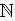 | Taille du mini-lot (), longueur de la séquence de tokens ou de trames (), dimension cachée du modèle ( ou ) |
|  | Entiers naturels  | Nombre de couches physiques distinctes () et nombre d'itérations récurrentes en profondeur / de boucles ()3 |
|  | Entiers naturels  | Nombre de têtes de requêtes (), nombre de têtes de clés-valeurs (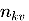 dans GQA/MQA) et dimension d'une tête ()30 |
|  | Vecteurs  | Vecteur d'entrée à l'étape  et état caché dans la couche  à l'étape  |
|  | Matrice  ou vecteur  | État récurrent de taille fixe (poids rapides / mémoire associative) dans les SSM et l'attention linéaire25 |
|  | Opérateurs tensoriels binaires | Produit d'Hadamard terme à terme () et produit externe / de Kronecker () |
|  | Fonctions d'activation non linéaires | Sigmoïde logistique  et fonction  (Swish-1) |
|  | Fonctionnelle  | Divergence de Kullback—Leibler  |

Voici les définitions rigoureuses des principaux mécanismes architecturaux et algorithmiques :

* **Différentiation automatique en mode inverse (Reverse-Mode AD / rétropropagation)** — algorithme de calcul exact du gradient d'une fonction de perte scalaire 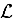 par rapport à tous les nœuds d'un graphe de calcul acyclique, en un temps proportionnel à celui d'une seule passe avant, par propagation récursive des dérivées adjointes  de la sortie vers l'entrée7.  
* **Temps de calcul adaptatif (Adaptive Computation Time, ACT / porte de sortie anticipée)** — mécanisme d'allocation dynamique du nombre d'itérations récurrentes  pour chaque token au moyen d'une porte d'arrêt apprenable , qui permet de consacrer davantage d'opérations arithmétiques aux positions logiquement complexes41.  
* **Poids rapides et apprentissage au moment du test (Fast Weights / Test-Time Training, TTT)** — paramètres d'un sous-réseau interne ou matrice de mémoire associative  mis à jour dynamiquement à l'étape d'inférence (par la règle de Hebb, la règle delta ou un pas de descente de gradient sur une perte auto-supervisée) afin de comprimer un contexte long dans un volume de mémoire fixe44.  
* **Quantification vectorielle, résiduelle et scalaire finie (VQ / RVQ / FSQ)** — discrétisation d'un vecteur latent continu  soit par la recherche de l'élément le plus proche du dictionnaire de codes (VQ), soit par quantification en cascade des résidus sur  dictionnaires (Residual VQ dans SoundStream, EnCodec, Mimi), soit par arrondi direct coordonnée par coordonnée sur un réseau d'entiers borné, sans dictionnaire apprenable (Finite Scalar Quantization dans CosyVoice 3\)46.  
* **Attention par requêtes groupées (Grouped-Query Attention, GQA) et attention multi-requête (MQA)** — partage d'un seul jeu de projections de clés et de valeurs  entre toutes les  têtes de requêtes (, MQA) ou au sein de  groupes (, GQA), afin de réduire de plusieurs fois la taille du cache KV et le trafic depuis la mémoire vidéo HBM lors du décodage39.  
* **Attention latente multi-têtes à cache latent compressé (Multi-Head Latent Attention, MLA)** — mécanisme qui projette l'état caché en un unique vecteur de faible rang  (), avec une branche distincte de petite dimension pour l'encodage positionnel Decoupled RoPE ; à l'inférence, seul le latent compressé est mis en cache, ce qui réduit la mémoire du cache KV de 93.3 % au niveau du modèle (jusqu'à 98.24 % par couche par rapport à un MHA à 128 têtes)50.  
* **Optimisation de politique relative par groupe (Group Relative Policy Optimization, GRPO)** — algorithme d'apprentissage par renforcement sans réseau critique distinct (value model), qui estime l'avantage  en standardisant les récompenses au sein d'un groupe de 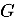 trajectoires générées pour un même prompt53.  
* **Règle delta dans l'attention linéaire (DeltaNet / Gated DeltaNet / KDA)** — remplacement de l'écriture additive  par une réflexion de Householder généralisée avec amortissement , qui efface l'ancienne valeur associée à la clé  avant d'écrire la nouvelle valeur  (où  est le scalaire  dans GDN ou la matrice diagonale  dans KDA)24.  
* **Diffusion discrète de texte (Masked / Uniform Diffusion Language Models, dLLM / MDM / UDLM)** — modèles de langage non autorégressifs fondés sur un transformeur bidirectionnel, qui reconstruisent les tokens en parallèle à partir de masques \[MASK\] (MDM : MDLM, LLaDA, Dream, Mercury) ou de substitutions lexicales aléatoires (UDLM), en minimisant une borne variationnelle pondérée de la vraisemblance35.  
* **Alignement latent des représentations (Representation Alignment, REPA / JEPA)** — famille de principes d'apprentissage : dans la compréhension du monde visuel (I-JEPA, V-JEPA), le réseau prédit les représentations cachées de blocs masqués dans l'espace de l'encodeur EMA, sans générer de pixels ; dans la génération par diffusion (REPA), les couches intermédiaires du DiT sont alignées, par similarité cosinus, sur les caractéristiques d'un enseignant visuel préentraîné (par exemple DINOv2)36.  
* **Hyper-connexions contraintes sur une variété (Manifold-Constrained Hyper-Connections, mHC)** — extension du flux résiduel du transformeur d'un seul vecteur  à  voies parallèles , où la matrice de mélange des voies est projetée par l'algorithme de Sinkhorn—Knopp sur le polytope de Birkhoff des matrices doublement stochastiques, afin d'obtenir une propagation non expansive du signal () à profondeur arbitraire2.  
* **Modèles d'espace d'états (Structured State Space Models, SSM / S4 / Mamba)** — systèmes dynamiques linéaires 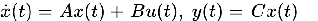, discrétisés avec un pas  ; dans les SSM sélectifs (Mamba-1/2/3), les paramètres  dépendent de l'entrée, ce qui permet un entraînement parallèle linéaire en  et une mémoire constante  par pas à l'inférence32.  
* **Prédiction multi-tokens (Multi-Token Prediction, MTP)** — architecture d'entraînement et de décodage auto-spéculatif dans laquelle, au-dessus du tronc commun du modèle, des têtes en cascade prédisent plusieurs tokens de texte futurs ou les niveaux résiduels des dictionnaires audio RVQ29.  
* **Impulsion matricielle orthogonalisée (Muon / MuonClip)** — optimiseur pour les couches matricielles bidimensionnelles, qui remplace la mise à l'échelle coordonnée par coordonnée du gradient par une orthogonalisation approchée de la matrice d'impulsion  au moyen d'itérations polynomiales de Newton—Schulz (), ce qui égalise le spectre des valeurs singulières du pas de mise à jour65.  
* **Connexions résiduelles avec attention en profondeur (Attention Residuals, AttnRes)** — remplacement de la sommation fixe des sorties de toutes les couches précédentes par une attention softmax apprenable le long de l'axe de la profondeur (sur les blocs précédents), qui élimine la dilution de la norme des caractéristiques dans les transformeurs Pre-LN profonds34.  
* **Modèles vocaux full-duplex (Full-Duplex Speech-to-Speech, STS)** — architectures (Moshi, PersonaPlex, NemotronLabs VoiceChat) qui traitent de façon synchrone le flux entrant de tokens audio de l'utilisateur et génèrent des flux parallèles de « monologue intérieur » (texte) et de tokens audio de réponse, sans segmentation en répliques alternées, ce qui permet les interruptions et les interjections avec une latence de 160–205 ms68.  
* **Plongements positionnels rotatifs (Rotary Position Embedding, RoPE / p-RoPE / 3D-RoPE / TMRoPE)** — encodage de la position relative par rotation de paires de coordonnées des requêtes  et des clés  d'angles , de sorte que le produit scalaire  ne dépend que du décalage  ; se généralise à la rotation d'une fraction du sous-espace (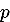\-RoPE) et aux axes spatio-temporels de la vidéo et du son (3D-RoPE, TMRoPE)71.  
* **Mélange parcimonieux d'experts (Sparse Mixture-of-Experts, MoE / LatentMoE)** — remplacement de la couche FFN dense par un ensemble de  sous-réseaux experts, avec activation de  experts par token ; dans **LatentMoE**, le vecteur d'entrée est préalablement comprimé en un latent de faible dimension afin de réduire le trafic de lecture des poids et les échanges All-to-All entre serveurs27.  
* **Attention parcimonieuse alignée sur le matériel (NSA / DSA / CSA)** — mécanismes d'attention parcimonieuse apprenables (Native Sparse Attention, DeepSeek Sparse Attention, Compressed Sparse Attention) qui utilisent une compression hiérarchique par blocs ou un indexeur léger (lightning indexer) pour sélectionner les top\- clés par requête, ramenant la complexité de l'attention de  à 31.  
* **Transformeur récurrent en profondeur (bouclé) (Looped / Recurrent-Depth Transformer, PLT)** — architecture à poids partagés en profondeur, qui fait passer l'état caché  fois à travers un même bloc de couches (Huginn, Ouro) ; dans le **Parallel Loop Transformer (PLT)**, les itérations successives de tokens voisins sont exécutées en pipeline au sein d'une seule passe parallèle (Cross-Loop Parallelism)3.  
* **Flots rectifiés et appariement de flots (Flow Matching / Rectified Flow)** — apprentissage d'une EDO générative 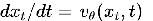 par régression directe du champ de vitesses le long de l'interpolation linéaire  entre les données et un bruit gaussien, ce qui permet une génération déterministe rapide en un petit nombre de pas d'Euler5.  
* **Transducteur de tokens et de durées (Token-and-Duration Transducer, TDT)** — extension du décodeur ASR en flux RNN-T qui prédit conjointement le token de sous-mot et le nombre de trames acoustiques 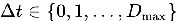 qu'il couvre, afin de sauter les zones stationnaires et les pauses à l'inférence79.

## **1958**

**Domaines :** Base  
Le point de départ de l'apprentissage paramétrique des réseaux de neurones artificiels fut la publication par Frank Rosenblatt de l'article *« The Perceptron: A Probabilistic Model for Information Storage and Organization in the Brain »* dans la revue *Psychological Review* (n° 1\) et la réalisation matérielle de la machine Mark I Perceptron au Cornell Aeronautical Laboratory (préalablement simulée sur le mainframe IBM 704\)82. À la différence des éléments logiques fixes de McCulloch et Pitts (1943), le perceptron de Rosenblatt distinguait une rétine sensorielle (bloc \), une couche de projections associatives non linéaires aléatoires (bloc 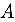\, caractéristiques ) et un sommateur à seuil apprenable (bloc \) qui définit un hyperplan séparateur :  
  
La règle de correction par l'erreur ne mettait à jour les poids  que sur les objets mal classés , où , selon la formule 83. La même année 1958 parut, à titre posthume, la monographie de John von Neumann *« The Computer and the Brain »* (n° 2), qui, pour la première fois, mettait en regard l'architecture massivement parallèle et basse fréquence de la mémoire synaptique du cerveau et le goulot d'étranglement séquentiel des machines de calcul numériques. Bien que Rosenblatt ait déjà envisagé en 1958 des schémas multicouches, il lui manquait un algorithme différentiable d'attribution du crédit pour les couches cachées7.

## **1959**

**Domaines :** Encodeur Base  
En 1959 apparurent trois piliers conceptuels des futurs réseaux profonds : la hiérarchie neurophysiologique des filtres visuels, la reconnaissance parallèle en cascade et l'amorçage (bootstrapping) de la fonction d'évaluation dans le temps. David Hubel et Torsten Wiesel, dans un article du *The Journal of Physiology* (n° 3\), découvrirent dans le cortex strié du chat des champs récepteurs locaux sélectifs à l'orientation, qui devinrent le prototype biologique des noyaux convolutifs85. Simultanément, Oliver Selfridge présenta au symposium de Teddington l'architecture **Pandemonium** (n° 4\) — une hiérarchie parallèle de « démons de caractéristiques », de « démons cognitifs » qui les pondèrent et d'un « démon de décision » supérieur qui sélectionne le maximum de la réponse 87. La même année, Arthur Samuel publia dans l'*IBM Journal of Research and Development* son célèbre travail sur le jeu de dames auto-apprenant (n° 5), qui consacra le terme *machine learning* et introduisit la mise à jour des poids du polynôme d'évaluation à partir de la différence des évaluations de la position courante et de la suivante — prototype direct de la méthode des différences temporelles (TD learning) et du critique en apprentissage par renforcement.

## **1960**

**Domaines :** Base Optimisation  
Le passage de la règle à seuil discontinue du perceptron à l'optimisation par gradient lisse fut opéré par Bernard Widrow et Marcian Hoff, qui présentèrent le nœud linéaire adaptatif **ADALINE** et l'algorithme des moindres carrés **LMS** (Widrow–Hoff / Delta Rule, n° 6\)88. La nouveauté essentielle d'ADALINE consistait à calculer l'erreur sur la sortie linéaire continue  *avant* le quantificateur binaire à seuil. La descente de gradient stochastique sur l'erreur quadratique instantanée  donna la règle delta classique :  
  
C'est précisément cette équation — réécrite pour une mémoire associative matricielle sous la forme  — qui constitue le fondement des transformeurs linéaires modernes **DeltaNet** et **Gated DeltaNet** (2024–2026)25. La même année 1960, Henry Kelley publia dans l'*ARS Journal* l'article *« Gradient Theory of Optimal Flight Paths »* (n° 7), où il établit la méthode continue des équations adjointes pour la rétropropagation des dérivées de la fonctionnelle de coût le long de la trajectoire d'un système dynamique — précurseur analytique à la fois de la rétropropagation de l'erreur et des Neural ODE7.

## **1961**

**Domaines :** Boucles Mémoire Base  
En 1961, le cybernéticien allemand Karl Steinbuch publia dans le premier tome de la revue *Kybernetik* le travail *« Die Lernmatrix »* (« La matrice d'apprentissage », n° 8\) — la première architecture matricielle de mémoire hétéroassociative sur un réseau croisé de conducteurs91. Dans la matrice de Steinbuch, le vecteur de caractéristiques d'entrée 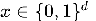 et le code de classe  étaient reliés par une règle locale de type Hebb , et la récupération s'effectuait par un produit matrice-vecteur parallèle  avec sélection concurrentielle du maximum. Sur le plan algébrique, la « matrice d'apprentissage » posait le prototype des mémoires associatives linéaires clé–valeur modernes . La même année, Eduardo Caianiello, dans le *Journal of Theoretical Biology* (n° 9\), sépara la dynamique des réseaux de neurones en deux échelles de temps couplées : les « équations neuronales » rapides de relaxation des activations et les « équations mnémoniques » adiabatiques lentes de plasticité des poids synaptiques.

## **1962**

**Domaines :** Base Encodeur  
En avril 1962, le mathématicien Albert Novikoff présenta une démonstration rigoureuse et concise du **théorème de convergence du perceptron** (n° 10 ; des bornes apparentées furent publiées la même année par H. D. Block, n° 13\)92. Novikoff montra que si un échantillon  à entrées de norme bornée  est linéairement séparable par un vecteur unitaire  () avec une marge positive , alors l'algorithme du perceptron, partant du vecteur nul , s'achève en au plus 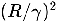 mises à jour. À chaque exemple erroné, le produit scalaire avec l'oracle croît d'au moins  (), tandis que la condition d'erreur  borne supérieurement l'accroissement du carré de la norme par la quantité  (), d'où résulte une borne totalement indépendante de la dimension de l'espace 83 :  
  
La même année parurent la monographie de synthèse de Frank Rosenblatt *« Principles of Neurodynamics »* (n° 11), l'architecture linéaire par morceaux **MADALINE** de Bernard Widrow (n° 12\) et l'article classique de Hubel et Wiesel (n° 14), qui décrivait l'alternance de *cellules simples* (détecteurs linéaires locaux de contours) et de *cellules complexes* (pooling spatialement invariant) dans le cortex visuel87.

## **1963**

**Domaines :** Base Optimisation  
Développant la géométrie de la marge séparatrice , Vladimir Vapnik et Alexander Lerner publièrent dans la revue *« Automatique et télémécanique »* (*Avtomatika i Telemekhanika*) l'article *« Reconnaissance des formes à l'aide de portraits généralisés »* (n° 15\)97. Au lieu de chercher un hyperplan séparateur quelconque, les auteurs formulèrent un problème d'optimisation quadratique visant à trouver l'unique **hyperplan de marge maximale** (prototype linéaire de la méthode des machines à vecteurs de support, SVM), dont le vecteur normal ne se décompose que sur les vecteurs de support extrêmes de l'échantillon . C'est ainsi que le principe du contrôle de la norme des poids  comme mesure de la capacité du classifieur entra dans la théorie de l'apprentissage. La même année, Steinbuch et Piske publièrent dans les *IEEE Transactions on Electronic Computers* une analyse des matrices de mémoire continues en présence de signaux bruités (n° 16), et Stuart Dreyfus simplifia la dérivation de la règle de la chaîne des multiplicateurs adjoints par la programmation dynamique (n° 17\)7.

## **1964**

**Domaines :** Optimisation Base  
En 1964 furent créés trois outils mathématiques qui opèrent directement dans les frameworks modernes d'apprentissage profond. Boris Teodorovitch Polyak publia dans le *« Journal de mathématiques computationnelles et de physique mathématique »* la méthode inertielle de la **« boule lourde » (Heavy-Ball Momentum)** (n° 18\), destinée à accélérer la descente de gradient dans les problèmes en ravin mal conditionnés100 :  
  
Le terme d'inertie  amortit les oscillations transversales du gradient et réduit le nombre de conditionnement effectif du problème quadratique de  à . Simultanément, Mark Aizerman, Emmanuil Braverman et Lev Rozonoer introduisirent dans *« Automatique et télémécanique »* la **méthode des fonctions potentielles** (n° 19\) — une justification rigoureuse de l'*astuce du noyau* , directement liée à la future factorisation par noyau de l'attention linéaire20. La même année, Robert Wengert présenta dans les *Communications of the ACM* (n° 20\) un algorithme logiciel de **différentiation automatique en mode direct (Forward-Mode AD)** sur la liste des opérations élémentaires.

## **1965**

**Domaines :** Base Optimisation  
En 1965, Alexeï Grigorievitch Ivakhnenko et Valentin Grigorievitch Lapa publièrent la monographie *« Dispositifs cybernétiques de prédiction »* (n° 21), décrivant les premiers algorithmes opérationnels d'apprentissage couche par couche de **perceptrons multicouches profonds** à nombre arbitraire de couches cachées7. Chaque nœud du réseau calculait un polynôme quadratique de Kolmogorov—Gabor avec des produits multiplicatifs des entrées ( — précurseur algébrique des blocs à porte GLU et SwiGLU), les coefficients étaient trouvés par la méthode des moindres carrés, et un échantillon de validation écartait les neurones surajustés avant la construction de la couche suivante7.  
Parallèlement, Thomas Cover démontra dans les *IEEE Transactions on Electronic Computers* le **théorème fondamental de Cover sur la capacité de séparation linéaire** (n° 22) : le nombre de partitions binaires linéairement réalisables de  points en position générale dans  est égal à , ce qui représente exactement la moitié de l'ensemble des  dichotomies pour  et tend exponentiellement vers zéro pour . Ce fait géométrique explique la nécessité de projections larges des caractéristiques dans les couches cachées des MLP et des MoE. L'année fut complétée par le livre classique de Nils Nilsson *« Learning Machines »* (n° 23\)88 et par la méthode du gradient de Ho—Kashyap pour les systèmes d'inégalités linéaires (n° 24).

## **1966**

**Domaines :** Optimisation Base  
En 1966, Yakov Zalmanovitch Tsypkin, dans le travail *« Adaptation, apprentissage et auto-apprentissage dans les systèmes automatiques »* (*Automatique et télémécanique*, n° 25\), ramena les règles disparates des perceptrons, d'ADALINE et du filtrage à un problème variationnel unique de **minimisation de l'espérance mathématique de la fonction de perte (risque moyen)**  au moyen de l'approximation stochastique récurrente de Robbins—Monro 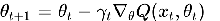105. Cette formulation est devenue le langage standard de la théorie moderne de l'optimisation des réseaux de neurones. La même année, Emmanuil Braverman étendit la méthode des fonctions potentielles au problème de l'auto-apprentissage et du clustering non supervisé (n° 26\)20, tandis que Lawrence Fogel, Alvin Owens et Michael Walsh faisaient paraître la monographie *« Artificial Intelligence through Simulated Evolution »* (n° 27), qui ouvrit la voie de la recherche évolutionnaire sans gradient.

## **1967**

**Domaines :** Base Optimisation  
En juin 1967, Shun'ichi Amari publia dans les *IEEE Transactions on Electronic Computers* l'article *« A Theory of Adaptive Pattern Classifiers »* (n° 28\) — le premier travail de l'histoire où la **descente de gradient stochastique de bout en bout (end-to-end SGD)** était appliquée à l'entraînement d'un réseau de neurones multicouche à couches cachées non linéaires sur des distributions non linéairement séparables7. Remplaçant l'échelon à seuil par des fonctions d'activation lisses et différentiables, Amari établit la règle de la chaîne pour la correction des poids cachés  et entraîna expérimentalement un classifieur à 5 couches dix-neuf ans avant la publication de 1986 dans *Nature*7.  
La même année parurent deux travaux d'une immense portée : Thomas Cover et Peter Hart démontrèrent une borne asymptotique de l'erreur de la règle du plus proche voisin (, n° 29), posant la base théorique de la recherche vectorielle et des systèmes RAG, et Richard Sinkhorn et Paul Knopp publièrent dans le *Pacific Journal of Mathematics* le théorème et l'algorithme itératif de normalisation alternée des lignes et des colonnes d'une matrice positive vers une forme doublement stochastique (n° 30\) — précisément l'opérateur de **Sinkhorn–Knopp** qui, à la charnière 2025–2026, a assuré la stabilité des hyper-connexions multivoies **mHC** dans les architectures DeepSeek2.

## **1968**

**Domaines :** Base Boucles  
En 1968, Alexeï Ivakhnenko formalisa la **Méthode de groupement des arguments (MGUA / Group Method of Data Handling, GMDH)** dans la revue *« Avtomatika »* (n° 31\)104, systématisant l'accroissement automatique de réseaux polynomiaux profonds avec sélection régulière des meilleurs neurones et arrêt précoce de la profondeur sur un ensemble de validation indépendant. Parallèlement, Stephen Grossberg publia dans les *PNAS* le modèle non linéaire d'apprentissage associatif **Outstar** et un système d'équations différentielles de la mémoire à court terme (STM) et à long terme (LTM) (n° 32\)109 :  
  
démontrant la convergence inconditionnelle des poids synaptiques vers les proportions spatiales du motif d'entrée. La même année, Vladimir Vapnik et Alexeï Tchervonenkis publièrent dans les *« Comptes rendus de l'Académie des sciences de l'URSS »* le théorème de convergence uniforme des fréquences empiriques vers les probabilités sur une classe d'événements, introduisant une mesure combinatoire de la capacité des familles de fonctions — la **dimension de Vapnik—Chervonenkis (VC-dimension)** (n° 33).

## **1969**

**Domaines :** Base Encodeur Optimisation  
En 1969, Marvin Minsky et Seymour Papert firent paraître la monographie analytique *« Perceptrons: An Introduction to Computational Geometry »* (n° 34\)7. À l'aide de la théorie des invariants de groupes, les auteurs démontrèrent rigoureusement l'impossibilité, pour un perceptron monocouche à caractéristiques locales d'ordre borné, de réaliser le prédicat de parité (y compris le **XOR** à deux bits) et le prédicat topologique de connexité. Bien que les auteurs aient noté que les réseaux multicouches sont exempts de cette limitation, l'absence d'un algorithme efficace d'apprentissage des couches cachées, largement connu en Occident, provoqua un refroidissement de l'intérêt pour le connexionnisme dans le milieu académique anglophone7.  
Cependant, la même année 1969 furent publiés deux éléments clés de l'apprentissage profond moderne. Arthur Bryson et Yu-Chi Ho, dans le livre *« Applied Optimal Control »* (n° 35\), écrivirent les formules discrètes explicites de la rétropropagation des multiplicateurs de Lagrange à travers des cascades à plusieurs étapes 7. Simultanément, Kunihiko Fukushima, dans l'article *« Visual Feature Extraction by a Multilayered Network of Analog Threshold Elements »* (*IEEE Transactions on Systems Science and Cybernetics*, n° 36\)85, introduisit un réseau visuel multicouche à **redresseurs demi-onde analogiques** 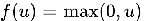 — historiquement la première utilisation de la fonction d'activation **ReLU** dans des réseaux de neurones multicouches7.

## **1970**

**Domaines :** Base Optimisation  
En 1970, le mathématicien finlandais Seppo Linnainmaa soutint à l'Université d'Helsinki un mémoire de master (n° 37\)7 dans lequel il formula pour la première fois, et implémenta en code machine, l'algorithme général de **différentiation automatique en mode inverse (Reverse-Mode Automatic Differentiation)** pour des graphes de calcul arbitraires. Si le calcul de la fonction de perte scalaire  est décomposé en nœuds élémentaires  (), la passe arrière de  vers  accumule récursivement les dérivées partielles :  
  
Le calcul du vecteur gradient complet  par rapport à un nombre arbitraire de paramètres  ne coûte qu'un facteur constant du nombre d'opérations d'une seule passe avant114. La même année 1970, Broyden, Fletcher, Goldfarb et Shanno établirent indépendamment la méthode quasi-newtonienne du second ordre **BFGS** (n° 38), et Ivakhnenko publia dans la revue internationale *Automatica* une synthèse sur l'auto-organisation heuristique des réseaux profonds (n° 39\)115.

## **1971**

**Domaines :** Base Mémoire  
En octobre 1971, Alexeï Ivakhnenko publia dans les *IEEE Transactions on Systems, Man, and Cybernetics* l'article *« Polynomial Theory of Complex Systems »* (n° 40\)115, décrivant en détail la construction et l'entraînement d'un **réseau profond à 8 couches** à propagation avant par la méthode MGUA, avec sélection régularisée des caractéristiques sur un échantillon de validation7. Cette publication devint l'un des premiers exemples, largement cités dans la littérature internationale, d'entraînement pratique d'une architecture profonde à huit couches7.  
La même année, David Marr publia dans les *Philosophical Transactions of the Royal Society B* un modèle mathématique de l'hippocampe, *« Simple Memory: A Theory for Archicortex »* (n° 41\)7. Marr montra que le codage parcimonieux de vecteurs d'entrée dans un espace de haute dimension, combiné à la plasticité locale de Hebb et à un seuil inhibiteur adaptatif, permet d'enregistrer en une seule passe un grand volume d'associations épisodiques et de les restituer sans erreur à partir d'indices partiels — principe qui sous-tend les modules parcimonieux modernes de mémoire externe et paramétrique.

## **1972**

**Domaines :** Boucles Mémoire  
En novembre 1972, Shun'ichi Amari publia dans les *IEEE Transactions on Computers* l'article *« Learning Patterns and Pattern Sequences by Self-Organizing Nets of Threshold Elements »* (n° 42), établissant, dix ans avant la publication de Hopfield, les équations de stabilité des réseaux associatifs récurrents discrets (**réseau d'Amari—Hopfield**), aussi bien pour les attracteurs statiques avec une matrice de poids symétrique que pour les chaînes dynamiques de séquences avec une matrice asymétrique7 :  
  
La même année 1972, Teuvo Kohonen introduisit indépendamment, dans les *IEEE Transactions on Computers*, les mémoires matricielles de corrélation (n° 43\)118, James Anderson décrivit une mémoire interactive linéaire à seuil dans *Mathematical Biosciences* (n° 44), Kaoru Nakano construisit le système associatif **Associatron** (n° 45\)7, et Hugh Wilson et Jack Cowan, dans le *Biophysical Journal*, établirent un système non linéaire d'EDO de populations neuronales excitatrices et inhibitrices couplées (, n° 46), démontrant analytiquement le lien entre les cycles limites d'oscillation et l'hystérésis multistable de la mémoire119.

## **1973**

**Domaines :** Encodeur Boucles  
En 1973, Christoph von der Malsburg publia dans *Kybernetik* l'article *« Self-Organization of Orientation Sensitive Cells in the Striate Cortex »* (n° 47\)115 — la première démonstration informatique d'**apprentissage compétitif (competitive learning)** de détecteurs de caractéristiques locales. En combinant l'excitation intracorticale à courte portée, l'inhibition latérale et la règle de Hebb avec la **conservation de la 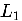\-norme des synapses d'entrée de chaque neurone** (), von der Malsburg montra la formation spontanée, sans supervision, de cartes ordonnées de colonnes d'orientation.  
Simultanément, Stephen Grossberg publia dans *Studies in Applied Mathematics* une analyse rigoureuse des **réseaux récurrents à shunt** avec saturation multiplicative et inhibition latérale divisive (n° 48\)109 : il démontra que c'est précisément la caractéristique de transfert sigmoïdale qui supprime le bruit de fond de faible amplitude et préserve le contraste relatif du motif sans saturation lors d'une croissance arbitraire de la luminosité totale de l'entrée — fondement théorique des couches de normalisation des activations. Hugh Wilson et Jack Cowan généralisèrent leur dynamique de populations à des champs neuronaux spatialement continus du cortex et du thalamus (n° 49\)124.

## **1974**

**Domaines :** Base Optimisation Boucles  
En 1974, Paul Werbos soutint à l'Université Harvard sa thèse de doctorat *« Beyond Regression: New Tools for Prediction and Analysis in the Behavioral Sciences »* (n° 50\)7. Werbos formula la méthode de la « rétroaction dynamique » — des formules explicites de rétropropagation en chaîne des dérivées de la fonction objectif à travers des réseaux multicouches arbitraires à nœuds non linéaires —, préparant l'application directe de la méthode aux réseaux de neurones au début des années 1980115.  
La même année, le physicien William Little publia dans *Mathematical Biosciences* l'article *« The Existence of Persistent States in the Brain »* (n° 51\)126, qui établit une correspondance directe entre la physique statistique des **systèmes de spins d'Ising** et les réseaux de neurones récurrents stochastiques. En introduisant une température effective du bruit synaptique 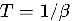 et une probabilité logistique de déclenchement du neurone , Little décrivit la mémoire à long terme comme des états propres dominants dégénérés de la matrice de transition markovienne — fondement des machines de Boltzmann et des modèles génératifs thermodynamiques.

## **1975**

**Domaines :** Encodeur Mémoire Base  
En 1975, Kunihiko Fukushima présenta dans *Biological Cybernetics* le réseau multicouche auto-organisé **Cognitron** (n° 52\)86. Dans le Cognitron, des champs récepteurs locaux excitateurs et inhibiteurs étaient combinés à un rapport divisif de shunt  et à un renforcement compétitif des synapses du seul neurone le plus actif dans un voisinage ; le réseau ne partageait cependant pas encore les poids sur tout le plan et restait donc sensible aux décalages de l'image129.  
Parallèlement parurent trois travaux marquants dans des domaines voisins : James Albus créa l'architecture rapide à hachage local du contrôleur cérébelleux **CMAC**, à champs récepteurs grossiers et chevauchants (n° 53\)130 ; David Sherrington et Scott Kirkpatrick introduisirent dans *Physical Review Letters* le modèle résoluble de **verre de spin SK** à liaisons aléatoires de signe alterné 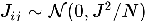 (n° 54\)126, dont la méthode analytique des répliques servit de base au calcul des transitions de phase et de la capacité des réseaux de neurones ; et John Holland publia la monographie *« Adaptation in Natural and Artificial Systems »* (n° 55), qui posa les mathématiques des algorithmes génétiques.

## **1976**

**Domaines :** Optimisation Boucles Base  
En juin 1976, Seppo Linnainmaa publia dans la revue internationale *BIT Numerical Mathematics* l'article en anglais *« Taylor Expansion of the Accumulated Rounding Error »* (n° 56\)23. Outre les algorithmes complets de différentiation inverse du premier ordre et d'ordres supérieurs sur un graphe de calcul, Linnainmaa analysa pour la première fois le problème fondamental de la mémoire de la passe arrière — la nécessité de conserver les états intermédiaires de toutes les opérations et les moyens de réduire la consommation de mémoire maximale —, préfigurant les techniques modernes de recalcul sélectif des activations (**activation / gradient checkpointing**, employées notamment dans l'entraînement de Ring Attention et de DeepSeek mHC2).  
La même année, Stephen Grossberg, dans un travail en deux parties paru dans *Biological Cybernetics* (n° 57\)126, formula le **dilemme stabilité—plasticité** (comment faire apprendre à un réseau de nouvelles classes sans détruire de façon catastrophique les représentations apprises auparavant) et proposa un mécanisme de filtrage par résonance des caractéristiques ascendantes par des attentes descendantes (**Adaptive Resonance Theory, ART**), tandis que David Willshaw et Christoph von der Malsburg construisirent un modèle synaptique d'auto-organisation de projections topographiques continues de la rétine (n° 58).

## **1977**

**Domaines :** Boucles Mémoire Optimisation  
En 1977, James Anderson, Jack Silverstein, Stephen Ritz et Randall Jones publièrent dans *Psychological Review* le modèle récurrent non linéaire de mémoire catégorielle **Brain-State-in-a-Box (BSB)** (n° 59\)122, qui borne la trajectoire de rétroaction positive par les parois de l'hypercube unité  :  
  
La matrice symétrique de liaisons de Hebb  amplifie les projections le long des vecteurs propres principaux jusqu'à ce que l'état se stabilise en un sommet de l'hypercube correspondant à un prototype discret pur de mémoire. La même année, Shun'ichi Amari publia la théorie mathématique canonique des excitations localisées (« bumps » de la mémoire de travail) dans des champs neuronaux continus à inhibition latérale (n° 60\)124, Teuvo Kohonen fit paraître la monographie *« Associative Memory »* (n° 61), et Arthur Dempster, Nan Laird et Donald Rubin formalisèrent dans *JRSS-B* l'**algorithme EM** de maximisation de la vraisemblance des modèles à variables latentes via la borne variationnelle de Jensen (n° 62\) — fondement analytique de l'entraînement des MoE et des autoencodeurs variationnels.

## **1978**

**Domaines :** Mémoire Boucles Base  
En 1978, William Little et Gordon Shaw publièrent dans *Mathematical Biosciences* le travail *« Analytic Study of the Memory Storage Capacity of a Neural Network »* (n° 63\)127. En résolvant analytiquement un modèle linéarisé de réseau de neurones stochastique à liaisons plastiques, les auteurs montrèrent rigoureusement que la capacité informationnelle d'une mémoire neuronale distribuée croît proportionnellement au **nombre de synapses** , et non au nombre de neurones 127. Dans l'ingénierie moderne, c'est précisément cette loi qui explique pourquoi le stockage des faits du monde exige de porter le nombre total de paramètres de poids à des centaines de milliards, voire des milliers de milliards dans les architectures MoE parcimonieuses, même lorsqu'un petit sous-ensemble actif de neurones suffit pour traiter un seul token.  
La même année, Gideon Schwarz introduisit dans les *Annals of Statistics* le critère d'information bayésien **BIC** pour la sélection de la dimension des modèles paramétriques (n° 64), Stephen Grossberg présenta la théorie du chunking hiérarchique de séquences en mémoire de travail (n° 65\)109, et Kunihiko Fukushima perfectionna la règle synaptique de type quadratique moyen pour l'auto-apprentissage profond sans supervision (n° 66\)129.

## **1979**

**Domaines :** Encodeur Base  
En octobre 1979, Kunihiko Fukushima publia dans la revue japonaise *Transactions of the IECE of Japan* (tome J62-A, n° 10, p. 658–665) le premier article sur l'architecture **Neocognitron** — le premier réseau de neurones convolutif profond invariant aux décalages spatiaux des motifs d'entrée (n° 67\)7. S'inspirant de la découverte de Hubel et Wiesel, Fukushima organisa le réseau comme une alternance à plusieurs étages de paires de couches de deux types : des plans de **cellules **, dont tous les neurones d'un même plan ont des *poids partagés identiques* (weight sharing) et extraient une caractéristique locale en chaque point du champ bidimensionnel (opération de convolution 2D avec redresseur ReLU), et des plans de **cellules **, qui agrègent les réponses d'un voisinage local de cellules  avec réduction de résolution (opération de pooling spatial), grâce à quoi la tolérance au décalage s'accumule progressivement de couche en couche sans perte de la géométrie relative des détails87. La même année, Leon Cooper, F. Liberman et Erkki Oja publièrent dans *Biological Cybernetics* un modèle synaptique de formation de la sélectivité des neurones du cortex visuel (n° 68).

## **1980**

**Domaines :** Encodeur Optimisation  
En avril 1980 parut dans *Biological Cybernetics* (t. 36, p. 193–202) la publication classique en anglais de Kunihiko Fukushima *« Neocognitron: A Self-Organizing Neural Network Model for a Mechanism of Pattern Recognition Unaffected by Shift in Position »* (n° 69\)86, qui fit connaître la hiérarchie convolution-pooling à toute la communauté mondiale. La réponse de la cellule  à la position  du plan de caractéristiques  de la couche , avec inhibition divisive par l'activité quadratique moyenne  dans la fenêtre locale , était donnée par l'équation :  
  
Ainsi, toute la topologie structurelle des réseaux visuels profonds — convolutions 2D multicanaux à poids partagés, redressement , normalisation locale quadratique moyenne et pooling spatial — était entièrement construite, dans l'attente du remplacement des règles locales d'auto-organisation par la descente de gradient globale87. La même année, Stephen Grossberg publia dans *Psychological Review* un article de synthèse sur les codes cognitifs résonants (n° 70), et Walter Baur et Volker Strassen démontrèrent le célèbre théorème de complexité algébrique (Baur–Strassen Theorem, n° 71) : le calcul du gradient de toute fonction rationnelle de plusieurs variables sur un circuit arithmétique ne requiert pas plus de cinq fois le nombre d'opérations du calcul de la fonction elle-même114.

## **1981**

**Domaines :** Mémoire Boucles Optimisation  
En 1981, Geoffrey Hinton et James Anderson firent paraître la monographie collective programmatique *« Parallel Models of Associative Memory »* (n° 72\)140, qui justifia le passage des nœuds symboliques localistes (« un concept — une cellule ») aux **représentations vectorielles distribuées** denses (distributed representations), où chaque concept est codé par un motif d'activité de nombreux éléments, assurant une généralisation automatique par similarité des micro-caractéristiques. La même année, James McClelland et David Rumelhart présentèrent dans *Psychological Review* le **modèle d'activation interactive** de la perception des lettres et des mots, avec des rétroactions bidirectionnelles entre couches (n° 73), et Andrew Barto, Richard Sutton et Peter Brouwer publièrent dans *Biological Cybernetics* le modèle de **réseau associatif de recherche** (n° 74), unissant génération stochastique d'actions et apprentissage par un signal scalaire de renforcement — précurseur direct des méthodes de gradient en apprentissage par renforcement.

## **1982**

**Domaines :** Boucles Mémoire Encodeur Base  
En avril 1982, John Hopfield publia dans les *PNAS* le célèbre article *« Neural Networks and Physical Systems with Emergent Collective Computational Abilities »* (n° 75\)124. Ayant associé au réseau récurrent binaire 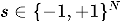 à matrice de poids symétrique  () une **fonction d'énergie de Lyapunov** physique explicite :  
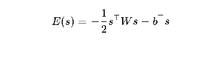  
Hopfield démontra la non-croissance monotone de l'énergie (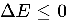) lors des mises à jour asynchrones à seuil  et la convergence vers des minima locaux — attracteurs de mémoire adressables par le contenu (la capacité de la variante binaire classique est d'environ  motifs non corrélés, tandis que les réseaux de Hopfield exponentiels modernes de 2016–2020 ont une capacité exponentielle et sont équivalents à l'attention softmax du transformeur142).  
La même année 1982, Paul Werbos publia pour la première fois explicitement, lors de la conférence IFIP, l'application de la rétropropagation de l'erreur directement aux réseaux de neurones artificiels (n° 76\)7 ; Teuvo Kohonen créa les **cartes auto-organisatrices de caractéristiques (SOM)** topographiques (n° 77) ; Erkki Oja établit la règle de plasticité locale normalisée  (**règle d'Oja**, n° 78), qui extrait le vecteur propre principal de la matrice de covariance des données (ACP neuronale) ; Bienenstock, Cooper et Munro proposèrent la règle non linéaire de modification synaptique à seuil glissant **BCM** (n° 79) ; et parut, à titre posthume, le livre fondamental de David Marr *« Vision »* (n° 80).

## **1983**

**Domaines :** Optimisation Boucles  
En 1983, Yurii Evgenievitch Nesterov publia dans les *« Comptes rendus de l'Académie des sciences de l'URSS »* (*Soviet Mathematics Doklady*, 27(2), 372–376) une méthode optimale de minimisation de fonctions convexes lisses, à vitesse de convergence  — la **méthode du gradient accéléré de Nesterov (NAG)** (n° 81\)143 :  
  
Le calcul du gradient au point d'inertie anticipé  assura une correction de trajectoire dans les virages serrés du paysage de perte et devint la norme dans les modifications modernes de SGD, dans NAdam et dans l'impulsion orthogonalisée Muon. Dans le numéro de mai de *Science*, Scott Kirkpatrick, Charles Gelatt et Mario Vecchi présentèrent l'optimisation globale stochastique par **recuit simulé (Simulated Annealing)** avec la probabilité de transition de Metropolis  (n° 82\)144, et Andrew Barto, Richard Sutton et Charles Anderson publièrent dans *IEEE TSMC* l'architecture neuronale **Actor–Critic** sur la tâche du maintien d'un pendule inversé (n° 83\)144.

## **1984**

**Domaines :** Base Boucles Diffusion  
En novembre 1984, Leslie Valiant publia dans les *Communications of the ACM* l'article *« A Theory of the Learnable »* (n° 84\)146, qui posa le fondement calculatoire et statistique rigoureux de l'**apprentissage probablement approximativement correct (PAC Learning)** : formalisation de la complexité d'échantillonnage et de calcul nécessaire pour atteindre une erreur de généralisation 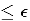 avec une confiance . La même année, John Hopfield généralisa son modèle aux circuits dynamiques continus à sigmoïde monotone lisse  et à fonctionnelle de Lyapunov continue (n° 85), les frères Stuart et Donald Geman introduisirent dans *IEEE TPAMI* l'**échantillonnage de Gibbs (Gibbs Sampling)** sur des champs aléatoires markoviens à distribution de Gibbs  pour la restauration bayésienne d'images bruitées (n° 86), et Teuvo Kohonen fit paraître la monographie augmentée *« Self-Organization and Associative Memory »* (n° 87).

## **1985**

**Domaines :** Base Mémoire Diffusion  
En 1985, David Ackley, Geoffrey Hinton et Terrence Sejnowski publièrent dans *Cognitive Science* l'algorithme d'apprentissage des **machines de Boltzmann** (n° 88\)146 — des réseaux d'énergie stochastiques à *variables cachées* , qui modélisent la distribution des vecteurs visibles 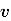 par marginalisation . Le gradient de la divergence de Kullback—Leibler par rapport au poids symétrique 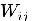 se ramena à une différence de corrélations par paires dans deux régimes thermodynamiques :  
  
Bien que le recuit MCMC de longue durée ait limité la taille des machines de Boltzmann entièrement connectées, ce fut la première démonstration théoriquement rigoureuse de l'apprentissage de représentations distribuées profondes dans des réseaux génératifs150. La même année 1985, Yann LeCun à la conférence *Cognitiva 85* à Paris (n° 89\) et David Parker dans le rapport du MIT *« Learning-Logic »* (n° 90\) publièrent indépendamment des schémas de rétropropagation de l'erreur par gradient pour les réseaux multicouches, et David Rumelhart et David Zipser systématisèrent le clustering compétitif de caractéristiques (n° 91).

## **1986**

**Domaines :** Base Boucles Optimisation  
En octobre 1986, David Rumelhart, Geoffrey Hinton et Ronald Williams publièrent dans *Nature* le célèbre article *« Learning Representations by Back-Propagating Errors »* (n° 92), simultanément à la parution de l'ouvrage fondamental en deux volumes du groupe PDP *« Parallel Distributed Processing »* (MIT Press, n° 93\)7. Les auteurs montrèrent qu'un perceptron multicouche (MLP) à activations lisses , entraîné par propagation récursive du vecteur de sensibilité :  
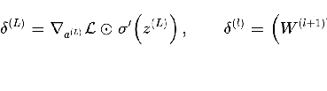  
construit dans les couches intermédiaires des représentations sémantiques non triviales et résout des prédicats non linéairement séparables151. Dans la même édition PDP, Paul Smolensky introduisit le réseau d'énergie biparti sans connexions intracouche **Harmonium** — mathématiquement équivalent à la **machine de Boltzmann restreinte (RBM)**, avec une inférence conditionnelle exacte en une étape  (n° 94) ; Michael Jordan proposa un réseau récurrent avec rétroaction de la sortie vers le vecteur d'état contextuel  (**Jordan RNN**, n° 95) ; et Terrence Sejnowski et Charles Rosenberg démontrèrent le synthétiseur de transcription phonémique de textes anglais **NETtalk** (n° 96).

## **1987**

**Domaines :** STT Boucles Encodeur  
En 1987, Alexander Waibel, Toshiyuki Hanazawa, Geoffrey Hinton, Kiyohiro Shikano et Kevin Lang créèrent le **Time-Delay Neural Network (TDNN)** pour la reconnaissance des phonèmes de la parole (n° 97\)87 — le premier réseau convolutif unidimensionnel le long de l'axe temporel, à poids partagés, invariant au décalage des formants acoustiques et entraîné par rétropropagation de l'erreur. La même année, Geoffrey Hinton et David Plaut publièrent le travail *« Using Fast Weights to Deblur Old Memories »* (n° 98\)45, dotant chaque connexion d'une paire formée d'un poids lent à long terme et d'un poids contextuel à décroissance rapide (**Fast Weights**) — source conceptuelle directe des couches modernes d'attention linéaire et d'apprentissage au moment du test (TTT et Titans). Parallèlement, Dana Ballard proposa à la conférence AAAI un préentraînement modulaire couche par couche de hiérarchies profondes par **pile d'autoencodeurs** (n° 99), Gail Carpenter et Stephen Grossberg formalisèrent l'architecture de résonance adaptative **ART 1** (n° 100\)110, et Fernando Pineda établit dans *Physical Review Letters* la rétropropagation continue des gradients pour les points fixes d'attracteurs récurrents  (**Recurrent Backpropagation**, n° 101\) — précurseur analytique des réseaux d'équilibre DEQ.

## **1988**

**Domaines :** Encodeur Optimisation Boucles  
En 1988, Wei Zhang et ses coauteurs publièrent le premier **réseau de neurones convolutif bidimensionnel invariant au décalage (Shift-Invariant 2D CNN)** pour la reconnaissance de caractères, entraîné directement par la méthode de rétropropagation de l'erreur (n° 102\)20. David Broomhead et David Lowe introduisirent dans *Complex Systems* les **réseaux à fonctions de base radiales (RBF Networks)**  (n° 103). En théorie de l'apprentissage, Richard Sutton publia dans la revue *Machine Learning* le travail fondamental sur l'**apprentissage par différences temporelles TD()** (n° 104\)152, qui met à jour les paramètres du prédicteur selon le résidu de Bellman  avant la fin de l'épisode. Simultanément, Hervé Bourlard et Yves Kamp démontrèrent qu'un autoencodeur linéaire à goulot d'étranglement de dimension  apprend le projecteur orthogonal sur les sous-espaces singuliers principaux de la SVD (n° 105), et Bart Kosko introduisit la mémoire hétéroassociative bidirectionnelle **BAM** (n° 106).

## **1989**

**Domaines :** Encodeur Base Optimisation Boucles  
En 1989, Yann LeCun, Bernhard Boser, John Denker, Donnie Henderson, Richard Howard, Wayne Hubbard et Lawrence Jackel publièrent dans *Neural Computation* l'article *« Backpropagation Applied to Handwritten Zip Code Recognition »* (n° 107\)87, entraînant un réseau convolutif profond à filtres partagés 5×5 et à sous-échantillonnage (stride 2\) directement sur les pixels normalisés de codes postaux manuscrits de l'USPS, et démontrant une amélioration spectaculaire de la généralisation grâce au partage spatial des poids. La même année, George Cybenko (n° 108\), puis, indépendamment, Kurt Hornik, Maxwell Stinchcombe et Halbert White (n° 109\) démontrèrent le **théorème d'approximation universelle** des fonctions continues sur des compacts par des perceptrons à deux couches à activation non polynomiale. L'année fut aussi marquée par l'algorithme d'apprentissage en ligne des réseaux récurrents **RTRL** de Ronald Williams et David Zipser (n° 110), la création du **Q-learning** dans la thèse de Christopher Watkins (n° 111), la méthode à mémoire limitée **L-BFGS** de Dong Liu et Jorge Nocedal (n° 112\)153 et l'interprétation probabiliste de la fonction **Softmax** chez John Bridle (n° 113).

## **1990**

**Domaines :** Boucles Optimisation Base  
En 1990, Jeffrey Elman publia dans *Cognitive Science* l'article *« Finding Structure in Time »* (n° 114\)154, qui fit du **réseau récurrent simple (Simple RNN / Elman Network)**  l'outil de base de la modélisation des séquences et montra l'apparition spontanée de clusters syntaxico-sémantiques dans l'espace caché lors de la prédiction du mot suivant. Paul Werbos fixa dans les *Proceedings of the IEEE* la formulation générale de la **rétropropagation à travers le temps (BPTT)** par dépliage pas à pas du graphe (n° 115). À la conférence NIPS, Yann LeCun, John Denker et Sara Solla présentèrent la méthode d'élagage parcimonieux des poids du second ordre **Optimal Brain Damage (OBD)** fondée sur la diagonale du hessien 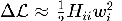 (n° 116\) — précurseur direct des algorithmes modernes de compression des LLM. Parallèlement, Jürgen Schmidhuber proposa un jeu minimax de deux réseaux dans le cadre de la **curiosité artificielle antagoniste** (n° 117\)7, et Lars Hansen et Peter Salamon justifièrent la réduction de la variance de l'erreur dans les **ensembles de réseaux de neurones** (n° 118).

## **1991**

**Domaines :** MoE Boucles Attention/LLM Base  
En 1991 furent posés trois mécanismes fondamentaux qui déterminent l'architecture des modèles phares de 2024–2027. Robert Jacobs, Michael Jordan, Steven Nowlan et Geoffrey Hinton publièrent dans *Neural Computation* l'article *« Adaptive Mixtures of Local Experts »* (**premier MoE**, n° 119\)156. En remplaçant la moyenne de l'erreur quadratique par la maximisation du logarithme de la vraisemblance d'un mélange gaussien piloté par un réseau de porte 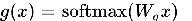 :  
  
les auteurs obtinrent une spécialisation compétitive des experts  sur différentes régions de l'espace d'entrée, puisque le gradient est reçu principalement par l'expert ayant la plus grande responsabilité a posteriori pour l'exemple.  
En juin de la même année 1991, Sepp Hochreiter soutint, sous la direction de Jürgen Schmidhuber, un mémoire de diplôme (n° 120\)7, donnant pour la première fois une analyse rigoureuse de l'**évanouissement et de l'explosion des gradients** dans les réseaux profonds et récurrents via le produit des jacobiens . Et au printemps 1991, Schmidhuber proposa l'architecture des **Fast Weight Programmers** (n° 121 ; publication en revue en 1992\)7, où un réseau lent génère dynamiquement des vecteurs de clés et de valeurs pour la réécriture additive de la matrice de poids rapides  et la lecture  — construction mathématiquement isomorphe à l'auto-attention linéaire non normalisée22. L'année s'acheva avec les autoencodeurs non linéaires à cinq couches de Mark Kramer (n° 122\) et le manuel classique de mécanique statistique des réseaux de neurones de Hertz, Krogh et Palmer (n° 123).

## **1992**

**Domaines :** Optimisation Boucles Base  
En 1992, Ronald Williams publia dans *Machine Learning* l'estimateur du gradient de politique **REINFORCE** avec soustraction d'une ligne de base  pour réduire la variance (n° 124) :  
  
devenu la base directe de l'optimisation des modèles de langage raisonnants par les méthodes PPO et GRPO53. Simultanément, Jürgen Schmidhuber introduisit dans *Neural Computation* le **compresseur neuronal d'historique** (n° 125\)22 — un préentraînement auto-supervisé hiérarchique des RNN, qui ne transmet au niveau supérieur que les tokens imprévisibles (« surprenants »), avec compression ultérieure (« distillation ») d'un enseignant profond dans un réseau élève compact7. Boris Polyak et Anatoli Juditsky démontrèrent l'optimalité asymptotique du **moyennage de la trajectoire des poids de SGD**  (n° 126\) — fondement théorique des cibles EMA dans DINO, JEPA et la diffusion ; Anders Krogh et John Hertz justifièrent la régularisation par décroissance des poids (**Weight Decay**, n° 127) ; et Boser, Guyon et Vapnik combinèrent la marge de l'hyperplan avec l'astuce du noyau à la conférence COLT (n° 128).

## **1993**

**Domaines :** Encodeur Base Optimisation  
En 1993, Jane Bromley, Isabelle Guyon, Yann LeCun et leurs coauteurs présentèrent à NIPS les **réseaux de neurones siamois (Siamese Networks)** (n° 129) : deux tours convolutives identiques à poids partagés projettent une paire d'entrées dans un espace métrique commun de proximité cosinus — paradigme qui sous-tend tous les encodeurs contrastifs modernes (CLIP, SigLIP, recherche dense). À la conférence COLT, Geoffrey Hinton et Drew van Camp formulèrent le principe de longueur de description minimale des poids par minimisation de l'énergie libre variationnelle  (**inférence bayésienne variationnelle dans les réseaux de neurones**, n° 130), qui préfigura la fonctionnelle ELBO. La même année, Andrew Barron démontra l'indépendance de la vitesse d'approximation  par un réseau à deux couches vis-à-vis de la dimension de l'espace  pour des fonctions à norme spectrale de Fourier bornée (n° 131), et Babak Hassibi et David Stork généralisèrent l'élagage hessien en un **Optimal Brain Surgeon (OBS)** complet, non diagonal (n° 132\) — base mathématique des quantificateurs modernes de poids de LLM (GPTQ).

## **1994**

**Domaines :** Boucles MoE Optimisation  
En 1994, Yoshua Bengio, Patrice Simard et Paolo Frasconi publièrent dans les *IEEE Transactions on Neural Networks* le théorème rigoureux *« Learning Long-Term Dependencies with Gradient Descent is Difficult »* (n° 133), démontrant un conflit fondamental des systèmes dynamiques non linéaires : le stockage d'un bit robuste au bruit dans un attracteur hyperbolique exige des valeurs propres du jacobien 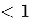, ce qui provoque automatiquement une décroissance exponentielle du gradient de l'erreur dans le temps. La même année, Michael Jordan et Robert Jacobs généralisèrent le mélange d'experts en un **mélange hiérarchique d'experts (HME)** arborescent à apprentissage EM rapide (n° 134), Barak Pearlmutter établit l'opérateur différentiel 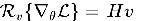 pour le produit exact hessien-vecteur en  opérations sans stocker la matrice des dérivées secondes (n° 135), et parut la première édition du cours fondamental de Simon Haykin *« Neural Networks: A Comprehensive Foundation »* (n° 136).

## **1995**

**Domaines :** Base Diffusion Encodeur  
En mai 1995, Geoffrey Hinton, Peter Dayan, Brendan Frey et Radford Neal publièrent dans *Science* l'architecture de la **machine de Helmholtz** et l'algorithme biphasé **Wake–Sleep** (n° 137), appariant un modèle génératif dirigé  à un réseau d'inférence de reconnaissance rapide  — précurseur structurel direct de l'autoencodeur variationnel. Anthony Bell et Terrence Sejnowski créèrent l'algorithme de séparation aveugle de signaux **InfoMax ICA** par maximisation de l'entropie de la sortie non linéaire (n° 138) ; Corinna Cortes et Vladimir Vapnik introduisirent le classifieur à marge souple **Support-Vector Networks** (n° 139\)149 ; Yann LeCun et Yoshua Bengio systématisèrent les architectures convolutives 1D/2D pour la parole et les images (n° 140) ; et Christopher Bishop publia la monographie classique *« Neural Networks for Pattern Recognition »* (Oxford University Press, n° 141\)88, qui fixa l'interprétation bayésienne et probabiliste des fonctions de perte et de la régularisation.

## **1996**

**Domaines :** Encodeur Base Boucles  
En juin 1996, Bruno Olshausen et David Field montrèrent dans la revue *Nature* (*« Emergence of Simple-Cell Receptive Field Properties by Learning a Sparse Code for Natural Images »*, n° 142) que la minimisation de l'erreur quadratique de reconstruction d'images naturelles par un dictionnaire surcomplet avec une pénalité de parcimonie en norme \  forme spontanément des ondelettes de Gabor localisées et orientées — fondement mathématique à la fois du codage parcimonieux et des Sparse Autoencoders (SAE) modernes pour l'interprétabilité des LLM. La même année, Radford Neal, dans la monographie *« Bayesian Learning for Neural Networks »* (n° 143\), démontra la convergence de réseaux de neurones d'initialisation aléatoire de largeur infinie () vers des **processus gaussiens (NNGP)**, Christoph Goller et Andreas Küchler introduisirent la rétropropagation sur des graphes acycliques et des arbres syntaxiques (n° 144), et parut le livre de Brian Ripley *« Pattern Recognition and Neural Networks »* (n° 145).

## **1997**

**Domaines :** Boucles Mémoire Optimisation  
En novembre 1997, Sepp Hochreiter et Jürgen Schmidhuber publièrent dans *Neural Computation* l'architecture **Long Short-Term Memory (LSTM)** (n° 146\)7. Pour surmonter l'évanouissement des gradients, les auteurs remplacèrent la transformation non linéaire contractante de l'état par un **carrousel d'erreur constante (Constant Error Carousel, CEC)** linéaire , de jacobien unité dans le temps, en protégeant l'écriture et la lecture par des portes multiplicatives d'entrée () et de sortie () :  
  
La même année 1997, Mike Schuster et Kuldip Paliwal créèrent dans *IEEE TSP* les **réseaux récurrents bidirectionnels (BiRNN)** (n° 147), qui combinent les dépliages temporels avant et arrière pour un encodage contextuel complet ; Hochreiter et Schmidhuber introduisirent le critère de recherche de **minima plats (Flat Minima)** à faible courbure du hessien pour améliorer la généralisation (n° 148) ; et Yoav Freund et Robert Schapire publièrent l'algorithme de boosting pondéré **AdaBoost** (n° 149).

## **1998**

**Domaines :** Encodeur Optimisation Base  
En novembre 1998, Yann LeCun, Léon Bottou, Yoshua Bengio et Patrick Haffner publièrent dans les *Proceedings of the IEEE* l'article monumental *« Gradient-Based Learning Applied to Document Recognition »* (n° 150), fixant le réseau convolutif de référence à 7 couches **LeNet-5** (erreur de 0.8 % sur le jeu de données MNIST) et les **réseaux de transducteurs de graphes (GTN)** entraînés globalement pour la lecture de documents multicaractères sans segmentation préalable, complété par le guide pratique de mise à l'échelle des activations et d'initialisation *« Efficient BackProp »* (n° 151). Simultanément, Shun'ichi Amari établit dans *Neural Computation* le **gradient naturel (Natural Gradient)**  dans la métrique riemannienne de la matrice d'information de Fisher  (n° 152\)159 — fondement invariant par reparamétrisation des algorithmes du second ordre K-FAC, Shampoo, SOAP et des régions de confiance de PPO160. La même année parurent les monographies classiques de Richard Sutton et Andrew Barto sur l'apprentissage par renforcement (n° 153\)152 et de Vladimir Vapnik *« Statistical Learning Theory »* (n° 154\)99.

## **1999**

**Domaines :** Boucles Mémoire Base  
Dans les flux continus sans marqueurs de réinitialisation, la cellule de mémoire linéaire  de la LSTM originale de 1997 se saturait indéfiniment. Felix Gers, Jürgen Schmidhuber et Fred Cummins résolurent ce problème à la conférence ICANN 1999 (n° 155\)155, en introduisant la **porte d'oubli (Forget Gate)** multiplicative 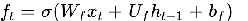, qui permit à la cellule d'effacer dynamiquement l'état périmé. Il est remarquable que le passage du DeltaNet linéaire à **Gated DeltaNet** et **KDA** en 2024–2025 ait reproduit la même idée mathématique d'introduction d'un facteur d'amortissement dépendant de l'entrée  devant la mémoire matricielle24. La même année, Daniel Lee et Sebastian Seung publièrent dans *Nature* la **factorisation matricielle non négative (NMF)** (n° 156), montrant que l'interdiction de la soustraction mutuelle des caractéristiques pour  fait ressortir des composantes additives interprétables (principe transposé en 2025 aux projections non négatives  de l'architecture DeepSeek **mHC**2), et Ning Qian donna une analyse spectrale exacte de l'impulsion dans la descente de gradient (n° 157).

## **2000**

**Domaines :** Boucles Mémoire Base  
En 2000, Gers, Schmidhuber et Cummins publièrent la version complète en revue de la **LSTM à porte d'oubli** dans *Neural Computation* (n° 158\) et la complétèrent par des **connexions « judas » (Peephole Connections)** de l'état de la cellule  directement vers les portes, pour compter avec précision des intervalles de temps (n° 159) :  
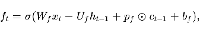  
À la conférence NIPS 2000, Charles Dugas, Yoshua Bengio et leurs coauteurs introduisirent la fonction d'activation lisse strictement positive **Softplus**  (n° 160\)161, primitive de la sigmoïde logistique, qui, dans les SSM modernes (Mamba-1/2/3) et les réseaux delta, est le paramétreur standard du pas de discrétisation 24. Simultanément, la revue *Science* publia les algorithmes géométriques de redressement non linéaire des variétés de données **Isomap** de Tenenbaum et al. (n° 161\) et **LLE** de Roweis et Saul (n° 162).

## **2001**

**Domaines :** Boucles Encodeur Base  
En 2001, Herbert Jaeger présenta le concept de calcul par réservoir dans un rapport sur les **réseaux à états d'écho (Echo State Networks, ESN)** (n° 163) : un grand réservoir récurrent fixe, de rayon spectral 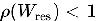, projette non linéairement l'historique d'entrée dans un état de grande dimension , au-dessus duquel seule la matrice de lecture de sortie est entraînée par régression linéaire, sans BPTT. À la conférence ICML 2001, John Lafferty, Andrew McCallum et Fernando Pereira introduisirent les **champs aléatoires conditionnels (Conditional Random Fields, CRF)** (n° 164), qui normalisent globalement les probabilités de toute la séquence de sortie  et éliminèrent le biais des modèles markoviens à normalisation locale. La même année parut la première édition de la monographie statistique fondamentale de Hastie, Tibshirani et Friedman *« The Elements of Statistical Learning »* (n° 165).

## **2002**

**Domaines :** Diffusion Base Boucles  
En 2002, Geoffrey Hinton publia dans *Neural Computation* l'algorithme de **divergence contrastive (\-step Contrastive Divergence, CD\-)** (n° 166\)142, qui accéléra radicalement l'entraînement des modèles à énergie et des RBM : au lieu d'une longue convergence de la chaîne de Markov vers l'équilibre de la densité modélisée, la phase négative du gradient est approximée en un seul pas  d'échantillonnage de Gibbs partant du vecteur de données réel. Wolfgang Maass, Thomas Natschläger et Henry Markram présentèrent l'analogue impulsionnel des réseaux à réservoir — les **machines à états liquides (LSM)** (n° 167) ; Michael Collins généralisa à EMNLP le perceptron et le théorème de Novikoff aux tâches de prédiction structurée de séquences avec décodage de Viterbi (n° 168) ; et Ronan Collobert, Samy Bengio et Johnny Mariéthoz publièrent la bibliothèque modulaire ouverte en C++ **Torch** (n° 169), ancêtre du PyTorch moderne.

## **2003**

**Domaines :** Base Attention/LLM Encodeur  
En 2003, Yoshua Bengio, Réjean Ducharme, Pascal Vincent et Christian Jauvin publièrent dans *JMLR* l'article *« A Neural Probabilistic Language Model »* (n° 170), qui remplaça les compteurs discrets de \-grammes par une matrice apprenable de **plongements lexicaux vectoriels denses**  et par un perceptron lisse au-dessus de la fenêtre concaténée des tokens précédents  :  
  
L'entraînement conjoint des plongements et de la couche cachée reporta la masse de probabilité sur des combinaisons de mots sémantiquement proches, jamais rencontrées littéralement dans le corpus, ouvrant la voie directe aux LLM modernes. La même année, Patrice Simard, Dave Steinkraus et John Platt introduisirent les déformations élastiques des données et standardisèrent les pratiques convolutives simples à ICDAR (0.4 % d'erreur sur MNIST, n° 171), et David MacKay publia l'ouvrage fondamental *« Information Theory, Inference, and Learning Algorithms »* (n° 172).

## **2004**

**Domaines :** Optimisation Base  
En 2004, Kyoung-Su Oh et Keechul Jung publièrent dans *Pattern Recognition* l'article *« GPU Implementation of Neural Networks »* (n° 173), qui transposa pour la première fois les multiplications matricielles d'un réseau de neurones entièrement connecté sur le pipeline de pixel shaders d'une carte vidéo (ATI Radeon 9700 Pro), avec une **accélération de 20×** par rapport au processeur central7. À la conférence ICML 2004, Andrew Ng démontra rigoureusement qu'en présence d'un nombre exponentiel de caractéristiques bruitées, la complexité d'échantillonnage de la régularisation \ ne croît que logarithmiquement , alors que pour les méthodes invariantes par rotation à pénalité \ elle croît linéairement  (n° 174). À NIPS, Max Welling, Michal Rosen-Zvi et Geoffrey Hinton étendirent l'architecture RBM aux distributions continues de la famille exponentielle (**Exponential Family Harmoniums**, n° 175\)162.

## **2005**

**Domaines :** Diffusion STT Encodeur Base  
En 2005, Aapo Hyvärinen publia dans *JMLR* la méthode d'**appariement de la fonction de score (Score Matching)** (n° 176\)161, qui permit d'entraîner des densités d'énergie non normalisées  sans calculer la fonction de partition , en minimisant l'écart entre les gradients du logarithme de la densité par rapport au vecteur de données 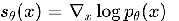 (l'inconnue  étant éliminée par intégration par parties) :  
  
La même année, Alex Graves et Jürgen Schmidhuber combinèrent la LSTM à portes avec un dépliage bidirectionnel dans le temps (**BiLSTM**) et une rétropropagation complète à travers les portes pour la classification phonémique de la parole (n° 177) ; Sumit Chopra, Raia Hadsell et Yann LeCun introduisirent à CVPR la fonction de perte métrique **Contrastive Loss** (n° 178) ; Marco Gori, Gabriele Monfardini et Franco Scarselli proposèrent la première formulation des **réseaux de neurones sur graphes (GNN)** (n° 179) ; et Frederic Morin et Yoshua Bengio accélérèrent la couche de sortie des modèles de langage de 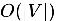 à  grâce au **Softmax hiérarchique** sur un arbre binaire de mots (n° 180).

## **2006**

**Domaines :** STT Base Encodeur  
À la conférence ICML 2006, Alex Graves, Santiago Fernández, Faustino Gomez et Jürgen Schmidhuber présentèrent le mécanisme de **Connectionist Temporal Classification (CTC)** (n° 181), qui libéra la reconnaissance de la parole et de l'écriture manuscrite de la nécessité d'un étiquetage des phonèmes trame par trame. En étendant l'alphabet par un symbole vide  (blank) et en introduisant l'opérateur d'effondrement des répétitions et des vides , CTC calcule la probabilité exacte de la transcription cible  en sommant sur tous les chemins d'alignement admissibles de longueur  par la méthode de programmation dynamique avant-arrière en  :  
  
Simultanément, Geoffrey Hinton, Simon Osindero et Yee-Whye Teh publièrent le préentraînement couche par couche des **réseaux de croyance profonds (Deep Belief Nets)** à partir d'une pile de RBM (n° 182\)142, et Hinton et Ruslan Salakhutdinov démontrèrent dans la revue *Science* la compression non linéaire de données par des autoencodeurs profonds avec affinage par rétropropagation (n° 183), ramenant les réseaux profonds au centre de l'attention scientifique. L'année s'acheva avec la synthèse fondamentale sur les modèles à énergie de Yann LeCun et de ses coauteurs (n° 184\) et le manuel classique de Christopher Bishop *« Pattern Recognition and Machine Learning »* (n° 185\)164.

## **2007**

**Domaines :** Base Optimisation Encodeur  
En 2007, Yoshua Bengio, Pascal Lamblin, Dan Popovici et Hugo Larochelle montrèrent à NIPS (*« Greedy Layer-Wise Training of Deep Networks »*, n° 186\)163 que le préentraînement glouton couche par couche d'autoencodeurs déterministes initialise les réseaux profonds aussi bien que les RBM stochastiques. À la même conférence, Léon Bottou et Olivier Bousquet publièrent le travail *« The Tradeoffs of Large Scale Learning »* (n° 187), démontrant qu'à budget de temps de calcul fixé, en régime de grands échantillons, la simple descente de gradient stochastique du premier ordre (SGD) minimise le risque de généralisation espéré de façon asymptotiquement plus efficace que les lourds optimiseurs du second ordre. Andriy Mnih et Geoffrey Hinton introduisirent le **Log-Bilinear Language Model** (n° 188), et Ruslan Salakhutdinov, Andriy Mnih et Geoffrey Hinton appliquèrent les RBM au filtrage matriciel de recommandations sur le Netflix Prize (n° 189).

## **2008**

**Domaines :** Encodeur Diffusion Attention/LLM  
À la conférence ICML 2008, Pascal Vincent, Hugo Larochelle, Yoshua Bengio et Pierre-Antoine Manzagol présentèrent les **autoencodeurs débruiteurs (Denoising Autoencoders, DAE)** (n° 190\)161 : le vecteur d'entrée est délibérément corrompu par une mise à zéro aléatoire de composantes (masquage) ou par un bruit gaussien , et le réseau est entraîné à reprojeter le point bruité sur la variété des données propres 165. Ce simple remplacement de la reconstruction identique par le débruitage devint un pont conceptuel direct à la fois vers la modélisation du langage masquée (BERT, LLaDA) et vers l'appariement de score par diffusion. À la même ICML, Ronan Collobert et Jason Weston entraînèrent une architecture convolutive unique, avec des plongements de mots préentraînés sur Wikipédia, pour résoudre conjointement six tâches de NLP sans ingénierie manuelle des caractéristiques (n° 191), et Laurens van der Maaten et Geoffrey Hinton introduisirent dans *JMLR* l'algorithme de visualisation de variétés **t-SNE** (n° 192).

## **2009**

**Domaines :** Encodeur Optimisation Base  
En 2009 coïncidèrent trois événements qui préparèrent la mise à l'échelle de l'apprentissage profond moderne. Jia Deng, Fei-Fei Li et leurs coauteurs présentèrent à CVPR le corpus hiérarchique **ImageNet** (plus de 14 millions d'images annotées, n° 193\)167 ; Rajat Raina, Anand Madhavan et Andrew Ng entraînèrent à ICML des réseaux profonds de 100 millions de paramètres sur des cœurs programmables **CUDA GPU** avec une **accélération de 70×** par rapport aux CPU multicœurs (n° 194) ; et Yoshua Bengio, Jérôme Louradour, Ronan Collobert et Jason Weston formalisèrent l'**apprentissage par curriculum (Curriculum Learning)** (n° 195\) — élévation progressive de la difficulté et de la longueur des exemples d'entraînement, devenue une étape obligée de l'entraînement progressif au contexte long et à la haute résolution dans tous les LLM et générateurs vidéo modernes59. La même année, Salakhutdinov et Hinton créèrent les **machines de Boltzmann profondes (DBM)** à connexions bidirectionnelles entre couches (n° 196), et Franco Scarselli et al. établirent la convergence mathématique des réseaux sur graphes **GNN** dans *IEEE TNN* (n° 197).

## **2010**

**Domaines :** Base Optimisation Boucles  
En 2010 furent levés les principaux obstacles à l'entraînement de réseaux profonds à propagation avant à partir de zéro, sans préentraînement couche par couche. Xavier Glorot et Yoshua Bengio, à la conférence AISTATS (n° 198\), montrèrent que, pour conserver simultanément la variance du signal dans la passe avant et la variance des gradients dans la passe arrière, les poids d'une couche doivent être initialisés avec la variance de **Glorot (Xavier Initialization)** :  
  
À la conférence ICML 2010, Vinod Nair et Geoffrey Hinton publièrent le travail *« Rectified Linear Units Improve Restricted Boltzmann Machines »* (n° 199), introduisant dans la pratique courante l'activation linéaire par morceaux **ReLU** , de dérivée unité sur le demi-axe positif. La même année, Tomáš Mikolov et ses coauteurs présentèrent à Interspeech le **modèle de langage récurrent (RNNLM)** pour la reconnaissance de la parole (n° 200), Michael Gutmann et Aapo Hyvärinen établirent l'**estimation contrastive par le bruit (NCE)** (n° 201), James Martens entraîna des réseaux profonds sans préentraînement par la méthode du second ordre **Hessian-Free** (n° 202), et parut le compilateur symbolico-tensoriel de différentiation automatique sur GPU **Theano** de James Bergstra et du groupe de Bengio (n° 203).

## **2011**

**Domaines :** Optimisation Diffusion Base STT  
En 2011, John Duchi, Elad Hazan et Yoram Singer publièrent dans *JMLR* l'optimiseur adaptatif **AdaGrad** (n° 204\)168, qui normalise le pas de chaque coordonnée par la racine de la somme cumulée des carrés de ses gradients passés , ce qui fonda toute la famille des méthodes adaptatives d'optimisation des réseaux profonds.  
Pascal Vincent publia à l'été 2011 dans *Neural Computation* l'article théorique fondamental *« A Connection Between Score Matching and Denoising Autoencoders »* (**Denoising Score Matching, DSM**, n° 205\)161. Vincent démontra rigoureusement que l'entraînement d'un autoencodeur à supprimer un bruit gaussien  équivaut à l'estimation de la fonction de score de la densité lissée de Parzen  *sans calcul des dérivées secondes du jacobien*166 :  
  
Étant donné que , cette formule est le noyau mathématique direct de tous les modèles de diffusion continus (NCSN, DDPM, Score SDE)142. La même année, Glorot, Bordes et Bengio justifièrent la parcimonie des réseaux profonds à ReLU (n° 206), Max Welling et Yee-Whye Teh associèrent le gradient stochastique à la dynamique de Langevin dans **SGLD** (n° 207), Frank Seide, Gang Li et Dong Yu réalisèrent une percée dans la reconnaissance industrielle de la parole conversationnelle avec l'hybride **CD-DNN-HMM** (n° 208), et Collobert et al. publièrent l'article de synthèse *« Natural Language Processing (Almost) from Scratch »* dans *JMLR* (n° 209).

## **2012**

**Domaines :** Encodeur STT Optimisation Boucles  
En décembre 2012, Alex Krizhevsky, Ilya Sutskever et Geoffrey Hinton présentèrent à NIPS le réseau convolutif à huit couches **AlexNet** (n° 210\)96, qui réduisit l'erreur Top-5 sur ImageNet ILSVRC-2012 de 26.2 % à **15.3 %** (précision Top-1 de 63.3 %). Le succès d'AlexNet combinait 60 millions de paramètres, la non-linéarité **ReLU** (qui accéléra la convergence d'un facteur 6 par rapport à 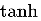), la désactivation stochastique de neurones **Dropout** pour supprimer la coadaptation des caractéristiques (Hinton et al., 2012, n° 212\) et un entraînement parallèle par modèle sur deux cartes vidéo NVIDIA GTX 580167.  
Simultanément, en novembre 2012, Alex Graves publia l'architecture **RNN-Transducer (RNN-T)** (n° 211), qui leva l'hypothèse d'indépendance conditionnelle des sorties de CTC en réunissant l'encodeur acoustique  et le réseau autorégressif de prédiction de texte 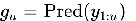 dans un réseau conjoint **Joiner**  avec marginalisation sur le treillis bidimensionnel  — standard de tous les systèmes de reconnaissance de la parole en flux jusqu'aux TDT modernes170. La même année apparurent la mise à l'échelle du pas par moyenne glissante quadratique **RMSProp** de Hinton et la méthode sans dimension **Adadelta** de Matthew Zeiler (n° 213), le framework de cluster distribué **DistBelief** de Jeff Dean et al. (n° 214), les ensembles de GPU-CNN de Dan Cireşan, Ueli Meier et Jürgen Schmidhuber avec la première précision surhumaine sur la reconnaissance de panneaux (n° 215\)155 et la démonstration de l'efficacité de la recherche aléatoire d'hyperparamètres par Bergstra et Bengio (n° 216).

## **2013**

**Domaines :** Encodeur Diffusion Base Optimisation  
En décembre 2013, Diederik Kingma et Max Welling publièrent l'**Autoencodeur variationnel (Variational Autoencoder, VAE)** (*« Auto-Encoding Variational Bayes »*, n° 217 ; indépendamment Danilo Rezende, Shakir Mohamed et Daan Wierstra, n° 218), qui maximise la borne inférieure variationnelle de la vraisemblance (**ELBO**) :  
  
L'**astuce de reparamétrisation**  introduite par les auteurs déporta l'aléa dans un bruit externe et permit d'entraîner des encodeurs probabilistes profonds arbitraires par la rétropropagation ordinaire de l'erreur ; ce sont précisément les espaces comprimés des VAE qui forment aujourd'hui le substrat latent de tous les générateurs phares d'images, de vidéo et de parole longue74.  
Parallèlement, Tomáš Mikolov et ses coauteurs chez Google présentèrent les architectures contrastives **Word2Vec** (Skip-Gram et CBOW avec échantillonnage négatif, n° 219), qui étendirent l'apprentissage des représentations vectorielles de mots à des corpus de milliards de mots, avec une structure sémantique linéaire. Min Lin, Qiang Chen et Shuicheng Yan introduisirent les convolutions ponctuelles 1×1 et le pooling moyen global dans **Network in Network** (n° 220), Ian Goodfellow et al. proposèrent l'activation **Maxout** (n° 221), Volodymyr Mnih et l'équipe de DeepMind associèrent un réseau convolutif à l'apprentissage Q et à un tampon d'expérience dans **DQN** sur les jeux Atari (n° 222), Andrew Saxe, James McClelland et Surya Ganguli démontrèrent la conservation des valeurs singulières du jacobien dans l'**initialisation orthogonale** des réseaux profonds (n° 223\)175, et Rie Johnson et Tong Zhang introduisirent la réduction de variance du gradient **SVRG** (n° 224).

## **2014**

**Domaines :** Attention/LLM Boucles Diffusion Encodeur Optimisation  
En 2014 naquirent l'attention douce différentiable, les réseaux antagonistes génératifs et l'optimiseur principal de l'apprentissage profond moderne. À la suite du modèle **Seq2Seq** d'Ilya Sutskever, Oriol Vinyals et Quoc Le (n° 225), qui comprimait la phrase d'entrée dans un unique vecteur fixe de LSTM, Dzmitry Bahdanau, Kyunghyun Cho et Yoshua Bengio (*« Neural Machine Translation by Jointly Learning to Align and Translate »*, n° 226\) éliminèrent le goulot d'étranglement informationnel du vecteur fixe, en permettant au décodeur de pondérer dynamiquement, à chaque pas , tous les états cachés de l'encodeur  (**attention additive**) :  
  
La même année, Kyunghyun Cho et al. simplifièrent la cellule récurrente à portes en deux portes dans le **GRU** (, n° 227), et Alex Graves, Greg Wayne et Ivo Danihelka dotèrent le réseau de neurones d'une mémoire matricielle externe différentiable dans la **Neural Turing Machine (NTM)** (n° 228). À NIPS 2014, Ian Goodfellow et ses coauteurs formulèrent le jeu minimax du générateur et du discriminateur des **GAN** (, n° 229), et en décembre Diederik Kingma et Jimmy Ba publièrent l'optimiseur **Adam** (n° 230), qui combine des estimations exponentielles glissantes des moments du premier et du second ordre du gradient avec correction du biais d'initialisation à zéro. En vision par ordinateur et en plongements parurent les cascades de petits noyaux 3×3 **VGG** de Simonyan et Zisserman (n° 231\)176, les blocs multi-échelles **GoogLeNet / Inception** de Szegedy et al. (n° 232), la factorisation matricielle de la cooccurrence de mots **GloVe** de Pennington et al. (n° 233), le travail de Goodfellow et al. sur la nature linéaire des **perturbations antagonistes (FGSM)** (n° 234\) et la bibliothèque **Caffe** de Yangqing Jia (n° 235).

## **2015**

**Domaines :** Base Diffusion Encodeur Optimisation STT  
En 2015, la barrière de la dégradation avec la profondeur des réseaux fut franchie et, simultanément, la diffusion thermodynamique fut formulée. Développant les autoroutes à portes des **Highway Networks** de Rupesh Srivastava, Klaus Greff et Jürgen Schmidhuber (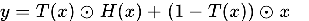, n° 236\)7, Kaiming He, Xiangyu Zhang, Shaoqing Ren et Jian Sun simplifièrent la propagation du signal en une pure addition d'identité dans **ResNet-152** (n° 237 ; conjointement avec l'initialisation **Kaiming Init**  pour ReLU, n° 238\)61 :  
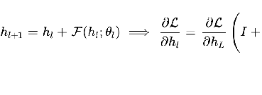  
Le terme additif  dans le jacobien assura un flux de gradient sans amortissement à travers des centaines de couches et valut la victoire à ILSVRC-2015 avec une erreur d'ensemble de 3.57 %34.  
La même année, Sergey Ioffe et Christian Szegedy introduisirent la **Batch Normalization** (n° 239\)178 ; Olaf Ronneberger, Philipp Fischer et Thomas Brox créèrent l'architecture convolutive symétrique encodeur–décodeur à propagation directe des cartes de caractéristiques spatiales **U-Net** (n° 240\)179 ; et Jascha Sohl-Dickstein, Eric Weiss, Niru Maheswaranathan et Surya Ganguli publièrent à ICML 2015 l'article pionnier *« Deep Unsupervised Learning using Nonequilibrium Thermodynamics »* (n° 241), introduisant la chaîne de Markov directe de bruitage par diffusion  et la chaîne inverse apprenable de restauration générative . L'année fut complétée par la **distillation de connaissances** à température de Hinton, Vinyals et Dean (n° 242), l'approximation de Fisher **K-FAC** de Martens et Grosse (n° 243), l'attention scalaire de Luong (n° 244), les architectures vocales de bout en bout **LAS** de Chan et al. (n° 245\) et **DeepSpeech 2** d'Amodei et al. (n° 246), la segmentation en sous-mots **BPE** de Sennrich et al. (n° 247\) et la publication ouverte du framework **TensorFlow** (n° 248).

## **2016**

**Domaines :** TTS Boucles Base Optimisation Encodeur  
En 2016 prirent forme les mécanismes de normalisation par token, de boucles récurrentes adaptatives et de synthèse autorégressive du son. Jimmy Ba, Jamie Kiros et Geoffrey Hinton proposèrent la **Layer Normalization (LayerNorm)** (n° 249), qui normalise le vecteur de caractéristiques de chaque token indépendamment de la taille du lot, et Kaiming He et al. démontrèrent que le déplacement de la normalisation à l'intérieur de la branche résiduelle (**Pre-LN ResNet** : 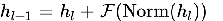, n° 250\) préserve une pure autoroute d'identité à une profondeur de plus de 1000 couches61. Alex Graves introduisit le mécanisme d'**Adaptive Computation Time (ACT)** (n° 251\)41, qui permet au réseau d'exécuter un nombre variable et apprenable d'itérations internes sur chaque token sous le contrôle d'une porte d'arrêt sigmoïdale (ponder cost) — fondement direct de la profondeur adaptative dans Universal Transformer, Ouro et Huginn41. Dan Hendrycks et Kevin Gimpel proposèrent la non-linéarité probabiliste lisse **GELU**  (n° 252).  
En synthèse de la parole, Aäron van den Oord et l'équipe de DeepMind présentèrent **WaveNet** (n° 253\) — une pile de convolutions 1D causales dilatées à croissance exponentielle de la dilatation  et à non-linéarités à portes , qui rapprocha pour la première fois la synthèse de l'onde de la voix naturelle. La même année, Laurent Dinh, Jascha Sohl-Dickstein et Samy Bengio créèrent les flots normalisants inversibles **RealNVP** (n° 254) ; Eric Jang et al. établirent la relaxation catégorielle différentiable **Gumbel-Softmax** (n° 255\)54 ; Thomas Kipf et Max Welling formalisèrent les **réseaux convolutifs sur graphes (GCN)** spectraux (n° 256) ; Gao Huang et al. présentèrent **DenseNet** (n° 257\)180 ; Ilya Loshchilov et Frank Hutter introduisirent le calendrier cosinus du taux d'apprentissage **SGDR / Cosine Annealing** (n° 258) ; et parut le manuel classique de Goodfellow, Bengio et Courville *« Deep Learning »* (MIT Press, n° 259\)8.

## **2017**

**Domaines :** Attention/LLM MoE TTS Encodeur Optimisation  
En juin 2017, Ashish Vaswani, Noam Shazeer, Niki Parmar, Jakob Uszkoreit, Llion Jones, Aidan Gomez, Łukasz Kaiser et Illia Polosukhin publièrent l'article *« Attention Is All You Need »* (n° 260\)182, remplaçant les chaînes récurrentes et les convolutions par l'architecture **Transformer**, fondée sur l'auto-attention multi-têtes à produit scalaire normalisé (**Multi-Head Attention, MHA**) :  
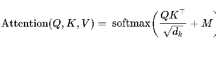  
Le facteur 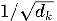 stabilise la variance des logits avant le softmax, la longueur du chemin de transmission du signal entre deux positions quelconques de la séquence se réduit à , et le parallélisme complet sur tous les  tokens à l'étape d'entraînement s'accorde idéalement aux produits tensoriels des GPU, au prix d'une complexité quadratique .  
La même année 2017 parurent cinq autres travaux qui façonnèrent l'aspect des systèmes multimodaux et parcimonieux modernes. Noam Shazeer et ses coauteurs présentèrent à ICLR le **Sparsely-Gated Mixture-of-Experts** (n° 261\)184, qui porta le modèle de langage à 137 milliards de paramètres grâce à un routage parcimonieux 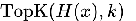 avec une pénalité auxiliaire d'équilibrage de la charge des experts. Aäron van den Oord, Oriol Vinyals et Koray Kavukcuoglu créèrent **VQ-VAE** (n° 262), qui introduisit la quantification vectorielle de l'espace latent dans un dictionnaire de codes (codebook) discret, avec une estimation de gradient de bout en bout par Straight-Through Estimator — mécanisme de base de tous les codecs audio neuronaux modernes. Yuxuan Wang et al. (**Tacotron**, n° 263\) et Jonathan Shen et al. (**Tacotron 2**, n° 264\) construisirent une synthèse vocale de bout en bout « texte 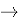 mel-spectrogramme  vocodeur neuronal ». En optimisation, Ilya Loshchilov et Frank Hutter dissocièrent la décroissance des poids du second moment adaptatif dans **AdamW** (, n° 265), John Schulman et al. créèrent le gradient de politique à substitut écrêté **PPO** (n° 266\)158, et Martin Arjovsky, Soumith Chintala et Léon Bottou stabilisèrent les réseaux antagonistes par la métrique de Wasserstein **WGAN** (n° 267). L'arsenal architectural s'enrichit des convolutions séparables en profondeur **MobileNets** de Howard et al. (n° 268), de l'attention par canaux **SENet** de Hu et al. (n° 269), de l'activation **Swish / SiLU** 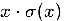 de Ramachandran et al. (n° 270\) et de l'attention sur graphes **GAT** de Veličković et al. (n° 271).

## **2018**

**Domaines :** Encodeur Attention/LLM Boucles TTS Optimisation  
En 2018, le préentraînement des transformeurs sur de grands corpus non annotés se scinda en deux branches complémentaires. À la suite des représentations contextuelles de BiLSTM **ELMo** de Matthew Peters et al. (n° 272), Alec Radford et ses coauteurs chez OpenAI présentèrent le décodeur causal autorégressif **GPT-1** (n° 273), et Jacob Devlin, Ming-Wei Chang, Kenton Lee et Kristina Toutanova chez Google créèrent l'encodeur bidirectionnel profond **BERT** (n° 274\)186, entraîné à restituer 15 % de tokens aléatoirement masqués (**Masked Language Modeling, MLM**) à partir du contexte complet gauche et droit.  
Simultanément, Mostafa Dehghani et ses coauteurs introduisirent l'**Universal Transformer** (n° 275\)187 — le premier transformeur bouclé à poids partagés en profondeur et à arrêt ACT par token, démontrant son universalité computationnelle à profondeur variable et posant la base directe des modèles modernes Huginn et Ouro. Ricky Chen, Yulia Rubanova, Jesse Bettencourt et David Duvenaud passèrent à la limite continue du réseau résiduel  dans **Neural ODE**, avec un entraînement par la méthode des équations adjointes en  de mémoire en profondeur (n° 276\)190. La même année, Aäron van den Oord, Yazhe Li et Oriol Vinyals formulèrent la fonctionnelle contrastive **InfoNCE** dans le cadre de **CPC** (n° 277\)191 ; Kingma et Dhariwal créèrent le générateur inversible **Glow** (n° 278), adapté par Ryan Prenger et al. en un vocodeur vocal rapide à flot, **WaveGlow** (n° 279) ; Yuxin Wu et Kaiming He introduisirent **GroupNorm** (n° 280) ; en optimisation apparurent **Adafactor** de rang faible de Shazeer et Stern (n° 281\)192 et le préconditionneur matriciel de courbure **Shampoo** de Gupta, Koren et Singer (n° 282\)160 ; Arthur Jacot et al. décrivirent le régime du **noyau tangent neuronal (NTK)** (n° 283) ; et Taku Kudo et John Richardson publièrent le tokeniseur **SentencePiece** (n° 284\)73.

## **2019**

**Domaines :** Attention/LLM Boucles TTS Diffusion Optimisation  
En 2019 prit forme l'ossature d'ingénierie du décodeur de LLM moderne et de l'infrastructure de son entraînement distribué. Alec Radford et ses coauteurs, avec **GPT-2** (1.5B paramètres, n° 285\)1, établirent le schéma **Pre-LN** et l'exécution zero-shot de tâches par continuation linguistique. Biao Zhang et Rico Sennrich présentèrent **RMSNorm** (n° 286\)28, qui abandonne le centrage de la moyenne de LayerNorm pour ne conserver que la normalisation invariante d'échelle par l'amplitude quadratique moyenne :  
  
ce qui accéléra la normalisation sur GPU et devint la norme de pratiquement toutes les architectures ouvertes de 2023–2026196. En novembre, Noam Shazeer publia la **Multi-Query Attention (MQA)** (n° 287\)49, en soulignant la limitation du décodage autorégressif par la bande passante de la mémoire HBM lors de la lecture du cache KV et en proposant des projections communes  pour toutes les têtes de requêtes.  
Dans les modèles bouclés et à contexte long, Shaojie Bai, Zico Kolter et Vladlen Koltun créèrent les **Deep Equilibrium Models (DEQ)** (n° 288), qui trouvent le point fixe de la boucle  par un solveur numérique de racines et le différencient analytiquement via le théorème des fonctions implicites en  de mémoire ; Zhenzhong Lan et al. appliquèrent le partage de poids de bout en bout entre couches dans **ALBERT** (n° 289\)189 ; Colin Raffel et al. introduisirent le biais d'attention relatif tabulaire dans **T5** (n° 290\)72 ; et Zihang Dai et al. combinèrent la récurrence par segments avec des positions relatives dans **Transformer-XL** (n° 291\)190. En synthèse de la parole, Yi Ren et al. créèrent le transformeur non autorégressif **FastSpeech** avec un régulateur explicite de durée des phonèmes (**Length Regulator**, n° 292), accélérant de deux ordres de grandeur la génération de mel-spectrogrammes sans perte de robustesse. Yang Song et Stefano Ermon firent renaître la modélisation générative par score sur une grille multi-échelle de bruits dans **NCSN** (n° 293). L'année s'acheva avec la mise à l'échelle composée des CNN **EfficientNet** de Tan et Le (n° 294\)178, l'encodeur audio auto-supervisé **wav2vec** de Schneider et al. (n° 295), le parallélisme tensoriel intracouche **Megatron-LM** de NVIDIA (n° 296\)198, le partitionnement des états de l'optimiseur et des poids **ZeRO** de Microsoft DeepSpeed (n° 297\)73 et l'article de référence d'Adam Paszke et al. sur **PyTorch** (n° 298).

## **2020**

**Domaines :** Attention/LLM Diffusion Encodeur STT TTS Boucles/SSM  
En 2020, les modèles de langage, la génération par diffusion, la vision par ordinateur et les technologies de la parole se sont transformés simultanément. Jared Kaplan et ses coauteurs ont établi les **lois d'échelle (Scaling Laws)** en loi de puissance de la perte de modélisation du langage en fonction du nombre de paramètres, des données et du budget de FLOPs  (n° 299\)4, mises en œuvre par Tom Brown et l'équipe d'OpenAI dans **GPT-3**, à 175 milliards de paramètres, avec un apprentissage en contexte émergent (n° 300). Noam Shazeer a introduit la famille de blocs entièrement connectés à portes **SwiGLU**  (n° 301\)199, qui a remplacé le MLP classique à deux couches dans les LLM modernes, tandis qu'Angelos Katharopoulos et al. ont factorisé l'attention au moyen d'un noyau de caractéristiques positif  dans l'**attention linéaire (Linear Attention)** (n° 302\)25, en montrant la dualité entre le transformeur linéaire et un RNN doté d'une mémoire matricielle  de complexité .  
Dans les modèles génératifs, Jonathan Ho, Ajay Jain et Pieter Abbeel ont publié **DDPM** (n° 303\)37, qui ramène l'apprentissage variationnel de la chaîne de Markov inverse à la prédiction du bruit gaussien ajouté  ; Jiaming Song, Chenlin Meng et Stefano Ermon ont construit les trajectoires déterministes non markoviennes d'échantillonnage accéléré **DDIM** (n° 304\)5 ; et Yang Song et al. ont unifié la diffusion et l'estimation du score en équations différentielles stochastiques continues **Score SDE** et en un flot de probabilité déterministe, la **Probability Flow ODE** (n° 305\)5. En vision par ordinateur, Alexey Dosovitskiy, Lucas Beyer et al. ont présenté le transformeur pur sur patchs **ViT** (découpage de l'image en patchs 16×16 sans convolutions, 88.55 % de Top-1 sur ImageNet pour ViT-H/14, n° 306\)73, en parallèle de la percée de l'apprentissage auto-supervisé contrastif **SimCLR** (n° 311\)202, de **MoCo** (n° 312\) et de **BYOL**, sans exemples négatifs (n° 313).  
En traitement audio sont apparus trois composants de base de la pile vocale moderne : l'hybride convolution-transformeur **Conformer** d'Anmol Gulati et al. (Macaron-FFN \+ MHSA \+ DepthwiseConv, qui atteint **1.9 % / 3.9 % de WER** sur LibriSpeech test-clean / test-other, n° 307\)203, l'encodeur quantifiant auto-supervisé de forme d'onde brute **wav2vec 2.0** d'Alexei Baevski et al. (n° 308\)191 et le vocodeur génératif adversarial multi-période **HiFi-GAN** de Jungil Kong et al. (n° 309\)206. Enfin, Albert Gu, Tri Dao et leurs coauteurs ont établi les opérateurs de projection polynomiale orthogonale de l'historique continu d'un signal **HiPPO** (n° 310\)62 (base théorique de S4 et de Mamba), Patrick Lewis et al. ont créé l'architecture **RAG** (n° 314), et Dmitry Lepikhin et al. ont étendu le MoE à 600 Md de paramètres dans le système **GShard** (n° 315\)27.

## **2021**

**Domaines :** Attention/LLM MoE Encodeur Boucles/SSM TTS Diffusion Optimisation  
En 2021 se sont constitués les standards de l'encodage positionnel relatif, de l'adaptation de bas rang, des espaces d'états structurés et de la diffusion latente. Jianlin Su et ses coauteurs ont introduit dans **RoFormer** l'**encodage positionnel rotatif (RoPE)** (n° 316\)72, qui multiplie les paires de coordonnées des requêtes et des clés par des matrices de rotation orthogonales dans le plan complexe, avec un spectre de fréquences géométrique  :  
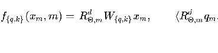  
Ofir Press et al. ont proposé les pénalités positionnelles linéaires d'attention **ALiBi** (n° 317) ; William Fedus, Barret Zoph et Noam Shazeer ont simplifié le MoE jusqu'à un routage **Top-1** dans le **Switch Transformer** de 1.6 billion de paramètres (n° 318) ; et Edward Hu et al. ont créé la méthode **LoRA** (n° 319\)210, qui gèle les matrices préentraînées  et n'entraîne qu'un terme additif de bas rang  de rang , sans latence supplémentaire à l'inférence.  
Parmi les encodeurs multimodaux et visuels, Alec Radford et al. ont aligné les espaces d'images et de textes sur 400 millions de paires dans **CLIP** (n° 320\)212, Kaiming He et al. ont créé l'autoencodeur asymétrique à masquage de patchs **MAE** (masquage de 75 % des patchs, n° 321), Mathilde Caron et al. ont découvert l'autodistillation sans étiquettes des transformeurs visuels **DINO** (n° 322\)213, et Ze Liu et al. ont introduit les fenêtres décalées hiérarchiques dans le **Swin Transformer** (n° 323). Dans la modélisation des longues séquences, Albert Gu, Karan Goel et Christopher Ré ont publié **S4 (Structured State Spaces)** (n° 324\)62 : en décomposant la matrice HiPPO en la somme d'une matrice normale et d'une matrice de bas rang (**NPLR** : ), ils ont ramené le calcul du noyau de convolution de longueur  à un noyau de Cauchy et à une FFT en , résolvant pour la première fois la tâche Path-X de longueur 16,384 de Long Range Arena (score moyen de 86.09)216 ; en parallèle, Imanol Schlag, Kazuki Irie et Jürgen Schmidhuber ont introduit à ICML 2021 la règle delta de réécriture dans les transformeurs linéaires (**Fast Weight Programmers**, n° 325\)157, source théorique directe de DeltaNet.  
Dans les domaines de la parole et de la génération, Jaehyeon Kim, Jungil Kong et Juhee Son ont réuni inférence variationnelle, flots normalisants et synthèse adversariale de la forme d'onde dans **VITS** (n° 326\)217 ; Neil Zeghidour et al. ont créé le premier codec audio neuronal de bout en bout à **quantification vectorielle résiduelle (RVQ)**, **SoundStream** (n° 327\)47 ; Wei-Ning Hsu et al. ont présenté l'encodeur de parole à masquage **HuBERT** (n° 328\)191 ; Prafulla Dhariwal et Alex Nichol ont démontré la supériorité de la diffusion sur les GAN pour la qualité d'image dans **ADM** (n° 329\)219 ; Jacob Austin et al. ont formalisé la diffusion discrète à jeton absorbant \[MASK\] dans **D3PM** (n° 330\)35 ; et en décembre, Robin Rombach, Andreas Blattmann, Dominik Lorenz, Patrick Esser et Björn Ommer ont transposé la diffusion dans l'espace comprimé d'un autoencodeur perceptuel, avec attention croisée sur le texte, dans les **Latent Diffusion Models (LDM / Stable Diffusion)** (n° 331\)179.

## **2022**

**Domaines :** Attention/LLM Optimisation Diffusion STT TTS  
En 2022, les algorithmes de mémoire conscients du matériel, les lois d'échelle optimales en calcul et les flots d'EDO rectilignes ont changé l'économie des grands modèles. Tri Dao, Daniel Fu, Stefano Ermon, Atri Rudra et Christopher Ré ont publié **FlashAttention** (n° 332\)199 : en découpant en blocs les matrices  dans la mémoire rapide intégrée à la puce du GPU, la **SRAM**, et en appliquant le redimensionnement exact par blocs de l'**online-softmax** (qui remonte à Milakov et Gimelshein, n° 333) :  
  
les auteurs ont calculé une attention mathématiquement exacte sans écrire la matrice  dans la mémoire globale HBM, ramenant la consommation de mémoire à 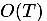223. Jordan Hoffmann et al., dans **Chinchilla** (n° 334\)224, ont montré qu'à budget de FLOPs fixé, le régime d'entraînement optimal exige une mise à l'échelle proportionnelle du nombre de paramètres et du nombre de jetons d'entraînement (), tandis que Greg Yang, Edward Hu et al. ont établi la paramétrisation **P** pour le transfert zero-shot des hyperparamètres des petits modèles vers des entraînements gigantesques (n° 335).  
Dans la modélisation générative, Jonathan Ho et Tim Salimans ont introduit le **guidage sans classifieur (CFG)** (n° 336), Tero Karras et al. ont systématisé le préconditionnement du bruit et les échantillonneurs du second ordre dans **EDM** (n° 337\)37, et à l'automne 2022, Xingchao Liu, Chengyue Gong et Qiang Liu (**Rectified Flow**, n° 338), Yaron Lipman, Ricky Chen et al. (**Flow Matching**, n° 339\) ainsi que Michael Albergo avec Eric Vanden-Eijnden (**Stochastic Interpolants**, n° 340\) ont fait passer la génération à l'apprentissage de champs vectoriels de vitesse rectilignes de l'EDO  le long de l'interpolation linéaire , avec la procédure de redressement des trajectoires **Reflow**5. En décembre, William Peebles et Saining Xie ont remplacé le U-Net de la diffusion latente par un transformeur extensible à normalisation adaptative **adaLN-Zero**, le **Diffusion Transformer (DiT)** (FID de 2.27 sur ImageNet 256×256, n° 341\)219. En audio et en post-entraînement sont apparus le transformeur ASR multilingue **Whisper** d'Alec Radford et al., entraîné sur 680,000 heures de données faiblement annotées (n° 342\)229, le codec RVQ ouvert 24 kHz **EnCodec** d'Alexandre Défossez et al. (n° 343\)231, l'alignement en trois étapes sur les préférences humaines **InstructGPT (RLHF)** de Long Ouyang et al. (n° 344), le prompting de chaînes de raisonnement **Chain-of-Thought** de Jason Wei et al. (n° 345\) et les optimiseurs 8 bits à quantification par blocs de Tim Dettmers et al. (n° 346\)169.

## **2023**

**Domaines :** Attention/LLM MoE Boucles/SSM Encodeur Vidéo STT TTS STS Optimisation  
En 2023, l'écosystème ouvert des LLM a reçu un standard de décodage efficace, et les modèles linéaires récurrents ont pour la première fois défié les transformeurs sur les tâches de langage. Joshua Ainslie et al. ont introduit l'**attention à requêtes groupées (Grouped-Query Attention, GQA)** (n° 347\)39, qui partage  groupes de clés-valeurs entre  têtes de requêtes (adoptée dans **Llama 2 70B** de Touvron et al., n° 348194) ; Woosuk Kwon et al. ont éliminé la fragmentation de la mémoire vidéo du cache KV grâce au mécanisme de pagination **PagedAttention** dans le moteur **vLLM** (n° 349\)232 ; Tri Dao a optimisé le parallélisme de warps dans **FlashAttention-2** (n° 350\)198 ; Hao Liu, Matei Zaharia et Pieter Abbeel ont créé l'attention répartie en anneau sur des accélérateurs **Ring Attention** pour les contextes de plusieurs millions de jetons (n° 351\)132 ; l'équipe de Mistral AI a publié le mélange d'experts épars ouvert **Mixtral 8x7B** (Top-2 parmi 8, n° 352\)234 ; et Rafael Rafailov et al. ont établi une forme close d'alignement de la politique sans modèle de récompense, la **Direct Preference Optimization (DPO)** (n° 353\)158 :  
  
Parallèlement s'est déployée l'offensive des architectures sous-quadratiques à mémoire d'inférence constante  : **RWKV-4** de Bo Peng et al. (n° 354\)236, le réseau de rétention multi-échelle **RetNet** de Yutao Sun et al. (n° 355\)49 et, en décembre, **Mamba (S6)** d'Albert Gu et Tri Dao (n° 356\)25. En faisant des paramètres de l'espace d'états  des fonctions du jeton d'entrée courant (**Selective SSM**) et en implémentant un scan associatif parallèle conscient du matériel dans la SRAM, Mamba a résolu le problème du filtrage du contexte dépendant du contenu à complexité linéaire .  
Dans les domaines visuel, de la diffusion de texte et de la parole sont apparus : le prédicteur latent non génératif d'images **I-JEPA** d'Assran, LeCun et al. (n° 357), l'encodeur contrastif à sigmoïde par paires sans softmax **SigLIP** de Zhai et al. (n° 358\)212, le modèle fondation visuel **DINOv2** d'Oquab et al. (n° 359\)176, le générateur vidéo **Stable Video Diffusion** de Blattmann et al. (n° 360), la diffusion discrète à estimation de rapports de vraisemblance **SEDD** de Lou, Meng et Ermon (n° 361\)57, le premier modèle de langage à codec pour la synthèse vocale zero-shot à partir d'un échantillon de 3 secondes, **VALL-E** de Wang et al. (n° 362\)218, le codec audio amélioré **DAC** de Kumar et al. (n° 363\)55, le modèle de parole conversationnel **SpeechGPT** de Zhang et al. (n° 364\)240, l'encodeur à trame de 80 ms accéléré de 2.8×, **FastConformer**, de Rekesh et al. (n° 365\)171, le transducteur sautant les trames vides **Token-and-Duration Transducer (TDT)** de Xu, Majumdar et Ginsburg (n° 366\)79, l'adaptation 4 bits **QLoRA** de Dettmers et al. (n° 367), l'extension de la fenêtre de RoPE **YaRN** de Peng et al. (n° 368\)30 et le manuel de Simon Prince *« Understanding Deep Learning »* (MIT Press, n° 369\)8.

## **2024**

**Domaines :** Attention/LLM MoE Boucles/SSM Diffusion Vidéo Encodeur STT TTS STS Optimisation

### **Attention latente MLA, équilibrage du MoE sans pénalité et préentraînement quantifié**

En 2024, une série de travaux du laboratoire DeepSeek-AI a révisé l'architecture de l'attention et du routage des experts. Dans **DeepSeekMoE** (arXiv:2401.06066, n° 370\)29, les experts ont été fragmentés en petits sous-réseaux spécialisés, combinés à des *experts partagés* isolés et toujours actifs. En mai, **DeepSeek-V2** (arXiv:2405.04434, 236B de paramètres au total / 21B actifs, n° 371\)50 a introduit le mécanisme **Multi-Head Latent Attention (MLA)** :  
  
Grâce à l'absorption des matrices de décompression  dans les projections de requêtes et de sortie au moment de l'inférence, seul le vecteur comprimé  de  éléments par couche est stocké en mémoire, au lieu de 32,768 pour un MHA à 128 têtes : une réduction du cache KV de 98.24 % par couche (et de 93.3 % au niveau de l'ensemble du modèle V2 par rapport à DeepSeek 67B dense)50. En décembre, **DeepSeek-V3** (arXiv:2412.19437, 671B de paramètres au total / 37B actifs, 14.8T de jetons, n° 372\)29 a réuni l'**équilibrage de charge des experts sans perte auxiliaire**, par un biais dynamique  dans la sélection Top\- (prolongeant le Loss-Free Balancing de Wang et al., n° 37327), le module en cascade **Multi-Token Prediction (MTP)** (fondé plus tôt, en avril, par Fabian Gloeckle et al. de Meta, arXiv:2404.19737, n° 37464), le pipeline de recouvrement des communications **DualPipe** et un entraînement stable en précision **FP8** en 2.788 millions d'heures-GPU H800 (environ \$5.576M au tarif de référence de \$2/h, hors exécutions de recherche préliminaires et ablations ; MMLU 88.5 %, MATH-500 90.2 %)29. Dès février, Zhihong Shao et al., dans **DeepSeekMath** (arXiv:2402.03300, n° 375\)53, avaient présenté l'algorithme d'apprentissage par renforcement sans critique **GRPO**. Parallèlement, Shuming Ma et al. ont montré la viabilité des poids ternaires  dans **BitNet b1.58** (arXiv:2402.17764, n° 376\)51, tandis que la lignée ouverte des transformeurs denses était conduite par **Llama 3.1 405B** (n° 377\)246 et **Qwen2.5** (n° 378\)247.

### **Dualité des SSM, Gated DeltaNet, TTT et optimiseurs de seconde génération**

Sur l'axe des séquences récurrentes, Tri Dao et Albert Gu ont démontré dans **Mamba-2** (arXiv:2405.21060, n° 379\)32 une dualité structurelle rigoureuse (**SSD**) entre les SSM sélectifs à transition scalaire  et l'attention linéaire semi-séparable , ce qui a ramené l'entraînement des SSM à des blocs matriciels sur les Tensor Cores. Maximilian Beck et Sepp Hochreiter ont étendu le LSTM à portes exponentielles et à mémoire matricielle de covariance **mLSTM** dans **xLSTM** (arXiv:2405.04517, n° 380\)183 ; Songlin Yang et al. ont parallélisé le transformeur linéaire à règle delta grâce à la représentation par blocs (chunks) WY de Householder (**DeltaNet**, n° 381248) puis, en décembre, avec Jan Kautz et Ali Hatamizadeh, ont combiné la règle delta avec l'amortissement adaptatif de Mamba-2 dans **Gated DeltaNet** (arXiv:2412.06464, n° 382\)157 :  
  
La même année sont apparus les **RWKV-5/6 (Eagle & Finch)** à récurrence matricielle de Bo Peng et al. (n° 383\)249, l'hybride Mamba–Transformeur–MoE **Jamba** d'Opher Lieber et al. (n° 384\)184, les flux résiduels multibandes **Hyper-Connections (HC)** de Defa Zhu et al. (arXiv:2409.19606, n° 385\)61 et les couches **Test-Time Training (TTT-Linear / TTT-MLP)** de Yu Sun, Karan Dalal et al. (arXiv:2407.04620, n° 386\)44, qui ont transformé l'état caché lui-même en un perceptron à deux couches entraîné sur le contexte de test. En optimisation matérielle et numérique ont paru **FlashAttention-3**, asynchrone, pour les puces Hopper H100 (740 TFLOPs/s en FP16, n° 387\)252, le préconditionneur **SOAP** de Nikhil Vyas, Sham Kakade et al. (arXiv:2409.11321, exécution d'AdamW dans la base propre des matrices de Shampoo, avec une réduction de plus de 35 % du temps d'entraînement à grands lots, n° 388\)168 et l'impulsion matricielle orthogonalisante **Muon** de Keller Jordan (n° 389\)65.

### **DiT multimodal, VAE vidéo, REPA et dialogue en duplex intégral Moshi**

En génération d'images et de vidéos, Patrick Esser et al. dans **Stable Diffusion 3** (arXiv:2403.03206, n° 390\)174 et l'équipe de Black Forest Labs dans **FLUX.1** (12B de paramètres, n° 391\)174 ont consacré l'architecture à double flux **MMDiT** avec Rectified Flow. Aux modèles vidéo convolutifs ont succédé des DiT 3D spatio-temporels au-dessus de VAE 3D causaux (compression 4×8×8) : **CogVideoX** de Zhuoyi Yang et al. (n° 392\)255, **Mochi 1** (n° 393\)254, **HunyuanVideo** de 13 milliards de paramètres, de Weijie Kong et al., avec encodage des prompts par un MLLM et RoPE 3D (arXiv:2412.03603, n° 394\)256, et l'ultra-rapide **LTX-Video** de Lightricks, à compression Video-VAE 1:192 (arXiv:2501.00103, n° 395\)258. Sihyun Yu et al. ont accéléré de plus de **17.5×** la convergence des transformeurs de diffusion par la méthode d'alignement des patchs latents sur les caractéristiques de DINOv2 (**REPA**, arXiv:2410.06940, FID de 1.42 sur ImageNet 256×256, n° 396\)36 ; Subham Sahoo et al. ont établi la limite continue de la diffusion masquée de texte dans **MDLM** (arXiv:2406.07524, n° 397\)222 ; Adrien Bardes et al. ont présenté l'encodeur vidéo à prédiction de caractéristiques **V-JEPA** (arXiv:2404.08471, n° 398\)60 ; et Benjamin Warner et al. ont porté les encodeurs bidirectionnels texte-code à une fenêtre de 8,192 jetons dans **ModernBERT** (arXiv:2412.13663, alternance d'attention globale et glissante 1:2, RoPE, GeGLU, unpadding, n° 399\)186.  
Dans l'interaction vocale, Alexandre Défossez et al. du laboratoire Kyutai ont publié **Moshi** et le codec neuronal en flux continu **Mimi** (arXiv:2410.00037, n° 400\)26, premier LLM vocal ouvert en duplex intégral, avec une latence théorique de **160 ms** (200 ms en pratique, contre une pause moyenne d'environ 230 ms dans la parole humaine). Le codec Mimi comprime l'onde de 24 kHz à une fréquence de **12.5 Hz** (pas de 80 ms) en 8 codebooks RVQ de 2,048 entrées (**1.1 kbit/s**), avec distillation de la sémantique de WavLM dans le premier codebook, tandis qu'une hiérarchie composée d'un Temporal Transformer de 7B et d'un petit Depth Transformer prédit en parallèle le « monologue intérieur » (Inner Monologue) textuel et deux flux audio, sans découper la conversation en tours de parole26. La pile de 2024 a été complétée par l'encodeur non autorégressif **SenseVoice** (15× plus rapide que Whisper-Large) et le synthétiseur **CosyVoice** (FunAudioLLM, n° 401\)263, par **F5-TTS** en flux continu (n° 402\)264, par **Fish-Speech** à double cascade (n° 403\)265, ainsi que par les nouveaux manuels de référence de Christopher et Hugh Bishop *« Deep Learning: Foundations and Concepts »* (Springer, n° 404\)266 et de Sebastian Raschka *« Build a Large Language Model (From Scratch) »* (Manning, n° 405\)267.

## **2025**

**Domaines :** Attention/LLM MoE Boucles/SSM Diffusion Vidéo Encodeur STT TTS STS Optimisation

### **RL de raisonnement vérifiable, attention éparse, mHC et modèles à mille milliards de paramètres sur Muon**

En janvier 2025, la publication de **DeepSeek-R1** (arXiv:2501.12948, parue en septembre 2025 dans la revue *Nature*, n° 406\)50 a montré, avec l'expérience **DeepSeek-R1-Zero**, que la simple mise à l'échelle de l'apprentissage par renforcement **GRPO** sur des règles vérifiables, sans SFT initial, fait spontanément émerger de longues chaînes d'auto-vérification et de réflexion, faisant passer la précision sur AIME 2024 de 15.6 % à 71.0 %, tandis que **DeepSeek-R1**, complet et multi-étapes, a atteint **79.8 % de Pass@1 sur AIME 2024** et **97.3 % sur MATH-500**, avec une distillation réussie du raisonnement dans des modèles denses de 1.5B à 70B269. En février, Jingyang Yuan et al. ont présenté la **Native Sparse Attention (NSA)** (arXiv:2502.11089, Best Paper ACL 2025, n° 407\)50, qui répartit l'attention en trois branches (comprimée, sélective et à fenêtre locale), avec une accélération du décodage allant jusqu'à 11.6×76. En décembre ont paru **DeepSeek-V3.2** (arXiv:2512.02556, n° 408\)10, qui a intégré au-dessus de MLA le mécanisme **DeepSeek Sparse Attention (DSA)**, doté d'un indexeur rapide (lightning indexer) et d'une sélection des top\- jetons de complexité  (la variante à budget élevé V3.2-Speciale a obtenu des résultats de niveau or à l'IMO 2025 et à l'IOI 2025 selon le rapport des auteurs)10, et le travail de Zhenda Xie, Shengding Hu et al. sur les **Manifold-Constrained Hyper-Connections (mHC)** (arXiv:2512.24880, n° 409\)2, qui a projeté les matrices de mélange des bandes du flux résiduel sur le polytope de Birkhoff des matrices doublement stochastiques par l'algorithme de Sinkhorn—Knopp (garantie de  et seulement 6.7 % de surcoût en temps pour )2.  
Parallèlement, l'équipe de Moonshot AI a démontré le passage à l'échelle de l'optimiseur matriciel **Muon** (arXiv:2502.16982, n° 410\)65 et, en juillet, a entraîné sur 15.5 billions de jetons, sans le moindre pic de perte, le modèle phare agentique à mille milliards de paramètres **Kimi K2** (arXiv:2507.20534, 1.04T de paramètres au total / 32.6B actifs, 8 experts sur 384 \+ 1 partagé, n° 411\), grâce à l'association **MuonClip** (itérations de Newton—Schulz \+ limitation du logit d'attention maximal **QK-Clip**)66, qu'elle a complétée en octobre par l'architecture hybride **Kimi Linear**, à amortissement delta par canal **KDA** (arXiv:2510.26692, jusqu'à 6× d'accélération du décodage sur un contexte de 1M, n° 412\)278. Le front ouvert a été élargi par la famille à raisonnement contrôlable **Qwen3** (jusqu'à 235B-A22B sur 36T de jetons, arXiv:2505.09388, n° 413\)247, les modèles nativement multimodaux à fusion précoce **Llama 4 Scout** (109B-A17B, contexte de 10 millions de jetons) et **Llama 4 Maverick** (400B-A17B, n° 414\)280, le modèle agentique **GLM-4.5** (355B-A32B, arXiv:2508.06471, n° 415\)282 et l'hybride Mamba-2 \+ GQA \+ MoE au format NVFP4 **NVIDIA Nemotron 3 Nano** (31.6B-A3.2B, contexte de 1M, arXiv:2512.20848, n° 416\)13.

### **Profondeur récurrente, mémoire à l'inférence, LLM de diffusion et vidéo MoE**

En février 2025, Jonas Geiping, Tom Goldstein et al. ont mis à l'échelle le raisonnement latent en profondeur dans le modèle **Huginn-0125** (3.5B de paramètres, 800B de jetons, arXiv:2502.05171, n° 417\)3 : le schéma en sandwich  repasse un noyau de 4 couches, à initialisation aléatoire  et avec réinjection de l'entrée , jusqu'à  fois (132 couches effectives), même si des études ultérieures par sondage (Lu et al., arXiv:2507.02199) ont signalé l'ambiguïté d'une interprétation textuelle directe des itérations cachées intermédiaires et une réserve de mémoire factuelle plus modeste (MMLU 31.4 %) que celle de modèles entraînés sur 4T de jetons187. En octobre, Rui-Jie Zhu et al. (ByteDance) ont entraîné sur 7.7T de jetons les modèles bouclés de bout en bout à sortie adaptative **Ouro-1.4B et Ouro-2.6B** (arXiv:2510.25741, n° 418\)77, dont le modèle 2.6B, à , a atteint 90.8 % sur MATH-500 et égalé des modèles denses jusqu'à 12B grâce à la composition multi-étapes des connaissances, tandis que Bohong Wu et al. ont levé la pénalité de latence séquentielle des boucles par l'ordonnancement en pipeline **Cross-Loop Parallelism** dans le **Parallel Loop Transformer (PLT)** (arXiv:2510.24824, n° 419\)33. Simultanément, Ali Behrouz et al. ont créé la neuromémoire à long terme **Titans**, mise à jour à l'inférence par gradient avec impulsion (arXiv:2501.00663, n° 420\)288, Tianyuan Zhang et al. ont étendu l'entraînement des poids rapides par blocs jusqu'à 1M de jetons dans **LaCT** (arXiv:2505.23884, n° 421\)289, Maximilian Beck et Sepp Hochreiter ont publié **xLSTM 7B** (arXiv:2503.13427, n° 422\)183, et Bo Peng et al. **RWKV-7 « Goose »**, à évolution dynamique de bas rang de l'état (arXiv:2503.14456, n° 423\)236.  
En diffusion discrète de texte sont apparus **LLaDA-8B** (et sa variante MoE 7B-A1B) de Shen Nie et al., entraîné de zéro avec une perte ELBO pondérée par  (arXiv:2502.09992, n° 424\)35, la famille commerciale **Mercury Coder** d'Inception Labs, d'une vitesse de génération parallèle de **1,109 jetons/s** sur H100 (arXiv:2506.17298, n° 425\)58 et **Dream 7B** de Jiacheng Ye et al. (arXiv:2508.15487, n° 426\)294. En génération vidéo, l'équipe d'Alibaba a publié sous licence Apache 2.0 les modèles **Wan 2.1** (arXiv:2503.20314, n° 427\) et **Wan 2.2** (n° 428\), première architecture de diffusion vidéo à **débruiteur MoE temporel à deux experts** (27B de paramètres au total / 14B actifs, bascule entre l'expert de structure grossière et l'expert de détails fins selon un seuil de SNR, sans hausse du coût par pas, plus le modèle compact **TI2V-5B** à compression VAE 4×16×16 pour une seule RTX 4090\)172. Sont également parus **HunyuanVideo 1.5** (8.3B de paramètres, 75 s de rendu sur RTX 4090 en mode step-distilled, arXiv:2511.18870, n° 429\)297, l'éditeur contextuel et générateur de 32 milliards de paramètres **FLUX.1 Kontext / FLUX.2** (Mistral-3 24B \+ VAE à 128 canaux, n° 430\)174, l'encodeur multilingue **SigLIP 2** (arXiv:2502.14786, 85.0 % zero-shot sur ImageNet pour ViT-g/16, n° 431\)239, le modèle vidéo de monde avec planification robotique **V-JEPA 2** (arXiv:2506.09985, n° 432\)59 et l'encodeur visuel de 7 milliards de paramètres **DINOv3** avec le mécanisme de **Gram Anchoring**, qui préserve les cartes denses de segmentation lors d'un entraînement prolongé (arXiv:2508.10104, 55.9 mIoU sur ADE20k, n° 433\)301.  
Dans la pile audio, Alibaba a présenté les modèles omnimodaux **Qwen2.5-Omni** (arXiv:2503.20215, n° 434\) et **Qwen3-Omni** (arXiv:2509.17765, architecture **Thinker–Talker MoE** \+ encodeur **AuT** à 12.5 Hz sur 20 millions d'heures d'audio \+ décodeur causal instantané Code2Wav, sans baisse du MMLU textuel, n° 435\)303. Sont parus à leurs côtés **Step-Audio**, de 130 milliards de paramètres (arXiv:2502.11946, n° 436\)306, **LLaMA-Omni2** en flux continu (arXiv:2505.02625, n° 437\)308, le synthétiseur à quantification FSQ **CosyVoice 3** (arXiv:2505.17589, n° 438\)46, les modèles ouverts locaux **Kokoro-82M**, **Orpheus-3B** et **Chatterbox**311, le générateur de dialogues de 90 minutes à \-VAE continu **Microsoft VibeVoice** (arXiv:2508.19205, n° 439\)173, les modèles de langage audio continus de Kyutai (arXiv:2509.06926, n° 440\)315, le LLM audio **Mistral Voxtral** (arXiv:2507.13264, n° 441\)316, les ultra-rapides **NVIDIA Canary-1B-v2 et Parakeet-TDT-0.6B-v3** (arXiv:2509.14128, 3,332.7 RTFx, n° 442\)229 et **GigaAM-v3**317.

## **2026**

**Domaines :** Attention/LLM MoE Boucles/SSM Diffusion Vidéo Encodeur STT TTS STS Optimisation

### **Modèles phares ultra-épars, attention en profondeur (AttnRes) et économie du cache KV global**

En novembre 2026, les architectures ouvertes (systématisées dans le catalogue de Sebastian Raschka *LLM Architecture Gallery*, qui compte 132 modèles, et dans sa monographie *« Build a Reasoning Model (From Scratch) »*, juin 2026, n° 445\)1 sont passées à l'activation ultra-éparse des poids (3–6 % par jeton) et à la compression hybride de l'attention. Le modèle **DeepSeek V4 Pro** (version 0813 d'août 2026, licence MIT) a porté le MoE à **1.6 billion de paramètres pour \~49B actifs par jeton (\~3.06 %)**, avec une fenêtre de 1M de jetons (entraînement sur \>32T de jetons avec l'optimiseur Muon) : l'association de la **Compressed Sparse Attention (CSA)** et de la **Heavily Compressed Attention (HCA)** a ramené le coût de calcul sur un contexte de 1M à 27 % des FLOPs et la mémoire du cache KV à 10 % du niveau de V3.2 (d'après les synthèses publiées et les documents de la publication, on rapporte 93–94 % sur LiveCodeBench, \>90 % sur GPQA Diamond et 62.7 sur DeepSWE)31.  
À la suite de l'agent visuel **Kimi K2.5** (arXiv:2602.02276), l'équipe de Moonshot AI a publié la méthode **Attention Residuals (AttnRes)** (arXiv:2603.15031), qui remplace l'accumulation uniforme du flux résiduel par une attention softmax par blocs apprise le long de l'axe de profondeur des couches précédentes, puis, en juillet 2026, a ouvert le plus grand modèle phare de l'époque, **Kimi K3**, à 2.8 billions de paramètres (arXiv:2607.24653, 104B de paramètres actifs — 16 experts routés sur 896 \+ 2 partagés, fenêtre de 1M, point de contrôle natif MXFP4, n° 443\)4. Kimi K3 applique une alternance 3:1 de couches linéaires **KDA** (avec un log-amortissement sigmoïde borné inférieurement, qui tient dans la plage dynamique de BF16 sur les noyaux matriciels denses des Tensor Cores) et de couches globales **Gated MLA sans aucun encodage positionnel (NoPE)**, ainsi que le **Normalized LatentMoE**, avec une couche RMSNorm avant la projection ascendante4. La série des grands MoE à attention éparse a été complétée par **GLM-5** (arXiv:2602.15763, 744B-A40B, MLA \+ DSA \+ RL agentique asynchrone APRIL, 77.8 % sur SWE-bench Verified et 50.4 sur AA Index v4.0)321, **Tencent Hy4** (770B-A49B, Gated MLA \+ DSA avec IndexCache inter-couches et hyper-connexions à 4 bandes iHC)1 et **Meta Muse Spark Open** (816B-A42B)1.  
Au pôle des systèmes locaux compacts, **Google Gemma 4** (arXiv:2607.02770, Apache 2.0, tailles E2B, E4B, 12B Unified, 26B-A4B MoE et 31B Dense) a introduit d'emblée trois mécanismes architecturaux : les tables d'embeddings par couche **Per-Layer Embeddings (PLE)** dans les modèles de petite taille, la **projection entièrement sans encodeur (Encoder-Free)** des segments audio bruts de 40 ms et des patchs d'image directement dans le décodeur dans le 12B Unified, et la **réutilisation des clés comme valeurs (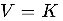)** conjuguée à une rotation partielle **\-RoPE (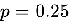)** dans les couches d'attention globales (rapport local/global de 5:1), ce qui a réduit de **37.5 %** le cache KV global73. Malgré de bonnes notes aux tests de mathématiques et de sciences (89.2 % à AIME 2026 et 84.3 % à GPQA Diamond pour le 31B en mode Thinking), l'archive indépendante Artificial Analysis v5.0.1 a relevé un retard du modèle 31B dans les scénarios agentiques complexes à plusieurs étapes par rapport aux grands systèmes à mille milliards de paramètres324.

### **Hybrides 3:1 (Qwen 3.8, Nemotron 3/3.5), Mamba-3, FlashAttention-4 et modèles de diffusion bouclés**

L'hybridation de la mémoire matricielle linéaire et de l'attention complète rare s'est imposée dans **Alibaba Qwen 3.8-27B** (août 2026, Apache 2.0, architecture VLM dense de 64 couches : 16 blocs de 3 couches **Gated DeltaNet** et 1 couche **Gated Attention**, en parallèle du modèle phare fermé Qwen 3.8-Max de 2.4T-A95B)11. Dans les 48 couches Gated DeltaNet sont stockées des matrices d'état de taille fixe pour 48 têtes de valeurs , occupant **72.0 MiB constants en BF16** (**144.0 MiB / 151.0 Mo en FP32**) quelle que soit la longueur de la séquence, tandis que les 16 couches Gated Attention exigent quatre fois moins de mémoire de cache KV qu'un transformeur homogène de 64 couches30. Dans la famille **NVIDIA Nemotron 3 Super** (120B-A12B, arXiv:2604.12374), **Nemotron 3 Ultra** (550B-A55B, 108 couches, arXiv:2606.15007) et **Nemotron 3.5 Super & Lightning** (arXiv:2610.38095), l'hybride Mamba-2 \+ GQA est associé au **LatentMoE** () et à un drafter MTP récursif pour le décodage spéculatif sur des contextes allant jusqu'à 1M de jetons27.  
Les noyaux de base des SSM et de l'attention ont eux-mêmes reçu une mise à jour fondamentale. Aakash Lahoti, Tri Dao, Albert Gu et al. ont présenté **Mamba-3** (arXiv:2603.15569, ICLR 2026\)32 : le passage à la **discrétisation exponentielle-trapézoïdale** de précision du second ordre  a supprimé le besoin d'une convolution 1D externe, les **transitions d'état à valeurs complexes** (équivalentes à une rotation **RoPE** dépendante de l'entrée) ont permis de suivre la parité (Parity) avec une précision de 100 %, et la **formulation MIMO** de rang  a multiplié par 4 l'intensité arithmétique du décodage sans hausse de la latence, en égalant l'état  à l'ancien 329. Ali Hatamizadeh, Jeejin Choi et Jan Kautz ont séparé les portes d'effacement et d'écriture dans **Gated DeltaNet-2** (arXiv:2605.22791)248, et le laboratoire de Tri Dao a publié **FlashAttention-4** (arXiv:2603.05451) pour la mise à l'échelle asymétrique des accélérateurs **NVIDIA Blackwell (B200/GB200)** : l'émulation polynomiale de l'exponentielle sur les blocs FMA et le **saut conditionnel du redimensionnement de l'online-softmax** pour 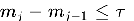 ont donné 1,600 TFLOPs/s (71 % du pic), et l'écriture du noyau en Python avec **CuTe-DSL** a réduit le temps de compilation de 20 à 30 fois par rapport aux gabarits C++223. À l'intersection des boucles et de la diffusion, Sanghyun Lee et al. ont créé les **Looped Diffusion Language Models (LoopMDM)** (arXiv:2605.26106, NeurIPS 2026), en bouclant les couches initiales-intermédiaires d'un LM de diffusion masquée, pour une économie allant jusqu'à **3.34× de FLOPs d'entraînement**188 (développé dans **Looped UDLMs**, arXiv:2610.3006656) ; sont également parus l'étude de saturation du codeur 7B **LoopCoder-v2 (PLT-7B)** (arXiv:2606.18023)38, les **Hyperloop Transformers** (arXiv:2604.21254)334, **LoopFold** (arXiv:2610.35556)194 et le modèle MoE bouclé ouvert **Inkling 2 Mini** (Thinking Machines Lab, 26.4B-A3.4B, 3 passes des couches intermédiaires \+ AttnRes)197.

### **Synthèse audio-vidéo synchrone LTX-2.5 et agents vocaux en duplex intégral avec outils**

En vidéo générative, Lightricks a publié **LTX-2** (arXiv:2601.03233, DiT asymétrique à deux flux : un flux vidéo de 14B avec RoPE 3D et un flux audio de 5B avec RoPE 1D, reliés par une attention croisée bidirectionnelle dans le temps)335 puis, en août 2026, la **LTX-2.5** de 22 milliards de paramètres (encodeur de texte Gemma 4 12B, génération en une seule passe de vidéo synchrone jusqu'à 4K et jusqu'à 20 s avec son stéréo 24 kHz, continuité multi-plans des scènes et contrôle par IC-LoRA)258, tandis qu'en génération d'images le transformeur découplé **DDT-XL/2** de Wang et al. (CVPR 2026, arXiv:2504.05741) a abaissé le FID sur ImageNet 256×256 à **1.26**219. En parole en duplex intégral, l'équipe de NVIDIA a présenté **PersonaPlex 7B** (arXiv:2602.06053, prompt hybride de rôle et d'échantillon de voix ancré dans le contexte au-dessus de l'architecture Moshi \+ Mimi : naturalité DMOS de **3.90 ± 0.15** et similarité de clonage de voix SSIM de **0.57**)68 et **NemotronLabs VoiceChat** (arXiv:2609.21967, premier modèle STS Full-Duplex ouvert à appel d'outils natif (Tool Calling), transcription auxiliaire RNN-T, 100 % d'interception lors des interruptions et 93 % de reprise de la parole après les interjections de l'auditeur)69. La pile vocale en flux continu a été complétée par **Qwen3-TTS** (arXiv:2601.15621, branche causale à 12.5 Hz avec MTP à 16 codebooks et latence du premier paquet d'environ **97–100 ms**) et **Qwen-Audio-3.0-TTS** (arXiv:2607.23938)54, **Qwen3.5-Omni** (arXiv:2604.15804, alignement ARIA)342, **Fish Audio S2-Pro** (arXiv:2603.08823, TTFA \~100 ms, RTF 0.195) et **Drama 3** (arXiv:2610.18010)158, **Kyutai Pocket TTS** (100M de paramètres, MIT), qui fonctionne 6× plus vite que le temps réel sur deux cœurs CPU d'un ordinateur portable344, **Mistral Voxtral Realtime** en flux continu (arXiv:2602.11298, latence de 480 ms)345, **GigaAM Multilingual** (arXiv:2607.10371, Interspeech 2026\)346 et **Nemotron 3.5 Transcribe** à deux branches (TDT \+ diariseur Sortformer)348.

## **2027**

**Domaines :** Attention/LLM Boucles/SSM Diffusion Vidéo Optimisation  
Le programme scientifique de **2027**, tel que le fixent en novembre 2026 les publications acceptées aux conférences d'hiver et de printemps **WACV 2027**, **AAAI / IAAI 2027**, **WSDM 2027**, **DATE 2027** et le corpus ouvert évalué par les pairs de 37,028 soumissions à **ICLR 2027** sur OpenReview, se concentre sur l'unification théorique des paradigmes génératifs et sur l'élimination des subtiles pathologies numériques de phase des réseaux hybrides et bouclés15. Dans l'article d'Amandeep Kumar, Nithin Nair et Vishal Patel accepté à WACV 2027, *« Scale-wise VAR is Secretly Discrete Diffusion »* (n° 444\)17, il est rigoureusement démontré que les modèles autorégressifs visuels à prédiction de l'échelle suivante (VAR) sont fonctionnellement équivalents à une diffusion discrète masquée échelle par échelle dans un espace latent multi-échelle. Les actes de WACV 2027 et d'AAAI/IAAI 2027 présentent également les transformeurs vidéo à masquage de segmentation à long terme **LVMT** (Norouzi et al.)16, des schémas de flots à un pas (arXiv:2608.09579), les décodeurs de diffusion **PixCell** (arXiv:2611.01141), des biais structurels d'attention (arXiv:2611.04657) et des architectures industrielles de recherche d'information à autorité contrainte (arXiv:2611.20398)19.  
Dans le corpus évalué d'ICLR 2027 se dégagent trois mécanismes fondamentaux de la génération suivante. Premièrement, l'analyse de la compression du cache KV par blocs (*« Periodic Weak Spots: Phase Sensitivity from Chunked KV-Cache Compression »*) a montré que, dans les modèles de la classe DeepSeek-V4, la précision de récupération des faits varie jusqu'à **40 points de pourcentage** selon la phase de la position du jeton par rapport aux frontières de la fenêtre de compression, du fait de l'apparition de têtes spécialisées par phase15. Deuxièmement, le travail sur la stabilité numérique de la passe arrière de l'attention (OpenReview:LJvGaCWmFh) a établi que les explosions tardives de gradients lors de l'entraînement avec **BF16 FlashAttention-3** sont dues à la violation, par l'arrondi BF16, de la loi exacte de conservation de la somme des gradients d'une ligne du softmax (erreur médiane du gradient des requêtes de 219 %), et a proposé une correction du noyau arrière ramenant l'erreur à **0.34 % / 0.37 %** (niveau FP32) pour un surcoût de seulement 4.7 % par pas352. Troisièmement ont été proposés les **Variable-Width (« Hourglass ») Transformers**, rétrécis au milieu, les **Matryoshka Language Model Suites** imbriquées (économie de 36 % du calcul d'entraînement pour la gamme de tailles) et la méthode **SafeBridge** pour l'alignement de sûreté des modèles bouclés à toutes les profondeurs de récursion, en réponse à la découverte que la réduction de moitié du nombre de boucles à l'inférence dans Ouro et Huginn conserve 89 % de précision sur GSM8K mais détruit le vecteur de refus, qui se forme tardivement, ce qui accroît la vulnérabilité aux requêtes malveillantes de 5.3 à 9.9 fois15.

## **Annexe A. Tableaux récapitulatifs des architectures, des benchmarks, des statistiques et des dépôts**

### **Tableau A.1. Matrice chronologique complète des architectures et mécanismes (1958–2027, pas d'un an)**

| Année | Domaine / Étiquettes | Architecture / algorithme clé | Mécanisme mathématique de référence | Jalons, auteurs et numéro dans la Bibliographie |
| :---- | :---- | :---- | :---- | :---- |
| **1958** | Fondements | Perceptron Mark I | Hyperplan , correction d'erreurs | Rosenblatt (n° 1), von Neumann (n° 2\) |
| **1959** | Encodeur Fondements | Pandemonium ; TD-dames ; Champs réceptifs de V1 | Sélection parallèle  ; différence temporelle de l'évaluation de position | Hubel & Wiesel (n° 3), Selfridge (n° 4), Samuel (n° 5\) |
| **1960** | Fondements Optimisation | ADALINE / règle LMS ; Gradient conjugué | Règle delta  ; EDO conjuguées continues | Widrow & Hoff (n° 6), Kelley (n° 7\)7 |
| **1961** | Boucles Mémoire | Die Lernmatrix ; Équations mnémoniques | Mémoire hétéroassociative matricielle  | Steinbuch (n° 8\)91, Caianiello (n° 9\) |
| **1962** | Fondements Encodeur | Théorème de convergence du perceptron ; MADALINE | Borne d'erreurs  ; cellules simples et complexes du cortex | Novikoff (n° 10\)93, Hubel & Wiesel (n° 14\) |
| **1963** | Fondements Optimisation | Portrait généralisé (SVM linéaire) | Hyperplan à marge maximale  | Vapnik & Lerner (n° 15\)98 |
| **1964** | Optimisation Fondements | Méthode du moment de Polyak ; Fonctions de potentiel | Heavy-ball  ; astuce du noyau ; AD direct | Polyak (n° 18\)101, Aizerman et al. (n° 19), Wengert (n° 20\) |
| **1965** | Fondements | Premiers MLP profonds ; Théorème de Cover | Sélection couche par couche de polynômes de Kolmogorov—Gabor ; nombre de dichotomies  | Ivakhnenko & Lapa (n° 21\)7, Cover (n° 22\) |
| **1966** | Optimisation Fondements | Minimisation du risque moyen en apprentissage | Approximation stochastique  | Tsypkin (n° 25\)106, Braverman (n° 26\) |
| **1967** | Fondements Optimisation | SGD multicouche de bout en bout ; Sinkhorn–Knopp | Descente de gradient dans un réseau à 5 couches ; projection de matrices doublement stochastiques | Amari (n° 28\)21, Sinkhorn & Knopp (n° 30\)61 |
| **1968** | Fondements Boucles | GMDH (MGUA) ; Réseaux Outstar ; Théorie VC | Régularisation de la profondeur par validation ; équations de plasticité STM/LTM | Ivakhnenko (n° 31), Grossberg (n° 32), Vapnik (n° 33\) |
| **1969** | Fondements Encodeur | Limites des perceptrons ; ReLU analogique | Non-séparabilité de XOR par une seule couche ; redresseur multicouche  | Minsky & Papert (n° 34), Bryson & Ho (n° 35), Fukushima (n° 36\)85 |
| **1970** | Fondements Optimisation | Mode inverse de la différentiation automatique ; BFGS | Règle de la chaîne exacte sur le graphe  ; quasi-Newton | Linnainmaa (n° 37\)113, BFGS (n° 38\) |
| **1971** | Fondements Mémoire | Réseau GMDH à 8 couches ; Théorie de l'archicortex | Réseau polynomial profond ; mémoire associative éparse de l'hippocampe | Ivakhnenko (n° 40\)115, Marr (n° 41\) |
| **1972** | Boucles Mémoire | Réseau d'Amari—Hopfield ; Populations de Wilson–Cowan | Attracteurs récurrents  ; cycles limites E–I | Amari (n° 42\)115, Kohonen (n° 43), Wilson & Cowan (n° 46\)120 |
| **1973** | Encodeur Boucles | Auto-organisation du cortex V1 ; Réseaux à shunt | Règle compétitive de Hebb avec normalisation des poids en  ; contraste divisif | von der Malsburg (n° 47\)123, Grossberg (n° 48\) |
| **1974** | Fondements Boucles | Backprop pour les réseaux de neurones ; Modèle de spins du cerveau | Rétroaction dynamique des dérivées ; distribution d'Ising à température | Werbos (n° 50\)123, Little (n° 51\)127 |
| **1975** | Encodeur Mémoire | Cognitron ; CMAC ; Verre de spin SK | Inhibition divisive des couches ; codage par hachage local ; hamiltonien SK | Fukushima (n° 52\)122, Albus (n° 53), SK (n° 54\) |
| **1976** | Optimisation Boucles | Reverse AD en publication (BIT) ; Prototype d'ART | Développement de Taylor avec compromis mémoire ; dilemme stabilité—plasticité | Linnainmaa (n° 56\)23, Grossberg (n° 57\) |
| **1977** | Boucles Optimisation | Brain-State-in-a-Box (BSB) ; Algorithme EM | Attracteurs dans l'hypercube  ; borne inférieure de la vraisemblance des variables latentes | Anderson et al. (n° 59\)122, Dempster et al. (n° 62\) |
| **1978** | Mémoire Fondements | Capacité mnésique synaptique ; Critère BIC | Mise à l'échelle de la capacité mémoire  selon le nombre de synapses | Little & Shaw (n° 63\)127, Schwarz (n° 64\) |
| **1979** | Encodeur | Neocognitron (publication originale) | Cascade de plans partagés de cellules  (convolution) et de cellules  (pooling) | Fukushima (n° 67\)86 |
| **1980** | Encodeur Optimisation | Neocognitron (international) ; Borne de Baur—Strassen | Invariance par translation via la cascade 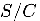 ; estimation de la complexité du gradient  | Fukushima (n° 69\)129, Baur & Strassen (n° 71\) |
| **1981** | Mémoire Boucles | Représentations distribuées ; RL associatif | Activation interactive de caractéristiques ; gradient de recherche par renforcement | Hinton & Anderson (n° 72), Barto et al. (n° 74\) |
| **1982** | Boucles Encodeur | Réseau de Hopfield ; Cartes de Kohonen (SOM) ; Règle d'Oja | Fonction de Lyapounov  ; apprentissage topographique ; PCA neuronale | Hopfield (n° 75), Werbos (n° 76), Kohonen (n° 77), Oja (n° 78\) |
| **1983** | Optimisation Boucles | Méthode accélérée de Nesterov ; Recuit simulé | Descente optimale  au point d'anticipation ; RL Actor–Critic | Nesterov (n° 81\)143, Kirkpatrick (n° 82), Barto (n° 83\) |
| **1984** | Fondements Diffusion | Apprentissage PAC ; Hopfield continu ; Échantillonneur de Gibbs | Apprenabilité polynomiale  ; relaxation MCMC sur des champs MRF | Valiant (n° 84\)147, Hopfield (n° 85), Geman (n° 86\) |
| **1985** | Fondements Diffusion | Machine de Boltzmann ; Dérivations indépendantes de Backprop | Gradient de la différence des corrélations de phases  | Ackley, Hinton & Sejnowski (n° 88\)150, LeCun (n° 89\) |
| **1986** | Fondements Boucles | MLP \+ Backpropagation ; RBM (Harmonium) ; RNN de Jordan | Gradient en chaîne des représentations cachées  ; énergie bipartite sans cycles | Rumelhart, Hinton & Williams (n° 92), Smolensky (n° 94), Jordan (n° 95\) |
| **1987** | STT Boucles | TDNN ; Poids rapides (Fast Weights) ; Autoencoder stack | Convolution 1D dans le temps pour la parole ; terme additif plastique de poids contextuels | Waibel (n° 97), Hinton & Plaut (n° 98), Ballard (n° 99), Pineda (n° 101\) |
| **1988** | Encodeur Optimisation | CNN 2D avec backprop ; Réseaux RBF ; Apprentissage TD() | Convolution bidimensionnelle avec apprentissage par l'erreur ; bootstrapping du résidu de Bellman | Zhang (n° 102\)20, Broomhead (n° 103), Sutton (n° 104\) |
| **1989** | Encodeur Fondements | Réseau convolutif de LeCun (USPS) ; Théorème d'approximation | Backprop de bout en bout sur des noyaux 2D avec stride ; densité des MLP dans  ; Q-learning | LeCun et al. (n° 107), Cybenko (n° 108), Hornik (n° 109), Watkins (n° 111\) |
| **1990** | Boucles Optimisation | Réseau d'Elman (Simple RNN) ; BPTT ; Optimal Brain Damage | Contexte caché  ; élagage par la diagonale du hessien | Elman (n° 114), Werbos (n° 115), LeCun et al. (n° 116), Schmidhuber (n° 117\) |
| **1991** | MoE Boucles Attention | Mixture of Experts ; Évanouissement du gradient ; Fast Weights | Réseau de portes  ; analyse de  ; auto-attention linéaire | Jacobs et al. (n° 119), Hochreiter (n° 120), Schmidhuber (n° 121\)22 |
| **1992** | Optimisation Boucles | REINFORCE ; Compresseur neuronal d'historique ; Moyennage de Polyak | Gradient de politique  ; distillation de RNN ; moyenne de trajectoire du SGD | Williams (n° 124), Schmidhuber (n° 125), Polyak & Juditsky (n° 126\) |
| **1993** | Encodeur Fondements | Réseaux siamois ; MDL variationnel ; Borne de Barron | Tours métriques à poids partagés ; énergie libre des poids ; élagage OBS | Bromley & LeCun (n° 129), Hinton & van Camp (n° 130), Barron (n° 131\) |
| **1994** | Boucles MoE | Théorème des dépendances à long terme ; MoE hiérarchique | Incompatibilité entre stockage stable et gradient dans les RNN ; opérateur  en  | Bengio et al. (n° 133), Jordan & Jacobs (n° 134), Pearlmutter (n° 135\) |
| **1995** | Fondements Diffusion | Machine de Helmholtz (Wake–Sleep) ; SVM à marge souple | Paire générateur/réseau d'inférence  ; maximisation de l'information mutuelle | Hinton et al. (n° 137), Cortes & Vapnik (n° 139), Bishop (n° 141\) |
| **1996** | Encodeur Fondements | Codage parcimonieux de V1 ; Limite gaussienne de largeur infinie | Reconstruction en  par un dictionnaire sur-complet ; convergence de  vers un NNGP | Olshausen & Field (n° 142), Neal (n° 143), Goller & Küchler (n° 144\) |
| **1997** | Boucles Mémoire | LSTM ; RNN bidirectionnel (BiRNN) ; Minima plats | Cellule additive  (CEC) ; branches temporelles avant et arrière | Hochreiter & Schmidhuber (n° 146), Schuster & Paliwal (n° 147\) |
| **1998** | Encodeur Optimisation | LeNet-5 ; Gradient naturel d'Amari | Cascade Conv–Pool–FC \+ transducteur de graphe ; métrique de Fisher  | LeCun et al. (n° 150), Amari (n° 152), Sutton & Barto (n° 153\) |
| **1999** | Boucles Fondements | Porte d'oubli du LSTM ; Factorisation non négative NMF | Réinitialisation multiplicative  ; caractéristiques additives  | Gers, Schmidhuber & Cummins (n° 155\)155, Lee & Seung (n° 156\) |
| **2000** | Boucles Fondements | Peephole LSTM ; Softplus ; Apprentissage de variétés (Isomap/LLE) | Liaison de la cellule  aux portes ; activation lisse  | Gers et al. (n° 158, 159), Dugas et al. (n° 160), Tenenbaum (n° 161\) |
| **2001** | Boucles Encodeur | Echo State Networks (ESN) ; Champs aléatoires conditionnels (CRF) | Réservoir amorti  ; normalisation globale des chemins  | Jaeger (n° 163), Lafferty et al. (n° 164), Hastie et al. (n° 165\) |
| **2002** | Diffusion Fondements | Divergence contrastive (CD\-) ; Perceptron structuré | Estimation MCMC à un pas du gradient de la RBM à partir des données ; bibliothèque Torch | Hinton (n° 166), Collins (n° 168), Collobert et al. (n° 169\) |
| **2003** | Fondements Attention/LLM | Modèle de langage probabiliste neuronal (NPLM) | Plongements de mots denses apprenables  ; distorsions élastiques pour les CNN | Bengio et al. (n° 170), Simard et al. (n° 171), MacKay (n° 172\) |
| **2004** | Optimisation Fondements | Première accélération des réseaux de neurones sur GPU ; Théorie  vs  | Opérations matricielles dans les shaders de GPU (20×) ; complexité logarithmique  | Oh & Jung (n° 173), Ng (n° 174), Welling et al. (n° 175\) |
| **2005** | Diffusion STT Fondements | Score Matching ; BiLSTM pour la parole ; Réseaux de graphes (GNN) | Estimation de  sans fonction de partition  ; Softmax hiérarchique | Hyvärinen (n° 176\)163, Graves (n° 177), Gori et al. (n° 179\) |
| **2006** | STT Fondements | CTC ; Réseaux de croyance profonds (DBN) et autoencodeurs | Sommation des alignements avec symbole vide  ; empilement de RBM couche par couche | Graves et al. (n° 181), Hinton et al. (n° 182, 183), Bishop (n° 185\) |
| **2007** | Fondements Optimisation | Asymptotique du SGD sur grandes données ; Empilement d'autoencodeurs | Optimalité du SGD du premier ordre à temps de calcul limité | Bengio et al. (n° 186), Bottou & Bousquet (n° 187), Mnih (n° 188\) |
| **2008** | Encodeur Diffusion | Autoencodeurs débruiteurs (DAE) ; CNN-NLP unifié | Reconstruction du  propre à partir du  bruité ; plongements multitâches ; t-SNE | Vincent et al. (n° 190), Collobert & Weston (n° 191), t-SNE (n° 192\) |
| **2009** | Encodeur Optimisation | ImageNet ; Apprentissage profond sur CUDA ; Curriculum Learning | Passage à l'échelle sur 14M d'images et CUDA (70×) ; calendrier de difficulté | Deng et al. (n° 193), Raina, Madhavan & Ng (n° 194), Bengio (n° 195\) |
| **2010** | Fondements Optimisation | Initialisation Xavier ; ReLU dans les réseaux profonds ; RNNLM ; NCE | Conservation de la variance 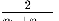 ; linéarité par morceaux  ; Theano | Glorot & Bengio (n° 198), Nair & Hinton (n° 199), Mikolov (n° 200\) |
| **2011** | Optimisation Diffusion | AdaGrad ; Denoising Score Matching (DSM) ; CD-DNN-HMM | Mise à l'échelle par coordonnée  ; équivalence entre DAE et 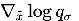 | Duchi et al. (n° 204), Vincent (n° 205\)166, Seide et al. (n° 208\) |
| **2012** | Encodeur STT | AlexNet ; RNN-Transducer (RNN-T) ; Dropout ; RMSProp | CNN GPU profond avec ReLU et Dropout ; treillis conjoint Joiner  pour l'ASR en ligne | Krizhevsky et al. (n° 210\)167, Graves (n° 211), Hinton (n° 212\) |
| **2013** | Encodeur Diffusion | Variational Autoencoder (VAE) ; Word2Vec ; NiN ; DQN | Borne inférieure ELBO \+ reparamétrisation  ; Skip-Gram contrastif | Kingma & Welling (n° 217), Mikolov (n° 219), Lin (n° 220), Mnih (n° 222\) |
| **2014** | Attention Diffusion | Seq2Seq \+ Bahdanau Attention ; GRU ; GAN ; Optimiseur Adam | Alignement souple du contexte  ; minimax  ; moments adaptatifs | Sutskever (n° 225), Bahdanau (n° 226), Cho (n° 227), GAN (n° 229), Adam (n° 230\) |
| **2015** | Fondements Diffusion | ResNet \+ Kaiming Init ; BatchNorm ; U-Net ; Diffusion | Raccourci d'identité  ; encodeur-décodeur à skip ; inversion de la chaîne de Markov | He et al. (n° 237), Ioffe (n° 239), U-Net (n° 240), Sohl-Dickstein (n° 241\) |
| **2016** | TTS Boucles Fondements | LayerNorm ; Pre-LN ResNet ; ACT ; GELU ; WaveNet | Normalisation par les caractéristiques du jeton ; porte d'arrêt de boucle apprenable ; convolutions dilatées | Ba (n° 249), He (n° 250), Graves (n° 251), GELU (n° 252), WaveNet (n° 253\) |
| **2017** | Attention/LLM MoE TTS | Transformer canonique ; Sparse MoE ; VQ-VAE ; AdamW ; PPO |  ; routage Top\- ; codebook discret ; weight decay découplé | Vaswani (n° 260), Shazeer (n° 261), VQ-VAE (n° 262), AdamW (n° 265), PPO (n° 266\) |
| **2018** | Encodeur LLM Boucles | BERT ; GPT-1 ; Universal Transformer ; Neural ODE ; InfoNCE ; Shampoo | MLM bidirectionnel vs AR causal ; boucle de transformeur avec ACT ; profondeur continue | Devlin (n° 274), Radford (n° 273), Dehghani (n° 275), Chen (n° 276), Shampoo (n° 282\) |
| **2019** | Attention/LLM Boucles TTS | GPT-2 ; RMSNorm ; MQA ; DEQ ; FastSpeech ; NCSN ; ZeRO/Megatron | Normalisation sans décalage ; une seule tête KV ; point fixe implicite  ; régulateur de longueurs | Radford (n° 285), RMSNorm (n° 286), MQA (n° 287), DEQ (n° 288), FastSpeech (n° 292\) |
| **2020** | LLM Diffusion STT | GPT-3 & Scaling Laws ; SwiGLU ; Linear Attn ; DDPM/SDE ; ViT ; Conformer | FFN à porte ; noyau  ; perte de bruit  ; patchs 16×16 ; hybride Conv+Attn | Brown (n° 300), SwiGLU (n° 301), DDPM (n° 303), ViT (n° 306), Conformer (n° 307\) |
| **2021** | LLM Boucles/SSM TTS | RoPE ; ALiBi ; Switch MoE ; LoRA ; CLIP ; S4 ; VITS ; SoundStream ; LDM | Rotation complexe  ; adaptateur  de rang  ; SSM NPLR ; codec audio RVQ ; diffusion dans un VAE | RoPE (n° 316), LoRA (n° 319), CLIP (n° 320), S4 (n° 324), SoundStream (n° 327), LDM (n° 331\) |
| **2022** | LLM Diffusion STT | FlashAttention ; Chinchilla ; DiT ; Flow Matching / Rectified Flow ; Whisper | Tiling en SRAM avec online-softmax ;  ; transformeur adaLN-Zero ; EDO rectilignes  | Dao (n° 332), Chinchilla (n° 334), Rectified Flow (n° 338), DiT (n° 341), Whisper (n° 342\) |
| **2023** | LLM Boucles/SSM STS | GQA ; vLLM ; Mixtral 8x7B ; Mamba (S6) ; RWKV/RetNet ; SigLIP ; VALL-E ; TDT ; DPO | KV groupé ;  dépendants de l'entrée ; perte sigmoïde ; saut de trames par durée | GQA (n° 347), Mamba (n° 356), SigLIP (n° 358), VALL-E (n° 362), TDT (n° 366), DPO (n° 353\) |
| **2024** | LLM MoE Boucles STS | DeepSeek-V2/V3 (MLA, Aux-Free MoE, MTP) ; Mamba-2 ; xLSTM ; GDN ; MMDiT ; Moshi | Cache KV de bas rang MLA ; équilibrage par biais  ; règle delta  ; Full-Duplex 160 ms (Mimi) | DeepSeek (n° 371, 372), Mamba-2 (n° 379), GDN (n° 382), HunyuanVideo (n° 394), Moshi (n° 400\) |
| **2025** | LLM Boucles Diffusion Vidéo | DeepSeek-R1 & V3.2 (DSA) & mHC ; Kimi K2 (MuonClip) & KDA ; Huginn/Ouro/PLT ; LLaDA/Mercury ; Wan 2.2 | GRPO vérifiable ; projection de Sinkhorn sur le polytope de Birkhoff ; boucles latentes ; dLLM ; vidéo MoE | R1 (n° 406), V3.2 (n° 408), mHC (n° 409), K2 (n° 411), Huginn (n° 417), Ouro (n° 418), LLaDA (n° 424\) |
| **2026** | LLM Hybrides Vidéo STS | DeepSeek V4 Pro ; Kimi K3 (AttnRes) ; Gemma 4 ; Qwen 3.8 ; Nemotron 3/3.5 ; Mamba-3 ; FA-4 ; LTX-2.5 ; PersonaPlex | CSA+HCA (10 % de KV) ; attention en profondeur ;  \+ \-RoPE ; hybride 3:1 GDN ; SSM MIMO complexe ; DiT audio-vidéo | K3 (n° 443\)4, Gemma 4156, Qwen 3.830, Mamba-332, LTX-2.5297 |
| **2027** | LLM Diffusion Optimisation | Scale-wise VAR \= dLLM ; Analyse de phase du KV de DeepSeek-V4 ; FA-bwd BF16 exact ; Hourglass LM ; SafeBridge | Isomorphisme entre VAR et diffusion masquée ; loi de conservation du gradient du softmax ; sûreté par boucles | Kumar et al. (WACV'27, n° 444\)17, OpenReview ICLR'2715 |

Deux grandes évolutions systémiques des architectures de langage ouvertes de 2024–2026 se situent dans le domaine de la gestion de la mémoire des cartes graphiques : la compression radicale de l'état du contexte (par le cache de bas rang de MLA et le remplacement de 75 % des couches d'attention par une mémoire matricielle de taille constante en fonction de la longueur, celle de Gated DeltaNet ou de KDA) et le passage à une activation ultra-éparse des poids, où, pour un volume total de connaissances de 0.7 à 2.8 billions de paramètres, seuls 3.1–10.0 % du réseau sont activés pour chaque jeton4.  
  
La comparaison des volumes de mémoire cités explique l'économie pratique de l'inférence agentique à long contexte : dans les modèles homogènes à attention complète, la croissance linéaire du cache KV dépasse rapidement la taille des poids du modèle eux-mêmes, ce qui oblige à répartir l'inférence sur plusieurs nœuds uniquement pour stocker l'historique du dialogue196. À l'inverse, l'architecture hybride 3:1 fige totalement la croissance de la mémoire dans 75 % des couches du réseau (la laissant égale à 72 MiB en BF16, que la longueur du contexte soit de 32K ou de 1M de jetons) et, combinée à 3–5 % d'experts actifs, permet de servir des trajectoires à plusieurs étapes à un coût inférieur d'un ordre de grandeur, à qualité égale30.

### **Tableau A.2. Spécifications architecturales et benchmarks des LLM phares ouverts et des hybrides (2024–2026)**

*Note sur l'attribution (au 25.11.2026) :* Les métriques sont données d'après les rapports techniques officiels et les fiches de modèles des développeurs ; lorsque des mesures ou des synthèses indépendantes existent (Epoch AI, Artificial Analysis, synthèses techniques), la source est indiquée explicitement dans la cellule31. Un tiret (—) signifie l'absence de publication comparable de la métrique dans la source primaire.

| Modèle (Sortie, Licence) | Poids totaux / actifs | Architecture d'attention / SSM et d'experts | Fenêtre de contexte | MMLU-Pro (%) | GPQA Diamond (%) | AIME 24 / 25 / 26 (%) | LiveCodeBench (%) | SWE-bench Verified (%) |
| :---- | :---- | :---- | :---- | :---- | :---- | :---- | :---- | :---- |
| **DeepSeek-V3 / 0324** (déc. 2024, MIT)29 | 671B / 37B (5.5 %) | 61 couches : MLA \+ MoE sans perte auxiliaire (8/256 \+ 1 partagé) \+ MTP | 128K | 75.9 (81.2 en 0324\) | 59.1 (68.4 en 0324\) | 39.2 ('24 ; 59.4 en 0324\) | 46.9 (v6, 0324\) | 38.8 (Agentic, 0324\) |
| **DeepSeek-R1 / 0528** (janv./mai 2025, MIT)268 | 671B / 37B (5.5 %) | Base V3 \+ RL vérifiable multi-étapes (GRPO) | 128K | 84.0 | 71.5 (81.0 en 0528\) | 79.8 ('24) / 70\.0$\rightarrow$87.5 ('25) | 63\.5$\rightarrow$73.3 (v6) | 49.2 |
| **Llama 4 Maverick** (avr. 2025, Llama 4\)280 | 400B / 17B (4.3 %) | Alternance de couches denses et MoE (1/128 \+ 1 partagé), fusion précoce | 1M (10M pour Scout) | — | 67.0 (Epoch AI) | — | — | — |
| **Qwen3-235B-A22B** (mai/juil. 2025, Apache 2.0)247 | 235B / 22B (9.4 %) | 94 couches : GQA (64Q / 4KV) \+ MoE (8/128), mode Think/Non-Think | 128K–262K (1M DCA) | 77.3 (non-think) | 62.9 (non-think) | 85.7 ('24) / 81.5 ('25, think) | 70.7 (v5, think) | 34.4 (non-think) |
| **Kimi K2 Instruct** (juil. 2025, MIT mod.)66 | 1.04T / 32.6B (3.1 %) | 61 couches : MLA (64 têtes) \+ MoE (8/384 \+ 1 partagé), entraîné avec MuonClip | 128K | 81.1 | 75.1 | 69.6 ('24) / 49.5 ('25) | 53.7 (v6, non-think) | 65.8 (71.6 multi) |
| **GLM-4.5** (juil. 2025, MIT)282 | 355B / 32B (9.0 %) | MoE profond \+ GQA \+ MTP, hybride Thinking / Non-Thinking | 128K | 84.6 | 79.1 | 91.0 (AIME'24) | 72.9 | 64.2 |
| **DeepSeek-V3.2** (déc. 2025, MIT)10 | 671B / 37B (5.5 %) | MLA \+ **DeepSeek Sparse Attention (DSA)** \+ GRPO agentique unifié | 128K | \~85.0 | 82.4 | 94.17 (AIME'26) | — | 70.2 (Multilingual) |
| **Nemotron 3 Nano** (déc. 2025, OpenMDW)184 | 31.6B / 3.2B (10.1 %) | Hybride Mamba-2 \+ GQA \+ MoE granulaire (6/128), NVFP4 | 1M (RULER 86.3) | 78.3 | 73.0 (75.0 tools) | 89.1 ('25) / 99.2 (tools) | 68.3 (v6) | 38.8 (OpenHands) |
| **GLM-5 / GLM-5.1** (févr./avr. 2026, MIT)321 | 744B / 40B (5.4 %) | 80 couches : MLA \+ **DSA** \+ 256 experts \+ Muon \+ RL asynchrone APRIL | 200K–1M | — | — | 95.4 / 95.3 (AIME'26) | — | 77.8 |
| **Qwen3.5-397B-A17B** (printemps 2026, Apache 2.0)353 | 397B / 17B (4.3 %) | Hybride 3:1 (75 % **Gated DeltaNet** \+ 25 % GQA) \+ Sparse MoE | 256K | — | 88.4 (synthèse) | 91.3 (AIME'26) | 83.6 (v6) | — |
| **Gemma 4 31B Dense** (avr./juil. 2026, Apache 2.0)324 | 30.7B / 30.7B (100 %) | 60 couches : 5:1 SWA/Global,  **\+ \-RoPE** (économie de 37.5 % de KV), MTP | 256K | 85.2 | 84.3 (75.8 min Epoch) | 89.2 (AIME'26) | 80.0 (v6) | — |
| **Gemma 4 26B-A4B** (avr./juil. 2026, Apache 2.0)324 | 25.2B / 3.8B (15.1 %) | 30 couches : 5:1 SWA/Global (, \-RoPE) \+ MoE (8/128 \+ 1 partagé) | 256K | 82.6 | 82.3 | 88.3 (AIME'26) | 77.1 (v6) | — |
| **Nemotron 3 Ultra** (juin 2026, OpenMDW)326 | 550B / 55B (10.0 %) | 108 couches : Mamba-2 \+ GQA (64Q/2KV) \+ **LatentMoE** (22/512) \+ 2 MTP | 1M | — | — (AA Index 56.4) | — | — | — |
| **Kimi K3** (juil. 2026, Licence Kimi K3)4 | 2.8T / 104B (3.7 %) | Hybride 3:1 (**KDA** \+ Gated MLA NoPE) \+ **AttnRes** \+ Stable LatentMoE (16/896) | 1M | — | — | — | — | 81.2 (FrontierSWE) |
| **DeepSeek V4 Pro** (août 2026, MIT)31 | 1.6T / \~49B (3.1 %) | Hybride **CSA \+ HCA** (27 % de FLOPs et 10 % de KV par rapport à V3.2 à 1M) \+ Muon (\>32T jetons) | 1M | — | \>90.0 (synthèse de la sortie) | — | 93–94 (synthèse de la sortie) | 62.7 (DeepSWE) |
| **Qwen3.8-27B** (août 2026, Apache 2.0)30 | 27B / 27B (100 %, VLM) | 64 couches : **48 Gated DeltaNet** (48V/16QK) \+ **16 Gated Attn** (24Q/4KV) \+ MTP | 262K (1M YaRN) | — | — (AA v4.3.2 : 33.7) | — | — | 42.2 (DeepSWE 1.1) |
| **Tencent Hy4** (août 2026, Open)1 | 770B / 49B (6.4 %) | 78 couches : Gated MLA \+ **DSA (IndexCache)** \+ **iHC** à 4 bandes \+ MoE (8/256 \+ 1\) | — | — | — | — | — | — |
| **Nemotron 3.5 Super** (oct. 2026, OpenMDW)327 | 120B / 12B (10.0 %) | Hybride Mamba-2 \+ GQA \+ LatentMoE (512 exp.) \+ drafter MTP récursif | 1M | — | — | — | — | 86\.9$\rightarrow$92.1 (Pro V2 \+ RL) |

La dynamique de la densité d'intelligence entre les générations de 2025 et de 2026 apparaît de façon particulièrement nette lorsqu'on compare des problèmes scientifiques et olympiques complexes (GPQA Diamond et AIME 2026\) à l'efficacité paramétrique des modèles à profondeur récurrente10.  
  
Les données présentées révèlent une régularité importante : dans les tâches de déduction séquentielle (AIME, MATH-500), le facteur décisif n'est pas le nombre brut de paramètres uniques, mais la *profondeur effective de transformations non linéaires séquentielles*, atteinte soit explicitement par le mode de raisonnement en contexte (le mode Thinking de Gemma 4 26B-A4B, avec 3.8B de paramètres actifs, porte AIME 2026 à 88.3 % contre 20.8 % pour Gemma 3 27B sans raisonnement), soit implicitement, au sein de l'état caché, par  passes récurrentes sur la pile de couches partagée dans Ouro-2.6B286.

### **Tableau A.3. Modèles de langage à profondeur récurrente (bouclés) et de diffusion (2025–2026)**

| Modèle / Architecture | Paradigme et topologie de la profondeur | Paramètres uniques / Jetons d'entraînement | Principales métriques expérimentales et accélérations |
| :---- | :---- | :---- | :---- |
| **Huginn-0125** (arXiv:2502.05171)3 | Boucle en sandwich  avec injection par concaténation de l'entrée  et de ,  () | 3.5B / 800B de jetons (4,096 MI250X) | Avec l'augmentation des boucles  : ARC-Easy 49.07 %69.91 %, HellaSwag 43.46 %65.21 %, GSM8K CoT 42.08 % ; partage zero-shot du KV sur 4 emplacements sans perte sur MT-Bench (5.86)284 |
| **Ouro-1.4B & Ouro-2.6B** (arXiv:2510.25741)286 | Boucle sur la pile complète () avec porte de sortie anticipée apprenable (ACT gate) | 1.4B et 2.6B / 7.7T de jetons | **Ouro-1.4B** : MMLU 67.3 %, GSM8K 78.9 %, MATH-500 82.4 % ; **Ouro-2.6B** : MMLU 74.6 %, MMLU-Pro 55.7 %, BBH 80.5 %, MATH-500 **90.8 %** (comparable aux modèles denses jusqu'à 12B)286 |
| **PLT & LoopCoder-v2 7B** (arXiv:2510.24824, 2606.18023)33 | Pipeline Cross-Loop Parallelism (CLP) \+ KV partagé de la première boucle \+ Gated SWA () | 1.7B actifs / 7B dense (18T de jetons de code et de texte) | Supprime la pénalité de latence séquentielle (+96 %\~4 % de surcoût pour ) ; \+5.0 points de précision sur 2 boucles, saturation diagnostiquée pour  en raison du décalage de phase de CLP33 |
| **Inkling 2 Mini** (Thinking Machines, nov. 2026\)197 | Sandwich de  applications de 24 couches \+ AttnRes \+ MoE (8/128) | 26.4B au total / 3.4B uniques actifs (5.4B d'activations) | Contexte de 1,048,576 jetons, Apache 2.0, 5 SWA locales (1024) \+ 1 GQA globale par bloc, cache KV de 192 KiB/jeton197 |
| **LLaDA-8B / LLaDA-MoE** (arXiv:2502.09992)35 | Transformeur de diffusion masquée bidirectionnel (MDM, ELBO pondéré par ) | 8B dense ; 7B-A1B MoE | Parité avec LLaMA-3 8B à FLOPs égaux ; Instruct (démasquage par blocs) : GSM8K **78.6 %**, MATH **42.2 %**, CMMLU 69.9 % ; surmonte la reversal curse57 |
| **Dream 7B** (arXiv:2508.15487)57 | LLM de diffusion discrète initialisé à partir de poids autorégressifs | 7B dense | MATH **51.2 %**, HumanEval **54.3 %**, forte planification et remplissage bidirectionnel de lacunes57 |
| **Mercury Coder Mini / Small** (arXiv:2506.17298)58 | LLM de code de diffusion commercial à génération parallèle de jetons | Échelle non divulguée (billions de jetons) | Débit sur NVIDIA H100 standard : **1,109 jetons/s** (Mini) et **737 jetons/s** (Small) d'après la mesure d'Artificial Analysis (jusqu'à 10× plus rapide que les modèles AR)58 |
| **LoopMDM & Looped UDLM** (arXiv:2605.26106, 2610.30066)56 | Boucle sélective sur les couches initiales-intermédiaires à l'intérieur du débruiteur de diffusion discrète | 125M–170M (NeurIPS 2026\) | Atteint le même NLL de validation avec **3.34× moins de FLOPs d'entraînement** sur FineWeb-Edu ; \+8.5 points sur GSM8K ; la sortie adaptative économise jusqu'à 34.8 % des boucles56 |

### **Tableau A.4. Encodeurs visuels et modèles génératifs d'images et de vidéo (2012–2026)**

| Modèle (Année) | Type et mécanisme clé | Échelle / Compression latente | Métriques vérifiées de qualité et de vitesse |
| :---- | :---- | :---- | :---- |
| **AlexNet** (2012)  **ResNet-152** (2015)  **ViT-H/14** (2020)167 | Évolution des CNN 2D (ReLU+Dropout) vers les réseaux résiduels et les transformeurs sur patchs | 60M  60M  632M | Précision Top-1 ImageNet-1K : **63.3 %** (AlexNet)  **78.3 %** (ResNet-152, ensemble, 3.57 % d'erreur Top-5)  **88.55 %** (ViT-H/14 JFT)177 |
| **SigLIP 2** (févr. 2025, arXiv:2502.14786)300 | ViT multilingue (109 langues) : perte sigmoïde \+ décodeur LocCa \+ SILC/TIPS \+ NaFlex | 86M (B), 303M (L), 400M (So400m), 1B (g) | Top-1 zero-shot ImageNet-1K : **84.3 %** (So400m/16 @ 512px) et **85.0 %** (ViT-g/16 @ 384px) ; COCO T2I R@1 : 53.2 % pour B/16300 |
| **V-JEPA 2** (juin 2025, arXiv:2506.09985)59 | Prédiction auto-supervisée de caractéristiques vidéo sans pixels ni texte \+ V-JEPA 2-AC | Entraîné sur VideoMix22M (jusqu'à 64 images 384×384) | Something-Something v2 : **77.3 %** Top-1 ; PerceptionTest : **84.0 %** ; anticipation d'actions Epic-Kitchens-100 : **39.7 R@5** (+44 % rel.)59 |
| **DINOv3** (août 2025, arXiv:2508.10104)301 | Autodistillation sur 1.7B d'images \+ **Gram Anchoring** des cartes denses de patchs | De 21.6M (ViT-S/16) à **7B** (ViT-7B/16) | Sondage linéaire de caractéristiques gelées : ImageNet-1K **88.0 %**, segmentation ADE20k **55.9 mIoU** (contre 49.5 pour DINOv2-g/14)301 |
| **ADM**  **LDM-4**  **DiT-XL/2**  **SiT-XL/2 \+ REPA**  **DDT-XL/2**36 | Évolution de la génération ImageNet 256×256 : U-Net pixel  U-Net de VAE  DiT  alignement avec DINOv2  DiT découplé | 554M / 400M / 675M / 675M / 675M | FID-50K sur ImageNet 256×256 (avec CFG, plus bas = meilleur) : **4.59** (ADM)  **3.60** (LDM-4)  **2.27** (DiT-XL/2)  **2.06** (SiT-XL/2)  **1.42** (+REPA, convergence 17.5× plus rapide)  **1.26** (DDT-XL/2, 2025–2026)36 |
| **FLUX.1** (2024)  **FLUX.2** (nov. 2025, BFL)174 | Rectified Flow latent \+ MMDiT ; dans la 2e version VLM Mistral-3 24B \+ VAE à 128 canaux | 12B (FLUX.1)  32B (FLUX.2 \[dev\]) | Génération unifiée et édition multi-images jusqu'à 4 Mpx avec nombre de pas contrôlable et typographie précise299 |
| **HunyuanVideo** (déc. 2024\) & **1.5** (nov. 2025\)257 | DiT Dual-to-Single Stream \+ encodeur de texte MLLM \+ Causal 3D-VAE \+ RoPE 3D | 13B (v1.0, compression 4×8×8) / **8.3B** (v1.5) | v1.0 : 66.5 % de qualité de mouvement en test à l'aveugle (60–80 Go de VRAM) ; v1.5 : rendu en **\~75 s sur une seule RTX 4090** (step-distilled)297 |
| **Wan 2.1** (févr. 2025\) & **Wan 2.2** (juil. 2025, Apache 2.0)172 | DiT à Flow-Matching ; en 2.2 : **MoE temporel à 2 experts selon le SNR** et VAE comprimé | **27B-A14B MoE** (4×8×8) et **TI2V-5B** (4×16×16) | Leader des modèles ouverts en esthétique (85.3 sur Wan-Bench 2.0) et sur VBVR (0.371 contre 0.273 pour CogVideoX-1.5) ; le 5B rend du 720p@24fps sur une seule RTX 4090172 |
| **LTX-Video**  **LTX-2**  **LTX-2.5** (août 2026, Lightricks)259 | Video-VAE ultra-comprimé (1:192)  **DiT audio-vidéo asymétrique à deux flux** avec attention croisée et RoPE 1D/3D | 2B/13B  19B (14B V \+ 5B A)  **22B** (+Gemma 4 12B) | Génération synchrone de vidéo jusqu'à 4K (jusqu'à 20 s en Fast) et de son stéréo 24 kHz (dialogues, foley, synchronisation labiale) en une seule passe ; exécution à partir de 12–24 Go de VRAM en FP8297 |

Synchroniquement dans les domaines visuel et vocal, les modèles génératifs se sont rapprochés en 2026 de deux limites physiques fondamentales : la limite de précision de reconstruction de l'autoencodeur latent lui-même (rFID \= 1.20 pour le SD-VAE standard sur ImageNet 256×256) et la durée moyenne de la pause naturelle entre les répliques dans une conversation humaine en direct (230 ms selon des mesures interlinguistiques)70.  
  
Le fait que les débruiteurs atteignent un FID de 1.26 contre 1.20 pour le SD-VAE lui-même explique pourquoi, dans la seconde moitié de 2025 et en 2026, l'attention de la recherche est passée de la modification du transformeur de diffusion lui-même à la reconception des espaces latents des autoencodeurs, depuis le réglage de bout en bout du VAE avec REPA-E jusqu'à l'espace à 128 canaux du **FLUX.2-VAE** et à l'espace vidéo hautement comprimé du **Wan2.2-VAE**36. À son tour, dans la pile vocale, le passage à une fréquence de trames très basse de **12.5 Hz** (pas de 80 ms dans Mimi, Qwen3-Omni et Qwen3-TTS) a permis de ramener la génération du premier paquet sonore à un ou deux pas du décodeur autorégressif, rendant la communication vocale en direct avec interruptions indiscernable par son timing d'un dialogue entre humains48.

### **Tableau A.5. Caractéristiques et métriques récapitulatives de la pile vocale : STT (ASR), TTS et STS en duplex intégral (2020–2026)**

| Système (Développeur, Année) | Classe et architecture | Fréquence des jetons / Codec | Métriques vérifiées de précision, de vitesse et de latence |
| :---- | :---- | :---- | :---- |
| **Conformer** (Google, 2020\)203 | STT Hybride Macaron FFN \+ MHSA \+ DepthwiseConv \+ RNN-T | 25 Hz (sous-échantillonnage 4×) | WER LibriSpeech test-clean / test-other : **2.1 % / 4.3 %** (sans LM), **1.9 % / 3.9 %** (avec LM) ; version 10M : 2.7 % / 6.3 %203 |
| **Whisper Large-v3** (OpenAI, 2022–2023)229 | STT Transformer Encodeur-Décodeur de 1.55B (32+32 couches, mel à 128 bins) | Encodeur à 50 Hz (fenêtre de 30 s) | LibriSpeech test-clean **1.86–2.01 % de WER**, test-other **4.2–5.0 % de WER** ; moyenne sur 99 langues de FLEURS \~10.6 % de WER ; vitesse \~145.5 RTFx229 |
| **SenseVoice-Small** (Alibaba, 2024\)263 | STT Encodeur ASR non autorégressif \+ émotions (SER) \+ événements | NAR de bout en bout | Plus de **15× plus rapide** que Whisper-Large et **5× plus rapide** que Whisper-Small, avec reconnaissance des émotions et des événements sonores263 |
| **Parakeet-TDT-0.6B-v3 & Canary-1B-v2** (NVIDIA, sept. 2025\)193 | STT FastConformer (stride 8×) \+ **TDT** (saut de 0–4 trames) / AED | **12.5 Hz** (trame de 80 ms) | **Parakeet-TDT-0.6B-v3** : 6.32 % de WER moyen à la vitesse de **3,332.7 RTFx** (54× plus rapide que les ASR à base de LLM) ; **Canary-1B-v2** : 25 langues, 7.15 % de WER EN, 749 RTFx229 |
| **Voxtral / Voxtral Realtime** (Mistral, 2025–2026)316 | STT LLM audio natif (3B/24B, contexte 32K \= 40 min \+ appel de fonctions) | Encodage en flux continu | Apache 2.0 ; **Voxtral Realtime**, avec une latence de **480 ms**, se compare à Whisper hors ligne et, à 960 ms, dépasse les références316 |
| **GigaAM-v3 & Multilingual** (Sber, 2025–2026)317 | STT Conformer SSL (style HuBERT sur 2 millions d'h avec équilibrage par graphe) | 25 Hz (pas de 40 ms) | Dépasse Whisper Large-v3 et Omnilingual-1B sur des corpus centrasiatiques sous-représentés et de téléphonie spontanée317 |
| **Nemotron 3.5 Transcribe** (NVIDIA, oct. 2026\)348 | STT Encodeur parallèle à experts (0.6B TDT \+ Sortformer gelé) \+ LLM | Blocs de 30 s (375 trames, 12.5 Hz) | Transcription simultanée littérale et formatée, horodatage des mots et diarisation de bout en bout des locuteurs sur 65K jetons (BF16/FP8/NVFP4)348 |
| **CosyVoice 3** (Alibaba, mai 2025\)46 | TTS LLM AR de jetons vocaux \+ générateur Flow-Matching \+ DiffRO RL | **25 Hz** monoflux **FSQ** (MinMo) | Leader sur le benchmark de références « en conditions réelles » CV3-Eval, bi-streaming bilatéral et clonage vocal interlingue46 |
| **Qwen3-TTS** (Alibaba, janv. 2026\)341 | TTS LLM à deux pistes (0.6B/1.7B, 5M h) \+ **MTP** à 16 codebooks | **12.5 Hz** (16 RVQ) ou **25 Hz** (DiT) | Premier paquet audio en **\~97–100 ms** sur le chemin causal à 12.5 Hz ; réduction de l'erreur ZH$\rightarrow$KO de 66 % par rapport à CosyVoice 3 (4.82 contre 14.4 de WER) ; \>10 min de parole stable63 |
| **Kyutai Pocket TTS** (janv. 2026, MIT)315 | TTS LM audio continu avec bruitage des latents (100M de paramètres) | Sortie 24 kHz sans GPU | Fonctionne à **\~6× le temps réel sur 2 cœurs CPU** (MacBook Air M4), latence du premier bloc \~200 ms, clonage vocal, 6 langues344 |
| **Fish Audio S2-Pro** (mars 2026\)158 | TTS Dual-AR séquentiel (Fast AR par codebooks) \+ GRPO \+ SGLang | RVQ à 10 codebooks (base DAC) | 80+ langues, **TTFA \~100 ms**, **RTF 0.195** sur H200 (\>3000 jetons/s), victoire de 81.88 % sur EmergentTTS-Eval (91.61 % en paralinguistique)55 |
| **Moshi \+ Mimi** (Kyutai, oct. 2024\)26 | STS RQ-Transformer en duplex intégral (7B Helium \+ Depth Tr.) \+ Inner Monologue | **Mimi : 12.5 Hz**, 8 RVQ, **1.1 kbit/s** | Premier STS Full-Duplex ouvert : latence **160 ms** théor. / **200 ms** prat. ; WER du TTS en flux continu 4.7 %, WER de l'ASR 5.7 %26 |
| **Qwen3-Omni & 3.5-Omni** (Alibaba, 2025–2026)303 | STS **Thinker–Talker MoE** omnimodal \+ encodeur **AuT** \+ Code2Wav causal | **12.5 Hz** RVQ \+ MTP (ARIA dans 3.5) | Latence du dialogue audio **234 ms** (547 ms audio+vidéo), SOTA ouvert sur 32 des 36 benchmarks audio sans baisse du MMLU textuel (81.69 %)304 |
| **NVIDIA PersonaPlex 7B** (janv. 2026\)68 | STS Full-Duplex (base Moshi \+ Mimi) avec prompt hybride ancré (texte+voix) | **12.5 Hz** Mimi (fenêtre de 2,048 trames) | Naturalité Full-Duplex-Bench DMOS **3.90 ± 0.15** (contre 3.72 pour Gemini et 3.11 pour Moshi), similarité de la voix clonée SSIM **0.57**68 |
| **NemotronLabs VoiceChat** (NVIDIA, sept. 2026\)69 | STS Décodeur Full-Duplex \+ encodeur en flux continu \+ branche RNN-T auxiliaire \+ **Tool Calling** | Sortie parallèle en flux continu | Full-Duplex-Bench 1.0 : **100 % d'interception lors des interruptions**, qualité de réponse de 4.33/5 ; FDB 1.5 : **93 % de retour à la parole** après les interjections ; FDB 3.0 : **82.5 % de F1 sur le choix des outils**69 |

### **Tableau A.6. Registre des principaux dépôts ouverts d'architectures et de noyaux de réseaux de neurones (Open-Source Ecosystem)**

| Domaine | Dépôt (GitHub / Organisation) | Licence | Mécanismes implémentés et valeur d'ingénierie |
| :---- | :---- | :---- | :---- |
| **Catalogue d'architectures de LLM** | rasbt/llm-architecture-gallery197 | Apache-2.0 | Métadonnées models.yml, schémas et calculateur de mémoire pour 132 architectures de LLM modernes (mis à jour en novembre 2026\) |
| **Noyaux d'attention (Hopper / Blackwell)** | Dao-AILab/flash-attention223 | BSD-3 | FlashAttention-1/2/3 et **FlashAttention-4** en Python CuTe-DSL (online-softmax conditionnel, pipelines asynchrones B200) |
| **Attention latente et éparse \+ MoE** | deepseek-ai/DeepSeek-V3, DeepSeek-V3.2-Exp, FlashMLA, DeepEP, DeepGEMM50 | MIT | Implémentations de référence de MLA, de DeepSeek Sparse Attention (DSA), de GEMM FP8 et du routage inter-serveurs des experts |
| **Hyper-connexions sur la variété de Birkhoff** | tokenbender/mHC-manifold-constrained-hyper-connections384 | MIT | Implémentation de recherche de **mHC** de DeepSeek (arXiv:2512.24880) avec projection de Sinkhorn—Knopp |
| **Attention linéaire et réseaux delta** | fla-org/flash-linear-attention9 | MIT | Noyaux Triton / TileLang haute vitesse pour **Gated DeltaNet**, **GDN-2**, **Kimi Delta Attention (KDA)**, GLA, RetNet, RWKV-7 et **AttnRes** |
| **Modèles d'espace d'états (SSM)** | state-spaces/mamba (s4)207 | Apache-2.0 | Scans CUDA officiels et blocs **S4**, **S4D**, **Mamba-1**, **Mamba-2 (SSD)** et **Mamba-3 (MIMO \+ Complex RoPE)** |
| **LSTM matriciel et RNN dynamiques** | NX-AI/xlstm, mlstm\_kernels ; BlinkDL/RWKV-LM175 | Apache-2.0 | Noyaux Triton/CUDA pour **mLSTM / xLSTM 7B** et l'évolution dynamique de l'état de **RWKV-5/6/7 (« Goose »)** |
| **Profondeur récurrente et LM bouclés** | seal-rg/recurrent-pretraining (Huginn) ; rkstgr/LoopLM (Ouro)42 | Apache-2.0 | Préentraînement à profondeur récurrente **Huginn-0125** et sortie adaptative dans les modèles bouclés **Ouro** |
| **Apprentissage des poids rapides à l'inférence** | a1600012888/LaCT ; nikhilvyas/SOAP192 | MIT | Apprentissage au moment du test par gros blocs **LaCT** en PyTorch pur et préconditionneur du second ordre **SOAP** |
| **LLM de diffusion et encodeurs modernes** | ML-GSAI/LLaDA ; AnswerDotAI/ModernBERT ; google-research/big\_vision186 | MIT / Apache-2.0 | Diffusion masquée de texte **LLaDA-8B / MoE**, encodeur à long contexte **ModernBERT** et **SigLIP 2** |
| **Génération d'images et DiT audio-vidéo** | CompVis/latent-diffusion, black-forest-labs/flux, Wan-Video/Wan2.2, Tencent-Hunyuan/HunyuanVideo-1.5, Lightricks/LTX-2296 | Apache-2.0 / Comm. | Toute la pile, du premier LDM au générateur vidéo MoE **Wan 2.2** et à l'audio-vidéo synchrone **LTX-2 / LTX-2.5** |
| **Pile vocale et en duplex intégral** | kyutai-labs/moshi, kyutai-labs/pocket-tts, NVIDIA/personaplex, NVIDIA/NeMo, QwenLM/Qwen3-Omni, QwenLM/Qwen3-TTS, FunAudioLLM/CosyVoice, fishaudio/fish-speech, salute-developers/GigaAM26 | MIT / Apache-2.0 | Codec **Mimi**, **Moshi** et **PersonaPlex** en duplex intégral, décodeurs **FastConformer / TDT**, modèle omni **Qwen3-Omni** et synthèse CPU **Pocket TTS** |

## **Annexe B. Listings de programmes de référence de tous les mécanismes clés**

Sont présentés ci-dessous douze modules autonomes en langage Python (torch) implémentant les mécanismes mathématiques de référence des dix domaines examinés dans les chapitres 1958–2027.

### **Listing B.1. Perceptron (1958) et moteur de différentiation automatique inverse (1970–1986)**

```python
import math
import torch
import torch.nn as nn
import torch.nn.functional as F

class RosenblattPerceptron:
    """1958–1962 : perceptron linéaire de Rosenblatt avec la borne de convergence de Novikoff (R/gamma)^2."""
    def __init__(self, dim: int, lr: float = 1.0):
        self.w = torch.zeros(dim)
        self.b = torch.zeros(1)
        self.lr = lr

    def fit_step(self, x: torch.Tensor, y: float) -> bool:
        margin = y * (torch.dot(self.w, x) + self.b)
        if margin <= 0.0:
            self.w = self.w + self.lr * y * x
            self.b = self.b + self.lr * y
            return True
        return False

class ScalarNode:
    """1970, 1976, 1986 : mode inverse de la différentiation automatique (Linnainmaa / Rumelhart et al.)."""
    def __init__(self, val: float, parents: tuple = ()):
        self.val = float(val)
        self.grad = 0.0
        self._parents = parents

    def __add__(self, other: "ScalarNode") -> "ScalarNode":
        return ScalarNode(self.val + other.val, ((self, 1.0), (other, 1.0)))

    def __mul__(self, other: "ScalarNode") -> "ScalarNode":
        return ScalarNode(self.val * other.val, ((self, other.val), (other, self.val)))

    def tanh(self) -> "ScalarNode":
        t = math.tanh(self.val)
        return ScalarNode(t, ((self, 1.0 - t * t),))

    def backward(self) -> None:
        topo, visited = [], set()

        def build(node: "ScalarNode") -> None:
            if node not in visited:
                visited.add(node)
                for parent, _ in node._parents:
                    build(parent)
                topo.append(node)

        build(self)
        self.grad = 1.0
        for node in reversed(topo):
            for parent, local_deriv in node._parents:
                parent.grad += node.grad * local_deriv
```

### **Listing B.2. Blocs de base du Transformer++ : RMSNorm (2019), SwiGLU (2020) et bloc Conformer (2020)**

```python
class RMSNorm(nn.Module):
    """2019 : Root Mean Square Layer Normalization sans centrage de la moyenne (Zhang & Sennrich)."""
    def __init__(self, dim: int, eps: float = 1e-6):
        super().__init__()
        self.eps = eps
        self.weight = nn.Parameter(torch.ones(dim))

    def forward(self, x: torch.Tensor) -> torch.Tensor:
        rms = torch.rsqrt(x.float().pow(2).mean(dim=-1, keepdim=True) + self.eps)
        return (x.float() * rms).to(x.dtype) * self.weight

class SwiGLUFFN(nn.Module):
    """2020 : sous-réseau entièrement connecté à portes SwiGLU (Shazeer)."""
    def __init__(self, d_model: int, d_ff: int):
        super().__init__()
        self.w_gate = nn.Linear(d_model, d_ff, bias=False)
        self.w_up = nn.Linear(d_model, d_ff, bias=False)
        self.w_down = nn.Linear(d_ff, d_model, bias=False)

    def forward(self, x: torch.Tensor) -> torch.Tensor:
        return self.w_down(F.silu(self.w_gate(x)) * self.w_up(x))

class ConformerConvModule(nn.Module):
    """2020 : module convolutif Conformer / FastConformer (Pointwise GLU -> Depthwise Conv1d -> SiLU)."""
    def __init__(self, d_model: int, kernel_size: int = 15):
        super().__init__()
        self.norm = RMSNorm(d_model)
        self.pw_in = nn.Conv1d(d_model, 2 * d_model, kernel_size=1)
        self.dw = nn.Conv1d(d_model, d_model, kernel_size=kernel_size,
                            padding=kernel_size // 2, groups=d_model)
        self.gn = nn.GroupNorm(1, d_model)
        self.pw_out = nn.Conv1d(d_model, d_model, kernel_size=1)

    def forward(self, x: torch.Tensor) -> torch.Tensor:
        h = self.norm(x).transpose(1, 2)
        a, b = self.pw_in(h).chunk(2, dim=1)
        h = a * torch.sigmoid(b)
        h = self.pw_out(F.silu(self.gn(self.dw(h)))).transpose(1, 2)
        return x + h
```

### **Listing B.3. Évolution de la mémoire à portes : LSTM à porte d'oubli (1997–2000) contre mLSTM dans xLSTM (2024–2025)**

```python
class ForgetGateLSTMCell(nn.Module):
    """1997–2000 : cellule LSTM classique avec carrousel d'erreur CEC et porte d'oubli."""
    def __init__(self, d_in: int, d_hid: int):
        super().__init__()
        self.proj = nn.Linear(d_in + d_hid, 4 * d_hid)

    def forward(self, x_t: torch.Tensor, state: tuple[torch.Tensor, torch.Tensor]):
        h_prev, c_prev = state
        i, f, o, g = self.proj(torch.cat([x_t, h_prev], dim=-1)).chunk(4, dim=-1)
        c_t = torch.sigmoid(f) * c_prev + torch.sigmoid(i) * torch.tanh(g)
        h_t = torch.sigmoid(o) * torch.tanh(c_t)
        return h_t, c_t

class MatrixLSTMCell(nn.Module):
    """2024–2025 : cellule mLSTM de xLSTM 7B avec mémoire matricielle C_t et soft-capping des portes."""
    def __init__(self, d_model: int, d_head: int = 64, softcap: float = 15.0):
        super().__init__()
        self.scale = d_head ** -0.5
        self.softcap = softcap
        self.wq = nn.Linear(d_model, d_head, bias=False)
        self.wk = nn.Linear(d_model, d_head, bias=False)
        self.wv = nn.Linear(d_model, d_head, bias=False)
        self.gates = nn.Linear(d_model, 2)
        self.wo = nn.Linear(d_model, d_head, bias=False)

    def _cap(self, x: torch.Tensor) -> torch.Tensor:
        return self.softcap * torch.tanh(x / self.softcap)

    def step(self, x_t: torch.Tensor, C_prev: torch.Tensor, n_prev: torch.Tensor, m_prev: torch.Tensor):
        q = self.wq(x_t).unsqueeze(-1)
        k = (self.wk(x_t) * self.scale).unsqueeze(-1)
        v = self.wv(x_t).unsqueeze(-1)
        raw_i, raw_f = self._cap(self.gates(x_t)).chunk(2, dim=-1)
        log_f = -F.softplus(-raw_f).unsqueeze(-1)
        log_i = raw_i.unsqueeze(-1)

        m_t = torch.maximum(log_f + m_prev, log_i)
        i_t = torch.exp(log_i - m_t)
        f_t = torch.exp(log_f + m_prev - m_t)

        C_t = f_t * C_prev + i_t * (v @ k.transpose(-1, -2))
        n_t = f_t * n_prev + i_t * k
        denom = torch.clamp((n_t.transpose(-1, -2) @ q).abs(), min=1.0)
        h_tilde = (C_t @ q) / denom
        h_t = torch.sigmoid(self.wo(x_t)) * h_tilde.squeeze(-1)
        return h_t, C_t, n_t, m_t
```

### **Listing B.4. Optimiseurs matriciels : Muon avec itération de Newton—Schulz et QK-Clip (2024–2026) et SOAP (2024–2025)**

```python
def zeropower_via_newtonschulz5(G: torch.Tensor, steps: int = 5, eps: float = 1e-7) -> torch.Tensor:
    """2024–2026 : orthogonalisation polynomiale en cinq pas de la matrice d'impulsion dans l'optimiseur Muon."""
    a, b, c = (3.4445, -4.7750, 2.0315)
    X = G.bfloat16() / (G.norm() + eps)
    transposed = X.size(0) > X.size(1)
    if transposed:
        X = X.T
    for _ in range(steps):
        A = X @ X.T
        B = b * A + c * (A @ A)
        X = a * X + B @ X
    return X.T if transposed else X

@torch.no_grad()
def apply_qk_clip(wq: torch.Tensor, wk: torch.Tensor, max_attn_logit: float, tau: float = 100.0) -> None:
    """2025 : stabilisateur des logits d'attention QK-Clip de Kimi K2 (MuonClip)."""
    if max_attn_logit > tau:
        scale = (tau / max_attn_logit) ** 0.5
        wq.mul_(scale)
        wk.mul_(scale)

class MinimalSOAPStep:
    """2024–2025 : pas de l'optimiseur SOAP, qui exécute Adam dans la base propre du préconditionneur de Shampoo."""
    def __init__(self, shape: tuple[int, int], lr: float = 1e-3, beta1: float = 0.9,
                 beta2: float = 0.999, precond_freq: int = 10):
        m, n = shape
        self.lr, self.b1, self.b2, self.freq = lr, beta1, beta2, precond_freq
        self.step_idx = 0
        self.L, self.R = torch.zeros(m, m), torch.zeros(n, n)
        self.QL, self.QR = torch.eye(m), torch.eye(n)
        self.exp_avg, self.exp_avg_sq = torch.zeros(m, n), torch.zeros(m, n)

    @torch.no_grad()
    def step(self, W: torch.Tensor, G: torch.Tensor) -> torch.Tensor:
        self.step_idx += 1
        self.L.lerp_(G @ G.T, 1.0 - self.b2)
        self.R.lerp_(G.T @ G, 1.0 - self.b2)

        G_rot = self.QL.T @ G @ self.QR
        self.exp_avg.lerp_(G_rot, 1.0 - self.b1)
        self.exp_avg_sq.lerp_(G_rot.pow(2), 1.0 - self.b2)

        step_rot = self.exp_avg / (self.exp_avg_sq.sqrt() + 1e-8)
        W.sub_(self.lr * (self.QL @ step_rot @ self.QR.T))

        if self.step_idx % self.freq == 0:
            _, QL_new = torch.linalg.eigh(self.L + 1e-6 * torch.eye(self.L.size(0), device=G.device))
            _, QR_new = torch.linalg.eigh(self.R + 1e-6 * torch.eye(self.R.size(0), device=G.device))
            self.exp_avg = QL_new.T @ self.QL @ self.exp_avg @ self.QR.T @ QR_new
            self.QL, self.QR = QL_new, QR_new
        return W
```

### **Listing B.5. Pile d'attention moderne : p-RoPE (2021/2026), online-softmax de FlashAttention-4 (2022–2026), MLA (2024) et DSA (2025)**

```python
def apply_partial_rope(x: torch.Tensor, cos: torch.Tensor, sin: torch.Tensor, p_ratio: float = 0.25) -> torch.Tensor:
    """2021, 2026 : encodage positionnel rotatif partiel p-RoPE (RoFormer / Gemma 4 / Qwen 3.8)."""
    rot_dim = int(x.size(-1) * p_ratio) // 2 * 2
    x_rot, x_pass = x[..., :rot_dim], x[..., rot_dim:]
    x1, x2 = x_rot[..., ::2], x_rot[..., 1::2]
    rotated = torch.stack([x1 * cos - x2 * sin, x1 * sin + x2 * cos], dim=-1).flatten(-2)
    return torch.cat([rotated, x_pass], dim=-1)

def flash_attention_v4_tiled(Q: torch.Tensor, K: torch.Tensor, V: torch.Tensor,
                             block_size: int = 64, tau: float = 0.25) -> torch.Tensor:
    """2022–2026 : online-softmax par blocs avec saut conditionnel du redimensionnement (FlashAttention-4)."""
    B, H, T, D = Q.shape
    scale = D ** -0.5
    O = torch.zeros_like(Q)
    m = torch.full((B, H, T, 1), -float("inf"), device=Q.device, dtype=Q.dtype)
    ell = torch.zeros((B, H, T, 1), device=Q.device, dtype=Q.dtype)

    for j in range(0, T, block_size):
        Kj = K[:, :, j:j + block_size]
        Vj = V[:, :, j:j + block_size]
        Sj = torch.matmul(Q, Kj.transpose(-1, -2)) * scale

        mj_cand = torch.maximum(m, Sj.amax(dim=-1, keepdim=True))
        need_rescale = (mj_cand - m) > tau
        mj = torch.where(need_rescale, mj_cand, m)
        alpha = torch.where(need_rescale, torch.exp(m - mj), torch.ones_like(m))

        Pj = torch.exp(Sj - mj)
        ell = alpha * ell + Pj.sum(dim=-1, keepdim=True)
        O = alpha * O + torch.matmul(Pj, Vj)
        m = mj
    return O / ell

class MultiHeadLatentAttentionDSA(nn.Module):
    """2024–2026 : cache comprimé MLA (DeepSeek-V2/V3) avec indexeur top-k léger DSA (DeepSeek-V3.2)."""
    def __init__(self, d_model: int = 512, n_heads: int = 8, d_head: int = 64,
                 d_latent_kv: int = 128, top_k_tokens: int = 64):
        super().__init__()
        self.n_heads, self.d_head, self.top_k = n_heads, d_head, top_k_tokens
        self.wq = nn.Linear(d_model, n_heads * d_head, bias=False)
        self.w_dkv = nn.Linear(d_model, d_latent_kv, bias=False)
        self.w_uk = nn.Linear(d_latent_kv, n_heads * d_head, bias=False)
        self.w_uv = nn.Linear(d_latent_kv, n_heads * d_head, bias=False)
        self.idx_q = nn.Linear(d_model, 32, bias=False)
        self.idx_k = nn.Linear(d_latent_kv, 32, bias=False)
        self.wo = nn.Linear(n_heads * d_head, d_model, bias=False)

    def forward(self, h: torch.Tensor) -> torch.Tensor:
        B, T, _ = h.shape
        c_kv = self.w_dkv(h)
        q = self.wq(h).view(B, T, self.n_heads, self.d_head)

        k_sel = min(self.top_k, T)
        idx_scores = torch.matmul(self.idx_q(h), self.idx_k(c_kv).transpose(-1, -2))
        causal = torch.triu(torch.full((T, T), -float("inf"), device=h.device), diagonal=1)
        _, top_indices = torch.topk(idx_scores + causal, k=k_sel, dim=-1)

        c_selected = c_kv.unsqueeze(1).expand(B, T, T, -1).gather(
            2, top_indices.unsqueeze(-1).expand(-1, -1, -1, c_kv.size(-1))
        )
        k = self.w_uk(c_selected).view(B, T, k_sel, self.n_heads, self.d_head)
        v = self.w_uv(c_selected).view(B, T, k_sel, self.n_heads, self.d_head)

        attn_logits = torch.einsum("bthd,btkhd->bthk", q, k) * (self.d_head ** -0.5)
        attn_weights = F.softmax(attn_logits, dim=-1)
        out = torch.einsum("bthk,btkhd->bthd", attn_weights, v).reshape(B, T, -1)
        return self.wo(out)
```

### **Listing B.6. Normalized LatentMoE épars avec équilibrage sans pénalité dans la perte (2024–2026)**

```python
class NormalizedLatentMoE(nn.Module):
    """2024–2026 : synthèse du MoE sans perte auxiliaire (DeepSeek-V3) et du Normalized LatentMoE (Nemotron 3 / Kimi K3)."""
    def __init__(self, d_model: int = 512, d_latent: int = 192, n_routed: int = 16,
                 top_k: int = 4, d_expert: int = 256, bias_lr: float = 1e-3):
        super().__init__()
        self.top_k, self.bias_lr = top_k, bias_lr
        self.down_proj = nn.Linear(d_model, d_latent, bias=False)
        self.up_proj = nn.Linear(d_latent, d_model, bias=False)
        self.post_agg_norm = RMSNorm(d_latent)

        self.router = nn.Linear(d_model, n_routed, bias=False)
        self.register_buffer("expert_bias", torch.zeros(n_routed))

        self.shared_expert = SwiGLUFFN(d_model, 2 * d_expert)
        self.experts = nn.ModuleList([SwiGLUFFN(d_latent, d_expert) for _ in range(n_routed)])

    def forward(self, x: torch.Tensor) -> torch.Tensor:
        B, T, D = x.shape
        x_flat = x.view(-1, D)
        z_flat = self.down_proj(x_flat)

        scores = torch.sigmoid(self.router(x_flat))
        _, top_idx = torch.topk(scores + self.expert_bias, k=self.top_k, dim=-1)
        weights = torch.gather(scores, 1, top_idx)
        weights = weights / (weights.sum(dim=-1, keepdim=True) + 1e-6)

        if self.training:
            with torch.no_grad():
                counts = torch.bincount(top_idx.reshape(-1), minlength=len(self.experts)).float()
                self.expert_bias.add_(self.bias_lr * torch.sign(counts.mean() - counts))

        agg_latent = torch.zeros_like(z_flat)
        for i, expert in enumerate(self.experts):
            tok_ids, slot_ids = torch.where(top_idx == i)
            if tok_ids.numel() > 0:
                agg_latent.index_add_(0, tok_ids, expert(z_flat[tok_ids]) * weights[tok_ids, slot_ids, None])

        routed_out = self.up_proj(self.post_agg_norm(agg_latent))
        return (routed_out + self.shared_expert(x_flat)).view(B, T, D)
```

### **Listing B.7. Réseaux delta linéaires et SSM : Gated DeltaNet / KDA (2024–2026) et Mamba-3 MIMO RoPE-SSM (2026)**

```python
class KimiDeltaAttentionLayer(nn.Module):
    """2024–2026 : Gated DeltaNet / Kimi Delta Attention (KDA) avec amortissement par canal à borne inférieure."""
    def __init__(self, d_model: int = 256, d_k: int = 64, d_v: int = 64, g_min: float = -4.0):
        super().__init__()
        self.d_k, self.d_v, self.g_min = d_k, d_v, g_min
        self.wq = nn.Linear(d_model, d_k, bias=False)
        self.wk = nn.Linear(d_model, d_k, bias=False)
        self.wv = nn.Linear(d_model, d_v, bias=False)
        self.w_beta = nn.Linear(d_model, 1)
        self.w_decay = nn.Linear(d_model, d_k)
        self.w_gate = nn.Linear(d_model, d_v)
        self.wo = nn.Linear(d_v, d_model, bias=False)

    def forward(self, x: torch.Tensor) -> tuple[torch.Tensor, torch.Tensor]:
        B, T, _ = x.shape
        q = F.normalize(self.wq(x), dim=-1)
        k = F.normalize(self.wk(x), dim=-1)
        v = self.wv(x)
        beta = torch.sigmoid(self.w_beta(x)).unsqueeze(-1)
        alpha = torch.exp(self.g_min * torch.sigmoid(self.w_decay(x)))

        S = torch.zeros(B, self.d_v, self.d_k, device=x.device, dtype=x.dtype)
        outputs = []
        for t in range(T):
            S_pred = S * alpha[:, t].unsqueeze(1)
            k_t = k[:, t].unsqueeze(-1)
            v_t = v[:, t].unsqueeze(-1)
            residual = v_t - torch.matmul(S_pred, k_t)
            S = S_pred + beta[:, t] * torch.matmul(residual, k_t.transpose(-1, -2))
            y_t = torch.matmul(S, q[:, t].unsqueeze(-1)).squeeze(-1)
            outputs.append(y_t)

        y = torch.stack(outputs, dim=1) * F.silu(self.w_gate(x))
        return self.wo(y), S

class Mamba3MIMOCell(nn.Module):
    """2026 : noyau de Mamba-3 — discrétisation trapézoïdale, rotation RoPE dans l'état et rang MIMO R."""
    def __init__(self, d_model: int = 256, state_dim: int = 64, mimo_rank: int = 4):
        super().__init__()
        self.N, self.R = state_dim, mimo_rank
        self.w_x = nn.Linear(d_model, d_model * mimo_rank, bias=False)
        self.w_bc = nn.Linear(d_model, 2 * state_dim * mimo_rank)
        self.w_dt_lam = nn.Linear(d_model, 2)
        self.w_theta = nn.Linear(d_model, state_dim // 2)
        self.wo = nn.Linear(d_model, d_model, bias=False)

    @staticmethod
    def _rotate(v: torch.Tensor, cos: torch.Tensor, sin: torch.Tensor) -> torch.Tensor:
        v1, v2 = v[..., ::2], v[..., 1::2]
        return torch.stack([v1 * cos - v2 * sin, v1 * sin + v2 * cos], dim=-1).flatten(-2)

    def forward(self, u: torch.Tensor) -> torch.Tensor:
        B, T, D = u.shape
        H = torch.zeros(B, D, self.N, device=u.device, dtype=u.dtype)
        prev_u_proj = torch.zeros(B, D, self.N, device=u.device, dtype=u.dtype)
        outs = []

        for t in range(T):
            ut = u[:, t]
            dt_raw, lam_raw = self.w_dt_lam(ut).chunk(2, dim=-1)
            dt = F.softplus(dt_raw).unsqueeze(-1)
            lam = torch.sigmoid(lam_raw).unsqueeze(-1)
            alpha = torch.exp(-dt)

            theta = self.w_theta(ut)
            cos, sin = torch.cos(theta).unsqueeze(1), torch.sin(theta).unsqueeze(1)

            x_r = self.w_x(ut).view(B, D, self.R)
            b_r, c_r = self.w_bc(ut).chunk(2, dim=-1)
            b_r = b_r.view(B, self.R, self.N)
            c_r = c_r.view(B, self.N, self.R)

            cur_u_proj = dt * torch.matmul(x_r, b_r)
            H_rot = self._rotate(H, cos, sin)
            H = alpha * H_rot + (1.0 - lam) * alpha * prev_u_proj + lam * cur_u_proj
            prev_u_proj = cur_u_proj

            yt = torch.matmul(H, c_r).mean(dim=-1)
            outs.append(yt)
        return self.wo(torch.stack(outs, dim=1))
```

### **Listing B.8. Topologie de la profondeur : hyper-connexions mHC (2025–2026), Attention Residuals (2026) et Test-Time Training (2024–2025)**

```python
def sinkhorn_knopp_birkhoff(logits: torch.Tensor, iters: int = 8, eps: float = 1e-6) -> torch.Tensor:
    """1967 / 2025 : projection d'une matrice sur le polytope de Birkhoff des matrices doublement stochastiques (mHC)."""
    P = torch.exp(logits - logits.amax(dim=-1, keepdim=True))
    for _ in range(iters):
        P = P / (P.sum(dim=-1, keepdim=True) + eps)
        P = P / (P.sum(dim=-2, keepdim=True) + eps)
    return P

class ManifoldHyperConnectionBlock(nn.Module):
    """2025–2026 : couche Manifold-Constrained Hyper-Connections (DeepSeek mHC, arXiv:2512.24880)."""
    def __init__(self, d_model: int, n_streams: int = 4):
        super().__init__()
        self.h_res_logits = nn.Parameter(torch.eye(n_streams) * 2.0)
        self.h_pre_logits = nn.Parameter(torch.zeros(n_streams))
        self.h_post_logits = nn.Parameter(torch.zeros(n_streams))
        self.norm = RMSNorm(d_model)
        self.sublayer = SwiGLUFFN(d_model, 2 * d_model)

    def forward(self, streams: torch.Tensor) -> torch.Tensor:
        H_res = sinkhorn_knopp_birkhoff(self.h_res_logits)
        h_pre = F.softmax(self.h_pre_logits, dim=0)
        h_post = F.softplus(self.h_post_logits)

        layer_in = torch.einsum("n,btnd->btd", h_pre, streams)
        layer_out = self.sublayer(self.norm(layer_in))
        mixed = torch.einsum("mn,btnd->btmd", H_res, streams)
        return mixed + torch.einsum("m,btd->btmd", h_post, layer_out)

class AttentionResidualAggregator(nn.Module):
    """2026 : Attention Residuals (AttnRes, Kimi K3, arXiv:2603.15031) — attention le long de l'axe de profondeur."""
    def __init__(self, d_model: int):
        super().__init__()
        self.q_proj = nn.Parameter(torch.randn(d_model) * 0.02)
        self.k_norm = RMSNorm(d_model)

    def forward(self, block_history: list[torch.Tensor]) -> torch.Tensor:
        stacked = torch.stack(block_history, dim=2)
        keys = self.k_norm(stacked)
        scores = torch.einsum("d,btmd->btm", self.q_proj, keys) * (stacked.size(-1) ** -0.5)
        weights = F.softmax(scores, dim=-1)
        return torch.einsum("btm,btmd->btd", weights, stacked)

class LargeChunkTTTLayer(nn.Module):
    """2024–2025 : apprentissage des poids rapides à l'inférence par blocs (TTT / Titans / LaCT)."""
    def __init__(self, d_model: int = 256, inner_lr: float = 0.1):
        super().__init__()
        self.inner_lr = inner_lr
        self.wq = nn.Linear(d_model, d_model, bias=False)
        self.wk = nn.Linear(d_model, d_model, bias=False)
        self.wv = nn.Linear(d_model, d_model, bias=False)
        self.w_fast_init = nn.Parameter(torch.eye(d_model) * 0.1)

    def forward(self, x: torch.Tensor, chunk_size: int = 64) -> torch.Tensor:
        B, T, D = x.shape
        W_fast = self.w_fast_init.unsqueeze(0).expand(B, D, D).clone()
        outs = []
        for s in range(0, T, chunk_size):
            xc = x[:, s:s + chunk_size]
            qc, kc, vc = self.wq(xc), F.normalize(self.wk(xc), dim=-1), self.wv(xc)
            outs.append(torch.matmul(qc, W_fast.transpose(-1, -2)))
            err = torch.matmul(kc, W_fast.transpose(-1, -2)) - vc
            grad_w = torch.matmul(err.transpose(-1, -2), kc) / xc.size(1)
            W_fast = W_fast - self.inner_lr * grad_w
        return torch.cat(outs, dim=1)
```

### **Listing B.9. Réseaux à profondeur récurrente (bouclés) : Looped Transformer avec ACT (2025) et pipeline PLT (2025–2026)**

```python
class LoopedTransformerACT(nn.Module):
    """2025–2026 : modèle à profondeur récurrente, injection de l'entrée et porte ACT (Huginn / Ouro)."""
    def __init__(self, vocab_size: int, d_model: int = 256, n_heads: int = 4,
                 core_layers: int = 2, max_loops: int = 4):
        super().__init__()
        self.max_loops = max_loops
        self.emb = nn.Embedding(vocab_size, d_model)
        self.inject_proj = nn.Linear(2 * d_model, d_model)
        self.core = nn.ModuleList([
            nn.TransformerEncoderLayer(d_model, n_heads, 4 * d_model,
                                       activation="gelu", batch_first=True, norm_first=True)
            for _ in range(core_layers)
        ])
        self.exit_gate = nn.Linear(d_model, 1)
        self.norm = RMSNorm(d_model)
        self.head = nn.Linear(d_model, vocab_size)

    def forward(self, idx: torch.Tensor, n_loops: int | None = None) -> tuple[torch.Tensor, torch.Tensor]:
        B, T = idx.shape
        R = n_loops or self.max_loops
        e = self.emb(idx)
        s = e
        causal_mask = nn.Transformer.generate_square_subsequent_mask(T, device=idx.device)

        remaining_prob = torch.ones(B, T, 1, device=idx.device)
        weighted_state = torch.zeros_like(e)
        halt_probs = []

        for r in range(R):
            h = self.inject_proj(torch.cat([s, e], dim=-1))
            for layer in self.core:
                h = layer(h, src_mask=causal_mask, is_causal=True)
            s = h
            p_r = torch.sigmoid(self.exit_gate(s)) if r < R - 1 else torch.ones_like(remaining_prob)
            step_weight = remaining_prob * p_r
            weighted_state = weighted_state + step_weight * s
            remaining_prob = remaining_prob * (1.0 - p_r)
            halt_probs.append(step_weight)

        return self.head(self.norm(weighted_state)), torch.cat(halt_probs, dim=-1)

class ParallelLoopCoreSimulator(nn.Module):
    """2025–2026 : pipeline Cross-Loop Parallelism (PLT, Wu et al.) : 1 passe par jeton pour R boucles."""
    def __init__(self, d_model: int = 256, n_loops: int = 3):
        super().__init__()
        self.R = n_loops
        self.shared_block = nn.Sequential(RMSNorm(d_model), SwiGLUFFN(d_model, 2 * d_model))

    def decode_pipeline(self, token_embs: torch.Tensor) -> torch.Tensor:
        B, T, _ = token_embs.shape
        states = [[None for _ in range(self.R + 1)] for _ in range(T)]
        for t in range(T):
            states[t][0] = token_embs[:, t]

        for s in range(T + self.R - 1):
            active_coords = [
                (s - r, r) for r in range(self.R) if 0 <= (s - r) < T and states[s - r][r] is not None
            ]
            if active_coords:
                batch_in = torch.stack([states[tok][lp] for tok, lp in active_coords], dim=1)
                batch_out = batch_in + self.shared_block(batch_in)
                for idx, (tok, lp) in enumerate(active_coords):
                    states[tok][lp + 1] = batch_out[:, idx]

        return torch.stack([states[t][self.R] for t in range(T)], dim=1)
```

### **Listing B.10. Rectified Flow continu avec REPA (2022–2026) et diffusion masquée discrète LLaDA (2025)**

```python
def rectified_flow_repa_loss(dit_step_fn, proj_mlp: nn.Module, x_0: torch.Tensor,
                             dino_clean_feats: torch.Tensor, repa_weight: float = 0.5) -> torch.Tensor:
    """2022–2026 : perte conjointe Flow Matching + REPA (alignement de la couche cachée avec DINOv2/v3)."""
    B = x_0.size(0)
    t = torch.sigmoid(torch.randn(B, device=x_0.device))
    t_view = t.view(B, *([1] * (x_0.ndim - 1)))

    noise = torch.randn_like(x_0)
    x_t = (1.0 - t_view) * x_0 + t_view * noise
    v_pred, mid_hidden = dit_step_fn(x_t, t)

    fm_loss = F.mse_loss(v_pred, noise - x_0)
    aligned = F.normalize(proj_mlp(mid_hidden), dim=-1)
    target = F.normalize(dino_clean_feats.detach(), dim=-1)
    repa_loss = -(aligned * target).sum(dim=-1).mean()
    return fm_loss + repa_weight * repa_loss

def llada_masked_diffusion_loss(bidir_transformer: nn.Module, clean_ids: torch.Tensor,
                                mask_token_id: int, eps: float = 1e-3) -> torch.Tensor:
    """2024–2026 : perte ELBO stricte pondérée par 1/t de la diffusion masquée discrète (MDLM / LLaDA)."""
    B, L = clean_ids.shape
    t = eps + (1.0 - eps) * torch.rand(B, 1, device=clean_ids.device)
    mask = torch.rand(B, L, device=clean_ids.device) < t
    noisy_ids = torch.where(mask, mask_token_id, clean_ids)

    logits = bidir_transformer(noisy_ids)
    tok_nll = F.cross_entropy(logits.transpose(1, 2), clean_ids, reduction="none")
    weighted_nll = (tok_nll * mask.float()) / t
    return weighted_nll.sum(dim=-1).mean() / L
```

### **Listing B.11. Apprentissage du raisonnement et alignement sans critique : DPO (2023) et GRPO (2024–2026)**

```python
def dpo_preference_loss(policy_w_logp: torch.Tensor, policy_l_logp: torch.Tensor,
                        ref_w_logp: torch.Tensor, ref_l_logp: torch.Tensor, beta: float = 0.1) -> torch.Tensor:
    """2023 : Direct Preference Optimization DPO (Rafailov et al.)."""
    logits = (policy_w_logp - ref_w_logp) - (policy_l_logp - ref_l_logp)
    return -F.logsigmoid(beta * logits).mean()

def grpo_policy_loss(logp_new: torch.Tensor, logp_old: torch.Tensor, logp_ref: torch.Tensor,
                     rewards: torch.Tensor, resp_mask: torch.Tensor,
                     clip_eps: float = 0.2, kl_beta: float = 0.04) -> torch.Tensor:
    """2024–2026: Group Relative Policy Optimization (DeepSeekMath / DeepSeek-R1 / Qwen3 / GLM-5)."""
    mean_r = rewards.mean(dim=-1, keepdim=True)
    std_r = rewards.std(dim=-1, keepdim=True) + 1e-6
    advantages = ((rewards - mean_r) / std_r).unsqueeze(-1)

    ratio = torch.exp(logp_new - logp_old.detach())
    surr1 = ratio * advantages
    surr2 = torch.clamp(ratio, 1.0 - clip_eps, 1.0 + clip_eps) * advantages

    log_ratio_ref = logp_ref.detach() - logp_new
    kl_per_tok = torch.exp(log_ratio_ref) - log_ratio_ref - 1.0

    per_tok_obj = torch.minimum(surr1, surr2) - kl_beta * kl_per_tok
    return -(per_tok_obj * resp_mask).sum() / (resp_mask.sum() + 1e-6)
```

### **Listing B.12. Pile vocale complète : CTC (2006), RVQ et FSQ (2021–2025), TDT (2023) et tick Full-Duplex de Moshi / PersonaPlex (2024–2026)**

```python
def ctc_forward_log_likelihood(log_probs: torch.Tensor, targets: list[int], blank: int = 0) -> torch.Tensor:
    """2006 : algorithme avant exact de programmation dynamique de CTC dans l'espace logarithmique (Graves et al.)."""
    ext = [blank]
    for y in targets:
        ext.extend([y, blank])
    L_ext, T_steps = len(ext), log_probs.size(0)
    alpha = log_probs.new_full((T_steps, L_ext), -float("inf"))
    alpha[0, 0] = log_probs[0, ext[0]]
    if L_ext > 1:
        alpha[0, 1] = log_probs[0, ext[1]]

    for t in range(1, T_steps):
        for s in range(L_ext):
            prev = [alpha[t - 1, s]]
            if s >= 1:
                prev.append(alpha[t - 1, s - 1])
            if s >= 2 and ext[s] != blank and ext[s] != ext[s - 2]:
                prev.append(alpha[t - 1, s - 2])
            alpha[t, s] = torch.logsumexp(torch.stack(prev), dim=0) + log_probs[t, ext[s]]

    end_terms = [alpha[-1, -1]] + ([alpha[-1, -2]] if L_ext > 1 else [])
    return torch.logsumexp(torch.stack(end_terms), dim=0)

class ResidualVQTokenizer(nn.Module):
    """2021–2026 : quantification vectorielle résiduelle audio RVQ (SoundStream / EnCodec / Mimi / Qwen3-TTS)."""
    def __init__(self, d_latent: int = 128, n_codebooks: int = 8, codebook_size: int = 2048):
        super().__init__()
        self.codebooks = nn.ModuleList([nn.Embedding(codebook_size, d_latent) for _ in range(n_codebooks)])

    def forward(self, z: torch.Tensor) -> tuple[torch.Tensor, torch.Tensor, torch.Tensor]:
        residual, z_q_total, codes_all, commit_loss = z, torch.zeros_like(z), [], z.new_zeros(())
        for cb in self.codebooks:
            dist = residual.pow(2).sum(-1, keepdim=True) - 2 * (residual @ cb.weight.t()) + cb.weight.pow(2).sum(-1)
            idx = dist.argmin(dim=-1)
            q = cb(idx)
            commit_loss = commit_loss + F.mse_loss(residual, q.detach()) + 0.25 * F.mse_loss(residual.detach(), q)
            z_q_total = z_q_total + (residual + (q - residual).detach())
            residual = residual - q.detach()
            codes_all.append(idx)
        return z_q_total, torch.stack(codes_all, dim=-1), commit_loss

class FiniteScalarQuantizer(nn.Module):
    """2023–2025 : quantification scalaire FSQ sans codebook avec gradient de bout en bout (CosyVoice 3)."""
    def __init__(self, d_in: int = 256, levels: list[int] = [8, 5, 5, 5]):
        super().__init__()
        self.register_buffer("levels", torch.tensor(levels, dtype=torch.float32))
        self.proj_down = nn.Linear(d_in, len(levels))
        self.proj_up = nn.Linear(len(levels), d_in)

    def forward(self, h: torch.Tensor) -> tuple[torch.Tensor, torch.Tensor]:
        half_w = (self.levels - 1.0) * 0.5
        z = torch.tanh(self.proj_down(h)) * half_w
        z_q = z + (torch.round(z) - z).detach()
        bases = torch.cumprod(torch.cat([torch.ones(1, device=h.device), self.levels[:-1]]), dim=0)
        indices = ((torch.round(z) + half_w) * bases).long().sum(dim=-1)
        return self.proj_up(z_q), indices

@torch.no_grad()
def tdt_frame_skipping_greedy_decode(enc_frames: torch.Tensor, pred_step_fn, joiner_fn,
                                     blank_id: int = 0, durations: tuple = (0, 1, 2, 3, 4)) -> list[int]:
    """2023–2026 : décodage Token-and-Duration Transducer avec saut de trames (Parakeet-TDT)."""
    T_frames = enc_frames.size(0)
    t, pred_state, transcript, last_tok = 0, None, [], blank_id
    while t < T_frames:
        pred_vec, cand_state = pred_step_fn(last_tok, pred_state)
        tok_logits, dur_logits = joiner_fn(enc_frames[t], pred_vec)
        tok = int(tok_logits.argmax().item())
        skip = durations[int(dur_logits.argmax().item())]
        if tok != blank_id:
            transcript.append(tok)
            last_tok, pred_state = tok, cand_state
            t += max(1, skip) if skip > 0 else 1
        else:
            t += max(1, skip)
    return transcript

class FullDuplexRQStep(nn.Module):
    """2024–2026 : un tick de 80 ms (12.5 Hz) du modèle en duplex intégral Moshi / PersonaPlex."""
    def __init__(self, d_temporal: int = 512, d_depth: int = 256, n_cb: int = 8,
                 text_vocab: int = 4096, audio_vocab: int = 2048):
        super().__init__()
        self.n_cb = n_cb
        self.user_embs = nn.ModuleList([nn.Embedding(audio_vocab, d_temporal) for _ in range(n_cb)])
        self.agent_embs = nn.ModuleList([nn.Embedding(audio_vocab, d_temporal) for _ in range(n_cb)])
        self.text_emb = nn.Embedding(text_vocab, d_temporal)

        self.temporal_cell = nn.GRUCell(d_temporal, d_temporal)
        self.inner_monologue_head = nn.Linear(d_temporal, text_vocab)
        self.to_depth = nn.Linear(d_temporal, d_depth)
        self.depth_cell = nn.GRUCell(d_depth, d_depth)
        self.cb_emb_depth = nn.ModuleList([nn.Embedding(audio_vocab, d_depth) for _ in range(n_cb)])
        self.cb_heads = nn.ModuleList([nn.Linear(d_depth, audio_vocab) for _ in range(n_cb)])

    def step_80ms(self, user_codes_t: torch.Tensor, prev_agent_codes: torch.Tensor,
                  prev_text_tok: torch.Tensor, h_temporal: torch.Tensor):
        u_sum = sum(emb(user_codes_t[:, q]) for q, emb in enumerate(self.user_embs))
        a_sum = sum(emb(prev_agent_codes[:, q]) for q, emb in enumerate(self.agent_embs))
        h_temporal = self.temporal_cell(u_sum + a_sum + self.text_emb(prev_text_tok), h_temporal)
        agent_text_tok = self.inner_monologue_head(h_temporal).argmax(dim=-1)

        h_d = self.to_depth(h_temporal)
        d_in = self.cb_emb_depth[0](agent_text_tok % self.cb_heads[0].out_features)
        agent_codes_out = []
        for q in range(self.n_cb):
            h_d = self.depth_cell(d_in, h_d)
            code_q = self.cb_heads[q](h_d).argmax(dim=-1)
            agent_codes_out.append(code_q)
            d_in = self.cb_emb_depth[q](code_q)

        return agent_text_tok, torch.stack(agent_codes_out, dim=-1), h_temporal
```

## **Annexe C. Ce que basalt prend déjà en charge parmi les mécanismes de la monographie**

Cette annexe met en correspondance les types de modèles et les mécanismes que la monographie traite comme des jalons (surtout 2012–2027, plus les fondations sur lesquelles repose basalt) avec basalt main à la date du 2026-11-27. Une ligne est *prise en charge* uniquement si un `model_type` enregistré, un drapeau accepté ou un point d'accès routé l'atteint avec de vrais poids. Les cœurs autonomes, les drapeaux refusés ou réservés à l'expérimental, et les modules qui chargent leurs poids au mieux sur un squelette initialisé aléatoirement comptent comme *partiels*. Lorsque le README de basalt contredit le code ou le CHANGELOG, le code et le CHANGELOG l'emportent.

Les liens vers `https://github.com/goodmai/mlx-swift-lm/...` pointent vers la révision épinglée du fork `8e76c2f` (`Package.swift`), qui contient la plupart des définitions d'architectures.

La liste de contrôle de ces lignes pour le recueil de problèmes de la monographie est suivie dans l'issue [#816](https://github.com/goodmai/basalt/issues/816).

### Fondations (Basis)

| Mécanisme / type de modèle | Chapitre (année) | Statut dans basalt | Où dans basalt |
|---|---|---|---|
| Perceptron Mark I comme machine matérielle | 1958 ; B.1 | hors du champ | Un dispositif physique. L'unité linéaire elle-même est `MLXNN.Linear`. |
| Différentiation automatique en mode inverse et rétropropagation | 1970–1986 ; B.1 | pris en charge | MLX `valueAndGrad` dans les entraîneurs d'adaptateurs : [`ADPOTrainer.swift`](../../Sources/BasaltInference/ADPOTrainer.swift), [`MLXInferenceEngine+LeJEPATrain.swift`](../../Sources/BasaltInference/MLXInferenceEngine+LeJEPATrain.swift), [`PVTuner+Steps.swift`](../../Sources/BasaltInference/PVTuner+Steps.swift) |
| Réseaux convolutifs (LeNet, AlexNet, VGG, Inception) | 1989–2014 | partiel | Les convolutions n'apparaissent qu'à l'intérieur des encodeurs et des décodeurs : le cou SAM dans [`DeepSeekOCRSAM.swift`](../../Sources/BasaltInference/DeepSeekOCRSAM.swift) et [`CausalConv3d.swift`](../../Sources/BasaltInference/Video/CausalConv3d.swift). Aucun point d'accès de classification d'images. |
| Connexions résiduelles et branche Pre-LN (ResNet, Pre-LN ResNet, GPT-2) | 2015–2019 | pris en charge | Chaque bloc décodeur du fork, p. ex. [`Qwen35.swift`](https://github.com/goodmai/mlx-swift-lm/blob/8e76c2fb9322f9bccc2724fc7c4eebb19fe28f8a/Libraries/MLXLLM/Models/Qwen35.swift) et [`Gemma4Text.swift`](https://github.com/goodmai/mlx-swift-lm/blob/8e76c2fb9322f9bccc2724fc7c4eebb19fe28f8a/Libraries/MLXLLM/Models/Gemma4Text.swift) |
| LSTM et GRU | 1997, 2014 ; B.3 | partiel | Seulement sLSTM, une cellule LSTM à portes exponentielles, comme bloc facultatif de `xlstm` ([`XLSTMOps.swift`](../../Sources/BasaltInference/Models/XLSTM/XLSTMOps.swift), [#864](https://github.com/goodmai/basalt/pull/864)). Il est synthétique : il n'a pas de disposition issue d'un checkpoint public et n'est testé que sur une fixture minuscule contre une référence CPU. Aucun LSTM ni GRU classique. |
| Seq2Seq avec attention additive (Bahdanau) | 2014 | partiel | Le schéma encodeur→décodeur n'existe que sous la forme encodeur audio → LLM (Nemotron 3.5 Transcribe, [`NemotronTranscribeEncoder.swift`](../../Sources/BasaltInference/NemotronTranscribeEncoder.swift)) et comme attention croisée textuelle dans les squelettes DiT. Le score additif est absent. |
| Transformer à attention multi-têtes, et LM causal à décodeur seul (GPT-1…3) | 2017–2020 | pris en charge | SDPA fusionnée de MLX dans chaque modèle du fork. Les chemins fusionnés de basalt sont dans [`FusedTransformerKernels.swift`](../../Sources/BasaltInference/FusedTransformerKernels.swift). Servi par `basalt serve` via les API OpenAI et Anthropic ([commandes](../commands.md)). |
| Encodeur bidirectionnel BERT et LM masqué | 2018 | partiel | Les encodeurs de la famille BERT servent `/v1/embeddings` et `/v1/rerank` ([`Bert.swift`](https://github.com/goodmai/mlx-swift-lm/blob/8e76c2fb9322f9bccc2724fc7c4eebb19fe28f8a/Libraries/MLXEmbedders/Models/Bert.swift), [#178](https://github.com/goodmai/basalt/issues/178)). Il n'y a ni tête MLM ni entraînement MLM. |
| ModernBERT | 2024 | pas encore | MLXEmbedders fournit Bert, NomicBert, Qwen3, Gemma3 et LFM2Bidirectional, mais pas ModernBERT. |
| Lois d'échelle, Chinchilla, μP | 2020–2022 | hors du champ | Elles régissent l'allocation du calcul de préentraînement, et basalt ne fait aucun préentraînement. |

### Attention et encodage positionnel (Attention/LLM)

| Mécanisme / type de modèle | Chapitre (année) | Statut dans basalt | Où dans basalt |
|---|---|---|---|
| MQA et GQA | 2019, 2023 | pris en charge | Têtes KV partagées dans toute attention du fork. Qwen3.8-27B utilise 4 têtes KV. Les couches globales de Gemma 4 12B utilisent `num_global_key_value_heads = 1`. Le dimensionnement du KV est dans [modèles](../models.md). |
| FlashAttention : attention par tuiles avec softmax en ligne | 2022 ; B.5 | pris en charge | SDPA Metal fusionnée (`MLXFast.scaledDotProductAttention`). Les blocs de préremplissage non fusionnés sont plafonnés par [`PrefillAttentionScratch.swift`](../../Sources/BasaltInference/PrefillAttentionScratch.swift) ([#762](https://github.com/goodmai/basalt/issues/762)). |
| Noyaux FlashAttention-2/3/4 | 2023–2026 ; B.5 | hors du champ | Noyaux CUDA pour Ampere, Hopper et Blackwell (spécialisation des warps, TMA, exp émulée par FMA). Sur les GPU Apple, la SDPA Metal de MLX joue ce rôle. |
| RoPE | 2021 | pris en charge | Toutes les familles de LLM servies, p. ex. [`Qwen35.swift`](https://github.com/goodmai/mlx-swift-lm/blob/8e76c2fb9322f9bccc2724fc7c4eebb19fe28f8a/Libraries/MLXLLM/Models/Qwen35.swift) |
| Extension de contexte YaRN | 2023 | pris en charge | `--rope-yarn` pour Qwen 3.5/3.6/3.8 ([`RopeYarnStage.swift`](../../Sources/BasaltInference/RopeYarnStage.swift), [#729](https://github.com/goodmai/basalt/issues/729)) |
| ALiBi | 2021 | pas encore | Aucune preuve trouvée. |
| Biais de position relative (T5) | 2019 | partiel | Inkling 2 ajoute un biais relatif appris (`d_rel` 16, `rel_extent` 1024) dans [`Inkling2Attention.swift`](../../Sources/BasaltInference/Models/Inkling2/Inkling2Attention.swift). Le biais par seaux de type T5 est absent. |
| Alternance local/global avec fenêtres glissantes (ModernBERT 1:2, Gemma 4 5:1) | 2024–2026 | pris en charge | Gemma 4 utilise une fenêtre de 1024 jetons à 5:1. Le décodage par lots passe par [`BatchRotatingKVCache.swift`](../../Sources/BasaltInference/BatchRotatingKVCache.swift) ([#255](https://github.com/goodmai/basalt/issues/255)). |
| Rotation partielle p-RoPE | 2026 ; B.5 | pris en charge | `partial_rotary_factor` 0,25 sur les couches globales de Gemma 4 ([`Gemma4Text.swift`](https://github.com/goodmai/mlx-swift-lm/blob/8e76c2fb9322f9bccc2724fc7c4eebb19fe28f8a/Libraries/MLXLLM/Models/Gemma4Text.swift)). YaRN est refusé sur p-RoPE ([#729](https://github.com/goodmai/basalt/issues/729)). |
| Clés réutilisées comme valeurs, K = V (Gemma 4) | 2026 | pris en charge | Le fork lit `attention_k_eq_v`. `--experimental-kv-shared-row` stocke une rangée de 640 valeurs par tête, soit 0,625× le KV global ([`KEqVRowKVCache.swift`](../../Sources/BasaltInference/KV/KEqVRowKVCache.swift), [#645](https://github.com/goodmai/basalt/issues/645)). |
| Couches NoPE (couches globales de Kimi K3) | 2026 | pris en charge | `no_rope_layer_indices` dans Flint ([`FlintConfiguration.swift`](../../Sources/BasaltInference/Models/Flint/FlintConfiguration.swift)). Ripple-65B utilise NoPE avec RoPE partiel ([#520](https://github.com/goodmai/basalt/issues/520)). |
| Sortie d'attention à porte (Gated Attention de Qwen 3.8) | 2026 | pris en charge | `sigmoidMultiply(merged, gate)` dans [`Qwen35.swift`](https://github.com/goodmai/mlx-swift-lm/blob/8e76c2fb9322f9bccc2724fc7c4eebb19fe28f8a/Libraries/MLXLLM/Models/Qwen35.swift), piloté par la config `attn_output_gate`. |
| MLA, attention latente multi-têtes | 2024 ; B.5 | pris en charge | deepseek_v2/v3 ([`DeepseekV3.swift`](https://github.com/goodmai/mlx-swift-lm/blob/8e76c2fb9322f9bccc2724fc7c4eebb19fe28f8a/Libraries/MLXLLM/Models/DeepseekV3.swift)) gardent le cache décompressé par tête ([modèles](../models.md)). bailing_hybrid garde un cache latent absorbé ([`BailingHybridMLAAbsorption.swift`](../../Sources/BasaltInference/Models/BailingHybrid/BailingHybridMLAAbsorption.swift), [#672](https://github.com/goodmai/basalt/issues/672)). |
| MLA à porte (Kimi K3, Tencent Hy4) | 2026 | partiel | `GatedMLAAttention`, avec portes de sortie et de valeurs et NoPE ([`GatedMLAAttention.swift`](../../Sources/BasaltInference/Attention/GatedMLAAttention.swift), [#864](https://github.com/goodmai/basalt/pull/864)), correspond à une référence CPU sur des fixtures minuscules, mais aucun type de modèle ne l'utilise. Le MLA de bailing_hybrid accepte aussi les options NoPE et porte de sortie, sans exécution sur de vrais poids pour l'instant ([#672](https://github.com/goodmai/basalt/issues/672)). Aucun checkpoint Kimi K3 ou Tencent Hy4 n'a été exécuté. |
| Native Sparse Attention (NSA) | 2025 | partiel | `--attention-backend nsa` avec `--nsa-window` ([`KVCacheOptions.swift`](../../Sources/BasaltCLI/KVCacheOptions.swift), [`SageMXKVCache+NSA.swift`](../../Sources/BasaltInference/Attention/SageMXKVCache+NSA.swift), [#864](https://github.com/goodmai/basalt/pull/864)) exécute une approximation expérimentale des trois branches : compression par moyenne, top-k de blocs via [`BlockSparseRoutingMetal.swift`](../../Sources/BasaltInference/Attention/BlockSparseRoutingMetal.swift) et fenêtre glissante, mélangées par des portes fixes plutôt qu'entraînées. Il n'y a pas encore de tableau de vitesse ou de perplexité sur un vrai modèle. |
| DeepSeek Sparse Attention (DSA) avec indexeur éclair | 2025 ; B.5 | partiel | L'indexeur éclair et son attention éparse top-k ont des noyaux Metal qui correspondent à une référence CPU sur des fixtures minuscules ([`DSALightningIndexer.swift`](../../Sources/BasaltInference/Attention/DSALightningIndexer.swift), [`DSALightningIndexerMetal.swift`](../../Sources/BasaltInference/Attention/DSALightningIndexerMetal.swift), [#864](https://github.com/goodmai/basalt/pull/864)), et bailing_hybrid accepte un indexeur via les clés de configuration `dsa_*`. Aucun checkpoint ouvert de 40B ou moins ne porte de poids d'indexeur entraînés, et `--attention-backend dsa` n'est pas exposé. |
| Attention compressée CSA + HCA (DeepSeek V4) | 2026 | pas encore | Aucune preuve trouvée. |
| Projection multimodale sans encodeur (Gemma 4 12B Unified) | 2026 | partiel | `gemma4_unified` est enregistré, et les patchs d'image vont directement au décodeur (`Gemma4UnifiedVisionEmbedder` dans [`Gemma4.swift`](https://github.com/goodmai/mlx-swift-lm/blob/8e76c2fb9322f9bccc2724fc7c4eebb19fe28f8a/Libraries/MLXVLM/Models/Gemma4.swift)). Basalt envoie l'audio par la transcription ([`PipelineRunner.swift`](../../Sources/BasaltServer/REST/PipelineRunner.swift)), et non en blocs bruts de 40 ms. |
| Embeddings par couche (PLE, Gemma 4 E2B/E4B) | 2026 | pris en charge | Entrées par couche dans [`Gemma4Text.swift`](https://github.com/goodmai/mlx-swift-lm/blob/8e76c2fb9322f9bccc2724fc7c4eebb19fe28f8a/Libraries/MLXLLM/Models/Gemma4Text.swift) et [`Gemma3nText.swift`](https://github.com/goodmai/mlx-swift-lm/blob/8e76c2fb9322f9bccc2724fc7c4eebb19fe28f8a/Libraries/MLXLLM/Models/Gemma3nText.swift). gemma-4-e2b et e4b figurent dans [modèles](../models.md). |

### Mélange d'experts et routage (MoE)

| Mécanisme / type de modèle | Chapitre (année) | Statut dans basalt | Où dans basalt |
|---|---|---|---|
| MoE à portes éparses avec routage top-k (MoE de Jacobs, Shazeer, Switch top-1, Mixtral top-2) | 1991, 2017, 2021, 2023 | pris en charge | Routage SwitchGLU dans qwen3_moe, `mixtral` et Gemma 4 26B-A4B (golden, [`GoldenLogitsTests.swift`](../../Tests/BasaltTests/GoldenLogitsTests.swift)). Le routeur fusionné est [`FusedMoERouterKernel.swift`](../../Sources/BasaltInference/FusedMoERouterKernel.swift). Mixtral ne figure pas dans la table vérifiée de basalt, donc ses fonctions de service restent désactivées ([`ModelCapabilities.swift`](../../Sources/BasaltInference/ModelCapabilities.swift)). |
| Experts routés à granularité fine plus experts partagés (DeepSeekMoE) | 2024 | pris en charge | deepseek_v3. Flint a 512 experts routés, top-10, plus 1 partagé ([#518](https://github.com/goodmai/basalt/issues/518)). Gemma 4 a un MLP partagé. |
| Équilibrage de charge : perte auxiliaire, et biais sans perte (DeepSeek-V3) | 2017, 2024 ; B.6 | partiel | L'inférence applique le `e_score_correction_bias` entraîné ([`DeepseekV3.swift`](https://github.com/goodmai/mlx-swift-lm/blob/8e76c2fb9322f9bccc2724fc7c4eebb19fe28f8a/Libraries/MLXLLM/Models/DeepseekV3.swift)). Basalt n'entraîne aucun routeur. |
| LatentMoE (Nemotron 3/3.5 ; variante normalisée dans Kimi K3) | 2026 ; B.6 | pris en charge | `NemotronLatentMoEMixer` avec `fc1/fc2_latent_proj` ([`NemotronLightningModel.swift`](../../Sources/BasaltInference/Models/NemotronLightning/NemotronLightningModel.swift), [#521](https://github.com/goodmai/basalt/issues/521)). Aucune preuve trouvée pour la variante avec RMSNorm avant la projection montante. |
| Inférence MoE ultra-éparse, 3–6 % des poids actifs | 2025–2026 | pris en charge | Streaming d'experts depuis le SSD, `--expert-streaming` ([`ExpertStreamingLoader.swift`](../../Sources/BasaltInference/ExpertStreamingLoader.swift), [#225](https://github.com/goodmai/basalt/issues/225), [#477](https://github.com/goodmai/basalt/issues/477), [#478](https://github.com/goodmai/basalt/issues/478)). Les experts sont diffusés automatiquement quand la place pour le KV manque ([#793](https://github.com/goodmai/basalt/issues/793)). |
| Parallélisme d'experts entre appareils (GShard) | 2020 | partiel | [`ZeroBubbleAndExpertParallel.swift`](../../Sources/BasaltInference/Distributed/ZeroBubbleAndExpertParallel.swift) ([#568](https://github.com/goodmai/basalt/issues/568)) n'est référencé nulle part en dehors de `Distributed/`. |

### Modèles d'espace d'états, attention linéaire et règles delta (Loops/SSM)

| Mécanisme / type de modèle | Chapitre (année) | Statut dans basalt | Où dans basalt |
|---|---|---|---|
| Attention linéaire (Katharopoulos) | 2020 | partiel | Présente uniquement à travers ses descendants delta à porte (Gated DeltaNet, KDA). Il n'y a pas d'attention linéaire à fonction de caractéristiques à noyau. |
| S4 et HiPPO | 2020–2021 | pas encore | Aucune preuve trouvée. |
| SSM sélectif, Mamba | 2023 | pris en charge | Le type de modèle `jamba` a un mélangeur Mamba avec `dt_proj` et `A_log` ([`Jamba.swift`](https://github.com/goodmai/mlx-swift-lm/blob/8e76c2fb9322f9bccc2724fc7c4eebb19fe28f8a/Libraries/MLXLLM/Models/Jamba.swift)). Il ne figure pas dans la table vérifiée de basalt. |
| Mamba-2 et dualité SSD | 2024 | pris en charge | nemotron_h (fixture golden), falcon_h1, mamba2 ([`NemotronH.swift`](https://github.com/goodmai/mlx-swift-lm/blob/8e76c2fb9322f9bccc2724fc7c4eebb19fe28f8a/Libraries/MLXLLM/Models/NemotronH.swift), [`Mamba2.swift`](https://github.com/goodmai/mlx-swift-lm/blob/8e76c2fb9322f9bccc2724fc7c4eebb19fe28f8a/Libraries/MLXLLM/Models/Mamba2.swift)) |
| De la règle delta à Gated DeltaNet (Fast Weight Programmers, DeltaNet, GDN) | 1991, 2021, 2024 ; B.7 | pris en charge | Uniquement sous forme à porte, dans les hybrides qwen3_5/3.6/3.8 (Qwen3.8-27B est testé en golden). Le chemin rapide Metal est [`GatedDeltaFastPath.swift`](../../Sources/BasaltInference/Kernels/GatedDeltaFastPath.swift). |
| Kimi Delta Attention (KDA) | 2025 ; B.7 | pris en charge | bailing_hybrid (Ling-3.0) avec un noyau Metal KDA par canal ([`BailingHybridKDAKernel.swift`](../../Sources/BasaltInference/Models/BailingHybrid/BailingHybridKDAKernel.swift), [#672](https://github.com/goodmai/basalt/issues/672)). Le type de modèle `kimi_linear` lui-même n'est pas enregistré. Sur poids réels, `rapid-mlx/Ling-3.0-tiny-MLX-4bit` atteint 1,09 bit/octet sur de la prose et 0,15 sur du code ([#672](https://github.com/goodmai/basalt/issues/672), [#871](https://github.com/goodmai/basalt/pull/871)) ; les autres points P3 (passkey, TTFT, débit en release) restent ouverts. |
| Cœurs SSM et delta de deuxième génération : Mamba-3 (MIMO, transitions complexes) et Gated DeltaNet-2 | 2026 ; B.7 | partiel | `mamba3` ([`Mamba3Model.swift`](../../Sources/BasaltInference/Models/Mamba3/Mamba3Model.swift), [#867](https://github.com/goodmai/basalt/pull/867)) charge les vrais poids de `state-spaces/mamba3-mimo-187m` (après une conversion sûre `.bin` → safetensors) en vérifiant chaque tenseur, et en float32 son décodage pas à pas est égal à la passe par blocs ([#871](https://github.com/goodmai/basalt/pull/871)). Avec le tokeniseur Llama-3.1, il atteint 1,42 bit/octet sur de la prose et 1,17 sur du code ([#847](https://github.com/goodmai/basalt/issues/847)) ; son utilisation exige encore la conversion manuelle du `.bin` et l'injection de `model_type`. `gdn2` ([`GatedDeltaNet2Model.swift`](../../Sources/BasaltInference/Models/GatedDeltaNet2/GatedDeltaNet2Model.swift), [#867](https://github.com/goodmai/basalt/pull/867)) ne tourne que sur une fixture minuscule ; aucun checkpoint n'existe. |
| Autres LM récurrents : RWKV-4…7, RetNet, xLSTM/mLSTM | 2023–2025 ; B.3 | partiel | `rwkv7` ([`RWKV7Model.swift`](../../Sources/BasaltInference/Models/RWKV7/RWKV7Model.swift), [#840](https://github.com/goodmai/basalt/pull/840)) tourne avec de vrais poids : `fla-hub/rwkv7-2.9B-world` atteint 1,02 bit/octet sur de la prose, avec le tokeniseur RWKV World ([#871](https://github.com/goodmai/basalt/pull/871)). `xlstm` ([`XLSTMModel.swift`](../../Sources/BasaltInference/Models/XLSTM/XLSTMModel.swift), [#864](https://github.com/goodmai/basalt/pull/864)) tourne avec de vrais poids : `NX-AI/xLSTM-7b` atteint environ 1,01 bit/octet sur de la prose une fois `force_bos_token_insert` respecté ([#871](https://github.com/goodmai/basalt/pull/871)). Son bloc sLSTM est synthétique et n'a pas de checkpoint. RetNet n'est pas pris en charge. |
| Hybride 3:1 d'attention linéaire et complète (Qwen 3.5/3.8) | 2026 | pris en charge | Qwen3.8-27B a 48 couches GDN et 16 couches d'attention à porte et est testé en golden. Les instantanés d'état récurrent permettent la réutilisation du cache de prompt ([`HybridPrefixSnapshot.swift`](../../Sources/BasaltInference/HybridPrefixSnapshot.swift), [#79](https://github.com/goodmai/basalt/issues/79)). |
| Hybride de Mamba-2, GQA et MoE (Jamba, Nemotron 3/3.5) | 2024–2026 | pris en charge | nemotron_h et Nemotron-3.5-Lightning ([#521](https://github.com/goodmai/basalt/issues/521)) |
| Couches d'entraînement au moment du test : TTT, Titans, LaCT | 2024–2025 ; B.8 | partiel | `ttt` (Linear et MLP), `titans` (MAC, MAG, MAL) et `lact` ([`TTTModel.swift`](../../Sources/BasaltInference/Models/FastWeights/TTTModel.swift), [`TitansModel.swift`](../../Sources/BasaltInference/Models/FastWeights/TitansModel.swift), [`LaCTModel.swift`](../../Sources/BasaltInference/Models/FastWeights/LaCTModel.swift), [#867](https://github.com/goodmai/basalt/pull/867)) mettent à jour des poids rapides à l'intérieur de la couche pendant l'inférence. Ils correspondent à des références CPU scalaires sur des fixtures minuscules ; aucune disposition de checkpoint amont n'est mise en correspondance ni exécutée. |

### Topologie de la profondeur (Loops)

| Mécanisme / type de modèle | Chapitre (année) | Statut dans basalt | Où dans basalt |
|---|---|---|---|
| Hyper-Connections (HC), mHC sur le polytope de Birkhoff, iHC | 2024–2026 ; B.8 | partiel | `mhc`, `ihc` et `hyper_connection` ([`HyperConnectionModel.swift`](../../Sources/BasaltInference/Models/HyperConnection/HyperConnectionModel.swift), [#864](https://github.com/goodmai/basalt/pull/864)), avec une projection de Sinkhorn–Knopp sur le polytope de Birkhoff en Metal ([`HyperConnectionSinkhornKernel.swift`](../../Sources/BasaltInference/Kernels/HyperConnectionSinkhornKernel.swift)). Testés uniquement sur des fixtures minuscules ; aucun checkpoint ouvert de 40B ou moins n'utilise mHC ou iHC. |
| Attention Residuals (AttnRes), attention le long de la profondeur | 2026 ; B.8 | pris en charge | Inkling 2 porte son attention sur des blocs résiduels de 6 couches (`depthAttention` dans [`Inkling2Layers.swift`](../../Sources/BasaltInference/Models/Inkling2/Inkling2Layers.swift)), avec parité face à mlx-lm ([#755](https://github.com/goodmai/basalt/issues/755)). |
| Profondeur bouclée à poids partagés (du Universal Transformer aux LM bouclés) | 2018–2026 ; B.9 | pris en charge | Le pilote de boucle d'Inkling 2 exécute les couches 6–17 trois fois, soit 48 visites de couches ([`Inkling2Model.swift`](../../Sources/BasaltInference/Models/Inkling2/Inkling2Model.swift), [#650](https://github.com/goodmai/basalt/issues/650)). |
| Huginn-0125, Ouro et Parallel Loop Transformer (parallélisme inter-boucles) | 2025 ; B.9 | pris en charge | Huginn-0125 (`huginn_raven`, [`HuginnModel.swift`](../../Sources/BasaltInference/Models/Huginn/HuginnModel.swift), [#838](https://github.com/goodmai/basalt/pull/838)), Ouro (`ouro`, [`OuroModel.swift`](../../Sources/BasaltInference/Models/Ouro/OuroModel.swift), [#832](https://github.com/goodmai/basalt/pull/832)) et LoopCoder-V2 (`iquestpltcoder`, [`PLTModel.swift`](../../Sources/BasaltInference/Models/PLT/PLTModel.swift), [#869](https://github.com/goodmai/basalt/pull/869)) tournent avec de vrais poids ; LoopCoder-V2 atteint une perplexité de 1,93 sur du code avec 2 boucles contre 15,5 avec 1. Le KV partagé de la boucle 0 et la fenêtre glissante à porte de PLT sont implémentés. Le parallélisme inter-boucles exécute toutes les boucles d'un pas de décodage en une seule passe groupée ([#875](https://github.com/goodmai/basalt/pull/875)) : LoopCoder-V2 décode à 46,7 jetons/s avec 2 boucles contre 26,0 en séquentiel, à perplexité égale. |
| Arrêt adaptatif (ACT) et portes de sortie anticipée (Ouro) | 2016, 2025 ; B.9 | pris en charge | `--experimental-loop-exit <threshold>` ([`LoopExit.swift`](../../Sources/BasaltInference/Models/LoopExit.swift), [#820](https://github.com/goodmai/basalt/issues/820)) : Ouro utilise sa porte de sortie entraînée ; Inkling 2 et Huginn utilisent une sortie sans entraînement fondée sur la variation relative du résidu entre deux passes. Sur Huginn-0125, le seuil 0,1 donne une vitesse de décodage 2,3× plus élevée pour +1,9 % de perplexité ([#849](https://github.com/goodmai/basalt/pull/849)). |
| Transformers à largeur variable en sablier, suites Matryoshka, SafeBridge (sécurité à travers les profondeurs de boucle) | 2027 | pas encore | Aucune preuve trouvée. Des outils de direction de refus existent (`steer_search`, [outils de recherche](../research-tools.md)) mais n'opèrent sur rien par profondeur de boucle. |

### Normalisation et activations (Basis)

| Mécanisme / type de modèle | Chapitre (année) | Statut dans basalt | Où dans basalt |
|---|---|---|---|
| ReLU, y compris ReLU au carré | 2010–2012 | pris en charge | Le MLP `relu2` dans [`NemotronH.swift`](https://github.com/goodmai/mlx-swift-lm/blob/8e76c2fb9322f9bccc2724fc7c4eebb19fe28f8a/Libraries/MLXLLM/Models/NemotronH.swift) |
| GELU/GeGLU, Swish/SiLU et SwiGLU | 2016, 2017, 2020 ; B.2 | pris en charge | Les MLP de Gemma utilisent GeGLU et ceux de Qwen utilisent SwiGLU ([`Gemma4Text.swift`](https://github.com/goodmai/mlx-swift-lm/blob/8e76c2fb9322f9bccc2724fc7c4eebb19fe28f8a/Libraries/MLXLLM/Models/Gemma4Text.swift), [`Qwen35.swift`](https://github.com/goodmai/mlx-swift-lm/blob/8e76c2fb9322f9bccc2724fc7c4eebb19fe28f8a/Libraries/MLXLLM/Models/Qwen35.swift)). |
| LayerNorm et RMSNorm | 2016, 2019 ; B.2 | pris en charge | LayerNorm dans les tours de vision et les encodeurs BERT. RMSNorm dans chaque famille de décodeurs servie. |

### Optimiseurs et entraînement (Optimisation)

| Mécanisme / type de modèle | Chapitre (année) | Statut dans basalt | Où dans basalt |
|---|---|---|---|
| Adam et AdamW | 2014, 2017 | pris en charge | Adam pilote les entraîneurs LoRA de distillation, de corpus et on-policy ([`MLXInferenceEngine+DistillTrain.swift`](../../Sources/BasaltInference/MLXInferenceEngine+DistillTrain.swift)). AdamW pilote les entraîneurs LeJEPA et decision-bank ([`MLXInferenceEngine+LeJEPATrain.swift`](../../Sources/BasaltInference/MLXInferenceEngine+LeJEPATrain.swift)). |
| Autres optimiseurs : AdaGrad, RMSProp, Adafactor, Shampoo/SOAP, optimiseurs 8 bits | 2011–2024 ; B.4 | partiel | `--optimizer soap` ([`SOAPOptimizer.swift`](../../Sources/BasaltInference/Training/SOAPOptimizer.swift), [#853](https://github.com/goodmai/basalt/pull/853)) entraîne des adaptateurs LoRA et a été exécuté sur Gemma 4 12B (NLL sur données réservées 5,954 → 3,010 en 20 pas). AdaGrad, RMSProp et Adafactor sont fournis dans [MLXOptimizers](https://github.com/ml-explore/mlx-swift/blob/0.33.0/Source/MLXOptimizers/Optimizers.swift), mais basalt ne les construit pas. Aucune preuve trouvée pour Shampoo seul ou les états 8 bits. |
| Muon et MuonClip (Newton–Schulz, QK-Clip) | 2024–2025 ; B.4 | partiel | `--optimizer muon` exécute Muon à RMS apparié avec Newton–Schulz ([`MatchedRMSMuonOptimizer.swift`](../../Sources/BasaltInference/Training/MatchedRMSMuonOptimizer.swift), [#840](https://github.com/goodmai/basalt/pull/840), [#853](https://github.com/goodmai/basalt/pull/853)) dans les entraîneurs d'adaptateurs et a été exécuté sur Gemma 4 12B (NLL sur données réservées 5,954 → 3,530 en 20 pas). Le QK-Clip de MuonClip ([`QKClipController.swift`](../../Sources/BasaltInference/Training/QKClipController.swift)) n'est testé que sur une fixture minuscule : les entraîneurs d'adaptateurs, seul chemin d'entraînement, refusent `--optimizer muonclip` car ils gèlent `W_q` et `W_k`. |
| LoRA | 2021 | pris en charge | `--adapter name=dir` ([#179](https://github.com/goodmai/basalt/issues/179)), `models distill`, MCP `train_experts`, et import PEFT avec export fusionné ([#675](https://github.com/goodmai/basalt/issues/675)) |
| QLoRA : LoRA sur une base quantifiée | 2023 | pris en charge | Les adaptateurs s'entraînent et sont servis sur des bases 4 bits, mxfp4 et nvfp4 ([#746](https://github.com/goodmai/basalt/issues/746), [#675](https://github.com/goodmai/basalt/issues/675)). |
| Distillation de connaissances, et distillation du raisonnement vers des modèles denses (R1) | 2015, 2025 | pris en charge | `basalt models distill` depuis un enseignant API, avec KD au niveau séquence et KL inverse `--on-policy` ([commandes](../commands.md), [#393](https://github.com/goodmai/basalt/issues/393), [#394](https://github.com/goodmai/basalt/issues/394)) |
| RLHF avec PPO (InstructGPT) | 2017, 2022 | pas encore | Aucune preuve trouvée. |
| DPO | 2023 ; B.11 | pris en charge | `basalt models train --dpo-pairs` entraîne un LoRA par DPO hors ligne ([`OfflineDPOTrainer.swift`](../../Sources/BasaltInference/Training/OfflineDPOTrainer.swift), [`ModelsTrainCommand.swift`](../../Sources/BasaltCLI/ModelsTrainCommand.swift), [#840](https://github.com/goodmai/basalt/pull/840)). Sur Gemma 4 12B, 4 pas ont porté la marge de préférence de 0 à 4,74. Une perte de forme DPO s'exécute aussi via MCP `train_experts` ([`ADPOTrainer.swift`](../../Sources/BasaltInference/ADPOTrainer.swift)). |
| GRPO | 2024 ; B.11 | partiel | `basalt models train --grpo` ([`GRPOTrainer.swift`](../../Sources/BasaltInference/Training/GRPOTrainer.swift), [#840](https://github.com/goodmai/basalt/pull/840)) applique des mises à jour relatives au groupe, écrêtées à la PPO, vérifiées sur une fixture minuscule. L'exécution sur Gemma 4 12B a résolu tous les rollouts arithmétiques : chaque groupe avait un avantage nul et aucune mise à jour n'a été appliquée ([#822](https://github.com/goodmai/basalt/issues/822)). |
| RL avec récompenses vérifiables (DeepSeek-R1-Zero) | 2025 | partiel | `train_experts` ne garde que les réponses que le vérificateur accepte, entraîne un LoRA, et revient en arrière si la KL ou la PPL sur données réservées se dégrade ([`MLXInferenceEngine+LabTrain.swift`](../../Sources/BasaltInference/MLXInferenceEngine+LabTrain.swift), [outils de recherche](../research-tools.md#self-training-train_experts)). Des mises à jour par gradient de politique sur récompenses vérifiables existent via `--grpo`, mais n'ont pas encore modifié de vrais poids (voir GRPO). |
| Chaîne de pensée, modes de réflexion et calcul au moment du test | 2022, 2025 | pris en charge | `--reasoning-effort`, budgets de réflexion ([`ThinkingSplitter.swift`](../../Sources/BasaltInference/ThinkingSplitter.swift)) et `--experimental-adaptive-thinking-budget` ([#41](https://github.com/goodmai/basalt/issues/41)) |
| Entraînement parallèle en données, tenseurs et pipeline (ZeRO, Megatron, DDP) | 2019 | partiel | [`ZeRO2AdapterTrainer.swift`](../../Sources/BasaltInference/Distributed/ZeRO2AdapterTrainer.swift) et [`DiLoCoTrainer.swift`](../../Sources/BasaltInference/Distributed/DiLoCoTrainer.swift) ([#564](https://github.com/goodmai/basalt/issues/564)) ne sont référencés nulle part en dehors de `Distributed/`. |
| Préentraînement FP8 et DualPipe (DeepSeek-V3) | 2024 | hors du champ | Les GPU Apple n'ont pas d'arithmétique FP8, et DualPipe est une communication de préentraînement multi-nœuds. |
| Passe arrière FlashAttention BF16 corrigée (soumission ICLR 2027) | 2027 | pas encore | Aucune preuve trouvée. Basalt entraîne les adaptateurs via la SDPA de MLX. |

### Quantification et compression

| Mécanisme / type de modèle | Chapitre (année) | Statut dans basalt | Où dans basalt |
|---|---|---|---|
| Poids NF4 (issus de QLoRA) | 2023 | pris en charge | `models convert --quantize nf4:32`, expérimental ([`NF4Linear.swift`](../../Sources/BasaltInference/NF4Linear.swift), [#357](https://github.com/goodmai/basalt/issues/357)) |
| Poids ternaires, BitNet b1.58 | 2024 | pris en charge | `bitnet_b1_58` est enregistré ([`ModelCapabilities.swift`](../../Sources/BasaltInference/ModelCapabilities.swift)). Ternary Bonsai 2 27B tourne dans 7,4 Go ([`PrismHadamard.swift`](../../Sources/BasaltInference/PrismHadamard.swift), [modèles](../models.md)). |
| FP8 et MXFP8 | 2024 | partiel | Les couches FP8 de ModelOpt sont importées en 8 bits affine, et le FP8 par canal est refusé ([`ModelOptImporter.swift`](../../Sources/BasaltInference/Quantization/ModelOptImporter.swift), [#677](https://github.com/goodmai/basalt/issues/677)). LoRA tourne sur des bases mxfp8 ([#675](https://github.com/goodmai/basalt/issues/675)). Il n'y a pas d'arithmétique FP8. |
| MXFP4 (natif dans Kimi K3) | 2026 | pris en charge | Cibles `mxfp4` et `macaq:mxfp4` ([`QuantizationTarget.swift`](../../Sources/BasaltCore/QuantizationTarget.swift)) |
| NVFP4 (Nemotron 3 Nano) | 2025 | pris en charge | `models convert --to nvfp4` et import ModelOpt sans perte ([#677](https://github.com/goodmai/basalt/issues/677)) |
| Entraînement conscient de la quantification et à basse précision | 2024 | partiel | Il existe un cœur de fausse quantification STE, [`QATFakeQuantizer.swift`](../../Sources/BasaltInference/Quantization/QATFakeQuantizer.swift) ([#616](https://github.com/goodmai/basalt/issues/616)), mais la CLI refuse la conversion QAT ([CHANGELOG 0.13.0](../../CHANGELOG.md)). Les points de contrôle QAT existants, comme Gemma 4 QAT, fonctionnent. |
| Élagage par saillance du second ordre (OBD, OBS) | 1990, 1993 | partiel | Le cœur de compensation OBR [`OBRAndSharedBasisMoE.swift`](../../Sources/BasaltInference/Quantization/OBRAndSharedBasisMoE.swift) ([#552](https://github.com/goodmai/basalt/issues/552)) n'a aucun cas `QuantizationTarget`. |

### Cache KV et contexte long

| Mécanisme / type de modèle | Chapitre (année) | Statut dans basalt | Où dans basalt |
|---|---|---|---|
| Quantification du cache KV et zones exactes (économie du KV global) | 2024–2026 | pris en charge | `--kv-bits 4\|8\|auto\|k8v4` avec `--kv-zones` ([`ZonedKVCache.swift`](../../Sources/BasaltInference/ZonedKVCache.swift), [commandes](../commands.md)). `turbo*`, `polar4` et `kvarn` sont expérimentaux. |
| Mémoire KV paginée (PagedAttention de vLLM) | 2023 | partiel | Partage du KV par arbre de préfixes ([`PromptCacheTree.swift`](../../Sources/BasaltInference/PromptCacheTree.swift)) et KV par lots (`--batch-slots`, [`BatchKVCache.swift`](../../Sources/BasaltInference/BatchKVCache.swift)). Il n'y a pas d'allocateur paginé par blocs. |
| Ring Attention entre appareils | 2023 | pas encore | Aucune preuve trouvée. |
| Sensibilité de phase de la compression du KV par blocs (soumission ICLR 2027) | 2027 | partiel | Le KV zoné par groupes et des exécutions passkey à plusieurs profondeurs existent (`--kv-zones`). Rien n'analyse la phase des jetons par rapport aux frontières des blocs de compression. |

### Décodage spéculatif, multi-jetons et par diffusion

| Mécanisme / type de modèle | Chapitre (année) | Statut dans basalt | Où dans basalt |
|---|---|---|---|
| Décodage spéculatif : brouillon et vérification | 2023–2026 | pris en charge | Recherche dans le prompt avec `--speculative-lookup` ([`PromptLookupTokenIterator.swift`](../../Sources/BasaltInference/PromptLookupTokenIterator.swift), [#239](https://github.com/goodmai/basalt/issues/239), [#265](https://github.com/goodmai/basalt/issues/265)) et `--speculative-recycling` |
| Têtes de prédiction multi-jetons, y compris le brouillonneur MTP récursif (Nemotron 3.5) | 2024, 2026 | pris en charge | `--mtp` ([`MTPSidecar.swift`](../../Sources/BasaltInference/MTPSidecar.swift)) couvre le MTP de Qwen 3.5/3.8 ([`Qwen35MTP.swift`](https://github.com/goodmai/mlx-swift-lm/blob/8e76c2fb9322f9bccc2724fc7c4eebb19fe28f8a/Libraries/MLXLLM/Models/Qwen35MTP.swift)), le brouillonneur Nemotron ([`NemotronLightningMTP.swift`](../../Sources/BasaltInference/Models/NemotronLightning/NemotronLightningMTP.swift)) et DSpark d'Inkling 2 ([#728](https://github.com/goodmai/basalt/issues/728)). Le brouillonneur Gemma 4 du fork ([`Gemma4Assistant.swift`](https://github.com/goodmai/mlx-swift-lm/blob/8e76c2fb9322f9bccc2724fc7c4eebb19fe28f8a/Libraries/MLXVLM/Models/Gemma4Assistant.swift)) n'est pas branché. |
| LM à diffusion discrète masquée (D3PM, SEDD, MDLM, LLaDA, Dream, Mercury) | 2021–2025 ; B.10 | pris en charge | LLaDA-8B (`llada`, [`LLaDAModel.swift`](../../Sources/BasaltInference/Models/LLaDA/LLaDAModel.swift)) tourne avec de vrais poids sous `--experimental-dllm` via l'exécuteur Fast-dLLM ([`FastDLLMRunner.swift`](../../Sources/BasaltInference/DiffusionLLM/FastDLLMRunner.swift), [#832](https://github.com/goodmai/basalt/pull/832), [#833](https://github.com/goodmai/basalt/pull/833)), avec un noyau d'attention double bloc fusionné ([#840](https://github.com/goodmai/basalt/pull/840)). Dream et Mercury ne sont pas pris en charge. Le `nemotron_labs_diffusion` du fork n'est piloté que sur son chemin autorégressif. |
| LM à diffusion bouclés (LoopMDM, Looped UDLM) et VAR par échelles comme diffusion discrète (WACV 2027) | 2026–2027 | pas encore | Aucune preuve trouvée. |

### Encodeurs de vision et multimodalité (Encoder)

| Mécanisme / type de modèle | Chapitre (année) | Statut dans basalt | Où dans basalt |
|---|---|---|---|
| ViT | 2020 | pris en charge | Tours VLM ([`Qwen3VL.swift`](https://github.com/goodmai/mlx-swift-lm/blob/8e76c2fb9322f9bccc2724fc7c4eebb19fe28f8a/Libraries/MLXVLM/Models/Qwen3VL.swift), [`Gemma4.swift`](https://github.com/goodmai/mlx-swift-lm/blob/8e76c2fb9322f9bccc2724fc7c4eebb19fe28f8a/Libraries/MLXVLM/Models/Gemma4.swift)) avec un test sur modèle réel ([`VisionRealModelTests.swift`](../../Tests/BasaltTests/VisionRealModelTests.swift)) |
| Encodeurs contrastifs image–texte : CLIP, SigLIP, SigLIP 2 | 2021, 2023, 2025 | partiel | Ils n'apparaissent que comme tours : CLIP-L dans DeepSeek-OCR ([`DeepSeekOCR.swift`](../../Sources/BasaltInference/DeepSeekOCR.swift)) et SigLIP dans PaliGemma et Idefics3 ([`Paligemma.swift`](https://github.com/goodmai/mlx-swift-lm/blob/8e76c2fb9322f9bccc2724fc7c4eebb19fe28f8a/Libraries/MLXVLM/Models/Paligemma.swift)). Il n'y a ni point d'accès d'embedding image–texte ou zéro-shot, ni entraînement contrastif. |
| MAE et DINO / DINOv2 / DINOv3 | 2021–2025 | pas encore | Aucune preuve trouvée. |
| Famille JEPA : I-JEPA, V-JEPA 2, LeJEPA | 2023–2026 | partiel | `basalt models train-jepa` entraîne un LoRA LeJEPA et un projecteur sur du texte multi-vues ([`LeJEPALoss.swift`](../../Sources/BasaltInference/LeJEPALoss.swift), [commandes](../commands.md)). Il n'y a pas de JEPA image ou vidéo. |
| LLM multimodaux natifs avec RoPE multimodal/3D (fusion précoce de Llama 4, M-RoPE de Qwen-VL, Kimi K2.5) | 2024–2026 | pris en charge | Familles MLXVLM gemma4, qwen3_5, qwen3_vl, mistral3 et muse_glimmer. Le `mrope_section` de Qwen3.8 est géré dans le fork. L'OCR tourne sur DeepSeek-OCR-2 et PaddleOCR-VL. La vidéo utilise [`Fractional3DMultimodalRoPE.swift`](../../Sources/BasaltInference/Video/Fractional3DMultimodalRoPE.swift). |

### Parole et audio full-duplex (STT / TTS / STS)

| Mécanisme / type de modèle | Chapitre (année) | Statut dans basalt | Où dans basalt |
|---|---|---|---|
| CTC | 2006 ; B.12 | partiel | Un cœur d'alignement forcé CTC (`Qwen3CTCAlignerCore` dans [`SpeechEnhancementAndAligner.swift`](../../Sources/BasaltInference/Speech/SpeechEnhancementAndAligner.swift)) sans point d'accès |
| RNN-Transducer et TDT | 2012, 2023 ; B.12 | pas encore | Nemotron 3.5 Transcribe décode avec son LLM, pas avec une tête de transducteur. |
| Encodeur Conformer et LLM audio avec diarisation (Conformer, SALM / Voxtral, Nemotron 3.5 Transcribe) | 2020, 2025–2026 ; B.2 | pris en charge | Nemotron 3.5 Transcribe combine un encodeur Conformer ([`NemotronTranscribeEncoder.swift`](../../Sources/BasaltInference/NemotronTranscribeEncoder.swift)), un diariseur Sortformer ([`NemotronTranscribeDiarizer.swift`](../../Sources/BasaltInference/NemotronTranscribeDiarizer.swift)) et un LLM Nemotron-H derrière `/v1/audio/transcriptions` ([#230](https://github.com/goodmai/basalt/issues/230)). Il a un test sur modèle réel ([`NemotronTranscribeTests.swift`](../../Tests/BasaltTests/NemotronTranscribeTests.swift)). |
| Whisper et ASR rapide (Parakeet-TDT, Canary, SenseVoice, GigaAM, Voxtral Realtime) | 2022–2026 | pris en charge | `/v1/audio/transcriptions` route Whisper (`whisper`, [`Speech/Whisper`](../../Sources/BasaltInference/Speech/Whisper/), [#838](https://github.com/goodmai/basalt/pull/838)) et Parakeet-TDT ([`Speech/Parakeet`](../../Sources/BasaltInference/Speech/Parakeet/), [#839](https://github.com/goodmai/basalt/pull/839)) via `SpeechRecognitionModel`, mesurés avec de vrais poids dans [#818](https://github.com/goodmai/basalt/issues/818). Les dépôts Whisper de mlx-community ont encore besoin d'un `tokenizer.json` ([#851](https://github.com/goodmai/basalt/issues/851)). Canary, SenseVoice, GigaAM et Voxtral Realtime ne sont pas pris en charge. |
| Encodeurs de parole auto-supervisés (wav2vec 2.0, HuBERT, WavLM) | 2019–2021 | pas encore | Aucune preuve trouvée. |
| Modèles de forme d'onde autorégressifs et à flux (WaveNet, RealNVP, Glow, WaveGlow) | 2016–2018 | pas encore | Aucune preuve trouvée. |
| Vocodeur ou décodeur de codec entraîné par GAN (HiFi-GAN, DAC) | 2020, 2023 | pris en charge | ZONOS3-Mini décode avec un décodeur de type DAC ([`Zonos3MiniCodec.swift`](../../Sources/BasaltInference/TTS/Zonos3MiniCodec.swift), [`Zonos3MiniTests.swift`](../../Tests/BasaltTests/Zonos3MiniTests.swift)). Les modules iSTFTNet et Vocos des autres backends TTS sont des squelettes. |
| TTS non autorégressif avec prédicteur de durée (FastSpeech, VITS, Kokoro) | 2019, 2021, 2025 | partiel | Le module Kokoro-82M ([`KokoroMLXSynthesizer.swift`](../../Sources/BasaltInference/TTS/KokoroMLXSynthesizer.swift)) ne charge que les poids dont la clé et la forme correspondent à un squelette initialisé aléatoirement ([`TTSAudioConditioning.swift`](../../Sources/BasaltInference/TTS/TTSAudioConditioning.swift)). Aucun test de parité trouvé. |
| Codecs neuronaux RVQ (SoundStream, EnCodec, Mimi), et Pocket TTS construit sur Mimi | 2021–2026 ; B.12 | partiel | Les modules de codec de type Mimi et SNAC partent d'une initialisation `.tiny` aléatoire ([`StreamingAudioCodecs.swift`](../../Sources/BasaltInference/Speech/StreamingAudioCodecs.swift)). `PocketTTSSynthesizer` est un substitut qui associe des caractères à des codes via un embedding aléatoire ([`SopranoAndPocketSynthesizers.swift`](../../Sources/BasaltInference/Speech/SopranoAndPocketSynthesizers.swift)). |
| Livres de codes FSQ (CosyVoice 3) | 2025 ; B.12 | pris en charge | ZONOS3-Mini utilise un DAC multi-têtes FSQ à 32 livres de codes ([#525](https://github.com/goodmai/basalt/issues/525), [#527](https://github.com/goodmai/basalt/issues/527)). |
| TTS à modèle de langage de codec (VALL-E, Fish-Speech, Qwen3-TTS) | 2023–2026 | pris en charge | ZONOS3-Mini exécute un squelette Llama 1,6B sur des jetons de codec à RTF 0,23–0,26 ([`Zonos3MiniLM.swift`](../../Sources/BasaltInference/TTS/Zonos3MiniLM.swift), [#527](https://github.com/goodmai/basalt/issues/527)). Le module Qwen3-TTS ([`Qwen3TTSSynthesizer.swift`](../../Sources/BasaltInference/TTS/Qwen3TTSSynthesizer.swift)) est un squelette. |
| TTS par appariement de flux (F5-TTS, CosyVoice 3) | 2024–2025 | partiel | [`CosyVoice3Modules.swift`](../../Sources/BasaltInference/TTS/CosyVoice3Modules.swift) est un squelette initialisé aléatoirement qui charge les poids au mieux. |
| LM de parole full-duplex (Moshi avec Mimi) | 2024 ; B.12 | partiel | L'exécuteur de session duplex LFM2.5-Audio ne charge aucun poids ([`LFM25AudioSessionRunner.swift`](../../Sources/BasaltInference/Speech/LFM25AudioSessionRunner.swift)). La voix mains libres de l'application Mac est une cascade SpeechAnalyzer, LLM et TTS ([#604](https://github.com/goodmai/basalt/issues/604)). |
| Duplex guidé par persona, duplex avec appels d'outils, et Omni Thinker–Talker (PersonaPlex, NemotronLabs VoiceChat, Qwen-Omni) | 2025–2026 ; B.12 | pas encore | Aucune preuve trouvée. |

### Génération d'images et de vidéos (Diffusion / Video)

Les backends d'images et de vidéos sont routés (`/v1/images/*`, `/v1/videos/*` dans [`RESTServer.swift`](../../Sources/BasaltServer/REST/RESTServer.swift)). Chacun construit un squelette initialisé aléatoirement et n'y copie que les safetensors dont la clé et la forme correspondent ([`ImageRunnerCore.swift`](../../Sources/BasaltInference/Image/ImageRunnerCore.swift), [`VideoDiTCheckpointCompat.swift`](../../Sources/BasaltInference/Video/VideoDiTCheckpointCompat.swift)). Le conditionnement textuel des images est un embedder à hachage de Fourier ([`SharedTextEncoderBridge.swift`](../../Sources/BasaltInference/Image/SharedTextEncoderBridge.swift)). Aucun test de parité sur point de contrôle réel n'a été trouvé, ces mécanismes sont donc classés comme partiels.

| Mécanisme / type de modèle | Chapitre (année) | Statut dans basalt | Où dans basalt |
|---|---|---|---|
| VAE | 2013 | partiel | Décodeurs VAE dans les squelettes d'images et de vidéos ([`Causal3DVAE.swift`](../../Sources/BasaltInference/Video/Causal3DVAE.swift)) |
| GAN | 2014 | partiel | Inférence uniquement, de décodeurs entraînés par GAN comme le DAC de ZONOS3. Pas d'entraînement adverse. |
| DDPM, DDIM, Score SDE et EDM | 2015–2022 | pas encore | Aucun échantillonneur à prédiction ε ni DDIM trouvé. Les échantillonneurs intègrent un champ de vitesse. |
| Guidage sans classifieur | 2022 | pris en charge | ZONOS3 utilise CFG 1,5 ([`Zonos3MiniSampling.swift`](../../Sources/BasaltInference/TTS/Zonos3MiniSampling.swift), [#527](https://github.com/goodmai/basalt/issues/527)). Les squelettes d'images et de vidéos acceptent aussi une échelle de guidage. |
| Diffusion latente avec DiT et adaLN-Zero (LDM, DiT) | 2021–2022 | partiel | [`ImageDiTModules.swift`](../../Sources/BasaltInference/Image/ImageDiTModules.swift) et [`PixelDiTModules.swift`](../../Sources/BasaltInference/Image/PixelDiTModules.swift) (squelette) |
| Flux rectifié et appariement de flux | 2022 ; B.10 | partiel | Échantillonneurs à champ de vitesse dans [`S3DiTSynthesizer.swift`](../../Sources/BasaltInference/Image/S3DiTSynthesizer.swift) et [`FluxKleinSynthesizer.swift`](../../Sources/BasaltInference/Image/FluxKleinSynthesizer.swift) (squelette) |
| Blocs MMDiT à double et simple flux, et édition en contexte (SD3, FLUX.1, FLUX.1 Kontext / FLUX.2) | 2024–2025 | partiel | `dualBlocks` et `singleBlocks` dans [`FluxKleinSynthesizer.swift`](../../Sources/BasaltInference/Image/FluxKleinSynthesizer.swift). Les modifications par image de référence passent par `/v1/images/edits` ([`ReferenceImageKVCache.swift`](../../Sources/BasaltInference/Image/ReferenceImageKVCache.swift), [#605](https://github.com/goodmai/basalt/issues/605)) (squelette). |
| REPA et le DDT découplé | 2024–2026 ; B.10 | pas encore | Les deux sont des alignements à l'entraînement avec des caractéristiques DINOv2. Aucune preuve trouvée. |
| DiT vidéo sur un VAE 3D causal, y compris le débruiteur à deux experts de Wan 2.2 commuté par SNR (CogVideoX, HunyuanVideo, LTX-Video, Wan) | 2024–2025 | partiel | `serve --video-model` et `/v1/videos/generations` ([`PhasedVideoRunnerActor.swift`](../../Sources/BasaltInference/Video/PhasedVideoRunnerActor.swift), [#608](https://github.com/goodmai/basalt/issues/608)–[#611](https://github.com/goodmai/basalt/issues/611)). Le DiT vidéo route les jetons sur des experts génériques (4 experts, top-2), sans commutation par SNR ([`AudioVisualVideoDiTModels.swift`](../../Sources/BasaltInference/Video/AudioVisualVideoDiTModels.swift)). |
| DiT audio–vidéo à double flux (LTX-2, LTX-2.5) | 2026 | partiel | Un flux d'entrée audio dans [`AudioVisualVideoDiTModels.swift`](../../Sources/BasaltInference/Video/AudioVisualVideoDiTModels.swift). Les répertoires `ltx_2_5_av` sont détectés par [`VideoDiTCheckpointCompat.swift`](../../Sources/BasaltInference/Video/VideoDiTCheckpointCompat.swift) (squelette). |

### Tokenisation et embeddings

| Mécanisme / type de modèle | Chapitre (année) | Statut dans basalt | Où dans basalt |
|---|---|---|---|
| Tokeniseurs BPE et SentencePiece/Unigram | 2015, 2018 | pris en charge | Les tokeniseurs swift-transformers servent chaque modèle ([CHANGELOG 0.10.0](../../CHANGELOG.md)). |
| Embeddings textuels contrastifs et recherche (InfoNCE/CPC, RAG) | 2018, 2020 | partiel | `/v1/embeddings` et `/v1/rerank` ([#178](https://github.com/goodmai/basalt/issues/178)), plus le cache sémantique LANTERN ([#625](https://github.com/goodmai/basalt/issues/625)). Aucun index de recherche ni pipeline RAG trouvé. |

### Familles de modèles phares (Tableaux A.2–A.3)

| Mécanisme / type de modèle | Chapitre (année) | Statut dans basalt | Où dans basalt |
|---|---|---|---|
| Familles déjà servies : Qwen3 et Qwen 3.5/3.8, Gemma 4, Nemotron 3/3.5, GLM-4.5, Inkling 2 Mini | 2025–2026 | pris en charge | Lignes vérifiées dans [`ModelCapabilities.swift`](../../Sources/BasaltInference/ModelCapabilities.swift). Les tests golden couvrent Gemma 4 26B-A4B, Qwen3.8-27B et nemotron_h. `glm4_moe` vient du fork et n'est pas vérifié. Inkling 2 a la parité avec mlx-lm ([#755](https://github.com/goodmai/basalt/issues/755)). |
| DeepSeek-V3 / R1 | 2024–2025 | pris en charge | `deepseek_v3` ([`DeepseekV3.swift`](https://github.com/goodmai/mlx-swift-lm/blob/8e76c2fb9322f9bccc2724fc7c4eebb19fe28f8a/Libraries/MLXLLM/Models/DeepseekV3.swift)), non vérifié dans basalt. À 671B, il dépasse la plupart des Mac. |
| Kimi K2 | 2025 | partiel | La disposition DeepSeek-V3 se charge, mais le type de modèle `kimi_k2` n'est pas associé. Seul son analyseur d'appels d'outils existe ([`ToolCallFormat.swift`](https://github.com/goodmai/mlx-swift-lm/blob/8e76c2fb9322f9bccc2724fc7c4eebb19fe28f8a/Libraries/MLXLMCommon/Tool/ToolCallFormat.swift)). |
| Llama 4 Scout / Maverick | 2025 | pas encore | Il n'y a pas de type de modèle `llama4` dans la fabrique du fork ([`LLMModelFactory.swift`](https://github.com/goodmai/mlx-swift-lm/blob/8e76c2fb9322f9bccc2724fc7c4eebb19fe28f8a/Libraries/MLXLLM/LLMModelFactory.swift)). |
| Modèles de pointe à attention éparse : DeepSeek-V3.2, GLM-5, DeepSeek V4 Pro, Kimi K3, Tencent Hy4 | 2025–2026 | pas encore | Aucun type de modèle pour ces familles. DSA, MLA à porte et iHC n'existent que comme mécanismes sur fixtures minuscules ([#864](https://github.com/goodmai/basalt/pull/864)), et CSA/HCA est absent. KDA et AttnRes existent séparément (bailing_hybrid, Inkling 2). |

**Total : 120 lignes — pris en charge 56, partiel 42, pas encore 18, hors du champ 4.**

## **Bibliographie**

Le répertoire bibliographique comprend **445 sources primaires numérotées individuellement** (publications scientifiques, monographies fondamentales et dépôts ouverts couvrant la période 1958–2027), classées par ordre chronologique :

> 1. Rosenblatt, F. (1958). The perceptron: A probabilistic model for information storage and organization in the brain. *Psychological Review*, 65(6), 386–408.82  
> 2. von Neumann, J. (1958). *The Computer and the Brain*. Yale University Press.  
> 3. Hubel, D. H., & Wiesel, T. N. (1959). Receptive fields of single neurones in the cat's striate cortex. *The Journal of Physiology*, 148(3), 574–591.86  
> 4. Selfridge, O. G. (1959). Pandemonium: A paradigm for learning. *Proceedings of the Symposium on Mechanisation of Thought Processes*, HMSO, 511–529.87  
> 5. Samuel, A. L. (1959). Some studies in machine learning using the game of checkers. *IBM Journal of Research and Development*, 3(3), 210–229.  
> 6. Widrow, B., & Hoff, M. E. (1960). Adaptive switching circuits (ADALINE & LMS). *IRE WESCON Convention Record*, Part 4, 96–104.88  
> 7. Kelley, H. J. (1960). Gradient theory of optimal flight paths. *ARS Journal*, 30(10), 947–954.7  
> 8. Steinbuch, K. (1961). Die Lernmatrix. *Kybernetik*, 1(1), 36–45.91  
> 9. Caianiello, E. R. (1961). Outline of a theory of thought-processes and thinking machines. *Journal of Theoretical Biology*, 1(2), 204–235.  
> 10. Novikoff, A. B. J. (1962). On convergence proofs on perceptrons. *Proceedings of the Symposium on the Mathematical Theory of Automata*, 12, 615–622.92  
> 11. Rosenblatt, F. (1962). *Principles of Neurodynamics: Perceptrons and the Theory of Brain Mechanisms*. Spartan Books.  
> 12. Widrow, B. (1962). Generalization and information storage in networks of adaline "neurons" (MADALINE). *Self-Organizing Systems*, Spartan Books, 435–461.  
> 13. Block, H. D. (1962). The perceptron: A model for brain functioning. I. *Reviews of Modern Physics*, 34(1), 123–135.94  
> 14. Hubel, D. H., & Wiesel, T. N. (1962). Receptive fields, binocular interaction and functional architecture in the cat's visual cortex. *The Journal of Physiology*, 160(1), 106–154.96  
> 15. Vapnik, V. N., & Lerner, A. Y. (1963). Pattern recognition using generalized portraits. *Avtomatika i Telemekhanika*, 24(6), 774–780.98  
> 16. Steinbuch, K., & Piske, U. A. W. (1963). Learning matrices and their applications. *IEEE Transactions on Electronic Computers*, EC-12(6), 846–862.  
> 17. Dreyfus, S. E. (1962/1963). Variational problems with inequality constraints. *Journal of Mathematical Analysis and Applications*, 4(2), 297–308.7  
> 18. Polyak, B. T. (1964). Some methods of speeding up the convergence of iteration methods (Heavy-Ball Momentum). *USSR Computational Mathematics and Mathematical Physics*, 4(5), 1–17.100  
> 19. Aizerman, M. A., Braverman, E. M., & Rozonoer, L. I. (1964). Theoretical foundations of the potential function method in pattern recognition learning. *Automation and Remote Control*, 25, 821–837.20  
> 20. Wengert, R. E. (1964). A simple automatic derivative evaluation program. *Communications of the ACM*, 7(8), 463–464.  
> 21. Ivakhnenko, A. G., & Lapa, V. G. (1965). *Cybernetic Predicting Devices* (Кибернетические предсказывающие устройства). Наукова думка.7  
> 22. Cover, T. M. (1965). Geometrical and statistical properties of systems of linear inequalities with applications in pattern recognition. *IEEE Transactions on Electronic Computers*, EC-14(3), 326–334.  
> 23. Nilsson, N. J. (1965). *Learning Machines: Foundations of Trainable Pattern-Classifying Systems*. McGraw-Hill.88  
> 24. Ho, Y.-C., & Kashyap, R. L. (1965). An algorithm for linear inequalities and its applications. *IEEE Transactions on Electronic Computers*, EC-14(5), 683–688.  
> 25. Tsypkin, Y. Z. (1966). Adaptation, training and self-organization in automatic systems. *Avtomatika i Telemekhanika*, 27(1), 23–61.106  
> 26. Braverman, E. M. (1966). The method of potential functions in the problem of training machines to recognize patterns without a teacher. *Avtomatika i Telemekhanika*, 27(10), 100–121.103  
> 27. Fogel, L. J., Owens, A. J., & Walsh, M. J. (1966). *Artificial Intelligence through Simulated Evolution*. John Wiley & Sons.  
> 28. Amari, S.-I. (1967). A theory of adaptive pattern classifiers. *IEEE Transactions on Electronic Computers*, EC-16(3), 299–307.21  
> 29. Cover, T., & Hart, P. (1967). Nearest neighbor pattern classification. *IEEE Transactions on Information Theory*, 13(1), 21–27.  
> 30. Sinkhorn, R., & Knopp, P. (1967). Concerning nonnegative matrices and doubly stochastic matrices. *Pacific Journal of Mathematics*, 21(2), 343–348.61  
> 31. Ivakhnenko, A. G. (1968). The group method of data handling — a rival of the method of stochastic approximation. *Soviet Automatic Control*, 13(3), 43–55.104  
> 32. Grossberg, S. (1968). Some nonlinear networks capable of learning a spatial pattern of arbitrary complexity. *PNAS*, 59(2), 368–372.109  
> 33. Vapnik, V. N., & Chervonenkis, A. Y. (1968). On the uniform convergence of relative frequencies of events to their probabilities. *Doklady Akademii Nauk SSSR*, 181(4), 781–783.  
> 34. Minsky, M., & Papert, S. (1969). *Perceptrons: An Introduction to Computational Geometry*. MIT Press.82  
> 35. Bryson, A. E., & Ho, Y.-C. (1969). *Applied Optimal Control: Optimization, Estimation, and Control*. Blaisdell Publishing.7  
> 36. Fukushima, K. (1969). Visual feature extraction by a multilayered network of analog threshold elements. *IEEE Transactions on Systems Science and Cybernetics*, 5(4), 322–333.85  
> 37. Linnainmaa, S. (1970). *The representation of the cumulative rounding error of an algorithm as a Taylor expansion of the local rounding errors*. Master's Thesis, University of Helsinki.113  
> 38. Goldfarb, D. (1970). A family of variable-metric methods derived by variational means (BFGS). *Mathematics of Computation*, 24(109), 23–26.  
> 39. Ivakhnenko, A. G. (1970). Heuristic self-organization in problems of engineering cybernetics. *Automatica*, 6(2), 207–219.115  
> 40. Ivakhnenko, A. G. (1971). Polynomial theory of complex systems. *IEEE Transactions on Systems, Man, and Cybernetics*, SMC-1(4), 364–378.115  
> 41. Marr, D. (1971). Simple memory: A theory for archicortex. *Philosophical Transactions of the Royal Society of London B*, 262(841), 23–81.7  
> 42. Amari, S.-I. (1972). Learning patterns and pattern sequences by self-organizing nets of threshold elements. *IEEE Transactions on Computers*, C-21(11), 1197–1206.115  
> 43. Kohonen, T. (1972). Correlation matrix memories. *IEEE Transactions on Computers*, C-21(4), 353–359.118  
> 44. Anderson, J. A. (1972). A simple neural network generating an interactive memory. *Mathematical Biosciences*, 14(3–4), 197–220.  
> 45. Nakano, K. (1972). Associatron — A model of associative memory. *IEEE Transactions on Systems, Man, and Cybernetics*, SMC-2(3), 380–388.7  
> 46. Wilson, H. R., & Cowan, J. D. (1972). Excitatory and inhibitory interactions in localized populations of model neurons. *Biophysical Journal*, 12(1), 1–24.119  
> 47. von der Malsburg, C. (1973). Self-organization of orientation sensitive cells in the striate cortex. *Kybernetik*, 14(2), 85–100.123  
> 48. Grossberg, S. (1973). Contour enhancement, short term memory, and constancies in reverberating neural networks. *Studies in Applied Mathematics*, 52(3), 213–257.109  
> 49. Wilson, H. R., & Cowan, J. D. (1973). A mathematical theory of the functional dynamics of cortical and thalamic nervous tissue. *Kybernetik*, 13(2), 55–80.125  
> 50. Werbos, P. J. (1974). *Beyond Regression: New Tools for Prediction and Analysis in the Behavioral Sciences*. PhD Thesis, Harvard University.123  
> 51. Little, W. A. (1974). The existence of persistent states in the brain. *Mathematical Biosciences*, 19(1–2), 101–120.127  
> 52. Fukushima, K. (1975). Cognitron: A self-organizing multilayered neural network. *Biological Cybernetics*, 20(3–4), 121–136.86  
> 53. Albus, J. S. (1975). A new approach to manipulator control: The cerebellar model articulation controller (CMAC). *Transactions of the ASME, Journal of Dynamic Systems, Measurement, and Control*, 97(3), 220–227.130  
> 54. Sherrington, D., & Kirkpatrick, S. (1975). Solvable model of a spin-glass. *Physical Review Letters*, 35(26), 1792–1796.  
> 55. Holland, J. H. (1975). *Adaptation in Natural and Artificial Systems*. University of Michigan Press.  
> 56. Linnainmaa, S. (1976). Taylor expansion of the accumulated rounding error. *BIT Numerical Mathematics*, 16(2), 146–160.23  
> 57. Grossberg, S. (1976). Adaptive pattern classification and universal recoding: I & II. *Biological Cybernetics*, 23, 121–134 & 187–202.89  
> 58. Willshaw, D. J., & von der Malsburg, C. (1976). How patterned neural connections can be set up by self-organization. *Proceedings of the Royal Society of London B*, 194(1117), 431–445.  
> 59. Anderson, J. A., Silverstein, J. W., Ritz, S. A., & Jones, R. S. (1977). Distinctive features, categorical perception, and probability learning: Some applications of a neural model (BSB). *Psychological Review*, 84(5), 413–451.122  
> 60. Amari, S.-I. (1977). Dynamics of pattern formation in lateral-inhibition type neural fields. *Biological Cybernetics*, 27(2), 77–87.124  
> 61. Kohonen, T. (1977). *Associative Memory: A System-Theoretical Approach*. Springer-Verlag.  
> 62. Dempster, A. P., Laird, N. M., & Rubin, D. B. (1977). Maximum likelihood from incomplete data via the EM algorithm. *JRSS: Series B*, 39(1), 1–38.  
> 63. Little, W. A., & Shaw, G. L. (1978). Analytic study of the memory storage capacity of a neural network. *Mathematical Biosciences*, 39(3–4), 281–290.127  
> 64. Schwarz, G. (1978). Estimating the dimension of a model. *The Annals of Statistics*, 6(2), 461–464.  
> 65. Grossberg, S. (1978). A theory of human memory: Self-organization and performance of sensory-motor codes, maps, and plans. *Progress in Theoretical Biology*, 5, 233–374.  
> 66. Fukushima, K. (1979). Improved Cognitron with r.m.s.-type synapses. *Biological Cybernetics*, 32, 97–108.129  
> 67. Fukushima, K. (1979). Neural network model for a mechanism of pattern recognition unaffected by shift in position — Neocognitron (in Japanese). *Transactions of the IECE of Japan*, J62-A(10), 658–665.86  
> 68. Cooper, L. N., Liberman, F., & Oja, E. (1979). A theory for the acquisition and loss of neuron specificity in visual cortex. *Biological Cybernetics*, 33(1), 9–28.  
> 69. Fukushima, K. (1980). Neocognitron: A self-organizing neural network model for a mechanism of pattern recognition unaffected by shift in position. *Biological Cybernetics*, 36(4), 193–202.129  
> 70. Grossberg, S. (1980). How does a brain build a cognitive code? *Psychological Review*, 87(1), 1–51.  
> 71. Baur, W., & Strassen, V. (1983/1980). The complexity of partial derivatives. *Theoretical Computer Science*, 22(3), 317–330.114  
> 72. Hinton, G. E., & Anderson, J. A. (Eds.). (1981). *Parallel Models of Associative Memory*. Lawrence Erlbaum Associates.  
> 73. McClelland, J. L., & Rumelhart, D. E. (1981). An interactive activation model of context effects in letter perception: Part 1\. *Psychological Review*, 88(5), 375–407.  
> 74. Barto, A. G., Sutton, R. S., & Brouwer, P. S. (1981). Associative search network: A reinforcement learning associative memory. *Biological Cybernetics*, 40(3), 201–211.  
> 75. Hopfield, J. J. (1982). Neural networks and physical systems with emergent collective computational abilities. *PNAS*, 79(8), 2554–2558.124  
> 76. Werbos, P. J. (1982). Applications of advances in nonlinear sensitivity analysis. *System Modeling and Optimization (IFIP)*, Springer, 762–770.7  
> 77. Kohonen, T. (1982). Self-organized formation of topologically correct feature maps. *Biological Cybernetics*, 43(1), 59–69.  
> 78. Oja, E. (1982). Simplified neuron model as a principal component analyzer. *Journal of Mathematical Biology*, 15(3), 267–273.  
> 79. Bienenstock, E. L., Cooper, L. N., & Munro, P. W. (1982). Theory for the development of neuron selectivity: Orientation specificity and binocular interaction in visual cortex. *Journal of Neuroscience*, 2(1), 32–48.  
> 80. Marr, D. (1982). *Vision: A Computational Investigation into the Human Representation and Processing of Visual Information*. W. H. Freeman.  
> 81. Nesterov, Y. E. (1983). A method for solving the convex programming problem with convergence rate . *Doklady Akademii Nauk SSSR*, 269(3), 543–547 (*Soviet Math. Dokl.*, 27(2), 372–376).143  
> 82. Kirkpatrick, S., Gelatt, C. D., & Vecchi, M. P. (1983). Optimization by simulated annealing. *Science*, 220(4598), 671–680.144  
> 83. Barto, A. G., Sutton, R. S., & Anderson, C. W. (1983). Neuronlike adaptive elements that can solve difficult learning control problems. *IEEE TSMC*, SMC-13(5), 834–846.  
> 84. Valiant, L. G. (1984). A theory of the learnable. *Communications of the ACM*, 27(11), 1134–1142.147  
> 85. Hopfield, J. J. (1984). Neurons with graded response have collective computational properties like those of two-state neurons. *PNAS*, 81(10), 3088–3092.  
> 86. Geman, S., & Geman, D. (1984). Stochastic relaxation, Gibbs distributions, and the Bayesian restoration of images. *IEEE TPAMI*, 6(6), 721–741.  
> 87. Kohonen, T. (1984). *Self-Organization and Associative Memory*. Springer-Verlag.  
> 88. Ackley, D. H., Hinton, G. E., & Sejnowski, T. J. (1985). A learning algorithm for Boltzmann machines. *Cognitive Science*, 9(1), 147–169.149  
> 89. LeCun, Y. (1985). Une procédure d'apprentissage pour réseau à seuil asymétrique. *Proceedings of Cognitiva 85*, 599–604.  
> 90. Parker, D. B. (1985). *Learning-Logic*. Technical Report TR-47, Center for Computational Research in Economics and Management Science, MIT.  
> 91. Rumelhart, D. E., & Zipser, D. (1985). Feature discovery by competitive learning. *Cognitive Science*, 9(1), 75–112.  
> 92. Rumelhart, D. E., Hinton, G. E., & Williams, R. J. (1986). Learning representations by back-propagating errors. *Nature*, 323(6088), 533–536.115  
> 93. Rumelhart, D. E., McClelland, J. L., & the PDP Research Group. (1986). *Parallel Distributed Processing: Explorations in the Microstructure of Cognition* (Vols. 1 & 2). MIT Press.150  
> 94. Smolensky, P. (1986). Information processing in dynamical systems: Foundations of harmony theory. In *Parallel Distributed Processing* (Vol. 1, pp. 194–281). MIT Press.  
> 95. Jordan, M. I. (1986). *Attractor dynamics and parallelism in a connectionist sequential machine*. Proceedings of the 8th Annual Conference of the Cognitive Science Society, 531–546.  
> 96. Sejnowski, T. J., & Rosenberg, C. R. (1987/1986). Parallel networks that learn to pronounce English text (NETtalk). *Complex Systems*, 1(1), 145–168.  
> 97. Waibel, A., Hanazawa, T., Hinton, G., Shikano, K., & Lang, K. J. (1989/1987). Phoneme recognition using time-delay neural networks (TDNN). *IEEE TASSP*, 37(3), 328–339 (ATR TR-I-0006, 1987).87  
> 98. Hinton, G. E., & Plaut, D. C. (1987). Using fast weights to deblur old memories. *Proceedings of the 9th Annual Conference of the Cognitive Science Society*, 177–186.45  
> 99. Ballard, D. H. (1987). Modular learning in neural networks. *Proceedings of AAAI-87*, 279–284.  
> 100. Carpenter, G. A., & Grossberg, S. (1987). A massively parallel architecture for a self-organizing neural pattern recognition machine (ART 1). *Computer Vision, Graphics, and Image Processing*, 37(1), 54–115.  
> 101. Pineda, F. J. (1987). Generalization of back-propagation to recurrent neural networks. *Physical Review Letters*, 59(19), 2229–2232.  
> 102. Zhang, W., Tanida, J., Itoh, K., & Ichioka, Y. (1988). Shift-invariant pattern recognition neural network and its optical architecture. *Proceedings of Annual Conference of the Japan Society of Applied Physics*, 2147–2151.20  
> 103. Broomhead, D. S., & Lowe, D. (1988). Multivariable functional interpolation and adaptive networks (RBF). *Complex Systems*, 2, 321–355.  
> 104. Sutton, R. S. (1988). Learning to predict by the methods of temporal differences. *Machine Learning*, 3(1), 9–44.  
> 105. Bourlard, H., & Kamp, Y. (1988). Auto-association by multilayer perceptrons and singular value decomposition. *Biological Cybernetics*, 59(4–5), 291–294.  
> 106. Kosko, B. (1988). Bidirectional associative memories. *IEEE TSMC*, 18(1), 49–60.  
> 107. LeCun, Y., Boser, B., Denker, J. S., Henderson, D., Howard, R. E., Hubbard, W., & Jackel, L. D. (1989). Backpropagation applied to handwritten zip code recognition. *Neural Computation*, 1(4), 541–551.96  
> 108. Cybenko, G. (1989). Approximation by superpositions of a sigmoidal function. *Mathematics of Control, Signals, and Systems*, 2(4), 303–314.  
> 109. Hornik, K., Stinchcombe, M., & White, H. (1989). Multilayer feedforward networks are universal approximators. *Neural Networks*, 2(5), 359–366.  
> 110. Williams, R. J., & Zipser, D. (1989). A learning algorithm for continually running fully recurrent neural networks (RTRL). *Neural Computation*, 1(2), 270–280.  
> 111. Watkins, C. J. C. H. (1989). *Learning from Delayed Rewards*. PhD Thesis, King's College, University of Cambridge.  
> 112. Liu, D. C., & Nocedal, J. (1989). On the limited memory BFGS method for large scale optimization. *Mathematical Programming*, 45(1–3), 503–528.153  
> 113. Bridle, J. S. (1990/1989). Probabilistic interpretation of feedforward classification network outputs, with relationships to statistical pattern recognition (Softmax). *Neurocomputing*, Springer, 227–236.  
> 114. Elman, J. L. (1990). Finding structure in time. *Cognitive Science*, 14(2), 179–211.154  
> 115. Werbos, P. J. (1990). Backpropagation through time: What it does and how to do it. *Proceedings of the IEEE*, 78(10), 1550–1560.  
> 116. LeCun, Y., Denker, J. S., & Solla, S. A. (1990). Optimal brain damage. *NeurIPS*, 2, 598–605.  
> 117. Schmidhuber, J. (1990). Making the world differentiable: On using self-supervised fully recurrent neural networks for dynamic reinforcement learning and planning in non-stationary environments. Technical Report FKI-126-90, TU Munich.7  
> 118. Hansen, L. K., & Salamon, P. (1990). Neural network ensembles. *IEEE TPAMI*, 12(10), 993–1001.  
> 119. Jacobs, R. A., Jordan, M. I., Nowlan, S. J., & Hinton, G. E. (1991). Adaptive mixtures of local experts. *Neural Computation*, 3(1), 79–87.156  
> 120. Hochreiter, S. (1991). *Untersuchungen zu dynamischen neuronalen Netzen*. Diploma Thesis, Institut für Informatik, Technische Universität München.7  
> 121. Schmidhuber, J. (1992/1991). Learning to control fast-weight memories: An alternative to dynamic recurrent networks. *Neural Computation*, 4(1), 131–139 (TR FKI-147-91, March 1991).22  
> 122. Kramer, M. A. (1991). Nonlinear principal component analysis using autoassociative neural networks. *AIChE Journal*, 37(2), 233–243.  
> 123. Hertz, J., Krogh, A., & Palmer, R. G. (1991). *Introduction to the Theory of Neural Computation*. Addison-Wesley.  
> 124. Williams, R. J. (1992). Simple statistical gradient-following algorithms for connectionist reinforcement learning (REINFORCE). *Machine Learning*, 8(3–4), 229–256.  
> 125. Schmidhuber, J. (1992). Learning complex, extended sequences using the principle of history compression. *Neural Computation*, 4(2), 234–242.22  
> 126. Polyak, B. T., & Juditsky, A. B. (1992). Acceleration of stochastic approximation by averaging. *SIAM Journal on Control and Optimization*, 30(4), 838–855.  
> 127. Krogh, A., & Hertz, J. A. (1992). A simple weight decay can improve generalization. *NeurIPS*, 4, 950–957.  
> 128. Boser, B. E., Guyon, I. M., & Vapnik, V. N. (1992). A training algorithm for optimal margin classifiers. *Proceedings of COLT*, 144–152.  
> 129. Bromley, J., Guyon, I., LeCun, Y., Säckinger, E., & Shah, R. (1993). Signature verification using a "Siamese" time delay neural network. *NeurIPS*, 6, 737–744.  
> 130. Hinton, G. E., & van Camp, D. (1993). Keeping the neural networks simple by minimizing the description length of the weights. *Proceedings of COLT*, 5–13.  
> 131. Barron, A. R. (1993). Universal approximation bounds for superpositions of a sigmoidal function. *IEEE Transactions on Information Theory*, 39(3), 930–945.  
> 132. Hassibi, B., & Stork, D. G. (1993). Second order derivatives for network pruning: Optimal Brain Surgeon. *NeurIPS*, 5, 164–171.  
> 133. Bengio, Y., Simard, P., & Frasconi, P. (1994). Learning long-term dependencies with gradient descent is difficult. *IEEE Transactions on Neural Networks*, 5(2), 157–166.  
> 134. Jordan, M. I., & Jacobs, R. A. (1994). Hierarchical mixtures of experts and the EM algorithm. *Neural Computation*, 6(2), 181–214.  
> 135. Pearlmutter, B. A. (1994). Fast exact multiplication by the Hessian. *Neural Computation*, 6(1), 147–160.  
> 136. Haykin, S. (1994). *Neural Networks: A Comprehensive Foundation*. Macmillan / Prentice Hall.  
> 137. Hinton, G. E., Dayan, P., Frey, B. J., & Neal, R. M. (1995). The "wake-sleep" algorithm for unsupervised neural networks. *Science*, 268(5214), 1158–1161.  
> 138. Bell, A. J., & Sejnowski, T. J. (1995). An information-maximization approach to blind separation and blind deconvolution. *Neural Computation*, 7(6), 1129–1159.  
> 139. Cortes, C., & Vapnik, V. (1995). Support-vector networks. *Machine Learning*, 20(3), 273–297.149  
> 140. LeCun, Y., & Bengio, Y. (1995). Convolutional networks for images, speech, and time series. In *The Handbook of Brain Theory and Neural Networks* (pp. 255–258). MIT Press.  
> 141. Bishop, C. M. (1995). *Neural Networks for Pattern Recognition*. Oxford University Press.88  
> 142. Olshausen, B. A., & Field, D. J. (1996). Emergence of simple-cell receptive field properties by learning a sparse code for natural images. *Nature*, 381(6583), 607–609.  
> 143. Neal, R. M. (1996). *Bayesian Learning for Neural Networks*. Lecture Notes in Statistics, Vol. 118, Springer.  
> 144. Goller, C., & Küchler, A. (1996). Learning task-dependent distributed representations by backpropagation through structure. *Proceedings of IEEE ICNN*, 1, 347–352.  
> 145. Ripley, B. D. (1996). *Pattern Recognition and Neural Networks*. Cambridge University Press.  
> 146. Hochreiter, S., & Schmidhuber, J. (1997). Long short-term memory. *Neural Computation*, 9(8), 1735–1780.155  
> 147. Schuster, M., & Paliwal, K. K. (1997). Bidirectional recurrent neural networks. *IEEE Transactions on Signal Processing*, 45(11), 2673–2681.  
> 148. Hochreiter, S., & Schmidhuber, J. (1997). Flat minima. *Neural Computation*, 9(1), 1–42.  
> 149. Freund, Y., & Schapire, R. E. (1997). A decision-theoretic generalization of on-line learning and an application to boosting (AdaBoost). *Journal of Computer and System Sciences*, 55(1), 119–139.  
> 150. LeCun, Y., Bottou, L., Bengio, Y., & Haffner, P. (1998). Gradient-based learning applied to document recognition (LeNet-5). *Proceedings of the IEEE*, 86(11), 2278–2324.  
> 151. LeCun, Y., Bottou, L., Orr, G. B., & Müller, K.-R. (1998). Efficient BackProp. In *Neural Networks: Tricks of the Trade* (pp. 9–50). Springer.  
> 152. Amari, S.-I. (1998). Natural gradient works efficiently in learning. *Neural Computation*, 10(2), 251–276.159  
> 153. Sutton, R. S., & Barto, A. G. (1998/2018). *Reinforcement Learning: An Introduction*. MIT Press.152  
> 154. Vapnik, V. N. (1998). *Statistical Learning Theory*. John Wiley & Sons.99  
> 155. Gers, F. A., Schmidhuber, J., & Cummins, F. (1999). Learning to forget: Continual prediction with LSTM. *Proceedings of ICANN*, 2, 850–855.155  
> 156. Lee, D. D., & Seung, H. S. (1999). Learning the parts of objects by non-negative matrix factorization. *Nature*, 401(6755), 788–791.  
> 157. Qian, N. (1999). On the momentum term in gradient descent learning algorithms. *Neural Networks*, 12(1), 145–151.  
> 158. Gers, F. A., Schmidhuber, J., & Cummins, F. (2000). Learning to forget: Continual prediction with LSTM. *Neural Computation*, 12(10), 2451–2471.  
> 159. Gers, F. A., & Schmidhuber, J. (2000). Recurrent nets that time and count (Peephole LSTM). *Proceedings of IEEE IJCNN*, 3, 189–194.  
> 160. Dugas, C., Bengio, Y., Bélisle, F., Nadeau, C., & Garcia, R. (2000). Incorporating second-order functional knowledge for better option pricing (Softplus). *NeurIPS*, 13, 472–478.  
> 161. Tenenbaum, J. B., de Silva, V., & Langford, J. C. (2000). A global geometric framework for nonlinear dimensionality reduction (Isomap). *Science*, 290(5500), 2319–2323.  
> 162. Roweis, S. T., & Saul, L. K. (2000). Nonlinear dimensionality reduction by locally linear embedding (LLE). *Science*, 290(5500), 2323–2326.  
> 163. Jaeger, H. (2001). *The "echo state" approach to analysing and training recurrent neural networks*. GMD Report 148, German National Research Center for Information Technology.  
> 164. Lafferty, J., McCallum, A., & Pereira, F. C. N. (2001). Conditional random fields: Probabilistic models for segmenting and labeling sequence data. *ICML*, 282–289.  
> 165. Hastie, T., Tibshirani, R., & Friedman, J. (2001). *The Elements of Statistical Learning: Data Mining, Inference, and Prediction*. Springer.  
> 166. Hinton, G. E. (2002). Training products of experts by minimizing contrastive divergence. *Neural Computation*, 14(8), 1771–1800.142  
> 167. Maass, W., Natschläger, T., & Markram, H. (2002). Real-time computing without stable states: A new framework for neural computation based on perturbations (LSM). *Neural Computation*, 14(11), 2531–2560.  
> 168. Collins, M. (2002). Discriminative training methods for hidden Markov models: Theory and experiments with perceptron algorithms. *EMNLP*, 1–8.  
> 169. Collobert, R., Bengio, S., & Mariéthoz, J. (2002). *Torch: A modular machine learning software library*. Technical Report IDIAP-RR 02-46.  
> 170. Bengio, Y., Ducharme, R., Vincent, P., & Jauvin, C. (2003). A neural probabilistic language model. *Journal of Machine Learning Research*, 3, 1137–1155.  
> 171. Simard, P. Y., Steinkraus, D., & Platt, J. C. (2003). Best practices for convolutional neural networks applied to visual document analysis. *ICDAR*, 958–963.  
> 172. MacKay, D. J. C. (2003). *Information Theory, Inference, and Learning Algorithms*. Cambridge University Press.  
> 173. Oh, K.-S., & Jung, K. (2004). GPU implementation of neural networks. *Pattern Recognition*, 37(6), 1311–1314.  
> 174. Ng, A. Y. (2004). Feature selection,  vs.  regularization, and rotational invariance. *ICML*, 78\.  
> 175. Welling, M., Rosen-Zvi, M., & Hinton, G. E. (2004). Exponential family harmoniums with an application to information retrieval. *NeurIPS*, 17, 1481–1488.163  
> 176. Hyvärinen, A. (2005). Estimation of non-normalized statistical models by score matching. *Journal of Machine Learning Research*, 6, 695–709.163  
> 177. Graves, A., & Schmidhuber, J. (2005). Framewise phoneme classification with bidirectional LSTM and other neural network architectures. *Neural Networks*, 18(5–6), 602–610.  
> 178. Chopra, S., Hadsell, R., & LeCun, Y. (2005). Learning a similarity metric discriminatively, with application to face verification. *CVPR*, 1, 539–546.  
> 179. Gori, M., Monfardini, G., & Scarselli, F. (2005). A new model for learning in graph domains. *IEEE IJCNN*, 2, 729–734.  
> 180. Morin, F., & Bengio, Y. (2005). Hierarchical probabilistic neural network language model. *AISTATS*, 246–252.  
> 181. Graves, A., Fernández, S., Gomez, F., & Schmidhuber, J. (2006). Connectionist temporal classification: Labelling unsegmented sequence data with recurrent neural networks (CTC). *ICML*, 369–376.  
> 182. Hinton, G. E., Osindero, S., & Teh, Y.-W. (2006). A fast learning algorithm for deep belief nets. *Neural Computation*, 18(7), 1527–1554.142  
> 183. Hinton, G. E., & Salakhutdinov, R. R. (2006). Reducing the dimensionality of data with neural networks. *Science*, 313(5786), 504–507.  
> 184. LeCun, Y., Chopra, S., Hadsell, R., Ranzato, M., & Huang, F. J. (2006). A tutorial on energy-based learning. *Predicting Structured Data*, MIT Press, 1–59.  
> 185. Bishop, C. M. (2006). *Pattern Recognition and Machine Learning*. Springer.164  
> 186. Bengio, Y., Lamblin, P., Popovici, D., & Larochelle, H. (2007). Greedy layer-wise training of deep networks. *NeurIPS*, 19, 153–160.163  
> 187. Bottou, L., & Bousquet, O. (2007). The tradeoffs of large scale learning. *NeurIPS*, 20, 161–168.  
> 188. Mnih, A., & Hinton, G. (2007). Three new graphical models for statistical language modelling. *ICML*, 641–648.  
> 189. Salakhutdinov, R., Mnih, A., & Hinton, G. (2007). Restricted Boltzmann machines for collaborative filtering. *ICML*, 791–798.  
> 190. Vincent, P., Larochelle, H., Bengio, Y., & Manzagol, P.-A. (2008). Extracting and composing robust features with denoising autoencoders. *ICML*, 1096–1103.161  
> 191. Collobert, R., & Weston, J. (2008). A unified architecture for natural language processing: Deep neural networks with multitask learning. *ICML*, 160–167.  
> 192. van der Maaten, L., & Hinton, G. (2008). Visualizing data using t-SNE. *Journal of Machine Learning Research*, 9, 2579–2605.  
> 193. Deng, J., Dong, W., Socher, R., Li, L.-J., Li, K., & Fei-Fei, L. (2009). ImageNet: A large-scale hierarchical image database. *CVPR*, 248–255.  
> 194. Raina, R., Madhavan, A., & Ng, A. Y. (2009). Large-scale deep unsupervised learning using graphics processors. *ICML*, 873–880.  
> 195. Bengio, Y., Louradour, J., Collobert, R., & Weston, J. (2009). Curriculum learning. *ICML*, 41–48.  
> 196. Salakhutdinov, R., & Hinton, G. E. (2009). Deep Boltzmann machines. *AISTATS*, 448–455.  
> 197. Scarselli, F., Gori, M., Tsoi, A. C., Hagenbuchner, M., & Monfardini, G. (2009). The graph neural network model. *IEEE Transactions on Neural Networks*, 20(1), 61–80.  
> 198. Glorot, X., & Bengio, Y. (2010). Understanding the difficulty of training deep feedforward neural networks (Xavier Init). *AISTATS*, 249–256.  
> 199. Nair, V., & Hinton, G. E. (2010). Rectified linear units improve restricted Boltzmann machines (ReLU). *ICML*, 807–814.  
> 200. Mikolov, T., Karafiát, M., Burget, L., Černocký, J., & Khudanpur, S. (2010). Recurrent neural network based language model. *Interspeech*, 1045–1048.  
> 201. Gutmann, M., & Hyvärinen, A. (2010). Noise-contrastive estimation: A new estimation principle for unnormalized statistical models (NCE). *AISTATS*, 297–304.  
> 202. Martens, J. (2010). Deep learning via Hessian-free optimization. *ICML*, 735–742.  
> 203. Bergstra, J., Breuleux, O., Bastien, F., Lamblin, P., Pascanu, R., Desjardins, G., Turian, J., Warde-Farley, D., & Bengio, Y. (2010). Theano: A CPU and GPU math compiler in Python. *SciPy*, 3–10.  
> 204. Duchi, J., Hazan, E., & Singer, Y. (2011). Adaptive subgradient methods for online learning and stochastic optimization (AdaGrad). *Journal of Machine Learning Research*, 12, 2121–2159.168  
> 205. Vincent, P. (2011). A connection between score matching and denoising autoencoders (DSM). *Neural Computation*, 23(7), 1661–1674.161  
> 206. Glorot, X., Bordes, A., & Bengio, Y. (2011). Deep sparse rectifier neural networks. *AISTATS*, 315–323.  
> 207. Welling, M., & Teh, Y. W. (2011). Bayesian learning via stochastic gradient Langevin dynamics (SGLD). *ICML*, 681–688.  
> 208. Seide, F., Li, G., & Yu, D. (2011). Conversational speech transcription using context-dependent deep neural networks. *Interspeech*, 437–440.  
> 209. Collobert, R., Weston, J., Bottou, L., Karlen, M., Kavukcuoglu, K., & Kuksa, P. (2011). Natural language processing (almost) from scratch. *JMLR*, 12, 2493–2537.  
> 210. Krizhevsky, A., Sutskever, I., & Hinton, G. E. (2012). ImageNet classification with deep convolutional neural networks (AlexNet). *NeurIPS*, 25, 1097–1105.96  
> 211. Graves, A. (2012). Sequence transduction with recurrent neural networks (RNN-T). *arXiv preprint arXiv:1211.3711*.  
> 212. Hinton, G. E., Srivastava, N., Krizhevsky, A., Sutskever, I., & Salakhutdinov, R. R. (2012). Improving neural networks by preventing co-adaptation of feature detectors (Dropout). *arXiv:1207.0580* (*JMLR* 2014).  
> 213. Zeiler, M. D. (2012). ADADELTA: An adaptive learning rate method. *arXiv preprint arXiv:1212.5701*.  
> 214. Dean, J., Corrado, G., Monga, R., Chen, K., Devin, M., Mao, M., ... & Ng, A. Y. (2012). Large scale distributed deep networks (DistBelief). *NeurIPS*, 25, 1223–1231.  
> 215. Cireşan, D., Meier, U., & Schmidhuber, J. (2012). Multi-column deep neural networks for image classification. *CVPR*, 3642–3649.155  
> 216. Bergstra, J., & Bengio, Y. (2012). Random search for hyper-parameter optimization. *JMLR*, 13, 281–305.  
> 217. Kingma, D. P., & Welling, M. (2013). Auto-encoding variational Bayes (VAE). *arXiv preprint arXiv:1312.6114* (ICLR 2014).  
> 218. Rezende, D. J., Mohamed, S., & Wierstra, D. (2014/2013). Stochastic backpropagation and approximate inference in deep generative models. *ICML*, 1278–1286.  
> 219. Mikolov, T., Sutskever, I., Chen, K., Corrado, G. S., & Dean, J. (2013). Distributed representations of words and phrases and their compositionality (Word2Vec). *NeurIPS*, 26, 3111–3119.  
> 220. Lin, M., Chen, Q., & Yan, S. (2013). Network in network. *arXiv preprint arXiv:1312.4400*.  
> 221. Goodfellow, I. J., Warde-Farley, D., Mirza, M., Courville, A., & Bengio, Y. (2013). Maxout networks. *ICML*, 1319–1327.  
> 222. Mnih, V., Kavukcuoglu, K., Silver, D., Graves, A., Antonoglou, I., Wierstra, D., & Riedmiller, M. (2013/2015). Playing Atari with deep reinforcement learning (DQN). *arXiv:1312.5602* (*Nature* 2015).  
> 223. Saxe, A. M., McClelland, J. L., & Ganguli, S. (2013). Exact solutions to the nonlinear dynamics of learning in deep linear neural networks. *arXiv:1312.6120* (ICLR 2014).  
> 224. Johnson, R., & Zhang, T. (2013). Accelerating stochastic gradient descent using predictive variance reduction (SVRG). *NeurIPS*, 26, 315–323.  
> 225. Sutskever, I., Vinyals, O., & Le, Q. V. (2014). Sequence to sequence learning with neural networks. *NeurIPS*, 27, 3104–3112.  
> 226. Bahdanau, D., Cho, K., & Bengio, Y. (2014). Neural machine translation by jointly learning to align and translate. *arXiv preprint arXiv:1409.0473* (ICLR 2015).  
> 227. Cho, K., van Merriënboer, B., Gulcehre, C., Bahdanau, D., Bougares, F., Schwenk, H., & Bengio, Y. (2014). Learning phrase representations using RNN encoder-decoder for statistical machine translation (GRU). *EMNLP*, 1724–1734.  
> 228. Graves, A., Wayne, G., & Danihelka, I. (2014). Neural Turing machines. *arXiv preprint arXiv:1410.5401*.  
> 229. Goodfellow, I., Pouget-Abadie, J., Mirza, M., Xu, B., Warde-Farley, D., Ozair, S., Courville, A., & Bengio, Y. (2014). Generative adversarial nets (GAN). *NeurIPS*, 27, 2672–2680.  
> 230. Kingma, D. P., & Ba, J. (2014). Adam: A method for stochastic optimization. *arXiv preprint arXiv:1412.6980* (ICLR 2015).  
> 231. Simonyan, K., & Zisserman, A. (2014). Very deep convolutional networks for large-scale image recognition (VGG). *arXiv preprint arXiv:1409.1556*.176  
> 232. Szegedy, C., Liu, W., Jia, Y., Sermanet, P., Reed, S., Anguelov, D., ... & Rabinovich, A. (2015/2014). Going deeper with convolutions (GoogLeNet). *CVPR*, 1–9 (arXiv:1409.4842).  
> 233. Pennington, J., Socher, R., & Manning, C. D. (2014). GloVe: Global vectors for word representation. *EMNLP*, 1532–1543.  
> 234. Goodfellow, I. J., Shlens, J., & Szegedy, C. (2014). Explaining and harnessing adversarial examples. *arXiv preprint arXiv:1412.6572* (ICLR 2015).  
> 235. Jia, Y., Shelhamer, E., Donahue, J., Karayev, S., Long, J., Girshick, R., Guadarrama, S., & Darrell, T. (2014). Caffe: Convolutional architecture for fast feature embedding. *ACM Multimedia*, 675–678.  
> 236. Srivastava, R. K., Greff, K., & Schmidhuber, J. (2015). Highway networks. *arXiv preprint arXiv:1505.00387*.  
> 237. He, K., Zhang, X., Ren, S., & Sun, J. (2016/2015). Deep residual learning for image recognition (ResNet). *CVPR*, 770–778 (arXiv:1512.03385).61  
> 238. He, K., Zhang, X., Ren, S., & Sun, J. (2015). Delving deep into rectifiers: Surpassing human-level performance on ImageNet classification (Kaiming Init). *ICCV*, 1026–1034.  
> 239. Ioffe, S., & Szegedy, C. (2015). Batch normalization: Accelerating deep network training by reducing internal covariate shift. *ICML*, 448–456.178  
> 240. Ronneberger, O., Fischer, P., & Brox, T. (2015). U-Net: Convolutional networks for biomedical image segmentation. *MICCAI*, Springer, 234–241.179  
> 241. Sohl-Dickstein, J., Weiss, E., Maheswaranathan, N., & Ganguli, S. (2015). Deep unsupervised learning using nonequilibrium thermodynamics. *ICML*, 2256–2265.  
> 242. Hinton, G., Vinyals, O., & Dean, J. (2015). Distilling the knowledge in a neural network. *arXiv preprint arXiv:1503.02531*.  
> 243. Martens, J., & Grosse, R. (2015). Optimizing neural networks with Kronecker-factored approximate curvature (K-FAC). *ICML*, 2408–2417.  
> 244. Luong, M.-T., Pham, H., & Manning, C. D. (2015). Effective approaches to attention-based neural machine translation. *EMNLP*, 1412–1421.  
> 245. Chan, W., Jaitly, N., Le, Q., & Vinyals, O. (2016/2015). Listen, attend and spell (LAS). *ICASSP*, 4960–4964 (arXiv:1508.01211).  
> 246. Amodei, D., Ananthanarayanan, S., Anubhai, R., Bai, J., Battenberg, E., Case, C., ... & Zhu, Z. (2016/2015). Deep Speech 2: End-to-end speech recognition in English and Mandarin. *ICML*, 173–182 (arXiv:1512.02595).  
> 247. Sennrich, R., Haddow, B., & Birch, A. (2016/2015). Neural machine translation of rare words with subword units (BPE). *ACL*, 1715–1725 (arXiv:1508.07909).  
> 248. Abadi, M., Barham, P., Chen, J., Chen, Z., Davis, A., Dean, J., ... & Zheng, X. (2016/2015). TensorFlow: A system for large-scale machine learning. *OSDI*, 265–283 (github.com/tensorflow/tensorflow).  
> 249. Ba, J. L., Kiros, J. R., & Hinton, G. E. (2016). Layer normalization. *arXiv preprint arXiv:1607.06450*.  
> 250. He, K., Zhang, X., Ren, S., & Sun, J. (2016). Identity mappings in deep residual networks (Pre-LN ResNet). *ECCV*, 630–645.61  
> 251. Graves, A. (2016). Adaptive computation time for recurrent neural networks (ACT). *arXiv preprint arXiv:1603.08983*.41  
> 252. Hendrycks, D., & Gimpel, K. (2016). Gaussian error linear units (GELUs). *arXiv preprint arXiv:1606.08415*.  
> 253. van den Oord, A., Dieleman, S., Zen, H., Simonyan, K., Vinyals, O., Graves, A., Kalchbrenner, N., Senior, A., & Kavukcuoglu, K. (2016). WaveNet: A generative model for raw audio. *arXiv:1609.03499*.  
> 254. Dinh, L., Sohl-Dickstein, J., & Bengio, S. (2016). Density estimation using Real NVP. *arXiv preprint arXiv:1605.08803* (ICLR 2017).  
> 255. Jang, E., Gu, S., & Poole, B. (2016). Categorical reparameterization with Gumbel-Softmax. *arXiv preprint arXiv:1611.01144* (ICLR 2017).54  
> 256. Kipf, T. N., & Welling, M. (2016). Semi-supervised classification with graph convolutional networks (GCN). *arXiv preprint arXiv:1609.02907* (ICLR 2017).  
> 257. Huang, G., Liu, Z., Van Der Maaten, L., & Weinberger, K. Q. (2017/2016). Densely connected convolutional networks (DenseNet). *CVPR*, 4700–4708 (arXiv:1608.06993).180  
> 258. Loshchilov, I., & Hutter, F. (2016). SGDR: Stochastic gradient descent with warm restarts (Cosine Annealing). *arXiv:1608.03983* (ICLR 2017).  
> 259. Goodfellow, I., Bengio, Y., & Courville, A. (2016). *Deep Learning*. MIT Press.8  
> 260. Vaswani, A., Shazeer, N., Parmar, N., Uszkoreit, J., Jones, L., Gomez, A. N., Kaiser, Ł., & Polosukhin, I. (2017). Attention is all you need. *NeurIPS*, 30, 5998–6008.182  
> 261. Shazeer, N., Mirhoseini, A., Maziarz, K., Davis, A., Le, Q., Hinton, G., & Dean, J. (2017). Outrageously large neural networks: The sparsely-gated mixture-of-experts layer. *ICLR* (arXiv:1701.06538).184  
> 262. van den Oord, A., Vinyals, O., & Kavukcuoglu, K. (2017). Neural discrete representation learning (VQ-VAE). *NeurIPS*, 30, 6306–6315.  
> 263. Wang, Y., Skerry-Ryan, R., Stanton, D., Wu, Y., Weiss, R. J., Jaitly, N., ... & Saurous, R. A. (2017). Tacotron: Towards end-to-end speech synthesis. *Interspeech*, 4006–4010.  
> 264. Shen, J., Pang, R., Weiss, R. J., Schuster, M., Jaitly, N., Yang, Z., ... & Wu, Y. (2018/2017). Natural TTS synthesis by conditioning WaveNet on mel spectrogram predictions (Tacotron 2). *ICASSP*, 4779–4783 (arXiv:1712.05884).  
> 265. Loshchilov, I., & Hutter, F. (2017). Decoupled weight decay regularization (AdamW). *arXiv preprint arXiv:1711.05101* (ICLR 2019).  
> 266. Schulman, J., Wolski, F., Dhariwal, P., Radford, A., & Klimov, O. (2017). Proximal policy optimization algorithms (PPO). *arXiv preprint arXiv:1707.06347*.158  
> 267. Arjovsky, M., Chintala, S., & Bottou, L. (2017). Wasserstein generative adversarial networks (WGAN). *ICML*, 214–223.  
> 268. Howard, A. G., Zhu, M., Chen, B., Kalenichenko, D., Wang, W., Weyand, T., Andreetto, M., & Adam, H. (2017). MobileNets: Efficient convolutional neural networks for mobile vision applications. *arXiv:1704.04861*.  
> 269. Hu, J., Shen, L., & Sun, G. (2018/2017). Squeeze-and-excitation networks (SENet). *CVPR*, 7132–7141 (arXiv:1709.01507).  
> 270. Ramachandran, P., Zoph, B., & Le, Q. V. (2017). Searching for activation functions (Swish). *arXiv preprint arXiv:1710.05941*.  
> 271. Veličković, P., Cucurull, G., Casanova, A., Romero, A., Liò, P., & Bengio, Y. (2017). Graph attention networks (GAT). *arXiv:1710.10903* (ICLR 2018).  
> 272. Peters, M. E., Neumann, M., Iyyer, M., Gardner, M., Clark, C., Lee, K., & Zettlemoyer, L. (2018). Deep contextualized word representations (ELMo). *NAACL-HLT*, 2227–2237.  
> 273. Radford, A., Narasimhan, K., Salimans, T., & Sutskever, I. (2018). Improving language understanding by generative pre-training (GPT-1). *OpenAI Technical Report*.  
> 274. Devlin, J., Chang, M.-W., Lee, K., & Toutanova, K. (2019/2018). BERT: Pre-training of deep bidirectional transformers for language understanding. *NAACL-HLT*, 4171–4186 (arXiv:1810.04805).186  
> 275. Dehghani, M., Gouws, S., Vinyals, O., Uszkoreit, J., & Kaiser, Ł. (2018). Universal transformers. *arXiv preprint arXiv:1807.03819* (ICLR 2019).41  
> 276. Chen, R. T. Q., Rubanova, Y., Bettencourt, J., & Duvenaud, D. K. (2018). Neural ordinary differential equations. *NeurIPS*, 31, 6571–6583.  
> 277. van den Oord, A., Li, Y., & Vinyals, O. (2018). Representation learning with contrastive predictive coding (CPC / InfoNCE). *arXiv preprint arXiv:1807.03748*.191  
> 278. Kingma, D. P., & Dhariwal, P. (2018). Glow: Generative flow with invertible 1x1 convolutions. *NeurIPS*, 31, 10215–10224.  
> 279. Prenger, R., Valle, R., & Catanzaro, B. (2019/2018). WaveGlow: A flow-based generative network for speech synthesis. *ICASSP*, 3617–3621 (arXiv:1811.00002).  
> 280. Wu, Y., & He, K. (2018). Group normalization. *ECCV*, 3–19.  
> 281. Shazeer, N., & Stern, M. (2018). Adafactor: Adaptive learning rates with sublinear memory cost. *ICML*, 4596–4604.192  
> 282. Gupta, V., Koren, T., & Singer, Y. (2018). Shampoo: Preconditioned stochastic tensor optimization. *ICML*, 1842–1850.160  
> 283. Jacot, A., Gabriel, F., & Hongler, C. (2018). Neural tangent kernel: Convergence and generalization in neural networks. *NeurIPS*, 31, 8571–8580.  
> 284. Kudo, T., & Richardson, J. (2018). SentencePiece: A simple and language independent subword tokenizer and detokenizer for neural text processing. *EMNLP Demo*, 66–71 (github.com/google/sentencepiece).193  
> 285. Radford, A., Wu, J., Child, R., Luan, D., Amodei, D., & Sutskever, I. (2019). Language models are unsupervised multitask learners (GPT-2). *OpenAI Blog*, 1(8), 9\.194  
> 286. Zhang, B., & Sennrich, R. (2019). Root mean square layer normalization (RMSNorm). *NeurIPS*, 32, 12360–12371.73  
> 287. Shazeer, N. (2019). Fast transformer decoding: One write-head is all you need (MQA). *arXiv preprint arXiv:1911.02150*.156  
> 288. Bai, S., Kolter, J. Z., & Koltun, V. (2019). Deep equilibrium models (DEQ). *NeurIPS*, 32, 690–701.  
> 289. Lan, Z., Chen, M., Goodman, S., Gimpel, K., Sharma, P., & Soricut, R. (2019). ALBERT: A lite BERT for self-supervised learning of language representations. *arXiv:1909.11942* (ICLR 2020).189  
> 290. Raffel, C., Shazeer, N., Roberts, A., Lee, K., Narang, S., Matena, M., Zhou, Y., Li, W., & Liu, P. J. (2020/2019). Exploring the limits of transfer learning with a unified text-to-text transformer (T5). *JMLR*, 21(140), 1–67 (arXiv:1910.10683).72  
> 291. Dai, Z., Yang, Z., Yang, Y., Carbonell, J., Le, Q. V., & Salakhutdinov, R. (2019). Transformer-XL: Attentive language models beyond a fixed-length context. *ACL*, 2978–2988.190  
> 292. Ren, Y., Ruan, Y., Tan, X., Qin, T., Zhao, S., Zhao, Z., & Liu, T.-Y. (2019). FastSpeech: Fast, robust and controllable text to speech. *NeurIPS*, 32, 3171–3180.  
> 293. Song, Y., & Ermon, S. (2019). Generative modeling by estimating gradients of the data distribution (NCSN). *NeurIPS*, 32, 11895–11907.  
> 294. Tan, M., & Le, Q. (2019). EfficientNet: Rethinking model scaling for convolutional neural networks. *ICML*, 6105–6114.178  
> 295. Schneider, S., Baevski, A., Collobert, R., & Auli, M. (2019). wav2vec: Unsupervised pre-training for speech recognition. *Interspeech*, 3465–3469.  
> 296. Shoeybi, M., Patwary, M., Puri, R., LeGresley, P., Casper, J., & Catanzaro, B. (2019). Megatron-LM: Training multi-billion parameter language models using model parallelism. *arXiv:1909.08053* (github.com/NVIDIA/Megatron-LM).198  
> 297. Rajbhandari, S., Rasley, J., Ruwase, O., & He, Y. (2020/2019). ZeRO: Memory optimizations toward training trillion parameter models. *SC20* (arXiv:1910.02054, github.com/microsoft/DeepSpeed).73  
> 298. Paszke, A., Gross, S., Massa, F., Lerer, A., Bradbury, J., Chanan, G., ... & Chintala, S. (2019). PyTorch: An imperative style, high-performance deep learning library. *NeurIPS*, 32, 8024–8035 (github.com/pytorch/pytorch).  
> 299. Kaplan, J., McCandlish, S., Henighan, T., Brown, T. B., Chess, B., Child, R., ... & Amodei, D. (2020). Scaling laws for neural language models. *arXiv preprint arXiv:2001.08361*.4  
> 300. Brown, T., Mann, B., Ryder, N., Subbiah, M., Kaplan, J. D., Dhariwal, P., ... & Amodei, D. (2020). Language models are few-shot learners (GPT-3). *NeurIPS*, 33, 1877–1901.  
> 301. Shazeer, N. (2020). GLU variants improve transformer (SwiGLU / GeGLU). *arXiv preprint arXiv:2002.05202*.199  
> 302. Katharopoulos, A., Vyas, A., Pappas, N., & Fleuret, F. (2020). Transformers are RNNs: Fast autoregressive transformers with linear attention. *ICML*, 5156–5165.25  
> 303. Ho, J., Jain, A., & Abbeel, P. (2020). Denoising diffusion probabilistic models (DDPM). *NeurIPS*, 33, 6840–6851.37  
> 304. Song, J., Meng, C., & Ermon, S. (2020). Denoising diffusion implicit models (DDIM). *arXiv preprint arXiv:2010.02502* (ICLR 2021).5  
> 305. Song, Y., Sohl-Dickstein, J., Kingma, D. P., Kumar, A., Ermon, S., & Poole, B. (2020). Score-based generative modeling through stochastic differential equations (Score SDE). *arXiv:2011.13456* (ICLR 2021).37  
> 306. Dosovitskiy, A., Beyer, L., Kolesnikov, A., Weissenborn, D., Zhai, X., Unterthiner, T., ... & Houlsby, N. (2020). An image is worth 16x16 words: Transformers for image recognition at scale (ViT). *arXiv:2010.11929* (ICLR 2021).73  
> 307. Gulati, A., Qin, J., Chiu, C.-C., Parmar, N., Zhang, Y., Yu, J., ... & Pang, R. (2020). Conformer: Convolution-augmented transformer for speech recognition. *Interspeech*, 5036–5040 (arXiv:2005.08100).203  
> 308. Baevski, A., Zhou, Y., Mohamed, A., & Auli, M. (2020). wav2vec 2.0: A framework for self-supervised learning of speech representations. *NeurIPS*, 33, 12449–12460.191  
> 309. Kong, J., Kim, J., & Bae, J. (2020). HiFi-GAN: Generative adversarial networks for efficient and high fidelity speech synthesis. *NeurIPS*, 33, 17022–17033.206  
> 310. Gu, A., Dao, T., Ermon, S., Rudra, A., & Ré, C. (2020). HiPPO: Recurrent memory with optimal polynomial projections. *NeurIPS*, 33, 1474–1487 (arXiv:2008.07669).207  
> 311. Chen, T., Kornblith, S., Norouzi, M., & Hinton, G. (2020). A simple framework for contrastive learning of visual representations (SimCLR). *ICML*, 1597–1607.202  
> 312. He, K., Fan, H., Wu, Y., Xie, S., & Girshick, R. (2020). Momentum contrast for unsupervised visual representation learning (MoCo). *CVPR*, 9729–9738.  
> 313. Grill, J.-B., Strub, F., Altché, F., Tallec, C., Richemond, P., Buchatskaya, E., ... & Valko, M. (2020). Bootstrap your own latent — A new approach to self-supervised learning (BYOL). *NeurIPS*, 33, 21271–21284.  
> 314. Lewis, P., Perez, E., Piktus, A., Petroni, F., Karpukhin, V., Goyal, N., ... & Kiela, D. (2020). Retrieval-augmented generation for knowledge-intensive NLP tasks (RAG). *NeurIPS*, 33, 9459–9474.  
> 315. Lepikhin, D., Lee, H., Xu, Y., Chen, D., Firat, O., Huang, Y., ... & Chen, Z. (2020). GShard: Scaling giant models with conditional computation and automatic sharding. *arXiv:2006.16668* (ICLR 2021).27  
> 316. Su, J., Ahmed, M., Lu, Y., Pan, S., Bo, W., & Liu, Y. (2021). RoFormer: Enhanced transformer with rotary position embedding (RoPE). *arXiv:2104.09864* (*Neurocomputing*, 568, 2024).190  
> 317. Press, O., Smith, N. A., & Lewis, M. (2021). Train short, test long: Attention with linear biases enables input length extrapolation (ALiBi). *arXiv:2108.12409* (ICLR 2022).  
> 318. Fedus, W., Zoph, B., & Shazeer, N. (2021/2022). Switch transformers: Scaling to trillion parameter models with simple and efficient sparsity. *JMLR*, 23(120), 1–39 (arXiv:2101.03961).  
> 319. Hu, E. J., Shen, Y., Wallis, P., Allen-Zhu, Z., Li, Y., Wang, S., Wang, L., & Chen, W. (2021). LoRA: Low-rank adaptation of large language models. *arXiv:2106.09685* (ICLR 2022, github.com/microsoft/LoRA).210  
> 320. Radford, A., Kim, J. W., Hallacy, C., Ramesh, A., Goh, G., Agarwal, S., ... & Sutskever, I. (2021). Learning transferable visual models from natural language supervision (CLIP). *ICML*, 8748–8763 (github.com/openai/CLIP).212  
> 321. He, K., Chen, X., Xie, S., Li, Y., Dollár, P., & Girshick, R. (2022/2021). Masked autoencoders are scalable vision learners (MAE). *CVPR*, 16000–16009 (arXiv:2111.06377).  
> 322. Caron, M., Touvron, H., Misra, I., Jégou, H., Mairal, J., Bojanowski, P., & Joulin, A. (2021). Emerging properties in self-supervised vision transformers (DINO). *ICCV*, 9650–9660.214  
> 323. Liu, Z., Lin, Y., Cao, Y., Hu, H., Wei, Y., Zhang, Z., Lin, S., & Guo, B. (2021). Swin Transformer: Hierarchical vision transformer using shifted windows. *ICCV*, 10012–10022.  
> 324. Gu, A., Goel, K., & Ré, C. (2021). Efficiently modeling long sequences with structured state spaces (S4). *arXiv:2111.00396* (ICLR 2022, github.com/state-spaces/s4).62  
> 325. Schlag, I., Irie, K., & Schmidhuber, J. (2021). Linear transformers are secretly fast weight programmers. *ICML*, 9355–9366 (arXiv:2102.11174).157  
> 326. Kim, J., Kong, J., & Son, J. (2021). Conditional variational autoencoder with adversarial learning for end-to-end text-to-speech (VITS). *ICML*, 5530–5540 (arXiv:2106.06103).217  
> 327. Zeghidour, N., Luebs, A., Omran, A., Skoglund, J., & Tagliasacchi, M. (2021). SoundStream: An end-to-end neural audio codec. *IEEE/ACM TASLP*, 30, 495–507 (arXiv:2107.03312).47  
> 328. Hsu, W.-N., Bolte, B., Tsai, Y.-H. H., Lakhotia, K., Salakhutdinov, R., & Mohamed, A. (2021). HuBERT: Self-supervised speech representation learning by masked prediction of hidden units. *IEEE/ACM TASLP*, 29, 3451–3460.191  
> 329. Dhariwal, P., & Nichol, A. (2021). Diffusion models beat GANs on image synthesis (ADM). *NeurIPS*, 34, 8780–8794.219  
> 330. Austin, J., Johnson, D. D., Ho, J., Tarlow, D., & van den Berg, R. (2021). Structured denoising diffusion models in discrete state-spaces (D3PM). *NeurIPS*, 34, 17981–17993.35  
> 331. Rombach, R., Blattmann, A., Lorenz, D., Esser, P., & Ommer, B. (2022/2021). High-resolution image synthesis with latent diffusion models (LDM / Stable Diffusion). *CVPR*, 10684–10695 (arXiv:2112.10752, github.com/CompVis/latent-diffusion).179  
> 332. Dao, T., Fu, D. Y., Ermon, S., Rudra, A., & Ré, C. (2022). FlashAttention: Fast and memory-efficient exact attention with IO-awareness. *NeurIPS*, 35, 16344–16359 (github.com/Dao-AILab/flash-attention).199  
> 333. Milakov, M., & Gimelshein, N. (2018/2022). Online normalizer calculation for softmax. *arXiv preprint arXiv:1805.02867*.  
> 334. Hoffmann, J., Borgeaud, S., Mensch, A., Buchatskaya, E., Cai, T., Rutherford, E., ... & Sifre, L. (2022). Training compute-optimal large language models (Chinchilla). *NeurIPS*, 35, 30016–30030 (arXiv:2203.15556).  
> 335. Yang, G., Hu, E. J., Babuschkin, I., Sidor, S., Liu, X., Farhi, D., ... & Chen, J. (2022). Tensor programs V: Tuning large neural networks via zero-shot hyperparameter transfer (P). *NeurIPS*, 35, 17084–17097.  
> 336. Ho, J., & Salimans, T. (2022). Classifier-free diffusion guidance (CFG). *NeurIPS 2021 Workshop on Deep Generative Models* (arXiv:2207.12598).  
> 337. Karras, T., Aittala, M., Aila, T., & Laine, S. (2022). Elucidating the design space of diffusion-based generative models (EDM). *NeurIPS*, 35, 26565–26577 (arXiv:2206.00364).37  
> 338. Liu, X., Gong, C., & Liu, Q. (2022). Flow straight and fast: Learning to generate and transfer data with rectified flow. *arXiv:2209.03003* (ICLR 2023).5  
> 339. Lipman, Y., Chen, R. T. Q., Ben-Hamu, H., Nickel, M., & Le, M. (2022). Flow matching for generative modeling. *arXiv:2210.02747* (ICLR 2023).37  
> 340. Albergo, M. S., & Vanden-Eijnden, E. (2022). Building normalizing flows with stochastic interpolants. *arXiv:2209.15571* (ICLR 2023).78  
> 341. Peebles, W., & Xie, S. (2023/2022). Scalable diffusion models with transformers (DiT). *ICCV*, 4195–4205 (arXiv:2212.09748).219  
> 342. Radford, A., Kim, J. W., Xu, T., Brockman, G., McLeavey, C., & Sutskever, I. (2023/2022). Robust speech recognition via large-scale weak supervision (Whisper). *ICML*, 28492–28518 (arXiv:2212.04356, github.com/openai/whisper).229  
> 343. Défossez, A., Copet, J., Synnaeve, G., & Adi, Y. (2022). High fidelity neural audio compression (EnCodec). *arXiv:2210.13438* (*TMLR* 2023, github.com/facebookresearch/encodec).231  
> 344. Ouyang, L., Wu, J., Jiang, X., Almeida, D., Wainwright, C., Mishkin, P., ... & Lowe, R. (2022). Training language models to follow instructions with human feedback (InstructGPT). *NeurIPS*, 35, 27730–27744.  
> 345. Wei, J., Wang, X., Schuurmans, D., Bosma, M., Ichter, B., Xia, F., Chi, E., Le, Q., & Zhou, D. (2022). Chain-of-thought prompting elicits reasoning in large language models. *NeurIPS*, 35, 24824–24837.  
> 346. Dettmers, T., Lewis, M., Shleifer, S., & Zettlemoyer, L. (2022). 8-bit optimizers via block-wise quantization (bitsandbytes). *ICLR* (openreview.net/forum?id=shpkpVXzo3h).169  
> 347. Ainslie, J., Lee-Thorp, J., de Jong, M., Zemlyanskiy, Y., Lebrón, F., & Sanghai, S. (2023). GQA: Training generalized multi-query transformer models from multi-head checkpoints. *EMNLP*, 4895–4901 (arXiv:2305.13245).39  
> 348. Touvron, H., Martin, L., Stone, K., Albert, P., Almahairi, A., Babaei, Y., ... & Scialom, T. (2023). Llama 2: Open foundation and fine-tuned chat models. *arXiv:2307.09288*.194  
> 349. Kwon, W., Li, Z., Zhuang, S., Sheng, Y., Zheng, L., Yu, C. H., Gonzalez, J., Zhang, H., & Stoica, I. (2023). Efficient memory management for large language model serving with PagedAttention (vLLM). *SOSP*, 611–626 (github.com/vllm-project/vllm).232  
> 350. Dao, T. (2023). FlashAttention-2: Faster attention with better parallelism and work partitioning. *arXiv:2307.08691* (ICLR 2024).198  
> 351. Liu, H., Zaharia, M., & Abbeel, P. (2023). Ring Attention with blockwise transformers for near-infinite context. *arXiv:2310.01889* (ICLR 2024).132  
> 352. Jiang, A. Q., Sablayrolles, A., Roux, A., Mensch, A., Savary, B., Bamford, C., ... & Sayed, W. E. (2024/2023). Mixtral of experts. *arXiv:2401.04088* (open weights Dec 2023).234  
> 353. Rafailov, R., Sharma, A., Mitchell, E., Ermon, S., Manning, C. D., & Finn, C. (2023). Direct preference optimization: Your language model is secretly a reward model (DPO). *NeurIPS*, 36, 53728–53741 (arXiv:2305.18290).158  
> 354. Peng, B., Alcaide, E., Anthony, Q., Albalak, A., Arcadinho, S., Biderman, S., ... & Zhu, R.-J. (2023). RWKV: Reinventing RNNs for the transformer era. *Findings of EMNLP*, 14048–14077 (arXiv:2305.13048, github.com/BlinkDL/RWKV-LM).175  
> 355. Sun, Y., Dong, L., Huang, S., Ma, S., Xia, Y., Xue, J., Wang, J., & Wei, F. (2023). Retentive network: A successor to transformer for large language models (RetNet). *arXiv:2307.08621*.49  
> 356. Gu, A., & Dao, T. (2023). Mamba: Linear-time sequence modeling with selective state spaces. *arXiv:2312.00752* (COLM 2024, github.com/state-spaces/mamba).25  
> 357. Assran, M., Duval, Q., Misra, I., Bojanowski, P., Vincent, P., Rabbat, M., LeCun, Y., & Ballas, N. (2023). Self-supervised learning from images with a joint-embedding predictive architecture (I-JEPA). *CVPR*, 15619–15629 (arXiv:2301.08243).  
> 358. Zhai, X., Mustafa, B., Kolesnikov, A., & Beyer, L. (2023). Sigmoid loss for language image pre-training (SigLIP). *ICCV*, 11975–11986 (arXiv:2303.15343).212  
> 359. Oquab, M., Darcet, T., Moutakanni, T., Vo, H., Szafraniec, M., Khalidov, V., ... & Bojanowski, P. (2023). DINOv2: Learning robust visual features without supervision. *arXiv:2304.07193* (*TMLR* 2024, github.com/facebookresearch/dinov2).176  
> 360. Blattmann, A., Dockhorn, T., Kulal, S., Mendelevitch, D., Kilian, M., Lorenz, D., ... & Rombach, R. (2023). Stable Video Diffusion: Scaling latent video diffusion models to large datasets. *arXiv:2311.15127*.  
> 361. Lou, A., Meng, C., & Ermon, S. (2023). Discrete diffusion modeling by estimating the ratios of the data distribution (SEDD). *arXiv:2310.16834* (ICML 2024 Best Paper).56  
> 362. Wang, C., Chen, S., Wu, Y., Zhang, Z., Zhou, L., Liu, S., ... & Wei, F. (2023). Neural codec language models are zero-shot text to speech synthesizers (VALL-E). *arXiv:2301.02111*.218  
> 363. Kumar, R., Seetharaman, P., Luebs, A., Kumar, I., & Kumar, K. (2023). High-fidelity audio compression with improved RVQGAN (DAC). *NeurIPS*, 36 (arXiv:2306.06546).55  
> 364. Zhang, D., Li, S., Zhang, X., Zhan, J., Wang, P., Zhou, Y., & Qiu, X. (2023). SpeechGPT: Empowering large language models with intrinsic cross-modal conversational abilities. *Findings of EMNLP*, 15757–15773 (arXiv:2305.11000).240  
> 365. Rekesh, D., Koluguri, N. R., Kriman, S., Majumdar, S., Noroozi, V., Huang, H., ... & Ginsburg, B. (2023). Fast Conformer with linearly scalable attention for efficient speech recognition. *IEEE ASRU*, 1–8 (arXiv:2305.05084).81  
> 366. Xu, H., Jia, F., Majumdar, S., Huang, H., Watanabe, S., & Ginsburg, B. (2023). Efficient sequence transduction by jointly predicting tokens and durations (TDT). *ICML*, 38464–38484 (arXiv:2304.06795, github.com/NVIDIA/NeMo).79  
> 367. Dettmers, T., Pagnoni, A., Holtzman, A., & Zettlemoyer, L. (2023). QLoRA: Efficient finetuning of quantized LLMs. *NeurIPS*, 36, 10088–10115.  
> 368. Peng, B., Quesnelle, J., Fan, H., & Shippole, E. (2023). YaRN: Efficient context window extension of large language models. *arXiv:2309.00071* (ICLR 2024).30  
> 369. Prince, S. J. D. (2023). *Understanding Deep Learning*. MIT Press (udlbook.github.io/udlbook).8  
> 370. Dai, D., Deng, C., Zhao, C., Xu, R. X., Gao, H., Chen, D., ... & Liang, W. (2024). DeepSeekMoE: Towards ultimate expert specialization in mixture-of-experts language models. *ACL* (arXiv:2401.06066).29  
> 371. DeepSeek-AI. (2024). DeepSeek-V2: A strong, economical, and efficient mixture-of-experts language model (MLA). *arXiv:2405.04434*.51  
> 372. DeepSeek-AI, Liu, A., Feng, B., Xue, B., Wang, B., Wu, B., ... & Liang, W. (2024). DeepSeek-V3 Technical Report. *arXiv:2412.19437* (github.com/deepseek-ai/DeepSeek-V3).29  
> 373. Wang, L., Gao, H., Zhao, C., Sun, X., & Dai, D. (2024). Auxiliary-loss-free load balancing strategy for mixture-of-experts. *arXiv:2408.15664*.27  
> 374. Gloeckle, F., Idrissi, B. Y., Rozière, B., Lopez-Paz, D., & Synnaeve, G. (2024). Better & faster large language models via multi-token prediction (MTP). *ICML* (arXiv:2404.19737).13  
> 375. Shao, Z., Wang, P., Zhu, Q., Xu, R., Song, J., Bi, X., ... & Guo, D. (2024). DeepSeekMath: Pushing the limits of mathematical reasoning in open language models (GRPO). *arXiv:2402.03300*.53  
> 376. Ma, S., Wang, H., Ma, L., Wang, L., Wang, W., Huang, S., Dong, L., Wang, R., Xue, J., & Wei, F. (2024). The era of 1-bit LLMs: All large language models are in 1.58 bits (BitNet b1.58). *arXiv:2402.17764*.51  
> 377. Grattafiori, A., Dubey, A., Jauhri, A., Pandey, A., Kadian, A., Al-Dahle, A., ... & Meta Llama Team. (2024). The Llama 3 herd of models. *arXiv:2407.21783*.246  
> 378. Yang, A., Yang, B., Zhang, B., Hui, B., Zheng, B., Yu, B., ... & Qwen Team. (2024). Qwen2.5 technical report. *arXiv:2412.15115*.247  
> 379. Dao, T., & Gu, A. (2024). Transformers are SSMs: Generalized models and efficient algorithms through structured state space duality (Mamba-2). *ICML* (arXiv:2405.21060).184  
> 380. Beck, M., Pöppel, K., Spanring, M., Auer, A., Prudnikova, O., Kopp, M., Klambauer, G., Brandstetter, J., & Hochreiter, S. (2024). xLSTM: Extended long short-term memory. *NeurIPS* (arXiv:2405.04517, github.com/NX-AI/xlstm).183  
> 381. Yang, S., Wang, B., Zhang, Y., Shen, Y., & Kim, Y. (2024). Parallelizing linear transformers with the delta rule over sequence length (DeltaNet). *NeurIPS* (arXiv:2406.06484, github.com/fla-org/flash-linear-attention).9  
> 382. Yang, S., Kautz, J., & Hatamizadeh, A. (2024). Gated Delta Networks: Improving Mamba2 with delta rule. *arXiv:2412.06464* (ICLR 2025).157  
> 383. Peng, B., Goldstein, D., Anthony, Q., Albalak, A., Alcaide, E., Biderman, S., ... & Zhu, R.-J. (2024). Eagle and Finch: RWKV with matrix-valued states and dynamic recurrence (RWKV-5/6). *COLM* (arXiv:2404.05892).236  
> 384. Lieber, O., Lenz, B., Bata, H., Cohen, G., Osin, J., Dalmedigos, I., ... & Shoham, Y. (2024). Jamba: A hybrid Transformer-Mamba language model. *arXiv:2403.19887*.184  
> 385. Zhu, D., Huang, H., Huang, Z., Zeng, Y., Mao, Y., Wu, B., Min, Q., & Zhou, X. (2024). Hyper-Connections. *arXiv:2409.19606* (ICLR 2025).61  
> 386. Sun, Y., Li, X., Dalal, K., Xu, J., Vikram, A., Zhang, G., Dubois, Y., Chen, X., Wang, X., Koyejo, S., Hashimoto, T., & Guestrin, C. (2024). Learning to (learn at test time): RNNs with expressive hidden states (TTT). *arXiv:2407.04620* (ICML 2025).44  
> 387. Shah, J., Bikshandi, G., Zhang, Y., Thakkar, V., Ramani, P., & Dao, T. (2024). FlashAttention-3: Fast and accurate attention with asynchrony and low-precision. *NeurIPS* (arXiv:2407.08608).198  
> 388. Vyas, N., Morwani, D., Zhao, R., Kwun, M., Shapira, I., Brandfonbrener, D., Janson, L., & Kakade, S. (2024). SOAP: Improving and stabilizing Shampoo using Adam. *arXiv:2409.11321* (ICLR 2025, github.com/nikhilvyas/SOAP).192  
> 389. Jordan, K., Jin, Y., Boza, V., Jiacheng, Y., Cecista, F., Newhouse, L., & Bernstein, J. (2024). Muon: An optimizer for hidden layers in neural networks (github.com/KellerJordan/Muon).65  
> 390. Esser, P., Kulal, S., Blattmann, A., Entezari, R., Müller, J., Saini, H., ... & Rombach, R. (2024). Scaling rectified flow transformers for high-resolution image synthesis (Stable Diffusion 3 / MMDiT). *ICML* (arXiv:2403.03206).174  
> 391. Black Forest Labs. (2024). FLUX.1: 12B Rectified Flow Transformer (github.com/black-forest-labs/flux).254  
> 392. Yang, Z., Teng, J., Zheng, W., Ding, M., Huang, S., Xu, J., ... & Tang, J. (2024). CogVideoX: Text-to-video diffusion models with an expert transformer. *arXiv:2408.06072* (ICLR 2025).255  
> 393. Genmo Team. (2024). Mochi 1: Asymmetric Diffusion Transformer for Video Generation (github.com/genmoai/mochi).254  
> 394. Kong, W., Tian, Q., Zhang, Z., Min, R., Dai, Z., Zhou, J., ... & Zhong, Z. (2024). HunyuanVideo: A systematic framework for large video generative models. *arXiv:2412.03603* (github.com/Tencent-Hunyuan/HunyuanVideo).256  
> 395. HaCohen, Y., Chiprut, N., Brazowski, B., Shalem, D., Moshe, D., Richardson, E., ... & Lightricks Team. (2024). LTX-Video: Realtime video latent diffusion. *arXiv:2501.00103* (github.com/Lightricks/LTX-Video).258  
> 396. Yu, S., Kwak, S., Jang, H., Jeong, J., Huang, J., Shin, J., & Xie, S. (2024). Representation alignment for generation: Training diffusion transformers is easier than you think (REPA). *arXiv:2410.06940* (ICLR 2025).36  
> 397. Sahoo, S. S., Arriola, M., Schiff, Y., Gokaslan, A., Marroquin, E., Chiu, J. T., Rush, A., & Kuleshov, V. (2024). Simple and effective masked diffusion language models (MDLM). *NeurIPS* (arXiv:2406.07524).56  
> 398. Bardes, A., Garrido, Q., Ponce, J., Chen, X., Rabbat, M., LeCun, Y., Assran, M., & Ballas, N. (2024). Revisiting feature prediction for learning visual representations from video (V-JEPA). *TMLR* (arXiv:2404.08471).60  
> 399. Warner, B., Chaffin, A., Clavié, B., Weller, O., Hallström, O., Taghadouini, S., ... & Poli, I. (2024). Smarter, better, faster, longer: A modern bidirectional encoder for fast, memory efficient, and long context finetuning and inference (ModernBERT). *arXiv:2412.13663* (github.com/AnswerDotAI/ModernBERT).186  
> 400. Défossez, A., Mazaré, L., Orsini, M., Royer, A., Pérez, P., Jégou, H., Grave, E., & Zeghidour, N. (2024). Moshi: A speech-text foundation model for real-time dialogue (and Mimi codec). *arXiv:2410.00037* (github.com/kyutai-labs/moshi).26  
> 401. An, K., Chen, Q., Deng, C., Du, Z., Gao, C., Gao, Z., ... & FunAudioLLM Team. (2024). FunAudioLLM: Voice understanding and generation foundation models for natural interaction between humans and LLMs (SenseVoice & CosyVoice). *arXiv:2407.04051* (github.com/FunAudioLLM).407  
> 402. Chen, Y., Niu, Z., Ma, Z., Deng, K., Wang, C., Zhao, J., Yu, K., & Chen, X. (2024). F5-TTS: A fairytaler that fakes fluent and faithful speech with flow matching. *arXiv:2410.06885*.264  
> 403. Liao, S., Wang, Y., Li, T., Cheng, Y., Zhang, R., Zhou, R., & Xing, Y. (2024). Fish-Speech: Leveraging large language models for advanced multilingual text-to-speech synthesis. *arXiv:2411.01156* (github.com/fishaudio/fish-speech).265  
> 404. Bishop, C. M., & Bishop, H. (2024). *Deep Learning: Foundations and Concepts*. Springer Nature (bishopbook.com).8  
> 405. Raschka, S. (2024). *Build a Large Language Model (From Scratch)*. Manning Publications.196  
> 406. DeepSeek-AI, Guo, D., Yang, D., Zhang, H., Song, J., Zhang, R., ... & Liang, W. (2025). DeepSeek-R1: Incentivizing reasoning capability in LLMs via reinforcement learning. *arXiv:2501.12948* (*Nature*, Sept 2025).50  
> 407. Yuan, J., Gao, H., Dai, D., Luo, J., Zhao, L., Zhang, Z., Xie, Z., Wei, Y. X., Wang, L., Xiao, Z., Wang, Y., Ruan, C., Zhang, M., Liang, W., & Zeng, W. (2025). Native Sparse Attention: Hardware-aligned and natively trainable sparse attention (NSA). *ACL* (Best Paper), 23078–23097 (arXiv:2502.11089).50  
> 408. DeepSeek-AI. (2025). DeepSeek-V3.2: Pushing the frontier of open large language models (DeepSeek Sparse Attention, DSA). *arXiv:2512.02556* (github.com/deepseek-ai/DeepSeek-V3.2-Exp).10  
> 409. Xie, Z., Hu, S., Wang, Y., Yuan, J., Wang, L., & Liang, W. (2025/2026). Manifold-Constrained Hyper-Connections (mHC). *arXiv:2512.24880* (github.com/tokenbender/mHC-manifold-constrained-hyper-connections).61  
> 410. Liu, J., Su, J., Yao, X., Jiang, Z., Lai, G., Du, Y., ... & Moonshot AI. (2025). Muon is scalable for LLM training (Moonlight). *arXiv:2502.16982*.65  
> 411. Kimi Team, Bai, Y., Du, Y., ... & Moonshot AI. (2025). Kimi K2: Open agentic intelligence (MuonClip). *arXiv:2507.20534* (github.com/MoonshotAI/Kimi-K2).66  
> 412. Kimi Team, Moonshot AI. (2025). Kimi Linear: An expressive, efficient attention architecture (Kimi Delta Attention, KDA). *arXiv:2510.26692*.24  
> 413. Yang, A., ... & Qwen Team. (2025). Qwen3 technical report. *arXiv:2505.09388* (github.com/QwenLM/Qwen3).247  
> 414. Meta AI. (2025). The Llama 4 herd: Scout & Maverick natively multimodal MoE models (ai.meta.com/blog/llama-4-multimodal-intelligence, huggingface.co/meta-llama).280  
> 415. GLM-4.5 Team, Zhipu AI. (2025). GLM-4.5: Agentic, reasoning, and coding open-weight MoE models. *arXiv:2508.06471* (github.com/zai-org).282  
> 416. NVIDIA, Blakeman, A., et al. (2025). Nemotron 3 Nano: Open, efficient mixture-of-experts hybrid Mamba-Transformer model for agentic reasoning. *arXiv:2512.20848*.184  
> 417. Geiping, J., McLeish, S., Jain, N., Kirchenbauer, J., Singh, S., Bartoldson, B. R., Kailkhura, B., Bhatele, A., & Goldstein, T. (2025). Scaling up test-time compute with latent reasoning: A recurrent depth approach (Huginn-0125). *arXiv:2502.05171* (github.com/seal-rg/recurrent-pretraining).3  
> 418. Zhu, R.-J., Wang, Z., Hua, K., ... & ByteDance. (2025). Scaling latent reasoning via looped language models (Ouro-1.4B / 2.6B). *arXiv:2510.25741* (github.com/rkstgr/LoopLM).42  
> 419. Wu, B., Chen, M., Luo, X., ... & ByteDance Seed. (2025). Parallel Loop Transformer for efficient test-time computation scaling (PLT). *arXiv:2510.24824*.287  
> 420. Behrouz, A., Zhong, P., & Mirrokni, V. (2025). Titans: Learning to memorize at test time. *arXiv:2501.00663*.288  
> 421. Zhang, T., Bi, S., Hong, Y., Zhang, K., Luan, F., Yang, S., Sunkavalli, K., Freeman, W. T., & Tan, H. (2025/2026). Test-time training done right (LaCT). *arXiv:2505.23884* (ICLR 2026, github.com/a1600012888/LaCT).45  
> 422. Beck, M., Pöppel, K., Lippe, P., Kurle, R., Blies, P. M., Klambauer, G., Böck, S., & Hochreiter, S. (2025). xLSTM 7B: A recurrent LLM for fast and efficient inference. *arXiv:2503.13427* (github.com/NX-AI/xlstm-jax).183  
> 423. Peng, B., ... & RWKV Community. (2025). RWKV-7 "Goose" with expressive dynamic state evolution. *arXiv:2503.14456*.249  
> 424. Nie, S., Zhu, F., You, Z., Zhang, X., Ou, J., Hu, J., Zhou, J., Lin, Y., Wen, J.-R., & Li, C. (2025). Large language diffusion models (LLaDA). *arXiv:2502.09992* (github.com/ML-GSAI/LLaDA).35  
> 425. Khanna, S., Kharbanda, S., Li, S., Varma, H., Wang, E., Birnbaum, S., Luo, Z., Miraoui, Y., Palrecha, A., Ermon, S., Grover, A., & Kuleshov, V. (2025). Mercury: Ultra-fast language models based on diffusion. *arXiv:2506.17298*.58  
> 426. Ye, J., Xie, Z., Zheng, L., Gao, J., Wu, Z., Jiang, X., Li, Z., & Kong, L. (2025). Dream 7B: Diffusion large language models. *arXiv:2508.15487*.294  
> 427. Team Wan, Wang, A., Ai, B., Wen, B., ... & Alibaba Cloud. (2025). Wan: Open and advanced large-scale video generative models (Wan 2.1). *arXiv:2503.20314*.421  
> 428. Wan Team, Alibaba Cloud. (2025). Wan 2.2: Mixture-of-Experts video diffusion models & TI2V-5B (wan.video/blog/wan2.2, huggingface.co/Wan-AI).172  
> 429. Wu, B., ... & Tencent Hunyuan Foundation Model Team. (2025). HunyuanVideo 1.5 technical report. *arXiv:2511.18870* (github.com/Tencent-Hunyuan/HunyuanVideo-1.5).298  
> 430. Black Forest Labs. (2025). FLUX.1 Kontext & FLUX.2: Frontier visual intelligence (bfl.ai/blog/flux-2).174  
> 431. Tschannen, M., Gritsenko, A., Wang, X., Naeem, M. F., Alabdulmohsin, I., ... & Zhai, X. (2025). SigLIP 2: Multilingual vision-language encoders with improved semantic understanding, localization, and dense features. *arXiv:2502.14786* (github.com/google-research/big\_vision).212  
> 432. Assran, M., ... & Ballas, N., Rabbat, M. (2025). V-JEPA 2: Self-supervised video models enable understanding, prediction and planning. *arXiv:2506.09985*.59  
> 433. Siméoni, O., Vo, H. V., Seitzer, M., Baldassarre, F., Oquab, M., ... & Meta AI. (2025). DINOv3. *arXiv:2508.10104*.371  
> 434. Xu, J., Guo, Z., He, J., Hu, H., ... & Lin, J. (2025). Qwen2.5-Omni technical report. *arXiv:2503.20215* (github.com/QwenLM/Qwen2.5-Omni).305  
> 435. Xu, J., Guo, Z., Hu, H., Chu, Y., ... & Lin, J. (2025). Qwen3-Omni technical report. *arXiv:2509.17765* (github.com/QwenLM/Qwen3-Omni).303  
> 436. Huang, A., ... & StepFun. (2025). Step-Audio: Unified understanding and generation in intelligent speech interaction. *arXiv:2502.11946*.306  
> 437. Fang, Q., Zhou, Y., Guo, S., Zhang, S., & Feng, Y. (2025). LLaMA-Omni2: LLM-based real-time spoken chatbot with autoregressive streaming speech synthesis. *ACL* (arXiv:2505.02625, github.com/ictnlp/LLaMA-Omni2).308  
> 438. Du, Z., Gao, C., ... & Ye, J. (2025). CosyVoice 3: Towards in-the-wild speech generation via scaling-up and post-training. *arXiv:2505.17589*.310  
> 439. Microsoft VibeVoice Team. (2025). VibeVoice: Continuous speech tokenizers and long-form dialogue synthesis. *arXiv:2508.19205* (github.com/microsoft/VibeVoice).173  
> 440. Kyutai Labs. (2025/2026). Continuous audio language models & Pocket TTS. *arXiv:2509.06926* (github.com/kyutai-labs/pocket-tts).315  
> 441. Mistral AI. (2025/2026). Voxtral (arXiv:2507.13264) & Voxtral Realtime (arXiv:2602.11298).316  
> 442. NVIDIA NeMo Speech Team. (2025/2026). Canary-1B-v2 & Parakeet-TDT-0.6B-v3 (arXiv:2509.14128), PersonaPlex (arXiv:2602.06053, Roy et al., github.com/NVIDIA/personaplex), NemotronLabs VoiceChat (arXiv:2609.21967, Balam et al.) & Nemotron 3.5 Transcribe; Kuzmenko, A., et al. (2026). GigaAM Multilingual (*Interspeech 2026*, arXiv:2607.10371, github.com/salute-developers/GigaAM); Hu, H., et al. (2026). Qwen3-TTS (arXiv:2601.15621) & Qwen-Audio-3.0-TTS (arXiv:2607.23938); Liao, S., et al. (2026). Fish Audio S2 (arXiv:2603.08823) & Drama 3 (arXiv:2610.18010).54  
> 443. Kimi Team (2026). Kimi K2.5 (arXiv:2602.02276), Attention Residuals (arXiv:2603.15031) & Kimi K3: Open frontier intelligence (arXiv:2607.24653); GLM-5 Team (2026). GLM-5 (arXiv:2602.15763); Gemma Team (2026). Gemma 4 (arXiv:2607.02770); NVIDIA (2026). Nemotron 3 Super (arXiv:2604.12374), Ultra (arXiv:2606.15007) & Nemotron 3.5 (arXiv:2610.38095); Alibaba Qwen (2026). Qwen3.5-Omni (arXiv:2604.15804) & Qwen3.8-27B; DeepSeek-AI (2026). DeepSeek V4 Pro; Lahoti, A., Dao, T., Gu, A., et al. (2026). Mamba-3 (arXiv:2603.15569); Hatamizadeh, A., Choi, Y., & Kautz, J. (2026). Gated DeltaNet-2 (arXiv:2605.22791); Dao-AILab (2026). FlashAttention-4 (arXiv:2603.05451); Lee, S., et al. (2026). Looped Diffusion LMs (arXiv:2605.26106, NeurIPS 2026); HaCohen, Y., et al. (2026). LTX-2 (arXiv:2601.03233) & LTX-2.5; Wang, Z., et al. (2026). DDT (CVPR 2026, arXiv:2504.05741).4  
> 444. Kumar, A., Nair, N. G., & Patel, V. M. (2027). Scale-wise VAR is secretly discrete diffusion (*WACV 2027*); Norouzi, N., et al. (2027). LVMT: Video Mask Transformer (*WACV 2027*); Fu, Y., & Gabriel, N. (2027). Bounded retrieval control-logic LLM (*AAAI/IAAI 2027*, arXiv:2611.20398); OpenReview ICLR 2027 Corpus (Periodic Weak Spots in Chunked KV-Cache Compression, Variable-Width Transformers, Matryoshka Language Model Suites, SafeBridge: Aligning Safety Across Recurrent Depths, OpenReview:LJvGaCWmFh BF16 FlashAttention-3 backward conservation).15  
> 445. Raschka, S. (2026). *Build a Reasoning Model (From Scratch)* (Manning, ISBN 978-1-63343-467-7) & *LLM Architecture Gallery* (github.com/rasbt/llm-architecture-gallery); Schmidhuber, J. (2022/2025). Annotated history of modern AI and deep learning (arXiv:2212.11279); Канал «Скрытый слой» (2026). *Обучил 6 нейросетей из разных эпох на «Анне Карениной». От перцептрона до трансформера*.116

#### **Works cited**

> 1. LLM Architecture Gallery \| Sebastian Raschka, PhD, [https\://sebastianraschka.com/llm-architecture-gallery/](https://sebastianraschka.com/llm-architecture-gallery/)  
> 2. mHC: Manifold-Constrained Hyper-Connections \- arXiv, [https\://arxiv.org/html/2512.24880v2](https://arxiv.org/html/2512.24880v2)  
> 3. 1 Scaling by Thinking in Continuous Space \- arXiv, [https\://arxiv.org/html/2502.05171v1](https://arxiv.org/html/2502.05171v1)  
> 4. Kimi K3: Open Frontier Intelligence \- arXiv, [https\://arxiv.org/pdf/2607.24653](https://arxiv.org/pdf/2607.24653)  
> 5. Rectified Flow \- UT Austin Computer Science, [https\://www\.cs.utexas.edu/\~lqiang/rectflow/html/intro.html](https://www.cs.utexas.edu/~lqiang/rectflow/html/intro.html)  
> 6. Inside the LLM Architecture Gallery \| Sebastian Raschka, PhD, [https\://sebastianraschka.com/blog/2026/llm-architecture-gallery.html](https://sebastianraschka.com/blog/2026/llm-architecture-gallery.html)  
> 7. Annotated history of modern AI and deep neural networks, [https\://shuyuej.com/resources/Annotated-History-of-Modern-AI-and-Deep-Learning.pdf](https://shuyuej.com/resources/Annotated-History-of-Modern-AI-and-Deep-Learning.pdf)  
> 8. machinelearning/docs/02\_-\_resources.md at main \- GitHub, [https\://github.com/diegoandresalvarez/machinelearning/blob/main/docs/02\_-\_resources.md](https://github.com/diegoandresalvarez/machinelearning/blob/main/docs/02_-_resources.md)  
> 9. GitHub \- fla-org/flash-linear-attention: Efficient implementations for, [https\://github.com/fla-org/flash-linear-attention](https://github.com/fla-org/flash-linear-attention)  
> 10. Paper page \- DeepSeek-V3.2: Pushing the Frontier of Open Large, [https\://huggingface.co/papers/2512.02556](https://huggingface.co/papers/2512.02556)  
> 11. Qwen3.8 27B (eager) — Architecture, Evals & Inference Performance, [https\://inferencex.semianalysis.com/model/qwen-3-8-27b-eager](https://inferencex.semianalysis.com/model/qwen-3-8-27b-eager)  
> 12. Qwen 3.8 27B Release: A Deep Dive \- Kie.ai, [https\://kie.ai/blog/qwen-3-8-27b-27b-dense-multimodal-local-model](https://kie.ai/blog/qwen-3-8-27b-27b-dense-multimodal-local-model)  
> 13. NVIDIA Nemotron 3: Efficient and Open Intelligence, [https\://research.nvidia.com/labs/nemotron/files/NVIDIA-Nemotron-3-White-Paper.pdf](https://research.nvidia.com/labs/nemotron/files/NVIDIA-Nemotron-3-White-Paper.pdf)  
> 14. Kimi K3: Moonshot's 2.8T Flagship, Open Weights, 1M Context \- Morph, [https\://www\.morphllm.com/kimi-k3](https://www.morphllm.com/kimi-k3)  
> 15. Paper Digest: ICLR 2027 Top-Rated Submissions & Review Score, [https\://www\.paperdigest.org/2026/11/iclr-2027-papers-highlights/](https://www.paperdigest.org/2026/11/iclr-2027-papers-highlights/)  
> 16. Publications \- Daan de Geus, [https\://daandegeus.com/publications/](https://daandegeus.com/publications/)  
> 17. Nithin Gopalakrishnan Nair, [https\://nithin-gk.github.io/](https://nithin-gk.github.io/)  
> 18. Computer Science \- arXiv, [https\://arxiv.org/list/cs/new?skip=500](https://arxiv.org/list/cs/new?skip=500)  
> 19. Computer Science \- arXiv, [https\://www\.arxiv.org/list/cs/new?skip=875\&show=1000](https://www.arxiv.org/list/cs/new?skip=875&show=1000)  
> 20. Annotated History of Modern AI and Deep Learning, [https\://people.idsia.ch/\~juergen/deep-learning-history.html](https://people.idsia.ch/~juergen/deep-learning-history.html)  
> 21. Optimization Methods for Large-Scale Machine Learning, [https\://epubs.siam.org/doi/10.1137/16M1080173](https://epubs.siam.org/doi/10.1137/16M1080173)  
> 22. Who Invented Deep Learning?, [https\://people.idsia.ch/\~juergen/who-invented-deep-learning.html](https://people.idsia.ch/~juergen/who-invented-deep-learning.html)  
> 23. Taylor expansion of the accumulated rounding error, [https\://papers.baulab.info/papers/also/Linnainmaa-1976.pdf](https://papers.baulab.info/papers/also/Linnainmaa-1976.pdf)  
> 24. Inside Kimi K3 Technical Report \| Towards AI, [https\://towardsai.com/p/machine-learning/inside-kimi-k3-technical-report](https://towardsai.com/p/machine-learning/inside-kimi-k3-technical-report)  
> 25. Kalman Delta Networks: Uncertainty-aware Associative Memory, [https\://arxiv.org/pdf/2609.07816](https://arxiv.org/pdf/2609.07816)  
> 26. GitHub \- kyutai-labs/moshi: Moshi is a speech-text foundation model, [https\://github.com/kyutai-labs/moshi](https://github.com/kyutai-labs/moshi)  
> 27. Nemotron 3 Super: Open, Efficient Mixture-of-Experts Hybrid Mamba, [https\://arxiv.org/html/2604.12374v1](https://arxiv.org/html/2604.12374v1)  
> 28. Kimi K3: Open Frontier Intelligence \- arXiv, [https\://arxiv.org/html/2607.24653v2](https://arxiv.org/html/2607.24653v2)  
> 29. DeepSeek-V3 Technical Report \- arXiv, [https\://arxiv.org/pdf/2412.19437](https://arxiv.org/pdf/2412.19437)  
> 30. Qwen/Qwen3.8-27B \- Hugging Face, [https\://huggingface.co/Qwen/Qwen3.8-27B](https://huggingface.co/Qwen/Qwen3.8-27B)  
> 31. [https\://www\.eigent.ai/blog/deepseek-v4-pro](https://www.eigent.ai/blog/deepseek-v4-pro)  
> 32. Mamba-3: Improved Sequence Modeling using State Space Principles, [https\://arxiv.org/pdf/2603.15569](https://arxiv.org/pdf/2603.15569)  
> 33. Parallel Loop Transformer for Efficient Test-Time Computation Scaling, [https\://arxiv.org/pdf/2510.24824](https://arxiv.org/pdf/2510.24824)  
> 34. Attention Residuals \- arXiv, [https\://arxiv.org/pdf/2603.15031](https://arxiv.org/pdf/2603.15031)  
> 35. LLaDA \- Large Language Diffusion Models, [https\://ml-gsai.github.io/LLaDA-demo/](https://ml-gsai.github.io/LLaDA-demo/)  
> 36. Representation Alignment for Generation: Training Diffusion, [https\://www\.alphaxiv.org/abs/2410.06940](https://www.alphaxiv.org/abs/2410.06940)  
> 37. Rectified Diffusion: Straightness Is Not Your Need in Rectified Flow, [https\://arxiv.org/html/2410.07303v1](https://arxiv.org/html/2410.07303v1)  
> 38. LoopCoder-v2: Only Loop Once for Efficient Test-Time Computation, [https\://arxiv.org/html/2606.18023v1](https://arxiv.org/html/2606.18023v1)  
> 39. GQA: Training Generalized Multi-Query Transformer Models ... \- arXiv, [https\://arxiv.org/abs/2305.13245](https://arxiv.org/abs/2305.13245)  
> 40. MAMBA-3: IMPROVED SEQUENCE MODELING USING STATE, [https\://openreview.net/pdf?id=HwCvaJOiCj](https://openreview.net/pdf?id=HwCvaJOiCj)  
> 41. Depth-adaptive Inference of Looped Language Models via ... \- arXiv, [https\://arxiv.org/pdf/2608.09444](https://arxiv.org/pdf/2608.09444)  
> 42. rkstgr/LoopLM: Implementation of "Scaling Latent Reasoning via, [https\://github.com/rkstgr/LoopLM](https://github.com/rkstgr/LoopLM)  
> 43. Running Fewer Loops Removes Refusal Behaviour in Recurrent, [https\://www\.researchgate.net/publication/415749610\_Running\_Fewer\_Loops\_Removes\_Refusal\_Behaviour\_in\_Recurrent-Depth\_Language\_Models](https://www.researchgate.net/publication/415749610_Running_Fewer_Loops_Removes_Refusal_Behaviour_in_Recurrent-Depth_Language_Models)  
> 44. Learning to (Learn at Test Time): RNNs with Expressive Hidden States, [https\://icml.cc/virtual/2025/poster/43617](https://icml.cc/virtual/2025/poster/43617)  
> 45. TEST-TIME TRAINING DONE RIGHT \- ICLR Proceedings, [https\://proceedings.iclr.cc/paper\_files/paper/2026/file/ffbfff81fb78e4bb558273b91e12e318-Paper-Conference.pdf](https://proceedings.iclr.cc/paper_files/paper/2026/file/ffbfff81fb78e4bb558273b91e12e318-Paper-Conference.pdf)  
> 46. CosyVoice 3: Towards In-the-wild Speech Generation via Scaling, [https\://arxiv.org/html/2505.17589v1](https://arxiv.org/html/2505.17589v1)  
> 47. SoundStream: An End-to-End Neural Audio Codec \- arXiv, [https\://arxiv.org/abs/2107.03312](https://arxiv.org/abs/2107.03312)  
> 48. Full-Duplex Speech-to-Speech AI Explained: Audio Tokens and, [https\://safeguard.sh/resources/blog/full-duplex-speech-to-speech-ai-models-explained-audio-tokens-neural-codecs-why-they-sound-human-and-how-to-label-synthetic-speech](https://safeguard.sh/resources/blog/full-duplex-speech-to-speech-ai-models-explained-audio-tokens-neural-codecs-why-they-sound-human-and-how-to-label-synthetic-speech)  
> 49. A Survey of Techniques to Extend the Context Length in Large, [https\://arxiv.org/html/2402.02244v2](https://arxiv.org/html/2402.02244v2)  
> 50. Chinese AI Labs: The Complete Guide to DeepSeek, Qwen, Kimi, [https\://blog.prompt20.com/posts/chinese-ai-labs-complete-guide/](https://blog.prompt20.com/posts/chinese-ai-labs-complete-guide/)  
> 51. DeepSeek-V2: A Strong, Economical, and Efficient Mixture-of ... \- arXiv, [https\://arxiv.org/abs/2405.04434](https://arxiv.org/abs/2405.04434)  
> 52. [unknown\_url](http://docs.google.com/unknown_url)  
> 53. Boosting Long-Context Efficiency with DeepSeek Sparse Attention, [https\://aarnphm.xyz/thoughts/papers/DeepSeek\_V3\_2.pdf](https://aarnphm.xyz/thoughts/papers/DeepSeek_V3_2.pdf)  
> 54. Qwen-Audio-3.0-TTS: Freely Controllable and Highly Robust ... \- arXiv, [https\://arxiv.org/pdf/2607.23938](https://arxiv.org/pdf/2607.23938)  
> 55. Fish Audio S2 Technical Report \- alphaXiv, [https\://www\.alphaxiv.org/abs/2603.08823](https://www.alphaxiv.org/abs/2603.08823)  
> 56. Looped Uniform Diffusion Language Models \- arXiv, [https\://arxiv.org/pdf/2610.30066](https://arxiv.org/pdf/2610.30066)  
> 57. Diffusion Language Models: LLaDA, Masked Discrete Diffusion, [https\://iotdigitaltwinplm.com/diffusion-language-models-llada-masked-discrete-diffusion-vs-autoregressive-parallel-decoding-2026/](https://iotdigitaltwinplm.com/diffusion-language-models-llada-masked-discrete-diffusion-vs-autoregressive-parallel-decoding-2026/)  
> 58. arXiv:2506.17298v1 \[cs.CL\] 17 Jun 2025, [https\://arxiv.org/pdf/2506.17298](https://arxiv.org/pdf/2506.17298)  
> 59. V-JEPA 2: Self-Supervised Video Models Enable Understanding, [https\://arxiv.org/html/2506.09985v1](https://arxiv.org/html/2506.09985v1)  
> 60. Revisiting Feature Prediction for Learning Visual Representations, [https\://arxiv.org/abs/2404.08471](https://arxiv.org/abs/2404.08471)  
> 61. mHC: Manifold-Constrained Hyper-Connections \- arXiv, [https\://arxiv.org/pdf/2512.24880](https://arxiv.org/pdf/2512.24880)  
> 62. EFFICIENTLY MODELING LONG SEQUENCES WITH, [https\://openreview.net/pdf?id=uYLFoz1vlAC](https://openreview.net/pdf?id=uYLFoz1vlAC)  
> 63. (PDF) Qwen3-TTS Technical Report \- ResearchGate, [https\://www\.researchgate.net/publication/400002843\_Qwen3-TTS\_Technical\_Report](https://www.researchgate.net/publication/400002843_Qwen3-TTS_Technical_Report)  
> 64. Better & Faster Large Language Models via Multi-token Prediction, [https\://arxiv.org/pdf/2404.19737](https://arxiv.org/pdf/2404.19737)  
> 65. Muon is Scalable for LLM Training \- arXiv, [https\://arxiv.org/pdf/2502.16982](https://arxiv.org/pdf/2502.16982)  
> 66. Kimi K2: Open Agentic Intelligence \- arXiv, [https\://arxiv.org/html/2507.20534?ref=nextomoro.com](https://arxiv.org/html/2507.20534?ref=nextomoro.com)  
> 67. \[2603.15031\] Attention Residuals \- arXiv, [https\://arxiv.org/abs/2603.15031](https://arxiv.org/abs/2603.15031)  
> 68. personaplex: voice and role control for full duplex conversational, [https\://www\.rivista.ai/wp-content/uploads/2026/01/personaplex\_preprint.pdf](https://www.rivista.ai/wp-content/uploads/2026/01/personaplex_preprint.pdf)  
> 69. NemotronLabs VoiceChat: An Open Full-duplex Speech-to ... \- arXiv, [https\://arxiv.org/pdf/2609.21967](https://arxiv.org/pdf/2609.21967)  
> 70. Moshi: a speech-text foundation model for real-time dialogue, [https\://www\.researchgate.net/publication/384563750\_Moshi\_a\_speech-text\_foundation\_model\_for\_real-time\_dialogue](https://www.researchgate.net/publication/384563750_Moshi_a_speech-text_foundation_model_for_real-time_dialogue)  
> 71. Qwen2.5-Omni Technical Report \- alphaXiv, [https\://www\.alphaxiv.org/abs/2503.20215](https://www.alphaxiv.org/abs/2503.20215)  
> 72. roformer: enhanced transformer with rotary position embedding, [https\://zhanggroup.org/teaching/literature/Su\_2022\_RoFormer.pdf](https://zhanggroup.org/teaching/literature/Su_2022_RoFormer.pdf)  
> 73. Gemma 4 Technical Report \- arXiv, [https\://arxiv.org/pdf/2607.02770](https://arxiv.org/pdf/2607.02770)  
> 74. HunyuanVideo: A Systematic Framework For Large Video ... \- arXiv, [https\://arxiv.org/html/2412.03603v1](https://arxiv.org/html/2412.03603v1)  
> 75. DeepSeek-V3.2: Pushing the Frontier of Open Large Language, [https\://cocoxu.github.io/CS8803-LLM-spring2026/presentations/2026-03-02/deepseek-v3-2-pushing-the-frontier-of-open-large.pdf](https://cocoxu.github.io/CS8803-LLM-spring2026/presentations/2026-03-02/deepseek-v3-2-pushing-the-frontier-of-open-large.pdf)  
> 76. Optimizing Native Sparse Attention with Latent Attention and Local, [https\://arxiv.org/html/2511.00819v1](https://arxiv.org/html/2511.00819v1)  
> 77. Scaling Latent Reasoning via Looped Language Models, [https\://www\.farez.ai/papers/looped-language-models/](https://www.farez.ai/papers/looped-language-models/)  
> 78. Improving the Training of Rectified Flows \- arXiv, [https\://arxiv.org/html/2405.20320v1](https://arxiv.org/html/2405.20320v1)  
> 79. Efficient Sequence Transduction by Jointly Predicting Tokens and, [https\://huggingface.co/papers/2304.06795](https://huggingface.co/papers/2304.06795)  
> 80. arXiv:2409.05601v1 \[eess.AS\] 9 Sep 2024, [https\://arxiv.org/pdf/2409.05601?](https://arxiv.org/pdf/2409.05601)  
> 81. Parakeet TDT vs. Whisper on Apple Silicon \- Lapis, [https\://lapis.lvrpiz.com/en/blog/parakeet-vs-whisper-apple-silicon](https://lapis.lvrpiz.com/en/blog/parakeet-vs-whisper-apple-silicon)  
> 82. The Perceptron Convergence Theorem \| by dilli\_hangrae \- Medium, [https\://medium.com/@dillihangrae/the-perceptron-convergence-theorem-c71d0efbc334](https://medium.com/@dillihangrae/the-perceptron-convergence-theorem-c71d0efbc334)  
> 83. Novikoff 's Proof for Perceptron Convergence \- Math Stack Exchange, [https\://math.stackexchange.com/questions/2183227/novikoff-s-proof-for-perceptron-convergence](https://math.stackexchange.com/questions/2183227/novikoff-s-proof-for-perceptron-convergence)  
> 84. The Perceptron as a prototype for machine learning theory., [https\://archives.argmin.net/2021/11/04/perceptron/](https://archives.argmin.net/2021/11/04/perceptron/)  
> 85. Visual Feature Extraction by a Multilayered Network of Analog, [https\://www\.semanticscholar.org/paper/Visual-Feature-Extraction-by-a-Multilayered-Network-Fukushima/30ed843e8e1f4893f5885bdc419e1df67b01dde3](https://www.semanticscholar.org/paper/Visual-Feature-Extraction-by-a-Multilayered-Network-Fukushima/30ed843e8e1f4893f5885bdc419e1df67b01dde3)  
> 86. Neocognitron \- Wikipedia, [https\://en.wikipedia.org/wiki/Neocognitron](https://en.wikipedia.org/wiki/Neocognitron)  
> 87. The neocognitron (October 1979–April 1980\) \- The History of AI, [https\://thehistoryofai.com/en/timeline/papers?milestone=neocognitron\&pdf=schmidhuber-2022-historia](https://thehistoryofai.com/en/timeline/papers?milestone=neocognitron&pdf=schmidhuber-2022-historia)  
> 88. Neural Networks for Pattern Recognition, [https\://people.sabanciuniv.edu/berrin/cs512/lectures/Book-Bishop-Neural%20Networks%20for%20Pattern%20Recognition.pdf](https://people.sabanciuniv.edu/berrin/cs512/lectures/Book-Bishop-Neural%20Networks%20for%20Pattern%20Recognition.pdf)  
> 89. 30 years of adaptive neural networks \- Information Systems Laboratory, [https\://www-isl.stanford.edu/\~widrow/papers/j199030years.pdf](https://www-isl.stanford.edu/~widrow/papers/j199030years.pdf)  
> 90. UNIVERSITÉ DU QUÉBEC À RIMOUSKI \- UQAR, [https\://semaphore.uqar.ca/id/eprint/3305/1/Samira\_Mohammadi\_mars2025.pdf](https://semaphore.uqar.ca/id/eprint/3305/1/Samira_Mohammadi_mars2025.pdf)  
> 91. Neural Nets \| Quarterly Reviews of Biophysics \| Cambridge Core, [https\://www\.cambridge.org/core/journals/quarterly-reviews-of-biophysics/article/neural-nets/28E212CF4A4133332FD563BAE6DBAFEC](https://www.cambridge.org/core/journals/quarterly-reviews-of-biophysics/article/neural-nets/28E212CF4A4133332FD563BAE6DBAFEC)  
> 92. On Convergence proofs for perceptrons, [https\://cs.uwaterloo.ca/\~y328yu/classics/novikoff.pdf](https://cs.uwaterloo.ca/~y328yu/classics/novikoff.pdf)  
> 93. Exploration 2.4: Perceptron Convergence Theorem and Proof, [https\://web.engr.oregonstate.edu/\~huanlian/teaching/ML/2024fall/unit2/convergence.html](https://web.engr.oregonstate.edu/~huanlian/teaching/ML/2024fall/unit2/convergence.html)  
> 94. The Perceptron Mistake Bound, [https\://svivek.com/teaching/machine-learning/lectures/slides/perceptron/perceptron-mistake-bound.pdf](https://svivek.com/teaching/machine-learning/lectures/slides/perceptron/perceptron-mistake-bound.pdf)  
> 95. Perceptrons, [https\://academicweb.nd.edu/\~dchiang/teaching/tonn/2024/chapter2.pdf](https://academicweb.nd.edu/~dchiang/teaching/tonn/2024/chapter2.pdf)  
> 96. GitHub \- ishandutta2007/Awesome-Neocognitron, [https\://github.com/ishandutta2007/Awesome-Neocognitron](https://github.com/ishandutta2007/Awesome-Neocognitron)  
> 97. Early History of Support Vector Machines \- ResearchGate, [https\://www\.researchgate.net/publication/297645312\_Early\_History\_of\_Support\_Vector\_Machines](https://www.researchgate.net/publication/297645312_Early_History_of_Support_Vector_Machines)  
> 98. Master's Thesis \- LUTPub, [https\://lutpub.lut.fi/bitstream/handle/10024/163995/diplomityo\_lunttila\_jenni.pdf?sequence=1\&isAllowed=y](https://lutpub.lut.fi/bitstream/handle/10024/163995/diplomityo_lunttila_jenni.pdf?sequence=1&isAllowed=y)  
> 99. Support Vector Method for Novelty Detection, [http\://papers.neurips.cc/paper/1723-support-vector-method-for-novelty-detection.pdf](http://papers.neurips.cc/paper/1723-support-vector-method-for-novelty-detection.pdf)  
> 100. by James Martens A thesis submitted in conformity with ... \- toronto.edu, [https\://www\.cs.toronto.edu/\~jmartens/docs/thesis\_phd\_martens.pdf](https://www.cs.toronto.edu/~jmartens/docs/thesis_phd_martens.pdf)  
> 101. Optimization of Fast Deep Learning Models for Audio Analysis and, [https\://ai.honu.io/misc/Deep%20learning%20networks%20for%20audio%20analysis%20and%20synthesis.pdf](https://ai.honu.io/misc/Deep%20learning%20networks%20for%20audio%20analysis%20and%20synthesis.pdf)  
> 102. Deep Learning Architectures \- A Mathematical Approach \[1, [https\://dokumen.pub/deep-learning-architectures-a-mathematical-approach-1nbsped-9783030367206-9783030367213.html](https://dokumen.pub/deep-learning-architectures-a-mathematical-approach-1nbsped-9783030367206-9783030367213.html)  
> 103. On pattern classification algorithms introduction and survey \- SciSpace, [https\://scispace.com/pdf/on-pattern-classification-algorithms-introduction-and-survey-1zxhwc4y39.pdf](https://scispace.com/pdf/on-pattern-classification-algorithms-introduction-and-survey-1zxhwc4y39.pdf)  
> 104. Deep learning in neural networks: An overview, [https\://faculty.sites.iastate.edu/tesfatsi/archive/tesfatsi/DeepLearningInNeuralNetworksOverview.JSchmidhuber2015.pdf](https://faculty.sites.iastate.edu/tesfatsi/archive/tesfatsi/DeepLearningInNeuralNetworksOverview.JSchmidhuber2015.pdf)  
> 105. A Historical Perspective of Adaptive Control and Learning \- arXiv, [https\://arxiv.org/pdf/2108.11336](https://arxiv.org/pdf/2108.11336)  
> 106. A Historical Perspective of Adaptive Control and Learning \- arXiv, [https\://arxiv.org/html/2108.11336v2](https://arxiv.org/html/2108.11336v2)  
> 107. A Theory of Pattern Recognition \- J-Stage, [https\://www\.jstage.jst.go.jp/article/sicejl1962/7/3/7\_3\_180/\_article/-char/en](https://www.jstage.jst.go.jp/article/sicejl1962/7/3/7_3_180/_article/-char/en)  
> 108. Residual Networks, Neural Differential Equations and Transformers, [https\://hal.science/tel-04955468v1/file/Manuscript\_HAL.pdf](https://hal.science/tel-04955468v1/file/Manuscript_HAL.pdf)  
> 109. SELF-ORGANIZING NEURAL NETWORKS FOR STABLE, [https\://sites.bu.edu/steveg/files/2016/06/Gro1993SelfOrganNN.pdf](https://sites.bu.edu/steveg/files/2016/06/Gro1993SelfOrganNN.pdf)  
> 110. Neural Network Models for Pattern Recognition and Associative, [https\://papers.baulab.info/papers/also/Carpenter-1991.pdf](https://papers.baulab.info/papers/also/Carpenter-1991.pdf)  
> 111. Visual Feature Extraction by a Multilayered Network of Analog, [https\://colab.ws/articles/10.1109%2FTSSC.1969.300225](https://colab.ws/articles/10.1109%2FTSSC.1969.300225)  
> 112. Neural network (machine learning) \- Wikipedia, [https\://en.wikipedia.org/wiki/Neural\_network\_(machine\_learning)](https://en.wikipedia.org/wiki/Neural_network_\(machine_learning\))  
> 113. Seppo Linnainmaa \- Wikipedia, la enciclopedia libre, [https\://es.wikipedia.org/wiki/Seppo\_Linnainmaa](https://es.wikipedia.org/wiki/Seppo_Linnainmaa)  
> 114. Taylor expansion of the accumulated rounding error, [https\://www\.semanticscholar.org/paper/Taylor-expansion-of-the-accumulated-rounding-error-Linnainmaa/f49101078fb25f714a9813259ece149581017782](https://www.semanticscholar.org/paper/Taylor-expansion-of-the-accumulated-rounding-error-Linnainmaa/f49101078fb25f714a9813259ece149581017782)  
> 115. History of artificial neural networks \- Wikipedia, [https\://en.wikipedia.org/wiki/History\_of\_artificial\_neural\_networks](https://en.wikipedia.org/wiki/History_of_artificial_neural_networks)  
> 116. Modern Artificial Intelligence in the 1970s \- Bryant McGill \- Substack, [https\://bryantmcgill.substack.com/p/modern-artificial-intelligence-in](https://bryantmcgill.substack.com/p/modern-artificial-intelligence-in)  
> 117. devoted to the Group Method of Data Handling \- GMDH, [http\://www\.gmdh.net/articles/rus/list.pdf](http://www.gmdh.net/articles/rus/list.pdf)  
> 118. Deep Learning in Neural Networks: An Overview Technical Report, [https\://arxiv.org/html/1404.7828v4](https://arxiv.org/html/1404.7828v4)  
> 119. excitatory and inhibitory interactions in localized populations, [https\://case.edu/artsci/math/thomas/b378s08/WilsonCowan1972BiophysicalJournal.pdf](https://case.edu/artsci/math/thomas/b378s08/WilsonCowan1972BiophysicalJournal.pdf)  
> 120. Excitatory and inhibitory interactions in localized populations of, [https\://www\.semanticscholar.org/paper/Excitatory-and-inhibitory-interactions-in-localized-Wilson-Cowan/ebe6859ace06f9fde4edcb46e1c1612c7dd026e1](https://www.semanticscholar.org/paper/Excitatory-and-inhibitory-interactions-in-localized-Wilson-Cowan/ebe6859ace06f9fde4edcb46e1c1612c7dd026e1)  
> 121. Excitatory and Inhibitory Interactions in Localized Populations of, [https\://pmc.ncbi.nlm.nih.gov/articles/PMC1484078/](https://pmc.ncbi.nlm.nih.gov/articles/PMC1484078/)  
> 122. Perceptron PDF \| PDF \| Red neuronal artificial \- Scribd, [https\://es.scribd.com/document/96839153/Perceptron-pdf](https://es.scribd.com/document/96839153/Perceptron-pdf)  
> 123. Eine Einführung \- Literaturverzeichnis \- Neuronale Netze, [https\://www\.neuronalesnetz.de/literaturverzeichnis.html](https://www.neuronalesnetz.de/literaturverzeichnis.html)  
> 124. Excitatory and Inhibitory Interactions in Localized Populations of, [https\://scispace.com/papers/excitatory-and-inhibitory-interactions-in-localized-4861zp0jf0](https://scispace.com/papers/excitatory-and-inhibitory-interactions-in-localized-4861zp0jf0)  
> 125. Hugh R. Wilson \| alphaXiv, [https\://www\.alphaxiv.org/@hugh-r-wilson](https://www.alphaxiv.org/@hugh-r-wilson)  
> 126. Spiking Neuron Models \- Laboratory of Computational Neuroscience, [https\://lcnwww.epfl.ch/gerstner/PUBLICATIONS/SpikingNeuronM-extracts.pdf](https://lcnwww.epfl.ch/gerstner/PUBLICATIONS/SpikingNeuronM-extracts.pdf)  
> 127. Analytic study of the memory storage capacity of a neural network, [https\://www\.semanticscholar.org/paper/Analytic-study-of-the-memory-storage-capacity-of-a-Little-Shaw/55df761c57a71bc14ac36323d3ba49062d48243e](https://www.semanticscholar.org/paper/Analytic-study-of-the-memory-storage-capacity-of-a-Little-Shaw/55df761c57a71bc14ac36323d3ba49062d48243e)  
> 128. Demystifying Deep Learning \[1 ed.\] 9781394205608 \- dokumen.pub, [https\://dokumen.pub/demystifying-deep-learning-1nbsped-9781394205608.html](https://dokumen.pub/demystifying-deep-learning-1nbsped-9781394205608.html)  
> 129. Neocognitron: A self-organizing neural network model for a, [https\://www\.rctn.org/bruno/public/papers/Fukushima1980.pdf](https://www.rctn.org/bruno/public/papers/Fukushima1980.pdf)  
> 130. 过程神经元网络的若干理论问题, [http\://devp-service.oss-cn-beijing.aliyuncs.com/c1bef5bc349340ef8ae8faa19e39d47e/file\_1562050542944.pdf](http://devp-service.oss-cn-beijing.aliyuncs.com/c1bef5bc349340ef8ae8faa19e39d47e/file_1562050542944.pdf)  
> 131. Seppo Linnainmaa \- Wikipedia, [https\://en.wikipedia.org/wiki/Seppo\_Linnainmaa](https://en.wikipedia.org/wiki/Seppo_Linnainmaa)  
> 132. Ring Attention with Blockwise Transformers for Near-Infinite Context., [https\://arxiv.org/pdf/2310.01889](https://arxiv.org/pdf/2310.01889)  
> 133. artificial general intelligence systems challenges \- ResearchGate, [https\://www\.researchgate.net/publication/370818366\_ARTIFICIAL\_GENERAL\_INTELLIGENCE\_SYSTEMS\_CHALLENGES](https://www.researchgate.net/publication/370818366_ARTIFICIAL_GENERAL_INTELLIGENCE_SYSTEMS_CHALLENGES)  
> 134. Neural Networks and Statistical Learning \[2nd ed. 2019\] 978-1-4471, [https\://dokumen.pub/neural-networks-and-statistical-learning-2nd-ed-2019-978-1-4471-7451-6-978-1-4471-7452-3.html](https://dokumen.pub/neural-networks-and-statistical-learning-2nd-ed-2019-978-1-4471-7451-6-978-1-4471-7452-3.html)  
> 135. International Joint Conference on Neural Networks ... \- Gwern.net, [https\://gwern.net/doc/ai/nn/1990-caudill-internationaljointconferenceonneuralnetworks1990-v1.pdf](https://gwern.net/doc/ai/nn/1990-caudill-internationaljointconferenceonneuralnetworks1990-v1.pdf)  
> 136. The eigenvalues of a deterministic neural net \- ScienceDirect \- DOI, [https\://doi.org/10.1016/0025-5564(81)90003-1](https://doi.org/10.1016/0025-5564\(81\)90003-1)  
> 137. Active Filtering: A Predictive Function of Recurrent Circuits of, [https\://www\.annualreviews.org/content/journals/10.1146/annurev-vision-101922-041523?crawler=true](https://www.annualreviews.org/content/journals/10.1146/annurev-vision-101922-041523?crawler=true)  
> 138. Neocognitron \- Scholarpedia, [http\://www\.scholarpedia.org/article/Neocognitron](http://www.scholarpedia.org/article/Neocognitron)  
> 139. a self organizing neural network model for a mechanism of pattern, [https\://pubmed.ncbi.nlm.nih.gov/7370364/](https://pubmed.ncbi.nlm.nih.gov/7370364/)  
> 140. Neural associative memories and sparse coding \- MIT, [https\://www\.mit.edu/\~9.54/fall14/Classes/class07/Palm.pdf](https://www.mit.edu/~9.54/fall14/Classes/class07/Palm.pdf)  
> 141. Lagrangian Density Space-Time Deep Neural Network Topology, [https\://arxiv.org/pdf/2207.12209](https://arxiv.org/pdf/2207.12209)  
> 142. A Connection Between Score Matching and Denoising Autoencoders, [https\://portal.mardi4nfdi.de/wiki/A\_Connection\_Between\_Score\_Matching\_and\_Denoising\_Autoencoders](https://portal.mardi4nfdi.de/wiki/A_Connection_Between_Score_Matching_and_Denoising_Autoencoders)  
> 143. 「量子(68)アニーリングの基礎」の参考文献の参考文献 \- Qiita, [https\://qiita.com/kaizen\_nagoya/items/2b2fe08b5824c6c3c68d](https://qiita.com/kaizen_nagoya/items/2b2fe08b5824c6c3c68d)  
> 144. Untitled \- IIIA-CSIC, [https\://www\.iiia.csic.es/\~raquel.ros/publications/2024\_CCIA\_Sanz\_Proceedings.pdf](https://www.iiia.csic.es/~raquel.ros/publications/2024_CCIA_Sanz_Proceedings.pdf)  
> 145. Proceedings of Abstracts – ICRAMCS 2026 \- Sciencesconf.org, [https\://icramcs2026.sciencesconf.org/data/Proceedings\_Abstracts\_ICRAMCS\_2026.pdf](https://icramcs2026.sciencesconf.org/data/Proceedings_Abstracts_ICRAMCS_2026.pdf)  
> 146. \[PDF\] Learning Disjunction of Conjunctions \- Semantic Scholar, [https\://www\.semanticscholar.org/paper/Learning-Disjunction-of-Conjunctions-Valiant/6bee88f11407225011db66795bf0d74f9bedffad](https://www.semanticscholar.org/paper/Learning-Disjunction-of-Conjunctions-Valiant/6bee88f11407225011db66795bf0d74f9bedffad)  
> 147. Connectionist Learning Procedures \- University of Toronto, [https\://www\.cs.toronto.edu/\~hinton/absps/clp.pdf](https://www.cs.toronto.edu/~hinton/absps/clp.pdf)  
> 148. The Lagrangian Brain:A Constraint Mechanics of Mind and Machine, [https\://arxiv.org/html/2611.10737v1](https://arxiv.org/html/2611.10737v1)  
> 149. Important papers in the history of artificial intelligence \- GitHub, [https\://github.com/beamlab-hsph/journalclub](https://github.com/beamlab-hsph/journalclub)  
> 150. Scaling Relationships in Back-Propagation Learning \- Wolfram, [https\://content.wolfram.com/sites/13/2018/02/01-2-7.pdf](https://content.wolfram.com/sites/13/2018/02/01-2-7.pdf)  
> 151. DOCUMENT RESUME TM 011 451 Hinton, Geoffrey E ... \- ERIC, [https\://files.eric.ed.gov/fulltext/ED294889.pdf](https://files.eric.ed.gov/fulltext/ED294889.pdf)  
> 152. A Technical Review of Quantum Computing Use-Cases for Finance, [https\://www\.preprints.org/manuscript/202511.1802](https://www.preprints.org/manuscript/202511.1802)  
> 153. Numerical methods for large-scale minimization \- ECMWF, [https\://www\.ecmwf.int/sites/default/files/elibrary/1991/74609-numerical-methods-large-scale-minimization\_0.pdf](https://www.ecmwf.int/sites/default/files/elibrary/1991/74609-numerical-methods-large-scale-minimization_0.pdf)  
> 154. Systematic Generalization in Connectionist Models \- Róbert Csordás, [https\://robertcsordas.github.io/data/thesis.pdf](https://robertcsordas.github.io/data/thesis.pdf)  
> 155. Understanding Artificial Neural Networks \| PDF \| Deep Learning, [https\://www\.scribd.com/document/817384772/Neural-network-machine-learning](https://www.scribd.com/document/817384772/Neural-network-machine-learning)  
> 156. Gemma 4 Technical Report \- arXiv, [https\://arxiv.org/html/2607.02770v2](https://arxiv.org/html/2607.02770v2)  
> 157. Allocating Recurrent Compute in Looped Language Models, [https\://www\.researchgate.net/publication/412820914\_Allocating\_Recurrent\_Compute\_in\_Looped\_Language\_Models](https://www.researchgate.net/publication/412820914_Allocating_Recurrent_Compute_in_Looped_Language_Models)  
> 158. Fish Audio S2 Technical Report \- arXiv, [https\://arxiv.org/html/2603.08823v1](https://arxiv.org/html/2603.08823v1)  
> 159. Optimization Methods for Large-Scale Machine Learning \- arXiv, [https\://arxiv.org/pdf/1606.04838v1.pdf?source=post\_page---------------------------](https://arxiv.org/pdf/1606.04838v1.pdf?source=post_page---------------------------)  
> 160. \[PDF\] SOAP: Improving and Stabilizing Shampoo using Adam, [https\://www\.semanticscholar.org/paper/8c21832fb5a2294281d4190ec53e8bbc3bb74702](https://www.semanticscholar.org/paper/8c21832fb5a2294281d4190ec53e8bbc3bb74702)  
> 161. A Connection Between Score Matching and Denoising Autoencoders, [https\://www\.researchgate.net/publication/51050318\_A\_Connection\_Between\_Score\_Matching\_and\_Denoising\_Autoencoders](https://www.researchgate.net/publication/51050318_A_Connection_Between_Score_Matching_and_Denoising_Autoencoders)  
> 162. A Connection Between Score Matching and Denoising Autoencoders, [https\://www\.semanticscholar.org/paper/A-Connection-Between-Score-Matching-and-Denoising-Vincent/872bae24c109f7c30e052ac218b17a8b028d08a0](https://www.semanticscholar.org/paper/A-Connection-Between-Score-Matching-and-Denoising-Vincent/872bae24c109f7c30e052ac218b17a8b028d08a0)  
> 163. A Connection Between Score Matching and Denoising Autoencoders, [https\://www\.iro.umontreal.ca/\~vincentp/Publications/smdae\_techreport.pdf](https://www.iro.umontreal.ca/~vincentp/Publications/smdae_techreport.pdf)  
> 164. \[N\] New book by Bishop: Deep Learning Foundations and Concepts, [https\://www\.reddit.com/r/MachineLearning/comments/18pp37w/n\_new\_book\_by\_bishop\_deep\_learning\_foundations/](https://www.reddit.com/r/MachineLearning/comments/18pp37w/n_new_book_by_bishop_deep_learning_foundations/)  
> 165. A connection between Score Matching and Denoising Autoencoders, [https\://citeseerx.ist.psu.edu/document?repid=rep1\&type=pdf\&doi=00832729e722d619a8508190ee538ba0dd245946](https://citeseerx.ist.psu.edu/document?repid=rep1&type=pdf&doi=00832729e722d619a8508190ee538ba0dd245946)  
> 166. Score Matching and Denoising Autoencoders: A Connection, [https\://hunterheidenreich.com/notes/machine-learning/generative-models/score-matching-denoising-autoencoders/](https://hunterheidenreich.com/notes/machine-learning/generative-models/score-matching-denoising-autoencoders/)  
> 167. ImageNet Classification with Deep Convolutional Neural Networks, [https\://medium.com/@alriffaud/imagenet-classification-with-deep-convolutional-neural-networks-a-detailed-analysis-of-krizhevsky-d41d6fe418fd](https://medium.com/@alriffaud/imagenet-classification-with-deep-convolutional-neural-networks-a-detailed-analysis-of-krizhevsky-d41d6fe418fd)  
> 168. SOAP: Improving and Stabilizing Shampoo using Adam \- arXiv, [https\://arxiv.org/html/2409.11321v1](https://arxiv.org/html/2409.11321v1)  
> 169. SOAP: Improving and Stabilizing Shampoo using Adam, [https\://www\.researchgate.net/publication/384085944\_SOAP\_Improving\_and\_Stabilizing\_Shampoo\_using\_Adam](https://www.researchgate.net/publication/384085944_SOAP_Improving_and_Stabilizing_Shampoo_using_Adam)  
> 170. Label-Looping: Highly Efficient Decoding for Transducers \- arXiv, [https\://arxiv.org/html/2406.06220v1](https://arxiv.org/html/2406.06220v1)  
> 171. FastConformer, explained \| Quran Lab, [https\://fastconformer.com/](https://fastconformer.com/)  
> 172. Wan2.2 \- Wan AI: Leading AI Video Generation Model, [https\://wan.video/blog/wan2.2](https://wan.video/blog/wan2.2)  
> 173. VibeVoice Technical Report \- arXiv, [https\://arxiv.org/html/2508.19205v1](https://arxiv.org/html/2508.19205v1)  
> 174. FLUX.2 latent-space representation comparison \- Black Forest Labs, [https\://bfl.ai/research/representation-comparison](https://bfl.ai/research/representation-comparison)  
> 175. RWKV (pronounced RwaKuv) is an RNN with great LLM ... \- GitHub, [https\://github.com/blinkdl/rwkv-lm](https://github.com/blinkdl/rwkv-lm)  
> 176. Comparative Analysis of ImageNet Pre-Trained Deep Learning, [https\://arxiv.org/pdf/2402.07595](https://arxiv.org/pdf/2402.07595)  
> 177. Daily Papers \- Hugging Face, [https\://huggingface.co/papers?q=32-layer%20ResNet](https://huggingface.co/papers?q=32-layer+ResNet)  
> 178. High-Performance Large-Scale Image Recognition Without ... \- arXiv, [https\://arxiv.org/pdf/2102.06171](https://arxiv.org/pdf/2102.06171)  
> 179. High-Resolution Image Synthesis With Latent Diffusion Models, [https\://openaccess.thecvf.com/content/CVPR2022/papers/Rombach\_High-Resolution\_Image\_Synthesis\_With\_Latent\_Diffusion\_Models\_CVPR\_2022\_paper.pdf](https://openaccess.thecvf.com/content/CVPR2022/papers/Rombach_High-Resolution_Image_Synthesis_With_Latent_Diffusion_Models_CVPR_2022_paper.pdf)  
> 180. Model Zoo — FiftyOne Docs, [https\://docs.voxel51.com/model\_zoo/](https://docs.voxel51.com/model_zoo/)  
> 181. Foundations of Deep Learning \- Penn State, [https\://www\.cse.psu.edu/\~mzm616/courses/cse580/slides/cse580\_syllabus\_spring2025.pdf](https://www.cse.psu.edu/~mzm616/courses/cse580/slides/cse580_syllabus_spring2025.pdf)  
> 182. TRANSFORMERS AS IN-CONTEXT SAMPLERS \- OpenReview, [https\://openreview.net/pdf?id=Ga6UG3NWAE](https://openreview.net/pdf?id=Ga6UG3NWAE)  
> 183. xLSTM 7B: A Recurrent LLM for Fast and Efficient Inference \- arXiv, [https\://arxiv.org/html/2503.13427v1](https://arxiv.org/html/2503.13427v1)  
> 184. Nemotron 3 Nano: Open, Efficient Mixture-of-Experts Hybrid Mamba, [https\://research.nvidia.com/labs/nemotron/files/NVIDIA-Nemotron-3-Nano-Technical-Report.pdf](https://research.nvidia.com/labs/nemotron/files/NVIDIA-Nemotron-3-Nano-Technical-Report.pdf)  
> 185. Fish Audio Drama 3 Technical Report \- arXiv, [https\://arxiv.org/html/2610.18010v1](https://arxiv.org/html/2610.18010v1)  
> 186. arXiv:2412.13663v2 \[cs.CL\] 19 Dec 2024, [https\://arxiv.org/pdf/2412.13663](https://arxiv.org/pdf/2412.13663)  
> 187. Research Library \| RecurrentDepth.org, [https\://recurrentdepth.org/research](https://recurrentdepth.org/research)  
> 188. Looped Diffusion Language Models \- arXiv, [https\://arxiv.org/pdf/2605.26106](https://arxiv.org/pdf/2605.26106)  
> 189. Parallel Loop Transformer for Efficient Test-Time Computation Scaling, [https\://arxiv.org/html/2510.24824v1](https://arxiv.org/html/2510.24824v1)  
> 190. RoFormer: Enhanced Transformer with Rotary Position Embedding, [https\://www\.semanticscholar.org/paper/RoFormer%3A-Enhanced-Transformer-with-Rotary-Position-Su-Ahmed/66c10bf1f11bc1b2d92204d8f8391d087f6de1c4](https://www.semanticscholar.org/paper/RoFormer%3A-Enhanced-Transformer-with-Rotary-Position-Su-Ahmed/66c10bf1f11bc1b2d92204d8f8391d087f6de1c4)  
> 191. Recent Advances in Speech Language Models: A Survey, [https\://aclanthology.org/2025.acl-long.682.pdf](https://aclanthology.org/2025.acl-long.682.pdf)  
> 192. Soap: Improving and stabilizing shampoo using adam. \- arXiv, [https\://arxiv.org/pdf/2409.11321](https://arxiv.org/pdf/2409.11321)  
> 193. nvidia/canary-1b-v2 · Hugging Face, [https\://huggingface.co/nvidia/canary-1b-v2](https://huggingface.co/nvidia/canary-1b-v2)  
> 194. LoopFold: Parallelizing Recurrent Depth in Looped Transformers, [https\://arxiv.org/html/2610.35556v1](https://arxiv.org/html/2610.35556v1)  
> 195. xLSTM 7B: A Recurrent LLM for Fast and Efficient Inference \| alphaXiv, [https\://www\.alphaxiv.org/abs/2503.13427](https://www.alphaxiv.org/abs/2503.13427)  
> 196. LLM Architecture in 2026: What You Need to Know with Sebastian, [https\://podcasts.apple.com/ie/podcast/llm-architecture-in-2026-what-you-need-to-know-with/id1610318868?i=1000761022875](https://podcasts.apple.com/ie/podcast/llm-architecture-in-2026-what-you-need-to-know-with/id1610318868?i=1000761022875)  
> 197. rasbt/llm-architecture-gallery \- GitHub, [https\://github.com/rasbt/llm-architecture-gallery](https://github.com/rasbt/llm-architecture-gallery)  
> 198. A Modern Bidirectional Encoder for Fast, Memory Efficient, and Long, [https\://www\.semanticscholar.org/paper/Smarter%2C-Better%2C-Faster%2C-Longer%3A-A-Modern-Encoder-Warner-Chaffin/8dc5a5f57b5a4564536badf3ca98e5680f313314](https://www.semanticscholar.org/paper/Smarter%2C-Better%2C-Faster%2C-Longer%3A-A-Modern-Encoder-Warner-Chaffin/8dc5a5f57b5a4564536badf3ca98e5680f313314)  
> 199. TabiBERT:A Large-Scale ModernBERT Foundation Model and A, [https\://arxiv.org/html/2512.23065v2](https://arxiv.org/html/2512.23065v2)  
> 200. Kimi K2 Explained: Agentic Architecture & MCP Integration \- Cirra AI, [https\://cirra.ai/articles/kimi-k2-agentic-llm-mcp](https://cirra.ai/articles/kimi-k2-agentic-llm-mcp)  
> 201. when diffusion recommenders stop sampling: preserving generative di, [https\://arxiv.org/pdf/2610.36954](https://arxiv.org/pdf/2610.36954)  
> 202. arXiv:2003.10580v4 \[cs.LG\] 1 Mar 2021, [https\://arxiv.org/pdf/2003.10580](https://arxiv.org/pdf/2003.10580)  
> 203. Convolution-augmented Transformer for Speech Recognition \- arXiv, [https\://arxiv.org/abs/2005.08100](https://arxiv.org/abs/2005.08100)  
> 204. Convolution-augmented Transformer for Speech Recognition \- GptGet, [https\://gptget.net/papers/2005.08100?lang=en](https://gptget.net/papers/2005.08100?lang=en)  
> 205. Audio Representation Learning and Downstream Task Modeling, [https\://openreview.net/pdf/257c18c46a6e177d783e176a6cf6e792b72e58ff.pdf](https://openreview.net/pdf/257c18c46a6e177d783e176a6cf6e792b72e58ff.pdf)  
> 206. LLaMA-Omni2: LLM-based Real-time Spoken Chatbot with ... \- arXiv, [https\://arxiv.org/pdf/2505.02625](https://arxiv.org/pdf/2505.02625)  
> 207. raminmh/l-state-spaces: Sequence Modeling with Structured State, [https\://github.com/raminmh/l-state-spaces](https://github.com/raminmh/l-state-spaces)  
> 208. RoFormer: Enhanced Transformer with Rotary Position Embedding, [https\://arxiv.org/abs/2104.09864](https://arxiv.org/abs/2104.09864)  
> 209. RoFormer: Enhanced Transformer with Rotary Position Embedding, [https\://www\.researchgate.net/publication/351019664\_RoFormer\_Enhanced\_Transformer\_with\_Rotary\_Position\_Embedding](https://www.researchgate.net/publication/351019664_RoFormer_Enhanced_Transformer_with_Rotary_Position_Embedding)  
> 210. LoRA: Low-Rank Adaptation of Large Language Models \- arXiv, [https\://arxiv.org/abs/2106.09685](https://arxiv.org/abs/2106.09685)  
> 211. ON MULTI-TOKEN PREDICTION FOR EFFICIENT LLM INFERENCE, [https\://openreview.net/pdf?id=gKInyC9nlQ](https://openreview.net/pdf?id=gKInyC9nlQ)  
> 212. SigLIP 2: Enhanced Multilingual Encoders \| PDF \- Scribd, [https\://www\.scribd.com/document/863972086/SigLIP-2-Multilingual-Vision-Language-Encoders-with-Improved-Semantic-Understanding-Localization-and-Dense-Features](https://www.scribd.com/document/863972086/SigLIP-2-Multilingual-Vision-Language-Encoders-with-Improved-Semantic-Understanding-Localization-and-Dense-Features)  
> 213. DINOv3 Guide: Train Meta's Self-Supervised Vision Model \- Roboflow, [https\://roboflow.com/blog/train-dinov3](https://roboflow.com/blog/train-dinov3)  
> 214. PABLO GOMEZ ARENILLAS \| Procesado Avanzado de Señales y, [https\://blogs.upm.es/pasd/perfil/8133a865-9acc-4a76-b68b-626327ac6919/](https://blogs.upm.es/pasd/perfil/8133a865-9acc-4a76-b68b-626327ac6919/)  
> 215. Efficiently Modeling Long Sequences with Structured State Spaces, [https\://arxiv.org/abs/2111.00396](https://arxiv.org/abs/2111.00396)  
> 216. Efficiently Modeling Long Sequences with Structured State Spaces, [https\://research.rudrite.com/s4](https://research.rudrite.com/s4)  
> 217. Conditional Variational Autoencoder with Adversarial Learning for, [https\://arxiv.org/abs/2106.06103](https://arxiv.org/abs/2106.06103)  
> 218. Qwen3-TTS Technical Report \- Scilit, [https\://www\.scilit.com/publications/4846dcfdba06efd8bf7fa6a37d5d61ee](https://www.scilit.com/publications/4846dcfdba06efd8bf7fa6a37d5d61ee)  
> 219. Decoupled Diffusion Transformer for Enhanced Image Generation, [https\://www\.studocu.vn/vn/document/truong-dai-hoc-an-giang/assessment-in-education/ddt-decoupled-diffusion-transformer-for-enhanced-image-generation/167900363](https://www.studocu.vn/vn/document/truong-dai-hoc-an-giang/assessment-in-education/ddt-decoupled-diffusion-transformer-for-enhanced-image-generation/167900363)  
> 220. High-Resolution Image Synthesis with Latent Diffusion Models \- arXiv, [https\://arxiv.org/abs/2112.10752](https://arxiv.org/abs/2112.10752)  
> 221. High-Resolution Image Synthesis with Latent Diffusion Models, [https\://research.rudrite.com/latent-diffusion](https://research.rudrite.com/latent-diffusion)  
> 222. Language Models Can Control Their Own Attention \- arXiv, [https\://arxiv.org/html/2609.02737v1](https://arxiv.org/html/2609.02737v1)  
> 223. FlashAttention-4: Algorithm and Kernel Pipelining Co-Design ... \- arXiv, [https\://arxiv.org/html/2603.05451v1](https://arxiv.org/html/2603.05451v1)  
> 224. LEARNING TO COPY, LEARNING TO DEPEND \- OpenReview, [https\://openreview.net/pdf?id=wTZ679dxjO](https://openreview.net/pdf?id=wTZ679dxjO)  
> 225. Elucidating the Design Space of Diffusion-Based Generative Models, [https\://arxiv.org/abs/2206.00364](https://arxiv.org/abs/2206.00364)  
> 226. Learning to Generate and Transfer Data with Rectified Flow \- arXiv, [https\://arxiv.org/abs/2209.03003](https://arxiv.org/abs/2209.03003)  
> 227. Representation Entanglement for Generation: Training Diffusion, [https\://www\.alphaxiv.org/abs/2507.01467](https://www.alphaxiv.org/abs/2507.01467)  
> 228. A U-Shaped Transformer for Efficient End-to-End Pixel Diffusion \- arXiv, [https\://arxiv.org/html/2606.27760v1](https://arxiv.org/html/2606.27760v1)  
> 229. Canary-1B-v2 & Parakeet-TDT-0.6B-v3 \- alphaXiv, [https\://www\.alphaxiv.org/abs/2509.14128](https://www.alphaxiv.org/abs/2509.14128)  
> 230. WHISPER LARGE V3 Speech Recognition Model \- Local AI Master, [https\://localaimaster.com/models/whisper-large-v3](https://localaimaster.com/models/whisper-large-v3)  
> 231. Better & Faster Large Language Models via Multi-token Prediction, [https\://arxiv.org/html/2404.19737](https://arxiv.org/html/2404.19737)  
> 232. Hybrid Latent Attention for Looped Language Models \- ResearchGate, [https\://www\.researchgate.net/publication/415321441\_Hybrid\_Latent\_Attention\_for\_Looped\_Language\_Models](https://www.researchgate.net/publication/415321441_Hybrid_Latent_Attention_for_Looped_Language_Models)  
> 233. Ring Attention with Blockwise Transformers for Near-Infinite Context, [https\://arxiv.org/abs/2310.01889](https://arxiv.org/abs/2310.01889)  
> 234. Moshi: a speech-text foundation model for real-time dialogue, [https\://research.rudrite.com/moshi](https://research.rudrite.com/moshi)  
> 235. Direct Preference Optimization: Your Language Model is Secretly a, [https\://arxiv.org/abs/2305.18290](https://arxiv.org/abs/2305.18290)  
> 236. EmbeddingRWKV: State-Centric Retrieval with Reusable States, [https\://arxiv.org/html/2601.07861v1](https://arxiv.org/html/2601.07861v1)  
> 237. BRIDGING TRANSFORMERS AND RWKV: TOWARDS EFFICIENT, [https\://openreview.net/pdf?id=kmNqnwA4aV](https://openreview.net/pdf?id=kmNqnwA4aV)  
> 238. paperwave/mamba-3: Mamba SSM architecture \- GitHub, [https\://github.com/paperwave/mamba-3](https://github.com/paperwave/mamba-3)  
> 239. SigLIP 2: Multilingual Vision-Language Encoders with Improved, [https\://arxiv.org/pdf/2502.14786?](https://arxiv.org/pdf/2502.14786)  
> 240. LLaMA-Omni: Seamless Speech Interaction with Large Language, [https\://www\.researchgate.net/publication/383918535\_LLaMA-Omni\_Seamless\_Speech\_Interaction\_with\_Large\_Language\_Models](https://www.researchgate.net/publication/383918535_LLaMA-Omni_Seamless_Speech_Interaction_with_Large_Language_Models)  
> 241. Deep Learning – Foundations and Concepts (Chris Bishop), [https\://news.ycombinator.com/item?id=38605453](https://news.ycombinator.com/item?id=38605453)  
> 242. Hardware-Aligned and Natively Trainable Sparse Attention, [https\://www\.researchgate.net/publication/389091440\_Native\_Sparse\_Attention\_Hardware-Aligned\_and\_Natively\_Trainable\_Sparse\_Attention](https://www.researchgate.net/publication/389091440_Native_Sparse_Attention_Hardware-Aligned_and_Natively_Trainable_Sparse_Attention)  
> 243. \[2412.19437\] DeepSeek-V3 Technical Report \- arXiv, [https\://arxiv.org/abs/2412.19437](https://arxiv.org/abs/2412.19437)  
> 244. DeepSeek-V3 Technical Report \- alphaXiv, [https\://www\.alphaxiv.org/abs/2412.19437](https://www.alphaxiv.org/abs/2412.19437)  
> 245. Better & Faster Large Language Models via Multi-token Prediction, [https\://arxiv.org/abs/2404.19737](https://arxiv.org/abs/2404.19737)  
> 246. Hyperloop Transformers \- arXiv, [https\://arxiv.org/html/2604.21254v1](https://arxiv.org/html/2604.21254v1)  
> 247. Qwen3 Technical Report \- arXiv, [https\://arxiv.org/html/2505.09388v1](https://arxiv.org/html/2505.09388v1)  
> 248. 1 Introduction \- arXiv, [https\://arxiv.org/html/2610.00232v1](https://arxiv.org/html/2610.00232v1)  
> 249. RWKV Language Model, [https\://wiki.rwkv.com/](https://wiki.rwkv.com/)  
> 250. \[2409.19606\] Hyper-Connections \- arXiv, [https\://arxiv.org/abs/2409.19606](https://arxiv.org/abs/2409.19606)  
> 251. Learning to (Learn at Test Time): RNNs with Expressive Hidden States, [https\://arxiv.org/abs/2407.04620](https://arxiv.org/abs/2407.04620)  
> 252. (PDF) FlashAttention-3: Fast and Accurate Attention with Asynchrony, [https\://www\.researchgate.net/publication/382178162\_FlashAttention-3\_Fast\_and\_Accurate\_Attention\_with\_Asynchrony\_and\_Low-precision](https://www.researchgate.net/publication/382178162_FlashAttention-3_Fast_and_Accurate_Attention_with_Asynchrony_and_Low-precision)  
> 253. Scaling Rectified Flow Transformers for High-Resolution Image, [https\://arxiv.org/abs/2403.03206](https://arxiv.org/abs/2403.03206)  
> 254. 视频与世界模型· 一个产品经理的观察笔记, [https\://www\.yukipeng.com/research/video-model-survey-reader.html](https://www.yukipeng.com/research/video-model-survey-reader.html)  
> 255. \[2408.06072\] CogVideoX: Text-to-Video Diffusion Models with An, [https\://arxiv.org/abs/2408.06072](https://arxiv.org/abs/2408.06072)  
> 256. A Systematic Framework For Large Video Generative Models \- arXiv, [https\://arxiv.org/abs/2412.03603](https://arxiv.org/abs/2412.03603)  
> 257. HunyuanVideo: A Systematic Framework For Large Video ... \- GitHub, [https\://github.com/Tencent-Hunyuan/HunyuanVideo](https://github.com/Tencent-Hunyuan/HunyuanVideo)  
> 258. GitHub \- Lightricks/LTX-Video: Official repository for LTX-Video, [https\://github.com/Lightricks/ltx-video](https://github.com/Lightricks/ltx-video)  
> 259. LTX-Video : Realtime Video Latent Diffusion \| LTX Research, [https\://ltx.io/publications/ltx-video-realtime-video-latent-diffusion](https://ltx.io/publications/ltx-video-realtime-video-latent-diffusion)  
> 260. Training Diffusion Transformers Is Easier Than You Think, [https\://www\.researchgate.net/publication/384770224\_Representation\_Alignment\_for\_Generation\_Training\_Diffusion\_Transformers\_Is\_Easier\_Than\_You\_Think](https://www.researchgate.net/publication/384770224_Representation_Alignment_for_Generation_Training_Diffusion_Transformers_Is_Easier_Than_You_Think)  
> 261. Looped Diffusion Language Models (NeurIPS 2026\) \- scime atlas, [https\://atlas.scime.ai/paper/95446/looped-diffusion-language-models](https://atlas.scime.ai/paper/95446/looped-diffusion-language-models)  
> 262. Smarter, Better, Faster, Longer: A Modern Bidirectional Encoder for, [https\://arxiv.org/abs/2412.13663](https://arxiv.org/abs/2412.13663)  
> 263. FunAudioLLM: Voice Understanding and Generation Foundation, [https\://arxiv.org/html/2407.04051v1](https://arxiv.org/html/2407.04051v1)  
> 264. VoiceAssistant-Eval: Benchmarking AI Assistants ... \- OpenReview, [https\://openreview.net/attachment?id=PLWFoRWVci\&name=pdf](https://openreview.net/attachment?id=PLWFoRWVci&name=pdf)  
> 265. Fish-Speech: Leveraging Large Language Models for Advanced, [https\://www\.researchgate.net/publication/385529582\_Fish-Speech\_Leveraging\_Large\_Language\_Models\_for\_Advanced\_Multilingual\_Text-to-Speech\_Synthesis](https://www.researchgate.net/publication/385529582_Fish-Speech_Leveraging_Large_Language_Models_for_Advanced_Multilingual_Text-to-Speech_Synthesis)  
> 266. Ready to Read Deep Learning Foundations and Concepts \- Scribd, [https\://www\.scribd.com/document/1077973245/Ready-to-Read-Deep-Learning-Foundations-and-Concepts](https://www.scribd.com/document/1077973245/Ready-to-Read-Deep-Learning-Foundations-and-Concepts)  
> 267. Machine Learning and Data Science Experts to Follow \- Engatica, [https\://engatica.com/blog/machine-learning-experts-to-follow/](https://engatica.com/blog/machine-learning-experts-to-follow/)  
> 268. DeepSeek-R1: Incentivizing Reasoning Capability in LLMs via, [https\://www\.beri.net/learning/deepseek-r1-paper](https://www.beri.net/learning/deepseek-r1-paper)  
> 269. DeepSeek-R1: Incentivizing Reasoning Capability in LLMs ... \- arXiv, [https\://arxiv.org/html/2501.12948v1](https://arxiv.org/html/2501.12948v1)  
> 270. DeepSeek R1 Just Got Eyes with Fireworks Document Inlining, [https\://fireworks.ai/blog/deepseek-r1-got-eyes](https://fireworks.ai/blog/deepseek-r1-got-eyes)  
> 271. AI-Knowledge/sources/frontier-reasoning/md/deepseek-r1 ... \- GitHub, [https\://github.com/frederictriquet/AI-Knowledge/blob/master/sources/frontier-reasoning/md/deepseek-r1.md](https://github.com/frederictriquet/AI-Knowledge/blob/master/sources/frontier-reasoning/md/deepseek-r1.md)  
> 272. Hardware-Aligned and Natively Trainable Sparse Attention, [https\://aclanthology.org/2025.acl-long.1126.pdf](https://aclanthology.org/2025.acl-long.1126.pdf)  
> 273. Foreign Sparse Attention: Effective Distillation into ... \- OpenReview, [https\://openreview.net/pdf?id=SUupmv3fn4](https://openreview.net/pdf?id=SUupmv3fn4)  
> 274. DeepSeek-V3.2: Pushing the Frontier of Open Large Language, [https\://arxiv.org/abs/2512.02556](https://arxiv.org/abs/2512.02556)  
> 275. deepseek-ai/DeepSeek-V3.2 \- Hugging Face, [https\://huggingface.co/deepseek-ai/DeepSeek-V3.2](https://huggingface.co/deepseek-ai/DeepSeek-V3.2)  
> 276. \[2502.16982\] Muon is Scalable for LLM Training \- arXiv, [https\://arxiv.org/abs/2502.16982](https://arxiv.org/abs/2502.16982)  
> 277. Kimi K2 is the large language model series developed by Moonshot, [https\://github.com/moonshotai/kimi-k2](https://github.com/moonshotai/kimi-k2)  
> 278. Kimi Linear: An Attention Architecture That Outperforms Full Attention, [https\://www\.developersdigest.tech/blog/kimi-linear-attention-architecture-hn-analysis](https://www.developersdigest.tech/blog/kimi-linear-attention-architecture-hn-analysis)  
> 279. Qwen3 · LLM Wiki, [https\://vivarium.sh/wiki/wiki/Qwen3.html](https://vivarium.sh/wiki/wiki/Qwen3.html)  
> 280. The Llama 4 herd: The beginning of a new era of natively ... \- Meta AI, [https\://ai.meta.com/blog/llama-4-multimodal-intelligence/](https://ai.meta.com/blog/llama-4-multimodal-intelligence/)  
> 281. Llama 4 Scout / Maverick — Base / pretrained models \- AI Potluck, [https\://www\.aipotluck.org/product/llama](https://www.aipotluck.org/product/llama)  
> 282. GLM-4.5: Agentic, Reasoning, and Coding (ARC) Foundation Models, [https\://arxiv.org/html/2508.06471v1](https://arxiv.org/html/2508.06471v1)  
> 283. Nemotron 3 Nano: Open, Efficient Mixture-of-Experts Hybrid Mamba, [https\://arxiv.org/abs/2512.20848](https://arxiv.org/abs/2512.20848)  
> 284. Report 02 · Scaling up Test-Time Compute with Latent Reasoning, [https\://github.com/asimfish/awesome\_loop\_transformer/blob/main/reports/en/02\_recurrent\_depth\_huginn.md](https://github.com/asimfish/awesome_loop_transformer/blob/main/reports/en/02_recurrent_depth_huginn.md)  
> 285. What Is a Looped Transformer? Complete Guide to Recurrent Depth, [https\://tosea.ai/blog/looped-transformer-recurrent-depth-astra-guide](https://tosea.ai/blog/looped-transformer-recurrent-depth-astra-guide)  
> 286. Looped Language Models: Ouro, [https\://ouro-llm.github.io/](https://ouro-llm.github.io/)  
> 287. Parallel Loop Transformer for Efficient Test-Time Computation Scaling, [https\://arxiv.org/abs/2510.24824](https://arxiv.org/abs/2510.24824)  
> 288. Titans: Learning to Memorize at Test Time \- arXiv, [https\://arxiv.org/html/2501.00663v1](https://arxiv.org/html/2501.00663v1)  
> 289. \[2505.23884\] Test-Time Training Done Right \- arXiv, [https\://arxiv.org/abs/2505.23884](https://arxiv.org/abs/2505.23884)  
> 290. Test-Time Training Done Right \- OpenReview, [https\://openreview.net/forum?id=Tb9qAxT3xv](https://openreview.net/forum?id=Tb9qAxT3xv)  
> 291. xLSTM 7B: A Recurrent LLM for Fast and Efficient Inference \- arXiv, [https\://arxiv.org/abs/2503.13427](https://arxiv.org/abs/2503.13427)  
> 292. GitHub \- ML-GSAI/LLaDA: Official PyTorch implementation for, [https\://github.com/ML-GSAI/LLaDA](https://github.com/ML-GSAI/LLaDA)  
> 293. (PDF) Mercury: Ultra-Fast Language Models Based on Diffusion, [https\://www\.researchgate.net/publication/392941742\_Mercury\_Ultra-Fast\_Language\_Models\_Based\_on\_Diffusion](https://www.researchgate.net/publication/392941742_Mercury_Ultra-Fast_Language_Models_Based_on_Diffusion)  
> 294. \[2508.15487\] Dream 7B: Diffusion Large Language Models \- arXiv, [https\://arxiv.org/abs/2508.15487](https://arxiv.org/abs/2508.15487)  
> 295. Alibaba's Wan 2.2 Video Models Adopt a New Architecture To Sort, [https\://www\.deeplearning.ai/the-batch/alibabas-wan-2-2-video-models-adopt-a-new-architecture-to-sort-noisy-from-less-noisy-inputs](https://www.deeplearning.ai/the-batch/alibabas-wan-2-2-video-models-adopt-a-new-architecture-to-sort-noisy-from-less-noisy-inputs)  
> 296. Wan2.2: Alibaba's Open‑Source Breakthrough in AI Video Generation, [https\://rits.shanghai.nyu.edu/ai/wan2-2-alibabas-open%E2%80%91source-breakthrough-in-ai-video-generation/](https://rits.shanghai.nyu.edu/ai/wan2-2-alibabas-open%E2%80%91source-breakthrough-in-ai-video-generation/)  
> 297. Best Video Generation AI Models in 2026 \| Pinggy Blog, [https\://pinggy.io/blog/best\_video\_generation\_ai\_models/](https://pinggy.io/blog/best_video_generation_ai_models/)  
> 298. Paper page \- HunyuanVideo 1.5 Technical Report \- Hugging Face, [https\://huggingface.co/papers/2511.18870](https://huggingface.co/papers/2511.18870)  
> 299. FLUX.2: Frontier Visual Intelligence \| Black Forest Labs, [https\://bfl.ai/blog/flux-2](https://bfl.ai/blog/flux-2)  
> 300. SigLIP 2 Explained: ImageNet Zero-Shot Accuracy & Benchmarks, [https\://biff.ai/releases-under-the-radar-siglip-2/](https://biff.ai/releases-under-the-radar-siglip-2/)  
> 301. DINOv3 \- alphaXiv, [https\://www\.alphaxiv.org/abs/2508.10104](https://www.alphaxiv.org/abs/2508.10104)  
> 302. \[2508.10104\] DINOv3 \- arXiv, [https\://arxiv.org/abs/2508.10104](https://arxiv.org/abs/2508.10104)  
> 303. Qwen3-Omni Technical Report \- arXiv, [https\://arxiv.org/html/2509.17765v1](https://arxiv.org/html/2509.17765v1)  
> 304. Qwen3-Omni Technical Report \| alphaXiv, [https\://www\.alphaxiv.org/abs/2509.17765](https://www.alphaxiv.org/abs/2509.17765)  
> 305. \[2503.20215\] Qwen2.5-Omni Technical Report \- arXiv, [https\://arxiv.org/abs/2503.20215](https://arxiv.org/abs/2503.20215)  
> 306. Step-Audio: Unified Understanding and Generation in Intelligent, [https\://arxiv.org/html/2502.11946v2](https://arxiv.org/html/2502.11946v2)  
> 307. VoiceAssistant-Eval: Benchmarking AI Assistants across Listening, [https\://arxiv.org/html/2509.22651v1](https://arxiv.org/html/2509.22651v1)  
> 308. \[2505.02625\] LLaMA-Omni2: LLM-based Real-time Spoken Chatbot, [https\://arxiv.org/abs/2505.02625](https://arxiv.org/abs/2505.02625)  
> 309. LLaMA-Omni2: LLM-based Real-time Spoken Chatbot with, [https\://www\.chapterpal.com/s/m3i8y4lz/llama-omni2-llm-based-real-time-spoken-chatbot-with-autoregressive-streaming-speech-synthesis](https://www.chapterpal.com/s/m3i8y4lz/llama-omni2-llm-based-real-time-spoken-chatbot-with-autoregressive-streaming-speech-synthesis)  
> 310. CosyVoice 3: Towards In-the-wild Speech Generation via Scaling, [https\://arxiv.org/abs/2505.17589](https://arxiv.org/abs/2505.17589)  
> 311. GitHub \- ai4s-research/awesome-text-to-speech: A curated list of the, [https\://github.com/ai4s-research/awesome-text-to-speech](https://github.com/ai4s-research/awesome-text-to-speech)  
> 312. Open-source text to speech compared (2026) \- Bland AI, [https\://www\.bland.ai/blog/open-source-tts-compared](https://www.bland.ai/blog/open-source-tts-compared)  
> 313. 10 Best Open Source TTS Models in 2026 (License-Checked), [https\://www\.cekura.ai/blogs/open-source-tts](https://www.cekura.ai/blogs/open-source-tts)  
> 314. \[2508.19205\] VibeVoice Technical Report \- arXiv, [https\://arxiv.org/abs/2508.19205](https://arxiv.org/abs/2508.19205)  
> 315. Continuous Audio Language Models \- arXiv, [https\://arxiv.org/html/2509.06926v3](https://arxiv.org/html/2509.06926v3)  
> 316. Voxtral \- arXiv, [https\://arxiv.org/html/2507.13264v1](https://arxiv.org/html/2507.13264v1)  
> 317. GitHub \- salute-developers/GigaAM: Foundational Model for Speech, [https\://github.com/salute-developers/GigaAM](https://github.com/salute-developers/GigaAM)  
> 318. DeepSeek V4 Pro Hardware Requirements: RAM, VRAM & GPU, [https\://shop.zimaspace.com/pages/deepseek-v4-pro-hardware-requirements](https://shop.zimaspace.com/pages/deepseek-v4-pro-hardware-requirements)  
> 319. deepseek-v4-pro-0813-2026-en.md \- GitHub Gist, [https\://gist.github.com/sing1ee/4a9df17182e25b176416b6c99cf76555](https://gist.github.com/sing1ee/4a9df17182e25b176416b6c99cf76555)  
> 320. \[2602.02276\] Kimi K2.5: Visual Agentic Intelligence \- arXiv, [https\://arxiv.org/abs/2602.02276](https://arxiv.org/abs/2602.02276)  
> 321. GLM-5: from Vibe Coding to Agentic Engineering \- arXiv, [https\://arxiv.org/pdf/2602.15763](https://arxiv.org/pdf/2602.15763)  
> 322. GLM-5 / GLM-5.1 — Architecture, Evals & Inference Performance, [https\://inferencex.semianalysis.com/model/glm-5-1](https://inferencex.semianalysis.com/model/glm-5-1)  
> 323. GLM-5: Zhipu AI's Agentic Engineering Breakthrough \- LLM Stats, [https\://llm-stats.com/blog/research/glm-5-launch](https://llm-stats.com/blog/research/glm-5-launch)  
> 324. google/gemma-4-31B · Hugging Face, [https\://huggingface.co/google/gemma-4-31B](https://huggingface.co/google/gemma-4-31B)  
> 325. Gemma 4 — Base / pretrained models — Open Source AI Map, [https\://www\.aipotluck.org/product/gemma](https://www.aipotluck.org/product/gemma)  
> 326. Nemotron 3 Ultra: Open, Efficient Mixture-of-Experts Hybrid Mamba, [https\://research.nvidia.com/labs/nemotron/files/NVIDIA-Nemotron-3-Ultra-Technical-Report.pdf](https://research.nvidia.com/labs/nemotron/files/NVIDIA-Nemotron-3-Ultra-Technical-Report.pdf)  
> 327. Nemotron 3.5 Super and Lightning: Open, Efficient Mixture-of ... \- arXiv, [https\://arxiv.org/html/2610.38095v1](https://arxiv.org/html/2610.38095v1)  
> 328. Mamba-3: Improved Sequence Modeling using State Space Principles, [https\://arxiv.org/abs/2603.15569](https://arxiv.org/abs/2603.15569)  
> 329. Mamba-3: Improved Sequence Modeling using State Space Principles, [https\://arxiv.org/html/2603.15569v1](https://arxiv.org/html/2603.15569v1)  
> 330. Mamba-3: Improved Sequence Modeling using State Space Principles, [https\://www\.wispaper.ai/en/blog/mamba-3-improved-sequence-modeling-using-state-space-principles-20260320/eng](https://www.wispaper.ai/en/blog/mamba-3-improved-sequence-modeling-using-state-space-principles-20260320/eng)  
> 331. Allocating Recurrent Compute in Looped Language Models \- arXiv, [https\://arxiv.org/html/2608.18230v1](https://arxiv.org/html/2608.18230v1)  
> 332. (PDF) FlashAttention-4: Algorithm and Kernel Pipelining Co-Design, [https\://www\.researchgate.net/publication/401599856\_FlashAttention-4\_Algorithm\_and\_Kernel\_Pipelining\_Co-Design\_for\_Asymmetric\_Hardware\_Scaling](https://www.researchgate.net/publication/401599856_FlashAttention-4_Algorithm_and_Kernel_Pipelining_Co-Design_for_Asymmetric_Hardware_Scaling)  
> 333. \[2605.26106\] Looped Diffusion Language Models \- arXiv, [https\://arxiv.org/abs/2605.26106](https://arxiv.org/abs/2605.26106)  
> 334. Hyperloop Transformers \- arXiv, [https\://arxiv.org/pdf/2604.21254](https://arxiv.org/pdf/2604.21254)  
> 335. LTX-2: Efficient Joint Audio-Visual Foundation Model \- arXiv, [https\://arxiv.org/html/2601.03233v1](https://arxiv.org/html/2601.03233v1)  
> 336. (PDF) LTX-2: Efficient Joint Audio-Visual Foundation Model, [https\://www\.researchgate.net/publication/399522516\_LTX-2\_Efficient\_Joint\_Audio-Visual\_Foundation\_Model](https://www.researchgate.net/publication/399522516_LTX-2_Efficient_Joint_Audio-Visual_Foundation_Model)  
> 337. LTX 2.5: video con IA y sonido, hasta 4K \- Morphic, [https\://morphic.com/es/resources/models/ltx-2-5](https://morphic.com/es/resources/models/ltx-2-5)  
> 338. DDT: Decoupled Diffusion Transformer \| CVF Open Access, [https\://openaccess.thecvf.com/content/CVPR2026/papers/Wang\_DDT\_Decoupled\_Diffusion\_Transformer\_CVPR\_2026\_paper.pdf](https://openaccess.thecvf.com/content/CVPR2026/papers/Wang_DDT_Decoupled_Diffusion_Transformer_CVPR_2026_paper.pdf)  
> 339. GitHub \- NVIDIA/personaplex, [https\://github.com/NVIDIA/personaplex](https://github.com/NVIDIA/personaplex)  
> 340. NemotronLabs VoiceChat: An Open Full-duplex Speech-to ... \- arXiv, [https\://arxiv.org/abs/2609.21967](https://arxiv.org/abs/2609.21967)  
> 341. Qwen3-TTS Technical Report \- alphaXiv, [https\://www\.alphaxiv.org/abs/2601.15621](https://www.alphaxiv.org/abs/2601.15621)  
> 342. Qwen3.5-Omni Technical Report \- arXiv, [https\://arxiv.org/html/2604.15804v2](https://arxiv.org/html/2604.15804v2)  
> 343. Fish Audio Drama 3 Technical Report \- arXiv, [https\://arxiv.org/pdf/2610.18010](https://arxiv.org/pdf/2610.18010)  
> 344. kyutai/pocket-tts \- Hugging Face, [https\://huggingface.co/kyutai/pocket-tts](https://huggingface.co/kyutai/pocket-tts)  
> 345. Voxtral Realtime \- arXiv, [https\://arxiv.org/pdf/2602.11298](https://arxiv.org/pdf/2602.11298)  
> 346. \[2607.10371\] GigaAM Multilingual: Foundation Model for ... \- arXiv, [https\://arxiv.org/abs/2607.10371](https://arxiv.org/abs/2607.10371)  
> 347. GigaAM Multilingual \- arXiv, [https\://arxiv.org/pdf/2607.10371](https://arxiv.org/pdf/2607.10371)  
> 348. Nemotron 3.5 Transcribe Technical Report \- Research at NVIDIA, [https\://research.nvidia.com/labs/nemotron/files/NVIDIA-Nemotron-3.5-Transcribe-Technical-Report.pdf](https://research.nvidia.com/labs/nemotron/files/NVIDIA-Nemotron-3.5-Transcribe-Technical-Report.pdf)  
> 349. Exploiting Biases in Attention for Transformers \- arXiv, [https\://arxiv.org/html/2611.04657](https://arxiv.org/html/2611.04657)  
> 350. You Only Flow Once: Calibrated and Real-Time Radar Pose ... \- arXiv, [https\://arxiv.org/abs/2608.09579](https://arxiv.org/abs/2608.09579)  
> 351. GESTALT: Fast, Generalizable Histopathology Image Synthesis from, [https\://arxiv.org/abs/2611.01141](https://arxiv.org/abs/2611.01141)  
> 352. WHY FLASHATTENTION GRADIENTS BLOW UP LATE IN TRAINING, [https\://openreview.net/pdf?id=LJvGaCWmFh](https://openreview.net/pdf?id=LJvGaCWmFh)  
> 353. Qwen 3.5 to 3.8: Alibaba Open-Weights Guide (2026) \- Codersera, [https\://codersera.com/blog/qwen-3-5-complete-guide-2026/](https://codersera.com/blog/qwen-3-5-complete-guide-2026/)  
> 354. DeepSeek-V3: The 671B MoE Model You Can Run Locally in 2026, [https\://dev.to/rams901/deepseek-v3-the-671b-moe-model-you-can-run-locally-in-2026-30o4](https://dev.to/rams901/deepseek-v3-the-671b-moe-model-you-can-run-locally-in-2026-30o4)  
> 355. DeepSeek R1: Reasoning Model Benchmarks & How to Use, [https\://deepseekai.guide/models/deepseek-r1/](https://deepseekai.guide/models/deepseek-r1/)  
> 356. meta-llama/Llama-4-Maverick-17B-128E-Instruct \- Hugging Face, [https\://huggingface.co/meta-llama/Llama-4-Maverick-17B-128E-Instruct](https://huggingface.co/meta-llama/Llama-4-Maverick-17B-128E-Instruct)  
> 357. Qwen/Qwen3-235B-A22B-Instruct-2507 \- Hugging Face, [https\://huggingface.co/Qwen/Qwen3-235B-A22B-Instruct-2507](https://huggingface.co/Qwen/Qwen3-235B-A22B-Instruct-2507)  
> 358. GLM-4.5 by Z.ai — Specs, Benchmarks, Pricing \| AI/TLDR, [https\://ai-tldr.dev/models/glm-4-5/](https://ai-tldr.dev/models/glm-4-5/)  
> 359. DeepSeek V3.2 Explained: How Data, RL, and Sparse Attention, [https\://kili-technology.com/blog/data-story-deepseek-v3-2](https://kili-technology.com/blog/data-story-deepseek-v3-2)  
> 360. nvidia / nemotron-3-nano-30b-a3b, [https\://docs.api.nvidia.com/nim/reference/nvidia-nemotron-3-nano-30b-a3b](https://docs.api.nvidia.com/nim/reference/nvidia-nemotron-3-nano-30b-a3b)  
> 361. Gemma 4 Technical Report \- arXiv, [https\://arxiv.org/html/2607.02770v1](https://arxiv.org/html/2607.02770v1)  
> 362. AI Models database \- Epoch AI, [https\://epoch.ai/data/all\_ai\_models.csv](https://epoch.ai/data/all_ai_models.csv)  
> 363. qwen3-8-27b-2026-en.md \- GitHub Gist, [https\://gist.github.com/sing1ee/4864458ec409d10d7accaa5c3a0e31ad](https://gist.github.com/sing1ee/4864458ec409d10d7accaa5c3a0e31ad)  
> 364. (PDF) What RL on Expert-Built Tasks Teaches Nemotron 3.5 Super, [https\://www\.researchgate.net/publication/418027056\_What\_RL\_on\_Expert-Built\_Tasks\_Teaches\_Nemotron\_35\_Super](https://www.researchgate.net/publication/418027056_What_RL_on_Expert-Built_Tasks_Teaches_Nemotron_35_Super)  
> 365. 2-3x parameter efficiency achieved by Looped Language Models, [https\://note.com/ainest/n/na07f61d4b3f9?hl=en](https://note.com/ainest/n/na07f61d4b3f9?hl=en)  
> 366. Large Language Diffusion Models \- arXiv, [https\://arxiv.org/html/2502.09992v3](https://arxiv.org/html/2502.09992v3)  
> 367. Continuous-Space Diffusion and Flow Language Models: A Survey, [https\://www\.preprints.org/frontend/manuscript/08712a3d1efdbe2664ab275bca8a4f0a/download\_pub](https://www.preprints.org/frontend/manuscript/08712a3d1efdbe2664ab275bca8a4f0a/download_pub)  
> 368. \[2502.14786\] SigLIP 2: Multilingual Vision-Language Encoders with, [https\://arxiv.org/abs/2502.14786](https://arxiv.org/abs/2502.14786)  
> 369. SigLIP 2 review: pricing and verdict (2026) \- ReviewRamble, [https\://www\.reviewramble.com/models/siglip-2](https://www.reviewramble.com/models/siglip-2)  
> 370. V-JEPA 2: Self-Supervised Video Models Enable Understanding, [https\://arxiv.org/abs/2506.09985](https://arxiv.org/abs/2506.09985)  
> 371. Paper page \- DINOv3 \- Hugging Face, [https\://huggingface.co/papers/2508.10104](https://huggingface.co/papers/2508.10104)  
> 372. HunyuanVideo: A Systematic Framework For Large Video ... \- alphaXiv, [https\://www\.alphaxiv.org/abs/2412.03603](https://www.alphaxiv.org/abs/2412.03603)  
> 373. Wan 2.2, HunyuanVideo & LTX-2.3 GPU VRAM Requirements, [https\://www\.spheron.network/blog/ai-video-generation-gpu-guide/](https://www.spheron.network/blog/ai-video-generation-gpu-guide/)  
> 374. A Very Big Video Reasoning Suite \- arXiv, [https\://arxiv.org/html/2602.20159v1](https://arxiv.org/html/2602.20159v1)  
> 375. whisper-large-v3.md \- transcribe.cpp \- GitHub, [https\://github.com/handy-computer/transcribe.cpp/blob/main/docs/models/whisper-large-v3.md](https://github.com/handy-computer/transcribe.cpp/blob/main/docs/models/whisper-large-v3.md)  
> 376. Multi-Emotion Modeling for Instruction-Following TTS \- arXiv, [https\://arxiv.org/html/2608.30325v1](https://arxiv.org/html/2608.30325v1)  
> 377. Qwen3-TTS Technical Report \- arXiv, [https\://arxiv.org/html/2601.15621v1](https://arxiv.org/html/2601.15621v1)  
> 378. Fish Speech \- Fish Audio, [https\://speech.fish.audio/](https://speech.fish.audio/)  
> 379. (PDF) Qwen3-Omni Technical Report \- ResearchGate, [https\://www\.researchgate.net/publication/395725723\_Qwen3-Omni\_Technical\_Report](https://www.researchgate.net/publication/395725723_Qwen3-Omni_Technical_Report)  
> 380. PersonaPlex: Voice and Role Control for Full Duplex Conversational, [https\://www\.alphaxiv.org/abs/2602.06053](https://www.alphaxiv.org/abs/2602.06053)  
> 381. DeepSeek-V3.2-Exp/DeepSeek\_V3\_2.pdf at main ... \- GitHub, [https\://github.com/deepseek-ai/DeepSeek-V3.2-Exp/blob/main/DeepSeek\_V3\_2.pdf](https://github.com/deepseek-ai/DeepSeek-V3.2-Exp/blob/main/DeepSeek_V3_2.pdf)  
> 382. TILELANG: BRIDGE PROGRAMMABILITY AND PERFORMANCE IN, [https\://proceedings.iclr.cc/paper\_files/paper/2026/file/76fb92288bf90360c527efb0d1c2aba6-Paper-Conference.pdf](https://proceedings.iclr.cc/paper_files/paper/2026/file/76fb92288bf90360c527efb0d1c2aba6-Paper-Conference.pdf)  
> 383. DeepSeek-V3/README.md at main \- GitHub, [https\://github.com/deepseek-ai/DeepSeek-V3/blob/main/README.md](https://github.com/deepseek-ai/DeepSeek-V3/blob/main/README.md)  
> 384. mHC-manifold-constrained-hyper-connections \- GitHub, [https\://github.com/tokenbender/mHC-manifold-constrained-hyper-connections](https://github.com/tokenbender/mHC-manifold-constrained-hyper-connections)  
> 385. Releases · fla-org/flash-linear-attention \- GitHub, [https\://github.com/fla-org/flash-linear-attention/releases](https://github.com/fla-org/flash-linear-attention/releases)  
> 386. Mamba-3 public release · state-spaces/mamba3-mimo-187m at, [https\://huggingface.co/state-spaces/mamba3-mimo-187m/commit/8fd6e9eb7b795f2e15d7f6353251d0137980c43e](https://huggingface.co/state-spaces/mamba3-mimo-187m/commit/8fd6e9eb7b795f2e15d7f6353251d0137980c43e)  
> 387. tomg-group-umd/huginn-0125 \- Hugging Face, [https\://huggingface.co/tomg-group-umd/huginn-0125](https://huggingface.co/tomg-group-umd/huginn-0125)  
> 388. a1600012888/LaCT: Code release for paper "Test-Time ... \- GitHub, [https\://github.com/a1600012888/LaCT](https://github.com/a1600012888/LaCT)  
> 389. Paper page \- SigLIP 2: Multilingual Vision-Language Encoders with, [https\://huggingface.co/papers/2502.14786](https://huggingface.co/papers/2502.14786)  
> 390. Revealing Massive Activations in Diffusion Transformers \- arXiv, [https\://arxiv.org/html/2605.13974v2](https://arxiv.org/html/2605.13974v2)  
> 391. High-Resolution Image Synthesis with Latent Diffusion Models, [https\://github.com/compvis/latent-diffusion](https://github.com/compvis/latent-diffusion)  
> 392. Qwen3-TTS is an open-source series of TTS models ... \- GitHub, [https\://github.com/QwenLM/Qwen3-TTS](https://github.com/QwenLM/Qwen3-TTS)  
> 393. Steering intonational tunes in text-to-speech synthesis \- arXiv, [https\://arxiv.org/html/2610.27403v1](https://arxiv.org/html/2610.27403v1)  
> 394. Qwen3-omni is a natively end-to-end, omni-modal LLM ... \- GitHub, [https\://github.com/QwenLM/Qwen3-Omni](https://github.com/QwenLM/Qwen3-Omni)  
> 395. (PDF) Step size self-adaptation for SGD \- ResearchGate, [https\://www\.researchgate.net/publication/350699516\_Step\_size\_self-adaptation\_for\_SGD](https://www.researchgate.net/publication/350699516_Step_size_self-adaptation_for_SGD)  
> 396. Pascal Vincent \- DBLP, [https\://dblp.org/pid/43/861](https://dblp.org/pid/43/861)  
> 397. A Systematic Framework For Large Video Generative Models, [https\://www\.chapterpal.com/s/3p2aksnp/hunyuanvideo-a-systematic-framework-for-large-video-generative-models](https://www.chapterpal.com/s/3p2aksnp/hunyuanvideo-a-systematic-framework-for-large-video-generative-models)  
> 398. A Survey of Linear Attention: Algorithm, Theory, Application, and, [https\://www\.techrxiv.org/doi/pdf/10.36227/techrxiv.177032877.70562626](https://www.techrxiv.org/doi/pdf/10.36227/techrxiv.177032877.70562626)  
> 399. Titans: Learning to Memorize at Test Time \- NeurIPS 2026, [https\://neurips.cc/virtual/2025/poster/119639](https://neurips.cc/virtual/2025/poster/119639)  
> 400. \[2409.11321\] SOAP: Improving and Stabilizing Shampoo using Adam, [https\://arxiv.org/abs/2409.11321](https://arxiv.org/abs/2409.11321)  
> 401. SOAP: Improving and Stabilizing Shampoo using Adam for, [https\://openreview.net/forum?id=IDxZhXrpNf](https://openreview.net/forum?id=IDxZhXrpNf)  
> 402. tencent/HunyuanVideo-I2V \- Byte Goose AI, [https\://bytegoose.com/models/518](https://bytegoose.com/models/518)  
> 403. LTX-2: Efficient Joint Audio-Visual Foundation Model \| alphaXiv, [https\://www\.alphaxiv.org/abs/2601.03233](https://www.alphaxiv.org/abs/2601.03233)  
> 404. \[PDF\] Large Language Diffusion Models \- Semantic Scholar, [https\://www\.semanticscholar.org/paper/Large-Language-Diffusion-Models-Nie-Zhu/0d11a9674b68216b92e08cf7617a93fbd3fb91f4](https://www.semanticscholar.org/paper/Large-Language-Diffusion-Models-Nie-Zhu/0d11a9674b68216b92e08cf7617a93fbd3fb91f4)  
> 405. Smarter, Better, Faster, Longer: A Modern Bidirectional Encoder for, [https\://portkey.ai/blog/smarter-better-faster-longer-a-modern-bidirectional-encoder-for-fast-memory-efficient-and-long-context-finetuning-and-inference-summary-2/](https://portkey.ai/blog/smarter-better-faster-longer-a-modern-bidirectional-encoder-for-fast-memory-efficient-and-long-context-finetuning-and-inference-summary-2/)  
> 406. STT Kyutai Operator \- LOPs, [https\://docs.dotsimulate.com/operators/pipelines/stt\_kyutai/](https://docs.dotsimulate.com/operators/pipelines/stt_kyutai/)  
> 407. FunAudioLLM: Voice Understanding and Generation Foundation, [https\://arxiv.org/abs/2407.04051](https://arxiv.org/abs/2407.04051)  
> 408. Voice Understanding and Generation Foundation Models for Natural, [https\://huggingface.co/papers/2407.04051](https://huggingface.co/papers/2407.04051)  
> 409. NeurIPS Poster Jailbreak-AudioBench: In-Depth Evaluation and, [https\://neurips.cc/virtual/2025/poster/121592](https://neurips.cc/virtual/2025/poster/121592)  
> 410. CosyVoice 3: Towards In-the-wild Speech Generation via Scaling, [https\://www\.semanticscholar.org/paper/CosyVoice-3%3A-Towards-In-the-wild-Speech-Generation-Du-Gao/138a2de840af1726ec5daa51c43e44825b51f528](https://www.semanticscholar.org/paper/CosyVoice-3%3A-Towards-In-the-wild-Speech-Generation-Du-Gao/138a2de840af1726ec5daa51c43e44825b51f528)  
> 411. ‪Zhengyan Zhang‬ \- ‪Google 学术搜索‬, [https\://scholar.google.com/citations?user=GJ0K8HEAAAAJ\&hl=zh-CN](https://scholar.google.com/citations?user=GJ0K8HEAAAAJ&hl=zh-CN)  
> 412. \[2512.24880\] mHC: Manifold-Constrained Hyper-Connections \- arXiv, [https\://arxiv.org/abs/2512.24880](https://arxiv.org/abs/2512.24880)  
> 413. \[2507.20534\] Kimi K2: Open Agentic Intelligence \- arXiv, [https\://arxiv.org/abs/2507.20534](https://arxiv.org/abs/2507.20534)  
> 414. (PDF) Kimi Linear: An Expressive, Efficient Attention Architecture, [https\://www\.researchgate.net/publication/397088634\_Kimi\_Linear\_An\_Expressive\_Efficient\_Attention\_Architecture](https://www.researchgate.net/publication/397088634_Kimi_Linear_An_Expressive_Efficient_Attention_Architecture)  
> 415. Qwen3 is the large language model series developed by ... \- GitHub, [https\://github.com/qwenLM/qwen3](https://github.com/qwenLM/qwen3)  
> 416. Paper page \- Scaling Latent Reasoning via Looped Language Models, [https\://huggingface.co/papers/2510.25741](https://huggingface.co/papers/2510.25741)  
> 417. ‪Bohong Wu‬ \- ‪Google Scholar‬, [https\://scholar.google.com/citations?user=iVx8sqAAAAAJ\&hl=en](https://scholar.google.com/citations?user=iVx8sqAAAAAJ&hl=en)  
> 418. RWKV-7 ”Goose” with Expressive Dynamic State Evolution \- arXiv, [https\://arxiv.org/html/2503.14456v2](https://arxiv.org/html/2503.14456v2)  
> 419. \[2502.09992\] Large Language Diffusion Models \- arXiv, [https\://arxiv.org/abs/2502.09992](https://arxiv.org/abs/2502.09992)  
> 420. Revision History for Mercury: Ultra-Fast Language Models, [https\://openreview.net/revisions?id=9pvOtC5Cuj](https://openreview.net/revisions?id=9pvOtC5Cuj)  
> 421. Wan-AI/Wan2.2-TI2V-5B \- Hugging Face, [https\://huggingface.co/Wan-AI/Wan2.2-TI2V-5B](https://huggingface.co/Wan-AI/Wan2.2-TI2V-5B)  
> 422. Wan: Open and Advanced Large-Scale Video Generative Models, [https\://arxiv.org/abs/2503.20314](https://arxiv.org/abs/2503.20314)  
> 423. Wan-AI/Wan2.2-T2V-A14B \- Hugging Face, [https\://huggingface.co/Wan-AI/Wan2.2-T2V-A14B](https://huggingface.co/Wan-AI/Wan2.2-T2V-A14B)  
> 424. \[2511.18870\] HunyuanVideo 1.5 Technical Report \- arXiv, [https\://arxiv.org/abs/2511.18870](https://arxiv.org/abs/2511.18870)  
> 425. Revision History for DINOv3 \- OpenReview, [https\://openreview.net/revisions?id=3osoGC7A6B](https://openreview.net/revisions?id=3osoGC7A6B)  
> 426. Paper page \- Qwen2.5-Omni Technical Report \- Hugging Face, [https\://huggingface.co/papers/2503.20215](https://huggingface.co/papers/2503.20215)  
> 427. \[PDF\] Qwen3-Omni Technical Report \- Semantic Scholar, [https\://www\.semanticscholar.org/paper/Qwen3-Omni-Technical-Report-Xu-Guo/edfa18a4dd07afe54d18bab5c0dd3e24596ef9ef](https://www.semanticscholar.org/paper/Qwen3-Omni-Technical-Report-Xu-Guo/edfa18a4dd07afe54d18bab5c0dd3e24596ef9ef)  
> 428. Paper page \- LLaMA-Omni2: LLM-based Real-time Spoken Chatbot, [https\://huggingface.co/papers/2505.02625](https://huggingface.co/papers/2505.02625)  
> 429. ‪Qingkai Fang‬ \- ‪Google Scholar‬, [https\://scholar.google.com/citations?user=n2lRntoAAAAJ\&hl=en](https://scholar.google.com/citations?user=n2lRntoAAAAJ&hl=en)  
> 430. \[2601.15621\] Qwen3-TTS Technical Report \- arXiv, [https\://arxiv.org/abs/2601.15621](https://arxiv.org/abs/2601.15621)  
> 431. KIT's Submission to Cross-Lingual Voice Cloning in IWSLT 2026, [https\://arxiv.org/pdf/2606.07240](https://arxiv.org/pdf/2606.07240)  
> 432. \[2509.14128\] Canary-1B-v2 & Parakeet-TDT-0.6B-v3: Efficient and, [https\://arxiv.org/abs/2509.14128](https://arxiv.org/abs/2509.14128)  
> 433. Nemotron 3 Ultra: Open, Efficient Mixture-of-Experts Hybrid Mamba, [https\://arxiv.org/abs/2606.15007](https://arxiv.org/abs/2606.15007)  
> 434. Nemotron 3 Super: Open, Efficient Mixture-of-Experts Hybrid Mamba, [https\://arxiv.org/abs/2604.12374](https://arxiv.org/abs/2604.12374)  
> 435. Nemotron 3.5 Super and Lightning: Open, Efficient Mixture-of ... \- arXiv, [https\://arxiv.org/abs/2610.38095](https://arxiv.org/abs/2610.38095)  
> 436. Build a Reasoning Model (from Scratch) von Sebastian Raschka, [https\://www\.lehmanns.de/shop/technik/86731182-9781633434677-build-a-reasoning-model-from-scratch](https://www.lehmanns.de/shop/technik/86731182-9781633434677-build-a-reasoning-model-from-scratch)  
> 437. The Basics of AI Essentials \- YouTube, [https\://www\.youtube.com/watch?v=KqkIMU-0aSU](https://www.youtube.com/watch?v=KqkIMU-0aSU)
