# **Эволюция архитектур, математических механизмов и алгоритмов обучения нейронных сетей (1958–2027): хронологическая монография, бенчмарки, эталонные реализации и библиография**

**Автор:** Алексей Боклаг · **Лицензия:** текст — [CC BY 4.0](https://creativecommons.org/licenses/by/4.0/deed.ru), листинги кода — MIT · Опубликовано в [basalt](https://github.com/goodmai/basalt), 26 ноября 2026 г. · Переводы: [English](evo.en.md) · [Français](evo.fr.md) · [Español](evo.es.md) · [中文](evo.zh.md) · [العربية](evo.ar.md)

За семь десятилетий развития — от аппаратного перцептрона Mark I (1958) до триллионных разреженных гибридных моделей, полнодуплексных речевых систем и рекуррентно-глубинных диффузионных трансформеров рубежа 2026–2027 годов — теория и инженерия нейронных сетей эволюционировали вдоль четырёх фундаментальных математических осей: **топологии маршрутизации весов** (от плотных матриц к мелкозернистым Mixture-of-Experts в латентном подпространстве), **сжатия временного контекста** (от нелинейных RNN и квадратичного внимания  к дуальным моделям пространства состояний, дельта-правилу и аппаратно-выровненному разреженному вниманию), **итеративной глубины вычислений** (от остаточных связей до проекции гиперсвязей на многообразие Биркгофа и латентных петель рассуждения) и **непрерывного и дискретного вероятностного транспорта** (от вариационных границ к спрямлённым потокам Flow Matching, 3D-каузальным автоэнкодерам и остаточному векторному квантованию звука)1. В настоящей монографии представлена непрерывная погодовая реконструкция этой эволюции с гранулярностью ровно один год на главу за весь 70-летний период с **1958 по 2027 год**, открывающаяся руководством по чтению и строгим словарём тензорных обозначений и завершающаяся сводными таблицами верифицированных бенчмарков (Приложение А), исполняемыми эталонными реализациями всех опорных механизмов на PyTorch (Приложение Б) и систематизированной библиографией из **445 научных статей, фундаментальных книг и открытых репозиториев**6.  
При интерпретации эмпирических метрик необходимо учитывать два методологических ограничения по состоянию на **25 ноября 2026 года**. Во-первых, показатели флагманских архитектур 2025–2026 годов (DeepSeek-V3.2 и V4 Pro, Kimi K2.5 и K3, Qwen3.8, Gemma 4, GLM-5, Nemotron 3 и 3.5, Wan 2.2, LTX-2.5, PersonaPlex) существенно зависят от выделенного бюджета рассуждений на инференсе (reasoning\_effort, длина CoT-траектории), формата квантования (BF16, FP8, MXFP4, NVFP4) и протоколов оценки; поэтому в тексте и таблицах Приложения А разграничены данные технических отчётов разработчиков и независимые замеры (Artificial Analysis, Epoch AI, InferenceX, Full-Duplex-Bench)10. Во-вторых, глава **2027** опирается исключительно на документально подтверждённые к ноябрю 2026 года работы, прошедшие отбор в труды зимне-весенних конференций 2027 года (WACV 2027, AAAI/IAAI 2027, WSDM 2027, DATE 2027), и открытые рецензируемые подачи конференции ICLR 2027 на платформе OpenReview без спекулятивных прогнозов15.

## **Введение: архитектоника нейросетевой эволюции и руководство по чтению**

История глубокого обучения нередко излагается как череда разрозненных «зим» и внезапных эмпирических скачков, однако анализ первоисточников выявляет непрерывную математическую преемственность идей7. Непрерывный метод сопряжённых уравнений Генри Келли (1960), сквозной стохастический градиентный спуск Сюнъити Амари для пятислойных сетей (1967), восьмислойные полиномиальные сети Алексея Ивахненко (1965–1971) и автоматическое дифференцирование в обратном режиме Сеппо Линнайнмаа (1970, 1976\) сформировали полный аналитический аппарат обучения задолго до широкого распространения обратного распространения ошибки в 1986 году7. Столь же прямая генетическая связь соединяет правило коррекции ошибки Уидроу—Хоффа (1960) и сети программирования «быстрых весов» (Fast Weight Programmers, 1991–1992, 2021\) с современными линейными трансформерами на дельта-правиле (DeltaNet, Gated DeltaNet, Kimi Delta Attention, RWKV-7), переложенными на блочно-параллельные матричные операции тензорных ядер GPU9.  
Макроскопически 70-летняя траектория сводится к слиянию четырёх исторически изолированных линий через три технологические эпохи в единый мультимодальный стек 2026–2027 годов1:

| Ось проектирования | Классический фундамент (1958–2011) | Эра глубоких сетей и внимания (2012–2023) | Конвергентное ядро (2024–2027) |
| :---- | :---- | :---- | :---- |
| **Ёмкость и маршрутизация весов** | Перцептрон, MLP, локальная смесь экспертов MoE (1991) | Sparsely-Gated MoE, Switch Top-1, Mixtral Top-2 | Мелкозернистый Shared \+ Routed **LatentMoE** с балансировкой без штрафов в лоссе27 |
| **Память временного контекста** | Сети Амари—Хопфилда, RNN, LSTM с вентилем забывания, Fast Weights | Масштабированное внимание , RoPE, GQA, FlashAttention, S4, Mamba | Гибриды 3:1 (**Gated DeltaNet / KDA / Mamba-3** \+ **MLA / DSA / CSA**) с окном 1M+ токенов4 |
| **Топология и глубина вычислений** | Neocognitron, LeNet, послойные автоэнкодеры, нормализация весов | ResNet, Pre-LN, RMSNorm, ACT, Universal Transformer, DEQ, ViT | Гиперсвязи на многограннике Биркгофа (**mHC**), **Attention Residuals** и петлевые сети (**Huginn, Ouro, PLT**)2 |
| **Вероятностный транспорт и кодеки** | Машины Больцмана, RBM (CD\-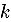), Score Matching и DSM (2005–2011) | VAE, GAN, VQ-VAE, DDPM/SDE, SoundStream/EnCodec (RVQ), LDM, DiT | **Rectified Flow / MMDiT**, выравнивание **REPA**, масочная диффузия текста (**dLLM**) и Full-Duplex кодек **Mimi** (12.5 Гц)26 |

Для эффективной работы со справочником рекомендуется следующий порядок чтения:

> 1. **Единая система нотации (следующий раздел):** перед чтением формул и кода сверьтесь со словарём тензорных размерностей и двадцати двух базовых механизмов — это устраняет разночтения между терминологией теории управления (SSM), статистической физики (диффузия) и речевой обработки (трансдьюсеры и кодеки).  
> 2. **Хронологический и доменный поиск по главам (1958–2027):** каждая из 70 глав названа годом и снабжена в первой строке фильтрационными тегами доменов (Базис, Оптимизация, Энкодер, Внимание/LLM, MoE, Петли/SSM, Диффузия, Видео, STT, TTS, STS). Внутри главы приводятся математический вывод ключевого механизма года, его вычислительные компромиссы и ссылки вида (№ 1)–(№ 445\) на полный библиографический указатель.  
> 3. **Количественная верификация (Приложение А):** для быстрого сопоставления моделей используйте Таблицу А.1 (погодовой индекс за 70 лет) и профильные Таблицы А.2–А.6 (архитектуры и бенчмарки LLM, петлевых и диффузионных моделей, видеогенераторов, речевых систем и open-source библиотек).  
> 4. **Инженерная реализация (Приложение Б):** двенадцать модульных листингов на PyTorch (Б.1–Б.12) позволяют перейти от аналитических уравнений непосредственно к работающему тензорному коду каждого механизма.

## **Словарь терминов и математических обозначений**

В приведённой ниже таблице зафиксированы сквозные размерности и операторы, используемые во всех главах и листингах монографии:

| Обозначение | Математический объект и размерность | Физический / алгоритмический смысл |
| :---- | :---- | :---- |
| **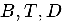** | Натуральные числа  | Размер мини-батча (), длина последовательности токенов или кадров (), скрытая размерность модели ( или ) |
|  | Натуральные числа  | Число физических уникальных слоёв () и число рекуррентных итераций по глубине / петель ()3 |
|  | Натуральные числа  | Число голов запросов (), число голов ключей-значений ( в GQA/MQA) и размерность одной головы ()30 |
|  | Векторы  | Входной вектор на шаге  и скрытое состояние в слое 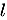 на шаге  |
|  | Матрица  или вектор  | Фиксированное по размеру рекуррентное состояние (быстрые веса / ассоциативная память) в SSM и линейном внимании25 |
|  | Бинарные тензорные операторы | Поэлементное произведение Адамара (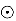) и внешнее/кронекерово произведение (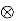) |
|  | Нелинейные функции активации | Логистическая сигмоида  и функция  (Swish-1) |
|  | Функционал 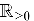 | Дивергенция Кульбака—Лейблера  |

Ниже приведены строгие определения опорных архитектурных и алгоритмических механизмов:

* **Автодифференцирование в обратном режиме (Reverse-Mode AD / Backpropagation)** — алгоритм точного вычисления градиента скалярной функции потерь  по всем узлам ациклического вычислительного графа за время, пропорциональное одному прямому проходу, путём рекурсивного распространения сопряжённых производных  от выхода ко входу7.  
* **Адаптивное время вычислений (Adaptive Computation Time, ACT / Early Exit Gate)** — механизм динамического выделения числа рекуррентных итераций  на каждый токен через обучаемый вентиль остановки , позволяющий тратить больше арифметических операций на логически сложные позиции41.  
* **Быстрые веса и обучение во время теста (Fast Weights / Test-Time Training, TTT)** — параметры внутренней подсети или матрицы ассоциативной памяти , которые динамически обновляются на этапе инференса (через правило Хебба, дельта-правило или шаг градиентного спуска по самоконтролируемому лоссу) для сжатия длинного контекста в фиксированный объём памяти44.  
* **Векторное, остаточное и конечное скалярное квантование (VQ / RVQ / FSQ)** — дискретизация непрерывного латентного вектора  поиском ближайшего элемента кодовой книги (VQ), каскадным квантованием остатков по  кодовым книгам (Residual VQ в SoundStream, EnCodec, Mimi) либо прямым покоординатным округлением в ограниченной целочисленной решётке без обучаемого кодбука (Finite Scalar Quantization в CosyVoice 3\)46.  
* **Внимание с групповыми запросами (Grouped-Query Attention, GQA) и мульти-запросное внимание (MQA)** — разделение одного набора проекций ключей и значений  между всеми  головами запросов (, MQA) либо внутри  групп (, GQA) для кратного сокращения объёма KV-кэша и трафика из видеопамяти HBM при декодировании39.  
* **Внимание со сжатым латентным кэшем (Multi-Head Latent Attention, MLA)** — механизм, проецирующий скрытое состояние в единый низкоранговый вектор 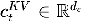 () с отдельной малоразмерной ветвью для позиционного кодирования Decoupled RoPE; на инференсе кэшируется только сжатый латент, сокращая память KV-кэша на 93.3% на уровне модели (до 98.24% в расчёте на слой относительно 128-голового MHA)50.  
* **Групповая относительная оптимизация политики (Group Relative Policy Optimization, GRPO)** — алгоритм обучения с подкреплением без отдельной сети критика (value model), оценивающий преимущество  путём стандартизации наград внутри группы из  сгенерированных траекторий для одного промпта53.  
* **Дельта-правило в линейном внимании (DeltaNet / Gated DeltaNet / KDA)** — замена аддитивной записи  на обобщённое отражение Хаусхолдера с затуханием 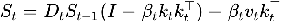, стирающее старое значение по ключу  перед записью нового значения  (где  — скаляр  в GDN или диагональная матрица  в KDA)24.  
* **Дискретная диффузия текста (Masked / Uniform Diffusion Language Models, dLLM / MDM / UDLM)** — неавторегрессивные языковые модели на базе двунаправленного трансформера, восстанавливающие токены параллельно из масок \[MASK\] (MDM: MDLM, LLaDA, Dream, Mercury) или случайных словарных замен (UDLM) путём минимизации взвешенной вариационной границы правдоподобия35.  
* **Латентное выравнивание представлений (Representation Alignment, REPA / JEPA)** — семейство принципов обучения: в понимании визуального мира (I-JEPA, V-JEPA) сеть предсказывает скрытые представления замаскированных блоков в пространстве EMA-энкодера без генерации пикселей; в диффузионной генерации (REPA) промежуточные слои DiT выравниваются по косинусному сходству с признаками предобученного визуального учителя (например, DINOv2)36.  
* **Масштабно-ограниченные гиперсвязи (Manifold-Constrained Hyper-Connections, mHC)** — расширение остаточного потока трансформера с одного вектора  до  параллельных полос , где матрица смешивания полос проецируется алгоритмом Синкхорна—Кноппа на многогранник Биркгофа дважды стохастических матриц для нерастягивающего распространения сигнала () на произвольной глубине2.  
* **Модели пространства состояний (Structured State Space Models, SSM / S4 / Mamba)** — линейные динамические системы , дискретизируемые с шагом ; в селективных SSM (Mamba-1/2/3) параметры  зависят от входа, обеспечивая линейное по  параллельное обучение и константную память  на шаг при инференсе32.  
* **Мультитокенное предсказание (Multi-Token Prediction, MTP)** — архитектура обучения и самоспекулятивного декодирования, при которой поверх общего ствола модели каскадные головы предсказывают несколько будущих текстовых токенов или остаточные уровни аудиокодбуков RVQ29.  
* **Ортогонализованный матричный импульс (Muon / MuonClip)** — оптимизатор для двумерных матричных слоёв, заменяющий покоординатное масштабирование градиента приближённой ортогонализацией матрицы импульса 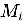 полиномиальными итерациями Ньютона—Шульца (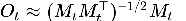), выравнивая спектр сингулярных значений шага обновления65.  
* **Остаточные связи с вниманием по глубине (Attention Residuals, AttnRes)** — замена фиксированного суммирования выходов всех предыдущих слоёв на обучаемое softmax-внимание вдоль оси глубины (по предшествующим блокам), устраняющая размывание нормы признаков в глубоких Pre-LN трансформерах34.  
* **Полнодуплексные речевые модели (Full-Duplex Speech-to-Speech, STS)** — архитектуры (Moshi, PersonaPlex, NemotronLabs VoiceChat), синхронно обрабатывающие входящий поток аудиотокенов пользователя и генерирующие параллельные потоки «внутреннего монолога» (текста) и аудиотокенов ответа без сегментации на поочерёдные реплики, что поддерживает перебивания и междометия с задержкой 160–205 мс68.  
* **Поворотные позиционные эмбеддинги (Rotary Position Embedding, RoPE / p-RoPE / 3D-RoPE / TMRoPE)** — кодирование относительной позиции вращением пар координат запросов  и ключей  на углы , благодаря чему скалярное произведение  зависит только от сдвига 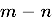; обобщается на вращение доли подпространства (\-RoPE) и пространственно-временные оси видео и звука (3D-RoPE, TMRoPE)71.  
* **Разреженная смесь экспертов (Sparse Mixture-of-Experts, MoE / LatentMoE)** — замена плотного слоя FFN пулом из  экспертных подсетей с активацией  экспертов на токен; в **LatentMoE** входной вектор предварительно сжимается в низкоразмерный латент для снижения трафика чтения весов и межсерверной пересылки All-to-All27.  
* **Разреженное аппаратно-выровненное внимание (NSA / DSA / CSA)** — обучаемые механизмы разреженного внимания (Native Sparse Attention, DeepSeek Sparse Attention, Compressed Sparse Attention), использующие иерархическое блочное сжатие или лёгкий индексатор (lightning indexer) для отбора top\- ключей на запрос, снижая сложность внимания с  до 31.  
* **Рекуррентно-глубинный (петлевой) трансформер (Looped / Recurrent-Depth Transformer, PLT)** — архитектура с разделением весов по глубине, прогоняющая скрытое состояние через общий блок слоёв  раз (Huginn, Ouro); в **Parallel Loop Transformer (PLT)** последовательные итерации соседних токенов конвейерно выполняются в одном параллельном проходе (Cross-Loop Parallelism)3.  
* **Спрямлённые потоки и согласование потоков (Flow Matching / Rectified Flow)** — обучение генеративного ОДУ  прямой регрессией поля скоростей вдоль линейной интерполяции 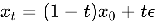 между данными и гауссовым шумом, обеспечивающее быструю детерминированную генерацию за малое число шагов Эйлера5.  
* **Трансдьюсер токенов и длительностей (Token-and-Duration Transducer, TDT)** — расширение потокового ASR-декодера RNN-T, совместно предсказывающее субсловный токен и число покрываемых им акустических фреймов  для пропуска стационарных участков и пауз на инференсе79.

## **1958**

**Домены:** Базис  
Отправной точкой параметрического обучения искусственных нейронных сетей стала публикация Фрэнка Розенблатта *«The Perceptron: A Probabilistic Model for Information Storage and Organization in the Brain»* в журнале *Psychological Review* (№ 1\) и аппаратная реализация машины Mark I Perceptron в Корнеллской аэронавтической лаборатории (предварительно симулированная на мейнфрейме IBM 704\)82. В отличие от фиксированных логических элементов Мак-Каллока и Питтса (1943), перцептрон Розенблатта разделял сенсорную сетчатку (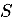\-блок), слой случайных нелинейных ассоциативных проекций (\-блок, признаки ) и обучаемый пороговый сумматор (\-блок), задающий разделяющую гиперплоскость:  
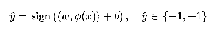  
Правило коррекции по ошибке обновляло веса  только на неверно классифицированных объектах , где , по формуле 83. В том же 1958 году посмертно вышла монография Джона фон Неймана *«The Computer and the Brain»* (№ 2), впервые сопоставившая массивно-параллельную низкочастотную архитектуру синаптической памяти мозга с последовательным бутылочным горлышком цифровых вычислительных машин. Хотя Розенблатт уже в 1958 году рассматривал многослойные схемы, у него отсутствовал дифференцируемый алгоритм кредитного присваивания для скрытых слоёв7.

## **1959**

**Домены:** Энкодер Базис  
В 1959 году возникли три концептуальные опоры будущих глубоких сетей: нейрофизиологическая иерархия зрительных фильтров, параллельное каскадное распознавание и бутстраппинг оценочной функции во времени. Дэвид Хьюбел и Торстен Визель в статье в *The Journal of Physiology* (№ 3\) открыли в стриарной коре кошки локальные ориентационно-избирательные рецептивные поля, ставшие биологическим прототипом свёрточных ядер85. Одновременно Оливер Селфридж представил на симпозиуме в Теддингтоне архитектуру **Pandemonium** (№ 4\) — параллельную иерархию «демонов признаков», взвешивающих их «когнитивных демонов» и верхнего «демона решения», отбирающего максимум отклика 87. В том же году Артур Самуэль опубликовал в *IBM Journal of Research and Development* знаменитую работу по самообучающейся игре в шашки (№ 5), закрепив термин *machine learning* и введя обновление весов оценочного полинома по разности оценок текущей и последующей позиций — прямой прообраз метода временных разностей (TD learning) и критика в обучении с подкреплением.

## **1960**

**Домены:** Базис Оптимизация  
Переход от разрывного порогового правила перцептрона к гладкой градиентной оптимизации осуществили Бернард Уидроу и Марсиан Хофф, представившие адаптивный линейный узел **ADALINE** и алгоритм наименьших квадратов **LMS** (Widrow–Hoff / Delta Rule, № 6\)88. Принципиальное новшество ADALINE состояло в вычислении ошибки по непрерывному линейному выходу 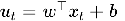 *до* бинарного порогового квантователя. Стохастический градиентный спуск по мгновенной квадратичной ошибке  дал классическое дельта-правило:  
  
Именно это уравнение — переписанное для матричной ассоциативной памяти в виде  — образует фундамент современных линейных трансформеров **DeltaNet** и **Gated DeltaNet** (2024–2026)25. В том же 1960 году Генри Келли в *ARS Journal* опубликовал статью *«Gradient Theory of Optimal Flight Paths»* (№ 7), выведя непрерывный метод сопряжённых уравнений для обратного распространения производных функционала стоимости вдоль траектории динамической системы — аналитический предшественник как обратного распространения ошибки, так и Neural ODE7.

## **1961**

**Домены:** Петли Память Базис  
В 1961 году немецкий кибернетик Карл Штайнбух опубликовал в первом томе журнала *Kybernetik* работу *«Die Lernmatrix»* («Обучающаяся матрица», № 8\) — первую матричную архитектуру гетероассоциативной памяти на перекрёстной решётке проводников91. В матрице Штайнбуха входной вектор признаков  и код класса 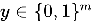 связывались локальным правилом типа Хебба , а извлечение выполнялось параллельным матрично-векторным умножением  с конкурентным отбором максимума. Алгебраически «обучающаяся матрица» заложила прообраз современных линейных ассоциативных памятей ключ–значение . В том же году Эдуардо Кайаниелло в *Journal of Theoretical Biology* (№ 9\) разделил нейросетевую динамику на два связанных масштаба времени: быстрые «нейронные уравнения» релаксации активаций и медленные адиабатические «мнемонических уравнения» пластичности синаптических весов.

## **1962**

**Домены:** Базис Энкодер  
В апреле 1962 года математик Альберт Новиков представил строгое и лаконичное доказательство **теоремы о сходимости перцептрона** (№ 10; родственные оценки в том же году опубликовал Х. Д. Блок, № 13\)92. Новиков показал, что если выборка  с ограниченной нормой входов  линейно разделима единичным вектором  () с положительным зазором , то алгоритм перцептрона из нулевого вектора  завершится не более чем за  обновлений. На каждом ошибочном примере скалярное произведение с оракулом возрастает минимум на  (), тогда как условие ошибки  ограничивает прирост квадрата нормы сверху величиной 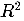 (), откуда следует оценка, совершенно не зависящая от размерности пространства 83:  
  
В том же году вышли итоговая монография Фрэнка Розенблатта *«Principles of Neurodynamics»* (№ 11), кусочно-линейная архитектура **MADALINE** Бернарда Уидроу (№ 12\) и классическая статья Хьюбела и Визеля (№ 14), описавшая чередование *простых клеток* (локальных линейных детекторов краёв) и *сложных клеток* (пространственно-инвариантного пулинга) в зрительной коре87.

## **1963**

**Домены:** Базис Оптимизация  
Развивая геометрию разделяющего зазора , Владимир Вапник и Александр Лернер опубликовали в журнале *«Автоматика и телемеханика»* статью *«Узнавание образов при помощи обобщённых портретов»* (№ 15\)97. Вместо поиска произвольной разделяющей гиперплоскости авторы сформулировали задачу квадратичной оптимизации по нахождению единственной **гиперплоскости максимального зазора** (линейный прообраз метода опорных векторов, SVM), вектор нормали которой раскладывается только по крайним опорным векторам выборки . Тем самым в теорию обучения вошёл принцип контроля нормы весов  как меры ёмкости классификатора. В том же году Штайнбух и Писке опубликовали в *IEEE Transactions on Electronic Computers* анализ непрерывных матриц памяти при зашумлённых сигналах (№ 16), а Стюарт Дрейфус упростил вывод цепного правила сопряжённых множителей через динамическое программирование (№ 17\)7.

## **1964**

**Домены:** Оптимизация Базис  
В 1964 году были созданы три математических инструмента, непосредственно работающих в современных фреймворках глубокого обучения. Борис Теодорович Поляк опубликовал в *«Журнале вычислительной математики и математической физики»* инерционный метод **«тяжёлого шарика» (Heavy-Ball Momentum)** (№ 18\) для ускорения градиентного спуска в плохо обусловленных овражных задачах100:  
  
Инерционное слагаемое  подавляет поперечные осцилляции градиента и сокращает эффективное число обусловленности квадратичной задачи с  до . Одновременно Марк Айзерман, Эммануил Браверман и Лев Розоноэр в *«Автоматике и телемеханике»* ввели **метод потенциальных функций** (№ 19\) — строгое обоснование *ядерного трюка* , напрямую связанное с будущей ядровой факторизацией линейного внимания20. В том же году Роберт Венгерт в *Communications of the ACM* (№ 20\) представил программный алгоритм **прямого режима автоматического дифференцирования (Forward-Mode AD)** по списку элементарных операций.

## **1965**

**Домены:** Базис Оптимизация  
В 1965 году Алексей Григорьевич Ивахненко и Валентин Григорьевич Лапа опубликовали монографию *«Кибернетические предсказывающие устройства»* (№ 21), описав первые работающие алгоритмы послойного обучения **глубоких многослойных перцептронов** с произвольным числом скрытых слоёв7. Каждый узел сети вычислял квадратичный полином Колмогорова—Габора с мультипликативными произведениями входов ( — алгебраический предшественник вентильных блоков GLU и SwiGLU), коэффициенты находились методом наименьших квадратов, а проверочная выборка отсеивала переобученные нейроны перед построением следующего слоя7.  
Параллельно Томас Ковер доказал в *IEEE Transactions on Electronic Computers* фундаментальную **теорему Ковера о ёмкости линейного разделения** (№ 22): число линейно реализуемых бинарных разбиений  точек общего положения в  равно , составляя ровно половину всех  дихотомий при  и экспоненциально стремясь к нулю при . Этот геометрический факт объясняет необходимость широких проекций признаков в скрытых слоях MLP и MoE. Год дополнили классическая книга Нильса Нильссона *«Learning Machines»* (№ 23\)88 и градиентный метод Хо—Кашьяпа для систем линейных неравенств (№ 24).

## **1966**

**Домены:** Оптимизация Базис  
В 1966 году Яков Залманович Цыпкин в работе *«Адаптация, обучение и самообучение в автоматических системах»* (*Автоматика и телемеханика*, № 25\) свёл разрозненные правила перцептронов, ADALINE и фильтрации к единой вариационной задаче **минимизации математического ожидания функции потерь (среднего риска)**  с помощью рекуррентной стохастической аппроксимации Роббинса—Монро 105. Эта постановка стала стандартным языком современной теории оптимизации нейросетей. В том же году Эммануил Браверман распространил метод потенциальных функций на задачу самообучения и кластеризации без учителя (№ 26\)20, а Лоуренс Фогель, Элвин Оуэнс и Майкл Уолш выпустили монографию *«Artificial Intelligence through Simulated Evolution»* (№ 27), открывшую направление эволюционного поиска без градиентов.

## **1967**

**Домены:** Базис Оптимизация  
В июне 1967 года Сюнъити Амари опубликовал в *IEEE Transactions on Electronic Computers* статью *«A Theory of Adaptive Pattern Classifiers»* (№ 28\) — первую в истории работу, где **сквозной стохастический градиентный спуск (end-to-end SGD)** применялся для обучения многослойной нейронной сети с нелинейными скрытыми слоями на линейно неразделимых распределениях7. Заменив пороговую ступеньку гладкими дифференцируемыми функциями активации, Амари вывел цепное правило коррекции скрытых весов  и экспериментально обучил 5-слойный классификатор за девятнадцать лет до публикации 1986 года в *Nature*7.  
В том же году вышли две работы огромного перспективного значения: Томас Ковер и Питер Харт доказали асимптотическую оценку ошибки правила ближайшего соседа (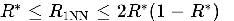, № 29), заложив теоретический базис векторного поиска и систем RAG, а Ричард Синкхорн и Пол Кнопп опубликовали в *Pacific Journal of Mathematics* теорему и итерационный алгоритм попеременной нормировки строк и столбцов положительной матрицы к дважды стохастическому виду (№ 30\) — тот самый оператор **Sinkhorn–Knopp**, который на рубеже 2025–2026 годов обеспечил устойчивость многополосных гиперсвязей **mHC** в архитектурах DeepSeek2.

## **1968**

**Домены:** Базис Петли  
В 1968 году Алексей Ивахненко оформил **Метод группового учёта аргументов (МГУА / Group Method of Data Handling, GMDH)** в журнале *«Автоматика»* (№ 31\)104, систематизировав автоматическое наращивание глубоких полиномиальных сетей с регулярным отбором лучших нейронов и ранней остановкой глубины на независимом валидационном множестве. Параллельно Стивен Гроссберг опубликовал в *PNAS* нелинейную модель ассоциативного обучения **Outstar** и систему дифференциальных уравнений кратковременной (STM) и долговременной (LTM) памяти (№ 32\)109:  
  
доказав безусловную сходимость синаптических весов к пространственным пропорциям входного паттерна. В том же году Владимир Вапник и Алексей Червоненкис опубликовали в *«Докладах АН СССР»* теорему о равномерной сходимости эмпирических частот к вероятностям по классу событий, введя комбинаторную меру ёмкости семейств функций — **размерность Вапника—Червоненкиса (VC-dimension)** (№ 33).

## **1969**

**Домены:** Базис Энкодер Оптимизация  
В 1969 году Марвин Минский и Сеймур Пейперт выпустили аналитическую монографию *«Perceptrons: An Introduction to Computational Geometry»* (№ 34\)7. С помощью теории инвариантов групп авторы строго доказали невозможность реализации предиката чётности (включая двухбитовый **XOR**) и топологического предиката связности однослойным перцептроном с локальными признаками ограниченного порядка. Хотя авторы отмечали, что многослойные сети свободны от этого ограничения, отсутствие широко известного на Западе эффективного алгоритма обучения скрытых слоёв вызвало охлаждение интереса к коннекционизму в англоязычной академической среде7.  
Однако в том же 1969 году были опубликованы два ключевых элемента современного глубокого обучения. Артур Брайсон и Ю-Чи Хо в книге *«Applied Optimal Control»* (№ 35\) выписали явные дискретные формулы обратного распространения множителей Лагранжа через многошаговые каскады 7. Одновременно Кунихико Фукусима в статье *«Visual Feature Extraction by a Multilayered Network of Analog Threshold Elements»* (*IEEE Transactions on Systems Science and Cybernetics*, № 36\)85 ввёл многослойную визуальную сеть с **аналоговыми полуволновыми выпрямителями**  — исторически первое применение функции активации **ReLU** в многослойных нейронных сетях7.

## **1970**

**Домены:** Базис Оптимизация  
В 1970 году финский математик Сеппо Линнайнмаа защитил в Хельсинкском университете магистерскую диссертацию (№ 37\)7, в которой впервые сформулировал и реализовал в машинном коде общий алгоритм **обратного режима автоматического дифференцирования (Reverse-Mode Automatic Differentiation)** для произвольных вычислительных графов. Если вычисление скалярной функции потерь  разложено на элементарные узлы  (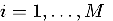), то обратный проход от 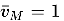 к  рекурсивно аккумулирует частные производные:  
  
Вычисление полного вектора градиента 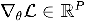 по произвольному числу параметров  требует константного множителя от числа операций одного прямого прохода114. В том же 1970 году Бройден, Флетчер, Гольдфарб и Шанно независимо вывели квазиньютоновский метод второго порядка **BFGS** (№ 38), а Ивахненко опубликовал в международном журнале *Automatica* обзор эвристической самоорганизации глубоких сетей (№ 39\)115.

## **1971**

**Домены:** Базис Память  
В октябре 1971 года Алексей Ивахненко опубликовал в *IEEE Transactions on Systems, Man, and Cybernetics* статью *«Polynomial Theory of Complex Systems»* (№ 40\)115, детально описав построение и обучение **8-слойной глубокой сети** прямого распространения по методу МГУА с регуляризационным отбором признаков на проверочной выборке7. Эта публикация стала одним из первых широко цитируемых в международной литературе примеров практического обучения глубокой восьмислойной архитектуры7.  
В том же году Дэвид Марр опубликовал в *Philosophical Transactions of the Royal Society B* математическую модель гиппокампа *«Simple Memory: A Theory for Archicortex»* (№ 41\)7. Марр показал, что разреженное кодирование входных векторов в пространстве высокой размерности в сочетании с локальной пластичностью Хебба и адаптивным тормозным порогом позволяет записывать большой объём эпизодических ассоциаций за один проход и безошибочно восстанавливать их по частичным подсказкам — принцип, лежащий в основе современных разреженных модулей внешней и параметрической памяти.

## **1972**

**Домены:** Петли Память  
В ноябре 1972 года Сюнъити Амари опубликовал в *IEEE Transactions on Computers* статью *«Learning Patterns and Pattern Sequences by Self-Organizing Nets of Threshold Elements»* (№ 42), за десять лет до публикации Хопфилда выведя уравнения устойчивости дискретных рекуррентных ассоциативных сетей (**сеть Амари—Хопфилда**) как для статических аттракторов с симметричной матрицей весов, так и для динамических цепочек последовательностей с несимметричной матрицей7:  
  
В том же 1972 году Теуво Кохонен в *IEEE Transactions on Computers* независимо ввёл корреляционные матричные памяти (№ 43\)118, Джеймс Андерсон описал линейно-пороговую интерактивную память в *Mathematical Biosciences* (№ 44), Каору Накано построил ассоциативную систему **Associatron** (№ 45\)7, а Хью Уилсон и Джек Коуэн в *Biophysical Journal* вывели нелинейную систему ОДУ связанных возбуждающих и тормозных нейронных популяций (, № 46), аналитически доказав связь предельных циклов осцилляций и мультистабильного гистерезиса памяти119.

## **1973**

**Домены:** Энкодер Петли  
В 1973 году Кристоф фон дер Мальсбург опубликовал в *Kybernetik* статью *«Self-Organization of Orientation Sensitive Cells in the Striate Cortex»* (№ 47\)115 — первую компьютерную демонстрацию **конкурентного самообучения (competitive learning)** детекторов локальных признаков. Объединив ближнее внутрикорковое возбуждение, латеральное торможение и правило Хебба с **сохранением \-нормы входных синапсов каждого нейрона** (), фон дер Мальсбург показал спонтанное формирование упорядоченных карт ориентационных колонок без учителя.  
Одновременно Стивен Гроссберг опубликовал в *Studies in Applied Mathematics* строгий анализ **шунтирующих рекуррентных сетей** с мультипликативным насыщением и дивизивным латеральным торможением (№ 48\)109: он доказал, что именно сигмоидальная передаточная характеристика подавляет фоновый шум малых амплитуд и сохраняет относительный контраст паттерна без насыщения при произвольном росте общей яркости входа — теоретический фундамент слоёв нормализации активаций. Хью Уилсон и Джек Коуэн обобщили свою популяционную динамику до пространственно-непрерывных нейронных полей коры и таламуса (№ 49\)124.

## **1974**

**Домены:** Базис Оптимизация Петли  
В 1974 году Пол Вербос защитил в Гарвардском университете докторскую диссертацию *«Beyond Regression: New Tools for Prediction and Analysis in the Behavioral Sciences»* (№ 50\)7. Вербос сформулировал метод «динамической обратной связи» — явные формулы цепного обратного распространения производных целевой функции сквозь произвольные многослойные сети с нелинейными узлами, подготовив прямое применение метода к нейросетям в начале 1980-х годов115.  
В том же году физик Уильям Литтл опубликовал в *Mathematical Biosciences* статью *«The Existence of Persistent States in the Brain»* (№ 51\)126, установившую прямое соответствие между статистической физикой **спиновых систем Изинга** и стохастическими рекуррентными нейросетями. Введя эффективную температуру синаптического шума  и логистическую вероятность срабатывания нейрона , Литтл описал долговременную память как вырожденные старшие собственные состояния марковской матрицы перехода — фундамент машин Больцмана и термодинамических генеративных моделей.

## **1975**

**Домены:** Энкодер Память Базис  
В 1975 году Кунихико Фукусима представил в *Biological Cybernetics* многослойную самоорганизующуюся сеть **Cognitron** (№ 52\)86. В Cognitron локальные возбуждающие и тормозные рецептивные поля сочетались с шунтирующим дивизивным отношением  и конкурентным усилением синапсов только наиболее активного нейрона в окрестности; при этом сеть ещё не разделяла веса по всей плоскости и поэтому оставалась чувствительной к сдвигам изображения129.  
Параллельно вышли три знаковые работы в смежных областях: Джеймс Албус создал быструю локально-хеширующую архитектуру мозжечкового контроллера **CMAC** с перекрывающимися грубыми рецептивными полями (№ 53\)130; Дэвид Шеррингтон и Скотт Киркпатрик в *Physical Review Letters* ввели решаемую модель **спинового стекла SK** со случайными знакопеременными связями  (№ 54\)126, аналитический метод реплик которой лёг в основу расчёта фазовых переходов и ёмкости нейронных сетей; а Джон Холланд опубликовал монографию *«Adaptation in Natural and Artificial Systems»* (№ 55), заложившую математику генетических алгоритмов.

## **1976**

**Домены:** Оптимизация Петли Базис  
В июне 1976 года Сеппо Линнайнмаа опубликовал в международном журнале *BIT Numerical Mathematics* англоязычную статью *«Taylor Expansion of the Accumulated Rounding Error»* (№ 56\)23. Помимо полных алгоритмов первого и высших порядков обратного дифференцирования на вычислительном графе, Линнайнмаа впервые проанализировал фундаментальную проблему памяти обратного прохода — необходимость сохранения промежуточных состояний всех операций и способы снижения пикового потребления памяти, предвосхитив современные техники выборочного перевычисления активаций (**activation / gradient checkpointing**, используемые, в частности, при обучении Ring Attention и DeepSeek mHC2).  
В том же году Стивен Гроссберг в двухчастной работе в *Biological Cybernetics* (№ 57\)126 сформулировал **дилемму стабильности—пластичности** (как дообучать сеть новым классам без катастрофического разрушения ранее выученных представлений) и предложил механизм резонансной фильтрации восходящих признаков нисходящими ожиданиями (**Adaptive Resonance Theory, ART**), а Дэвид Уиллшоу и Кристоф фон дер Мальсбург построили синаптическую модель самоорганизации непрерывных топографических проекций сетчатки (№ 58).

## **1977**

**Домены:** Петли Память Оптимизация  
В 1977 году Джеймс Андерсон, Джек Сильверстайн, Стивен Ритц и Рэндалл Джонс опубликовали в *Psychological Review* нелинейную рекуррентную модель категориальной памяти **Brain-State-in-a-Box (BSB)** (№ 59\)122, ограничивающую траекторию положительной обратной связи стенками единичного гиперкуба 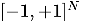:  
  
Симметричная матрица связей Хебба  усиливает проекции вдоль главных собственных векторов до тех пор, пока состояние не стабилизируется в вершине гиперкуба, соответствующей чистому дискретному прототипу памяти. В том же году Сюнъити Амари опубликовал каноническую математическую теорию локализованных возбуждений («бампов» рабочей памяти) в непрерывных нейронных полях с латеральным торможением (№ 60\)124, Теуво Кохонен выпустил монографию *«Associative Memory»* (№ 61), а Артур Демпстер, Нэн Лэрд и Дональд Рубин в *JRSS-B* формализовали **EM-алгоритм** максимизации правдоподобия моделей со скрытыми переменными через вариационную границу Йенсена (№ 62\) — аналитический фундамент обучения MoE и вариационных автоэнкодеров.

## **1978**

**Домены:** Память Петли Базис  
В 1978 году Уильям Литтл и Гордон Шоу опубликовали в *Mathematical Biosciences* работу *«Analytic Study of the Memory Storage Capacity of a Neural Network»* (№ 63\)127. Решив аналитически линеаризованную модель стохастической нейронной сети с пластичными связями, авторы строго показали, что информационная ёмкость распределённой нейронной памяти масштабируется пропорционально **числу синапсов** , а не числу нейронов 127. В современной инженерии именно этот закон объясняет, почему хранение мировых фактов требует масштабирования общего числа параметров весов до сотен миллиардов и триллионов в разреженных MoE-архитектурах даже тогда, когда для обработки одного токена достаточно малого активного подмножества нейронов.  
В том же году Гидеон Шварц ввёл в *Annals of Statistics* байесовский информационный критерий **BIC** отбора размерности параметрических моделей (№ 64), Стивен Гроссберг представил теорию иерархического чанкинга последовательностей в рабочей памяти (№ 65\)109, а Кунихико Фукусима усовершенствовал синаптическое правило среднеквадратичного типа для глубокого самообучения без учителя (№ 66\)129.

## **1979**

**Домены:** Энкодер Базис  
В октябре 1979 года Кунихико Фукусима опубликовал в японском журнале *Transactions of the IECE of Japan* (том J62-A, № 10, с. 658–665) первую статью об архитектуре **Neocognitron** — первой глубокой свёрточной нейронной сети, инвариантной к пространственному сдвигу входных образов (№ 67\)7. Вдохновляясь открытием Хьюбела и Визеля, Фукусима организовал сеть как многоступенчатое чередование пар слоёв двух типов: плоскостей **\-клеток**, где все нейроны одной плоскости имеют *тождественно равные разделяемые веса* (weight sharing) и извлекают локальный признак в каждой точке двумерного поля (операция 2D-свёртки с выпрямителем ReLU), и плоскостей **\-клеток**, агрегирующих отклики локальной окрестности \-клеток с понижением разрешения (операция пространственного пулинга), благодаря чему допустимая погрешность сдвига накапливается плавно от слоя к слою без потери взаимной геометрии деталей87. В том же году Леон Купер, Ф. Либерман и Эркки Ойя опубликовали в *Biological Cybernetics* синаптическую модель формирования селективности нейронов зрительной коры (№ 68).

## **1980**

**Домены:** Энкодер Оптимизация  
В апреле 1980 года в *Biological Cybernetics* (т. 36, с. 193–202) вышла классическая англоязычная публикация Кунихико Фукусимы *«Neocognitron: A Self-Organizing Neural Network Model for a Mechanism of Pattern Recognition Unaffected by Shift in Position»* (№ 69\)86, сделавшая свёрточно-пулинговую иерархию известной всему мировому сообществу. Отклик \-клетки на позиции  плоскости признака  слоя  при дивизивном торможении среднеквадратичной активностью  в локальном окне  задавался уравнением:  
  
Тем самым вся структурная топология глубоких визуальных сетей — многоканальные 2D-свёртки с разделением весов, выпрямление , локальная среднеквадратичная нормировка и пространственный пулинг — была полностью построена, ожидая замены локальных правил самоорганизации на глобальный градиентный спуск87. В том же году Стивен Гроссберг опубликовал в *Psychological Review* обобщающую статью по резонансным когнитивным кодам (№ 70), а Вильфрид Баур и Фолькер Штрассен доказали знаменитую теорему алгебраической сложности (Baur–Strassen Theorem, № 71): вычисление градиента любой рациональной функции многих переменных на арифметической схеме требует не более чем пятикратного числа операций от вычисления самой функции114.

## **1981**

**Домены:** Память Петли Оптимизация  
В 1981 году Джеффри Хинтон и Джеймс Андерсон выпустили программную коллективную монографию *«Parallel Models of Associative Memory»* (№ 72\)140, обосновавшую переход от символьных локалистских узлов («один концепт — одна ячейка») к плотным **распределённым векторным представлениям** (distributed representations), где каждое понятие кодируется паттерном активности многих элементов, обеспечивая автоматическое обобщение по сходству микропризнаков. В том же году Джеймс Макклелланд и Дэвид Румельхарт в *Psychological Review* представили **модель интерактивной активации** восприятия букв и слов с двунаправленными межслойными обратными связями (№ 73), а Эндрю Барто, Ричард Саттон и Питер Брауэр в *Biological Cybernetics* опубликовали модель **ассоциативной поисковой сети** (№ 74), объединив стохастическую генерацию действий с обучением по скалярному сигналу подкрепления — прямой предшественник градиентных методов обучения с подкреплением.

## **1982**

**Домены:** Петли Память Энкодер Базис  
В апреле 1982 года Джон Хопфилд опубликовал в *PNAS* знаменитую статью *«Neural Networks and Physical Systems with Emergent Collective Computational Abilities»* (№ 75\)124. Сопоставив бинарной рекуррентной сети  с симметричной матрицей весов  () явную физическую **функцию энергии Ляпунова**:  
  
Хопфилд доказал монотонное невозрастание энергии () при асинхронных пороговых обновлениях  и сходимость к локальным минимумам — контент-адресуемым аттракторам памяти (ёмкость классического бинарного варианта составляет около  некоррелированных паттернов, тогда как современные экспоненциальные сети Хопфилда 2016–2020 годов имеют экспоненциальную ёмкость и эквивалентны softmax-вниманию трансформера142).  
В том же 1982 году Пол Вербос на конференции IFIP впервые явно опубликовал применение обратного распространения ошибки непосредственно к искусственным нейронным сетям (№ 76\)7; Теуво Кохонен создал топографические **самоорганизующиеся карты признаков (SOM)** (№ 77); Эркки Ойя вывел локальное нормализованное правило пластичности  (**правило Ойя**, № 78), извлекающее главный собственный вектор ковариационной матрицы данных (нейронный PCA); Биненсток, Купер и Манро предложили нелинейное правило синаптической модификации со скользящим порогом **BCM** (№ 79); и посмертно вышла фундаментальная книга Дэвида Марра *«Vision»* (№ 80).

## **1983**

**Домены:** Оптимизация Петли  
В 1983 году Юрий Евгеньевич Нестеров опубликовал в *«Докладах АН СССР»* (*Soviet Mathematics Doklady*, 27(2), 372–376) оптимальный метод минимизации гладких выпуклых функций со скоростью сходимости  — **ускоренный градиентный метод Нестерова (NAG)** (№ 81\)143:  
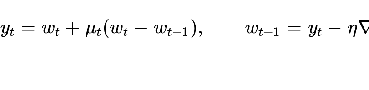  
Вычисление градиента в упреждающей инерционной точке  обеспечило коррекцию траектории на крутых поворотах ландшафта потерь и стало стандартом в современных модификациях SGD, NAdam и ортогонализованного импульса Muon. В майском номере *Science* Скотт Киркпатрик, Чарльз Джелаат и Марио Векки представили стохастическую глобальную оптимизацию методом **имитации отжига (Simulated Annealing)** с метрополисовской вероятностью перехода  (№ 82\)144, а Эндрю Барто, Ричард Саттон и Чарльз Андерсон в *IEEE TSMC* опубликовали нейросетевую архитектуру **Actor–Critic** на задаче удержания перевёрнутого маятника (№ 83\)144.

## **1984**

**Домены:** Базис Петли Диффузия  
В ноябре 1984 года Лесли Вэлиант опубликовал в *Communications of the ACM* статью *«A Theory of the Learnable»* (№ 84\)146, заложившую строгий вычислительно-статистический фундамент **вероятностно приближённо корректного обучения (PAC Learning)**: формализацию выборочной и вычислительной сложности достижения ошибки обобщения  с достоверностью 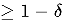. В том же году Джон Хопфилд обобщил свою модель на непрерывные динамические цепи с гладкой монотонной сигмоидой  и непрерывным функционалом Ляпунова (№ 85), братья Стюарт и Дональд Джеманы в *IEEE TPAMI* ввели **сэмплирование по Гиббсу (Gibbs Sampling)** на марковских случайных полях с распределением Гиббса  для байесовского восстановления зашумлённых изображений (№ 86), а Теуво Кохонен выпустил расширенную монографию *«Self-Organization and Associative Memory»* (№ 87).

## **1985**

**Домены:** Базис Память Диффузия  
В 1985 году Дэвид Экли, Джеффри Хинтон и Терренс Сейновски опубликовали в *Cognitive Science* алгоритм обучения **машин Больцмана** (№ 88\)146 — стохастических энергетических сетей со *скрытыми переменными* , моделирующих распределение видимых векторов  маргинализацией . Градиент дивергенции Кульбака—Лейблера по симметричному весу  свёлся к разности попарных корреляций в двух термодинамических режимах:  
  
Хотя длительный MCMC-отжиг ограничивал размер полносвязных машин Больцмана, это была первая теоретически строгая демонстрация обучения глубоких распределённых представлений в генеративных сетях150. В том же 1985 году Ян Лекун на конференции *Cognitiva 85* в Париже (№ 89\) и Дэвид Паркер в отчёте MIT *«Learning-Logic»* (№ 90\) независимо опубликовали градиентные схемы обратного распространения ошибки для многослойных сетей, а Дэвид Румельхарт и Дэвид Зипсер систематизировали конкурентную кластеризацию признаков (№ 91).

## **1986**

**Домены:** Базис Петли Оптимизация  
В октябре 1986 года Дэвид Румельхарт, Джеффри Хинтон и Рональд Уильямс опубликовали в *Nature* знаменитую статью *«Learning Representations by Back-Propagating Errors»* (№ 92), одновременно с выходом двухтомного фундаментального труда группы PDP *«Parallel Distributed Processing»* (MIT Press, № 93\)7. Авторы показали, что многослойный перцептрон (MLP) с гладкими активациями , обучаемый рекурсивным распространением вектора чувствительности:  
  
конструирует в промежуточных слоях нетривиальные семантические представления и решает нелинейно разделимые предикаты151. В том же издании PDP Пол Смоленский ввёл двудольную энергетическую сеть без внутрислойных связей **Harmonium** — математически эквивалентную **ограниченной машине Больцмана (RBM)** с точным одношаговым условным выводом  (№ 94); Майкл Джордан предложил рекуррентную сеть с обратной связью от выхода в контекстный вектор состояния  (**Jordan RNN**, № 95); а Терренс Сейновски и Чарльз Розенберг продемонстрировали синтезатор фонематической транскрипции английского текста **NETtalk** (№ 96).

## **1987**

**Домены:** STT Петли Энкодер  
В 1987 году Александр Вайбель, Ташиюки Ханазава, Джеффри Хинтон, Киёхиро Сикано и Кевин Лэнг создали **Time-Delay Neural Network (TDNN)** для распознавания фонем речи (№ 97\)87 — первую одномерную свёрточную сеть по оси времени с разделяемыми весами, инвариантную к сдвигу акустических формант и обучаемую обратным распространением ошибки. В том же году Джеффри Хинтон и Дэвид Плаут опубликовали работу *«Using Fast Weights to Deblur Old Memories»* (№ 98\)45, снабдив каждую связь парой из медленного долговременного веса и быстро затухающего контекстного веса (**Fast Weights**) — прямой концептуальный источник современных слоёв линейного внимания и обучения на тесте (TTT и Titans). Параллельно Дана Баллард на конференции AAAI предложил модульное послойное предобучение глубоких иерархий **стеком автоэнкодеров** (№ 99), Гейл Карпентер и Стивен Гроссберг формализовали архитектуру адаптивного резонанса **ART 1** (№ 100\)110, а Фернандо Пинеда в *Physical Review Letters* вывел непрерывное обратное распространение градиентов для неподвижных точек рекуррентных аттракторов 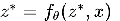 (**Recurrent Backpropagation**, № 101\) — аналитический предшественник равновесных сетей DEQ.

## **1988**

**Домены:** Энкодер Оптимизация Петли  
В 1988 году Вэй Чжан и соавторы опубликовали первую **двумерную инвариантную к сдвигу свёрточную нейронную сеть (Shift-Invariant 2D CNN)** для распознавания символов, обученную непосредственно методом обратного распространения ошибки (№ 102\)20. Дэвид Брумхед и Дэвид Лоу ввели в *Complex Systems* **сети радиальных базисных функций (RBF Networks)** 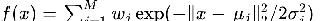 (№ 103). В теории обучения Ричард Саттон опубликовал в журнале *Machine Learning* фундаментальную работу по **обучению методом временных разностей TD()** (№ 104\)152, обновляющему параметры предсказателя по невязке Беллмана  до завершения эпизода. Одновременно Эрве Бурлар и Ив Камп доказали, что линейный автоэнкодер с узким горлышком размерности  выучивает ортогональный проектор на главные сингулярные подпространства SVD (№ 105), а Барт Коско ввёл двунаправленную гетероассоциативную память **BAM** (№ 106).

## **1989**

**Домены:** Энкодер Базис Оптимизация Петли  
В 1989 году Ян Лекун, Бернхард Бозер, Джон Денкер, Донни Хендерсон, Ричард Ховард, Уэйн Хаббард и Лоуренс Джекел опубликовали в *Neural Computation* статью *«Backpropagation Applied to Handwritten Zip Code Recognition»* (№ 107\)87, обучив глубокую свёрточную сеть с разделяемыми фильтрами 5×5 и подвыборкой (stride 2\) напрямую на нормированных пикселях рукописных почтовых индексов USPS и продемонстрировав резкое улучшение обобщения за счёт пространственного разделения весов. В том же году Джордж Цыбенко (№ 108\) и независимо Курт Хорник, Максвелл Стинчкомб и Халберт Уайт (№ 109\) доказали **теорему об универсальной аппроксимации** непрерывных функций на компактах двуслойными перцептронами с неполиномиальной активацией. Год также ознаменовался онлайн-алгоритмом обучения рекуррентных сетей **RTRL** Рональда Уильямса и Дэвида Зипсера (№ 110), созданием **Q-learning** в диссертации Кристофера Уоткинса (№ 111), методом ограниченной памяти **L-BFGS** Дуна Лю и Хорхе Носедаля (№ 112\)153 и вероятностной интерпретацией функции **Softmax** у Джона Бридла (№ 113).

## **1990**

**Домены:** Петли Оптимизация Базис  
В 1990 году Джеффри Элман опубликовал в *Cognitive Science* статью *«Finding Structure in Time»* (№ 114\)154, сделавшую **простую рекуррентную сеть (Simple RNN / Elman Network)**  базовым инструментом моделирования последовательностей и показавшую спонтанное возникновение синтаксико-семантических кластеров в скрытом пространстве при предсказании следующего слова. Пол Вербос в *Proceedings of the IEEE* закрепил общую формулировку **обратного распространения во времени (BPTT)** путём пошаговой развёртки графа (№ 115). На конференции NIPS Ян Лекун, Джон Денкер и Сара Солла представили метод разреженного прореживания весов второго порядка **Optimal Brain Damage (OBD)** по диагонали гессиана  (№ 116\) — прямой предшественник современных алгоритмов сжатия LLM. Параллельно Юрген Шмидхубер предложил минимаксную игру двух сетей в рамках **состязательного искусственного любопытства** (№ 117\)7, а Ларс Хансен и Питер Саламон обосновали снижение дисперсии ошибки в **ансамблях нейросетей** (№ 118).

## **1991**

**Домены:** MoE Петли Внимание/LLM Базис  
В 1991 году заложились три фундаментальных механизма, определяющих архитектуру флагманских моделей 2024–2027 годов. Роберт Джейкобс, Майкл Джордан, Стивен Ноулан и Джеффри Хинтон опубликовали в *Neural Computation* статью *«Adaptive Mixtures of Local Experts»* (**первый MoE**, № 119\)156. Заменив усреднение квадратичной ошибки максимизацией логарифма правдоподобия гауссовской смеси под управлением шлюзовой сети :  
  
авторы добились конкурентной специализации экспертов  на различных областях входного пространства, поскольку градиент получает преимущественно эксперт с наибольшей апостериорной ответственностью за пример.  
В июне того же 1991 года Зепп Хохрайтер защитил под руководством Юргена Шмидхубера дипломную работу (№ 120\)7, впервые дав строгий анализ **затухания и взрыва градиентов** в глубоких и рекуррентных сетях через произведение якобианов . А весной 1991 года Шмидхубер предложил архитектуру **Fast Weight Programmers** (№ 121; журн. публ. 1992\)7, где медленная сеть динамически генерирует векторы ключей и значений для аддитивной перезаписи матрицы быстрых весов  и считывания  — конструкция, математически изоморфная ненормированному линейному самовниманию22. Год завершили пятислойные нелинейные автоэнкодеры Марка Крамера (№ 122\) и классический учебник статистической механики нейросетей Герца, Крога и Палмера (№ 123).

## **1992**

**Домены:** Оптимизация Петли Базис  
В 1992 году Рональд Уильямс опубликовал в *Machine Learning* оценку градиента политики **REINFORCE** с вычитаемым базовым уровнем 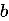 для снижения дисперсии (№ 124):  
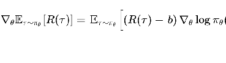  
ставшую прямой основой оптимизации рассуждающих языковых моделей методами PPO и GRPO53. Одновременно Юрген Шмидхубер ввёл в *Neural Computation* **нейронный компрессор истории** (№ 125\)22 — иерархическое самоконтролируемое предобучение RNN, передающее на верхний уровень только непредсказуемые («удивительные») токены с последующим сжатием («дистилляцией») глубокого учителя в компактную сеть-ученика7. Борис Поляк и Анатолий Юдицкий доказали асимптотическую оптимальность **усреднения траектории весов SGD**  (№ 126\) — теоретическую основу EMA-таргетов в DINO, JEPA и диффузии; Андерс Крог и Джон Герц обосновали регуляризацию затуханием весов (**Weight Decay**, № 127); а Бозер, Гийон и Вапник объединили зазор гиперплоскости с ядерным трюком на COLT (№ 128).

## **1993**

**Домены:** Энкодер Базис Оптимизация  
В 1993 году Джейн Бромли, Изабель Гийон, Ян Лекун и соавторы представили на NIPS **сиамские нейронные сети (Siamese Networks)** (№ 129): две идентичные свёрточные башни с разделяемыми весами отображают пару входов в общее метрическое пространство косинусной близости — парадигма, лежащая в основе всех современных контрастивных энкодеров (CLIP, SigLIP, плотный ретривал). На конференции COLT Джеффри Хинтон и Дрю ван Камп сформулировали принцип минимальной длины описания весов через минимизацию вариационной свободной энергии  (**вариационный байесовский вывод в нейросетях**, № 130), предвосхитивший функционал ELBO. В том же году Эндрю Бэррон доказал независимость скорости аппроксимации  двуслойной сетью от размерности пространства  для функций с ограниченной спектральной нормой Фурье (№ 131), а Бабак Хассиби и Дэвид Сторк обобщили прунинг гессиана до полного недиагонального **Optimal Brain Surgeon (OBS)** (№ 132\) — математической базы современных квантователей весов LLM (GPTQ).

## **1994**

**Домены:** Петли MoE Оптимизация  
В 1994 году Йошуа Бенджио, Патрис Симар и Паоло Фраскони опубликовали в *IEEE Transactions on Neural Networks* строгую теорему *«Learning Long-Term Dependencies with Gradient Descent is Difficult»* (№ 133), доказав фундаментальный конфликт нелинейных динамических систем: устойчивое к помехам хранение бита в гиперболическом аттракторе требует собственных чисел якобиана , что автоматически вызывает экспоненциальное затухание градиента ошибки во времени. В том же году Майкл Джордан и Роберт Джейкобс обобщили смесь экспертов до древовидной **иерархической смеси экспертов (HME)** с быстрым EM-обучением (№ 134), Барух Перлмуттер вывел дифференциальный оператор  для точного умножения гессиана на вектор за  операций без хранения матрицы вторых производных (№ 135), и вышло первое издание фундаментального курса Саймона Хайкина *«Neural Networks: A Comprehensive Foundation»* (№ 136).

## **1995**

**Домены:** Базис Диффузия Энкодер  
В мае 1995 года Джеффри Хинтон, Питер Дэйан, Брендан Фрей и Рэдфорд Нил опубликовали в *Science* архитектуру **машины Гельмгольца** и двухфазный алгоритм **Wake–Sleep** (№ 137), спарив направленную генеративную модель  с быстрой распознающей инференс-сетью  — прямой структурный предшественник вариационного автоэнкодера. Энтони Белл и Терренс Сейновски создали алгоритм слепого разделения сигналов **InfoMax ICA** путём максимизации энтропии нелинейного выхода (№ 138); Коринна Кортес и Владимир Вапник ввели классификатор мягкого зазора **Support-Vector Networks** (№ 139\)149; Ян Лекун и Йошуа Бенджио систематизировали 1D/2D свёрточные архитектуры для речи и изображений (№ 140); а Кристофер Бишоп выпустил классическую монографию *«Neural Networks for Pattern Recognition»* (Oxford University Press, № 141\)88, закрепившую байесовскую и теоретико-вероятностную трактовку функций потерь и регуляризации.

## **1996**

**Домены:** Энкодер Базис Петли  
В июне 1996 года Бруно Ольсхаузен и Дэвид Филд показали в журнале *Nature* (*«Emergence of Simple-Cell Receptive Field Properties by Learning a Sparse Code for Natural Images»*, № 142), что минимизация квадратичной ошибки реконструкции естественных изображений переполненным словарём с \-штрафом разреженности  самопроизвольно формирует локализованные ориентированные вейвлеты Габора — математическая основа как разреженного кодирования, так и современных Sparse Autoencoders (SAE) для интерпретируемости LLM. В том же году Рэдфорд Нил в монографии *«Bayesian Learning for Neural Networks»* (№ 143\) доказал сходимость случайно инициализированных нейросетей бесконечной ширины () к **гауссовским процессам (NNGP)**, Кристоф Голлер и Андреас Кюхлер ввели обратное распространение по ациклическим графам и синтаксическим деревьям (№ 144), и вышла книга Брайана Рипли *«Pattern Recognition and Neural Networks»* (№ 145).

## **1997**

**Домены:** Петли Память Оптимизация  
В ноябре 1997 года Зепп Хохрайтер и Юрген Шмидхубер опубликовали в *Neural Computation* архитектуру **Long Short-Term Memory (LSTM)** (№ 146\)7. Для преодоления затухания градиентов авторы заменили сжимающее нелинейное преобразование состояния линейной **каруселью постоянной ошибки (Constant Error Carousel, CEC)**  с единичным якобианом во времени, защитив запись и чтение мультипликативными входным () и выходным () вентилями:  
  
В том же 1997 году Майкл Шустер и Кулдип Паливал создали в *IEEE TSP* **двунаправленные рекуррентные сети (BiRNN)** (№ 147), объединяющие прямую и обратную временные развёртки для полного контекстного кодирования; Хохрайтер и Шмидхубер ввели критерий поиска **плоских минимумов (Flat Minima)** малой кривизны гессиана для улучшения обобщения (№ 148); а Йоав Фройнд и Роберт Шапире опубликовали алгоритм взвешенного бустинга **AdaBoost** (№ 149).

## **1998**

**Домены:** Энкодер Оптимизация Базис  
В ноябре 1998 года Ян Лекун, Леон Ботту, Йошуа Бенджио и Патрик Хаффнер опубликовали в *Proceedings of the IEEE* монументальную статью *«Gradient-Based Learning Applied to Document Recognition»* (№ 150), зафиксировав эталонную 7-слойную свёрточную сеть **LeNet-5** (ошибка 0.8% на датасете MNIST) и глобально обучаемые **сети графовых трансдьюсеров (GTN)** для чтения многосимвольных документов без предварительной сегментации, дополнив её практическим руководством по масштабированию активаций и инициализации *«Efficient BackProp»* (№ 151). Одновременно Сюнъити Амари вывел в *Neural Computation* **естественный градиент (Natural Gradient)**  в римановой метрике информационной матрицы Фишера 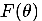 (№ 152\)159 — инвариантный к параметризации фундамент алгоритмов второго порядка K-FAC, Shampoo, SOAP и доверительных областей PPO160. В том же году вышли классические монографии Ричарда Саттона и Эндрю Барто по обучению с подкреплением (№ 153\)152 и Владимира Вапника *«Statistical Learning Theory»* (№ 154\)99.

## **1999**

**Домены:** Петли Память Базис  
В непрерывных потоках без маркеров сброса линейная ячейка памяти 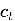 оригинальной LSTM 1997 года неограниченно насыщалась. Феликс Герс, Юрген Шмидхубер и Фред Камминс решили эту проблему на конференции ICANN 1999 (№ 155\)155, введя мультипликативный **вентиль забывания (Forget Gate)** , позволивший ячейке динамически стирать устаревшее состояние. Примечательно, что переход от линейного DeltaNet к **Gated DeltaNet** и **KDA** в 2024–2025 годах воспроизвёл ту же самую математическую идею введения входно-зависимого множителя затухания  перед матричной памятью24. В том же году Дэниел Ли и Себастьян Сеунг опубликовали в *Nature* **неотрицательную матричную факторизацию (NMF)** (№ 156), показав, что запрет взаимного вычитания признаков при 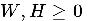 выделяет интерпретируемые аддитивные компоненты (принцип, перенесённый в 2025 году в неотрицательные проекции  архитектуры DeepSeek **mHC**2), а Нин Цянь дал точный спектральный анализ импульса в градиентном спуске (№ 157).

## **2000**

**Домены:** Петли Память Базис  
В 2000 году Герс, Шмидхубер и Камминс опубликовали полную журнальную версию **LSTM с вентилем забывания** в *Neural Computation* (№ 158\) и дополнили её **«глазковыми» связями (Peephole Connections)** от состояния ячейки  непосредственно к вентилям для точного счёта интервалов времени (№ 159):  
  
На конференции NIPS 2000 Шарль Дюга, Йошуа Бенджио и соавторы ввели гладкую строго положительную функцию активации **Softplus** 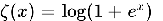 (№ 160\)161, первообразную логистической сигмоиды, которая в современных SSM (Mamba-1/2/3) и дельта-сетях является стандартным параметризатором шага дискретизации 24. Одновременно в журнале *Science* вышли геометрические алгоритмы нелинейного распрямления многообразий данных **Isomap** Тененбаума и др. (№ 161\) и **LLE** Роуиса и Сола (№ 162).

## **2001**

**Домены:** Петли Энкодер Базис  
В 2001 году Герберт Йегер представил концепцию резервуарных вычислений в отчёте по **сетям эхо-состояний (Echo State Networks, ESN)** (№ 163): большой фиксированный рекуррентный резервуар со спектральным радиусом  нелинейно проецирует входную историю в высокоразмерное состояние , над которым линейной регрессией обучается только выходная матрица считывания без BPTT. На конференции ICML 2001 Джон Лафферти, Эндрю Маккаллум и Фернандо Перейра ввели **условные случайные поля (Conditional Random Fields, CRF)** (№ 164), глобально нормирующие вероятности всей выходной последовательности  и устранившие смещение локально нормированных марковских моделей. В том же году вышло первое издание фундаментальной статистической монографии Хасти, Тибширани и Фридмана *«The Elements of Statistical Learning»* (№ 165).

## **2002**

**Домены:** Диффузия Базис Петли  
В 2002 году Джеффри Хинтон опубликовал в *Neural Computation* алгоритм **контрастивной дивергенции (\-step Contrastive Divergence, CD\-)** (№ 166\)142, радикально ускоривший обучение энергетических моделей и RBM: вместо длительного сведения цепи Маркова к равновесной моделируемой плотности отрицательная фаза градиента аппроксимируется всего за  шаг сэмплирования Гиббса, стартующий из реального вектора данных. Вольфганг Маасс, Томас Натшлегер и Генри Маркрам представили импульсный аналог резервуарных сетей — **машины жидких состояний (LSM)** (№ 167); Майкл Коллинз на EMNLP обобщил перцептрон и теорему Новикова на задачи структурного предсказания последовательностей с декодированием Витерби (№ 168); а Ронан Коллобер, Сами Бенджио и Джонни Мариэтаз выпустили открытую модульную C++ библиотеку **Torch** (№ 169), ставшую прародителем современного PyTorch.

## **2003**

**Домены:** Базис Внимание/LLM Энкодер  
В 2003 году Йошуа Бенджио, Режан Дюшарм, Паскаль Венсан и Кристиан Жовен опубликовали в *JMLR* статью *«A Neural Probabilistic Language Model»* (№ 170), заменившую дискретные счётчики \-грамм обучаемой матрицей **плотных векторных эмбеддингов слов** 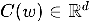 и гладким перцептроном над конкатенированным окном предшествующих токенов :  
  
Совместное обучение эмбеддингов и скрытого слоя перенесло вероятностную массу на семантически близкие комбинации слов, никогда не встречавшиеся в корпусе буквально, открыв прямую дорогу современным LLM. В том же году Патрис Симар, Дэйв Стейнкраус и Джон Платт ввели упругие деформации данных и стандартизировали простые свёрточные практики на ICDAR (0.4% ошибки на MNIST, № 171), а Дэвид Маккей выпустил фундаментальный труд *«Information Theory, Inference, and Learning Algorithms»* (№ 172).

## **2004**

**Домены:** Оптимизация Базис  
В 2004 году Кён-Су О и Кичхоль Чжун опубликовали в *Pattern Recognition* статью *«GPU Implementation of Neural Networks»* (№ 173), впервые переложив матричные умножения полносвязной нейросети на конвейер пиксельных шейдеров видеокарты (ATI Radeon 9700 Pro) с **20× ускорением** относительно центрального процессора7. На конференции ICML 2004 Эндрю Ын строго доказал, что при наличии экспоненциального числа шумовых признаков выборочная сложность \-регуляризации растёт лишь логарифмически , тогда как у ротационно-инвариантных методов с \-штрафом — линейно  (№ 174). На NIPS Макс Веллинг, Михаль Розен-Цви и Джеффри Хинтон распространили архитектуру RBM на непрерывные распределения экспоненциального семейства (**Exponential Family Harmoniums**, № 175\)162.

## **2005**

**Домены:** Диффузия STT Энкодер Базис  
В 2005 году Аапо Хювяринен опубликовал в *JMLR* метод **согласования функции счёта (Score Matching)** (№ 176\)161, позволивший обучать ненормированные энергетические плотности 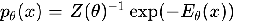 без вычисления статсуммы  путём минимизации расхождения градиентов логарифма плотности по вектору данных  (с исключением неизвестного  интегрированием по частям):  
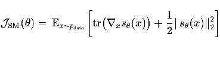  
В том же году Алекс Грейвс и Юрген Шмидхубер объединили вентильную LSTM с двунаправленной развёрткой во времени (**BiLSTM**) и полным обратным распространением по вентилям для фонемной классификации речи (№ 177); Сумит Чопра, Рая Хадселл и Ян Лекун ввели на CVPR метрическую функцию потерь **Contrastive Loss** (№ 178); Марко Гори, Габриэле Монфардини и Франко Скарселли предложили первую формулировку **графовых нейронных сетей (GNN)** (№ 179); а Фредерик Морен и Йошуа Бенджио ускорили выходной слой языковых моделей с  до  при помощи **иерархического Softmax** по бинарному дереву слов (№ 180).

## **2006**

**Домены:** STT Базис Энкодер  
На конференции ICML 2006 Алекс Грейвс, Сантьяго Фернандес, Фаустино Гомес и Юрген Шмидхубер представили механизм **Connectionist Temporal Classification (CTC)** (№ 181), освободивший распознавание речи и рукописного текста от необходимости покадровой разметки фонем. Расширив алфавит пустым символом  (blank) и введя оператор схлопывания повторов и пустот , CTC вычисляет точную вероятность целевой транскрипции  суммированием по всем допустимым путям выравнивания длины  методом динамического программирования прямого-обратного хода за :  
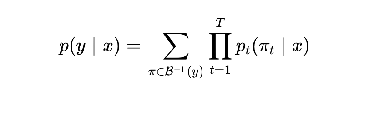  
Одновременно Джеффри Хинтон, Саймон Осиндеро и Йи-Уай Те опубликовали послойное предобучение **глубоких сетей доверия (Deep Belief Nets)** из стека RBM (№ 182\)142, а Хинтон и Руслан Салахутдинов в журнале *Science* продемонстрировали нелинейное сжатие данных глубокими автоэнкодерами с дообучением обратным распространением (№ 183), вернув глубокие сети в центр внимания науки. Завершили год фундаментальный обзор энергетических моделей Яна Лекуна и соавторов (№ 184\) и классический учебник Кристофера Бишопа *«Pattern Recognition and Machine Learning»* (№ 185\)164.

## **2007**

**Домены:** Базис Оптимизация Энкодер  
В 2007 году Йошуа Бенджио, Паскаль Ламблин, Дэн Поповичи и Хьюго Ларошель показали на NIPS (*«Greedy Layer-Wise Training of Deep Networks»*, № 186\)163, что жадное послойное предобучение детерминированных автоэнкодеров инициализирует глубокие сети столь же успешно, как и стохастические RBM. На той же конференции Леон Ботту и Оливье Буске опубликовали работу *«The Tradeoffs of Large Scale Learning»* (№ 187), доказав, что при фиксированном бюджете вычислительного времени в режиме больших выборок простой стохастический градиентный спуск первого порядка (SGD) минимизирует ожидаемый обобщающий риск асимптотически эффективнее тяжёлых оптимизаторов второго порядка. Андрей Мних и Джеффри Хинтон ввели **Log-Bilinear Language Model** (№ 188), а Руслан Салахутдинов, Андрей Мних и Джеффри Хинтон применили RBM к матричной фильтрации рекомендаций на Netflix Prize (№ 189).

## **2008**

**Домены:** Энкодер Диффузия Внимание/LLM  
На конференции ICML 2008 Паскаль Венсан, Хьюго Ларошель, Йошуа Бенджио и Пьер-Антуан Манзаголь представили **шумоподавляющие автоэнкодеры (Denoising Autoencoders, DAE)** (№ 190\)161: входной вектор намеренно искажается случайным занулением компонент (маскированием) или гауссовым шумом , а сеть обучается проецировать зашумлённую точку обратно на многообразие чистых данных 165. Эта простая замена тождественной реконструкции на шумоподавление стала прямым концептуальным мостом как к масочному языковому моделированию (BERT, LLaDA), так и к диффузионному согласованию счёта. На той же ICML Ронан Коллобер и Джейсон Вестон обучили единую свёрточную архитектуру с предобученными на Википедии эмбеддингами слов для совместного решения шести задач NLP без ручной инженерии признаков (№ 191), а Лоуренс ван дер Маатен и Джеффри Хинтон в *JMLR* ввели алгоритм визуализации многообразий **t-SNE** (№ 192).

## **2009**

**Домены:** Энкодер Оптимизация Базис  
В 2009 году совпали три события, подготовившие масштабирование современного глубокого обучения. Цзя Дэн, ఫэй-Фэй Ли и соавторы представили на CVPR иерархический корпус **ImageNet** (более 14 млн размеченных изображений, № 193\)167; Раджат Райна, Ананд Мадхаван и Эндрю Ын на ICML обучили глубокие сети из 100 млн параметров на программируемых ядрах **CUDA GPU** с **70× ускорением** над многоядерными CPU (№ 194); а Йошуа Бенджио, Жером Лурадур, Ронан Коллобер и Джейсон Вестон формализовали **обучение по учебному плану (Curriculum Learning)** (№ 195\) — постепенное повышение сложности и длины обучающих примеров, ставшее обязательным этапом прогрессивного обучения длинному контексту и высокому разрешению во всех современных LLM и видеогенераторах59. В том же году Салахутдинов и Хинтон создали **глубокие машины Больцмана (DBM)** с двунаправленными межслойными связями (№ 196), а Франко Скарселли и др. закрепили математическую сходимость графовых сетей **GNN** в *IEEE TNN* (№ 197).

## **2010**

**Домены:** Базис Оптимизация Петли  
В 2010 году были сняты главные препятствия для обучения глубоких сетей прямого распространения с нуля без послойного предобучения. Ксавье Глоро и Йошуа Бенджио на конференции AISTATS (№ 198\) показали, что для одновременного сохранения дисперсии сигнала в прямом проходе и дисперсии градиентов в обратном проходе веса слоя должны инициализироваться с дисперсией **Глорота (Xavier Initialization)**:  
  
На конференции ICML 2010 Винод Наир и Джеффри Хинтон опубликовали работу *«Rectified Linear Units Improve Restricted Boltzmann Machines»* (№ 199), введя в широкую практику кусочно-линейную активацию **ReLU**  с единичной производной на положительной полуоси. В том же году Томаш Миколов и соавторы представили на Interspeech **рекуррентную языковую модель (RNNLM)** для распознавания речи (№ 200), Майкл Гутманн и Аапо Хювяринен вывели **шумоконтрастивное оценивание (NCE)** (№ 201), Джеймс Мартенс обучил глубокие сети без предобучения методом второго порядка **Hessian-Free** (№ 202), и вышел символьно-тензорный компилятор автодифференцирования на GPU **Theano** Джеймса Бергстры и группы Бенджио (№ 203).

## **2011**

**Домены:** Оптимизация Диффузия Базис STT  
В 2011 году Джон Дучи, Элад Хазан и Йорам Сингер опубликовали в *JMLR* адаптивный оптимизатор **AdaGrad** (№ 204\)168, нормирующий шаг каждой координаты корнем из накопленной суммы квадратов её прошлых градиентов , что положило начало всему семейству адаптивных методов оптимизации глубоких сетей.  
Летом 2011 года Паскаль Венсан опубликовал в *Neural Computation* фундаментальную теоретическую статью *«A Connection Between Score Matching and Denoising Autoencoders»* (**Denoising Score Matching, DSM**, № 205\)161. Венсан строго доказал, что обучение автоэнкодера подавлять гауссов шум  эквивалентно оценке функции счёта парзеновской сглаженной плотности 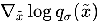 *без вычисления вторых производных якобиана*166:  
  
Учитывая, что , эта формула является прямым математическим ядром всех непрерывных диффузионных моделей (NCSN, DDPM, Score SDE)142. В том же году Глоро, Бордес и Бенджио обосновали разреженность глубоких сетей на ReLU (№ 206), Макс Веллинг и Йи-Уай Те соединили стохастический градиент с динамикой Ланжевена в **SGLD** (№ 207), Франк Зайде, Ган Ли и Дун Юй совершили прорыв в промышленном распознавании разговорной речи с гибридом **CD-DNN-HMM** (№ 208), а Коллобер и др. выпустили итоговую статью *«Natural Language Processing (Almost) from Scratch»* в *JMLR* (№ 209).

## **2012**

**Домены:** Энкодер STT Оптимизация Петли  
В декабре 2012 года Алекс Крижевский, Илья Суцкевер и Джеффри Хинтон представили на NIPS восьмислойную свёрточную сеть **AlexNet** (№ 210\)96, снизившую ошибку Top-5 на ImageNet ILSVRC-2012 с 26.2% до **15.3%** (Top-1 точность 63.3%). Успех AlexNet объединил 60 млн параметров, нелинейность **ReLU** (ускорившую сходимость в 6× по сравнению с ), стохастическое отключение нейронов **Dropout** для подавления коадаптации признаков (Хинтон и др., 2012, № 212\) и модельно-параллельное обучение на двух видеокартах NVIDIA GTX 580167.  
Одновременно в ноябре 2012 года Алекс Грейвс опубликовал архитектуру **RNN-Transducer (RNN-T)** (№ 211), снявшую предположение условной независимости выходов CTC за счёт объединения акустического энкодера  и авторегрессионной сети предсказания текста  в совместной сети **Joiner**  с маргинализацией по двумерной решётке  — стандарт всех потоковых систем распознавания речи вплоть до современных TDT170. В том же году появились скользящее среднеквадратичное масштабирование шага **RMSProp** Хинтона и безразмерный метод **Adadelta** Мэттью Зайлера (№ 213), распределённый кластерный фреймворк **DistBelief** Джеффа Дина и др. (№ 214), ансамбли GPU-CNN Дана Чирешана, Ули Майера и Юргена Шмидхубера с первой сверхчеловеческой точностью на распознавании знаков (№ 215\)155 и доказательство эффективности случайного поиска гиперпараметров Бергстры и Бенджио (№ 216).

## **2013**

**Домены:** Энкодер Диффузия Базис Оптимизация  
В декабре 2013 года Дидерик Кингма и Макс Веллинг опубликовали **Variational Autoencoder (VAE)** (*«Auto-Encoding Variational Bayes»*, № 217; независимо Данило Резенде, Шакир Мохамед и Даан Вирстра, № 218), максимизирующий вариационную нижнюю границу правдоподобия (**ELBO**):  
  
Введённый авторами **трюк репараметризации**  вынес случайность во внешний шум и позволил обучать произвольные глубокие вероятностные энкодеры обычным обратным распространением ошибки; именно сжатые пространства VAE сегодня образуют латентный субстрат всех флагманских генераторов изображений, видео и длинной речи74.  
Параллельно Томаш Миколов и соавторы в Google представили контрастивные архитектуры **Word2Vec** (Skip-Gram и CBOW с отрицательным сэмплированием, № 219), масштабировавшие обучение векторных представлений слов на миллиардные корпуса с линейной семантической структурой. Минь Линь, Цян Чэнь и Шуйчэн Янь ввели поточечные свёртки 1×1 и глобальный усредняющий пулинг в **Network in Network** (№ 220), Иэн Гудфеллоу и др. предложили активацию **Maxout** (№ 221), Владимир Мних и команда DeepMind соединили свёрточную сеть с Q-обучением и буфером опыта в **DQN** на играх Atari (№ 222), Эндрю Сакс, Джеймс Макклелланд и Сурья Гангули доказали сохранение сингулярных чисел якобиана при **ортогональной инициализации** глубоких сетей (№ 223\)175, а Ричард Джонсон и Тонг Чжан ввели редукцию дисперсии градиента **SVRG** (№ 224).

## **2014**

**Домены:** Внимание/LLM Петли Диффузия Энкодер Оптимизация  
В 2014 году родились мягкое дифференцируемое внимание, генеративно-состязательные сети и главный оптимизатор современного глубокого обучения. Вслед за моделью **Seq2Seq** Ильи Суцкевера, Ориола Виньялса и Куока Ле (№ 225), сжимавшей входную фразу в один фиксированный вектор LSTM, Дмитрий Бахданау, Кёнхён Чо и Йошуа Бенджио (*«Neural Machine Translation by Jointly Learning to Align and Translate»*, № 226\) устранили информационное узкое горлышко фиксированного вектора, позволив декодеру на каждом шаге  динамически взвешивать все скрытые состояния энкодера  (**аддитивное внимание**):  
  
В том же году Кёнхён Чо и др. упростили вентильную рекуррентную ячейку до двух вентилей в **GRU** (, № 227), а Алекс Грейвс, Грег Уэйн и Иво Данилевски снабдили нейросеть дифференцируемой внешней матричной памятью в **Neural Turing Machine (NTM)** (№ 228). На NIPS 2014 Иэн Гудфеллоу и соавторы сформулировали минимаксную игру генератора и дискриминатора **GAN** (, № 229), а в декабре Дидерик Кингма и Джимми Ба опубликовали оптимизатор **Adam** (№ 230), объединивший экспоненциальные скользящие оценки первого и второго моментов градиента с коррекцией смещения нуля. В компьютерном зрении и эмбеддингах вышли каскады узких ядер 3×3 **VGG** Симоняна и Зиссермана (№ 231\)176, многомасштабные блоки **GoogLeNet / Inception** Сегеди и др. (№ 232), матричная факторизация совстречаемости слов **GloVe** Пеннингтона и др. (№ 233), работа Гудфеллоу и др. о линейной природе **состязательных возмущений (FGSM)** (№ 234\) и библиотека **Caffe** Ян Цзя (№ 235).

## **2015**

**Домены:** Базис Диффузия Энкодер Оптимизация STT  
В 2015 году был преодолён барьер деградации глубины сетей и одновременно сформулирована термодинамическая диффузия. Развивая вентильные магистрали **Highway Networks** Рупеша Сриваставы, Клауса Греффа и Юргена Шмидхубера (, № 236\)7, Каймин Хэ, Сянъюй Чжан, Шаоцин Жэнь и Цзянь Сунь упростили проброс сигнала до чистого тождественного сложения в **ResNet-152** (№ 237; совместно с инициализацией **Kaiming Init**  для ReLU, № 238\)61:  
  
Аддитивная единица  в якобиане обеспечила беззатухающий поток градиента сквозь сотни слоёв и принесла победу на ILSVRC-2015 с ошибкой ансамбля 3.57%34.  
В том же году Сергей Иоффе и Кристиан Сегеди ввели **Batch Normalization** (№ 239\)178; Олаф Роннебергер, Филипп Фишер и Томас Брокс создали симметричную свёрточную архитектуру энкодер–декодер с пробросом пространственных карт признаков **U-Net** (№ 240\)179; а Яша Соль-Дикштейн, Эрик Вайс, Ниру Махесваран и Сурья Гангули на ICML 2015 опубликовали пионерскую статью *«Deep Unsupervised Learning using Nonequilibrium Thermodynamics»* (№ 241), введя прямую марковскую цепь диффузионного зашумления  и обучаемую обратную цепочку генеративного восстановления . Год дополнили температурная **дистилляция знаний** Хинтона, Виньялса и Дина (№ 242), аппроксимация Фишера **K-FAC** Мартенса и Гросса (№ 243), скалярное внимание Луонга (№ 244), сквозные речевые архитектуры **LAS** Чана и др. (№ 245\) и **DeepSpeech 2** Амодеи и др. (№ 246), субсловная сегментация **BPE** Зеннриха и др. (№ 247\) и открытый релиз фреймворка **TensorFlow** (№ 248).

## **2016**

**Домены:** TTS Петли Базис Оптимизация Энкодер  
В 2016 году оформились механизмы по-токенной нормализации, адаптивных рекуррентных петель и авторегрессионного синтеза звука. Джимми Ба, Джейми Кирос и Джеффри Хинтон предложили **Layer Normalization (LayerNorm)** (№ 249), нормирующую вектор признаков каждого отдельного токена независимо от размера батча, а Каймин Хэ и др. доказали, что перенос нормализации внутрь остаточной ветви (**Pre-LN ResNet**: , № 250\) сохраняет чистую тождественную магистраль на глубине свыше 1000 слоёв61. Алекс Грейвс ввёл механизм **Adaptive Computation Time (ACT)** (№ 251\)41, позволяющий сети выполнять переменное обучаемое число внутренних итераций над каждым токеном под управлением сигмоидного вентиля остановки (ponder cost) — прямой фундамент адаптивной глубины в Universal Transformer, Ouro и Huginn41. Дэн Хендрикс и Кевин Гимпел предложили гладкую вероятностную нелинейность **GELU**  (№ 252).  
В синтезе речи Аарон ван ден Оорд и команда DeepMind представили **WaveNet** (№ 253\) — стек каузальных дилатационных 1D-свёрток с экспоненциальным ростом дилатации 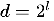 и вентильными нелинейностями , впервые приблизивший синтез волны к естественному голосу. В том же году Лоран Динь, Яша Соль-Дикштейн и Сами Бенджио создали обратимые нормализующие потоки **RealNVP** (№ 254); Эрик Джан и др. вывели дифференцируемую категориальную релаксацию **Gumbel-Softmax** (№ 255\)54; Томас Кипф и Макс Веллинг формализовали спектральные **графовые свёрточные сети (GCN)** (№ 256); Гао Хуан и др. представили **DenseNet** (№ 257\)180; Илья Лощилов и Франк Хаттер ввели косинусное расписание скорости обучения **SGDR / Cosine Annealing** (№ 258); и вышел классический учебник Гудфеллоу, Бенджио и Курвилля *«Deep Learning»* (MIT Press, № 259\)8.

## **2017**

**Домены:** Внимание/LLM MoE TTS Энкодер Оптимизация  
В июне 2017 года Эшиш Васвани, Ноам Шазир, Ники Пармар, Якоб Ушкорейт, Ллион Джонс, Эйдан Гомес, Лукаш Кайзер и Илья Полосухин опубликовали статью *«Attention Is All You Need»* (№ 260\)182, заменив рекуррентные цепи и свёртки архитектурой **Transformer** на базе масштабированного скалярного многоголового самовнимания (**Multi-Head Attention, MHA**):  
  
Множитель  стабилизирует дисперсию логитов перед softmax, длина пути передачи сигнала между любыми двумя позициями последовательности сокращается до , а полный параллелизм по всем  токенам на этапе обучения идеально ложится на тензорные умножения GPU ценой квадратичной сложности .  
В том же 2017 году вышли ещё пять работ, сформировавших облик современных мультимодальных и разреженных систем. Ноам Шазир и соавторы на ICLR представили **Sparsely-Gated Mixture-of-Experts** (№ 261\)184, масштабировав языковую модель до 137 млрд параметров при помощи разреженной маршрутизации  со вспомогательным балансировочным штрафом нагрузки экспертов. Аарон ван ден Оорд, Ориол Виньялс и Корай Кавукчуоглу создали **VQ-VAE** (№ 262), введя векторное квантование латентного пространства в дискретный кодбук со сквозной оценкой градиента Straight-Through Estimator — базовый механизм всех современных нейронных аудиокодеков. Юань Ван и др. (**Tacotron**, № 263\) и Джонатан Шен и др. (**Tacotron 2**, № 264\) построили сквозной синтез речи «текст  мел-спектрограмма  нейровокодер». В оптимизации Илья Лощилов и Франк Хаттер отделили затухание весов от адаптивного второго момента в **AdamW** (, № 265), Джон Шульман и др. создали клиппированный суррогатный градиент политики **PPO** (№ 266\)158, а Мартин Аржовски, Сумит Чинтала и Леон Ботту стабилизировали состязательные сети метрикой Вассерштейна **WGAN** (№ 267). Архитектурный арсенал пополнили глубинно-разделимые свёртки **MobileNets** Ховарда и др. (№ 268), канальное внимание **SENet** Ху и др. (№ 269), активация **Swish / SiLU**  Рамачандрана и др. (№ 270\) и графовое внимание **GAT** Величковича и др. (№ 271).

## **2018**

**Домены:** Энкодер Внимание/LLM Петли TTS Оптимизация  
В 2018 году предобучение трансформеров на больших неразмеченных корпусах разделилось на две комплементарные ветви. Вслед за контекстными представлениями BiLSTM **ELMo** Мэттью Питерса и др. (№ 272), Алек Рэдфорд и соавторы в OpenAI представили авторегрессионный каузальный декодер **GPT-1** (№ 273), а Джейкоб Девлин, Мин-Вэй Чан, Кентон Ли и Кристина Тутанова в Google создали глубокий двунаправленный энкодер **BERT** (№ 274\)186, обучаемый восстановлению 15% случайно замаскированных токенов (**Masked Language Modeling, MLM**) по полному левому и правому контексту.  
Одновременно Мостафа Дехгани и соавторы ввели **Universal Transformer** (№ 275\)187 — первый петлевой трансформер с разделением весов по глубине и по-токенной остановкой ACT, доказав его вычислительную универсальность при переменной глубине и заложив прямую основу современных моделей Huginn и Ouro. Рики Чэнь, Юлия Рубанова, Джесси Беттенкур и Дэвид Дювено перешли к непрерывному пределу остаточной сети  в **Neural ODE** с обучением методом сопряжённых уравнений за  памяти по глубине (№ 276\)190. В том же году Аарон ван ден Оорд, Ячжэ Ли и Ориол Виньялс сформулировали контрастивный функционал **InfoNCE** в рамках **CPC** (№ 277\)191; Кингма и Дхаривал создали обратимый генератор **Glow** (№ 278), адаптированный Райаном Пренгером и др. в быстрый потоковый вокодер речи **WaveGlow** (№ 279); Иусюань У и Каймин Хэ ввели **GroupNorm** (№ 280); в оптимизации появились низкоранговый **Adafactor** Шазира и Стерна (№ 281\)192 и матричный предобусловливатель кривизны **Shampoo** Гупты, Корена и Сингера (№ 282\)160; Артур Жако и др. описали режим **нейронного касательного ядра (NTK)** (№ 283); а Таку Кудо и Джон Ричардсон выпустили токенизатор **SentencePiece** (№ 284\)73.

## **2019**

**Домены:** Внимание/LLM Петли TTS Диффузия Оптимизация  
В 2019 году оформился инженерный каркас современного декодера LLM и инфраструктуры его распределённого обучения. Алек Рэдфорд и соавторы в **GPT-2** (1.5B параметров, № 285\)1 утвердили схему **Pre-LN** и zero-shot выполнение задач языковым продолжением. Бяо Чжан и Рико Зеннрих представили **RMSNorm** (№ 286\)28, отбросив центрирование среднего в LayerNorm и оставив только масштабно-инвариантную нормировку среднеквадратичной амплитудой:  
  
что ускорило нормализацию на GPU и стало стандартом практически всех открытых архитектур 2023–2026 годов196. В ноябре Ноам Шазир опубликовал **Multi-Query Attention (MQA)** (№ 287\)49, указав на ограничение авторегрессионного декодирования полосой пропускания памяти HBM при чтении KV-кэша и предложив общие проекции  для всех голов запросов.  
В петлевых и длинноконтекстных моделях Шаоцзе Бай, Зико Колтер и Владан Колтун создали **Deep Equilibrium Models (DEQ)** (№ 288), находящие неподвижную точку петли  численным решателем корней и дифференцирующие её аналитически через теорему о неявной функции за  памяти; Чжэньчжун Лань и др. применили сквозное разделение весов слоёв в **ALBERT** (№ 289\)189; Колин Раффел и др. ввели табличное относительное смещение внимания в **T5** (№ 290\)72; а Цзыхан Дай и др. объединили сегментную рекурсию с относительными позициями в **Transformer-XL** (№ 291\)190. В синтезе речи И Жэнь и др. создали неавторегрессионный трансформер **FastSpeech** с явным регулятором длительности фонем (**Length Regulator**, № 292), ускорив генерацию мел-спектрограмм на два порядка без потери устойчивости. Ян Сун и Стефано Эрмон возродили генеративное моделирование по счёту на мультимасштабной сетке шумов в **NCSN** (№ 293). Завершили год составное масштабирование CNN **EfficientNet** Таня и Ле (№ 294\)178, самоконтролируемый аудиоэнкодер **wav2vec** Шнайдера и др. (№ 295), внутрислойный тензорный параллелизм **Megatron-LM** от NVIDIA (№ 296\)198, шардирование состояний оптимизатора и весов **ZeRO** от Microsoft DeepSpeed (№ 297\)73 и эталонная статья Адама Пашке и др. по **PyTorch** (№ 298).

## **2020**

**Домены:** Внимание/LLM Диффузия Энкодер STT TTS Петли/SSM  
В 2020 году одновременно трансформировались языковые модели, диффузионная генерация, компьютерное зрение и речевые технологии. Джаред Каплан и соавторы установили степенные **законы масштабирования (Scaling Laws)** языкового лосса от числа параметров, данных и бюджета FLOPs 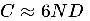 (№ 299\)4, реализованные Томом Брауном и командой OpenAI в 175-миллиардной **GPT-3** с эмерджентным обучением в контексте (№ 300). Ноам Шазир ввёл вентильное семейство полносвязных блоков **SwiGLU** 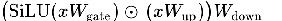 (№ 301\)199, заменившее обычный двухслойный MLP в современных LLM, а Ангелос Катаропулос и др. факторизовали внимание через положительное ядро признаков  в **Linear Attention** (№ 302\)25, показав дуальность линейного трансформера и RNN с матричной памятью  сложности 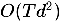.  
В генеративных моделях Джонатан Хо, Аджай Джайн и Питер Аббиль опубликовали **DDPM** (№ 303\)37, сведя вариационное обучение обратной цепи Маркова к предсказанию добавленного гауссова шума ; Цзямин Сун, Чэньлинь Мэн и Стефано Эрмон построили детерминированные немарковские траектории ускоренного сэмплинга **DDIM** (№ 304\)5; а Ян Сун и др. объединили диффузию и оценку счёта в непрерывные стохастические дифференциальные уравнения **Score SDE** и детерминированный поток вероятности **Probability Flow ODE** (№ 305\)5. В компьютерном зрении Алексей Досовицкий, Лукас Байер и др. представили чистый патч-трансформер **ViT** (разбиение картинки на патчи 16×16 без свёрток, 88.55% Top-1 на ImageNet у ViT-H/14, № 306\)73, наряду с прорывом контрастивного самообучения **SimCLR** (№ 311\)202, **MoCo** (№ 312\) и безнегативного **BYOL** (№ 313).  
В аудиообработке вышли три базовых компонента современного речевого стека: свёрточно-трансформерный гибрид **Conformer** Анмола Гулати и др. (Macaron-FFN \+ MHSA \+ DepthwiseConv, достигший **1.9% / 3.9% WER** на LibriSpeech test-clean / test-other, № 307\)203, самоконтролируемый квантующий энкодер сырой волны **wav2vec 2.0** Алексея Баевского и др. (№ 308\)191 и многопериодный генеративно-состязательный вокодер **HiFi-GAN** Чонила Кона и др. (№ 309\)206. Наконец, Альберт Гу, Три Дао и соавторы вывели операторы ортогональной полиномиальной проекции непрерывной истории сигнала **HiPPO** (№ 310\)62 (теоретическая база S4 и Mamba), Патрик Льюис и др. создали архитектуру **RAG** (№ 314), а Дмитрий Лепихин и др. масштабировали MoE до 600B параметров в системе **GShard** (№ 315\)27.

## **2021**

**Домены:** Внимание/LLM MoE Энкодер Петли/SSM TTS Диффузия Оптимизация  
В 2021 году сформировались стандарты относительного позиционного кодирования, низкоранговой адаптации, структурированных пространств состояний и латентной диффузии. Цзяньлинь Су и соавторы ввели в **RoFormer** **поворотное позиционное кодирование (RoPE)** (№ 316\)72, умножая пары координат запросов и ключей на ортогональные матрицы вращения в комплексной плоскости с геометрическим спектром частот :  
  
Офир Пресс и др. предложили линейные позиционные штрафы внимания **ALiBi** (№ 317); Уильям Федус, Баррет Зоф и Ноам Шазир упростили MoE до маршрутизации **Top-1** в 1.6-триллионном **Switch Transformer** (№ 318); а Эдвард Ху и др. создали метод **LoRA** (№ 319\)210, замораживающий предобученные матрицы 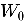 и обучающий только низкоранговую добавку  ранга  без задержки на инференсе.  
В мультимодальных и визуальных энкодерах Алек Рэдфорд и др. выровняли пространства изображений и текстов на 400 млн пар в **CLIP** (№ 320\)212, Каймин Хэ и др. создали асимметричный масочный автоэнкодер патчей **MAE** (маскирование 75% патчей, № 321), Матильда Карон и др. открыли самодистилляцию визуальных трансформеров без меток **DINO** (№ 322\)213, а Цзэ Лю и др. ввели иерархические сдвинутые окна в **Swin Transformer** (№ 323). В моделировании длинных последовательностей Альберт Гу, Каран Гоэл и Кристофер Ре опубликовали **S4 (Structured State Spaces)** (№ 324\)62: разложив матрицу HiPPO в сумму нормальной и низкоранговой (**NPLR**: ), они свели вычисление свёрточного ядра длины  к ядру Коши и FFT за 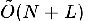, впервые решив задачу Path-X длины 16,384 на Long Range Arena (средний балл 86.09)216; параллельно Иманол Шлаг, Казуки Ири и Юрген Шмидхубер на ICML 2021 ввели дельта-правило перезаписи в линейные трансформеры (**Fast Weight Programmers**, № 325\)157, ставшее прямым теоретическим источником DeltaNet.  
В речевом и генеративном доменах Джэхён Ким, Чонил Кон и Джухи Сон объединили вариационный вывод, нормализующие потоки и состязательный синтез волны в **VITS** (№ 326\)217; Нил Зегидур и др. создали первый сквозной нейронный аудиокодек с **остаточным векторным квантованием (RVQ)** **SoundStream** (№ 327\)47; Вэй-Нин Сюй и др. представили масочный речевой энкодер **HuBERT** (№ 328\)191; Прафулла Дхаривал и Алекс Никол доказали превосходство диффузии над GAN по качеству изображений в **ADM** (№ 329\)219; Джейкоб Остин и др. формализовали дискретную диффузию с поглощающим токеном \[MASK\] в **D3PM** (№ 330\)35; а в декабре Робин Ромбах, Андреас Блаттманн, Доминик Лоренц, Патрик Эссер и Бьёрн Оммер перенесли диффузию в сжатое пространство перцептивного автоэнкодера с текстовым cross-attention в **Latent Diffusion Models (LDM / Stable Diffusion)** (№ 331\)179.

## **2022**

**Домены:** Внимание/LLM Оптимизация Диффузия STT TTS  
В 2022 году аппаратно-осведомлённые алгоритмы памяти, законы вычислительно-оптимального масштабирования и прямолинейные ОДУ-потоки изменили экономику больших моделей. Три Дао, Дэниел Фу, Стефано Эрмон, Атри Рудра и Кристофер Ре опубликовали **FlashAttention** (№ 332\)199: разбив матрицы 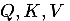 на блоки в быстрой накристальной памяти GPU **SRAM** и применив точное поблочное перемасштабирование **онлайн-softmax** (восходящее к Милакову и Гимельшейну, № 333):  
  
авторы вычислили математически точное внимание без записи матрицы  в глобальную память HBM, снизив потребление памяти до 223. Джордан Хоффманн и др. в работе **Chinchilla** (№ 334\)224 показали, что при фиксированном бюджете FLOPs оптимальный режим обучения требует пропорционального масштабирования числа параметров и обучающих токенов (), а Грег Янг, Эдвард Ху и др. вывели параметризацию **P** для zero-shot переноса гиперпараметров с малых моделей на гигантские запуски (№ 335).  
В генеративном моделировании Джонатан Хо и Тим Салиманс ввели **бесклассификаторное наведение (CFG)** (№ 336), Тэро Каррас и др. систематизировали предобусловливание шума и сэмплеры второго порядка в **EDM** (№ 337\)37, а осенью 2022 года Синчао Лю, Чэнъюэ Гун и Цян Лю (**Rectified Flow**, № 338), Ярон Липман, Рики Чэнь и др. (**Flow Matching**, № 339\) и Майкл Альберго с Эриком Ванден-Эйнденом (**Stochastic Interpolants**, № 340\) перевели генерацию на обучение прямолинейных векторных полей скорости ОДУ  вдоль линейной интерполяции  с процедурой распрямления траекторий **Reflow**5. В декабре Уильям Пиблз и Сайнин Се заменили U-Net в латентной диффузии на масштабируемый трансформер с адаптивной нормализацией **adaLN-Zero** — **Diffusion Transformer (DiT)** (FID 2.27 на ImageNet 256×256, № 341\)219. В аудио и постобучении вышли многоязычный ASR-трансформер **Whisper** Алека Рэдфорда и др. на 680,000 часов слабой разметки (№ 342\)229, открытый RVQ-кодек 24 кГц **EnCodec** Александра Дефоссе и др. (№ 343\)231, трёхэтапное выравнивание по предпочтениям людей **InstructGPT (RLHF)** Лонга Оуяна и др. (№ 344), промптинг цепочек рассуждений **Chain-of-Thought** Джейсона Вэя и др. (№ 345\) и блочно-квантованные 8-битные оптимизаторы Тима Деттмерса и др. (№ 346\)169.

## **2023**

**Домены:** Внимание/LLM MoE Петли/SSM Энкодер Видео STT TTS STS Оптимизация  
В 2023 году открытая экосистема LLM получила стандарт эффективного декодирования, а линейно-рекуррентные модели впервые бросили вызов трансформерам на языковых задачах. Джошуа Эйнсли и др. ввели **Grouped-Query Attention (GQA)** (№ 347\)39, разделив  групп ключей-значений между  головами запросов (внедрено в **Llama 2 70B** Туврона и др., № 348194); Вусук Квон и др. устранили фрагментацию видеопамяти KV-кэша страничным механизмом **PagedAttention** в движке **vLLM** (№ 349\)232; Три Дао оптимизировал варп-параллелизм во **FlashAttention-2** (№ 350\)198; Хао Лю, Матей Захария и Питер Аббиль создали распределённое по кольцу ускорителей внимание **Ring Attention** для миллионных контекстов (№ 351\)132; команда Mistral AI выпустила открытую разреженную смесь экспертов **Mixtral 8x7B** (Top-2 из 8, № 352\)234; а Рафаэль Рафайлов и др. вывели замкнутую форму выравнивания политики без модели наград — **Direct Preference Optimization (DPO)** (№ 353\)158:  
  
Одновременно развернулось наступление субквадратичных архитектур с константной памятью инференса : **RWKV-4** Бо Пэна и др. (№ 354\)236, многомасштабная сеть удержания **RetNet** Ютао Суня и др. (№ 355\)49 и в декабре — **Mamba (S6)** Альберта Гу и Три Дао (№ 356\)25. Сделав параметры пространства состояний  функциями текущего входного токена (**Selective SSM**) и реализовав аппаратно-осознанный параллельный ассоциативный сканер в SRAM, Mamba решила проблему контентно-зависимой фильтрации контекста при линейной сложности .  
В визуальном, текстово-диффузионном и речевом доменах вышли негенеративный латентный предиктор изображений **I-JEPA** Ассрана, Лекуна и др. (№ 357), безсофтмаксный попарный сигмоидный контрастивный энкодер **SigLIP** Чжая и др. (№ 358\)212, визуальный фундамент **DINOv2** Окаба и др. (№ 359\)176, видеогенератор **Stable Video Diffusion** Блаттманна и др. (№ 360), дискретная диффузия с оценкой отношений вероятностей **SEDD** Лу, Мэна и Эрмона (№ 361\)57, первая кодековая языковая модель zero-shot синтеза речи по 3-секундному образцу **VALL-E** Вана и др. (№ 362\)218, улучшенный аудиокодек **DAC** Кумара и др. (№ 363\)55, диалоговая речевая модель **SpeechGPT** Чжана и др. (№ 364\)240, ускоренный в 2.8× энкодер с 80-мс фреймом **FastConformer** Рекеша и др. (№ 365\)171, пропускающий пустые фреймы трансдьюсер **Token-and-Duration Transducer (TDT)** Сюя, Маджумдара и Гинзбурга (№ 366\)79, 4-битная адаптация **QLoRA** Деттмерса и др. (№ 367), расширение окна RoPE **YaRN** Пэна и др. (№ 368\)30 и учебник Саймона Принса *«Understanding Deep Learning»* (MIT Press, № 369\)8.

## **2024**

**Домены:** Внимание/LLM MoE Петли/SSM Диффузия Видео Энкодер STT TTS STS Оптимизация

### **Латентное внимание MLA, балансировка MoE без штрафов и квантованное предобучение**

В 2024 году серия работ лаборатории DeepSeek-AI пересмотрела архитектуру внимания и экспертной маршрутизации. В **DeepSeekMoE** (arXiv:2401.06066, № 370\)29 эксперты были раздроблены на мелкие специализированные подсети в сочетании с изолированными постоянно активными *общими экспертами*. В мае в **DeepSeek-V2** (arXiv:2405.04434, 236B общих / 21B активных параметров, № 371\)50 был введён механизм **Multi-Head Latent Attention (MLA)**:  
  
Благодаря поглощению матриц декомпрессии  в проекции запросов и выхода на этапе инференса в памяти хранится только сжатый вектор  из  элементов на слой вместо 32,768 у 128-голового MHA — сокращение KV-кэша на 98.24% в расчёте на слой (и на 93.3% на уровне всей модели V2 против плотной DeepSeek 67B)50. В декабре в **DeepSeek-V3** (arXiv:2412.19437, 671B общих / 37B активных параметров, 14.8T токенов, № 372\)29 были объединены **балансировка нагрузки экспертов без вспомогательного лосса** через динамическое смещение  при отборе Top\- (развивающая Loss-Free Balancing Вана и др., № 37327), каскадный модуль **Multi-Token Prediction (MTP)** (обоснованный ранее в апреле Фабианом Глёкле и др. из Meta, arXiv:2404.19737, № 37464), конвейер перекрытия коммуникаций **DualPipe** и стабильное обучение в точности **FP8** за 2.788 млн GPU-часов H800 (около \$5.576M по расчётной ставке \$2/ч без учёта предварительных исследовательских запусков и абляций; MMLU 88.5%, MATH-500 90.2%)29. Ещё в феврале Чжидун Шао и др. в **DeepSeekMath** (arXiv:2402.03300, № 375\)53 представили безкритиковый алгоритм RL **GRPO**. Параллельно Шумин Ма и др. показали жизнеспособность тернарных весов  в **BitNet b1.58** (arXiv:2402.17764, № 376\)51, а открытую линию плотных трансформеров возглавили **Llama 3.1 405B** (№ 377\)246 и **Qwen2.5** (№ 378\)247.

### **Дуальность SSM, Gated DeltaNet, TTT и оптимизаторы второго поколения**

На оси рекуррентных последовательностей Три Дао и Альберт Гу доказали в **Mamba-2** (arXiv:2405.21060, № 379\)32 строгую структурную дуальность (**SSD**) между селективными SSM со скалярным переходом  и полуразделимым линейным вниманием , переведя обучение SSM на матричные блоки Tensor Cores. Максимилиан Бек и Зепп Хохрайтер масштабировали LSTM с экспоненциальными вентилями и ковариационной матричной памятью **mLSTM** в **xLSTM** (arXiv:2405.04517, № 380\)183; Сунлинь Ян и др. распараллелили линейный трансформер с дельта-правилом через чанковое представление WY Хаусхолдера (**DeltaNet**, № 381248) и в декабре совместно с Яном Каутцем и Али Хатамизаде объединили дельта-правило с адаптивным затуханием Mamba-2 в **Gated DeltaNet** (arXiv:2412.06464, № 382\)157:  
  
В том же году вышли матрично-рекуррентные **RWKV-5/6 (Eagle & Finch)** Бо Пэна и др. (№ 383\)249, гибридный Mamba–Transformer–MoE **Jamba** Офера Либера и др. (№ 384\)184, многополосные остаточные потоки **Hyper-Connections (HC)** Дэфа Чжу и др. (arXiv:2409.19606, № 385\)61 и слои **Test-Time Training (TTT-Linear / TTT-MLP)** Юя Суня, Карана Далала и др. (arXiv:2407.04620, № 386\)44, превратившие само скрытое состояние в обучаемый на тестовом контексте двухслойный перцептрон. В аппаратной и численной оптимизации появились асинхронный **FlashAttention-3** для чипов Hopper H100 (740 TFLOPs/s в FP16, № 387\)252, предобусловливатель **SOAP** Никхила Вьяса, Шама Какаде и др. (arXiv:2409.11321, запуск AdamW в собственном базисе матриц Shampoo со снижением времени обучения больших батчей более чем на 35%, № 388\)168 и ортогонализующий матричный импульс **Muon** Келлера Джордана (№ 389\)65.

### **Мультимодальный DiT, видео-VAE, REPA и полнодуплексный диалог Moshi**

В генерации изображений и видео Патрик Эссер и др. в **Stable Diffusion 3** (arXiv:2403.03206, № 390\)174 и команда Black Forest Labs во **FLUX.1** (12B параметров, № 391\)174 закрепили двупоточную архитектуру **MMDiT** с Rectified Flow. На смену свёрточным видеомоделям пришли пространственно-временные 3D-DiT над каузальными 3D-VAE (сжатие 4×8×8): **CogVideoX** Чжои Яна и др. (№ 392\)255, **Mochi 1** (№ 393\)254, 13-миллиардный **HunyuanVideo** Вэйцзе Кона и др. с MLLM-кодированием промптов и 3D-RoPE (arXiv:2412.03603, № 394\)256 и сверхбыстрый **LTX-Video** от Lightricks со сжатием Video-VAE 1:192 (arXiv:2501.00103, № 395\)258. Сихён Ю и др. ускорили сходимость диффузионных трансформеров более чем в **17.5×** методом выравнивания скрытых патчей с признаками DINOv2 (**REPA**, arXiv:2410.06940, FID 1.42 на ImageNet 256×256, № 396\)36; Субхам Саху и др. вывели непрерывный предел масочной диффузии текста в **MDLM** (arXiv:2406.07524, № 397\)222; Адриен Бардес и др. представили видеоэнкодер предсказания признаков **V-JEPA** (arXiv:2404.08471, № 398\)60; а Бенджамин Уорнер и др. обновили двунаправленные текстово-кодовые энкодеры до окна 8,192 токенов в **ModernBERT** (arXiv:2412.13663, чередование глобального и скользящего внимания 1:2, RoPE, GeGLU, unpadding, № 399\)186.  
В речевом взаимодействии Александр Дефоссе и др. из лаборатории Kyutai выпустили **Moshi** и потоковый нейрокодек **Mimi** (arXiv:2410.00037, № 400\)26 — первую открытую полнодуплексную речевую LLM с теоретической задержкой **160 мс** (200 мс на практике против \~230 мс средней паузы в речи человека). Кодек Mimi сжимает волну 24 кГц до частоты **12.5 Гц** (шаг 80 мс) в 8 RVQ-кодбуков по 2,048 записей (**1.1 кбит/с**) с дистилляцией семантики WavLM в первый кодбук, а иерархия из 7B Temporal Transformer и малого Depth Transformer параллельно предсказывает текстовый «внутренний монолог» (Inner Monologue) и два аудиопотока без деления разговора на очереди26. Стек 2024 года дополнили неавторегрессионный энкодер **SenseVoice** (в 15× быстрее Whisper-Large) и синтезатор **CosyVoice** (FunAudioLLM, № 401\)263, потоковый **F5-TTS** (№ 402\)264, двухкаскадный **Fish-Speech** (№ 403\)265, а также новые базовые учебники Кристофера и Хью Бишопов *«Deep Learning: Foundations and Concepts»* (Springer, № 404\)266 и Себастьяна Рашки *«Build a Large Language Model (From Scratch)»* (Manning, № 405\)267.

## **2025**

**Домены:** Внимание/LLM MoE Петли/SSM Диффузия Видео Энкодер STT TTS STS Оптимизация

### **Верифицируемый RL рассуждений, разреженное внимание, mHC и триллионные модели на Muon**

В январе 2025 года публикация **DeepSeek-R1** (arXiv:2501.12948, в сентябре 2025 года вышедшая в журнале *Nature*, № 406\)50 показала на эксперименте **DeepSeek-R1-Zero**, что чистое масштабирование обучения с подкреплением **GRPO** по верифицируемым правилам без начального SFT спонтанно формирует длинные цепочки самопроверки и рефлексии, поднимая точность на AIME 2024 с 15.6% до 71.0%, а полная многостадийная **DeepSeek-R1** достигла **79.8% Pass@1 на AIME 2024** и **97.3% на MATH-500** с успешной дистилляцией рассуждений в плотные модели 1.5B–70B269. В феврале Цзинъян Юань и др. представили **Native Sparse Attention (NSA)** (arXiv:2502.11089, Best Paper ACL 2025, № 407\)50, разделив внимание на сжатую, селективную и локально-оконную ветви с ускорением декодирования до 11.6×76. В декабре вышли **DeepSeek-V3.2** (arXiv:2512.02556, № 408\)10, встроивший поверх MLA механизм **DeepSeek Sparse Attention (DSA)** с быстрым индексатором (lightning indexer) и отбором top\- токенов сложности 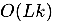 (высокобюджетный вариант V3.2-Speciale показал результаты золотого уровня IMO 2025 и IOI 2025 по данным отчёта авторов)10, и работа Чжэньды Се, Шэндина Ху и др. по **Manifold-Constrained Hyper-Connections (mHC)** (arXiv:2512.24880, № 409\)2, спроецировавшая матрицы смешивания полос остаточного потока алгоритмом Синкхорна—Кноппа на многогранник Биркгофа дважды стохастических матриц (гарантия  и лишь 6.7% накладных расходов по времени при )2.  
Параллельно команда Moonshot AI доказала масштабируемость матричного оптимизатора **Muon** (arXiv:2502.16982, № 410\)65 и в июле обучила на 15.5 трлн токенов без единого всплеска потерь триллионный агентный флагман **Kimi K2** (arXiv:2507.20534, 1.04T общих / 32.6B активных параметров, 8 из 384 экспертов \+ 1 общий, № 411\) за счёт связки **MuonClip** (итерации Ньютона—Шульца \+ ограничение максимального логита внимания **QK-Clip**)66, дополнив её в октябре гибридной архитектурой **Kimi Linear** с по-канальным дельта-затуханием **KDA** (arXiv:2510.26692, до 6× ускорения декодирования на 1M контекста, № 412\)278. Открытый фронт расширили управляемо-рассуждающее семейство **Qwen3** (до 235B-A22B на 36T токенов, arXiv:2505.09388, № 413\)247, нативно мультимодальные модели раннего слияния **Llama 4 Scout** (109B-A17B, контекст 10 млн токенов) и **Llama 4 Maverick** (400B-A17B, № 414\)280, агентная **GLM-4.5** (355B-A32B, arXiv:2508.06471, № 415\)282 и гибрид Mamba-2 \+ GQA \+ MoE в формате NVFP4 **NVIDIA Nemotron 3 Nano** (31.6B-A3.2B, контекст 1M, arXiv:2512.20848, № 416\)13.

### **Рекуррентная глубина, память на инференсе, диффузионные LLM и MoE-видео**

В феврале 2025 года Йонас Гайпинг, Том Голдштейн и др. масштабировали латентное рассуждение по глубине в модели **Huginn-0125** (3.5B параметров, 800B токенов, arXiv:2502.05171, № 417\)3: сэндвич-схема  повторно прогоняет 4-слойное ядро со случайной инициализацией  и повторной инъекцией входа  до  раз (132 эффективных слоя), хотя последующие исследования методом пробинга (Lu et al., arXiv:2507.02199) указали на неоднозначность прямой текстовой интерпретации промежуточных скрытых итераций и более скромный запас фактической памяти (MMLU 31.4%) по сравнению с моделями на 4T токенов187. В октябре Жуй-Цзе Чжу и др. (ByteDance) обучили на 7.7T токенов полностековые петлевые модели с адаптивным выходом **Ouro-1.4B и Ouro-2.6B** (arXiv:2510.25741, № 418\)77, где 2.6B-модель при  достигла 90.8% на MATH-500 и сопоставилась с плотными моделями до 12B за счёт многошаговой композиции знаний, а Бохун У и др. сняли последовательный штраф задержки петель конвейерным расписанием **Cross-Loop Parallelism** в **Parallel Loop Transformer (PLT)** (arXiv:2510.24824, № 419\)33. Одновременно Али Бехруз и др. создали обновляемую градиентом с импульсом на инференсе долговременную нейропамять **Titans** (arXiv:2501.00663, № 420\)288, Тяньюань Чжан и др. масштабировали обучение быстрых весов на чанки до 1M токенов в **LaCT** (arXiv:2505.23884, № 421\)289, Максимилиан Бек и Зепп Хохрайтер выпустили **xLSTM 7B** (arXiv:2503.13427, № 422\)183, а Бо Пэн и др. — **RWKV-7 "Goose"** с динамической низкоранговой эволюцией состояния (arXiv:2503.14456, № 423\)236.  
В дискретной диффузии текста вышли обученная с нуля со взвешенным  ELBO-лоссом **LLaDA-8B** (и её MoE-вариант 7B-A1B) Шэня Не и др. (arXiv:2502.09992, № 424\)35, коммерческое семейство **Mercury Coder** от Inception Labs со скоростью параллельной генерации **1,109 токенов/с** на H100 (arXiv:2506.17298, № 425\)58 и **Dream 7B** Цзячэна Е и др. (arXiv:2508.15487, № 426\)294. В видеогенерации команда Alibaba открыла под лицензией Apache 2.0 модели **Wan 2.1** (arXiv:2503.20314, № 427\) и **Wan 2.2** (№ 428\) — первую видеодиффузионную архитектуру с **двухэкспертным временным MoE-денойзером** (27B общих / 14B активных параметров, переключение эксперта грубой структуры и эксперта мелких деталей по порогу SNR без роста стоимости шага, плюс компактная модель **TI2V-5B** со сжатием VAE 4×16×16 для одной RTX 4090\)172. Вышли также **HunyuanVideo 1.5** (8.3B параметров, 75 с рендера на RTX 4090 в step-distilled режиме, arXiv:2511.18870, № 429\)297, контекстный редактор и 32-миллиардный генератор **FLUX.1 Kontext / FLUX.2** (Mistral-3 24B \+ 128-канальный VAE, № 430\)174, мультиязычный энкодер **SigLIP 2** (arXiv:2502.14786, 85.0% zero-shot на ImageNet у ViT-g/16, № 431\)239, мировая видеомодель с планированием роботов **V-JEPA 2** (arXiv:2506.09985, № 432\)59 и 7-миллиардный визуальный энкодер **DINOv3** с механизмом **Gram Anchoring** для сохранения плотных карт сегментации при длительном обучении (arXiv:2508.10104, 55.9 mIoU на ADE20k, № 433\)301.  
В аудиостеке Alibaba представила омнимодальные модели **Qwen2.5-Omni** (arXiv:2503.20215, № 434\) и **Qwen3-Omni** (arXiv:2509.17765, архитектура **Thinker–Talker MoE** \+ 12.5-Гц энкодер **AuT** на 20 млн часов аудио \+ мгновенный каузальный декодер Code2Wav без просадки текстового MMLU, № 435\)303. Рядом вышли 130-миллиардная **Step-Audio** (arXiv:2502.11946, № 436\)306, потоковый **LLaMA-Omni2** (arXiv:2505.02625, № 437\)308, синтезатор с квантованием FSQ **CosyVoice 3** (arXiv:2505.17589, № 438\)46, локальные открытые модели **Kokoro-82M**, **Orpheus-3B** и **Chatterbox**311, 90-минутный диалоговый генератор на непрерывном \-VAE **Microsoft VibeVoice** (arXiv:2508.19205, № 439\)173, непрерывные аудио-LM Kyutai (arXiv:2509.06926, № 440\)315, аудио-LLM **Mistral Voxtral** (arXiv:2507.13264, № 441\)316, сверхбыстрые **NVIDIA Canary-1B-v2 и Parakeet-TDT-0.6B-v3** (arXiv:2509.14128, 3,332.7 RTFx, № 442\)229 и **GigaAM-v3**317.

## **2026**

**Домены:** Внимание/LLM MoE Петли/SSM Диффузия Видео Энкодер STT TTS STS Оптимизация

### **Ультра-разреженные флагманы, внимание по глубине (AttnRes) и экономия глобального KV-кэша**

К ноябрю 2026 года открытые архитектуры (систематизированные в каталоге Себастьяна Рашки *LLM Architecture Gallery* из 132 моделей и его монографии *«Build a Reasoning Model (From Scratch)»*, июнь 2026, № 445\)1 перешли к ультра-разреженной активации весов (3–6% на токен) и гибридному сжатию внимания. Модель **DeepSeek V4 Pro** (релиз 0813 в августе 2026 года, лицензия MIT) масштабировала MoE до **1.6 триллиона параметров при \~49B активных на токен (\~3.06%)** с окном 1M токенов (обучение на \>32T токенов оптимизатором Muon): сочетание **Compressed Sparse Attention (CSA)** и **Heavily Compressed Attention (HCA)** снизило вычислительные затраты на контексте 1M до 27% FLOPs, а память KV-кэша — до 10% от уровня V3.2 (по опубликованным обзорам и материалам релиза сообщается о 93–94% на LiveCodeBench, \>90% на GPQA Diamond и 62.7 на DeepSWE)31.  
Команда Moonshot AI вслед за визуально-агентной **Kimi K2.5** (arXiv:2602.02276) выпустила метод **Attention Residuals (AttnRes)** (arXiv:2603.15031), заменяющий равномерное накопление остаточного потока обучаемым блочным softmax-вниманием вдоль оси глубины предшествующих слоёв, и в июле 2026 года открыла крупнейший на тот момент 2.8-триллионный флагман **Kimi K3** (arXiv:2607.24653, 104B активных параметров — 16 из 896 маршрутизируемых \+ 2 общих эксперта, окно 1M, нативный чекпоинт MXFP4, № 443\)4. В Kimi K3 применены чередование 3:1 линейных слоёв **KDA** (с ограниченным снизу сигмоидным лог-затуханием, укладывающимся в динамический диапазон BF16 на плотных матричных ядрах Tensor Cores) и глобальных слоёв **Gated MLA вообще без позиционного кодирования (NoPE)**, а также **Normalized LatentMoE** со слоем RMSNorm перед повышающей проекцией4. Серию крупных MoE с разреженным вниманием дополнили **GLM-5** (arXiv:2602.15763, 744B-A40B, MLA \+ DSA \+ асинхронный агентный RL APRIL, 77.8% на SWE-bench Verified и 50.4 на AA Index v4.0)321, **Tencent Hy4** (770B-A49B, Gated MLA \+ DSA с межслойным IndexCache и 4-полосными гиперсвязями iHC)1 и **Meta Muse Spark Open** (816B-A42B)1.  
На полюсе компактных локальных систем **Google Gemma 4** (arXiv:2607.02770, Apache 2.0, размеры E2B, E4B, 12B Unified, 26B-A4B MoE и 31B Dense) внедрила сразу три архитектурных механизма: послойные таблицы эмбеддингов **Per-Layer Embeddings (PLE)** в младших моделях, полностью **безэнкодерную проекцию (Encoder-Free)** сырых 40-мс аудиочанков и патчей изображений напрямую в декодер в 12B Unified, и **переиспользование ключей в качестве значений ()** совместно с частичным вращением **\-RoPE ()** в глобальных слоях внимания (соотношение локальных к глобальным 5:1), сократившее глобальный KV-кэш на **37.5%**73. При высоких оценках на математических и научных тестах (89.2% AIME 2026 и 84.3% GPQA Diamond у 31B в режиме Thinking) независимый архив Artificial Analysis v5.0.1 отметил отставание 31B-модели на сложных многошаговых агентных сценариях относительно крупных триллионных систем324.

### **Гибриды 3:1 (Qwen 3.8, Nemotron 3/3.5), Mamba-3, FlashAttention-4 и петлевые диффузионные модели**

Гибридизация линейной матричной памяти и редкого полного внимания закрепилась в **Alibaba Qwen 3.8-27B** (август 2026, Apache 2.0, плотная VLM-архитектура из 64 слоёв: 16 блоков по 3 слоя **Gated DeltaNet** и 1 слою **Gated Attention**, параллельно с закрытой/флагманской 2.4T-A95B Qwen 3.8-Max)11. В 48 слоях Gated DeltaNet хранятся фиксированные матрицы состояния 48 голов значений , занимающие константные **72.0 МиБ в BF16** (**144.0 МиБ / 151.0 МБ в FP32**) на любой длине последовательности, тогда как 16 слоёв Gated Attention требуют вчетверо меньше памяти KV-кэша, чем однородный 64-слойный трансформер30. В семействе **NVIDIA Nemotron 3 Super** (120B-A12B, arXiv:2604.12374), **Nemotron 3 Ultra** (550B-A55B, 108 слоёв, arXiv:2606.15007) и **Nemotron 3.5 Super & Lightning** (arXiv:2610.38095) гибрид Mamba-2 \+ GQA объединён с **LatentMoE** () и рекурсивным MTP-драфтером для спекулятивного декодирования на контексте до 1M токенов27.  
Фундаментальное обновление получили сами базовые ядра SSM и внимания. Аакаш Лахоти, Три Дао, Альберт Гу и др. представили **Mamba-3** (arXiv:2603.15569, ICLR 2026\)32: переход к **экспоненциально-трапецеидальной дискретизации** второго порядка точности  устранил необходимость во внешней 1D-свёртке, **комплекснозначные переходы состояния** (эквивалентные входно-зависимому вращению **RoPE**) позволили со 100% точностью отслеживать чётность (Parity), а **MIMO-формулировка** ранга  подняла арифметическую интенсивность декодирования в 4× без роста задержки, сравняв состояние  с прежним 329. Али Хатамизаде, Йеджин Чой и Ян Каутц разделили вентили стирания и записи в **Gated DeltaNet-2** (arXiv:2605.22791)248, а лаборатория Три Дао выпустила **FlashAttention-4** (arXiv:2603.05451) под асимметричное масштабирование ускорителей **NVIDIA Blackwell (B200/GB200)**: полиномиальная эмуляция экспоненты на FMA-блоках и **условный пропуск рескейлинга онлайн-softmax** при  обеспечили 1,600 TFLOPs/s (71% пика), а написание ядра на Python **CuTe-DSL** сократило время компиляции в 20–30 раз по сравнению с шаблонами C++223. На пересечении петель и диффузии Санхён Ли и др. создали **Looped Diffusion Language Models (LoopMDM)** (arXiv:2605.26106, NeurIPS 2026), зациклив ранне-средние слои масочной диффузионной LM с экономией до **3.34× FLOPs обучения**188 (развито в **Looped UDLMs**, arXiv:2610.3006656); вышли также исследование насыщения 7B-кодера **LoopCoder-v2 (PLT-7B)** (arXiv:2606.18023)38, **Hyperloop Transformers** (arXiv:2604.21254)334, **LoopFold** (arXiv:2610.35556)194 и открытая петлевая MoE-модель **Inkling 2 Mini** (Thinking Machines Lab, 26.4B-A3.4B, 3 прохода средних слоёв \+ AttnRes)197.

### **Синхронный аудио-видео синтез LTX-2.5 и полнодуплексные голосовые агенты с инструментами**

В генеративном видео Lightricks опубликовала **LTX-2** (arXiv:2601.03233, асимметричный двухпоточный DiT из 14B видеопотока с 3D-RoPE и 5B аудиопотока с 1D-RoPE, связанных двунаправленным кросс-вниманием по времени)335 и в августе 2026 года выпустила 22-миллиардную **LTX-2.5** (текстовый энкодер Gemma 4 12B, генерация синхронного видео до 4K длительностью до 20 с и стереозвука 24 кГц за один проход, многокадровая непрерывность сцен и управление IC-LoRA)258, тогда как в генерации изображений разделённый трансформер **DDT-XL/2** Вана и др. (CVPR 2026, arXiv:2504.05741) снизил FID на ImageNet 256×256 до **1.26**219. В полнодуплексной речи команда NVIDIA представила **PersonaPlex 7B** (arXiv:2602.06053, закреплённый в контексте гибридный промпт роли и образца голоса поверх архитектуры Moshi \+ Mimi: естественность DMOS **3.90 ± 0.15** и сходство клонирования голоса SSIM **0.57**)68 и **NemotronLabs VoiceChat** (arXiv:2609.21967, первая открытая Full-Duplex STS-модель с нативным вызовом инструментов Tool Calling, вспомогательной транскрипцией RNN-T, 100% перехватом при перебивании и 93% продолжением речи после междометий слушателя)69. Потоковый голосовой стек завершили **Qwen3-TTS** (arXiv:2601.15621, каузальная ветвь 12.5 Гц с 16-кодбучным MTP и задержкой первого пакета около **97–100 мс**) и **Qwen-Audio-3.0-TTS** (arXiv:2607.23938)54, **Qwen3.5-Omni** (arXiv:2604.15804, выравнивание ARIA)342, **Fish Audio S2-Pro** (arXiv:2603.08823, TTFA \~100 мс, RTF 0.195) и **Drama 3** (arXiv:2610.18010)158, работающий в 6× быстрее реального времени на двух ядрах CPU ноутбука **Kyutai Pocket TTS** (100M параметров, MIT)344, потоковый **Mistral Voxtral Realtime** (arXiv:2602.11298, задержка 480 мс)345, **GigaAM Multilingual** (arXiv:2607.10371, Interspeech 2026\)346 и двухветвевой **Nemotron 3.5 Transcribe** (TDT \+ диаризатор Sortformer)348.

## **2027**

**Домены:** Внимание/LLM Петли/SSM Диффузия Видео Оптимизация  
Научная программа **2027 года**, зафиксированная к ноябрю 2026 года принятыми публикациями зимне-весенних конференций **WACV 2027**, **AAAI / IAAI 2027**, **WSDM 2027**, **DATE 2027** и открытым рецензируемым корпусом из 37,028 подач **ICLR 2027** на OpenReview, фокусируется на теоретическом объединении генеративных парадигм и устранении тонких численно-фазовых патологий гибридных и петлевых сетей15. В принятой на WACV 2027 статье Амандипа Кумара, Нитхина Наира и Вишала Пателя *«Scale-wise VAR is Secretly Discrete Diffusion»* (№ 444\)17 строго доказано, что визуальные авторегрессионные модели предсказания следующего масштаба (VAR) функционально эквивалентны по-масштабной дискретной масочной диффузии в многомасштабном латентном пространстве. В трудах WACV 2027 и AAAI/IAAI 2027 также представлены видео-масочные трансформеры долговременной сегментации **LVMT** (Norouzi et al.)16, одношаговые потоковые схемы (arXiv:2608.09579), диффузионные декодеры **PixCell** (arXiv:2611.01141), структурные смещения внимания (arXiv:2611.04657) и промышленные архитектуры ограниченного авторитетного ретривала (arXiv:2611.20398)19.  
В рецензируемом корпусе ICLR 2027 выявлены три фундаментальных механизма следующего поколения. Во-первых, анализ чанкового сжатия KV-кэша (*«Periodic Weak Spots: Phase Sensitivity from Chunked KV-Cache Compression»*) показал, что в моделях класса DeepSeek-V4 точность извлечения фактов варьируется до **40 процентных пунктов** в зависимости от фазы позиции токена относительно границ окна сжатия из\-за возникновения фазово-специализированных голов15. Во-вторых, работа по численной устойчивости обратного прохода внимания (OpenReview:LJvGaCWmFh) установила, что поздние взрывы градиентов при обучении с **BF16 FlashAttention-3** вызваны нарушением при BF16-округлении точного закона сохранения суммы градиентов строки softmax (медианная ошибка градиента запросов 219%), и предложила коррекцию обратного ядра, снижающую ошибку до **0.34% / 0.37%** (уровень FP32) при удорожании шага всего на 4.7%352. В-третьих, предложены сужающиеся в середине **Variable-Width («Hourglass») Transformers**, вложенные **Matryoshka Language Model Suites** (экономия 36% вычислений на обучение линейки размеров) и метод **SafeBridge** для выравнивания безопасности петлевых моделей по всем глубинам рекурсии — в ответ на открытие того, что сокращение числа петель вдвое на инференсе в Ouro и Huginn сохраняет 89% точности на GSM8K, но разрушает поздно формирующийся вектор отказа, повышая уязвимость к вредоносным запросам в 5.3–9.9 раза15.

## **Приложение А. Сводные таблицы архитектур, бенчмарков, статистики и репозиториев**

### **Таблица А.1. Полная хронологическая матрица архитектур и механизмов (1958–2027, шаг 1 год)**

| Год | Домен / Теги | Ключевая архитектура / алгоритм | Опорный математический механизм | Вехи, авторы и номер в Библиографии |
| :---- | :---- | :---- | :---- | :---- |
| **1958** | Базис | Перцептрон Mark I | Гиперплоскость , коррекция ошибок | Rosenblatt (№ 1), von Neumann (№ 2\) |
| **1959** | Энкодер Базис | Pandemonium; TD-шашки; Рецептивные поля V1 | Параллельный выбор ; временная разность оценки позиции | Hubel & Wiesel (№ 3), Selfridge (№ 4), Samuel (№ 5\) |
| **1960** | Базис Оптимизация | ADALINE / правило LMS; Сопряжённый градиент | Дельта-правило ; непрерывные сопряжённые ОДУ | Widrow & Hoff (№ 6), Kelley (№ 7\)7 |
| **1961** | Петли Память | Die Lernmatrix; Мнемонические уравнения | Матричная гетероассоциативная память  | Steinbuch (№ 8\)91, Caianiello (№ 9\) |
| **1962** | Базис Энкодер | Теорема сходимости перцептрона; MADALINE | Граница ошибок ; простые и сложные клетки коры | Novikoff (№ 10\)93, Hubel & Wiesel (№ 14\) |
| **1963** | Базис Оптимизация | Обобщённый портрет (линейный SVM) | Гиперплоскость максимального зазора  | Vapnik & Lerner (№ 15\)98 |
| **1964** | Оптимизация Базис | Метод импульса Поляка; Потенциальные функции | Heavy-ball ; ядерный трюк; прямое AD | Polyak (№ 18\)101, Aizerman et al. (№ 19), Wengert (№ 20\) |
| **1965** | Базис | Первые глубокие MLP; Теорема Ковера | Послойный отбор полиномов Колмогорова—Габора; число дихотомий  | Ivakhnenko & Lapa (№ 21\)7, Cover (№ 22\) |
| **1966** | Оптимизация Базис | Минимизация среднего риска в обучении | Стохастическая аппроксимация  | Tsypkin (№ 25\)106, Braverman (№ 26\) |
| **1967** | Базис Оптимизация | Сквозной многослойный SGD; Sinkhorn–Knopp | Градиентный спуск в 5-слойной сети; проекция дважды стохастических матриц | Amari (№ 28\)21, Sinkhorn & Knopp (№ 30\)61 |
| **1968** | Базис Петли | МГУА (GMDH); Сети Outstar; Теория VC | Валидационная регуляризация глубины; уравнения STM/LTM пластичности | Ivakhnenko (№ 31), Grossberg (№ 32), Vapnik (№ 33\) |
| **1969** | Базис Энкодер | Пределы перцептронов; Аналоговый ReLU | Неразделимость XOR одним слоем; многослойный выпрямитель  | Minsky & Papert (№ 34), Bryson & Ho (№ 35), Fukushima (№ 36\)85 |
| **1970** | Базис Оптимизация | Обратный режим автодифференцирования; BFGS | Точное цепное правило на графе ; квази-Ньютон | Linnainmaa (№ 37\)113, BFGS (№ 38\) |
| **1971** | Базис Память | 8-слойная сеть GMDH; Теория архикортекса | Глубокая полиномиальная сеть; разреженная ассоциативная память гиппокампа | Ivakhnenko (№ 40\)115, Marr (№ 41\) |
| **1972** | Петли Память | Сеть Амари—Хопфилда; Популяции Wilson–Cowan | Рекуррентные аттракторы ; предельные циклы E–I | Amari (№ 42\)115, Kohonen (№ 43), Wilson & Cowan (№ 46\)120 |
| **1973** | Энкодер Петли | Самоорганизация коры V1; Шунтирующие сети | Конкурентное правило Хебба с \-нормировкой весов; дивизивный контраст | von der Malsburg (№ 47\)123, Grossberg (№ 48\) |
| **1974** | Базис Петли | Backprop для нейросетей; Спиновая модель мозга | Динамическая обратная связь производных; распределение Изинга с температурой | Werbos (№ 50\)123, Little (№ 51\)127 |
| **1975** | Энкодер Память | Cognitron; CMAC; Спиновое стекло SK | Дивизивное торможение слоёв; локальное хеш-кодирование; гамильтониан SK | Fukushima (№ 52\)122, Albus (№ 53), SK (№ 54\) |
| **1976** | Оптимизация Петли | Reverse AD в печати (BIT); Прообраз ART | Разложение Тейлора с компромиссом памяти; дилемма стабильности—пластичности | Linnainmaa (№ 56\)23, Grossberg (№ 57\) |
| **1977** | Петли Оптимизация | Brain-State-in-a-Box (BSB); EM-алгоритм | Аттракторы в гиперкубе ; нижняя граница правдоподобия скрытых переменных | Anderson et al. (№ 59\)122, Dempster et al. (№ 62\) |
| **1978** | Память Базис | Синаптическая ёмкость памяти; Критерий BIC | Масштабирование ёмкости памяти  по числу синапсов | Little & Shaw (№ 63\)127, Schwarz (№ 64\) |
| **1979** | Энкодер | Neocognitron (оригинальная публикация) | Каскад разделяемых плоскостей \-клеток (свёртка) и \-клеток (пулинг) | Fukushima (№ 67\)86 |
| **1980** | Энкодер Оптимизация | Neocognitron (междунар.); Граница Баура—Штрассена | Инвариантность к сдвигу каскадом ; оценка сложности градиента  | Fukushima (№ 69\)129, Baur & Strassen (№ 71\) |
| **1981** | Память Петли | Распределённые представления; Ассоциативный RL | Интерактивная активация признаков; поисковый градиент по подкреплению | Hinton & Anderson (№ 72), Barto et al. (№ 74\) |
| **1982** | Петли Энкодер | Сеть Хопфилда; Карты Кохонена (SOM); Правило Ойя | Функция Ляпунова ; топографическое обучение; нейронный PCA | Hopfield (№ 75), Werbos (№ 76), Kohonen (№ 77), Oja (№ 78\) |
| **1983** | Оптимизация Петли | Ускоренный метод Нестерова; Имитация отжига | Оптимальный спуск  в упреждающей точке; Actor–Critic RL | Nesterov (№ 81\)143, Kirkpatrick (№ 82), Barto (№ 83\) |
| **1984** | Базис Диффузия | PAC-обучение; Непрерывный Хопфилд; Сэмплер Гиббса | Полиномиальная обучаемость ; MCMC-релаксация на полях MRF | Valiant (№ 84\)147, Hopfield (№ 85), Geman (№ 86\) |
| **1985** | Базис Диффузия | Машина Больцмана; Независимые выводы Backprop | Градиент разности корреляций фаз  | Ackley, Hinton & Sejnowski (№ 88\)150, LeCun (№ 89\) |
| **1986** | Базис Петли | MLP \+ Backpropagation; RBM (Harmonium); Jordan RNN | Цепной градиент скрытых представлений ; двудольная энергия без циклов | Rumelhart, Hinton & Williams (№ 92), Smolensky (№ 94), Jordan (№ 95\) |
| **1987** | STT Петли | TDNN; Быстрые веса (Fast Weights); Autoencoder stack | 1D-свёртка по времени для речи; пластичная контекстная добавка весов | Waibel (№ 97), Hinton & Plaut (№ 98), Ballard (№ 99), Pineda (№ 101\) |
| **1988** | Энкодер Оптимизация | 2D-CNN с backprop; Сети RBF; TD()-обучение | Двумерная свёртка с обучением по ошибке; бутстраппинг невязки Беллмана | Zhang (№ 102\)20, Broomhead (№ 103), Sutton (№ 104\) |
| **1989** | Энкодер Базис | Свёрточная сеть LeCun (USPS); Теорема аппроксимации | Сквозной backprop по 2D-ядрам со stride; плотность MLP в ; Q-learning | LeCun et al. (№ 107), Cybenko (№ 108), Hornik (№ 109), Watkins (№ 111\) |
| **1990** | Петли Оптимизация | Сеть Элмана (Simple RNN); BPTT; Optimal Brain Damage | Скрытый контекст ; прунинг по диагонали гессиана | Elman (№ 114), Werbos (№ 115), LeCun et al. (№ 116), Schmidhuber (№ 117\) |
| **1991** | MoE Петли Внимание | Mixture of Experts; Затухание градиента; Fast Weights | Шлюзовая сеть ; анализ ; линейное самовнимание | Jacobs et al. (№ 119), Hochreiter (№ 120), Schmidhuber (№ 121\)22 |
| **1992** | Оптимизация Петли | REINFORCE; Нейронный компрессор истории; Усреднение Поляка | Градиент политики 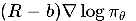; дистилляция RNN; траекторное среднее SGD | Williams (№ 124), Schmidhuber (№ 125), Polyak & Juditsky (№ 126\) |
| **1993** | Энкодер Базис | Сиамские сети; Вариационный MDL; Граница Бэррона | Метрические башни с общими весами; свободная энергия весов; прунинг OBS | Bromley & LeCun (№ 129), Hinton & van Camp (№ 130), Barron (№ 131\) |
| **1994** | Петли MoE | Теорема о дальних зависимостях; Иерархический MoE | Несовместимость устойчивого хранения и градиента в RNN; оператор  за  | Bengio et al. (№ 133), Jordan & Jacobs (№ 134), Pearlmutter (№ 135\) |
| **1995** | Базис Диффузия | Машина Гельмгольца (Wake–Sleep); Soft-margin SVM | Пара генератор/инференс-сеть 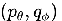; максимизация взаимной информации | Hinton et al. (№ 137), Cortes & Vapnik (№ 139), Bishop (№ 141\) |
| **1996** | Энкодер Базис | Разреженное кодирование V1; Гауссов предел бесконечной ширины | \-реконструкция переполненным словарём; сходимость  к NNGP | Olshausen & Field (№ 142), Neal (№ 143), Goller & Küchler (№ 144\) |
| **1997** | Петли Память | LSTM; Двунаправленная RNN (BiRNN); Плоские минимумы | Аддитивная ячейка  (CEC); прямая и обратная ветви времени | Hochreiter & Schmidhuber (№ 146), Schuster & Paliwal (№ 147\) |
| **1998** | Энкодер Оптимизация | LeNet-5; Естественный градиент Амари | Каскад Conv–Pool–FC \+ графовый трансдьюсер; метрика Фишера 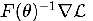 | LeCun et al. (№ 150), Amari (№ 152), Sutton & Barto (№ 153\) |
| **1999** | Петли Базис | Вентиль забывания LSTM; Неотрицательная факторизация NMF | Мультипликативный сброс ; аддитивные признаки  | Gers, Schmidhuber & Cummins (№ 155\)155, Lee & Seung (№ 156\) |
| **2000** | Петли Базис | Peephole LSTM; Softplus; Обучение многообразий (Isomap/LLE) | Связь ячейки  с вентилями; гладкая активация 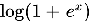 | Gers et al. (№ 158, 159), Dugas et al. (№ 160), Tenenbaum (№ 161\) |
| **2001** | Петли Энкодер | Echo State Networks (ESN); Условные случайные поля (CRF) | Затухающий резервуар ; глобальная нормировка путей  | Jaeger (№ 163), Lafferty et al. (№ 164), Hastie et al. (№ 165\) |
| **2002** | Диффузия Базис | Контрастивная дивергенция (CD\-); Структурный перцептрон | Одношаговая MCMC-оценка градиента RBM из данных; библиотека Torch | Hinton (№ 166), Collins (№ 168), Collobert et al. (№ 169\) |
| **2003** | Базис Внимание/LLM | Нейронная вероятностная языковая модель (NPLM) | Плотные обучаемые эмбеддинги слов ; эластичные искажения CNN | Bengio et al. (№ 170), Simard et al. (№ 171), MacKay (№ 172\) |
| **2004** | Оптимизация Базис | Первое ускорение нейросетей на GPU; Теория  vs  | Матричные операции в шейдерах GPU (20×); логарифмическая сложность  | Oh & Jung (№ 173), Ng (№ 174), Welling et al. (№ 175\) |
| **2005** | Диффузия STT Базис | Score Matching; BiLSTM для речи; Графовые сети (GNN) | Оценка 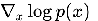 без статсуммы ; иерархический Softmax | Hyvärinen (№ 176\)163, Graves (№ 177), Gori et al. (№ 179\) |
| **2006** | STT Базис | CTC; Глубокие сети доверия (DBN) и автоэнкодеры | Суммирование выравниваний с пустым символом ; послойный стек RBM | Graves et al. (№ 181), Hinton et al. (№ 182, 183), Bishop (№ 185\) |
| **2007** | Базис Оптимизация | Асимптотика SGD на больших данных; Стек автоэнкодеров | Оптимальность SGD первого порядка при лимите времени вычислений | Bengio et al. (№ 186), Bottou & Bousquet (№ 187), Mnih (№ 188\) |
| **2008** | Энкодер Диффузия | Шумоподавляющие автоэнкодеры (DAE); Единый CNN-NLP | Реконструкция чистого  из зашумлённого ; многозадачные эмбеддинги; t-SNE | Vincent et al. (№ 190), Collobert & Weston (№ 191), t-SNE (№ 192\) |
| **2009** | Энкодер Оптимизация | ImageNet; Глубокое обучение на CUDA; Curriculum Learning | Масштабирование на 14M изображений и CUDA (70×); расписание сложности | Deng et al. (№ 193), Raina, Madhavan & Ng (№ 194), Bengio (№ 195\) |
| **2010** | Базис Оптимизация | Инициализация Xavier; ReLU в глубоких сетях; RNNLM; NCE | Сохранение дисперсии ; кусочная линейность ; Theano | Glorot & Bengio (№ 198), Nair & Hinton (№ 199), Mikolov (№ 200\) |
| **2011** | Оптимизация Диффузия | AdaGrad; Denoising Score Matching (DSM); CD-DNN-HMM | Покоординатное масштабирование ; эквивалентность DAE и  | Duchi et al. (№ 204), Vincent (№ 205\)166, Seide et al. (№ 208\) |
| **2012** | Энкодер STT | AlexNet; RNN-Transducer (RNN-T); Dropout; RMSProp | Глубокая GPU-CNN с ReLU и Dropout; совместная решётка Joiner  для онлайн-ASR | Krizhevsky et al. (№ 210\)167, Graves (№ 211), Hinton (№ 212\) |
| **2013** | Энкодер Диффузия | Variational Autoencoder (VAE); Word2Vec; NiN; DQN | Нижняя граница ELBO \+ репараметризация ; контрастивные Skip-Gram | Kingma & Welling (№ 217), Mikolov (№ 219), Lin (№ 220), Mnih (№ 222\) |
| **2014** | Внимание Диффузия | Seq2Seq \+ Bahdanau Attention; GRU; GAN; Оптимизатор Adam | Мягкое выравнивание контекста ; минимакс ; адаптивные моменты | Sutskever (№ 225), Bahdanau (№ 226), Cho (№ 227), GAN (№ 229), Adam (№ 230\) |
| **2015** | Базис Диффузия | ResNet \+ Kaiming Init; BatchNorm; U-Net; Диффузия | Тождественный проброс ; skip-энкодер-декодер; обращение цепи Маркова | He et al. (№ 237), Ioffe (№ 239), U-Net (№ 240), Sohl-Dickstein (№ 241\) |
| **2016** | TTS Петли Базис | LayerNorm; Pre-LN ResNet; ACT; GELU; WaveNet | Нормировка по признакам токена; обучаемый вентиль остановки петли; дилатационные свёртки | Ba (№ 249), He (№ 250), Graves (№ 251), GELU (№ 252), WaveNet (№ 253\) |
| **2017** | Внимание/LLM MoE TTS | Канонический Transformer; Sparse MoE; VQ-VAE; AdamW; PPO | ; маршрутизация Top\-; дискретный кодбук; отвязанный weight decay | Vaswani (№ 260), Shazeer (№ 261), VQ-VAE (№ 262), AdamW (№ 265), PPO (№ 266\) |
| **2018** | Энкодер LLM Петли | BERT; GPT-1; Universal Transformer; Neural ODE; InfoNCE; Shampoo | Двунаправленный MLM vs каузальный AR; петля трансформера с ACT; непрерывная глубина | Devlin (№ 274), Radford (№ 273), Dehghani (№ 275), Chen (№ 276), Shampoo (№ 282\) |
| **2019** | Внимание/LLM Петли TTS | GPT-2; RMSNorm; MQA; DEQ; FastSpeech; NCSN; ZeRO/Megatron | Нормировка без сдвига; одна KV-голова; неявная неподвижная точка ; регулятор длин | Radford (№ 285), RMSNorm (№ 286), MQA (№ 287), DEQ (№ 288), FastSpeech (№ 292\) |
| **2020** | LLM Диффузия STT | GPT-3 & Scaling Laws; SwiGLU; Linear Attn; DDPM/SDE; ViT; Conformer | Вентильный FFN; ядро ; лосс шума ; патчи 16×16; гибрид Conv+Attn | Brown (№ 300), SwiGLU (№ 301), DDPM (№ 303), ViT (№ 306), Conformer (№ 307\) |
| **2021** | LLM Петли/SSM TTS | RoPE; ALiBi; Switch MoE; LoRA; CLIP; S4; VITS; SoundStream; LDM | Комплексное вращение ; адаптер  ранга ; NPLR SSM; аудиокодек RVQ; диффузия в VAE | RoPE (№ 316), LoRA (№ 319), CLIP (№ 320), S4 (№ 324), SoundStream (№ 327), LDM (№ 331\) |
| **2022** | LLM Диффузия STT | FlashAttention; Chinchilla; DiT; Flow Matching / Rectified Flow; Whisper | Тайлинг в SRAM с онлайн-softmax; ; трансформер adaLN-Zero; прямые ОДУ  | Dao (№ 332), Chinchilla (№ 334), Rectified Flow (№ 338), DiT (№ 341), Whisper (№ 342\) |
| **2023** | LLM Петли/SSM STS | GQA; vLLM; Mixtral 8x7B; Mamba (S6); RWKV/RetNet; SigLIP; VALL-E; TDT; DPO | Групповой KV; входно-зависимые ; сигмоидный лосс; пропуск кадров длительностью | GQA (№ 347), Mamba (№ 356), SigLIP (№ 358), VALL-E (№ 362), TDT (№ 366), DPO (№ 353\) |
| **2024** | LLM MoE Петли STS | DeepSeek-V2/V3 (MLA, Aux-Free MoE, MTP); Mamba-2; xLSTM; GDN; MMDiT; Moshi | Низкоранговый KV-кэш MLA; баланс смещением ; дельта-правило ; Full-Duplex 160 мс (Mimi) | DeepSeek (№ 371, 372), Mamba-2 (№ 379), GDN (№ 382), HunyuanVideo (№ 394), Moshi (№ 400\) |
| **2025** | LLM Петли Диффузия Видео | DeepSeek-R1 & V3.2 (DSA) & mHC; Kimi K2 (MuonClip) & KDA; Huginn/Ouro/PLT; LLaDA/Mercury; Wan 2.2 | Верифицируемый GRPO; проекция Синкхорна на многогранник Биркгофа; латентные петли; dLLM; MoE-видео | R1 (№ 406), V3.2 (№ 408), mHC (№ 409), K2 (№ 411), Huginn (№ 417), Ouro (№ 418), LLaDA (№ 424\) |
| **2026** | LLM Гибриды Видео STS | DeepSeek V4 Pro; Kimi K3 (AttnRes); Gemma 4; Qwen 3.8; Nemotron 3/3.5; Mamba-3; FA-4; LTX-2.5; PersonaPlex | CSA+HCA (10% KV); внимание по глубине;  \+ \-RoPE; гибрид 3:1 GDN; комплексная MIMO-SSM; аудио-видео DiT | K3 (№ 443\)4, Gemma 4156, Qwen 3.830, Mamba-332, LTX-2.5297 |
| **2027** | LLM Диффузия Оптимизация | Scale-wise VAR \= dLLM; Анализ фаз KV DeepSeek-V4; Точный BF16 FA-bwd; Hourglass LM; SafeBridge | Изоморфизм VAR и масочной диффузии; закон сохранения градиента softmax; безопасность по петлям | Kumar et al. (WACV'27, № 444\)17, OpenReview ICLR'2715 |

Два определяющих системных сдвига открытых языковых архитектур 2024–2026 годов лежат в плоскости управления памятью видеокарт: радикальное сжатие состояния контекста (через низкоранговый кэш MLA и замену 75% слоёв внимания на константную по длине матричную память Gated DeltaNet или KDA) и переход к ультра-разреженной активации весов, когда при общем объёме знаний 0.7–2.8 трлн параметров на каждый токен активируется лишь 3.1–10.0% сети4.  
  
Сопоставление приведённых объёмов памяти объясняет практическую экономику длинноконтекстного агентного инференса: в однородных моделях полного внимания линейный рост KV-кэша быстро превосходит размер самих весов модели, вынуждая распределять инференс по нескольким узлам только ради хранения истории диалога196. Напротив, гибридная архитектура 3:1 полностью замораживает рост памяти в 75% слоёв сети (оставляя её равной 72 МиБ в BF16 независимо от того, составляет ли длина контекста 32K или 1M токенов), а в сочетании с 3–5% активных экспертов позволяет обслуживать многошаговые траектории на порядок дешевле при равном качестве30.

### **Таблица А.2. Архитектурные спецификации и бенчмарки открытых флагманских LLM и гибридов (2024–2026)**

*Примечание по атрибуции (по состоянию на 25.11.2026):* Метрики приведены по официальным техническим отчётам и карточкам моделей разработчиков; там, где имеются независимые замеры или обзоры (Epoch AI, Artificial Analysis, технические сводки), источник явно указан в ячейке31. Прочерк (—) означает отсутствие сопоставимой публикации метрики в первоисточнике.

| Модель (Релиз, Лицензия) | Всего / Активных весов | Архитектура внимания / SSM и экспертов | Окно контекста | MMLU-Pro (%) | GPQA Diamond (%) | AIME 24 / 25 / 26 (%) | LiveCodeBench (%) | SWE-bench Verified (%) |
| :---- | :---- | :---- | :---- | :---- | :---- | :---- | :---- | :---- |
| **DeepSeek-V3 / 0324** (дек. 2024, MIT)29 | 671B / 37B (5.5%) | 61 слой: MLA \+ Aux-Loss-Free MoE (8/256 \+ 1 shared) \+ MTP | 128K | 75.9 (81.2 в 0324\) | 59.1 (68.4 в 0324\) | 39.2 ('24; 59.4 в 0324\) | 46.9 (v6, 0324\) | 38.8 (Agentic, 0324\) |
| **DeepSeek-R1 / 0528** (янв./май 2025, MIT)268 | 671B / 37B (5.5%) | База V3 \+ многостадийный верифицируемый RL (GRPO) | 128K | 84.0 | 71.5 (81.0 в 0528\) | 79.8 ('24) / 70\.0$\rightarrow$87.5 ('25) | 63\.5$\rightarrow$73.3 (v6) | 49.2 |
| **Llama 4 Maverick** (апр. 2025, Llama 4\)280 | 400B / 17B (4.3%) | Чередование плотных и MoE слоёв (1/128 \+ 1 shared), раннее слияние | 1M (10M у Scout) | — | 67.0 (Epoch AI) | — | — | — |
| **Qwen3-235B-A22B** (май/июль 2025, Apache 2.0)247 | 235B / 22B (9.4%) | 94 слоя: GQA (64Q / 4KV) \+ MoE (8/128), режим Think/Non-Think | 128K–262K (1M DCA) | 77.3 (non-think) | 62.9 (non-think) | 85.7 ('24) / 81.5 ('25, think) | 70.7 (v5, think) | 34.4 (non-think) |
| **Kimi K2 Instruct** (июль 2025, Mod. MIT)66 | 1.04T / 32.6B (3.1%) | 61 слой: MLA (64 головы) \+ MoE (8/384 \+ 1 shared), обучена с MuonClip | 128K | 81.1 | 75.1 | 69.6 ('24) / 49.5 ('25) | 53.7 (v6, non-think) | 65.8 (71.6 multi) |
| **GLM-4.5** (июль 2025, MIT)282 | 355B / 32B (9.0%) | Глубокий MoE \+ GQA \+ MTP, гибрид Thinking / Non-Thinking | 128K | 84.6 | 79.1 | 91.0 (AIME'24) | 72.9 | 64.2 |
| **DeepSeek-V3.2** (дек. 2025, MIT)10 | 671B / 37B (5.5%) | MLA \+ **DeepSeek Sparse Attention (DSA)** \+ единый агентный GRPO | 128K | \~85.0 | 82.4 | 94.17 (AIME'26) | — | 70.2 (Multilingual) |
| **Nemotron 3 Nano** (дек. 2025, OpenMDW)184 | 31.6B / 3.2B (10.1%) | Гибрид Mamba-2 \+ GQA \+ гранулярный MoE (6/128), NVFP4 | 1M (RULER 86.3) | 78.3 | 73.0 (75.0 tools) | 89.1 ('25) / 99.2 (tools) | 68.3 (v6) | 38.8 (OpenHands) |
| **GLM-5 / GLM-5.1** (февр./апр. 2026, MIT)321 | 744B / 40B (5.4%) | 80 слоёв: MLA \+ **DSA** \+ 256 экспертов \+ Muon \+ асинхр. RL APRIL | 200K–1M | — | — | 95.4 / 95.3 (AIME'26) | — | 77.8 |
| **Qwen3.5-397B-A17B** (весна 2026, Apache 2.0)353 | 397B / 17B (4.3%) | Гибрид 3:1 (75% **Gated DeltaNet** \+ 25% GQA) \+ Sparse MoE | 256K | — | 88.4 (сводка) | 91.3 (AIME'26) | 83.6 (v6) | — |
| **Gemma 4 31B Dense** (апр./июль 2026, Apache 2.0)324 | 30.7B / 30.7B (100%) | 60 слоёв: 5:1 SWA/Global,  **\+ \-RoPE** (экономия 37.5% KV), MTP | 256K | 85.2 | 84.3 (75.8 min Epoch) | 89.2 (AIME'26) | 80.0 (v6) | — |
| **Gemma 4 26B-A4B** (апр./июль 2026, Apache 2.0)324 | 25.2B / 3.8B (15.1%) | 30 слоёв: 5:1 SWA/Global (, \-RoPE) \+ MoE (8/128 \+ 1 shared) | 256K | 82.6 | 82.3 | 88.3 (AIME'26) | 77.1 (v6) | — |
| **Nemotron 3 Ultra** (июнь 2026, OpenMDW)326 | 550B / 55B (10.0%) | 108 слоёв: Mamba-2 \+ GQA (64Q/2KV) \+ **LatentMoE** (22/512) \+ 2 MTP | 1M | — | — (AA Index 56.4) | — | — | — |
| **Kimi K3** (июль 2026, Kimi K3 Lic.)4 | 2.8T / 104B (3.7%) | Гибрид 3:1 (**KDA** \+ Gated MLA NoPE) \+ **AttnRes** \+ Stable LatentMoE (16/896) | 1M | — | — | — | — | 81.2 (FrontierSWE) |
| **DeepSeek V4 Pro** (авг. 2026, MIT)31 | 1.6T / \~49B (3.1%) | Гибрид **CSA \+ HCA** (27% FLOPs и 10% KV к V3.2 на 1M) \+ Muon (\>32T ток.) | 1M | — | \>90.0 (обзор релиза) | — | 93–94 (обзор релиза) | 62.7 (DeepSWE) |
| **Qwen3.8-27B** (авг. 2026, Apache 2.0)30 | 27B / 27B (100%, VLM) | 64 слоя: **48 Gated DeltaNet** (48V/16QK) \+ **16 Gated Attn** (24Q/4KV) \+ MTP | 262K (1M YaRN) | — | — (AA v4.3.2: 33.7) | — | — | 42.2 (DeepSWE 1.1) |
| **Tencent Hy4** (авг. 2026, Open)1 | 770B / 49B (6.4%) | 78 слоёв: Gated MLA \+ **DSA (IndexCache)** \+ 4-полосный **iHC** \+ MoE (8/256 \+ 1\) | — | — | — | — | — | — |
| **Nemotron 3.5 Super** (окт. 2026, OpenMDW)327 | 120B / 12B (10.0%) | Гибрид Mamba-2 \+ GQA \+ LatentMoE (512 эксп.) \+ рекурсивный MTP drafter | 1M | — | — | — | — | 86\.9$\rightarrow$92.1 (Pro V2 \+ RL) |

Динамика интеллектуальной плотности между поколениями 2025 и 2026 годов особенно отчётливо проявляется при сопоставлении сложных научных и олимпиадных задач (GPQA Diamond и AIME 2026\) с параметрической эффективностью рекуррентно-глубинных моделей10.  
  
Приведённые данные выявляют важную закономерность: в задачах последовательного дедуктивного вывода (AIME, MATH-500) решающим фактором выступает не сырое число уникальных параметров, а *эффективная глубина последовательных нелинейных преобразований* — достигаемая либо явно через режим рассуждений в контексте (Thinking mode в Gemma 4 26B-A4B с 3.8B активных параметров поднимает AIME 2026 до 88.3% против 20.8% у нерассуждающей Gemma 3 27B), либо неявно внутри скрытого состояния через  рекуррентных прохода по разделяемому стеку слоёв в Ouro-2.6B286.

### **Таблица А.3. Рекуррентно-глубинные (петлевые) и диффузионные языковые модели (2025–2026)**

| Модель / Архитектура | Парадигма и топология глубины | Уникальные параметры / Токены обучения | Ключевые экспериментальные метрики и ускорения |
| :---- | :---- | :---- | :---- |
| **Huginn-0125** (arXiv:2502.05171)3 | Сэндвич-петля  с concat-инъекцией входа  и ,  () | 3.5B / 800B токенов (4,096 MI250X) | При росте петель : ARC-Easy 49.07%69.91%, HellaSwag 43.46%65.21%, GSM8K CoT 42.08%; zero-shot KV-sharing на 4 слота без потерь MT-Bench (5.86)284 |
| **Ouro-1.4B & Ouro-2.6B** (arXiv:2510.25741)286 | Петля полного стека () с обучаемым вентилем раннего выхода (ACT gate) | 1.4B и 2.6B / 7.7T токенов | **Ouro-1.4B**: MMLU 67.3%, GSM8K 78.9%, MATH-500 82.4%; **Ouro-2.6B**: MMLU 74.6%, MMLU-Pro 55.7%, BBH 80.5%, MATH-500 **90.8%** (сопоставима с плотными до 12B)286 |
| **PLT & LoopCoder-v2 7B** (arXiv:2510.24824, 2606.18023)33 | Конвейер Cross-Loop Parallelism (CLP) \+ общий KV первой петли \+ Gated SWA () | 1.7B акт. / 7B плотная (18T токенов кода и текста) | Устраняет последовательный штраф задержки (+96%\~4% оверхеда при ); \+5.0 п.п. точности на 2 петлях, диагностировано насыщение при  из\-за фазового сдвига CLP33 |
| **Inkling 2 Mini** (Thinking Machines, нояб. 2026\)197 | Сэндвич  применений из 24 слоёв \+ AttnRes \+ MoE (8/128) | 26.4B всего / 3.4B уник. активн. (5.4B активаций) | Контекст 1,048,576 токенов, Apache 2.0, 5 локальных SWA (1024) \+ 1 глобальный GQA на блок, KV-кэш 192 КиБ/токен197 |
| **LLaDA-8B / LLaDA-MoE** (arXiv:2502.09992)35 | Двунаправленный масочный диффузионный трансформер (MDM, взвешенный  ELBO) | 8B плотная; 7B-A1B MoE | Паритет с LLaMA-3 8B при равных FLOPs; Instruct (блочное размаскирование): GSM8K **78.6%**, MATH **42.2%**, CMMLU 69.9%; преодолевает reversal curse57 |
| **Dream 7B** (arXiv:2508.15487)57 | Дискретная диффузионная LLM, инициализированная из авторегрессионных весов | 7B плотная | MATH **51.2%**, HumanEval **54.3%**, сильное планирование и двунаправленное заполнение пропусков57 |
| **Mercury Coder Mini / Small** (arXiv:2506.17298)58 | Коммерческая диффузионная кодовая LLM с параллельной генерацией токенов | Закрытый масштаб (триллионы токенов) | Пропускная способность на стандартных NVIDIA H100: **1,109 ток./с** (Mini) и **737 ток./с** (Small) по замеру Artificial Analysis (до 10× быстрее AR-моделей)58 |
| **LoopMDM & Looped UDLM** (arXiv:2605.26106, 2610.30066)56 | Селективная петля по ранне-средним слоям внутри денойзера дискретной диффузии | 125M–170M (NeurIPS 2026\) | Достигает того же валидационного NLL при **3.34× меньших FLOPs обучения** на FineWeb-Edu; \+8.5 п.п. на GSM8K; адаптивный выход экономит до 34.8% петель56 |

### **Таблица А.4. Визуальные энкодеры и генеративные модели изображений и видео (2012–2026)**

| Модель (Год) | Тип и ключевой механизм | Масштаб / Латентное сжатие | Верифицированные метрики качества и скорости |
| :---- | :---- | :---- | :---- |
| **AlexNet** (2012)  **ResNet-152** (2015)  **ViT-H/14** (2020)167 | Эволюция от 2D-CNN (ReLU+Dropout) к остаточным сетям и патч-трансформерам | 60M  60M  632M | ImageNet-1K Top-1 точность: **63.3%** (AlexNet)  **78.3%** (ResNet-152, ансамбль 3.57% Top-5 err)  **88.55%** (ViT-H/14 JFT)177 |
| **SigLIP 2** (февр. 2025, arXiv:2502.14786)300 | Мультиязычный ViT (109 яз.): Sigmoid loss \+ декодер LocCa \+ SILC/TIPS \+ NaFlex | 86M (B), 303M (L), 400M (So400m), 1B (g) | ImageNet-1K zero-shot Top-1: **84.3%** (So400m/16 @ 512px) и **85.0%** (ViT-g/16 @ 384px); COCO T2I R@1: 53.2% у B/16300 |
| **V-JEPA 2** (июнь 2025, arXiv:2506.09985)59 | Самоконтролируемое предсказание видеопризнаков без пикселей и текста \+ V-JEPA 2-AC | Обучена на VideoMix22M (до 64 кадров 384×384) | Something-Something v2: **77.3%** Top-1; PerceptionTest: **84.0%**; Epic-Kitchens-100 предвосхищение действий: **39.7 R@5** (+44% отн.)59 |
| **DINOv3** (авг. 2025, arXiv:2508.10104)301 | Самодистилляция на 1.7B изображений \+ **Gram Anchoring** плотных карт патчей | От 21.6M (ViT-S/16) до **7B** (ViT-7B/16) | Линейный пробинг замороженных признаков: ImageNet-1K **88.0%**, сегментация ADE20k **55.9 mIoU** (против 49.5 у DINOv2-g/14)301 |
| **ADM**  **LDM-4**  **DiT-XL/2**  **SiT-XL/2 \+ REPA**  **DDT-XL/2**36 | Эволюция генерации ImageNet 256×256: пиксельный U-Net  VAE U-Net  DiT  выравнивание с DINOv2  разделённый DiT | 554M / 400M / 675M / 675M / 675M | FID-50K на ImageNet 256×256 (с CFG, меньше — лучше): **4.59** (ADM)  **3.60** (LDM-4)  **2.27** (DiT-XL/2)  **2.06** (SiT-XL/2)  **1.42** (+REPA, сходимость 17.5× быстрее)  **1.26** (DDT-XL/2, 2025–2026)36 |
| **FLUX.1** (2024)  **FLUX.2** (нояб. 2025, BFL)174 | Латентный Rectified Flow \+ MMDiT; во 2-й версии VLM Mistral-3 24B \+ 128-кан. VAE | 12B (FLUX.1)  32B (FLUX.2 \[dev\]) | Единая генерация и многокартиночное редактирование до 4 Мп с управляемым числом шагов и точной типографикой299 |
| **HunyuanVideo** (дек. 2024\) & **1.5** (нояб. 2025\)257 | Dual-to-Single Stream DiT \+ MLLM текст-энкодер \+ Causal 3D-VAE \+ 3D-RoPE | 13B (v1.0, сжатие 4×8×8) / **8.3B** (v1.5) | v1.0: 66.5% качество движения в слепом тесте (60–80 ГБ VRAM); v1.5: рендер за **\~75 с на одной RTX 4090** (step-distilled)297 |
| **Wan 2.1** (февр. 2025\) & **Wan 2.2** (июль 2025, Apache 2.0)172 | Flow-Matching DiT; в 2.2 — **2-экспертный временной MoE по SNR** и сжатый VAE | **27B-A14B MoE** (4×8×8) и **TI2V-5B** (4×16×16) | Лидер открытых моделей по эстетике (85.3 на Wan-Bench 2.0) и VBVR (0.371 против 0.273 у CogVideoX-1.5); 5B рендерит 720p@24fps на одной RTX 4090172 |
| **LTX-Video**  **LTX-2**  **LTX-2.5** (авг. 2026, Lightricks)259 | Сверхсжатый Video-VAE (1:192)  **асимметричный двухпоточный аудио-видео DiT** с 1D/3D-RoPE кросс-вниманием | 2B/13B  19B (14B V \+ 5B A)  **22B** (+Gemma 4 12B) | Синхронная генерация видео до 4K (до 20 с в Fast) и стереозвука 24 кГц (диалоги, фоли, липсинк) за один проход; запуск от 12–24 ГБ VRAM в FP8297 |

Синхронно в визуальном и речевом доменах к 2026 году генеративные модели вплотную приблизились к двум фундаментальным физическим рубежам: пределу точности реконструкции самого латентного автоэнкодера (rFID \= 1.20 у стандартного SD-VAE на ImageNet 256×256) и средней длительности естественной паузы между репликами в живом человеческом разговоре (230 мс по кросс-лингвистическим измерениям)70.  
  
Достижение денойзерами порога FID 1.26 против 1.20 у самого SD-VAE объясняет, почему исследовательский фокус во второй половине 2025–2026 годов сместился с модификации самого диффузионного трансформера на перепроектирование латентных пространств автоэнкодеров — от сквозной настройки VAE с помощью REPA-E до 128-канального пространства **FLUX.2-VAE** и высокосжатого видеопространства **Wan2.2-VAE**36. В свою очередь, в речевом стеке переход на сверхнизкую частоту фреймов **12.5 Гц** (шаг 80 мс в Mimi, Qwen3-Omni и Qwen3-TTS) позволил уложить генерацию первого звукового пакета в одно-два шага авторегрессионного декодера, сделав живое голосовое общение с перебиваниями неотличимым по таймингу от диалога людей48.

### **Таблица А.5. Сводные характеристики и метрики речевого стека: STT (ASR), TTS и Full-Duplex STS (2020–2026)**

| Система (Разработчик, Год) | Класс и архитектура | Частота токенов / Кодек | Верифицированные метрики точности, скорости и задержки |
| :---- | :---- | :---- | :---- |
| **Conformer** (Google, 2020\)203 | STT Гибрид Macaron FFN \+ MHSA \+ DepthwiseConv \+ RNN-T | 25 Гц (субсэмплинг 4×) | LibriSpeech test-clean / test-other WER: **2.1% / 4.3%** (без LM), **1.9% / 3.9%** (с LM); 10M-версия: 2.7% / 6.3%203 |
| **Whisper Large-v3** (OpenAI, 2022–2023)229 | STT 1.55B Encoder-Decoder Transformer (32+32 слоя, 128-bin mel) | 50 Гц энкодер (окно 30 с) | LibriSpeech test-clean **1.86–2.01% WER**, test-other **4.2–5.0% WER**; среднее по 99 языкам FLEURS \~10.6% WER; скорость \~145.5 RTFx229 |
| **SenseVoice-Small** (Alibaba, 2024\)263 | STT Неавторегрессионный энкодер ASR \+ эмоции (SER) \+ события | NAR end-to-end | Более чем в **15× быстрее** Whisper-Large и в **5× быстрее** Whisper-Small с распознаванием эмоций и звуковых событий263 |
| **Parakeet-TDT-0.6B-v3 & Canary-1B-v2** (NVIDIA, сент. 2025\)193 | STT FastConformer (8× stride) \+ **TDT** (пропуск 0–4 кадров) / AED | **12.5 Гц** (фрейм 80 мс) | **Parakeet-TDT-0.6B-v3**: 6.32% средн. WER при скорости **3,332.7 RTFx** (54× быстрее LLM-ASR); **Canary-1B-v2**: 25 языков, 7.15% EN WER, 749 RTFx229 |
| **Voxtral / Voxtral Realtime** (Mistral, 2025–2026)316 | STT Нативная аудио-LLM (3B/24B, контекст 32K \= 40 мин \+ вызов функций) | Потоковое кодирование | Apache 2.0; **Voxtral Realtime** при задержке **480 мс** сравнивается с офлайн Whisper, а при 960 мс превосходит базовые линии316 |
| **GigaAM-v3 & Multilingual** (Sber, 2025–2026)317 | STT Conformer SSL (HuBERT-стиль на 2 млн ч с графовой балансировкой) | 25 Гц (шаг 40 мс) | Обходит Whisper Large-v3 и Omnilingual-1B на недопредставленных центральноазиатских и спонтанных телефонных корпусах317 |
| **Nemotron 3.5 Transcribe** (NVIDIA, окт. 2026\)348 | STT Параллельный экспертный энкодер (0.6B TDT \+ замороженный Sortformer) \+ LLM | Чанки 30 с (375 кадров, 12.5 Гц) | Одновременная дословная и форматированная транскрипция, таймкоды слов и сквозная диаризация спикеров на 65K токенов (BF16/FP8/NVFP4)348 |
| **CosyVoice 3** (Alibaba, май 2025\)46 | TTS AR-LLM речевых токенов \+ Flow-Matching генератор \+ DiffRO RL | **25 Гц** однопоточный **FSQ** (MinMo) | Лидер на бенчмарке «диких» референсов CV3-Eval, двусторонний би\-стриминг и кросс-языковое клонирование голоса46 |
| **Qwen3-TTS** (Alibaba, янв. 2026\)341 | TTS Двухтрековая LLM (0.6B/1.7B, 5M ч) \+ 16-кодбучный **MTP** | **12.5 Гц** (16 RVQ) или **25 Гц** (DiT) | Первая аудиопачка за **\~97–100 мс** на каузальном пути 12.5 Гц; снижение ошибки ZH$\rightarrow$KO на 66% к CosyVoice 3 (4.82 против 14.4 WER); \>10 мин стабильной речи63 |
| **Kyutai Pocket TTS** (янв. 2026, MIT)315 | TTS Непрерывная аудио-LM с зашумлением латентов (100M параметров) | 24 кГц выход без GPU | Работает в **\~6× быстрее реального времени на 2 ядрах CPU** (MacBook Air M4), задержка первого чанка \~200 мс, клонирование голоса, 6 языков344 |
| **Fish Audio S2-Pro** (март 2026\)158 | TTS Последовательный Dual-AR (Fast AR по кодбукам) \+ GRPO \+ SGLang | 10-кодбучный RVQ (DAC-база) | 80+ языков, **TTFA \~100 мс**, **RTF 0.195** на H200 (\>3000 ток./с), победа 81.88% на EmergentTTS-Eval (91.61% в паралингвистике)55 |
| **Moshi \+ Mimi** (Kyutai, окт. 2024\)26 | STS Полнодуплексный RQ-Transformer (7B Helium \+ Depth Tr.) \+ Inner Monologue | **Mimi: 12.5 Гц**, 8 RVQ, **1.1 кбит/с** | Первая открытая Full-Duplex STS: **160 мс** теор. / **200 мс** практ. задержка; потоковый TTS WER 4.7%, ASR WER 5.7%26 |
| **Qwen3-Omni & 3.5-Omni** (Alibaba, 2025–2026)303 | STS Омнимодальный **Thinker–Talker MoE** \+ энкодер **AuT** \+ каузальный Code2Wav | **12.5 Гц** RVQ \+ MTP (ARIA в 3.5) | Задержка аудиодиалога **234 мс** (547 мс аудио+видео), открытый SOTA на 32 из 36 аудио-бенчмарков без просадки текстового MMLU (81.69%)304 |
| **NVIDIA PersonaPlex 7B** (янв. 2026\)68 | STS Full-Duplex (база Moshi \+ Mimi) с закреплённым гибридным промптом (текст+голос) | **12.5 Гц** Mimi (окно 2,048 фреймов) | Full-Duplex-Bench естественность DMOS **3.90 ± 0.15** (против 3.72 у Gemini и 3.11 у Moshi), сходство клонированного голоса SSIM **0.57**68 |
| **NemotronLabs VoiceChat** (NVIDIA, сент. 2026\)69 | STS Full-Duplex декодер \+ потоковый энкодер \+ доп. ветка RNN-T \+ **Tool Calling** | Потоковый параллельный выход | Full-Duplex-Bench 1.0: **100% перехват при перебивании**, 4.33/5 качество ответа; FDB 1.5: **93% возврат к речи** после междометий; FDB 3.0: **82.5% F1 выбора тулов**69 |

### **Таблица А.6. Реестр ключевых открытых репозиториев нейросетевых архитектур и ядер (Open-Source Ecosystem)**

| Домен | Репозиторий (GitHub / Организация) | Лицензия | Реализованные механизмы и инженерная ценность |
| :---- | :---- | :---- | :---- |
| **Каталог архитектур LLM** | rasbt/llm-architecture-gallery197 | Apache-2.0 | Метаданные models.yml, схемы и калькулятор памяти для 132 современных архитектур LLM (обновлено в ноябре 2026\) |
| **Ядра внимания (Hopper / Blackwell)** | Dao-AILab/flash-attention223 | BSD-3 | FlashAttention-1/2/3 и **FlashAttention-4** на Python CuTe-DSL (условный онлайн-softmax, асинхронные пайплайны B200) |
| **Латентное и разреженное внимание \+ MoE** | deepseek-ai/DeepSeek-V3, DeepSeek-V3.2-Exp, FlashMLA, DeepEP, DeepGEMM50 | MIT | Эталонные реализации MLA, DeepSeek Sparse Attention (DSA), FP8 GEMM и межсерверной экспертной маршрутизации |
| **Гиперсвязи на многообразии Биркгофа** | tokenbender/mHC-manifold-constrained-hyper-connections384 | MIT | Исследовательская реализация DeepSeek **mHC** (arXiv:2512.24880) с проекцией Синкхорна—Кноппа |
| **Линейное внимание и дельта-сети** | fla-org/flash-linear-attention9 | MIT | Высокоскоростные ядра Triton / TileLang для **Gated DeltaNet**, **GDN-2**, **Kimi Delta Attention (KDA)**, GLA, RetNet, RWKV-7 и **AttnRes** |
| **Модели пространства состояний (SSM)** | state-spaces/mamba (s4)207 | Apache-2.0 | Официальные CUDA-сканеры и блоки **S4**, **S4D**, **Mamba-1**, **Mamba-2 (SSD)** и **Mamba-3 (MIMO \+ Complex RoPE)** |
| **Матричный LSTM и динамические RNN** | NX-AI/xlstm, mlstm\_kernels; BlinkDL/RWKV-LM175 | Apache-2.0 | Ядра Triton/CUDA для **mLSTM / xLSTM 7B** и динамической эволюции состояния **RWKV-5/6/7 ("Goose")** |
| **Рекуррентная глубина и петлевые LM** | seal-rg/recurrent-pretraining (Huginn); rkstgr/LoopLM (Ouro)42 | Apache-2.0 | Предобучение с рекуррентной глубиной **Huginn-0125** и адаптивный выход в петлевых моделях **Ouro** |
| **Обучение быстрых весов на инференсе** | a1600012888/LaCT; nikhilvyas/SOAP192 | MIT | Крупноблочное обучение на тесте **LaCT** на чистом PyTorch и предобусловливатель второго порядка **SOAP** |
| **Диффузионные LLM и современные энкодеры** | ML-GSAI/LLaDA; AnswerDotAI/ModernBERT; google-research/big\_vision186 | MIT / Apache-2.0 | Масочная диффузия текста **LLaDA-8B / MoE**, длинноконтекстный энкодер **ModernBERT** и **SigLIP 2** |
| **Генерация изображений и аудио-видео DiT** | CompVis/latent-diffusion, black-forest-labs/flux, Wan-Video/Wan2.2, Tencent-Hunyuan/HunyuanVideo-1.5, Lightricks/LTX-2296 | Apache-2.0 / Comm. | Весь стек от первого LDM до MoE-видеогенератора **Wan 2.2** и синхронного аудио-видео **LTX-2 / LTX-2.5** |
| **Речевой и полнодуплексный стек** | kyutai-labs/moshi, kyutai-labs/pocket-tts, NVIDIA/personaplex, NVIDIA/NeMo, QwenLM/Qwen3-Omni, QwenLM/Qwen3-TTS, FunAudioLLM/CosyVoice, fishaudio/fish-speech, salute-developers/GigaAM26 | MIT / Apache-2.0 | Кодек **Mimi**, полнодуплексные **Moshi** и **PersonaPlex**, декодеры **FastConformer / TDT**, омни-модель **Qwen3-Omni** и CPU-синтез **Pocket TTS** |

## **Приложение Б. Эталонные программные листинги всех ключевых механизмов**

Ниже приведены двенадцать самодостаточных модулей на языке Python (torch), реализующих опорные математические механизмы всех десяти доменов, рассмотренных в главах 1958–2027.

### **Листинг Б.1. Перцептрон (1958) и движок обратного автодифференцирования (1970–1986)**

```python
import math
import torch
import torch.nn as nn
import torch.nn.functional as F

class RosenblattPerceptron:
    """1958–1962: Линейный перцептрон Розенблатта с границей сходимости Новикова (R/gamma)^2."""
    def __init__(self, dim: int, lr: float = 1.0):
        self.w = torch.zeros(dim)
        self.b = torch.zeros(1)
        self.lr = lr

    def fit_step(self, x: torch.Tensor, y: float) -> bool:
        margin = y * (torch.dot(self.w, x) + self.b)
        if margin <= 0.0:
            self.w = self.w + self.lr * y * x
            self.b = self.b + self.lr * y
            return True
        return False

class ScalarNode:
    """1970, 1976, 1986: Обратный режим автодифференцирования (Linnainmaa / Rumelhart et al.)."""
    def __init__(self, val: float, parents: tuple = ()):
        self.val = float(val)
        self.grad = 0.0
        self._parents = parents

    def __add__(self, other: "ScalarNode") -> "ScalarNode":
        return ScalarNode(self.val + other.val, ((self, 1.0), (other, 1.0)))

    def __mul__(self, other: "ScalarNode") -> "ScalarNode":
        return ScalarNode(self.val * other.val, ((self, other.val), (other, self.val)))

    def tanh(self) -> "ScalarNode":
        t = math.tanh(self.val)
        return ScalarNode(t, ((self, 1.0 - t * t),))

    def backward(self) -> None:
        topo, visited = [], set()

        def build(node: "ScalarNode") -> None:
            if node not in visited:
                visited.add(node)
                for parent, _ in node._parents:
                    build(parent)
                topo.append(node)

        build(self)
        self.grad = 1.0
        for node in reversed(topo):
            for parent, local_deriv in node._parents:
                parent.grad += node.grad * local_deriv
```

### **Листинг Б.2. Базовые блоки Transformer++: RMSNorm (2019), SwiGLU (2020) и Conformer-блок (2020)**

```python
class RMSNorm(nn.Module):
    """2019: Root Mean Square Layer Normalization без центрирования среднего (Zhang & Sennrich)."""
    def __init__(self, dim: int, eps: float = 1e-6):
        super().__init__()
        self.eps = eps
        self.weight = nn.Parameter(torch.ones(dim))

    def forward(self, x: torch.Tensor) -> torch.Tensor:
        rms = torch.rsqrt(x.float().pow(2).mean(dim=-1, keepdim=True) + self.eps)
        return (x.float() * rms).to(x.dtype) * self.weight

class SwiGLUFFN(nn.Module):
    """2020: Вентильная полносвязная подсеть SwiGLU (Shazeer)."""
    def __init__(self, d_model: int, d_ff: int):
        super().__init__()
        self.w_gate = nn.Linear(d_model, d_ff, bias=False)
        self.w_up = nn.Linear(d_model, d_ff, bias=False)
        self.w_down = nn.Linear(d_ff, d_model, bias=False)

    def forward(self, x: torch.Tensor) -> torch.Tensor:
        return self.w_down(F.silu(self.w_gate(x)) * self.w_up(x))

class ConformerConvModule(nn.Module):
    """2020: Свёрточный модуль Conformer / FastConformer (Pointwise GLU -> Depthwise Conv1d -> SiLU)."""
    def __init__(self, d_model: int, kernel_size: int = 15):
        super().__init__()
        self.norm = RMSNorm(d_model)
        self.pw_in = nn.Conv1d(d_model, 2 * d_model, kernel_size=1)
        self.dw = nn.Conv1d(d_model, d_model, kernel_size=kernel_size,
                            padding=kernel_size // 2, groups=d_model)
        self.gn = nn.GroupNorm(1, d_model)
        self.pw_out = nn.Conv1d(d_model, d_model, kernel_size=1)

    def forward(self, x: torch.Tensor) -> torch.Tensor:
        h = self.norm(x).transpose(1, 2)
        a, b = self.pw_in(h).chunk(2, dim=1)
        h = a * torch.sigmoid(b)
        h = self.pw_out(F.silu(self.gn(self.dw(h)))).transpose(1, 2)
        return x + h
```

### **Листинг Б.3. Эволюция вентильной памяти: LSTM с вентилем забывания (1997–2000) против mLSTM в xLSTM (2024–2025)**

```python
class ForgetGateLSTMCell(nn.Module):
    """1997–2000: Классическая ячейка LSTM с каруселью ошибки CEC и вентилем забывания."""
    def __init__(self, d_in: int, d_hid: int):
        super().__init__()
        self.proj = nn.Linear(d_in + d_hid, 4 * d_hid)

    def forward(self, x_t: torch.Tensor, state: tuple[torch.Tensor, torch.Tensor]):
        h_prev, c_prev = state
        i, f, o, g = self.proj(torch.cat([x_t, h_prev], dim=-1)).chunk(4, dim=-1)
        c_t = torch.sigmoid(f) * c_prev + torch.sigmoid(i) * torch.tanh(g)
        h_t = torch.sigmoid(o) * torch.tanh(c_t)
        return h_t, c_t

class MatrixLSTMCell(nn.Module):
    """2024–2025: Ячейка mLSTM из xLSTM 7B с матричной памятью C_t и soft-capping вентилей."""
    def __init__(self, d_model: int, d_head: int = 64, softcap: float = 15.0):
        super().__init__()
        self.scale = d_head ** -0.5
        self.softcap = softcap
        self.wq = nn.Linear(d_model, d_head, bias=False)
        self.wk = nn.Linear(d_model, d_head, bias=False)
        self.wv = nn.Linear(d_model, d_head, bias=False)
        self.gates = nn.Linear(d_model, 2)
        self.wo = nn.Linear(d_model, d_head, bias=False)

    def _cap(self, x: torch.Tensor) -> torch.Tensor:
        return self.softcap * torch.tanh(x / self.softcap)

    def step(self, x_t: torch.Tensor, C_prev: torch.Tensor, n_prev: torch.Tensor, m_prev: torch.Tensor):
        q = self.wq(x_t).unsqueeze(-1)
        k = (self.wk(x_t) * self.scale).unsqueeze(-1)
        v = self.wv(x_t).unsqueeze(-1)
        raw_i, raw_f = self._cap(self.gates(x_t)).chunk(2, dim=-1)
        log_f = -F.softplus(-raw_f).unsqueeze(-1)
        log_i = raw_i.unsqueeze(-1)

        m_t = torch.maximum(log_f + m_prev, log_i)
        i_t = torch.exp(log_i - m_t)
        f_t = torch.exp(log_f + m_prev - m_t)

        C_t = f_t * C_prev + i_t * (v @ k.transpose(-1, -2))
        n_t = f_t * n_prev + i_t * k
        denom = torch.clamp((n_t.transpose(-1, -2) @ q).abs(), min=1.0)
        h_tilde = (C_t @ q) / denom
        h_t = torch.sigmoid(self.wo(x_t)) * h_tilde.squeeze(-1)
        return h_t, C_t, n_t, m_t
```

### **Листинг Б.4. Матричные оптимизаторы: Muon с итерацией Ньютона—Шульца и QK-Clip (2024–2026) и SOAP (2024–2025)**

```python
def zeropower_via_newtonschulz5(G: torch.Tensor, steps: int = 5, eps: float = 1e-7) -> torch.Tensor:
    """2024–2026: Пятишаговая полиномиальная ортогонализация матрицы импульса в оптимизаторе Muon."""
    a, b, c = (3.4445, -4.7750, 2.0315)
    X = G.bfloat16() / (G.norm() + eps)
    transposed = X.size(0) > X.size(1)
    if transposed:
        X = X.T
    for _ in range(steps):
        A = X @ X.T
        B = b * A + c * (A @ A)
        X = a * X + B @ X
    return X.T if transposed else X

@torch.no_grad()
def apply_qk_clip(wq: torch.Tensor, wk: torch.Tensor, max_attn_logit: float, tau: float = 100.0) -> None:
    """2025: Стабилизатор логитов внимания QK-Clip из Kimi K2 (MuonClip)."""
    if max_attn_logit > tau:
        scale = (tau / max_attn_logit) ** 0.5
        wq.mul_(scale)
        wk.mul_(scale)

class MinimalSOAPStep:
    """2024–2025: Шаг оптимизатора SOAP — запуск Adam в собственном базисе предобусловливателя Shampoo."""
    def __init__(self, shape: tuple[int, int], lr: float = 1e-3, beta1: float = 0.9,
                 beta2: float = 0.999, precond_freq: int = 10):
        m, n = shape
        self.lr, self.b1, self.b2, self.freq = lr, beta1, beta2, precond_freq
        self.step_idx = 0
        self.L, self.R = torch.zeros(m, m), torch.zeros(n, n)
        self.QL, self.QR = torch.eye(m), torch.eye(n)
        self.exp_avg, self.exp_avg_sq = torch.zeros(m, n), torch.zeros(m, n)

    @torch.no_grad()
    def step(self, W: torch.Tensor, G: torch.Tensor) -> torch.Tensor:
        self.step_idx += 1
        self.L.lerp_(G @ G.T, 1.0 - self.b2)
        self.R.lerp_(G.T @ G, 1.0 - self.b2)

        G_rot = self.QL.T @ G @ self.QR
        self.exp_avg.lerp_(G_rot, 1.0 - self.b1)
        self.exp_avg_sq.lerp_(G_rot.pow(2), 1.0 - self.b2)

        step_rot = self.exp_avg / (self.exp_avg_sq.sqrt() + 1e-8)
        W.sub_(self.lr * (self.QL @ step_rot @ self.QR.T))

        if self.step_idx % self.freq == 0:
            _, QL_new = torch.linalg.eigh(self.L + 1e-6 * torch.eye(self.L.size(0), device=G.device))
            _, QR_new = torch.linalg.eigh(self.R + 1e-6 * torch.eye(self.R.size(0), device=G.device))
            self.exp_avg = QL_new.T @ self.QL @ self.exp_avg @ self.QR.T @ QR_new
            self.QL, self.QR = QL_new, QR_new
        return W
```

### **Листинг Б.5. Современный стек внимания: p-RoPE (2021/2026), онлайн-softmax FlashAttention-4 (2022–2026), MLA (2024) и DSA (2025)**

```python
def apply_partial_rope(x: torch.Tensor, cos: torch.Tensor, sin: torch.Tensor, p_ratio: float = 0.25) -> torch.Tensor:
    """2021, 2026: Частичное поворотное позиционное кодирование p-RoPE (RoFormer / Gemma 4 / Qwen 3.8)."""
    rot_dim = int(x.size(-1) * p_ratio) // 2 * 2
    x_rot, x_pass = x[..., :rot_dim], x[..., rot_dim:]
    x1, x2 = x_rot[..., ::2], x_rot[..., 1::2]
    rotated = torch.stack([x1 * cos - x2 * sin, x1 * sin + x2 * cos], dim=-1).flatten(-2)
    return torch.cat([rotated, x_pass], dim=-1)

def flash_attention_v4_tiled(Q: torch.Tensor, K: torch.Tensor, V: torch.Tensor,
                             block_size: int = 64, tau: float = 0.25) -> torch.Tensor:
    """2022–2026: Поблочный онлайн-softmax с условным пропуском рескейлинга (FlashAttention-4)."""
    B, H, T, D = Q.shape
    scale = D ** -0.5
    O = torch.zeros_like(Q)
    m = torch.full((B, H, T, 1), -float("inf"), device=Q.device, dtype=Q.dtype)
    ell = torch.zeros((B, H, T, 1), device=Q.device, dtype=Q.dtype)

    for j in range(0, T, block_size):
        Kj = K[:, :, j:j + block_size]
        Vj = V[:, :, j:j + block_size]
        Sj = torch.matmul(Q, Kj.transpose(-1, -2)) * scale

        mj_cand = torch.maximum(m, Sj.amax(dim=-1, keepdim=True))
        need_rescale = (mj_cand - m) > tau
        mj = torch.where(need_rescale, mj_cand, m)
        alpha = torch.where(need_rescale, torch.exp(m - mj), torch.ones_like(m))

        Pj = torch.exp(Sj - mj)
        ell = alpha * ell + Pj.sum(dim=-1, keepdim=True)
        O = alpha * O + torch.matmul(Pj, Vj)
        m = mj
    return O / ell

class MultiHeadLatentAttentionDSA(nn.Module):
    """2024–2026: Сжатый кэш MLA (DeepSeek-V2/V3) с лёгким top-k индексатором DSA (DeepSeek-V3.2)."""
    def __init__(self, d_model: int = 512, n_heads: int = 8, d_head: int = 64,
                 d_latent_kv: int = 128, top_k_tokens: int = 64):
        super().__init__()
        self.n_heads, self.d_head, self.top_k = n_heads, d_head, top_k_tokens
        self.wq = nn.Linear(d_model, n_heads * d_head, bias=False)
        self.w_dkv = nn.Linear(d_model, d_latent_kv, bias=False)
        self.w_uk = nn.Linear(d_latent_kv, n_heads * d_head, bias=False)
        self.w_uv = nn.Linear(d_latent_kv, n_heads * d_head, bias=False)
        self.idx_q = nn.Linear(d_model, 32, bias=False)
        self.idx_k = nn.Linear(d_latent_kv, 32, bias=False)
        self.wo = nn.Linear(n_heads * d_head, d_model, bias=False)

    def forward(self, h: torch.Tensor) -> torch.Tensor:
        B, T, _ = h.shape
        c_kv = self.w_dkv(h)
        q = self.wq(h).view(B, T, self.n_heads, self.d_head)

        k_sel = min(self.top_k, T)
        idx_scores = torch.matmul(self.idx_q(h), self.idx_k(c_kv).transpose(-1, -2))
        causal = torch.triu(torch.full((T, T), -float("inf"), device=h.device), diagonal=1)
        _, top_indices = torch.topk(idx_scores + causal, k=k_sel, dim=-1)

        c_selected = c_kv.unsqueeze(1).expand(B, T, T, -1).gather(
            2, top_indices.unsqueeze(-1).expand(-1, -1, -1, c_kv.size(-1))
        )
        k = self.w_uk(c_selected).view(B, T, k_sel, self.n_heads, self.d_head)
        v = self.w_uv(c_selected).view(B, T, k_sel, self.n_heads, self.d_head)

        attn_logits = torch.einsum("bthd,btkhd->bthk", q, k) * (self.d_head ** -0.5)
        attn_weights = F.softmax(attn_logits, dim=-1)
        out = torch.einsum("bthk,btkhd->bthd", attn_weights, v).reshape(B, T, -1)
        return self.wo(out)
```

### **Листинг Б.6. Разреженный Normalized LatentMoE с балансировкой без штрафа в лоссе (2024–2026)**

```python
class NormalizedLatentMoE(nn.Module):
    """2024–2026: Синтез Aux-Loss-Free MoE (DeepSeek-V3) и Normalized LatentMoE (Nemotron 3 / Kimi K3)."""
    def __init__(self, d_model: int = 512, d_latent: int = 192, n_routed: int = 16,
                 top_k: int = 4, d_expert: int = 256, bias_lr: float = 1e-3):
        super().__init__()
        self.top_k, self.bias_lr = top_k, bias_lr
        self.down_proj = nn.Linear(d_model, d_latent, bias=False)
        self.up_proj = nn.Linear(d_latent, d_model, bias=False)
        self.post_agg_norm = RMSNorm(d_latent)

        self.router = nn.Linear(d_model, n_routed, bias=False)
        self.register_buffer("expert_bias", torch.zeros(n_routed))

        self.shared_expert = SwiGLUFFN(d_model, 2 * d_expert)
        self.experts = nn.ModuleList([SwiGLUFFN(d_latent, d_expert) for _ in range(n_routed)])

    def forward(self, x: torch.Tensor) -> torch.Tensor:
        B, T, D = x.shape
        x_flat = x.view(-1, D)
        z_flat = self.down_proj(x_flat)

        scores = torch.sigmoid(self.router(x_flat))
        _, top_idx = torch.topk(scores + self.expert_bias, k=self.top_k, dim=-1)
        weights = torch.gather(scores, 1, top_idx)
        weights = weights / (weights.sum(dim=-1, keepdim=True) + 1e-6)

        if self.training:
            with torch.no_grad():
                counts = torch.bincount(top_idx.reshape(-1), minlength=len(self.experts)).float()
                self.expert_bias.add_(self.bias_lr * torch.sign(counts.mean() - counts))

        agg_latent = torch.zeros_like(z_flat)
        for i, expert in enumerate(self.experts):
            tok_ids, slot_ids = torch.where(top_idx == i)
            if tok_ids.numel() > 0:
                agg_latent.index_add_(0, tok_ids, expert(z_flat[tok_ids]) * weights[tok_ids, slot_ids, None])

        routed_out = self.up_proj(self.post_agg_norm(agg_latent))
        return (routed_out + self.shared_expert(x_flat)).view(B, T, D)
```

### **Листинг Б.7. Линейные дельта-сети и SSM: Gated DeltaNet / KDA (2024–2026) и Mamba-3 MIMO RoPE-SSM (2026)**

```python
class KimiDeltaAttentionLayer(nn.Module):
    """2024–2026: Gated DeltaNet / Kimi Delta Attention (KDA) с ограниченным по-канальным затуханием."""
    def __init__(self, d_model: int = 256, d_k: int = 64, d_v: int = 64, g_min: float = -4.0):
        super().__init__()
        self.d_k, self.d_v, self.g_min = d_k, d_v, g_min
        self.wq = nn.Linear(d_model, d_k, bias=False)
        self.wk = nn.Linear(d_model, d_k, bias=False)
        self.wv = nn.Linear(d_model, d_v, bias=False)
        self.w_beta = nn.Linear(d_model, 1)
        self.w_decay = nn.Linear(d_model, d_k)
        self.w_gate = nn.Linear(d_model, d_v)
        self.wo = nn.Linear(d_v, d_model, bias=False)

    def forward(self, x: torch.Tensor) -> tuple[torch.Tensor, torch.Tensor]:
        B, T, _ = x.shape
        q = F.normalize(self.wq(x), dim=-1)
        k = F.normalize(self.wk(x), dim=-1)
        v = self.wv(x)
        beta = torch.sigmoid(self.w_beta(x)).unsqueeze(-1)
        alpha = torch.exp(self.g_min * torch.sigmoid(self.w_decay(x)))

        S = torch.zeros(B, self.d_v, self.d_k, device=x.device, dtype=x.dtype)
        outputs = []
        for t in range(T):
            S_pred = S * alpha[:, t].unsqueeze(1)
            k_t = k[:, t].unsqueeze(-1)
            v_t = v[:, t].unsqueeze(-1)
            residual = v_t - torch.matmul(S_pred, k_t)
            S = S_pred + beta[:, t] * torch.matmul(residual, k_t.transpose(-1, -2))
            y_t = torch.matmul(S, q[:, t].unsqueeze(-1)).squeeze(-1)
            outputs.append(y_t)

        y = torch.stack(outputs, dim=1) * F.silu(self.w_gate(x))
        return self.wo(y), S

class Mamba3MIMOCell(nn.Module):
    """2026: Ядро Mamba-3 — трапецеидальная дискретизация, вращение RoPE в состоянии и ранг MIMO R."""
    def __init__(self, d_model: int = 256, state_dim: int = 64, mimo_rank: int = 4):
        super().__init__()
        self.N, self.R = state_dim, mimo_rank
        self.w_x = nn.Linear(d_model, d_model * mimo_rank, bias=False)
        self.w_bc = nn.Linear(d_model, 2 * state_dim * mimo_rank)
        self.w_dt_lam = nn.Linear(d_model, 2)
        self.w_theta = nn.Linear(d_model, state_dim // 2)
        self.wo = nn.Linear(d_model, d_model, bias=False)

    @staticmethod
    def _rotate(v: torch.Tensor, cos: torch.Tensor, sin: torch.Tensor) -> torch.Tensor:
        v1, v2 = v[..., ::2], v[..., 1::2]
        return torch.stack([v1 * cos - v2 * sin, v1 * sin + v2 * cos], dim=-1).flatten(-2)

    def forward(self, u: torch.Tensor) -> torch.Tensor:
        B, T, D = u.shape
        H = torch.zeros(B, D, self.N, device=u.device, dtype=u.dtype)
        prev_u_proj = torch.zeros(B, D, self.N, device=u.device, dtype=u.dtype)
        outs = []

        for t in range(T):
            ut = u[:, t]
            dt_raw, lam_raw = self.w_dt_lam(ut).chunk(2, dim=-1)
            dt = F.softplus(dt_raw).unsqueeze(-1)
            lam = torch.sigmoid(lam_raw).unsqueeze(-1)
            alpha = torch.exp(-dt)

            theta = self.w_theta(ut)
            cos, sin = torch.cos(theta).unsqueeze(1), torch.sin(theta).unsqueeze(1)

            x_r = self.w_x(ut).view(B, D, self.R)
            b_r, c_r = self.w_bc(ut).chunk(2, dim=-1)
            b_r = b_r.view(B, self.R, self.N)
            c_r = c_r.view(B, self.N, self.R)

            cur_u_proj = dt * torch.matmul(x_r, b_r)
            H_rot = self._rotate(H, cos, sin)
            H = alpha * H_rot + (1.0 - lam) * alpha * prev_u_proj + lam * cur_u_proj
            prev_u_proj = cur_u_proj

            yt = torch.matmul(H, c_r).mean(dim=-1)
            outs.append(yt)
        return self.wo(torch.stack(outs, dim=1))
```

### **Листинг Б.8. Топология глубины: гиперсвязи mHC (2025–2026), Attention Residuals (2026) и Test-Time Training (2024–2025)**

```python
def sinkhorn_knopp_birkhoff(logits: torch.Tensor, iters: int = 8, eps: float = 1e-6) -> torch.Tensor:
    """1967 / 2025: Проекция матрицы на многогранник Биркгофа дважды стохастических матриц (mHC)."""
    P = torch.exp(logits - logits.amax(dim=-1, keepdim=True))
    for _ in range(iters):
        P = P / (P.sum(dim=-1, keepdim=True) + eps)
        P = P / (P.sum(dim=-2, keepdim=True) + eps)
    return P

class ManifoldHyperConnectionBlock(nn.Module):
    """2025–2026: Слой Manifold-Constrained Hyper-Connections (DeepSeek mHC, arXiv:2512.24880)."""
    def __init__(self, d_model: int, n_streams: int = 4):
        super().__init__()
        self.h_res_logits = nn.Parameter(torch.eye(n_streams) * 2.0)
        self.h_pre_logits = nn.Parameter(torch.zeros(n_streams))
        self.h_post_logits = nn.Parameter(torch.zeros(n_streams))
        self.norm = RMSNorm(d_model)
        self.sublayer = SwiGLUFFN(d_model, 2 * d_model)

    def forward(self, streams: torch.Tensor) -> torch.Tensor:
        H_res = sinkhorn_knopp_birkhoff(self.h_res_logits)
        h_pre = F.softmax(self.h_pre_logits, dim=0)
        h_post = F.softplus(self.h_post_logits)

        layer_in = torch.einsum("n,btnd->btd", h_pre, streams)
        layer_out = self.sublayer(self.norm(layer_in))
        mixed = torch.einsum("mn,btnd->btmd", H_res, streams)
        return mixed + torch.einsum("m,btd->btmd", h_post, layer_out)

class AttentionResidualAggregator(nn.Module):
    """2026: Attention Residuals (AttnRes, Kimi K3, arXiv:2603.15031) — внимание вдоль оси глубины."""
    def __init__(self, d_model: int):
        super().__init__()
        self.q_proj = nn.Parameter(torch.randn(d_model) * 0.02)
        self.k_norm = RMSNorm(d_model)

    def forward(self, block_history: list[torch.Tensor]) -> torch.Tensor:
        stacked = torch.stack(block_history, dim=2)
        keys = self.k_norm(stacked)
        scores = torch.einsum("d,btmd->btm", self.q_proj, keys) * (stacked.size(-1) ** -0.5)
        weights = F.softmax(scores, dim=-1)
        return torch.einsum("btm,btmd->btd", weights, stacked)

class LargeChunkTTTLayer(nn.Module):
    """2024–2025: Обучение быстрых весов на инференсе чанками (TTT / Titans / LaCT)."""
    def __init__(self, d_model: int = 256, inner_lr: float = 0.1):
        super().__init__()
        self.inner_lr = inner_lr
        self.wq = nn.Linear(d_model, d_model, bias=False)
        self.wk = nn.Linear(d_model, d_model, bias=False)
        self.wv = nn.Linear(d_model, d_model, bias=False)
        self.w_fast_init = nn.Parameter(torch.eye(d_model) * 0.1)

    def forward(self, x: torch.Tensor, chunk_size: int = 64) -> torch.Tensor:
        B, T, D = x.shape
        W_fast = self.w_fast_init.unsqueeze(0).expand(B, D, D).clone()
        outs = []
        for s in range(0, T, chunk_size):
            xc = x[:, s:s + chunk_size]
            qc, kc, vc = self.wq(xc), F.normalize(self.wk(xc), dim=-1), self.wv(xc)
            outs.append(torch.matmul(qc, W_fast.transpose(-1, -2)))
            err = torch.matmul(kc, W_fast.transpose(-1, -2)) - vc
            grad_w = torch.matmul(err.transpose(-1, -2), kc) / xc.size(1)
            W_fast = W_fast - self.inner_lr * grad_w
        return torch.cat(outs, dim=1)
```

### **Листинг Б.9. Рекуррентно-глубинные (петлевые) сети: Looped Transformer с ACT (2025) и конвейер PLT (2025–2026)**

```python
class LoopedTransformerACT(nn.Module):
    """2025–2026: Модель с рекуррентной глубиной, инъекцией входа и вентилем ACT (Huginn / Ouro)."""
    def __init__(self, vocab_size: int, d_model: int = 256, n_heads: int = 4,
                 core_layers: int = 2, max_loops: int = 4):
        super().__init__()
        self.max_loops = max_loops
        self.emb = nn.Embedding(vocab_size, d_model)
        self.inject_proj = nn.Linear(2 * d_model, d_model)
        self.core = nn.ModuleList([
            nn.TransformerEncoderLayer(d_model, n_heads, 4 * d_model,
                                       activation="gelu", batch_first=True, norm_first=True)
            for _ in range(core_layers)
        ])
        self.exit_gate = nn.Linear(d_model, 1)
        self.norm = RMSNorm(d_model)
        self.head = nn.Linear(d_model, vocab_size)

    def forward(self, idx: torch.Tensor, n_loops: int | None = None) -> tuple[torch.Tensor, torch.Tensor]:
        B, T = idx.shape
        R = n_loops or self.max_loops
        e = self.emb(idx)
        s = e
        causal_mask = nn.Transformer.generate_square_subsequent_mask(T, device=idx.device)

        remaining_prob = torch.ones(B, T, 1, device=idx.device)
        weighted_state = torch.zeros_like(e)
        halt_probs = []

        for r in range(R):
            h = self.inject_proj(torch.cat([s, e], dim=-1))
            for layer in self.core:
                h = layer(h, src_mask=causal_mask, is_causal=True)
            s = h
            p_r = torch.sigmoid(self.exit_gate(s)) if r < R - 1 else torch.ones_like(remaining_prob)
            step_weight = remaining_prob * p_r
            weighted_state = weighted_state + step_weight * s
            remaining_prob = remaining_prob * (1.0 - p_r)
            halt_probs.append(step_weight)

        return self.head(self.norm(weighted_state)), torch.cat(halt_probs, dim=-1)

class ParallelLoopCoreSimulator(nn.Module):
    """2025–2026: Конвейер Cross-Loop Parallelism (PLT, Wu et al.): 1 проход на токен для R петель."""
    def __init__(self, d_model: int = 256, n_loops: int = 3):
        super().__init__()
        self.R = n_loops
        self.shared_block = nn.Sequential(RMSNorm(d_model), SwiGLUFFN(d_model, 2 * d_model))

    def decode_pipeline(self, token_embs: torch.Tensor) -> torch.Tensor:
        B, T, _ = token_embs.shape
        states = [[None for _ in range(self.R + 1)] for _ in range(T)]
        for t in range(T):
            states[t][0] = token_embs[:, t]

        for s in range(T + self.R - 1):
            active_coords = [
                (s - r, r) for r in range(self.R) if 0 <= (s - r) < T and states[s - r][r] is not None
            ]
            if active_coords:
                batch_in = torch.stack([states[tok][lp] for tok, lp in active_coords], dim=1)
                batch_out = batch_in + self.shared_block(batch_in)
                for idx, (tok, lp) in enumerate(active_coords):
                    states[tok][lp + 1] = batch_out[:, idx]

        return torch.stack([states[t][self.R] for t in range(T)], dim=1)
```

### **Листинг Б.10. Непрерывный Rectified Flow с REPA (2022–2026) и дискретная масочная диффузия LLaDA (2025)**

```python
def rectified_flow_repa_loss(dit_step_fn, proj_mlp: nn.Module, x_0: torch.Tensor,
                             dino_clean_feats: torch.Tensor, repa_weight: float = 0.5) -> torch.Tensor:
    """2022–2026: Совместный лосс Flow Matching + REPA (выравнивание скрытого слоя с DINOv2/v3)."""
    B = x_0.size(0)
    t = torch.sigmoid(torch.randn(B, device=x_0.device))
    t_view = t.view(B, *([1] * (x_0.ndim - 1)))

    noise = torch.randn_like(x_0)
    x_t = (1.0 - t_view) * x_0 + t_view * noise
    v_pred, mid_hidden = dit_step_fn(x_t, t)

    fm_loss = F.mse_loss(v_pred, noise - x_0)
    aligned = F.normalize(proj_mlp(mid_hidden), dim=-1)
    target = F.normalize(dino_clean_feats.detach(), dim=-1)
    repa_loss = -(aligned * target).sum(dim=-1).mean()
    return fm_loss + repa_weight * repa_loss

def llada_masked_diffusion_loss(bidir_transformer: nn.Module, clean_ids: torch.Tensor,
                                mask_token_id: int, eps: float = 1e-3) -> torch.Tensor:
    """2024–2026: Строгий 1/t взвешенный ELBO-лосс дискретной масочной диффузии (MDLM / LLaDA)."""
    B, L = clean_ids.shape
    t = eps + (1.0 - eps) * torch.rand(B, 1, device=clean_ids.device)
    mask = torch.rand(B, L, device=clean_ids.device) < t
    noisy_ids = torch.where(mask, mask_token_id, clean_ids)

    logits = bidir_transformer(noisy_ids)
    tok_nll = F.cross_entropy(logits.transpose(1, 2), clean_ids, reduction="none")
    weighted_nll = (tok_nll * mask.float()) / t
    return weighted_nll.sum(dim=-1).mean() / L
```

### **Листинг Б.11. Обучение рассуждениям и выравнивание без критика: DPO (2023) и GRPO (2024–2026)**

```python
def dpo_preference_loss(policy_w_logp: torch.Tensor, policy_l_logp: torch.Tensor,
                        ref_w_logp: torch.Tensor, ref_l_logp: torch.Tensor, beta: float = 0.1) -> torch.Tensor:
    """2023: Прямая оптимизация предпочтений DPO (Rafailov et al.)."""
    logits = (policy_w_logp - ref_w_logp) - (policy_l_logp - ref_l_logp)
    return -F.logsigmoid(beta * logits).mean()

def grpo_policy_loss(logp_new: torch.Tensor, logp_old: torch.Tensor, logp_ref: torch.Tensor,
                     rewards: torch.Tensor, resp_mask: torch.Tensor,
                     clip_eps: float = 0.2, kl_beta: float = 0.04) -> torch.Tensor:
    """2024–2026: Group Relative Policy Optimization (DeepSeekMath / DeepSeek-R1 / Qwen3 / GLM-5)."""
    mean_r = rewards.mean(dim=-1, keepdim=True)
    std_r = rewards.std(dim=-1, keepdim=True) + 1e-6
    advantages = ((rewards - mean_r) / std_r).unsqueeze(-1)

    ratio = torch.exp(logp_new - logp_old.detach())
    surr1 = ratio * advantages
    surr2 = torch.clamp(ratio, 1.0 - clip_eps, 1.0 + clip_eps) * advantages

    log_ratio_ref = logp_ref.detach() - logp_new
    kl_per_tok = torch.exp(log_ratio_ref) - log_ratio_ref - 1.0

    per_tok_obj = torch.minimum(surr1, surr2) - kl_beta * kl_per_tok
    return -(per_tok_obj * resp_mask).sum() / (resp_mask.sum() + 1e-6)
```

### **Листинг Б.12. Полный речевой стек: CTC (2006), RVQ и FSQ (2021–2025), TDT (2023) и Full-Duplex такт Moshi / PersonaPlex (2024–2026)**

```python
def ctc_forward_log_likelihood(log_probs: torch.Tensor, targets: list[int], blank: int = 0) -> torch.Tensor:
    """2006: Точный прямой алгоритм динамического программирования CTC в лог-пространстве (Graves et al.)."""
    ext = [blank]
    for y in targets:
        ext.extend([y, blank])
    L_ext, T_steps = len(ext), log_probs.size(0)
    alpha = log_probs.new_full((T_steps, L_ext), -float("inf"))
    alpha[0, 0] = log_probs[0, ext[0]]
    if L_ext > 1:
        alpha[0, 1] = log_probs[0, ext[1]]

    for t in range(1, T_steps):
        for s in range(L_ext):
            prev = [alpha[t - 1, s]]
            if s >= 1:
                prev.append(alpha[t - 1, s - 1])
            if s >= 2 and ext[s] != blank and ext[s] != ext[s - 2]:
                prev.append(alpha[t - 1, s - 2])
            alpha[t, s] = torch.logsumexp(torch.stack(prev), dim=0) + log_probs[t, ext[s]]

    end_terms = [alpha[-1, -1]] + ([alpha[-1, -2]] if L_ext > 1 else [])
    return torch.logsumexp(torch.stack(end_terms), dim=0)

class ResidualVQTokenizer(nn.Module):
    """2021–2026: Остаточное векторное квантование аудио RVQ (SoundStream / EnCodec / Mimi / Qwen3-TTS)."""
    def __init__(self, d_latent: int = 128, n_codebooks: int = 8, codebook_size: int = 2048):
        super().__init__()
        self.codebooks = nn.ModuleList([nn.Embedding(codebook_size, d_latent) for _ in range(n_codebooks)])

    def forward(self, z: torch.Tensor) -> tuple[torch.Tensor, torch.Tensor, torch.Tensor]:
        residual, z_q_total, codes_all, commit_loss = z, torch.zeros_like(z), [], z.new_zeros(())
        for cb in self.codebooks:
            dist = residual.pow(2).sum(-1, keepdim=True) - 2 * (residual @ cb.weight.t()) + cb.weight.pow(2).sum(-1)
            idx = dist.argmin(dim=-1)
            q = cb(idx)
            commit_loss = commit_loss + F.mse_loss(residual, q.detach()) + 0.25 * F.mse_loss(residual.detach(), q)
            z_q_total = z_q_total + (residual + (q - residual).detach())
            residual = residual - q.detach()
            codes_all.append(idx)
        return z_q_total, torch.stack(codes_all, dim=-1), commit_loss

class FiniteScalarQuantizer(nn.Module):
    """2023–2025: Безкодбучное скалярное квантование FSQ со сквозным градиентом (CosyVoice 3)."""
    def __init__(self, d_in: int = 256, levels: list[int] = [8, 5, 5, 5]):
        super().__init__()
        self.register_buffer("levels", torch.tensor(levels, dtype=torch.float32))
        self.proj_down = nn.Linear(d_in, len(levels))
        self.proj_up = nn.Linear(len(levels), d_in)

    def forward(self, h: torch.Tensor) -> tuple[torch.Tensor, torch.Tensor]:
        half_w = (self.levels - 1.0) * 0.5
        z = torch.tanh(self.proj_down(h)) * half_w
        z_q = z + (torch.round(z) - z).detach()
        bases = torch.cumprod(torch.cat([torch.ones(1, device=h.device), self.levels[:-1]]), dim=0)
        indices = ((torch.round(z) + half_w) * bases).long().sum(dim=-1)
        return self.proj_up(z_q), indices

@torch.no_grad()
def tdt_frame_skipping_greedy_decode(enc_frames: torch.Tensor, pred_step_fn, joiner_fn,
                                     blank_id: int = 0, durations: tuple = (0, 1, 2, 3, 4)) -> list[int]:
    """2023–2026: Декодирование Token-and-Duration Transducer с пропуском кадров (Parakeet-TDT)."""
    T_frames = enc_frames.size(0)
    t, pred_state, transcript, last_tok = 0, None, [], blank_id
    while t < T_frames:
        pred_vec, cand_state = pred_step_fn(last_tok, pred_state)
        tok_logits, dur_logits = joiner_fn(enc_frames[t], pred_vec)
        tok = int(tok_logits.argmax().item())
        skip = durations[int(dur_logits.argmax().item())]
        if tok != blank_id:
            transcript.append(tok)
            last_tok, pred_state = tok, cand_state
            t += max(1, skip) if skip > 0 else 1
        else:
            t += max(1, skip)
    return transcript

class FullDuplexRQStep(nn.Module):
    """2024–2026: Один 80-мс такт (12.5 Гц) полнодуплексной модели Moshi / PersonaPlex."""
    def __init__(self, d_temporal: int = 512, d_depth: int = 256, n_cb: int = 8,
                 text_vocab: int = 4096, audio_vocab: int = 2048):
        super().__init__()
        self.n_cb = n_cb
        self.user_embs = nn.ModuleList([nn.Embedding(audio_vocab, d_temporal) for _ in range(n_cb)])
        self.agent_embs = nn.ModuleList([nn.Embedding(audio_vocab, d_temporal) for _ in range(n_cb)])
        self.text_emb = nn.Embedding(text_vocab, d_temporal)

        self.temporal_cell = nn.GRUCell(d_temporal, d_temporal)
        self.inner_monologue_head = nn.Linear(d_temporal, text_vocab)
        self.to_depth = nn.Linear(d_temporal, d_depth)
        self.depth_cell = nn.GRUCell(d_depth, d_depth)
        self.cb_emb_depth = nn.ModuleList([nn.Embedding(audio_vocab, d_depth) for _ in range(n_cb)])
        self.cb_heads = nn.ModuleList([nn.Linear(d_depth, audio_vocab) for _ in range(n_cb)])

    def step_80ms(self, user_codes_t: torch.Tensor, prev_agent_codes: torch.Tensor,
                  prev_text_tok: torch.Tensor, h_temporal: torch.Tensor):
        u_sum = sum(emb(user_codes_t[:, q]) for q, emb in enumerate(self.user_embs))
        a_sum = sum(emb(prev_agent_codes[:, q]) for q, emb in enumerate(self.agent_embs))
        h_temporal = self.temporal_cell(u_sum + a_sum + self.text_emb(prev_text_tok), h_temporal)
        agent_text_tok = self.inner_monologue_head(h_temporal).argmax(dim=-1)

        h_d = self.to_depth(h_temporal)
        d_in = self.cb_emb_depth[0](agent_text_tok % self.cb_heads[0].out_features)
        agent_codes_out = []
        for q in range(self.n_cb):
            h_d = self.depth_cell(d_in, h_d)
            code_q = self.cb_heads[q](h_d).argmax(dim=-1)
            agent_codes_out.append(code_q)
            d_in = self.cb_emb_depth[q](code_q)

        return agent_text_tok, torch.stack(agent_codes_out, dim=-1), h_temporal
```

## **Приложение В. Что из монографии уже поддержано в basalt**

Приложение сопоставляет вехи монографии (в основном 2012–2027 годы, а также фундамент, на который опирается basalt) с basalt main по состоянию на 2026-11-27. «Поддержано» ставится, только если механизм доступен через зарегистрированный `model_type`, принятый флаг или маршрут REST с реальными весами, а отдельные ядра без вызова, отклонённые или только экспериментальные флаги и модули, которые накладывают веса на каркас со случайной инициализацией, считаются «частично». Ссылки на `goodmai/mlx-swift-lm` указывают на зафиксированную ревизию форка `8e76c2f`, где лежит бо́льшая часть архитектур.

Чек-лист этих строк для задачника по монографии ведётся в issue [#816](https://github.com/goodmai/basalt/issues/816).

### Фундамент (Базис)

| Механизм / тип модели | Глава (год) | Статус в basalt | Где в basalt |
|---|---|---|---|
| Перцептрон Mark I как аппаратная машина | 1958; Б.1 | вне области | Это физическое устройство. Сам линейный нейрон — `MLXNN.Linear`. |
| Обратное автодифференцирование и обратное распространение ошибки | 1970–1986; Б.1 | поддержано | MLX `valueAndGrad` в тренерах адаптеров: [`ADPOTrainer.swift`](../../Sources/BasaltInference/ADPOTrainer.swift), [`MLXInferenceEngine+LeJEPATrain.swift`](../../Sources/BasaltInference/MLXInferenceEngine+LeJEPATrain.swift), [`PVTuner+Steps.swift`](../../Sources/BasaltInference/PVTuner+Steps.swift) |
| Свёрточные сети (LeNet, AlexNet, VGG, Inception) | 1989–2014 | частично | Свёртки есть только внутри энкодеров и декодеров: шейка SAM в [`DeepSeekOCRSAM.swift`](../../Sources/BasaltInference/DeepSeekOCRSAM.swift) и [`CausalConv3d.swift`](../../Sources/BasaltInference/Video/CausalConv3d.swift). Эндпоинта классификации изображений нет. |
| Остаточные связи и Pre-LN-ветвь (ResNet, Pre-LN ResNet, GPT-2) | 2015–2019 | поддержано | Каждый блок декодера в форке, например [`Qwen35.swift`](https://github.com/goodmai/mlx-swift-lm/blob/8e76c2fb9322f9bccc2724fc7c4eebb19fe28f8a/Libraries/MLXLLM/Models/Qwen35.swift) и [`Gemma4Text.swift`](https://github.com/goodmai/mlx-swift-lm/blob/8e76c2fb9322f9bccc2724fc7c4eebb19fe28f8a/Libraries/MLXLLM/Models/Gemma4Text.swift) |
| LSTM и GRU | 1997, 2014; Б.3 | частично | Есть только sLSTM — ячейка LSTM с экспоненциальными вентилями, необязательный блок `xlstm` ([`XLSTMOps.swift`](../../Sources/BasaltInference/Models/XLSTM/XLSTMOps.swift), [#864](https://github.com/goodmai/basalt/pull/864)). Он синтетический: у него нет раскладки из публичного чекпойнта, и он проверен только на крошечной фикстуре против эталона на CPU. Классических LSTM и GRU нет. |
| Seq2Seq с аддитивным вниманием Бахданау | 2014 | частично | Схема «энкодер → декодер» есть только как «аудиоэнкодер → LLM» (Nemotron 3.5 Transcribe, [`NemotronTranscribeEncoder.swift`](../../Sources/BasaltInference/NemotronTranscribeEncoder.swift)) и как текстовое кросс-внимание в каркасах DiT. Аддитивной оценки нет. |
| Transformer с многоголовым вниманием и каузальный декодер (GPT-1…3) | 2017–2020 | поддержано | Слитный SDPA из MLX во всех моделях форка. Слитные пути basalt — в [`FusedTransformerKernels.swift`](../../Sources/BasaltInference/FusedTransformerKernels.swift). Модель отдаёт `basalt serve` через API OpenAI и Anthropic ([команды](../commands.md)). |
| Двунаправленный энкодер BERT и MLM | 2018 | частично | Энкодеры семейства BERT обслуживают `/v1/embeddings` и `/v1/rerank` ([`Bert.swift`](https://github.com/goodmai/mlx-swift-lm/blob/8e76c2fb9322f9bccc2724fc7c4eebb19fe28f8a/Libraries/MLXEmbedders/Models/Bert.swift), [#178](https://github.com/goodmai/basalt/issues/178)). MLM-головы и обучения MLM нет. |
| ModernBERT | 2024 | пока нет | В MLXEmbedders есть Bert, NomicBert, Qwen3, Gemma3 и LFM2Bidirectional, ModernBERT нет. |
| Законы масштабирования, Chinchilla, μP | 2020–2022 | вне области | Они касаются распределения вычислений при предобучении, а basalt не предобучает модели. |

### Внимание и позиционное кодирование (Внимание/LLM)

| Механизм / тип модели | Глава (год) | Статус в basalt | Где в basalt |
|---|---|---|---|
| MQA и GQA | 2019, 2023 | поддержано | Общие KV-головы во всех слоях внимания форка. У Qwen3.8-27B 4 KV-головы. У глобальных слоёв Gemma 4 12B `num_global_key_value_heads = 1`. Расчёт KV — в [models](../models.md). |
| FlashAttention: блочное внимание с онлайн-softmax | 2022; Б.5 | поддержано | Слитный SDPA на Metal (`MLXFast.scaledDotProductAttention`). Неслитные чанки префилла ограничивает [`PrefillAttentionScratch.swift`](../../Sources/BasaltInference/PrefillAttentionScratch.swift) ([#762](https://github.com/goodmai/basalt/issues/762)). |
| Ядра FlashAttention-2/3/4 | 2023–2026; Б.5 | вне области | Это CUDA-ядра под Ampere, Hopper и Blackwell (специализация варпов, TMA, эмуляция exp на FMA). На GPU Apple эту роль играет SDPA из MLX на Metal. |
| RoPE | 2021 | поддержано | Все обслуживаемые семейства LLM, например [`Qwen35.swift`](https://github.com/goodmai/mlx-swift-lm/blob/8e76c2fb9322f9bccc2724fc7c4eebb19fe28f8a/Libraries/MLXLLM/Models/Qwen35.swift) |
| Расширение окна YaRN | 2023 | поддержано | `--rope-yarn` для Qwen 3.5/3.6/3.8 ([`RopeYarnStage.swift`](../../Sources/BasaltInference/RopeYarnStage.swift), [#729](https://github.com/goodmai/basalt/issues/729)) |
| ALiBi | 2021 | пока нет | Свидетельств не найдено. |
| Относительное смещение внимания (T5) | 2019 | частично | Inkling 2 добавляет обучаемое относительное смещение (`d_rel` 16, `rel_extent` 1024) в [`Inkling2Attention.swift`](../../Sources/BasaltInference/Models/Inkling2/Inkling2Attention.swift). Корзинного смещения T5 нет. |
| Чередование локальных и глобальных слоёв со скользящим окном (ModernBERT 1:2, Gemma 4 5:1) | 2024–2026 | поддержано | У Gemma 4 окно 1024 токена при соотношении 5:1. Пакетный декод идёт через [`BatchRotatingKVCache.swift`](../../Sources/BasaltInference/BatchRotatingKVCache.swift) ([#255](https://github.com/goodmai/basalt/issues/255)). |
| Частичное вращение p-RoPE | 2026; Б.5 | поддержано | `partial_rotary_factor` 0.25 в глобальных слоях Gemma 4 ([`Gemma4Text.swift`](https://github.com/goodmai/mlx-swift-lm/blob/8e76c2fb9322f9bccc2724fc7c4eebb19fe28f8a/Libraries/MLXLLM/Models/Gemma4Text.swift)). YaRN на p-RoPE отклоняется ([#729](https://github.com/goodmai/basalt/issues/729)). |
| Ключи в роли значений K = V (Gemma 4) | 2026 | поддержано | Форк читает `attention_k_eq_v`. `--experimental-kv-shared-row` хранит одну строку из 640 значений на голову, то есть 0.625× глобального KV ([`KEqVRowKVCache.swift`](../../Sources/BasaltInference/KV/KEqVRowKVCache.swift), [#645](https://github.com/goodmai/basalt/issues/645)). |
| Слои без позиционного кодирования NoPE (глобальные слои Kimi K3) | 2026 | поддержано | `no_rope_layer_indices` во Flint ([`FlintConfiguration.swift`](../../Sources/BasaltInference/Models/Flint/FlintConfiguration.swift)). Ripple-65B сочетает NoPE и частичный RoPE ([#520](https://github.com/goodmai/basalt/issues/520)). |
| Вентиль на выходе внимания (Gated Attention в Qwen 3.8) | 2026 | поддержано | `sigmoidMultiply(merged, gate)` в [`Qwen35.swift`](https://github.com/goodmai/mlx-swift-lm/blob/8e76c2fb9322f9bccc2724fc7c4eebb19fe28f8a/Libraries/MLXLLM/Models/Qwen35.swift), включается конфигом `attn_output_gate`. |
| Латентное внимание MLA | 2024; Б.5 | поддержано | deepseek_v2/v3 ([`DeepseekV3.swift`](https://github.com/goodmai/mlx-swift-lm/blob/8e76c2fb9322f9bccc2724fc7c4eebb19fe28f8a/Libraries/MLXLLM/Models/DeepseekV3.swift)) хранят кэш распакованным по головам ([models](../models.md)). bailing_hybrid хранит поглощённый латентный кэш ([`BailingHybridMLAAbsorption.swift`](../../Sources/BasaltInference/Models/BailingHybrid/BailingHybridMLAAbsorption.swift), [#672](https://github.com/goodmai/basalt/issues/672)). |
| Gated MLA (Kimi K3, Tencent Hy4) | 2026 | частично | `GatedMLAAttention` с вентилями на выходе и на значениях и с NoPE ([`GatedMLAAttention.swift`](../../Sources/BasaltInference/Attention/GatedMLAAttention.swift), [#864](https://github.com/goodmai/basalt/pull/864)) совпадает с эталоном на CPU на крошечных фикстурах, но ни один тип модели его не использует. MLA в bailing_hybrid тоже принимает NoPE и выходной вентиль, но прогона на реальных весах пока нет ([#672](https://github.com/goodmai/basalt/issues/672)). Чекпойнты Kimi K3 и Tencent Hy4 не запускались. |
| Native Sparse Attention (NSA) | 2025 | частично | `--attention-backend nsa` с `--nsa-window` ([`KVCacheOptions.swift`](../../Sources/BasaltCLI/KVCacheOptions.swift), [`SageMXKVCache+NSA.swift`](../../Sources/BasaltInference/Attention/SageMXKVCache+NSA.swift), [#864](https://github.com/goodmai/basalt/pull/864)) запускает экспериментальное приближение трёх ветвей: сжатие усреднением, top-k блоков через [`BlockSparseRoutingMetal.swift`](../../Sources/BasaltInference/Attention/BlockSparseRoutingMetal.swift) и скользящее окно, смешанные фиксированными, а не обученными вентилями. Таблицы скорости и перплексии на реальной модели пока нет. |
| DeepSeek Sparse Attention (DSA) с быстрым индексатором | 2025; Б.5 | частично | У быстрого индексатора и его разреженного внимания top-k есть ядра Metal, совпадающие с эталоном на CPU на крошечных фикстурах ([`DSALightningIndexer.swift`](../../Sources/BasaltInference/Attention/DSALightningIndexer.swift), [`DSALightningIndexerMetal.swift`](../../Sources/BasaltInference/Attention/DSALightningIndexerMetal.swift), [#864](https://github.com/goodmai/basalt/pull/864)), а bailing_hybrid принимает индексатор через ключи конфига `dsa_*`. Ни один открытый чекпойнт до 40B не несёт обученных весов индексатора, а `--attention-backend dsa` не выставлен. |
| Сжатое внимание CSA + HCA (DeepSeek V4) | 2026 | пока нет | Свидетельств не найдено. |
| Безэнкодерная мультимодальная проекция (Gemma 4 12B Unified) | 2026 | частично | `gemma4_unified` зарегистрирован, патчи изображения идут прямо в декодер (`Gemma4UnifiedVisionEmbedder` в [`Gemma4.swift`](https://github.com/goodmai/mlx-swift-lm/blob/8e76c2fb9322f9bccc2724fc7c4eebb19fe28f8a/Libraries/MLXVLM/Models/Gemma4.swift)). Аудио basalt пропускает через транскрипцию ([`PipelineRunner.swift`](../../Sources/BasaltServer/REST/PipelineRunner.swift)), а не подаёт сырыми чанками по 40 мс. |
| Послойные эмбеддинги PLE (Gemma 4 E2B/E4B) | 2026 | поддержано | Послойные входы в [`Gemma4Text.swift`](https://github.com/goodmai/mlx-swift-lm/blob/8e76c2fb9322f9bccc2724fc7c4eebb19fe28f8a/Libraries/MLXLLM/Models/Gemma4Text.swift) и [`Gemma3nText.swift`](https://github.com/goodmai/mlx-swift-lm/blob/8e76c2fb9322f9bccc2724fc7c4eebb19fe28f8a/Libraries/MLXLLM/Models/Gemma3nText.swift). gemma-4-e2b и e4b перечислены в [models](../models.md). |

### Смеси экспертов и маршрутизация (MoE)

| Механизм / тип модели | Глава (год) | Статус в basalt | Где в basalt |
|---|---|---|---|
| Разреженная MoE с маршрутизацией top-k (MoE Джейкобса, Шазир, Switch top-1, Mixtral top-2) | 1991, 2017, 2021, 2023 | поддержано | Маршрутизация SwitchGLU в qwen3_moe, `mixtral` и Gemma 4 26B-A4B (эталонные логиты, [`GoldenLogitsTests.swift`](../../Tests/BasaltTests/GoldenLogitsTests.swift)). Слитный роутер — [`FusedMoERouterKernel.swift`](../../Sources/BasaltInference/FusedMoERouterKernel.swift). Mixtral нет в проверенной таблице basalt, поэтому её функции сервера выключены ([`ModelCapabilities.swift`](../../Sources/BasaltInference/ModelCapabilities.swift)). |
| Мелкие маршрутизируемые и общие эксперты (DeepSeekMoE) | 2024 | поддержано | deepseek_v3. У Flint 512 маршрутизируемых экспертов, top-10, плюс 1 общий ([#518](https://github.com/goodmai/basalt/issues/518)). У Gemma 4 общий MLP. |
| Балансировка: вспомогательный лосс и смещение без лосса (DeepSeek-V3) | 2017, 2024; Б.6 | частично | Инференс применяет обученное `e_score_correction_bias` ([`DeepseekV3.swift`](https://github.com/goodmai/mlx-swift-lm/blob/8e76c2fb9322f9bccc2724fc7c4eebb19fe28f8a/Libraries/MLXLLM/Models/DeepseekV3.swift)). Роутеры basalt не обучает. |
| LatentMoE (Nemotron 3/3.5; нормализованный вариант в Kimi K3) | 2026; Б.6 | поддержано | `NemotronLatentMoEMixer` с `fc1/fc2_latent_proj` ([`NemotronLightningModel.swift`](../../Sources/BasaltInference/Models/NemotronLightning/NemotronLightningModel.swift), [#521](https://github.com/goodmai/basalt/issues/521)). Для варианта с RMSNorm перед повышающей проекцией свидетельств не найдено. |
| Ультра-разреженный инференс MoE, 3–6% активных весов | 2025–2026 | поддержано | Стриминг экспертов с SSD, `--expert-streaming` ([`ExpertStreamingLoader.swift`](../../Sources/BasaltInference/ExpertStreamingLoader.swift), [#225](https://github.com/goodmai/basalt/issues/225), [#477](https://github.com/goodmai/basalt/issues/477), [#478](https://github.com/goodmai/basalt/issues/478)). При нехватке места под KV эксперты стримятся автоматически ([#793](https://github.com/goodmai/basalt/issues/793)). |
| Экспертный параллелизм между устройствами (GShard) | 2020 | частично | На [`ZeroBubbleAndExpertParallel.swift`](../../Sources/BasaltInference/Distributed/ZeroBubbleAndExpertParallel.swift) ([#568](https://github.com/goodmai/basalt/issues/568)) нет ссылок вне `Distributed/`. |

### Пространства состояний, линейное внимание и дельта-правило (Петли/SSM)

| Механизм / тип модели | Глава (год) | Статус в basalt | Где в basalt |
|---|---|---|---|
| Линейное внимание (Катаропулос) | 2020 | частично | Есть только через вентильных дельта-наследников (Gated DeltaNet, KDA). Линейного внимания с ядром признаков нет. |
| S4 и HiPPO | 2020–2021 | пока нет | Свидетельств не найдено. |
| Селективная SSM, Mamba | 2023 | поддержано | Тип `jamba` содержит миксер Mamba с `dt_proj` и `A_log` ([`Jamba.swift`](https://github.com/goodmai/mlx-swift-lm/blob/8e76c2fb9322f9bccc2724fc7c4eebb19fe28f8a/Libraries/MLXLLM/Models/Jamba.swift)). В проверенной таблице basalt его нет. |
| Mamba-2 и дуальность SSD | 2024 | поддержано | nemotron_h (эталонные логиты), falcon_h1, mamba2 ([`NemotronH.swift`](https://github.com/goodmai/mlx-swift-lm/blob/8e76c2fb9322f9bccc2724fc7c4eebb19fe28f8a/Libraries/MLXLLM/Models/NemotronH.swift), [`Mamba2.swift`](https://github.com/goodmai/mlx-swift-lm/blob/8e76c2fb9322f9bccc2724fc7c4eebb19fe28f8a/Libraries/MLXLLM/Models/Mamba2.swift)) |
| От дельта-правила к Gated DeltaNet (Fast Weight Programmers, DeltaNet, GDN) | 1991, 2021, 2024; Б.7 | поддержано | Только в вентильной форме, в гибридах qwen3_5/3.6/3.8 (Qwen3.8-27B проверен по эталонным логитам). Быстрый путь на Metal — [`GatedDeltaFastPath.swift`](../../Sources/BasaltInference/Kernels/GatedDeltaFastPath.swift). |
| Kimi Delta Attention (KDA) | 2025; Б.7 | поддержано | bailing_hybrid (Ling-3.0) с поканальным ядром KDA на Metal ([`BailingHybridKDAKernel.swift`](../../Sources/BasaltInference/Models/BailingHybrid/BailingHybridKDAKernel.swift), [#672](https://github.com/goodmai/basalt/issues/672)). Сам тип `kimi_linear` не зарегистрирован. На реальных весах `rapid-mlx/Ling-3.0-tiny-MLX-4bit` даёт 1.09 бит/байт на прозе и 0.15 на коде ([#672](https://github.com/goodmai/basalt/issues/672), [#871](https://github.com/goodmai/basalt/pull/871)); остальные пункты P3 (passkey, TTFT, пропускная способность release-сборки) открыты. |
| SSM и дельта-ядра второго поколения: Mamba-3 (MIMO, комплексные переходы) и Gated DeltaNet-2 | 2026; Б.7 | частично | `mamba3` ([`Mamba3Model.swift`](../../Sources/BasaltInference/Models/Mamba3/Mamba3Model.swift), [#867](https://github.com/goodmai/basalt/pull/867)) загружает реальные веса `state-spaces/mamba3-mimo-187m` (после безопасной конвертации `.bin` → safetensors) с проверкой каждого тензора, и во float32 его пошаговое декодирование совпадает с проходом по чанкам ([#871](https://github.com/goodmai/basalt/pull/871)). Перплексия не измерена, потому что чекпойнт использует закрытый (gated) токенизатор Llama-3.1. `gdn2` ([`GatedDeltaNet2Model.swift`](../../Sources/BasaltInference/Models/GatedDeltaNet2/GatedDeltaNet2Model.swift), [#867](https://github.com/goodmai/basalt/pull/867)) запускается только на крошечной фикстуре; чекпойнта не существует. |
| Другие рекуррентные LM: RWKV-4…7, RetNet, xLSTM/mLSTM | 2023–2025; Б.3 | частично | `rwkv7` ([`RWKV7Model.swift`](../../Sources/BasaltInference/Models/RWKV7/RWKV7Model.swift), [#840](https://github.com/goodmai/basalt/pull/840)) работает на реальных весах: `fla-hub/rwkv7-2.9B-world` даёт 1.02 бит/байт на прозе с токенизатором RWKV World ([#871](https://github.com/goodmai/basalt/pull/871)). `xlstm` ([`XLSTMModel.swift`](../../Sources/BasaltInference/Models/XLSTM/XLSTMModel.swift), [#864](https://github.com/goodmai/basalt/pull/864)) работает на реальных весах: `NX-AI/xLSTM-7b` даёт около 1.01 бит/байт на прозе после учёта `force_bos_token_insert` ([#871](https://github.com/goodmai/basalt/pull/871)). Его блок sLSTM синтетический, и чекпойнта для него нет. RetNet не поддерживается. |
| Гибрид 3:1 линейного и полного внимания (Qwen 3.5/3.8) | 2026 | поддержано | У Qwen3.8-27B 48 слоёв GDN и 16 слоёв вентильного внимания, модель проверена по эталонным логитам. Снимки рекуррентного состояния дают повторное использование префиксного кэша ([`HybridPrefixSnapshot.swift`](../../Sources/BasaltInference/HybridPrefixSnapshot.swift), [#79](https://github.com/goodmai/basalt/issues/79)). |
| Гибрид Mamba-2, GQA и MoE (Jamba, Nemotron 3/3.5) | 2024–2026 | поддержано | nemotron_h и Nemotron-3.5-Lightning ([#521](https://github.com/goodmai/basalt/issues/521)) |
| Слои обучения на тесте: TTT, Titans, LaCT | 2024–2025; Б.8 | частично | `ttt` (Linear и MLP), `titans` (MAC, MAG, MAL) и `lact` ([`TTTModel.swift`](../../Sources/BasaltInference/Models/FastWeights/TTTModel.swift), [`TitansModel.swift`](../../Sources/BasaltInference/Models/FastWeights/TitansModel.swift), [`LaCTModel.swift`](../../Sources/BasaltInference/Models/FastWeights/LaCTModel.swift), [#867](https://github.com/goodmai/basalt/pull/867)) обновляют быстрые веса внутри слоя на инференсе. Они совпадают со скалярными эталонами на CPU на крошечных фикстурах; раскладка исходных чекпойнтов не сопоставлена и не запускалась. |

### Топология глубины (Петли)

| Механизм / тип модели | Глава (год) | Статус в basalt | Где в basalt |
|---|---|---|---|
| Гиперсвязи HC, mHC на многограннике Биркгофа, iHC | 2024–2026; Б.8 | частично | `mhc`, `ihc` и `hyper_connection` ([`HyperConnectionModel.swift`](../../Sources/BasaltInference/Models/HyperConnection/HyperConnectionModel.swift), [#864](https://github.com/goodmai/basalt/pull/864)) с проекцией Синкхорна—Кноппа на многогранник Биркгофа на Metal ([`HyperConnectionSinkhornKernel.swift`](../../Sources/BasaltInference/Kernels/HyperConnectionSinkhornKernel.swift)). Проверено только на крошечных фикстурах; ни один открытый чекпойнт до 40B не использует mHC или iHC. |
| Attention Residuals (AttnRes), внимание по глубине | 2026; Б.8 | поддержано | Inkling 2 применяет внимание по 6-слойным остаточным блокам (`depthAttention` в [`Inkling2Layers.swift`](../../Sources/BasaltInference/Models/Inkling2/Inkling2Layers.swift)), паритет с mlx-lm подтверждён ([#755](https://github.com/goodmai/basalt/issues/755)). |
| Петлевая глубина с общими весами (от Universal Transformer к петлевым LM) | 2018–2026; Б.9 | поддержано | Цикл Inkling 2 прогоняет слои 6–17 трижды, всего 48 проходов по слоям ([`Inkling2Model.swift`](../../Sources/BasaltInference/Models/Inkling2/Inkling2Model.swift), [#650](https://github.com/goodmai/basalt/issues/650)). |
| Huginn-0125, Ouro и Parallel Loop Transformer (межпетлевой параллелизм) | 2025; Б.9 | частично | Huginn-0125 (`huginn_raven`, [`HuginnModel.swift`](../../Sources/BasaltInference/Models/Huginn/HuginnModel.swift), [#838](https://github.com/goodmai/basalt/pull/838)), Ouro (`ouro`, [`OuroModel.swift`](../../Sources/BasaltInference/Models/Ouro/OuroModel.swift), [#832](https://github.com/goodmai/basalt/pull/832)) и LoopCoder-V2 (`iquestpltcoder`, [`PLTModel.swift`](../../Sources/BasaltInference/Models/PLT/PLTModel.swift), [#869](https://github.com/goodmai/basalt/pull/869)) работают на реальных весах; у LoopCoder-V2 перплексия на коде 1.93 с 2 петлями против 15.5 с одной. Общий KV петли 0 и вентильное скользящее окно PLT реализованы, но петли идут одна за другой (около 1.6× стоимости на токен), так что самого межпетлевого параллелизма нет. |
| Адаптивная остановка ACT и вентили раннего выхода (Ouro) | 2016, 2025; Б.9 | поддержано | `--experimental-loop-exit <threshold>` ([`LoopExit.swift`](../../Sources/BasaltInference/Models/LoopExit.swift), [#820](https://github.com/goodmai/basalt/issues/820)): Ouro использует свой обученный вентиль выхода, а Inkling 2 и Huginn — выход без обучения по относительному изменению остаточного потока между проходами. На Huginn-0125 порог 0.1 даёт 2.3× скорости декодирования при +1.9% перплексии ([#849](https://github.com/goodmai/basalt/pull/849)). |
| Hourglass-трансформеры переменной ширины, наборы Matryoshka, SafeBridge для безопасности по глубине петель | 2027 | пока нет | Свидетельств не найдено. Инструменты направления отказа есть (`steer_search`, [research tools](../research-tools.md)), но работы по отдельным петлям нет. |

### Нормализация и активации (Базис)

| Механизм / тип модели | Глава (год) | Статус в basalt | Где в basalt |
|---|---|---|---|
| ReLU, включая квадратичный ReLU | 2010–2012 | поддержано | MLP с `relu2` в [`NemotronH.swift`](https://github.com/goodmai/mlx-swift-lm/blob/8e76c2fb9322f9bccc2724fc7c4eebb19fe28f8a/Libraries/MLXLLM/Models/NemotronH.swift) |
| GELU/GeGLU, Swish/SiLU и SwiGLU | 2016, 2017, 2020; Б.2 | поддержано | MLP Gemma используют GeGLU, MLP Qwen — SwiGLU ([`Gemma4Text.swift`](https://github.com/goodmai/mlx-swift-lm/blob/8e76c2fb9322f9bccc2724fc7c4eebb19fe28f8a/Libraries/MLXLLM/Models/Gemma4Text.swift), [`Qwen35.swift`](https://github.com/goodmai/mlx-swift-lm/blob/8e76c2fb9322f9bccc2724fc7c4eebb19fe28f8a/Libraries/MLXLLM/Models/Qwen35.swift)). |
| LayerNorm и RMSNorm | 2016, 2019; Б.2 | поддержано | LayerNorm в визуальных башнях и энкодерах BERT. RMSNorm во всех обслуживаемых семействах декодеров. |

### Оптимизаторы и обучение (Оптимизация)

| Механизм / тип модели | Глава (год) | Статус в basalt | Где в basalt |
|---|---|---|---|
| Adam и AdamW | 2014, 2017 | поддержано | Adam работает в тренерах дистилляции, корпусном и on-policy LoRA ([`MLXInferenceEngine+DistillTrain.swift`](../../Sources/BasaltInference/MLXInferenceEngine+DistillTrain.swift)). AdamW — в тренерах LeJEPA и банка решений ([`MLXInferenceEngine+LeJEPATrain.swift`](../../Sources/BasaltInference/MLXInferenceEngine+LeJEPATrain.swift)). |
| Другие оптимизаторы: AdaGrad, RMSProp, Adafactor, Shampoo/SOAP, 8-битные оптимизаторы | 2011–2024; Б.4 | частично | `--optimizer soap` ([`SOAPOptimizer.swift`](../../Sources/BasaltInference/Training/SOAPOptimizer.swift), [#853](https://github.com/goodmai/basalt/pull/853)) обучает LoRA-адаптеры и запускался на Gemma 4 12B (NLL на отложенной выборке 5.954 → 3.010 за 20 шагов). AdaGrad, RMSProp и Adafactor есть в [MLXOptimizers](https://github.com/ml-explore/mlx-swift/blob/0.33.0/Source/MLXOptimizers/Optimizers.swift), но basalt их не создаёт. Для отдельного Shampoo и 8-битных состояний свидетельств не найдено. |
| Muon и MuonClip (Ньютон—Шульц, QK-Clip) | 2024–2025; Б.4 | частично | `--optimizer muon` запускает Muon с согласованным RMS и итерациями Ньютона—Шульца ([`MatchedRMSMuonOptimizer.swift`](../../Sources/BasaltInference/Training/MatchedRMSMuonOptimizer.swift), [#840](https://github.com/goodmai/basalt/pull/840), [#853](https://github.com/goodmai/basalt/pull/853)) в тренерах адаптеров; прогон на Gemma 4 12B дал NLL на отложенной выборке 5.954 → 3.530 за 20 шагов. QK-Clip из MuonClip ([`QKClipController.swift`](../../Sources/BasaltInference/Training/QKClipController.swift)) проверен только на крошечной фикстуре: тренеры адаптеров, единственный путь обучения, отклоняют `--optimizer muonclip`, потому что замораживают `W_q` и `W_k`. |
| LoRA | 2021 | поддержано | `--adapter name=dir` ([#179](https://github.com/goodmai/basalt/issues/179)), `models distill`, MCP `train_experts`, импорт PEFT и слитный экспорт ([#675](https://github.com/goodmai/basalt/issues/675)) |
| QLoRA: LoRA поверх квантованной базы | 2023 | поддержано | Адаптеры обучаются и работают поверх 4-битных, mxfp4- и nvfp4-баз ([#746](https://github.com/goodmai/basalt/issues/746), [#675](https://github.com/goodmai/basalt/issues/675)). |
| Дистилляция знаний и дистилляция рассуждений в плотные модели (R1) | 2015, 2025 | поддержано | `basalt models distill` от учителя через API, с KD на уровне последовательностей и обратным KL в режиме `--on-policy` ([команды](../commands.md), [#393](https://github.com/goodmai/basalt/issues/393), [#394](https://github.com/goodmai/basalt/issues/394)) |
| RLHF с PPO (InstructGPT) | 2017, 2022 | пока нет | Свидетельств не найдено. |
| DPO | 2023; Б.11 | поддержано | `basalt models train --dpo-pairs` обучает LoRA офлайновым DPO ([`OfflineDPOTrainer.swift`](../../Sources/BasaltInference/Training/OfflineDPOTrainer.swift), [`ModelsTrainCommand.swift`](../../Sources/BasaltCLI/ModelsTrainCommand.swift), [#840](https://github.com/goodmai/basalt/pull/840)). На Gemma 4 12B за 4 шага отрыв предпочтения вырос с 0 до 4.74. Лосс в форме DPO также запускается через MCP `train_experts` ([`ADPOTrainer.swift`](../../Sources/BasaltInference/ADPOTrainer.swift)). |
| GRPO | 2024; Б.11 | частично | `basalt models train --grpo` ([`GRPOTrainer.swift`](../../Sources/BasaltInference/Training/GRPOTrainer.swift), [#840](https://github.com/goodmai/basalt/pull/840)) делает групповые обновления с клиппингом PPO, проверенные на крошечной фикстуре. На Gemma 4 12B модель решила все арифметические роллауты, поэтому преимущество во всех группах было нулевым и ни одного обновления не произошло ([#822](https://github.com/goodmai/basalt/issues/822)). |
| RL с проверяемыми наградами (DeepSeek-R1-Zero) | 2025 | частично | `train_experts` оставляет только ответы, принятые проверяющим, обучает LoRA и откатывает её, если на отложенной выборке растут KL или перплексия ([`MLXInferenceEngine+LabTrain.swift`](../../Sources/BasaltInference/MLXInferenceEngine+LabTrain.swift), [research tools](../research-tools.md#self-training-train_experts)). Обновления по градиенту политики на проверяемых наградах есть через `--grpo`, но реальных весов они пока не меняли (см. GRPO). |
| Цепочки рассуждений, режимы мышления и вычисления на тесте | 2022, 2025 | поддержано | `--reasoning-effort`, бюджеты мышления ([`ThinkingSplitter.swift`](../../Sources/BasaltInference/ThinkingSplitter.swift)) и `--experimental-adaptive-thinking-budget` ([#41](https://github.com/goodmai/basalt/issues/41)) |
| Параллелизм по данным, тензорам и конвейеру при обучении (ZeRO, Megatron, DDP) | 2019 | частично | На [`ZeRO2AdapterTrainer.swift`](../../Sources/BasaltInference/Distributed/ZeRO2AdapterTrainer.swift) и [`DiLoCoTrainer.swift`](../../Sources/BasaltInference/Distributed/DiLoCoTrainer.swift) ([#564](https://github.com/goodmai/basalt/issues/564)) нет ссылок вне `Distributed/`. |
| FP8-предобучение и DualPipe (DeepSeek-V3) | 2024 | вне области | У GPU Apple нет FP8-арифметики, а DualPipe — коммуникация многоузлового предобучения. |
| Исправленный обратный проход BF16 FlashAttention (подача на ICLR 2027) | 2027 | пока нет | Свидетельств не найдено. Адаптеры basalt обучает через SDPA из MLX. |

### Квантование и сжатие

| Механизм / тип модели | Глава (год) | Статус в basalt | Где в basalt |
|---|---|---|---|
| Веса NF4 (из QLoRA) | 2023 | поддержано | `models convert --quantize nf4:32`, экспериментально ([`NF4Linear.swift`](../../Sources/BasaltInference/NF4Linear.swift), [#357](https://github.com/goodmai/basalt/issues/357)) |
| Тернарные веса BitNet b1.58 | 2024 | поддержано | `bitnet_b1_58` зарегистрирован ([`ModelCapabilities.swift`](../../Sources/BasaltInference/ModelCapabilities.swift)). Ternary Bonsai 2 27B работает в 7.4 ГБ ([`PrismHadamard.swift`](../../Sources/BasaltInference/PrismHadamard.swift), [models](../models.md)). |
| FP8 и MXFP8 | 2024 | частично | FP8-слои ModelOpt импортируются как аффинные 8-битные, поканальный FP8 отклоняется ([`ModelOptImporter.swift`](../../Sources/BasaltInference/Quantization/ModelOptImporter.swift), [#677](https://github.com/goodmai/basalt/issues/677)). LoRA работает поверх mxfp8-баз ([#675](https://github.com/goodmai/basalt/issues/675)). FP8-арифметики нет. |
| MXFP4 (нативный формат Kimi K3) | 2026 | поддержано | Цели `mxfp4` и `macaq:mxfp4` ([`QuantizationTarget.swift`](../../Sources/BasaltCore/QuantizationTarget.swift)) |
| NVFP4 (Nemotron 3 Nano) | 2025 | поддержано | `models convert --to nvfp4` и импорт ModelOpt без потерь ([#677](https://github.com/goodmai/basalt/issues/677)) |
| Обучение с учётом квантования и обучение в низкой точности | 2024 | частично | Есть STE-ядро фейк-квантования [`QATFakeQuantizer.swift`](../../Sources/BasaltInference/Quantization/QATFakeQuantizer.swift) ([#616](https://github.com/goodmai/basalt/issues/616)), но CLI отклоняет QAT-конвертацию ([CHANGELOG 0.13.0](../../CHANGELOG.md)). Готовые QAT-чекпоинты, например Gemma 4 QAT, работают. |
| Прунинг по значимости второго порядка (OBD, OBS) | 1990, 1993 | частично | У ядра компенсации OBR [`OBRAndSharedBasisMoE.swift`](../../Sources/BasaltInference/Quantization/OBRAndSharedBasisMoE.swift) ([#552](https://github.com/goodmai/basalt/issues/552)) нет варианта в `QuantizationTarget`. |

### KV-кэш и длинный контекст

| Механизм / тип модели | Глава (год) | Статус в basalt | Где в basalt |
|---|---|---|---|
| Квантование KV-кэша и точные зоны (экономия глобального KV) | 2024–2026 | поддержано | `--kv-bits 4\|8\|auto\|k8v4` с `--kv-zones` ([`ZonedKVCache.swift`](../../Sources/BasaltInference/ZonedKVCache.swift), [команды](../commands.md)). `turbo*`, `polar4` и `kvarn` экспериментальны. |
| Страничная память KV (PagedAttention в vLLM) | 2023 | частично | Совместное использование KV через префиксное дерево ([`PromptCacheTree.swift`](../../Sources/BasaltInference/PromptCacheTree.swift)) и пакетный KV (`--batch-slots`, [`BatchKVCache.swift`](../../Sources/BasaltInference/BatchKVCache.swift)). Страничного аллокатора блоков нет. |
| Ring Attention между устройствами | 2023 | пока нет | Свидетельств не найдено. |
| Фазовая чувствительность чанкового сжатия KV (подача на ICLR 2027) | 2027 | частично | Есть групповой зонированный KV и прогоны passkey на разных глубинах (`--kv-zones`). Анализа фазы токена относительно границ чанков сжатия нет. |

### Спекулятивное, многотокенное и диффузионное декодирование

| Механизм / тип модели | Глава (год) | Статус в basalt | Где в basalt |
|---|---|---|---|
| Спекулятивное декодирование: черновик и проверка | 2023–2026 | поддержано | Prompt lookup с `--speculative-lookup` ([`PromptLookupTokenIterator.swift`](../../Sources/BasaltInference/PromptLookupTokenIterator.swift), [#239](https://github.com/goodmai/basalt/issues/239), [#265](https://github.com/goodmai/basalt/issues/265)) и `--speculative-recycling` |
| Головы многотокенного предсказания, включая рекурсивный MTP-драфтер (Nemotron 3.5) | 2024, 2026 | поддержано | `--mtp` ([`MTPSidecar.swift`](../../Sources/BasaltInference/MTPSidecar.swift)) покрывает MTP Qwen 3.5/3.8 ([`Qwen35MTP.swift`](https://github.com/goodmai/mlx-swift-lm/blob/8e76c2fb9322f9bccc2724fc7c4eebb19fe28f8a/Libraries/MLXLLM/Models/Qwen35MTP.swift)), драфтер Nemotron ([`NemotronLightningMTP.swift`](../../Sources/BasaltInference/Models/NemotronLightning/NemotronLightningMTP.swift)) и DSpark Inkling 2 ([#728](https://github.com/goodmai/basalt/issues/728)). Драфтер Gemma 4 из форка ([`Gemma4Assistant.swift`](https://github.com/goodmai/mlx-swift-lm/blob/8e76c2fb9322f9bccc2724fc7c4eebb19fe28f8a/Libraries/MLXVLM/Models/Gemma4Assistant.swift)) не подключён. |
| Масочные дискретные диффузионные LM (D3PM, SEDD, MDLM, LLaDA, Dream, Mercury) | 2021–2025; Б.10 | поддержано | LLaDA-8B (`llada`, [`LLaDAModel.swift`](../../Sources/BasaltInference/Models/LLaDA/LLaDAModel.swift)) работает на реальных весах под `--experimental-dllm` через раннер Fast-dLLM ([`FastDLLMRunner.swift`](../../Sources/BasaltInference/DiffusionLLM/FastDLLMRunner.swift), [#832](https://github.com/goodmai/basalt/pull/832), [#833](https://github.com/goodmai/basalt/pull/833)) со слитным ядром внимания на два блока ([#840](https://github.com/goodmai/basalt/pull/840)). Dream и Mercury не поддержаны. `nemotron_labs_diffusion` из форка basalt вызывает только по его авторегрессионному пути. |
| Петлевые диффузионные LM (LoopMDM, Looped UDLM) и по-масштабный VAR как дискретная диффузия (WACV 2027) | 2026–2027 | пока нет | Свидетельств не найдено. |

### Визуальные энкодеры и мультимодальность (Энкодер)

| Механизм / тип модели | Глава (год) | Статус в basalt | Где в basalt |
|---|---|---|---|
| ViT | 2020 | поддержано | Визуальные башни VLM ([`Qwen3VL.swift`](https://github.com/goodmai/mlx-swift-lm/blob/8e76c2fb9322f9bccc2724fc7c4eebb19fe28f8a/Libraries/MLXVLM/Models/Qwen3VL.swift), [`Gemma4.swift`](https://github.com/goodmai/mlx-swift-lm/blob/8e76c2fb9322f9bccc2724fc7c4eebb19fe28f8a/Libraries/MLXVLM/Models/Gemma4.swift)) с тестом на реальной модели ([`VisionRealModelTests.swift`](../../Tests/BasaltTests/VisionRealModelTests.swift)) |
| Контрастивные энкодеры изображений и текста: CLIP, SigLIP, SigLIP 2 | 2021, 2023, 2025 | частично | Они встречаются только как башни: CLIP-L внутри DeepSeek-OCR ([`DeepSeekOCR.swift`](../../Sources/BasaltInference/DeepSeekOCR.swift)) и SigLIP внутри PaliGemma и Idefics3 ([`Paligemma.swift`](https://github.com/goodmai/mlx-swift-lm/blob/8e76c2fb9322f9bccc2724fc7c4eebb19fe28f8a/Libraries/MLXVLM/Models/Paligemma.swift)). Нет ни эндпоинта эмбеддингов «изображение–текст» или zero-shot-классификации, ни контрастивного обучения. |
| MAE и DINO / DINOv2 / DINOv3 | 2021–2025 | пока нет | Свидетельств не найдено. |
| Семейство JEPA: I-JEPA, V-JEPA 2, LeJEPA | 2023–2026 | частично | `basalt models train-jepa` обучает LoRA и проектор LeJEPA на многоракурсном тексте ([`LeJEPALoss.swift`](../../Sources/BasaltInference/LeJEPALoss.swift), [команды](../commands.md)). JEPA для изображений и видео нет. |
| Нативно мультимодальные LLM с мультимодальным/3D RoPE (раннее слияние Llama 4, M-RoPE в Qwen-VL, Kimi K2.5) | 2024–2026 | поддержано | Семейства MLXVLM: gemma4, qwen3_5, qwen3_vl, mistral3 и muse_glimmer. `mrope_section` Qwen3.8 обрабатывается в форке. OCR работает на DeepSeek-OCR-2 и PaddleOCR-VL. Видео использует [`Fractional3DMultimodalRoPE.swift`](../../Sources/BasaltInference/Video/Fractional3DMultimodalRoPE.swift). |

### Речь и полнодуплексное аудио (STT / TTS / STS)

| Механизм / тип модели | Глава (год) | Статус в basalt | Где в basalt |
|---|---|---|---|
| CTC | 2006; Б.12 | частично | Ядро принудительного выравнивания CTC (`Qwen3CTCAlignerCore` в [`SpeechEnhancementAndAligner.swift`](../../Sources/BasaltInference/Speech/SpeechEnhancementAndAligner.swift)) без эндпоинта |
| RNN-Transducer и TDT | 2012, 2023; Б.12 | пока нет | Nemotron 3.5 Transcribe декодирует своей LLM, а не головой трансдьюсера. |
| Энкодер Conformer и аудио-LLM с диаризацией (Conformer, SALM / Voxtral, Nemotron 3.5 Transcribe) | 2020, 2025–2026; Б.2 | поддержано | Nemotron 3.5 Transcribe объединяет энкодер Conformer ([`NemotronTranscribeEncoder.swift`](../../Sources/BasaltInference/NemotronTranscribeEncoder.swift)), диаризатор Sortformer ([`NemotronTranscribeDiarizer.swift`](../../Sources/BasaltInference/NemotronTranscribeDiarizer.swift)) и LLM Nemotron-H за `/v1/audio/transcriptions` ([#230](https://github.com/goodmai/basalt/issues/230)). Есть тест на реальной модели ([`NemotronTranscribeTests.swift`](../../Tests/BasaltTests/NemotronTranscribeTests.swift)). |
| Whisper и быстрые ASR (Parakeet-TDT, Canary, SenseVoice, GigaAM, Voxtral Realtime) | 2022–2026 | поддержано | `/v1/audio/transcriptions` направляет Whisper (`whisper`, [`Speech/Whisper`](../../Sources/BasaltInference/Speech/Whisper/), [#838](https://github.com/goodmai/basalt/pull/838)) и Parakeet-TDT ([`Speech/Parakeet`](../../Sources/BasaltInference/Speech/Parakeet/), [#839](https://github.com/goodmai/basalt/pull/839)) через `SpeechRecognitionModel`; замеры на реальных весах — в [#818](https://github.com/goodmai/basalt/issues/818). Репозиториям Whisper из mlx-community пока нужен `tokenizer.json` ([#851](https://github.com/goodmai/basalt/issues/851)). Canary, SenseVoice, GigaAM и Voxtral Realtime не поддержаны. |
| Самоконтролируемые речевые энкодеры (wav2vec 2.0, HuBERT, WavLM) | 2019–2021 | пока нет | Свидетельств не найдено. |
| Авторегрессионные и потоковые модели волны (WaveNet, RealNVP, Glow, WaveGlow) | 2016–2018 | пока нет | Свидетельств не найдено. |
| Вокодер или декодер кодека, обученный как GAN (HiFi-GAN, DAC) | 2020, 2023 | поддержано | ZONOS3-Mini декодирует DAC-подобным декодером ([`Zonos3MiniCodec.swift`](../../Sources/BasaltInference/TTS/Zonos3MiniCodec.swift), [`Zonos3MiniTests.swift`](../../Tests/BasaltTests/Zonos3MiniTests.swift)). Модули iSTFTNet и Vocos в остальных TTS — каркасы. |
| Неавторегрессионный TTS с предсказателем длительности (FastSpeech, VITS, Kokoro) | 2019, 2021, 2025 | частично | Модуль Kokoro-82M ([`KokoroMLXSynthesizer.swift`](../../Sources/BasaltInference/TTS/KokoroMLXSynthesizer.swift)) загружает только веса, чьи ключи и формы совпали с каркасом на фиксированном seed ([`TTSAudioConditioning.swift`](../../Sources/BasaltInference/TTS/TTSAudioConditioning.swift)). Теста паритета не найдено. |
| RVQ-кодеки (SoundStream, EnCodec, Mimi) и Pocket TTS на основе Mimi | 2021–2026; Б.12 | частично | Модули кодеков в стиле Mimi и SNAC стартуют со случайной инициализации `.tiny` ([`StreamingAudioCodecs.swift`](../../Sources/BasaltInference/Speech/StreamingAudioCodecs.swift)). `PocketTTSSynthesizer` — заглушка: символы переводятся в коды через случайный эмбеддинг ([`SopranoAndPocketSynthesizers.swift`](../../Sources/BasaltInference/Speech/SopranoAndPocketSynthesizers.swift)). |
| Кодбуки FSQ (CosyVoice 3) | 2025; Б.12 | поддержано | ZONOS3-Mini использует 32-кодбучный многоголовый FSQ-DAC ([#525](https://github.com/goodmai/basalt/issues/525), [#527](https://github.com/goodmai/basalt/issues/527)). |
| TTS на языковой модели над токенами кодека (VALL-E, Fish-Speech, Qwen3-TTS) | 2023–2026 | поддержано | ZONOS3-Mini — 1.6B-бэкбон Llama над токенами кодека, RTF 0.23–0.26 ([`Zonos3MiniLM.swift`](../../Sources/BasaltInference/TTS/Zonos3MiniLM.swift), [#527](https://github.com/goodmai/basalt/issues/527)). Модуль Qwen3-TTS ([`Qwen3TTSSynthesizer.swift`](../../Sources/BasaltInference/TTS/Qwen3TTSSynthesizer.swift)) — каркас. |
| TTS на flow matching (F5-TTS, CosyVoice 3) | 2024–2025 | частично | [`CosyVoice3Modules.swift`](../../Sources/BasaltInference/TTS/CosyVoice3Modules.swift) — каркас на фиксированном seed с загрузкой весов «по возможности». |
| Полнодуплексная речевая LM (Moshi и Mimi) | 2024; Б.12 | частично | Дуплексный раннер LFM2.5-Audio не загружает весов ([`LFM25AudioSessionRunner.swift`](../../Sources/BasaltInference/Speech/LFM25AudioSessionRunner.swift)). Голосовой режим «без рук» в Mac-приложении — каскад SpeechAnalyzer, LLM и TTS ([#604](https://github.com/goodmai/basalt/issues/604)). |
| Дуплекс с промптом роли, дуплекс с вызовом инструментов и Omni Thinker–Talker (PersonaPlex, NemotronLabs VoiceChat, Qwen-Omni) | 2025–2026; Б.12 | пока нет | Свидетельств не найдено. |

### Генерация изображений и видео (Диффузия / Видео)

Бэкенды изображений и видео подключены к маршрутам (`/v1/images/*`, `/v1/videos/*` в [`RESTServer.swift`](../../Sources/BasaltServer/REST/RESTServer.swift)). Каждый строит каркас на фиксированном seed и копирует из safetensors только тензоры с совпавшими ключом и формой ([`ImageRunnerCore.swift`](../../Sources/BasaltInference/Image/ImageRunnerCore.swift), [`VideoDiTCheckpointCompat.swift`](../../Sources/BasaltInference/Video/VideoDiTCheckpointCompat.swift)). Текстовое условие для изображений — хеширующий эмбеддер Фурье ([`SharedTextEncoderBridge.swift`](../../Sources/BasaltInference/Image/SharedTextEncoderBridge.swift)). Теста паритета на реальных чекпоинтах не найдено, поэтому эти механизмы помечены как «частично».

| Механизм / тип модели | Глава (год) | Статус в basalt | Где в basalt |
|---|---|---|---|
| VAE | 2013 | частично | Декодеры VAE в каркасах изображений и видео ([`Causal3DVAE.swift`](../../Sources/BasaltInference/Video/Causal3DVAE.swift)) |
| GAN | 2014 | частично | Только инференс декодеров, обученных как GAN, например DAC в ZONOS3. Состязательного обучения нет. |
| DDPM, DDIM, Score SDE и EDM | 2015–2022 | пока нет | Сэмплеров с предсказанием шума ε и DDIM не найдено. Сэмплеры интегрируют поле скорости. |
| Бесклассификаторное наведение (CFG) | 2022 | поддержано | ZONOS3 использует CFG 1.5 ([`Zonos3MiniSampling.swift`](../../Sources/BasaltInference/TTS/Zonos3MiniSampling.swift), [#527](https://github.com/goodmai/basalt/issues/527)). Каркасы изображений и видео тоже принимают масштаб наведения. |
| Латентная диффузия с DiT и adaLN-Zero (LDM, DiT) | 2021–2022 | частично | [`ImageDiTModules.swift`](../../Sources/BasaltInference/Image/ImageDiTModules.swift) и [`PixelDiTModules.swift`](../../Sources/BasaltInference/Image/PixelDiTModules.swift) (каркас) |
| Rectified Flow и Flow Matching | 2022; Б.10 | частично | Сэмплеры по полю скорости в [`S3DiTSynthesizer.swift`](../../Sources/BasaltInference/Image/S3DiTSynthesizer.swift) и [`FluxKleinSynthesizer.swift`](../../Sources/BasaltInference/Image/FluxKleinSynthesizer.swift) (каркас) |
| Двупоточные и однопоточные блоки MMDiT и контекстное редактирование (SD3, FLUX.1, FLUX.1 Kontext / FLUX.2) | 2024–2025 | частично | `dualBlocks` и `singleBlocks` в [`FluxKleinSynthesizer.swift`](../../Sources/BasaltInference/Image/FluxKleinSynthesizer.swift). Правки по референсным изображениям идут через `/v1/images/edits` ([`ReferenceImageKVCache.swift`](../../Sources/BasaltInference/Image/ReferenceImageKVCache.swift), [#605](https://github.com/goodmai/basalt/issues/605)) (каркас). |
| REPA и разделённый DDT | 2024–2026; Б.10 | пока нет | Оба — выравнивание с признаками DINOv2 на этапе обучения. Свидетельств не найдено. |
| Видео-DiT поверх каузального 3D-VAE, включая двухэкспертный денойзер Wan 2.2 с переключением по SNR (CogVideoX, HunyuanVideo, LTX-Video, Wan) | 2024–2025 | частично | `serve --video-model` и `/v1/videos/generations` ([`PhasedVideoRunnerActor.swift`](../../Sources/BasaltInference/Video/PhasedVideoRunnerActor.swift), [#608](https://github.com/goodmai/basalt/issues/608)–[#611](https://github.com/goodmai/basalt/issues/611)). Видео-DiT маршрутизирует токены по обычным экспертам (4 эксперта, top-2), без переключения по SNR ([`AudioVisualVideoDiTModels.swift`](../../Sources/BasaltInference/Video/AudioVisualVideoDiTModels.swift)). |
| Двупоточный аудио-видео DiT (LTX-2, LTX-2.5) | 2026 | частично | Аудиопоток на входе в [`AudioVisualVideoDiTModels.swift`](../../Sources/BasaltInference/Video/AudioVisualVideoDiTModels.swift). Каталоги `ltx_2_5_av` распознаёт [`VideoDiTCheckpointCompat.swift`](../../Sources/BasaltInference/Video/VideoDiTCheckpointCompat.swift) (каркас). |

### Токенизация и эмбеддинги

| Механизм / тип модели | Глава (год) | Статус в basalt | Где в basalt |
|---|---|---|---|
| Токенизаторы BPE и SentencePiece/Unigram | 2015, 2018 | поддержано | Токенизаторы swift-transformers обслуживают все модели ([CHANGELOG 0.10.0](../../CHANGELOG.md)). |
| Контрастивные текстовые эмбеддинги и ретривал (InfoNCE/CPC, RAG) | 2018, 2020 | частично | `/v1/embeddings` и `/v1/rerank` ([#178](https://github.com/goodmai/basalt/issues/178)), а также семантический кэш LANTERN ([#625](https://github.com/goodmai/basalt/issues/625)). Индекса ретривала и конвейера RAG не найдено. |

### Флагманские семейства моделей (Таблицы А.2–А.3)

| Механизм / тип модели | Глава (год) | Статус в basalt | Где в basalt |
|---|---|---|---|
| Уже обслуживаемые семейства: Qwen3 и Qwen 3.5/3.8, Gemma 4, Nemotron 3/3.5, GLM-4.5, Inkling 2 Mini | 2025–2026 | поддержано | Проверенные строки в [`ModelCapabilities.swift`](../../Sources/BasaltInference/ModelCapabilities.swift). Эталонные логиты есть для Gemma 4 26B-A4B, Qwen3.8-27B и nemotron_h. `glm4_moe` приходит из форка и не проверен. У Inkling 2 подтверждён паритет с mlx-lm ([#755](https://github.com/goodmai/basalt/issues/755)). |
| DeepSeek-V3 / R1 | 2024–2025 | поддержано | `deepseek_v3` ([`DeepseekV3.swift`](https://github.com/goodmai/mlx-swift-lm/blob/8e76c2fb9322f9bccc2724fc7c4eebb19fe28f8a/Libraries/MLXLLM/Models/DeepseekV3.swift)), в basalt не проверен. При 671B модель не помещается в память большинства Mac. |
| Kimi K2 | 2025 | частично | Архитектура DeepSeek-V3 загружается, но тип `kimi_k2` не сопоставлен с загрузчиком. Есть только его парсер вызовов инструментов ([`ToolCallFormat.swift`](https://github.com/goodmai/mlx-swift-lm/blob/8e76c2fb9322f9bccc2724fc7c4eebb19fe28f8a/Libraries/MLXLMCommon/Tool/ToolCallFormat.swift)). |
| Llama 4 Scout / Maverick | 2025 | пока нет | В фабрике форка нет типа `llama4` ([`LLMModelFactory.swift`](https://github.com/goodmai/mlx-swift-lm/blob/8e76c2fb9322f9bccc2724fc7c4eebb19fe28f8a/Libraries/MLXLLM/LLMModelFactory.swift)). |
| Флагманы с разреженным вниманием: DeepSeek-V3.2, GLM-5, DeepSeek V4 Pro, Kimi K3, Tencent Hy4 | 2025–2026 | пока нет | Типов моделей для этих семейств нет. DSA, Gated MLA и iHC есть только как механизмы на крошечных фикстурах ([#864](https://github.com/goodmai/basalt/pull/864)), CSA/HCA нет. KDA и AttnRes в basalt есть по отдельности (bailing_hybrid, Inkling 2). |

**Итого: 120 строк — поддержано 55, частично 43, пока нет 18, вне области 4.**

## **Библиография**

В библиографический указатель включены **445 индивидуально пронумерованных первоисточников** (научные публикации, фундаментальные монографии и открытые репозитории за период 1958–2027 годов), упорядоченных хронологически:

> 1. Rosenblatt, F. (1958). The perceptron: A probabilistic model for information storage and organization in the brain. *Psychological Review*, 65(6), 386–408.82  
> 2. von Neumann, J. (1958). *The Computer and the Brain*. Yale University Press.  
> 3. Hubel, D. H., & Wiesel, T. N. (1959). Receptive fields of single neurones in the cat's striate cortex. *The Journal of Physiology*, 148(3), 574–591.86  
> 4. Selfridge, O. G. (1959). Pandemonium: A paradigm for learning. *Proceedings of the Symposium on Mechanisation of Thought Processes*, HMSO, 511–529.87  
> 5. Samuel, A. L. (1959). Some studies in machine learning using the game of checkers. *IBM Journal of Research and Development*, 3(3), 210–229.  
> 6. Widrow, B., & Hoff, M. E. (1960). Adaptive switching circuits (ADALINE & LMS). *IRE WESCON Convention Record*, Part 4, 96–104.88  
> 7. Kelley, H. J. (1960). Gradient theory of optimal flight paths. *ARS Journal*, 30(10), 947–954.7  
> 8. Steinbuch, K. (1961). Die Lernmatrix. *Kybernetik*, 1(1), 36–45.91  
> 9. Caianiello, E. R. (1961). Outline of a theory of thought-processes and thinking machines. *Journal of Theoretical Biology*, 1(2), 204–235.  
> 10. Novikoff, A. B. J. (1962). On convergence proofs on perceptrons. *Proceedings of the Symposium on the Mathematical Theory of Automata*, 12, 615–622.92  
> 11. Rosenblatt, F. (1962). *Principles of Neurodynamics: Perceptrons and the Theory of Brain Mechanisms*. Spartan Books.  
> 12. Widrow, B. (1962). Generalization and information storage in networks of adaline "neurons" (MADALINE). *Self-Organizing Systems*, Spartan Books, 435–461.  
> 13. Block, H. D. (1962). The perceptron: A model for brain functioning. I. *Reviews of Modern Physics*, 34(1), 123–135.94  
> 14. Hubel, D. H., & Wiesel, T. N. (1962). Receptive fields, binocular interaction and functional architecture in the cat's visual cortex. *The Journal of Physiology*, 160(1), 106–154.96  
> 15. Vapnik, V. N., & Lerner, A. Y. (1963). Pattern recognition using generalized portraits. *Avtomatika i Telemekhanika*, 24(6), 774–780.98  
> 16. Steinbuch, K., & Piske, U. A. W. (1963). Learning matrices and their applications. *IEEE Transactions on Electronic Computers*, EC-12(6), 846–862.  
> 17. Dreyfus, S. E. (1962/1963). Variational problems with inequality constraints. *Journal of Mathematical Analysis and Applications*, 4(2), 297–308.7  
> 18. Polyak, B. T. (1964). Some methods of speeding up the convergence of iteration methods (Heavy-Ball Momentum). *USSR Computational Mathematics and Mathematical Physics*, 4(5), 1–17.100  
> 19. Aizerman, M. A., Braverman, E. M., & Rozonoer, L. I. (1964). Theoretical foundations of the potential function method in pattern recognition learning. *Automation and Remote Control*, 25, 821–837.20  
> 20. Wengert, R. E. (1964). A simple automatic derivative evaluation program. *Communications of the ACM*, 7(8), 463–464.  
> 21. Ivakhnenko, A. G., & Lapa, V. G. (1965). *Cybernetic Predicting Devices* (Кибернетические предсказывающие устройства). Наукова думка.7  
> 22. Cover, T. M. (1965). Geometrical and statistical properties of systems of linear inequalities with applications in pattern recognition. *IEEE Transactions on Electronic Computers*, EC-14(3), 326–334.  
> 23. Nilsson, N. J. (1965). *Learning Machines: Foundations of Trainable Pattern-Classifying Systems*. McGraw-Hill.88  
> 24. Ho, Y.-C., & Kashyap, R. L. (1965). An algorithm for linear inequalities and its applications. *IEEE Transactions on Electronic Computers*, EC-14(5), 683–688.  
> 25. Tsypkin, Y. Z. (1966). Adaptation, training and self-organization in automatic systems. *Avtomatika i Telemekhanika*, 27(1), 23–61.106  
> 26. Braverman, E. M. (1966). The method of potential functions in the problem of training machines to recognize patterns without a teacher. *Avtomatika i Telemekhanika*, 27(10), 100–121.103  
> 27. Fogel, L. J., Owens, A. J., & Walsh, M. J. (1966). *Artificial Intelligence through Simulated Evolution*. John Wiley & Sons.  
> 28. Amari, S.-I. (1967). A theory of adaptive pattern classifiers. *IEEE Transactions on Electronic Computers*, EC-16(3), 299–307.21  
> 29. Cover, T., & Hart, P. (1967). Nearest neighbor pattern classification. *IEEE Transactions on Information Theory*, 13(1), 21–27.  
> 30. Sinkhorn, R., & Knopp, P. (1967). Concerning nonnegative matrices and doubly stochastic matrices. *Pacific Journal of Mathematics*, 21(2), 343–348.61  
> 31. Ivakhnenko, A. G. (1968). The group method of data handling — a rival of the method of stochastic approximation. *Soviet Automatic Control*, 13(3), 43–55.104  
> 32. Grossberg, S. (1968). Some nonlinear networks capable of learning a spatial pattern of arbitrary complexity. *PNAS*, 59(2), 368–372.109  
> 33. Vapnik, V. N., & Chervonenkis, A. Y. (1968). On the uniform convergence of relative frequencies of events to their probabilities. *Doklady Akademii Nauk SSSR*, 181(4), 781–783.  
> 34. Minsky, M., & Papert, S. (1969). *Perceptrons: An Introduction to Computational Geometry*. MIT Press.82  
> 35. Bryson, A. E., & Ho, Y.-C. (1969). *Applied Optimal Control: Optimization, Estimation, and Control*. Blaisdell Publishing.7  
> 36. Fukushima, K. (1969). Visual feature extraction by a multilayered network of analog threshold elements. *IEEE Transactions on Systems Science and Cybernetics*, 5(4), 322–333.85  
> 37. Linnainmaa, S. (1970). *The representation of the cumulative rounding error of an algorithm as a Taylor expansion of the local rounding errors*. Master's Thesis, University of Helsinki.113  
> 38. Goldfarb, D. (1970). A family of variable-metric methods derived by variational means (BFGS). *Mathematics of Computation*, 24(109), 23–26.  
> 39. Ivakhnenko, A. G. (1970). Heuristic self-organization in problems of engineering cybernetics. *Automatica*, 6(2), 207–219.115  
> 40. Ivakhnenko, A. G. (1971). Polynomial theory of complex systems. *IEEE Transactions on Systems, Man, and Cybernetics*, SMC-1(4), 364–378.115  
> 41. Marr, D. (1971). Simple memory: A theory for archicortex. *Philosophical Transactions of the Royal Society of London B*, 262(841), 23–81.7  
> 42. Amari, S.-I. (1972). Learning patterns and pattern sequences by self-organizing nets of threshold elements. *IEEE Transactions on Computers*, C-21(11), 1197–1206.115  
> 43. Kohonen, T. (1972). Correlation matrix memories. *IEEE Transactions on Computers*, C-21(4), 353–359.118  
> 44. Anderson, J. A. (1972). A simple neural network generating an interactive memory. *Mathematical Biosciences*, 14(3–4), 197–220.  
> 45. Nakano, K. (1972). Associatron — A model of associative memory. *IEEE Transactions on Systems, Man, and Cybernetics*, SMC-2(3), 380–388.7  
> 46. Wilson, H. R., & Cowan, J. D. (1972). Excitatory and inhibitory interactions in localized populations of model neurons. *Biophysical Journal*, 12(1), 1–24.119  
> 47. von der Malsburg, C. (1973). Self-organization of orientation sensitive cells in the striate cortex. *Kybernetik*, 14(2), 85–100.123  
> 48. Grossberg, S. (1973). Contour enhancement, short term memory, and constancies in reverberating neural networks. *Studies in Applied Mathematics*, 52(3), 213–257.109  
> 49. Wilson, H. R., & Cowan, J. D. (1973). A mathematical theory of the functional dynamics of cortical and thalamic nervous tissue. *Kybernetik*, 13(2), 55–80.125  
> 50. Werbos, P. J. (1974). *Beyond Regression: New Tools for Prediction and Analysis in the Behavioral Sciences*. PhD Thesis, Harvard University.123  
> 51. Little, W. A. (1974). The existence of persistent states in the brain. *Mathematical Biosciences*, 19(1–2), 101–120.127  
> 52. Fukushima, K. (1975). Cognitron: A self-organizing multilayered neural network. *Biological Cybernetics*, 20(3–4), 121–136.86  
> 53. Albus, J. S. (1975). A new approach to manipulator control: The cerebellar model articulation controller (CMAC). *Transactions of the ASME, Journal of Dynamic Systems, Measurement, and Control*, 97(3), 220–227.130  
> 54. Sherrington, D., & Kirkpatrick, S. (1975). Solvable model of a spin-glass. *Physical Review Letters*, 35(26), 1792–1796.  
> 55. Holland, J. H. (1975). *Adaptation in Natural and Artificial Systems*. University of Michigan Press.  
> 56. Linnainmaa, S. (1976). Taylor expansion of the accumulated rounding error. *BIT Numerical Mathematics*, 16(2), 146–160.23  
> 57. Grossberg, S. (1976). Adaptive pattern classification and universal recoding: I & II. *Biological Cybernetics*, 23, 121–134 & 187–202.89  
> 58. Willshaw, D. J., & von der Malsburg, C. (1976). How patterned neural connections can be set up by self-organization. *Proceedings of the Royal Society of London B*, 194(1117), 431–445.  
> 59. Anderson, J. A., Silverstein, J. W., Ritz, S. A., & Jones, R. S. (1977). Distinctive features, categorical perception, and probability learning: Some applications of a neural model (BSB). *Psychological Review*, 84(5), 413–451.122  
> 60. Amari, S.-I. (1977). Dynamics of pattern formation in lateral-inhibition type neural fields. *Biological Cybernetics*, 27(2), 77–87.124  
> 61. Kohonen, T. (1977). *Associative Memory: A System-Theoretical Approach*. Springer-Verlag.  
> 62. Dempster, A. P., Laird, N. M., & Rubin, D. B. (1977). Maximum likelihood from incomplete data via the EM algorithm. *JRSS: Series B*, 39(1), 1–38.  
> 63. Little, W. A., & Shaw, G. L. (1978). Analytic study of the memory storage capacity of a neural network. *Mathematical Biosciences*, 39(3–4), 281–290.127  
> 64. Schwarz, G. (1978). Estimating the dimension of a model. *The Annals of Statistics*, 6(2), 461–464.  
> 65. Grossberg, S. (1978). A theory of human memory: Self-organization and performance of sensory-motor codes, maps, and plans. *Progress in Theoretical Biology*, 5, 233–374.  
> 66. Fukushima, K. (1979). Improved Cognitron with r.m.s.-type synapses. *Biological Cybernetics*, 32, 97–108.129  
> 67. Fukushima, K. (1979). Neural network model for a mechanism of pattern recognition unaffected by shift in position — Neocognitron (in Japanese). *Transactions of the IECE of Japan*, J62-A(10), 658–665.86  
> 68. Cooper, L. N., Liberman, F., & Oja, E. (1979). A theory for the acquisition and loss of neuron specificity in visual cortex. *Biological Cybernetics*, 33(1), 9–28.  
> 69. Fukushima, K. (1980). Neocognitron: A self-organizing neural network model for a mechanism of pattern recognition unaffected by shift in position. *Biological Cybernetics*, 36(4), 193–202.129  
> 70. Grossberg, S. (1980). How does a brain build a cognitive code? *Psychological Review*, 87(1), 1–51.  
> 71. Baur, W., & Strassen, V. (1983/1980). The complexity of partial derivatives. *Theoretical Computer Science*, 22(3), 317–330.114  
> 72. Hinton, G. E., & Anderson, J. A. (Eds.). (1981). *Parallel Models of Associative Memory*. Lawrence Erlbaum Associates.  
> 73. McClelland, J. L., & Rumelhart, D. E. (1981). An interactive activation model of context effects in letter perception: Part 1\. *Psychological Review*, 88(5), 375–407.  
> 74. Barto, A. G., Sutton, R. S., & Brouwer, P. S. (1981). Associative search network: A reinforcement learning associative memory. *Biological Cybernetics*, 40(3), 201–211.  
> 75. Hopfield, J. J. (1982). Neural networks and physical systems with emergent collective computational abilities. *PNAS*, 79(8), 2554–2558.124  
> 76. Werbos, P. J. (1982). Applications of advances in nonlinear sensitivity analysis. *System Modeling and Optimization (IFIP)*, Springer, 762–770.7  
> 77. Kohonen, T. (1982). Self-organized formation of topologically correct feature maps. *Biological Cybernetics*, 43(1), 59–69.  
> 78. Oja, E. (1982). Simplified neuron model as a principal component analyzer. *Journal of Mathematical Biology*, 15(3), 267–273.  
> 79. Bienenstock, E. L., Cooper, L. N., & Munro, P. W. (1982). Theory for the development of neuron selectivity: Orientation specificity and binocular interaction in visual cortex. *Journal of Neuroscience*, 2(1), 32–48.  
> 80. Marr, D. (1982). *Vision: A Computational Investigation into the Human Representation and Processing of Visual Information*. W. H. Freeman.  
> 81. Nesterov, Y. E. (1983). A method for solving the convex programming problem with convergence rate . *Doklady Akademii Nauk SSSR*, 269(3), 543–547 (*Soviet Math. Dokl.*, 27(2), 372–376).143  
> 82. Kirkpatrick, S., Gelatt, C. D., & Vecchi, M. P. (1983). Optimization by simulated annealing. *Science*, 220(4598), 671–680.144  
> 83. Barto, A. G., Sutton, R. S., & Anderson, C. W. (1983). Neuronlike adaptive elements that can solve difficult learning control problems. *IEEE TSMC*, SMC-13(5), 834–846.  
> 84. Valiant, L. G. (1984). A theory of the learnable. *Communications of the ACM*, 27(11), 1134–1142.147  
> 85. Hopfield, J. J. (1984). Neurons with graded response have collective computational properties like those of two-state neurons. *PNAS*, 81(10), 3088–3092.  
> 86. Geman, S., & Geman, D. (1984). Stochastic relaxation, Gibbs distributions, and the Bayesian restoration of images. *IEEE TPAMI*, 6(6), 721–741.  
> 87. Kohonen, T. (1984). *Self-Organization and Associative Memory*. Springer-Verlag.  
> 88. Ackley, D. H., Hinton, G. E., & Sejnowski, T. J. (1985). A learning algorithm for Boltzmann machines. *Cognitive Science*, 9(1), 147–169.149  
> 89. LeCun, Y. (1985). Une procédure d'apprentissage pour réseau à seuil asymétrique. *Proceedings of Cognitiva 85*, 599–604.  
> 90. Parker, D. B. (1985). *Learning-Logic*. Technical Report TR-47, Center for Computational Research in Economics and Management Science, MIT.  
> 91. Rumelhart, D. E., & Zipser, D. (1985). Feature discovery by competitive learning. *Cognitive Science*, 9(1), 75–112.  
> 92. Rumelhart, D. E., Hinton, G. E., & Williams, R. J. (1986). Learning representations by back-propagating errors. *Nature*, 323(6088), 533–536.115  
> 93. Rumelhart, D. E., McClelland, J. L., & the PDP Research Group. (1986). *Parallel Distributed Processing: Explorations in the Microstructure of Cognition* (Vols. 1 & 2). MIT Press.150  
> 94. Smolensky, P. (1986). Information processing in dynamical systems: Foundations of harmony theory. In *Parallel Distributed Processing* (Vol. 1, pp. 194–281). MIT Press.  
> 95. Jordan, M. I. (1986). *Attractor dynamics and parallelism in a connectionist sequential machine*. Proceedings of the 8th Annual Conference of the Cognitive Science Society, 531–546.  
> 96. Sejnowski, T. J., & Rosenberg, C. R. (1987/1986). Parallel networks that learn to pronounce English text (NETtalk). *Complex Systems*, 1(1), 145–168.  
> 97. Waibel, A., Hanazawa, T., Hinton, G., Shikano, K., & Lang, K. J. (1989/1987). Phoneme recognition using time-delay neural networks (TDNN). *IEEE TASSP*, 37(3), 328–339 (ATR TR-I-0006, 1987).87  
> 98. Hinton, G. E., & Plaut, D. C. (1987). Using fast weights to deblur old memories. *Proceedings of the 9th Annual Conference of the Cognitive Science Society*, 177–186.45  
> 99. Ballard, D. H. (1987). Modular learning in neural networks. *Proceedings of AAAI-87*, 279–284.  
> 100. Carpenter, G. A., & Grossberg, S. (1987). A massively parallel architecture for a self-organizing neural pattern recognition machine (ART 1). *Computer Vision, Graphics, and Image Processing*, 37(1), 54–115.  
> 101. Pineda, F. J. (1987). Generalization of back-propagation to recurrent neural networks. *Physical Review Letters*, 59(19), 2229–2232.  
> 102. Zhang, W., Tanida, J., Itoh, K., & Ichioka, Y. (1988). Shift-invariant pattern recognition neural network and its optical architecture. *Proceedings of Annual Conference of the Japan Society of Applied Physics*, 2147–2151.20  
> 103. Broomhead, D. S., & Lowe, D. (1988). Multivariable functional interpolation and adaptive networks (RBF). *Complex Systems*, 2, 321–355.  
> 104. Sutton, R. S. (1988). Learning to predict by the methods of temporal differences. *Machine Learning*, 3(1), 9–44.  
> 105. Bourlard, H., & Kamp, Y. (1988). Auto-association by multilayer perceptrons and singular value decomposition. *Biological Cybernetics*, 59(4–5), 291–294.  
> 106. Kosko, B. (1988). Bidirectional associative memories. *IEEE TSMC*, 18(1), 49–60.  
> 107. LeCun, Y., Boser, B., Denker, J. S., Henderson, D., Howard, R. E., Hubbard, W., & Jackel, L. D. (1989). Backpropagation applied to handwritten zip code recognition. *Neural Computation*, 1(4), 541–551.96  
> 108. Cybenko, G. (1989). Approximation by superpositions of a sigmoidal function. *Mathematics of Control, Signals, and Systems*, 2(4), 303–314.  
> 109. Hornik, K., Stinchcombe, M., & White, H. (1989). Multilayer feedforward networks are universal approximators. *Neural Networks*, 2(5), 359–366.  
> 110. Williams, R. J., & Zipser, D. (1989). A learning algorithm for continually running fully recurrent neural networks (RTRL). *Neural Computation*, 1(2), 270–280.  
> 111. Watkins, C. J. C. H. (1989). *Learning from Delayed Rewards*. PhD Thesis, King's College, University of Cambridge.  
> 112. Liu, D. C., & Nocedal, J. (1989). On the limited memory BFGS method for large scale optimization. *Mathematical Programming*, 45(1–3), 503–528.153  
> 113. Bridle, J. S. (1990/1989). Probabilistic interpretation of feedforward classification network outputs, with relationships to statistical pattern recognition (Softmax). *Neurocomputing*, Springer, 227–236.  
> 114. Elman, J. L. (1990). Finding structure in time. *Cognitive Science*, 14(2), 179–211.154  
> 115. Werbos, P. J. (1990). Backpropagation through time: What it does and how to do it. *Proceedings of the IEEE*, 78(10), 1550–1560.  
> 116. LeCun, Y., Denker, J. S., & Solla, S. A. (1990). Optimal brain damage. *NeurIPS*, 2, 598–605.  
> 117. Schmidhuber, J. (1990). Making the world differentiable: On using self-supervised fully recurrent neural networks for dynamic reinforcement learning and planning in non-stationary environments. Technical Report FKI-126-90, TU Munich.7  
> 118. Hansen, L. K., & Salamon, P. (1990). Neural network ensembles. *IEEE TPAMI*, 12(10), 993–1001.  
> 119. Jacobs, R. A., Jordan, M. I., Nowlan, S. J., & Hinton, G. E. (1991). Adaptive mixtures of local experts. *Neural Computation*, 3(1), 79–87.156  
> 120. Hochreiter, S. (1991). *Untersuchungen zu dynamischen neuronalen Netzen*. Diploma Thesis, Institut für Informatik, Technische Universität München.7  
> 121. Schmidhuber, J. (1992/1991). Learning to control fast-weight memories: An alternative to dynamic recurrent networks. *Neural Computation*, 4(1), 131–139 (TR FKI-147-91, March 1991).22  
> 122. Kramer, M. A. (1991). Nonlinear principal component analysis using autoassociative neural networks. *AIChE Journal*, 37(2), 233–243.  
> 123. Hertz, J., Krogh, A., & Palmer, R. G. (1991). *Introduction to the Theory of Neural Computation*. Addison-Wesley.  
> 124. Williams, R. J. (1992). Simple statistical gradient-following algorithms for connectionist reinforcement learning (REINFORCE). *Machine Learning*, 8(3–4), 229–256.  
> 125. Schmidhuber, J. (1992). Learning complex, extended sequences using the principle of history compression. *Neural Computation*, 4(2), 234–242.22  
> 126. Polyak, B. T., & Juditsky, A. B. (1992). Acceleration of stochastic approximation by averaging. *SIAM Journal on Control and Optimization*, 30(4), 838–855.  
> 127. Krogh, A., & Hertz, J. A. (1992). A simple weight decay can improve generalization. *NeurIPS*, 4, 950–957.  
> 128. Boser, B. E., Guyon, I. M., & Vapnik, V. N. (1992). A training algorithm for optimal margin classifiers. *Proceedings of COLT*, 144–152.  
> 129. Bromley, J., Guyon, I., LeCun, Y., Säckinger, E., & Shah, R. (1993). Signature verification using a "Siamese" time delay neural network. *NeurIPS*, 6, 737–744.  
> 130. Hinton, G. E., & van Camp, D. (1993). Keeping the neural networks simple by minimizing the description length of the weights. *Proceedings of COLT*, 5–13.  
> 131. Barron, A. R. (1993). Universal approximation bounds for superpositions of a sigmoidal function. *IEEE Transactions on Information Theory*, 39(3), 930–945.  
> 132. Hassibi, B., & Stork, D. G. (1993). Second order derivatives for network pruning: Optimal Brain Surgeon. *NeurIPS*, 5, 164–171.  
> 133. Bengio, Y., Simard, P., & Frasconi, P. (1994). Learning long-term dependencies with gradient descent is difficult. *IEEE Transactions on Neural Networks*, 5(2), 157–166.  
> 134. Jordan, M. I., & Jacobs, R. A. (1994). Hierarchical mixtures of experts and the EM algorithm. *Neural Computation*, 6(2), 181–214.  
> 135. Pearlmutter, B. A. (1994). Fast exact multiplication by the Hessian. *Neural Computation*, 6(1), 147–160.  
> 136. Haykin, S. (1994). *Neural Networks: A Comprehensive Foundation*. Macmillan / Prentice Hall.  
> 137. Hinton, G. E., Dayan, P., Frey, B. J., & Neal, R. M. (1995). The "wake-sleep" algorithm for unsupervised neural networks. *Science*, 268(5214), 1158–1161.  
> 138. Bell, A. J., & Sejnowski, T. J. (1995). An information-maximization approach to blind separation and blind deconvolution. *Neural Computation*, 7(6), 1129–1159.  
> 139. Cortes, C., & Vapnik, V. (1995). Support-vector networks. *Machine Learning*, 20(3), 273–297.149  
> 140. LeCun, Y., & Bengio, Y. (1995). Convolutional networks for images, speech, and time series. In *The Handbook of Brain Theory and Neural Networks* (pp. 255–258). MIT Press.  
> 141. Bishop, C. M. (1995). *Neural Networks for Pattern Recognition*. Oxford University Press.88  
> 142. Olshausen, B. A., & Field, D. J. (1996). Emergence of simple-cell receptive field properties by learning a sparse code for natural images. *Nature*, 381(6583), 607–609.  
> 143. Neal, R. M. (1996). *Bayesian Learning for Neural Networks*. Lecture Notes in Statistics, Vol. 118, Springer.  
> 144. Goller, C., & Küchler, A. (1996). Learning task-dependent distributed representations by backpropagation through structure. *Proceedings of IEEE ICNN*, 1, 347–352.  
> 145. Ripley, B. D. (1996). *Pattern Recognition and Neural Networks*. Cambridge University Press.  
> 146. Hochreiter, S., & Schmidhuber, J. (1997). Long short-term memory. *Neural Computation*, 9(8), 1735–1780.155  
> 147. Schuster, M., & Paliwal, K. K. (1997). Bidirectional recurrent neural networks. *IEEE Transactions on Signal Processing*, 45(11), 2673–2681.  
> 148. Hochreiter, S., & Schmidhuber, J. (1997). Flat minima. *Neural Computation*, 9(1), 1–42.  
> 149. Freund, Y., & Schapire, R. E. (1997). A decision-theoretic generalization of on-line learning and an application to boosting (AdaBoost). *Journal of Computer and System Sciences*, 55(1), 119–139.  
> 150. LeCun, Y., Bottou, L., Bengio, Y., & Haffner, P. (1998). Gradient-based learning applied to document recognition (LeNet-5). *Proceedings of the IEEE*, 86(11), 2278–2324.  
> 151. LeCun, Y., Bottou, L., Orr, G. B., & Müller, K.-R. (1998). Efficient BackProp. In *Neural Networks: Tricks of the Trade* (pp. 9–50). Springer.  
> 152. Amari, S.-I. (1998). Natural gradient works efficiently in learning. *Neural Computation*, 10(2), 251–276.159  
> 153. Sutton, R. S., & Barto, A. G. (1998/2018). *Reinforcement Learning: An Introduction*. MIT Press.152  
> 154. Vapnik, V. N. (1998). *Statistical Learning Theory*. John Wiley & Sons.99  
> 155. Gers, F. A., Schmidhuber, J., & Cummins, F. (1999). Learning to forget: Continual prediction with LSTM. *Proceedings of ICANN*, 2, 850–855.155  
> 156. Lee, D. D., & Seung, H. S. (1999). Learning the parts of objects by non-negative matrix factorization. *Nature*, 401(6755), 788–791.  
> 157. Qian, N. (1999). On the momentum term in gradient descent learning algorithms. *Neural Networks*, 12(1), 145–151.  
> 158. Gers, F. A., Schmidhuber, J., & Cummins, F. (2000). Learning to forget: Continual prediction with LSTM. *Neural Computation*, 12(10), 2451–2471.  
> 159. Gers, F. A., & Schmidhuber, J. (2000). Recurrent nets that time and count (Peephole LSTM). *Proceedings of IEEE IJCNN*, 3, 189–194.  
> 160. Dugas, C., Bengio, Y., Bélisle, F., Nadeau, C., & Garcia, R. (2000). Incorporating second-order functional knowledge for better option pricing (Softplus). *NeurIPS*, 13, 472–478.  
> 161. Tenenbaum, J. B., de Silva, V., & Langford, J. C. (2000). A global geometric framework for nonlinear dimensionality reduction (Isomap). *Science*, 290(5500), 2319–2323.  
> 162. Roweis, S. T., & Saul, L. K. (2000). Nonlinear dimensionality reduction by locally linear embedding (LLE). *Science*, 290(5500), 2323–2326.  
> 163. Jaeger, H. (2001). *The "echo state" approach to analysing and training recurrent neural networks*. GMD Report 148, German National Research Center for Information Technology.  
> 164. Lafferty, J., McCallum, A., & Pereira, F. C. N. (2001). Conditional random fields: Probabilistic models for segmenting and labeling sequence data. *ICML*, 282–289.  
> 165. Hastie, T., Tibshirani, R., & Friedman, J. (2001). *The Elements of Statistical Learning: Data Mining, Inference, and Prediction*. Springer.  
> 166. Hinton, G. E. (2002). Training products of experts by minimizing contrastive divergence. *Neural Computation*, 14(8), 1771–1800.142  
> 167. Maass, W., Natschläger, T., & Markram, H. (2002). Real-time computing without stable states: A new framework for neural computation based on perturbations (LSM). *Neural Computation*, 14(11), 2531–2560.  
> 168. Collins, M. (2002). Discriminative training methods for hidden Markov models: Theory and experiments with perceptron algorithms. *EMNLP*, 1–8.  
> 169. Collobert, R., Bengio, S., & Mariéthoz, J. (2002). *Torch: A modular machine learning software library*. Technical Report IDIAP-RR 02-46.  
> 170. Bengio, Y., Ducharme, R., Vincent, P., & Jauvin, C. (2003). A neural probabilistic language model. *Journal of Machine Learning Research*, 3, 1137–1155.  
> 171. Simard, P. Y., Steinkraus, D., & Platt, J. C. (2003). Best practices for convolutional neural networks applied to visual document analysis. *ICDAR*, 958–963.  
> 172. MacKay, D. J. C. (2003). *Information Theory, Inference, and Learning Algorithms*. Cambridge University Press.  
> 173. Oh, K.-S., & Jung, K. (2004). GPU implementation of neural networks. *Pattern Recognition*, 37(6), 1311–1314.  
> 174. Ng, A. Y. (2004). Feature selection,  vs.  regularization, and rotational invariance. *ICML*, 78\.  
> 175. Welling, M., Rosen-Zvi, M., & Hinton, G. E. (2004). Exponential family harmoniums with an application to information retrieval. *NeurIPS*, 17, 1481–1488.163  
> 176. Hyvärinen, A. (2005). Estimation of non-normalized statistical models by score matching. *Journal of Machine Learning Research*, 6, 695–709.163  
> 177. Graves, A., & Schmidhuber, J. (2005). Framewise phoneme classification with bidirectional LSTM and other neural network architectures. *Neural Networks*, 18(5–6), 602–610.  
> 178. Chopra, S., Hadsell, R., & LeCun, Y. (2005). Learning a similarity metric discriminatively, with application to face verification. *CVPR*, 1, 539–546.  
> 179. Gori, M., Monfardini, G., & Scarselli, F. (2005). A new model for learning in graph domains. *IEEE IJCNN*, 2, 729–734.  
> 180. Morin, F., & Bengio, Y. (2005). Hierarchical probabilistic neural network language model. *AISTATS*, 246–252.  
> 181. Graves, A., Fernández, S., Gomez, F., & Schmidhuber, J. (2006). Connectionist temporal classification: Labelling unsegmented sequence data with recurrent neural networks (CTC). *ICML*, 369–376.  
> 182. Hinton, G. E., Osindero, S., & Teh, Y.-W. (2006). A fast learning algorithm for deep belief nets. *Neural Computation*, 18(7), 1527–1554.142  
> 183. Hinton, G. E., & Salakhutdinov, R. R. (2006). Reducing the dimensionality of data with neural networks. *Science*, 313(5786), 504–507.  
> 184. LeCun, Y., Chopra, S., Hadsell, R., Ranzato, M., & Huang, F. J. (2006). A tutorial on energy-based learning. *Predicting Structured Data*, MIT Press, 1–59.  
> 185. Bishop, C. M. (2006). *Pattern Recognition and Machine Learning*. Springer.164  
> 186. Bengio, Y., Lamblin, P., Popovici, D., & Larochelle, H. (2007). Greedy layer-wise training of deep networks. *NeurIPS*, 19, 153–160.163  
> 187. Bottou, L., & Bousquet, O. (2007). The tradeoffs of large scale learning. *NeurIPS*, 20, 161–168.  
> 188. Mnih, A., & Hinton, G. (2007). Three new graphical models for statistical language modelling. *ICML*, 641–648.  
> 189. Salakhutdinov, R., Mnih, A., & Hinton, G. (2007). Restricted Boltzmann machines for collaborative filtering. *ICML*, 791–798.  
> 190. Vincent, P., Larochelle, H., Bengio, Y., & Manzagol, P.-A. (2008). Extracting and composing robust features with denoising autoencoders. *ICML*, 1096–1103.161  
> 191. Collobert, R., & Weston, J. (2008). A unified architecture for natural language processing: Deep neural networks with multitask learning. *ICML*, 160–167.  
> 192. van der Maaten, L., & Hinton, G. (2008). Visualizing data using t-SNE. *Journal of Machine Learning Research*, 9, 2579–2605.  
> 193. Deng, J., Dong, W., Socher, R., Li, L.-J., Li, K., & Fei-Fei, L. (2009). ImageNet: A large-scale hierarchical image database. *CVPR*, 248–255.  
> 194. Raina, R., Madhavan, A., & Ng, A. Y. (2009). Large-scale deep unsupervised learning using graphics processors. *ICML*, 873–880.  
> 195. Bengio, Y., Louradour, J., Collobert, R., & Weston, J. (2009). Curriculum learning. *ICML*, 41–48.  
> 196. Salakhutdinov, R., & Hinton, G. E. (2009). Deep Boltzmann machines. *AISTATS*, 448–455.  
> 197. Scarselli, F., Gori, M., Tsoi, A. C., Hagenbuchner, M., & Monfardini, G. (2009). The graph neural network model. *IEEE Transactions on Neural Networks*, 20(1), 61–80.  
> 198. Glorot, X., & Bengio, Y. (2010). Understanding the difficulty of training deep feedforward neural networks (Xavier Init). *AISTATS*, 249–256.  
> 199. Nair, V., & Hinton, G. E. (2010). Rectified linear units improve restricted Boltzmann machines (ReLU). *ICML*, 807–814.  
> 200. Mikolov, T., Karafiát, M., Burget, L., Černocký, J., & Khudanpur, S. (2010). Recurrent neural network based language model. *Interspeech*, 1045–1048.  
> 201. Gutmann, M., & Hyvärinen, A. (2010). Noise-contrastive estimation: A new estimation principle for unnormalized statistical models (NCE). *AISTATS*, 297–304.  
> 202. Martens, J. (2010). Deep learning via Hessian-free optimization. *ICML*, 735–742.  
> 203. Bergstra, J., Breuleux, O., Bastien, F., Lamblin, P., Pascanu, R., Desjardins, G., Turian, J., Warde-Farley, D., & Bengio, Y. (2010). Theano: A CPU and GPU math compiler in Python. *SciPy*, 3–10.  
> 204. Duchi, J., Hazan, E., & Singer, Y. (2011). Adaptive subgradient methods for online learning and stochastic optimization (AdaGrad). *Journal of Machine Learning Research*, 12, 2121–2159.168  
> 205. Vincent, P. (2011). A connection between score matching and denoising autoencoders (DSM). *Neural Computation*, 23(7), 1661–1674.161  
> 206. Glorot, X., Bordes, A., & Bengio, Y. (2011). Deep sparse rectifier neural networks. *AISTATS*, 315–323.  
> 207. Welling, M., & Teh, Y. W. (2011). Bayesian learning via stochastic gradient Langevin dynamics (SGLD). *ICML*, 681–688.  
> 208. Seide, F., Li, G., & Yu, D. (2011). Conversational speech transcription using context-dependent deep neural networks. *Interspeech*, 437–440.  
> 209. Collobert, R., Weston, J., Bottou, L., Karlen, M., Kavukcuoglu, K., & Kuksa, P. (2011). Natural language processing (almost) from scratch. *JMLR*, 12, 2493–2537.  
> 210. Krizhevsky, A., Sutskever, I., & Hinton, G. E. (2012). ImageNet classification with deep convolutional neural networks (AlexNet). *NeurIPS*, 25, 1097–1105.96  
> 211. Graves, A. (2012). Sequence transduction with recurrent neural networks (RNN-T). *arXiv preprint arXiv:1211.3711*.  
> 212. Hinton, G. E., Srivastava, N., Krizhevsky, A., Sutskever, I., & Salakhutdinov, R. R. (2012). Improving neural networks by preventing co-adaptation of feature detectors (Dropout). *arXiv:1207.0580* (*JMLR* 2014).  
> 213. Zeiler, M. D. (2012). ADADELTA: An adaptive learning rate method. *arXiv preprint arXiv:1212.5701*.  
> 214. Dean, J., Corrado, G., Monga, R., Chen, K., Devin, M., Mao, M., ... & Ng, A. Y. (2012). Large scale distributed deep networks (DistBelief). *NeurIPS*, 25, 1223–1231.  
> 215. Cireşan, D., Meier, U., & Schmidhuber, J. (2012). Multi-column deep neural networks for image classification. *CVPR*, 3642–3649.155  
> 216. Bergstra, J., & Bengio, Y. (2012). Random search for hyper-parameter optimization. *JMLR*, 13, 281–305.  
> 217. Kingma, D. P., & Welling, M. (2013). Auto-encoding variational Bayes (VAE). *arXiv preprint arXiv:1312.6114* (ICLR 2014).  
> 218. Rezende, D. J., Mohamed, S., & Wierstra, D. (2014/2013). Stochastic backpropagation and approximate inference in deep generative models. *ICML*, 1278–1286.  
> 219. Mikolov, T., Sutskever, I., Chen, K., Corrado, G. S., & Dean, J. (2013). Distributed representations of words and phrases and their compositionality (Word2Vec). *NeurIPS*, 26, 3111–3119.  
> 220. Lin, M., Chen, Q., & Yan, S. (2013). Network in network. *arXiv preprint arXiv:1312.4400*.  
> 221. Goodfellow, I. J., Warde-Farley, D., Mirza, M., Courville, A., & Bengio, Y. (2013). Maxout networks. *ICML*, 1319–1327.  
> 222. Mnih, V., Kavukcuoglu, K., Silver, D., Graves, A., Antonoglou, I., Wierstra, D., & Riedmiller, M. (2013/2015). Playing Atari with deep reinforcement learning (DQN). *arXiv:1312.5602* (*Nature* 2015).  
> 223. Saxe, A. M., McClelland, J. L., & Ganguli, S. (2013). Exact solutions to the nonlinear dynamics of learning in deep linear neural networks. *arXiv:1312.6120* (ICLR 2014).  
> 224. Johnson, R., & Zhang, T. (2013). Accelerating stochastic gradient descent using predictive variance reduction (SVRG). *NeurIPS*, 26, 315–323.  
> 225. Sutskever, I., Vinyals, O., & Le, Q. V. (2014). Sequence to sequence learning with neural networks. *NeurIPS*, 27, 3104–3112.  
> 226. Bahdanau, D., Cho, K., & Bengio, Y. (2014). Neural machine translation by jointly learning to align and translate. *arXiv preprint arXiv:1409.0473* (ICLR 2015).  
> 227. Cho, K., van Merriënboer, B., Gulcehre, C., Bahdanau, D., Bougares, F., Schwenk, H., & Bengio, Y. (2014). Learning phrase representations using RNN encoder-decoder for statistical machine translation (GRU). *EMNLP*, 1724–1734.  
> 228. Graves, A., Wayne, G., & Danihelka, I. (2014). Neural Turing machines. *arXiv preprint arXiv:1410.5401*.  
> 229. Goodfellow, I., Pouget-Abadie, J., Mirza, M., Xu, B., Warde-Farley, D., Ozair, S., Courville, A., & Bengio, Y. (2014). Generative adversarial nets (GAN). *NeurIPS*, 27, 2672–2680.  
> 230. Kingma, D. P., & Ba, J. (2014). Adam: A method for stochastic optimization. *arXiv preprint arXiv:1412.6980* (ICLR 2015).  
> 231. Simonyan, K., & Zisserman, A. (2014). Very deep convolutional networks for large-scale image recognition (VGG). *arXiv preprint arXiv:1409.1556*.176  
> 232. Szegedy, C., Liu, W., Jia, Y., Sermanet, P., Reed, S., Anguelov, D., ... & Rabinovich, A. (2015/2014). Going deeper with convolutions (GoogLeNet). *CVPR*, 1–9 (arXiv:1409.4842).  
> 233. Pennington, J., Socher, R., & Manning, C. D. (2014). GloVe: Global vectors for word representation. *EMNLP*, 1532–1543.  
> 234. Goodfellow, I. J., Shlens, J., & Szegedy, C. (2014). Explaining and harnessing adversarial examples. *arXiv preprint arXiv:1412.6572* (ICLR 2015).  
> 235. Jia, Y., Shelhamer, E., Donahue, J., Karayev, S., Long, J., Girshick, R., Guadarrama, S., & Darrell, T. (2014). Caffe: Convolutional architecture for fast feature embedding. *ACM Multimedia*, 675–678.  
> 236. Srivastava, R. K., Greff, K., & Schmidhuber, J. (2015). Highway networks. *arXiv preprint arXiv:1505.00387*.  
> 237. He, K., Zhang, X., Ren, S., & Sun, J. (2016/2015). Deep residual learning for image recognition (ResNet). *CVPR*, 770–778 (arXiv:1512.03385).61  
> 238. He, K., Zhang, X., Ren, S., & Sun, J. (2015). Delving deep into rectifiers: Surpassing human-level performance on ImageNet classification (Kaiming Init). *ICCV*, 1026–1034.  
> 239. Ioffe, S., & Szegedy, C. (2015). Batch normalization: Accelerating deep network training by reducing internal covariate shift. *ICML*, 448–456.178  
> 240. Ronneberger, O., Fischer, P., & Brox, T. (2015). U-Net: Convolutional networks for biomedical image segmentation. *MICCAI*, Springer, 234–241.179  
> 241. Sohl-Dickstein, J., Weiss, E., Maheswaranathan, N., & Ganguli, S. (2015). Deep unsupervised learning using nonequilibrium thermodynamics. *ICML*, 2256–2265.  
> 242. Hinton, G., Vinyals, O., & Dean, J. (2015). Distilling the knowledge in a neural network. *arXiv preprint arXiv:1503.02531*.  
> 243. Martens, J., & Grosse, R. (2015). Optimizing neural networks with Kronecker-factored approximate curvature (K-FAC). *ICML*, 2408–2417.  
> 244. Luong, M.-T., Pham, H., & Manning, C. D. (2015). Effective approaches to attention-based neural machine translation. *EMNLP*, 1412–1421.  
> 245. Chan, W., Jaitly, N., Le, Q., & Vinyals, O. (2016/2015). Listen, attend and spell (LAS). *ICASSP*, 4960–4964 (arXiv:1508.01211).  
> 246. Amodei, D., Ananthanarayanan, S., Anubhai, R., Bai, J., Battenberg, E., Case, C., ... & Zhu, Z. (2016/2015). Deep Speech 2: End-to-end speech recognition in English and Mandarin. *ICML*, 173–182 (arXiv:1512.02595).  
> 247. Sennrich, R., Haddow, B., & Birch, A. (2016/2015). Neural machine translation of rare words with subword units (BPE). *ACL*, 1715–1725 (arXiv:1508.07909).  
> 248. Abadi, M., Barham, P., Chen, J., Chen, Z., Davis, A., Dean, J., ... & Zheng, X. (2016/2015). TensorFlow: A system for large-scale machine learning. *OSDI*, 265–283 (github.com/tensorflow/tensorflow).  
> 249. Ba, J. L., Kiros, J. R., & Hinton, G. E. (2016). Layer normalization. *arXiv preprint arXiv:1607.06450*.  
> 250. He, K., Zhang, X., Ren, S., & Sun, J. (2016). Identity mappings in deep residual networks (Pre-LN ResNet). *ECCV*, 630–645.61  
> 251. Graves, A. (2016). Adaptive computation time for recurrent neural networks (ACT). *arXiv preprint arXiv:1603.08983*.41  
> 252. Hendrycks, D., & Gimpel, K. (2016). Gaussian error linear units (GELUs). *arXiv preprint arXiv:1606.08415*.  
> 253. van den Oord, A., Dieleman, S., Zen, H., Simonyan, K., Vinyals, O., Graves, A., Kalchbrenner, N., Senior, A., & Kavukcuoglu, K. (2016). WaveNet: A generative model for raw audio. *arXiv:1609.03499*.  
> 254. Dinh, L., Sohl-Dickstein, J., & Bengio, S. (2016). Density estimation using Real NVP. *arXiv preprint arXiv:1605.08803* (ICLR 2017).  
> 255. Jang, E., Gu, S., & Poole, B. (2016). Categorical reparameterization with Gumbel-Softmax. *arXiv preprint arXiv:1611.01144* (ICLR 2017).54  
> 256. Kipf, T. N., & Welling, M. (2016). Semi-supervised classification with graph convolutional networks (GCN). *arXiv preprint arXiv:1609.02907* (ICLR 2017).  
> 257. Huang, G., Liu, Z., Van Der Maaten, L., & Weinberger, K. Q. (2017/2016). Densely connected convolutional networks (DenseNet). *CVPR*, 4700–4708 (arXiv:1608.06993).180  
> 258. Loshchilov, I., & Hutter, F. (2016). SGDR: Stochastic gradient descent with warm restarts (Cosine Annealing). *arXiv:1608.03983* (ICLR 2017).  
> 259. Goodfellow, I., Bengio, Y., & Courville, A. (2016). *Deep Learning*. MIT Press.8  
> 260. Vaswani, A., Shazeer, N., Parmar, N., Uszkoreit, J., Jones, L., Gomez, A. N., Kaiser, Ł., & Polosukhin, I. (2017). Attention is all you need. *NeurIPS*, 30, 5998–6008.182  
> 261. Shazeer, N., Mirhoseini, A., Maziarz, K., Davis, A., Le, Q., Hinton, G., & Dean, J. (2017). Outrageously large neural networks: The sparsely-gated mixture-of-experts layer. *ICLR* (arXiv:1701.06538).184  
> 262. van den Oord, A., Vinyals, O., & Kavukcuoglu, K. (2017). Neural discrete representation learning (VQ-VAE). *NeurIPS*, 30, 6306–6315.  
> 263. Wang, Y., Skerry-Ryan, R., Stanton, D., Wu, Y., Weiss, R. J., Jaitly, N., ... & Saurous, R. A. (2017). Tacotron: Towards end-to-end speech synthesis. *Interspeech*, 4006–4010.  
> 264. Shen, J., Pang, R., Weiss, R. J., Schuster, M., Jaitly, N., Yang, Z., ... & Wu, Y. (2018/2017). Natural TTS synthesis by conditioning WaveNet on mel spectrogram predictions (Tacotron 2). *ICASSP*, 4779–4783 (arXiv:1712.05884).  
> 265. Loshchilov, I., & Hutter, F. (2017). Decoupled weight decay regularization (AdamW). *arXiv preprint arXiv:1711.05101* (ICLR 2019).  
> 266. Schulman, J., Wolski, F., Dhariwal, P., Radford, A., & Klimov, O. (2017). Proximal policy optimization algorithms (PPO). *arXiv preprint arXiv:1707.06347*.158  
> 267. Arjovsky, M., Chintala, S., & Bottou, L. (2017). Wasserstein generative adversarial networks (WGAN). *ICML*, 214–223.  
> 268. Howard, A. G., Zhu, M., Chen, B., Kalenichenko, D., Wang, W., Weyand, T., Andreetto, M., & Adam, H. (2017). MobileNets: Efficient convolutional neural networks for mobile vision applications. *arXiv:1704.04861*.  
> 269. Hu, J., Shen, L., & Sun, G. (2018/2017). Squeeze-and-excitation networks (SENet). *CVPR*, 7132–7141 (arXiv:1709.01507).  
> 270. Ramachandran, P., Zoph, B., & Le, Q. V. (2017). Searching for activation functions (Swish). *arXiv preprint arXiv:1710.05941*.  
> 271. Veličković, P., Cucurull, G., Casanova, A., Romero, A., Liò, P., & Bengio, Y. (2017). Graph attention networks (GAT). *arXiv:1710.10903* (ICLR 2018).  
> 272. Peters, M. E., Neumann, M., Iyyer, M., Gardner, M., Clark, C., Lee, K., & Zettlemoyer, L. (2018). Deep contextualized word representations (ELMo). *NAACL-HLT*, 2227–2237.  
> 273. Radford, A., Narasimhan, K., Salimans, T., & Sutskever, I. (2018). Improving language understanding by generative pre-training (GPT-1). *OpenAI Technical Report*.  
> 274. Devlin, J., Chang, M.-W., Lee, K., & Toutanova, K. (2019/2018). BERT: Pre-training of deep bidirectional transformers for language understanding. *NAACL-HLT*, 4171–4186 (arXiv:1810.04805).186  
> 275. Dehghani, M., Gouws, S., Vinyals, O., Uszkoreit, J., & Kaiser, Ł. (2018). Universal transformers. *arXiv preprint arXiv:1807.03819* (ICLR 2019).41  
> 276. Chen, R. T. Q., Rubanova, Y., Bettencourt, J., & Duvenaud, D. K. (2018). Neural ordinary differential equations. *NeurIPS*, 31, 6571–6583.  
> 277. van den Oord, A., Li, Y., & Vinyals, O. (2018). Representation learning with contrastive predictive coding (CPC / InfoNCE). *arXiv preprint arXiv:1807.03748*.191  
> 278. Kingma, D. P., & Dhariwal, P. (2018). Glow: Generative flow with invertible 1x1 convolutions. *NeurIPS*, 31, 10215–10224.  
> 279. Prenger, R., Valle, R., & Catanzaro, B. (2019/2018). WaveGlow: A flow-based generative network for speech synthesis. *ICASSP*, 3617–3621 (arXiv:1811.00002).  
> 280. Wu, Y., & He, K. (2018). Group normalization. *ECCV*, 3–19.  
> 281. Shazeer, N., & Stern, M. (2018). Adafactor: Adaptive learning rates with sublinear memory cost. *ICML*, 4596–4604.192  
> 282. Gupta, V., Koren, T., & Singer, Y. (2018). Shampoo: Preconditioned stochastic tensor optimization. *ICML*, 1842–1850.160  
> 283. Jacot, A., Gabriel, F., & Hongler, C. (2018). Neural tangent kernel: Convergence and generalization in neural networks. *NeurIPS*, 31, 8571–8580.  
> 284. Kudo, T., & Richardson, J. (2018). SentencePiece: A simple and language independent subword tokenizer and detokenizer for neural text processing. *EMNLP Demo*, 66–71 (github.com/google/sentencepiece).193  
> 285. Radford, A., Wu, J., Child, R., Luan, D., Amodei, D., & Sutskever, I. (2019). Language models are unsupervised multitask learners (GPT-2). *OpenAI Blog*, 1(8), 9\.194  
> 286. Zhang, B., & Sennrich, R. (2019). Root mean square layer normalization (RMSNorm). *NeurIPS*, 32, 12360–12371.73  
> 287. Shazeer, N. (2019). Fast transformer decoding: One write-head is all you need (MQA). *arXiv preprint arXiv:1911.02150*.156  
> 288. Bai, S., Kolter, J. Z., & Koltun, V. (2019). Deep equilibrium models (DEQ). *NeurIPS*, 32, 690–701.  
> 289. Lan, Z., Chen, M., Goodman, S., Gimpel, K., Sharma, P., & Soricut, R. (2019). ALBERT: A lite BERT for self-supervised learning of language representations. *arXiv:1909.11942* (ICLR 2020).189  
> 290. Raffel, C., Shazeer, N., Roberts, A., Lee, K., Narang, S., Matena, M., Zhou, Y., Li, W., & Liu, P. J. (2020/2019). Exploring the limits of transfer learning with a unified text-to-text transformer (T5). *JMLR*, 21(140), 1–67 (arXiv:1910.10683).72  
> 291. Dai, Z., Yang, Z., Yang, Y., Carbonell, J., Le, Q. V., & Salakhutdinov, R. (2019). Transformer-XL: Attentive language models beyond a fixed-length context. *ACL*, 2978–2988.190  
> 292. Ren, Y., Ruan, Y., Tan, X., Qin, T., Zhao, S., Zhao, Z., & Liu, T.-Y. (2019). FastSpeech: Fast, robust and controllable text to speech. *NeurIPS*, 32, 3171–3180.  
> 293. Song, Y., & Ermon, S. (2019). Generative modeling by estimating gradients of the data distribution (NCSN). *NeurIPS*, 32, 11895–11907.  
> 294. Tan, M., & Le, Q. (2019). EfficientNet: Rethinking model scaling for convolutional neural networks. *ICML*, 6105–6114.178  
> 295. Schneider, S., Baevski, A., Collobert, R., & Auli, M. (2019). wav2vec: Unsupervised pre-training for speech recognition. *Interspeech*, 3465–3469.  
> 296. Shoeybi, M., Patwary, M., Puri, R., LeGresley, P., Casper, J., & Catanzaro, B. (2019). Megatron-LM: Training multi-billion parameter language models using model parallelism. *arXiv:1909.08053* (github.com/NVIDIA/Megatron-LM).198  
> 297. Rajbhandari, S., Rasley, J., Ruwase, O., & He, Y. (2020/2019). ZeRO: Memory optimizations toward training trillion parameter models. *SC20* (arXiv:1910.02054, github.com/microsoft/DeepSpeed).73  
> 298. Paszke, A., Gross, S., Massa, F., Lerer, A., Bradbury, J., Chanan, G., ... & Chintala, S. (2019). PyTorch: An imperative style, high-performance deep learning library. *NeurIPS*, 32, 8024–8035 (github.com/pytorch/pytorch).  
> 299. Kaplan, J., McCandlish, S., Henighan, T., Brown, T. B., Chess, B., Child, R., ... & Amodei, D. (2020). Scaling laws for neural language models. *arXiv preprint arXiv:2001.08361*.4  
> 300. Brown, T., Mann, B., Ryder, N., Subbiah, M., Kaplan, J. D., Dhariwal, P., ... & Amodei, D. (2020). Language models are few-shot learners (GPT-3). *NeurIPS*, 33, 1877–1901.  
> 301. Shazeer, N. (2020). GLU variants improve transformer (SwiGLU / GeGLU). *arXiv preprint arXiv:2002.05202*.199  
> 302. Katharopoulos, A., Vyas, A., Pappas, N., & Fleuret, F. (2020). Transformers are RNNs: Fast autoregressive transformers with linear attention. *ICML*, 5156–5165.25  
> 303. Ho, J., Jain, A., & Abbeel, P. (2020). Denoising diffusion probabilistic models (DDPM). *NeurIPS*, 33, 6840–6851.37  
> 304. Song, J., Meng, C., & Ermon, S. (2020). Denoising diffusion implicit models (DDIM). *arXiv preprint arXiv:2010.02502* (ICLR 2021).5  
> 305. Song, Y., Sohl-Dickstein, J., Kingma, D. P., Kumar, A., Ermon, S., & Poole, B. (2020). Score-based generative modeling through stochastic differential equations (Score SDE). *arXiv:2011.13456* (ICLR 2021).37  
> 306. Dosovitskiy, A., Beyer, L., Kolesnikov, A., Weissenborn, D., Zhai, X., Unterthiner, T., ... & Houlsby, N. (2020). An image is worth 16x16 words: Transformers for image recognition at scale (ViT). *arXiv:2010.11929* (ICLR 2021).73  
> 307. Gulati, A., Qin, J., Chiu, C.-C., Parmar, N., Zhang, Y., Yu, J., ... & Pang, R. (2020). Conformer: Convolution-augmented transformer for speech recognition. *Interspeech*, 5036–5040 (arXiv:2005.08100).203  
> 308. Baevski, A., Zhou, Y., Mohamed, A., & Auli, M. (2020). wav2vec 2.0: A framework for self-supervised learning of speech representations. *NeurIPS*, 33, 12449–12460.191  
> 309. Kong, J., Kim, J., & Bae, J. (2020). HiFi-GAN: Generative adversarial networks for efficient and high fidelity speech synthesis. *NeurIPS*, 33, 17022–17033.206  
> 310. Gu, A., Dao, T., Ermon, S., Rudra, A., & Ré, C. (2020). HiPPO: Recurrent memory with optimal polynomial projections. *NeurIPS*, 33, 1474–1487 (arXiv:2008.07669).207  
> 311. Chen, T., Kornblith, S., Norouzi, M., & Hinton, G. (2020). A simple framework for contrastive learning of visual representations (SimCLR). *ICML*, 1597–1607.202  
> 312. He, K., Fan, H., Wu, Y., Xie, S., & Girshick, R. (2020). Momentum contrast for unsupervised visual representation learning (MoCo). *CVPR*, 9729–9738.  
> 313. Grill, J.-B., Strub, F., Altché, F., Tallec, C., Richemond, P., Buchatskaya, E., ... & Valko, M. (2020). Bootstrap your own latent — A new approach to self-supervised learning (BYOL). *NeurIPS*, 33, 21271–21284.  
> 314. Lewis, P., Perez, E., Piktus, A., Petroni, F., Karpukhin, V., Goyal, N., ... & Kiela, D. (2020). Retrieval-augmented generation for knowledge-intensive NLP tasks (RAG). *NeurIPS*, 33, 9459–9474.  
> 315. Lepikhin, D., Lee, H., Xu, Y., Chen, D., Firat, O., Huang, Y., ... & Chen, Z. (2020). GShard: Scaling giant models with conditional computation and automatic sharding. *arXiv:2006.16668* (ICLR 2021).27  
> 316. Su, J., Ahmed, M., Lu, Y., Pan, S., Bo, W., & Liu, Y. (2021). RoFormer: Enhanced transformer with rotary position embedding (RoPE). *arXiv:2104.09864* (*Neurocomputing*, 568, 2024).190  
> 317. Press, O., Smith, N. A., & Lewis, M. (2021). Train short, test long: Attention with linear biases enables input length extrapolation (ALiBi). *arXiv:2108.12409* (ICLR 2022).  
> 318. Fedus, W., Zoph, B., & Shazeer, N. (2021/2022). Switch transformers: Scaling to trillion parameter models with simple and efficient sparsity. *JMLR*, 23(120), 1–39 (arXiv:2101.03961).  
> 319. Hu, E. J., Shen, Y., Wallis, P., Allen-Zhu, Z., Li, Y., Wang, S., Wang, L., & Chen, W. (2021). LoRA: Low-rank adaptation of large language models. *arXiv:2106.09685* (ICLR 2022, github.com/microsoft/LoRA).210  
> 320. Radford, A., Kim, J. W., Hallacy, C., Ramesh, A., Goh, G., Agarwal, S., ... & Sutskever, I. (2021). Learning transferable visual models from natural language supervision (CLIP). *ICML*, 8748–8763 (github.com/openai/CLIP).212  
> 321. He, K., Chen, X., Xie, S., Li, Y., Dollár, P., & Girshick, R. (2022/2021). Masked autoencoders are scalable vision learners (MAE). *CVPR*, 16000–16009 (arXiv:2111.06377).  
> 322. Caron, M., Touvron, H., Misra, I., Jégou, H., Mairal, J., Bojanowski, P., & Joulin, A. (2021). Emerging properties in self-supervised vision transformers (DINO). *ICCV*, 9650–9660.214  
> 323. Liu, Z., Lin, Y., Cao, Y., Hu, H., Wei, Y., Zhang, Z., Lin, S., & Guo, B. (2021). Swin Transformer: Hierarchical vision transformer using shifted windows. *ICCV*, 10012–10022.  
> 324. Gu, A., Goel, K., & Ré, C. (2021). Efficiently modeling long sequences with structured state spaces (S4). *arXiv:2111.00396* (ICLR 2022, github.com/state-spaces/s4).62  
> 325. Schlag, I., Irie, K., & Schmidhuber, J. (2021). Linear transformers are secretly fast weight programmers. *ICML*, 9355–9366 (arXiv:2102.11174).157  
> 326. Kim, J., Kong, J., & Son, J. (2021). Conditional variational autoencoder with adversarial learning for end-to-end text-to-speech (VITS). *ICML*, 5530–5540 (arXiv:2106.06103).217  
> 327. Zeghidour, N., Luebs, A., Omran, A., Skoglund, J., & Tagliasacchi, M. (2021). SoundStream: An end-to-end neural audio codec. *IEEE/ACM TASLP*, 30, 495–507 (arXiv:2107.03312).47  
> 328. Hsu, W.-N., Bolte, B., Tsai, Y.-H. H., Lakhotia, K., Salakhutdinov, R., & Mohamed, A. (2021). HuBERT: Self-supervised speech representation learning by masked prediction of hidden units. *IEEE/ACM TASLP*, 29, 3451–3460.191  
> 329. Dhariwal, P., & Nichol, A. (2021). Diffusion models beat GANs on image synthesis (ADM). *NeurIPS*, 34, 8780–8794.219  
> 330. Austin, J., Johnson, D. D., Ho, J., Tarlow, D., & van den Berg, R. (2021). Structured denoising diffusion models in discrete state-spaces (D3PM). *NeurIPS*, 34, 17981–17993.35  
> 331. Rombach, R., Blattmann, A., Lorenz, D., Esser, P., & Ommer, B. (2022/2021). High-resolution image synthesis with latent diffusion models (LDM / Stable Diffusion). *CVPR*, 10684–10695 (arXiv:2112.10752, github.com/CompVis/latent-diffusion).179  
> 332. Dao, T., Fu, D. Y., Ermon, S., Rudra, A., & Ré, C. (2022). FlashAttention: Fast and memory-efficient exact attention with IO-awareness. *NeurIPS*, 35, 16344–16359 (github.com/Dao-AILab/flash-attention).199  
> 333. Milakov, M., & Gimelshein, N. (2018/2022). Online normalizer calculation for softmax. *arXiv preprint arXiv:1805.02867*.  
> 334. Hoffmann, J., Borgeaud, S., Mensch, A., Buchatskaya, E., Cai, T., Rutherford, E., ... & Sifre, L. (2022). Training compute-optimal large language models (Chinchilla). *NeurIPS*, 35, 30016–30030 (arXiv:2203.15556).  
> 335. Yang, G., Hu, E. J., Babuschkin, I., Sidor, S., Liu, X., Farhi, D., ... & Chen, J. (2022). Tensor programs V: Tuning large neural networks via zero-shot hyperparameter transfer (P). *NeurIPS*, 35, 17084–17097.  
> 336. Ho, J., & Salimans, T. (2022). Classifier-free diffusion guidance (CFG). *NeurIPS 2021 Workshop on Deep Generative Models* (arXiv:2207.12598).  
> 337. Karras, T., Aittala, M., Aila, T., & Laine, S. (2022). Elucidating the design space of diffusion-based generative models (EDM). *NeurIPS*, 35, 26565–26577 (arXiv:2206.00364).37  
> 338. Liu, X., Gong, C., & Liu, Q. (2022). Flow straight and fast: Learning to generate and transfer data with rectified flow. *arXiv:2209.03003* (ICLR 2023).5  
> 339. Lipman, Y., Chen, R. T. Q., Ben-Hamu, H., Nickel, M., & Le, M. (2022). Flow matching for generative modeling. *arXiv:2210.02747* (ICLR 2023).37  
> 340. Albergo, M. S., & Vanden-Eijnden, E. (2022). Building normalizing flows with stochastic interpolants. *arXiv:2209.15571* (ICLR 2023).78  
> 341. Peebles, W., & Xie, S. (2023/2022). Scalable diffusion models with transformers (DiT). *ICCV*, 4195–4205 (arXiv:2212.09748).219  
> 342. Radford, A., Kim, J. W., Xu, T., Brockman, G., McLeavey, C., & Sutskever, I. (2023/2022). Robust speech recognition via large-scale weak supervision (Whisper). *ICML*, 28492–28518 (arXiv:2212.04356, github.com/openai/whisper).229  
> 343. Défossez, A., Copet, J., Synnaeve, G., & Adi, Y. (2022). High fidelity neural audio compression (EnCodec). *arXiv:2210.13438* (*TMLR* 2023, github.com/facebookresearch/encodec).231  
> 344. Ouyang, L., Wu, J., Jiang, X., Almeida, D., Wainwright, C., Mishkin, P., ... & Lowe, R. (2022). Training language models to follow instructions with human feedback (InstructGPT). *NeurIPS*, 35, 27730–27744.  
> 345. Wei, J., Wang, X., Schuurmans, D., Bosma, M., Ichter, B., Xia, F., Chi, E., Le, Q., & Zhou, D. (2022). Chain-of-thought prompting elicits reasoning in large language models. *NeurIPS*, 35, 24824–24837.  
> 346. Dettmers, T., Lewis, M., Shleifer, S., & Zettlemoyer, L. (2022). 8-bit optimizers via block-wise quantization (bitsandbytes). *ICLR* (openreview.net/forum?id=shpkpVXzo3h).169  
> 347. Ainslie, J., Lee-Thorp, J., de Jong, M., Zemlyanskiy, Y., Lebrón, F., & Sanghai, S. (2023). GQA: Training generalized multi-query transformer models from multi-head checkpoints. *EMNLP*, 4895–4901 (arXiv:2305.13245).39  
> 348. Touvron, H., Martin, L., Stone, K., Albert, P., Almahairi, A., Babaei, Y., ... & Scialom, T. (2023). Llama 2: Open foundation and fine-tuned chat models. *arXiv:2307.09288*.194  
> 349. Kwon, W., Li, Z., Zhuang, S., Sheng, Y., Zheng, L., Yu, C. H., Gonzalez, J., Zhang, H., & Stoica, I. (2023). Efficient memory management for large language model serving with PagedAttention (vLLM). *SOSP*, 611–626 (github.com/vllm-project/vllm).232  
> 350. Dao, T. (2023). FlashAttention-2: Faster attention with better parallelism and work partitioning. *arXiv:2307.08691* (ICLR 2024).198  
> 351. Liu, H., Zaharia, M., & Abbeel, P. (2023). Ring Attention with blockwise transformers for near-infinite context. *arXiv:2310.01889* (ICLR 2024).132  
> 352. Jiang, A. Q., Sablayrolles, A., Roux, A., Mensch, A., Savary, B., Bamford, C., ... & Sayed, W. E. (2024/2023). Mixtral of experts. *arXiv:2401.04088* (open weights Dec 2023).234  
> 353. Rafailov, R., Sharma, A., Mitchell, E., Ermon, S., Manning, C. D., & Finn, C. (2023). Direct preference optimization: Your language model is secretly a reward model (DPO). *NeurIPS*, 36, 53728–53741 (arXiv:2305.18290).158  
> 354. Peng, B., Alcaide, E., Anthony, Q., Albalak, A., Arcadinho, S., Biderman, S., ... & Zhu, R.-J. (2023). RWKV: Reinventing RNNs for the transformer era. *Findings of EMNLP*, 14048–14077 (arXiv:2305.13048, github.com/BlinkDL/RWKV-LM).175  
> 355. Sun, Y., Dong, L., Huang, S., Ma, S., Xia, Y., Xue, J., Wang, J., & Wei, F. (2023). Retentive network: A successor to transformer for large language models (RetNet). *arXiv:2307.08621*.49  
> 356. Gu, A., & Dao, T. (2023). Mamba: Linear-time sequence modeling with selective state spaces. *arXiv:2312.00752* (COLM 2024, github.com/state-spaces/mamba).25  
> 357. Assran, M., Duval, Q., Misra, I., Bojanowski, P., Vincent, P., Rabbat, M., LeCun, Y., & Ballas, N. (2023). Self-supervised learning from images with a joint-embedding predictive architecture (I-JEPA). *CVPR*, 15619–15629 (arXiv:2301.08243).  
> 358. Zhai, X., Mustafa, B., Kolesnikov, A., & Beyer, L. (2023). Sigmoid loss for language image pre-training (SigLIP). *ICCV*, 11975–11986 (arXiv:2303.15343).212  
> 359. Oquab, M., Darcet, T., Moutakanni, T., Vo, H., Szafraniec, M., Khalidov, V., ... & Bojanowski, P. (2023). DINOv2: Learning robust visual features without supervision. *arXiv:2304.07193* (*TMLR* 2024, github.com/facebookresearch/dinov2).176  
> 360. Blattmann, A., Dockhorn, T., Kulal, S., Mendelevitch, D., Kilian, M., Lorenz, D., ... & Rombach, R. (2023). Stable Video Diffusion: Scaling latent video diffusion models to large datasets. *arXiv:2311.15127*.  
> 361. Lou, A., Meng, C., & Ermon, S. (2023). Discrete diffusion modeling by estimating the ratios of the data distribution (SEDD). *arXiv:2310.16834* (ICML 2024 Best Paper).56  
> 362. Wang, C., Chen, S., Wu, Y., Zhang, Z., Zhou, L., Liu, S., ... & Wei, F. (2023). Neural codec language models are zero-shot text to speech synthesizers (VALL-E). *arXiv:2301.02111*.218  
> 363. Kumar, R., Seetharaman, P., Luebs, A., Kumar, I., & Kumar, K. (2023). High-fidelity audio compression with improved RVQGAN (DAC). *NeurIPS*, 36 (arXiv:2306.06546).55  
> 364. Zhang, D., Li, S., Zhang, X., Zhan, J., Wang, P., Zhou, Y., & Qiu, X. (2023). SpeechGPT: Empowering large language models with intrinsic cross-modal conversational abilities. *Findings of EMNLP*, 15757–15773 (arXiv:2305.11000).240  
> 365. Rekesh, D., Koluguri, N. R., Kriman, S., Majumdar, S., Noroozi, V., Huang, H., ... & Ginsburg, B. (2023). Fast Conformer with linearly scalable attention for efficient speech recognition. *IEEE ASRU*, 1–8 (arXiv:2305.05084).81  
> 366. Xu, H., Jia, F., Majumdar, S., Huang, H., Watanabe, S., & Ginsburg, B. (2023). Efficient sequence transduction by jointly predicting tokens and durations (TDT). *ICML*, 38464–38484 (arXiv:2304.06795, github.com/NVIDIA/NeMo).79  
> 367. Dettmers, T., Pagnoni, A., Holtzman, A., & Zettlemoyer, L. (2023). QLoRA: Efficient finetuning of quantized LLMs. *NeurIPS*, 36, 10088–10115.  
> 368. Peng, B., Quesnelle, J., Fan, H., & Shippole, E. (2023). YaRN: Efficient context window extension of large language models. *arXiv:2309.00071* (ICLR 2024).30  
> 369. Prince, S. J. D. (2023). *Understanding Deep Learning*. MIT Press (udlbook.github.io/udlbook).8  
> 370. Dai, D., Deng, C., Zhao, C., Xu, R. X., Gao, H., Chen, D., ... & Liang, W. (2024). DeepSeekMoE: Towards ultimate expert specialization in mixture-of-experts language models. *ACL* (arXiv:2401.06066).29  
> 371. DeepSeek-AI. (2024). DeepSeek-V2: A strong, economical, and efficient mixture-of-experts language model (MLA). *arXiv:2405.04434*.51  
> 372. DeepSeek-AI, Liu, A., Feng, B., Xue, B., Wang, B., Wu, B., ... & Liang, W. (2024). DeepSeek-V3 Technical Report. *arXiv:2412.19437* (github.com/deepseek-ai/DeepSeek-V3).29  
> 373. Wang, L., Gao, H., Zhao, C., Sun, X., & Dai, D. (2024). Auxiliary-loss-free load balancing strategy for mixture-of-experts. *arXiv:2408.15664*.27  
> 374. Gloeckle, F., Idrissi, B. Y., Rozière, B., Lopez-Paz, D., & Synnaeve, G. (2024). Better & faster large language models via multi-token prediction (MTP). *ICML* (arXiv:2404.19737).13  
> 375. Shao, Z., Wang, P., Zhu, Q., Xu, R., Song, J., Bi, X., ... & Guo, D. (2024). DeepSeekMath: Pushing the limits of mathematical reasoning in open language models (GRPO). *arXiv:2402.03300*.53  
> 376. Ma, S., Wang, H., Ma, L., Wang, L., Wang, W., Huang, S., Dong, L., Wang, R., Xue, J., & Wei, F. (2024). The era of 1-bit LLMs: All large language models are in 1.58 bits (BitNet b1.58). *arXiv:2402.17764*.51  
> 377. Grattafiori, A., Dubey, A., Jauhri, A., Pandey, A., Kadian, A., Al-Dahle, A., ... & Meta Llama Team. (2024). The Llama 3 herd of models. *arXiv:2407.21783*.246  
> 378. Yang, A., Yang, B., Zhang, B., Hui, B., Zheng, B., Yu, B., ... & Qwen Team. (2024). Qwen2.5 technical report. *arXiv:2412.15115*.247  
> 379. Dao, T., & Gu, A. (2024). Transformers are SSMs: Generalized models and efficient algorithms through structured state space duality (Mamba-2). *ICML* (arXiv:2405.21060).184  
> 380. Beck, M., Pöppel, K., Spanring, M., Auer, A., Prudnikova, O., Kopp, M., Klambauer, G., Brandstetter, J., & Hochreiter, S. (2024). xLSTM: Extended long short-term memory. *NeurIPS* (arXiv:2405.04517, github.com/NX-AI/xlstm).183  
> 381. Yang, S., Wang, B., Zhang, Y., Shen, Y., & Kim, Y. (2024). Parallelizing linear transformers with the delta rule over sequence length (DeltaNet). *NeurIPS* (arXiv:2406.06484, github.com/fla-org/flash-linear-attention).9  
> 382. Yang, S., Kautz, J., & Hatamizadeh, A. (2024). Gated Delta Networks: Improving Mamba2 with delta rule. *arXiv:2412.06464* (ICLR 2025).157  
> 383. Peng, B., Goldstein, D., Anthony, Q., Albalak, A., Alcaide, E., Biderman, S., ... & Zhu, R.-J. (2024). Eagle and Finch: RWKV with matrix-valued states and dynamic recurrence (RWKV-5/6). *COLM* (arXiv:2404.05892).236  
> 384. Lieber, O., Lenz, B., Bata, H., Cohen, G., Osin, J., Dalmedigos, I., ... & Shoham, Y. (2024). Jamba: A hybrid Transformer-Mamba language model. *arXiv:2403.19887*.184  
> 385. Zhu, D., Huang, H., Huang, Z., Zeng, Y., Mao, Y., Wu, B., Min, Q., & Zhou, X. (2024). Hyper-Connections. *arXiv:2409.19606* (ICLR 2025).61  
> 386. Sun, Y., Li, X., Dalal, K., Xu, J., Vikram, A., Zhang, G., Dubois, Y., Chen, X., Wang, X., Koyejo, S., Hashimoto, T., & Guestrin, C. (2024). Learning to (learn at test time): RNNs with expressive hidden states (TTT). *arXiv:2407.04620* (ICML 2025).44  
> 387. Shah, J., Bikshandi, G., Zhang, Y., Thakkar, V., Ramani, P., & Dao, T. (2024). FlashAttention-3: Fast and accurate attention with asynchrony and low-precision. *NeurIPS* (arXiv:2407.08608).198  
> 388. Vyas, N., Morwani, D., Zhao, R., Kwun, M., Shapira, I., Brandfonbrener, D., Janson, L., & Kakade, S. (2024). SOAP: Improving and stabilizing Shampoo using Adam. *arXiv:2409.11321* (ICLR 2025, github.com/nikhilvyas/SOAP).192  
> 389. Jordan, K., Jin, Y., Boza, V., Jiacheng, Y., Cecista, F., Newhouse, L., & Bernstein, J. (2024). Muon: An optimizer for hidden layers in neural networks (github.com/KellerJordan/Muon).65  
> 390. Esser, P., Kulal, S., Blattmann, A., Entezari, R., Müller, J., Saini, H., ... & Rombach, R. (2024). Scaling rectified flow transformers for high-resolution image synthesis (Stable Diffusion 3 / MMDiT). *ICML* (arXiv:2403.03206).174  
> 391. Black Forest Labs. (2024). FLUX.1: 12B Rectified Flow Transformer (github.com/black-forest-labs/flux).254  
> 392. Yang, Z., Teng, J., Zheng, W., Ding, M., Huang, S., Xu, J., ... & Tang, J. (2024). CogVideoX: Text-to-video diffusion models with an expert transformer. *arXiv:2408.06072* (ICLR 2025).255  
> 393. Genmo Team. (2024). Mochi 1: Asymmetric Diffusion Transformer for Video Generation (github.com/genmoai/mochi).254  
> 394. Kong, W., Tian, Q., Zhang, Z., Min, R., Dai, Z., Zhou, J., ... & Zhong, Z. (2024). HunyuanVideo: A systematic framework for large video generative models. *arXiv:2412.03603* (github.com/Tencent-Hunyuan/HunyuanVideo).256  
> 395. HaCohen, Y., Chiprut, N., Brazowski, B., Shalem, D., Moshe, D., Richardson, E., ... & Lightricks Team. (2024). LTX-Video: Realtime video latent diffusion. *arXiv:2501.00103* (github.com/Lightricks/LTX-Video).258  
> 396. Yu, S., Kwak, S., Jang, H., Jeong, J., Huang, J., Shin, J., & Xie, S. (2024). Representation alignment for generation: Training diffusion transformers is easier than you think (REPA). *arXiv:2410.06940* (ICLR 2025).36  
> 397. Sahoo, S. S., Arriola, M., Schiff, Y., Gokaslan, A., Marroquin, E., Chiu, J. T., Rush, A., & Kuleshov, V. (2024). Simple and effective masked diffusion language models (MDLM). *NeurIPS* (arXiv:2406.07524).56  
> 398. Bardes, A., Garrido, Q., Ponce, J., Chen, X., Rabbat, M., LeCun, Y., Assran, M., & Ballas, N. (2024). Revisiting feature prediction for learning visual representations from video (V-JEPA). *TMLR* (arXiv:2404.08471).60  
> 399. Warner, B., Chaffin, A., Clavié, B., Weller, O., Hallström, O., Taghadouini, S., ... & Poli, I. (2024). Smarter, better, faster, longer: A modern bidirectional encoder for fast, memory efficient, and long context finetuning and inference (ModernBERT). *arXiv:2412.13663* (github.com/AnswerDotAI/ModernBERT).186  
> 400. Défossez, A., Mazaré, L., Orsini, M., Royer, A., Pérez, P., Jégou, H., Grave, E., & Zeghidour, N. (2024). Moshi: A speech-text foundation model for real-time dialogue (and Mimi codec). *arXiv:2410.00037* (github.com/kyutai-labs/moshi).26  
> 401. An, K., Chen, Q., Deng, C., Du, Z., Gao, C., Gao, Z., ... & FunAudioLLM Team. (2024). FunAudioLLM: Voice understanding and generation foundation models for natural interaction between humans and LLMs (SenseVoice & CosyVoice). *arXiv:2407.04051* (github.com/FunAudioLLM).407  
> 402. Chen, Y., Niu, Z., Ma, Z., Deng, K., Wang, C., Zhao, J., Yu, K., & Chen, X. (2024). F5-TTS: A fairytaler that fakes fluent and faithful speech with flow matching. *arXiv:2410.06885*.264  
> 403. Liao, S., Wang, Y., Li, T., Cheng, Y., Zhang, R., Zhou, R., & Xing, Y. (2024). Fish-Speech: Leveraging large language models for advanced multilingual text-to-speech synthesis. *arXiv:2411.01156* (github.com/fishaudio/fish-speech).265  
> 404. Bishop, C. M., & Bishop, H. (2024). *Deep Learning: Foundations and Concepts*. Springer Nature (bishopbook.com).8  
> 405. Raschka, S. (2024). *Build a Large Language Model (From Scratch)*. Manning Publications.196  
> 406. DeepSeek-AI, Guo, D., Yang, D., Zhang, H., Song, J., Zhang, R., ... & Liang, W. (2025). DeepSeek-R1: Incentivizing reasoning capability in LLMs via reinforcement learning. *arXiv:2501.12948* (*Nature*, Sept 2025).50  
> 407. Yuan, J., Gao, H., Dai, D., Luo, J., Zhao, L., Zhang, Z., Xie, Z., Wei, Y. X., Wang, L., Xiao, Z., Wang, Y., Ruan, C., Zhang, M., Liang, W., & Zeng, W. (2025). Native Sparse Attention: Hardware-aligned and natively trainable sparse attention (NSA). *ACL* (Best Paper), 23078–23097 (arXiv:2502.11089).50  
> 408. DeepSeek-AI. (2025). DeepSeek-V3.2: Pushing the frontier of open large language models (DeepSeek Sparse Attention, DSA). *arXiv:2512.02556* (github.com/deepseek-ai/DeepSeek-V3.2-Exp).10  
> 409. Xie, Z., Hu, S., Wang, Y., Yuan, J., Wang, L., & Liang, W. (2025/2026). Manifold-Constrained Hyper-Connections (mHC). *arXiv:2512.24880* (github.com/tokenbender/mHC-manifold-constrained-hyper-connections).61  
> 410. Liu, J., Su, J., Yao, X., Jiang, Z., Lai, G., Du, Y., ... & Moonshot AI. (2025). Muon is scalable for LLM training (Moonlight). *arXiv:2502.16982*.65  
> 411. Kimi Team, Bai, Y., Du, Y., ... & Moonshot AI. (2025). Kimi K2: Open agentic intelligence (MuonClip). *arXiv:2507.20534* (github.com/MoonshotAI/Kimi-K2).66  
> 412. Kimi Team, Moonshot AI. (2025). Kimi Linear: An expressive, efficient attention architecture (Kimi Delta Attention, KDA). *arXiv:2510.26692*.24  
> 413. Yang, A., ... & Qwen Team. (2025). Qwen3 technical report. *arXiv:2505.09388* (github.com/QwenLM/Qwen3).247  
> 414. Meta AI. (2025). The Llama 4 herd: Scout & Maverick natively multimodal MoE models (ai.meta.com/blog/llama-4-multimodal-intelligence, huggingface.co/meta-llama).280  
> 415. GLM-4.5 Team, Zhipu AI. (2025). GLM-4.5: Agentic, reasoning, and coding open-weight MoE models. *arXiv:2508.06471* (github.com/zai-org).282  
> 416. NVIDIA, Blakeman, A., et al. (2025). Nemotron 3 Nano: Open, efficient mixture-of-experts hybrid Mamba-Transformer model for agentic reasoning. *arXiv:2512.20848*.184  
> 417. Geiping, J., McLeish, S., Jain, N., Kirchenbauer, J., Singh, S., Bartoldson, B. R., Kailkhura, B., Bhatele, A., & Goldstein, T. (2025). Scaling up test-time compute with latent reasoning: A recurrent depth approach (Huginn-0125). *arXiv:2502.05171* (github.com/seal-rg/recurrent-pretraining).3  
> 418. Zhu, R.-J., Wang, Z., Hua, K., ... & ByteDance. (2025). Scaling latent reasoning via looped language models (Ouro-1.4B / 2.6B). *arXiv:2510.25741* (github.com/rkstgr/LoopLM).42  
> 419. Wu, B., Chen, M., Luo, X., ... & ByteDance Seed. (2025). Parallel Loop Transformer for efficient test-time computation scaling (PLT). *arXiv:2510.24824*.287  
> 420. Behrouz, A., Zhong, P., & Mirrokni, V. (2025). Titans: Learning to memorize at test time. *arXiv:2501.00663*.288  
> 421. Zhang, T., Bi, S., Hong, Y., Zhang, K., Luan, F., Yang, S., Sunkavalli, K., Freeman, W. T., & Tan, H. (2025/2026). Test-time training done right (LaCT). *arXiv:2505.23884* (ICLR 2026, github.com/a1600012888/LaCT).45  
> 422. Beck, M., Pöppel, K., Lippe, P., Kurle, R., Blies, P. M., Klambauer, G., Böck, S., & Hochreiter, S. (2025). xLSTM 7B: A recurrent LLM for fast and efficient inference. *arXiv:2503.13427* (github.com/NX-AI/xlstm-jax).183  
> 423. Peng, B., ... & RWKV Community. (2025). RWKV-7 "Goose" with expressive dynamic state evolution. *arXiv:2503.14456*.249  
> 424. Nie, S., Zhu, F., You, Z., Zhang, X., Ou, J., Hu, J., Zhou, J., Lin, Y., Wen, J.-R., & Li, C. (2025). Large language diffusion models (LLaDA). *arXiv:2502.09992* (github.com/ML-GSAI/LLaDA).35  
> 425. Khanna, S., Kharbanda, S., Li, S., Varma, H., Wang, E., Birnbaum, S., Luo, Z., Miraoui, Y., Palrecha, A., Ermon, S., Grover, A., & Kuleshov, V. (2025). Mercury: Ultra-fast language models based on diffusion. *arXiv:2506.17298*.58  
> 426. Ye, J., Xie, Z., Zheng, L., Gao, J., Wu, Z., Jiang, X., Li, Z., & Kong, L. (2025). Dream 7B: Diffusion large language models. *arXiv:2508.15487*.294  
> 427. Team Wan, Wang, A., Ai, B., Wen, B., ... & Alibaba Cloud. (2025). Wan: Open and advanced large-scale video generative models (Wan 2.1). *arXiv:2503.20314*.421  
> 428. Wan Team, Alibaba Cloud. (2025). Wan 2.2: Mixture-of-Experts video diffusion models & TI2V-5B (wan.video/blog/wan2.2, huggingface.co/Wan-AI).172  
> 429. Wu, B., ... & Tencent Hunyuan Foundation Model Team. (2025). HunyuanVideo 1.5 technical report. *arXiv:2511.18870* (github.com/Tencent-Hunyuan/HunyuanVideo-1.5).298  
> 430. Black Forest Labs. (2025). FLUX.1 Kontext & FLUX.2: Frontier visual intelligence (bfl.ai/blog/flux-2).174  
> 431. Tschannen, M., Gritsenko, A., Wang, X., Naeem, M. F., Alabdulmohsin, I., ... & Zhai, X. (2025). SigLIP 2: Multilingual vision-language encoders with improved semantic understanding, localization, and dense features. *arXiv:2502.14786* (github.com/google-research/big\_vision).212  
> 432. Assran, M., ... & Ballas, N., Rabbat, M. (2025). V-JEPA 2: Self-supervised video models enable understanding, prediction and planning. *arXiv:2506.09985*.59  
> 433. Siméoni, O., Vo, H. V., Seitzer, M., Baldassarre, F., Oquab, M., ... & Meta AI. (2025). DINOv3. *arXiv:2508.10104*.371  
> 434. Xu, J., Guo, Z., He, J., Hu, H., ... & Lin, J. (2025). Qwen2.5-Omni technical report. *arXiv:2503.20215* (github.com/QwenLM/Qwen2.5-Omni).305  
> 435. Xu, J., Guo, Z., Hu, H., Chu, Y., ... & Lin, J. (2025). Qwen3-Omni technical report. *arXiv:2509.17765* (github.com/QwenLM/Qwen3-Omni).303  
> 436. Huang, A., ... & StepFun. (2025). Step-Audio: Unified understanding and generation in intelligent speech interaction. *arXiv:2502.11946*.306  
> 437. Fang, Q., Zhou, Y., Guo, S., Zhang, S., & Feng, Y. (2025). LLaMA-Omni2: LLM-based real-time spoken chatbot with autoregressive streaming speech synthesis. *ACL* (arXiv:2505.02625, github.com/ictnlp/LLaMA-Omni2).308  
> 438. Du, Z., Gao, C., ... & Ye, J. (2025). CosyVoice 3: Towards in-the-wild speech generation via scaling-up and post-training. *arXiv:2505.17589*.310  
> 439. Microsoft VibeVoice Team. (2025). VibeVoice: Continuous speech tokenizers and long-form dialogue synthesis. *arXiv:2508.19205* (github.com/microsoft/VibeVoice).173  
> 440. Kyutai Labs. (2025/2026). Continuous audio language models & Pocket TTS. *arXiv:2509.06926* (github.com/kyutai-labs/pocket-tts).315  
> 441. Mistral AI. (2025/2026). Voxtral (arXiv:2507.13264) & Voxtral Realtime (arXiv:2602.11298).316  
> 442. NVIDIA NeMo Speech Team. (2025/2026). Canary-1B-v2 & Parakeet-TDT-0.6B-v3 (arXiv:2509.14128), PersonaPlex (arXiv:2602.06053, Roy et al., github.com/NVIDIA/personaplex), NemotronLabs VoiceChat (arXiv:2609.21967, Balam et al.) & Nemotron 3.5 Transcribe; Kuzmenko, A., et al. (2026). GigaAM Multilingual (*Interspeech 2026*, arXiv:2607.10371, github.com/salute-developers/GigaAM); Hu, H., et al. (2026). Qwen3-TTS (arXiv:2601.15621) & Qwen-Audio-3.0-TTS (arXiv:2607.23938); Liao, S., et al. (2026). Fish Audio S2 (arXiv:2603.08823) & Drama 3 (arXiv:2610.18010).54  
> 443. Kimi Team (2026). Kimi K2.5 (arXiv:2602.02276), Attention Residuals (arXiv:2603.15031) & Kimi K3: Open frontier intelligence (arXiv:2607.24653); GLM-5 Team (2026). GLM-5 (arXiv:2602.15763); Gemma Team (2026). Gemma 4 (arXiv:2607.02770); NVIDIA (2026). Nemotron 3 Super (arXiv:2604.12374), Ultra (arXiv:2606.15007) & Nemotron 3.5 (arXiv:2610.38095); Alibaba Qwen (2026). Qwen3.5-Omni (arXiv:2604.15804) & Qwen3.8-27B; DeepSeek-AI (2026). DeepSeek V4 Pro; Lahoti, A., Dao, T., Gu, A., et al. (2026). Mamba-3 (arXiv:2603.15569); Hatamizadeh, A., Choi, Y., & Kautz, J. (2026). Gated DeltaNet-2 (arXiv:2605.22791); Dao-AILab (2026). FlashAttention-4 (arXiv:2603.05451); Lee, S., et al. (2026). Looped Diffusion LMs (arXiv:2605.26106, NeurIPS 2026); HaCohen, Y., et al. (2026). LTX-2 (arXiv:2601.03233) & LTX-2.5; Wang, Z., et al. (2026). DDT (CVPR 2026, arXiv:2504.05741).4  
> 444. Kumar, A., Nair, N. G., & Patel, V. M. (2027). Scale-wise VAR is secretly discrete diffusion (*WACV 2027*); Norouzi, N., et al. (2027). LVMT: Video Mask Transformer (*WACV 2027*); Fu, Y., & Gabriel, N. (2027). Bounded retrieval control-logic LLM (*AAAI/IAAI 2027*, arXiv:2611.20398); OpenReview ICLR 2027 Corpus (Periodic Weak Spots in Chunked KV-Cache Compression, Variable-Width Transformers, Matryoshka Language Model Suites, SafeBridge: Aligning Safety Across Recurrent Depths, OpenReview:LJvGaCWmFh BF16 FlashAttention-3 backward conservation).15  
> 445. Raschka, S. (2026). *Build a Reasoning Model (From Scratch)* (Manning, ISBN 978-1-63343-467-7) & *LLM Architecture Gallery* (github.com/rasbt/llm-architecture-gallery); Schmidhuber, J. (2022/2025). Annotated history of modern AI and deep learning (arXiv:2212.11279); Канал «Скрытый слой» (2026). *Обучил 6 нейросетей из разных эпох на «Анне Карениной». От перцептрона до трансформера*.116

#### **Works cited**

> 1. LLM Architecture Gallery \| Sebastian Raschka, PhD, [https\://sebastianraschka.com/llm-architecture-gallery/](https://sebastianraschka.com/llm-architecture-gallery/)  
> 2. mHC: Manifold-Constrained Hyper-Connections \- arXiv, [https\://arxiv.org/html/2512.24880v2](https://arxiv.org/html/2512.24880v2)  
> 3. 1 Scaling by Thinking in Continuous Space \- arXiv, [https\://arxiv.org/html/2502.05171v1](https://arxiv.org/html/2502.05171v1)  
> 4. Kimi K3: Open Frontier Intelligence \- arXiv, [https\://arxiv.org/pdf/2607.24653](https://arxiv.org/pdf/2607.24653)  
> 5. Rectified Flow \- UT Austin Computer Science, [https\://www\.cs.utexas.edu/\~lqiang/rectflow/html/intro.html](https://www.cs.utexas.edu/~lqiang/rectflow/html/intro.html)  
> 6. Inside the LLM Architecture Gallery \| Sebastian Raschka, PhD, [https\://sebastianraschka.com/blog/2026/llm-architecture-gallery.html](https://sebastianraschka.com/blog/2026/llm-architecture-gallery.html)  
> 7. Annotated history of modern AI and deep neural networks, [https\://shuyuej.com/resources/Annotated-History-of-Modern-AI-and-Deep-Learning.pdf](https://shuyuej.com/resources/Annotated-History-of-Modern-AI-and-Deep-Learning.pdf)  
> 8. machinelearning/docs/02\_-\_resources.md at main \- GitHub, [https\://github.com/diegoandresalvarez/machinelearning/blob/main/docs/02\_-\_resources.md](https://github.com/diegoandresalvarez/machinelearning/blob/main/docs/02_-_resources.md)  
> 9. GitHub \- fla-org/flash-linear-attention: Efficient implementations for, [https\://github.com/fla-org/flash-linear-attention](https://github.com/fla-org/flash-linear-attention)  
> 10. Paper page \- DeepSeek-V3.2: Pushing the Frontier of Open Large, [https\://huggingface.co/papers/2512.02556](https://huggingface.co/papers/2512.02556)  
> 11. Qwen3.8 27B (eager) — Architecture, Evals & Inference Performance, [https\://inferencex.semianalysis.com/model/qwen-3-8-27b-eager](https://inferencex.semianalysis.com/model/qwen-3-8-27b-eager)  
> 12. Qwen 3.8 27B Release: A Deep Dive \- Kie.ai, [https\://kie.ai/blog/qwen-3-8-27b-27b-dense-multimodal-local-model](https://kie.ai/blog/qwen-3-8-27b-27b-dense-multimodal-local-model)  
> 13. NVIDIA Nemotron 3: Efficient and Open Intelligence, [https\://research.nvidia.com/labs/nemotron/files/NVIDIA-Nemotron-3-White-Paper.pdf](https://research.nvidia.com/labs/nemotron/files/NVIDIA-Nemotron-3-White-Paper.pdf)  
> 14. Kimi K3: Moonshot's 2.8T Flagship, Open Weights, 1M Context \- Morph, [https\://www\.morphllm.com/kimi-k3](https://www.morphllm.com/kimi-k3)  
> 15. Paper Digest: ICLR 2027 Top-Rated Submissions & Review Score, [https\://www\.paperdigest.org/2026/11/iclr-2027-papers-highlights/](https://www.paperdigest.org/2026/11/iclr-2027-papers-highlights/)  
> 16. Publications \- Daan de Geus, [https\://daandegeus.com/publications/](https://daandegeus.com/publications/)  
> 17. Nithin Gopalakrishnan Nair, [https\://nithin-gk.github.io/](https://nithin-gk.github.io/)  
> 18. Computer Science \- arXiv, [https\://arxiv.org/list/cs/new?skip=500](https://arxiv.org/list/cs/new?skip=500)  
> 19. Computer Science \- arXiv, [https\://www\.arxiv.org/list/cs/new?skip=875\&show=1000](https://www.arxiv.org/list/cs/new?skip=875&show=1000)  
> 20. Annotated History of Modern AI and Deep Learning, [https\://people.idsia.ch/\~juergen/deep-learning-history.html](https://people.idsia.ch/~juergen/deep-learning-history.html)  
> 21. Optimization Methods for Large-Scale Machine Learning, [https\://epubs.siam.org/doi/10.1137/16M1080173](https://epubs.siam.org/doi/10.1137/16M1080173)  
> 22. Who Invented Deep Learning?, [https\://people.idsia.ch/\~juergen/who-invented-deep-learning.html](https://people.idsia.ch/~juergen/who-invented-deep-learning.html)  
> 23. Taylor expansion of the accumulated rounding error, [https\://papers.baulab.info/papers/also/Linnainmaa-1976.pdf](https://papers.baulab.info/papers/also/Linnainmaa-1976.pdf)  
> 24. Inside Kimi K3 Technical Report \| Towards AI, [https\://towardsai.com/p/machine-learning/inside-kimi-k3-technical-report](https://towardsai.com/p/machine-learning/inside-kimi-k3-technical-report)  
> 25. Kalman Delta Networks: Uncertainty-aware Associative Memory, [https\://arxiv.org/pdf/2609.07816](https://arxiv.org/pdf/2609.07816)  
> 26. GitHub \- kyutai-labs/moshi: Moshi is a speech-text foundation model, [https\://github.com/kyutai-labs/moshi](https://github.com/kyutai-labs/moshi)  
> 27. Nemotron 3 Super: Open, Efficient Mixture-of-Experts Hybrid Mamba, [https\://arxiv.org/html/2604.12374v1](https://arxiv.org/html/2604.12374v1)  
> 28. Kimi K3: Open Frontier Intelligence \- arXiv, [https\://arxiv.org/html/2607.24653v2](https://arxiv.org/html/2607.24653v2)  
> 29. DeepSeek-V3 Technical Report \- arXiv, [https\://arxiv.org/pdf/2412.19437](https://arxiv.org/pdf/2412.19437)  
> 30. Qwen/Qwen3.8-27B \- Hugging Face, [https\://huggingface.co/Qwen/Qwen3.8-27B](https://huggingface.co/Qwen/Qwen3.8-27B)  
> 31. [https\://www\.eigent.ai/blog/deepseek-v4-pro](https://www.eigent.ai/blog/deepseek-v4-pro)  
> 32. Mamba-3: Improved Sequence Modeling using State Space Principles, [https\://arxiv.org/pdf/2603.15569](https://arxiv.org/pdf/2603.15569)  
> 33. Parallel Loop Transformer for Efficient Test-Time Computation Scaling, [https\://arxiv.org/pdf/2510.24824](https://arxiv.org/pdf/2510.24824)  
> 34. Attention Residuals \- arXiv, [https\://arxiv.org/pdf/2603.15031](https://arxiv.org/pdf/2603.15031)  
> 35. LLaDA \- Large Language Diffusion Models, [https\://ml-gsai.github.io/LLaDA-demo/](https://ml-gsai.github.io/LLaDA-demo/)  
> 36. Representation Alignment for Generation: Training Diffusion, [https\://www\.alphaxiv.org/abs/2410.06940](https://www.alphaxiv.org/abs/2410.06940)  
> 37. Rectified Diffusion: Straightness Is Not Your Need in Rectified Flow, [https\://arxiv.org/html/2410.07303v1](https://arxiv.org/html/2410.07303v1)  
> 38. LoopCoder-v2: Only Loop Once for Efficient Test-Time Computation, [https\://arxiv.org/html/2606.18023v1](https://arxiv.org/html/2606.18023v1)  
> 39. GQA: Training Generalized Multi-Query Transformer Models ... \- arXiv, [https\://arxiv.org/abs/2305.13245](https://arxiv.org/abs/2305.13245)  
> 40. MAMBA-3: IMPROVED SEQUENCE MODELING USING STATE, [https\://openreview.net/pdf?id=HwCvaJOiCj](https://openreview.net/pdf?id=HwCvaJOiCj)  
> 41. Depth-adaptive Inference of Looped Language Models via ... \- arXiv, [https\://arxiv.org/pdf/2608.09444](https://arxiv.org/pdf/2608.09444)  
> 42. rkstgr/LoopLM: Implementation of "Scaling Latent Reasoning via, [https\://github.com/rkstgr/LoopLM](https://github.com/rkstgr/LoopLM)  
> 43. Running Fewer Loops Removes Refusal Behaviour in Recurrent, [https\://www\.researchgate.net/publication/415749610\_Running\_Fewer\_Loops\_Removes\_Refusal\_Behaviour\_in\_Recurrent-Depth\_Language\_Models](https://www.researchgate.net/publication/415749610_Running_Fewer_Loops_Removes_Refusal_Behaviour_in_Recurrent-Depth_Language_Models)  
> 44. Learning to (Learn at Test Time): RNNs with Expressive Hidden States, [https\://icml.cc/virtual/2025/poster/43617](https://icml.cc/virtual/2025/poster/43617)  
> 45. TEST-TIME TRAINING DONE RIGHT \- ICLR Proceedings, [https\://proceedings.iclr.cc/paper\_files/paper/2026/file/ffbfff81fb78e4bb558273b91e12e318-Paper-Conference.pdf](https://proceedings.iclr.cc/paper_files/paper/2026/file/ffbfff81fb78e4bb558273b91e12e318-Paper-Conference.pdf)  
> 46. CosyVoice 3: Towards In-the-wild Speech Generation via Scaling, [https\://arxiv.org/html/2505.17589v1](https://arxiv.org/html/2505.17589v1)  
> 47. SoundStream: An End-to-End Neural Audio Codec \- arXiv, [https\://arxiv.org/abs/2107.03312](https://arxiv.org/abs/2107.03312)  
> 48. Full-Duplex Speech-to-Speech AI Explained: Audio Tokens and, [https\://safeguard.sh/resources/blog/full-duplex-speech-to-speech-ai-models-explained-audio-tokens-neural-codecs-why-they-sound-human-and-how-to-label-synthetic-speech](https://safeguard.sh/resources/blog/full-duplex-speech-to-speech-ai-models-explained-audio-tokens-neural-codecs-why-they-sound-human-and-how-to-label-synthetic-speech)  
> 49. A Survey of Techniques to Extend the Context Length in Large, [https\://arxiv.org/html/2402.02244v2](https://arxiv.org/html/2402.02244v2)  
> 50. Chinese AI Labs: The Complete Guide to DeepSeek, Qwen, Kimi, [https\://blog.prompt20.com/posts/chinese-ai-labs-complete-guide/](https://blog.prompt20.com/posts/chinese-ai-labs-complete-guide/)  
> 51. DeepSeek-V2: A Strong, Economical, and Efficient Mixture-of ... \- arXiv, [https\://arxiv.org/abs/2405.04434](https://arxiv.org/abs/2405.04434)  
> 52. [unknown\_url](http://docs.google.com/unknown_url)  
> 53. Boosting Long-Context Efficiency with DeepSeek Sparse Attention, [https\://aarnphm.xyz/thoughts/papers/DeepSeek\_V3\_2.pdf](https://aarnphm.xyz/thoughts/papers/DeepSeek_V3_2.pdf)  
> 54. Qwen-Audio-3.0-TTS: Freely Controllable and Highly Robust ... \- arXiv, [https\://arxiv.org/pdf/2607.23938](https://arxiv.org/pdf/2607.23938)  
> 55. Fish Audio S2 Technical Report \- alphaXiv, [https\://www\.alphaxiv.org/abs/2603.08823](https://www.alphaxiv.org/abs/2603.08823)  
> 56. Looped Uniform Diffusion Language Models \- arXiv, [https\://arxiv.org/pdf/2610.30066](https://arxiv.org/pdf/2610.30066)  
> 57. Diffusion Language Models: LLaDA, Masked Discrete Diffusion, [https\://iotdigitaltwinplm.com/diffusion-language-models-llada-masked-discrete-diffusion-vs-autoregressive-parallel-decoding-2026/](https://iotdigitaltwinplm.com/diffusion-language-models-llada-masked-discrete-diffusion-vs-autoregressive-parallel-decoding-2026/)  
> 58. arXiv:2506.17298v1 \[cs.CL\] 17 Jun 2025, [https\://arxiv.org/pdf/2506.17298](https://arxiv.org/pdf/2506.17298)  
> 59. V-JEPA 2: Self-Supervised Video Models Enable Understanding, [https\://arxiv.org/html/2506.09985v1](https://arxiv.org/html/2506.09985v1)  
> 60. Revisiting Feature Prediction for Learning Visual Representations, [https\://arxiv.org/abs/2404.08471](https://arxiv.org/abs/2404.08471)  
> 61. mHC: Manifold-Constrained Hyper-Connections \- arXiv, [https\://arxiv.org/pdf/2512.24880](https://arxiv.org/pdf/2512.24880)  
> 62. EFFICIENTLY MODELING LONG SEQUENCES WITH, [https\://openreview.net/pdf?id=uYLFoz1vlAC](https://openreview.net/pdf?id=uYLFoz1vlAC)  
> 63. (PDF) Qwen3-TTS Technical Report \- ResearchGate, [https\://www\.researchgate.net/publication/400002843\_Qwen3-TTS\_Technical\_Report](https://www.researchgate.net/publication/400002843_Qwen3-TTS_Technical_Report)  
> 64. Better & Faster Large Language Models via Multi-token Prediction, [https\://arxiv.org/pdf/2404.19737](https://arxiv.org/pdf/2404.19737)  
> 65. Muon is Scalable for LLM Training \- arXiv, [https\://arxiv.org/pdf/2502.16982](https://arxiv.org/pdf/2502.16982)  
> 66. Kimi K2: Open Agentic Intelligence \- arXiv, [https\://arxiv.org/html/2507.20534?ref=nextomoro.com](https://arxiv.org/html/2507.20534?ref=nextomoro.com)  
> 67. \[2603.15031\] Attention Residuals \- arXiv, [https\://arxiv.org/abs/2603.15031](https://arxiv.org/abs/2603.15031)  
> 68. personaplex: voice and role control for full duplex conversational, [https\://www\.rivista.ai/wp-content/uploads/2026/01/personaplex\_preprint.pdf](https://www.rivista.ai/wp-content/uploads/2026/01/personaplex_preprint.pdf)  
> 69. NemotronLabs VoiceChat: An Open Full-duplex Speech-to ... \- arXiv, [https\://arxiv.org/pdf/2609.21967](https://arxiv.org/pdf/2609.21967)  
> 70. Moshi: a speech-text foundation model for real-time dialogue, [https\://www\.researchgate.net/publication/384563750\_Moshi\_a\_speech-text\_foundation\_model\_for\_real-time\_dialogue](https://www.researchgate.net/publication/384563750_Moshi_a_speech-text_foundation_model_for_real-time_dialogue)  
> 71. Qwen2.5-Omni Technical Report \- alphaXiv, [https\://www\.alphaxiv.org/abs/2503.20215](https://www.alphaxiv.org/abs/2503.20215)  
> 72. roformer: enhanced transformer with rotary position embedding, [https\://zhanggroup.org/teaching/literature/Su\_2022\_RoFormer.pdf](https://zhanggroup.org/teaching/literature/Su_2022_RoFormer.pdf)  
> 73. Gemma 4 Technical Report \- arXiv, [https\://arxiv.org/pdf/2607.02770](https://arxiv.org/pdf/2607.02770)  
> 74. HunyuanVideo: A Systematic Framework For Large Video ... \- arXiv, [https\://arxiv.org/html/2412.03603v1](https://arxiv.org/html/2412.03603v1)  
> 75. DeepSeek-V3.2: Pushing the Frontier of Open Large Language, [https\://cocoxu.github.io/CS8803-LLM-spring2026/presentations/2026-03-02/deepseek-v3-2-pushing-the-frontier-of-open-large.pdf](https://cocoxu.github.io/CS8803-LLM-spring2026/presentations/2026-03-02/deepseek-v3-2-pushing-the-frontier-of-open-large.pdf)  
> 76. Optimizing Native Sparse Attention with Latent Attention and Local, [https\://arxiv.org/html/2511.00819v1](https://arxiv.org/html/2511.00819v1)  
> 77. Scaling Latent Reasoning via Looped Language Models, [https\://www\.farez.ai/papers/looped-language-models/](https://www.farez.ai/papers/looped-language-models/)  
> 78. Improving the Training of Rectified Flows \- arXiv, [https\://arxiv.org/html/2405.20320v1](https://arxiv.org/html/2405.20320v1)  
> 79. Efficient Sequence Transduction by Jointly Predicting Tokens and, [https\://huggingface.co/papers/2304.06795](https://huggingface.co/papers/2304.06795)  
> 80. arXiv:2409.05601v1 \[eess.AS\] 9 Sep 2024, [https\://arxiv.org/pdf/2409.05601?](https://arxiv.org/pdf/2409.05601)  
> 81. Parakeet TDT vs. Whisper on Apple Silicon \- Lapis, [https\://lapis.lvrpiz.com/en/blog/parakeet-vs-whisper-apple-silicon](https://lapis.lvrpiz.com/en/blog/parakeet-vs-whisper-apple-silicon)  
> 82. The Perceptron Convergence Theorem \| by dilli\_hangrae \- Medium, [https\://medium.com/@dillihangrae/the-perceptron-convergence-theorem-c71d0efbc334](https://medium.com/@dillihangrae/the-perceptron-convergence-theorem-c71d0efbc334)  
> 83. Novikoff 's Proof for Perceptron Convergence \- Math Stack Exchange, [https\://math.stackexchange.com/questions/2183227/novikoff-s-proof-for-perceptron-convergence](https://math.stackexchange.com/questions/2183227/novikoff-s-proof-for-perceptron-convergence)  
> 84. The Perceptron as a prototype for machine learning theory., [https\://archives.argmin.net/2021/11/04/perceptron/](https://archives.argmin.net/2021/11/04/perceptron/)  
> 85. Visual Feature Extraction by a Multilayered Network of Analog, [https\://www\.semanticscholar.org/paper/Visual-Feature-Extraction-by-a-Multilayered-Network-Fukushima/30ed843e8e1f4893f5885bdc419e1df67b01dde3](https://www.semanticscholar.org/paper/Visual-Feature-Extraction-by-a-Multilayered-Network-Fukushima/30ed843e8e1f4893f5885bdc419e1df67b01dde3)  
> 86. Neocognitron \- Wikipedia, [https\://en.wikipedia.org/wiki/Neocognitron](https://en.wikipedia.org/wiki/Neocognitron)  
> 87. The neocognitron (October 1979–April 1980\) \- The History of AI, [https\://thehistoryofai.com/en/timeline/papers?milestone=neocognitron\&pdf=schmidhuber-2022-historia](https://thehistoryofai.com/en/timeline/papers?milestone=neocognitron&pdf=schmidhuber-2022-historia)  
> 88. Neural Networks for Pattern Recognition, [https\://people.sabanciuniv.edu/berrin/cs512/lectures/Book-Bishop-Neural%20Networks%20for%20Pattern%20Recognition.pdf](https://people.sabanciuniv.edu/berrin/cs512/lectures/Book-Bishop-Neural%20Networks%20for%20Pattern%20Recognition.pdf)  
> 89. 30 years of adaptive neural networks \- Information Systems Laboratory, [https\://www-isl.stanford.edu/\~widrow/papers/j199030years.pdf](https://www-isl.stanford.edu/~widrow/papers/j199030years.pdf)  
> 90. UNIVERSITÉ DU QUÉBEC À RIMOUSKI \- UQAR, [https\://semaphore.uqar.ca/id/eprint/3305/1/Samira\_Mohammadi\_mars2025.pdf](https://semaphore.uqar.ca/id/eprint/3305/1/Samira_Mohammadi_mars2025.pdf)  
> 91. Neural Nets \| Quarterly Reviews of Biophysics \| Cambridge Core, [https\://www\.cambridge.org/core/journals/quarterly-reviews-of-biophysics/article/neural-nets/28E212CF4A4133332FD563BAE6DBAFEC](https://www.cambridge.org/core/journals/quarterly-reviews-of-biophysics/article/neural-nets/28E212CF4A4133332FD563BAE6DBAFEC)  
> 92. On Convergence proofs for perceptrons, [https\://cs.uwaterloo.ca/\~y328yu/classics/novikoff.pdf](https://cs.uwaterloo.ca/~y328yu/classics/novikoff.pdf)  
> 93. Exploration 2.4: Perceptron Convergence Theorem and Proof, [https\://web.engr.oregonstate.edu/\~huanlian/teaching/ML/2024fall/unit2/convergence.html](https://web.engr.oregonstate.edu/~huanlian/teaching/ML/2024fall/unit2/convergence.html)  
> 94. The Perceptron Mistake Bound, [https\://svivek.com/teaching/machine-learning/lectures/slides/perceptron/perceptron-mistake-bound.pdf](https://svivek.com/teaching/machine-learning/lectures/slides/perceptron/perceptron-mistake-bound.pdf)  
> 95. Perceptrons, [https\://academicweb.nd.edu/\~dchiang/teaching/tonn/2024/chapter2.pdf](https://academicweb.nd.edu/~dchiang/teaching/tonn/2024/chapter2.pdf)  
> 96. GitHub \- ishandutta2007/Awesome-Neocognitron, [https\://github.com/ishandutta2007/Awesome-Neocognitron](https://github.com/ishandutta2007/Awesome-Neocognitron)  
> 97. Early History of Support Vector Machines \- ResearchGate, [https\://www\.researchgate.net/publication/297645312\_Early\_History\_of\_Support\_Vector\_Machines](https://www.researchgate.net/publication/297645312_Early_History_of_Support_Vector_Machines)  
> 98. Master's Thesis \- LUTPub, [https\://lutpub.lut.fi/bitstream/handle/10024/163995/diplomityo\_lunttila\_jenni.pdf?sequence=1\&isAllowed=y](https://lutpub.lut.fi/bitstream/handle/10024/163995/diplomityo_lunttila_jenni.pdf?sequence=1&isAllowed=y)  
> 99. Support Vector Method for Novelty Detection, [http\://papers.neurips.cc/paper/1723-support-vector-method-for-novelty-detection.pdf](http://papers.neurips.cc/paper/1723-support-vector-method-for-novelty-detection.pdf)  
> 100. by James Martens A thesis submitted in conformity with ... \- toronto.edu, [https\://www\.cs.toronto.edu/\~jmartens/docs/thesis\_phd\_martens.pdf](https://www.cs.toronto.edu/~jmartens/docs/thesis_phd_martens.pdf)  
> 101. Optimization of Fast Deep Learning Models for Audio Analysis and, [https\://ai.honu.io/misc/Deep%20learning%20networks%20for%20audio%20analysis%20and%20synthesis.pdf](https://ai.honu.io/misc/Deep%20learning%20networks%20for%20audio%20analysis%20and%20synthesis.pdf)  
> 102. Deep Learning Architectures \- A Mathematical Approach \[1, [https\://dokumen.pub/deep-learning-architectures-a-mathematical-approach-1nbsped-9783030367206-9783030367213.html](https://dokumen.pub/deep-learning-architectures-a-mathematical-approach-1nbsped-9783030367206-9783030367213.html)  
> 103. On pattern classification algorithms introduction and survey \- SciSpace, [https\://scispace.com/pdf/on-pattern-classification-algorithms-introduction-and-survey-1zxhwc4y39.pdf](https://scispace.com/pdf/on-pattern-classification-algorithms-introduction-and-survey-1zxhwc4y39.pdf)  
> 104. Deep learning in neural networks: An overview, [https\://faculty.sites.iastate.edu/tesfatsi/archive/tesfatsi/DeepLearningInNeuralNetworksOverview.JSchmidhuber2015.pdf](https://faculty.sites.iastate.edu/tesfatsi/archive/tesfatsi/DeepLearningInNeuralNetworksOverview.JSchmidhuber2015.pdf)  
> 105. A Historical Perspective of Adaptive Control and Learning \- arXiv, [https\://arxiv.org/pdf/2108.11336](https://arxiv.org/pdf/2108.11336)  
> 106. A Historical Perspective of Adaptive Control and Learning \- arXiv, [https\://arxiv.org/html/2108.11336v2](https://arxiv.org/html/2108.11336v2)  
> 107. A Theory of Pattern Recognition \- J-Stage, [https\://www\.jstage.jst.go.jp/article/sicejl1962/7/3/7\_3\_180/\_article/-char/en](https://www.jstage.jst.go.jp/article/sicejl1962/7/3/7_3_180/_article/-char/en)  
> 108. Residual Networks, Neural Differential Equations and Transformers, [https\://hal.science/tel-04955468v1/file/Manuscript\_HAL.pdf](https://hal.science/tel-04955468v1/file/Manuscript_HAL.pdf)  
> 109. SELF-ORGANIZING NEURAL NETWORKS FOR STABLE, [https\://sites.bu.edu/steveg/files/2016/06/Gro1993SelfOrganNN.pdf](https://sites.bu.edu/steveg/files/2016/06/Gro1993SelfOrganNN.pdf)  
> 110. Neural Network Models for Pattern Recognition and Associative, [https\://papers.baulab.info/papers/also/Carpenter-1991.pdf](https://papers.baulab.info/papers/also/Carpenter-1991.pdf)  
> 111. Visual Feature Extraction by a Multilayered Network of Analog, [https\://colab.ws/articles/10.1109%2FTSSC.1969.300225](https://colab.ws/articles/10.1109%2FTSSC.1969.300225)  
> 112. Neural network (machine learning) \- Wikipedia, [https\://en.wikipedia.org/wiki/Neural\_network\_(machine\_learning)](https://en.wikipedia.org/wiki/Neural_network_\(machine_learning\))  
> 113. Seppo Linnainmaa \- Wikipedia, la enciclopedia libre, [https\://es.wikipedia.org/wiki/Seppo\_Linnainmaa](https://es.wikipedia.org/wiki/Seppo_Linnainmaa)  
> 114. Taylor expansion of the accumulated rounding error, [https\://www\.semanticscholar.org/paper/Taylor-expansion-of-the-accumulated-rounding-error-Linnainmaa/f49101078fb25f714a9813259ece149581017782](https://www.semanticscholar.org/paper/Taylor-expansion-of-the-accumulated-rounding-error-Linnainmaa/f49101078fb25f714a9813259ece149581017782)  
> 115. History of artificial neural networks \- Wikipedia, [https\://en.wikipedia.org/wiki/History\_of\_artificial\_neural\_networks](https://en.wikipedia.org/wiki/History_of_artificial_neural_networks)  
> 116. Modern Artificial Intelligence in the 1970s \- Bryant McGill \- Substack, [https\://bryantmcgill.substack.com/p/modern-artificial-intelligence-in](https://bryantmcgill.substack.com/p/modern-artificial-intelligence-in)  
> 117. devoted to the Group Method of Data Handling \- GMDH, [http\://www\.gmdh.net/articles/rus/list.pdf](http://www.gmdh.net/articles/rus/list.pdf)  
> 118. Deep Learning in Neural Networks: An Overview Technical Report, [https\://arxiv.org/html/1404.7828v4](https://arxiv.org/html/1404.7828v4)  
> 119. excitatory and inhibitory interactions in localized populations, [https\://case.edu/artsci/math/thomas/b378s08/WilsonCowan1972BiophysicalJournal.pdf](https://case.edu/artsci/math/thomas/b378s08/WilsonCowan1972BiophysicalJournal.pdf)  
> 120. Excitatory and inhibitory interactions in localized populations of, [https\://www\.semanticscholar.org/paper/Excitatory-and-inhibitory-interactions-in-localized-Wilson-Cowan/ebe6859ace06f9fde4edcb46e1c1612c7dd026e1](https://www.semanticscholar.org/paper/Excitatory-and-inhibitory-interactions-in-localized-Wilson-Cowan/ebe6859ace06f9fde4edcb46e1c1612c7dd026e1)  
> 121. Excitatory and Inhibitory Interactions in Localized Populations of, [https\://pmc.ncbi.nlm.nih.gov/articles/PMC1484078/](https://pmc.ncbi.nlm.nih.gov/articles/PMC1484078/)  
> 122. Perceptron PDF \| PDF \| Red neuronal artificial \- Scribd, [https\://es.scribd.com/document/96839153/Perceptron-pdf](https://es.scribd.com/document/96839153/Perceptron-pdf)  
> 123. Eine Einführung \- Literaturverzeichnis \- Neuronale Netze, [https\://www\.neuronalesnetz.de/literaturverzeichnis.html](https://www.neuronalesnetz.de/literaturverzeichnis.html)  
> 124. Excitatory and Inhibitory Interactions in Localized Populations of, [https\://scispace.com/papers/excitatory-and-inhibitory-interactions-in-localized-4861zp0jf0](https://scispace.com/papers/excitatory-and-inhibitory-interactions-in-localized-4861zp0jf0)  
> 125. Hugh R. Wilson \| alphaXiv, [https\://www\.alphaxiv.org/@hugh-r-wilson](https://www.alphaxiv.org/@hugh-r-wilson)  
> 126. Spiking Neuron Models \- Laboratory of Computational Neuroscience, [https\://lcnwww.epfl.ch/gerstner/PUBLICATIONS/SpikingNeuronM-extracts.pdf](https://lcnwww.epfl.ch/gerstner/PUBLICATIONS/SpikingNeuronM-extracts.pdf)  
> 127. Analytic study of the memory storage capacity of a neural network, [https\://www\.semanticscholar.org/paper/Analytic-study-of-the-memory-storage-capacity-of-a-Little-Shaw/55df761c57a71bc14ac36323d3ba49062d48243e](https://www.semanticscholar.org/paper/Analytic-study-of-the-memory-storage-capacity-of-a-Little-Shaw/55df761c57a71bc14ac36323d3ba49062d48243e)  
> 128. Demystifying Deep Learning \[1 ed.\] 9781394205608 \- dokumen.pub, [https\://dokumen.pub/demystifying-deep-learning-1nbsped-9781394205608.html](https://dokumen.pub/demystifying-deep-learning-1nbsped-9781394205608.html)  
> 129. Neocognitron: A self-organizing neural network model for a, [https\://www\.rctn.org/bruno/public/papers/Fukushima1980.pdf](https://www.rctn.org/bruno/public/papers/Fukushima1980.pdf)  
> 130. 过程神经元网络的若干理论问题, [http\://devp-service.oss-cn-beijing.aliyuncs.com/c1bef5bc349340ef8ae8faa19e39d47e/file\_1562050542944.pdf](http://devp-service.oss-cn-beijing.aliyuncs.com/c1bef5bc349340ef8ae8faa19e39d47e/file_1562050542944.pdf)  
> 131. Seppo Linnainmaa \- Wikipedia, [https\://en.wikipedia.org/wiki/Seppo\_Linnainmaa](https://en.wikipedia.org/wiki/Seppo_Linnainmaa)  
> 132. Ring Attention with Blockwise Transformers for Near-Infinite Context., [https\://arxiv.org/pdf/2310.01889](https://arxiv.org/pdf/2310.01889)  
> 133. artificial general intelligence systems challenges \- ResearchGate, [https\://www\.researchgate.net/publication/370818366\_ARTIFICIAL\_GENERAL\_INTELLIGENCE\_SYSTEMS\_CHALLENGES](https://www.researchgate.net/publication/370818366_ARTIFICIAL_GENERAL_INTELLIGENCE_SYSTEMS_CHALLENGES)  
> 134. Neural Networks and Statistical Learning \[2nd ed. 2019\] 978-1-4471, [https\://dokumen.pub/neural-networks-and-statistical-learning-2nd-ed-2019-978-1-4471-7451-6-978-1-4471-7452-3.html](https://dokumen.pub/neural-networks-and-statistical-learning-2nd-ed-2019-978-1-4471-7451-6-978-1-4471-7452-3.html)  
> 135. International Joint Conference on Neural Networks ... \- Gwern.net, [https\://gwern.net/doc/ai/nn/1990-caudill-internationaljointconferenceonneuralnetworks1990-v1.pdf](https://gwern.net/doc/ai/nn/1990-caudill-internationaljointconferenceonneuralnetworks1990-v1.pdf)  
> 136. The eigenvalues of a deterministic neural net \- ScienceDirect \- DOI, [https\://doi.org/10.1016/0025-5564(81)90003-1](https://doi.org/10.1016/0025-5564\(81\)90003-1)  
> 137. Active Filtering: A Predictive Function of Recurrent Circuits of, [https\://www\.annualreviews.org/content/journals/10.1146/annurev-vision-101922-041523?crawler=true](https://www.annualreviews.org/content/journals/10.1146/annurev-vision-101922-041523?crawler=true)  
> 138. Neocognitron \- Scholarpedia, [http\://www\.scholarpedia.org/article/Neocognitron](http://www.scholarpedia.org/article/Neocognitron)  
> 139. a self organizing neural network model for a mechanism of pattern, [https\://pubmed.ncbi.nlm.nih.gov/7370364/](https://pubmed.ncbi.nlm.nih.gov/7370364/)  
> 140. Neural associative memories and sparse coding \- MIT, [https\://www\.mit.edu/\~9.54/fall14/Classes/class07/Palm.pdf](https://www.mit.edu/~9.54/fall14/Classes/class07/Palm.pdf)  
> 141. Lagrangian Density Space-Time Deep Neural Network Topology, [https\://arxiv.org/pdf/2207.12209](https://arxiv.org/pdf/2207.12209)  
> 142. A Connection Between Score Matching and Denoising Autoencoders, [https\://portal.mardi4nfdi.de/wiki/A\_Connection\_Between\_Score\_Matching\_and\_Denoising\_Autoencoders](https://portal.mardi4nfdi.de/wiki/A_Connection_Between_Score_Matching_and_Denoising_Autoencoders)  
> 143. 「量子(68)アニーリングの基礎」の参考文献の参考文献 \- Qiita, [https\://qiita.com/kaizen\_nagoya/items/2b2fe08b5824c6c3c68d](https://qiita.com/kaizen_nagoya/items/2b2fe08b5824c6c3c68d)  
> 144. Untitled \- IIIA-CSIC, [https\://www\.iiia.csic.es/\~raquel.ros/publications/2024\_CCIA\_Sanz\_Proceedings.pdf](https://www.iiia.csic.es/~raquel.ros/publications/2024_CCIA_Sanz_Proceedings.pdf)  
> 145. Proceedings of Abstracts – ICRAMCS 2026 \- Sciencesconf.org, [https\://icramcs2026.sciencesconf.org/data/Proceedings\_Abstracts\_ICRAMCS\_2026.pdf](https://icramcs2026.sciencesconf.org/data/Proceedings_Abstracts_ICRAMCS_2026.pdf)  
> 146. \[PDF\] Learning Disjunction of Conjunctions \- Semantic Scholar, [https\://www\.semanticscholar.org/paper/Learning-Disjunction-of-Conjunctions-Valiant/6bee88f11407225011db66795bf0d74f9bedffad](https://www.semanticscholar.org/paper/Learning-Disjunction-of-Conjunctions-Valiant/6bee88f11407225011db66795bf0d74f9bedffad)  
> 147. Connectionist Learning Procedures \- University of Toronto, [https\://www\.cs.toronto.edu/\~hinton/absps/clp.pdf](https://www.cs.toronto.edu/~hinton/absps/clp.pdf)  
> 148. The Lagrangian Brain:A Constraint Mechanics of Mind and Machine, [https\://arxiv.org/html/2611.10737v1](https://arxiv.org/html/2611.10737v1)  
> 149. Important papers in the history of artificial intelligence \- GitHub, [https\://github.com/beamlab-hsph/journalclub](https://github.com/beamlab-hsph/journalclub)  
> 150. Scaling Relationships in Back-Propagation Learning \- Wolfram, [https\://content.wolfram.com/sites/13/2018/02/01-2-7.pdf](https://content.wolfram.com/sites/13/2018/02/01-2-7.pdf)  
> 151. DOCUMENT RESUME TM 011 451 Hinton, Geoffrey E ... \- ERIC, [https\://files.eric.ed.gov/fulltext/ED294889.pdf](https://files.eric.ed.gov/fulltext/ED294889.pdf)  
> 152. A Technical Review of Quantum Computing Use-Cases for Finance, [https\://www\.preprints.org/manuscript/202511.1802](https://www.preprints.org/manuscript/202511.1802)  
> 153. Numerical methods for large-scale minimization \- ECMWF, [https\://www\.ecmwf.int/sites/default/files/elibrary/1991/74609-numerical-methods-large-scale-minimization\_0.pdf](https://www.ecmwf.int/sites/default/files/elibrary/1991/74609-numerical-methods-large-scale-minimization_0.pdf)  
> 154. Systematic Generalization in Connectionist Models \- Róbert Csordás, [https\://robertcsordas.github.io/data/thesis.pdf](https://robertcsordas.github.io/data/thesis.pdf)  
> 155. Understanding Artificial Neural Networks \| PDF \| Deep Learning, [https\://www\.scribd.com/document/817384772/Neural-network-machine-learning](https://www.scribd.com/document/817384772/Neural-network-machine-learning)  
> 156. Gemma 4 Technical Report \- arXiv, [https\://arxiv.org/html/2607.02770v2](https://arxiv.org/html/2607.02770v2)  
> 157. Allocating Recurrent Compute in Looped Language Models, [https\://www\.researchgate.net/publication/412820914\_Allocating\_Recurrent\_Compute\_in\_Looped\_Language\_Models](https://www.researchgate.net/publication/412820914_Allocating_Recurrent_Compute_in_Looped_Language_Models)  
> 158. Fish Audio S2 Technical Report \- arXiv, [https\://arxiv.org/html/2603.08823v1](https://arxiv.org/html/2603.08823v1)  
> 159. Optimization Methods for Large-Scale Machine Learning \- arXiv, [https\://arxiv.org/pdf/1606.04838v1.pdf?source=post\_page---------------------------](https://arxiv.org/pdf/1606.04838v1.pdf?source=post_page---------------------------)  
> 160. \[PDF\] SOAP: Improving and Stabilizing Shampoo using Adam, [https\://www\.semanticscholar.org/paper/8c21832fb5a2294281d4190ec53e8bbc3bb74702](https://www.semanticscholar.org/paper/8c21832fb5a2294281d4190ec53e8bbc3bb74702)  
> 161. A Connection Between Score Matching and Denoising Autoencoders, [https\://www\.researchgate.net/publication/51050318\_A\_Connection\_Between\_Score\_Matching\_and\_Denoising\_Autoencoders](https://www.researchgate.net/publication/51050318_A_Connection_Between_Score_Matching_and_Denoising_Autoencoders)  
> 162. A Connection Between Score Matching and Denoising Autoencoders, [https\://www\.semanticscholar.org/paper/A-Connection-Between-Score-Matching-and-Denoising-Vincent/872bae24c109f7c30e052ac218b17a8b028d08a0](https://www.semanticscholar.org/paper/A-Connection-Between-Score-Matching-and-Denoising-Vincent/872bae24c109f7c30e052ac218b17a8b028d08a0)  
> 163. A Connection Between Score Matching and Denoising Autoencoders, [https\://www\.iro.umontreal.ca/\~vincentp/Publications/smdae\_techreport.pdf](https://www.iro.umontreal.ca/~vincentp/Publications/smdae_techreport.pdf)  
> 164. \[N\] New book by Bishop: Deep Learning Foundations and Concepts, [https\://www\.reddit.com/r/MachineLearning/comments/18pp37w/n\_new\_book\_by\_bishop\_deep\_learning\_foundations/](https://www.reddit.com/r/MachineLearning/comments/18pp37w/n_new_book_by_bishop_deep_learning_foundations/)  
> 165. A connection between Score Matching and Denoising Autoencoders, [https\://citeseerx.ist.psu.edu/document?repid=rep1\&type=pdf\&doi=00832729e722d619a8508190ee538ba0dd245946](https://citeseerx.ist.psu.edu/document?repid=rep1&type=pdf&doi=00832729e722d619a8508190ee538ba0dd245946)  
> 166. Score Matching and Denoising Autoencoders: A Connection, [https\://hunterheidenreich.com/notes/machine-learning/generative-models/score-matching-denoising-autoencoders/](https://hunterheidenreich.com/notes/machine-learning/generative-models/score-matching-denoising-autoencoders/)  
> 167. ImageNet Classification with Deep Convolutional Neural Networks, [https\://medium.com/@alriffaud/imagenet-classification-with-deep-convolutional-neural-networks-a-detailed-analysis-of-krizhevsky-d41d6fe418fd](https://medium.com/@alriffaud/imagenet-classification-with-deep-convolutional-neural-networks-a-detailed-analysis-of-krizhevsky-d41d6fe418fd)  
> 168. SOAP: Improving and Stabilizing Shampoo using Adam \- arXiv, [https\://arxiv.org/html/2409.11321v1](https://arxiv.org/html/2409.11321v1)  
> 169. SOAP: Improving and Stabilizing Shampoo using Adam, [https\://www\.researchgate.net/publication/384085944\_SOAP\_Improving\_and\_Stabilizing\_Shampoo\_using\_Adam](https://www.researchgate.net/publication/384085944_SOAP_Improving_and_Stabilizing_Shampoo_using_Adam)  
> 170. Label-Looping: Highly Efficient Decoding for Transducers \- arXiv, [https\://arxiv.org/html/2406.06220v1](https://arxiv.org/html/2406.06220v1)  
> 171. FastConformer, explained \| Quran Lab, [https\://fastconformer.com/](https://fastconformer.com/)  
> 172. Wan2.2 \- Wan AI: Leading AI Video Generation Model, [https\://wan.video/blog/wan2.2](https://wan.video/blog/wan2.2)  
> 173. VibeVoice Technical Report \- arXiv, [https\://arxiv.org/html/2508.19205v1](https://arxiv.org/html/2508.19205v1)  
> 174. FLUX.2 latent-space representation comparison \- Black Forest Labs, [https\://bfl.ai/research/representation-comparison](https://bfl.ai/research/representation-comparison)  
> 175. RWKV (pronounced RwaKuv) is an RNN with great LLM ... \- GitHub, [https\://github.com/blinkdl/rwkv-lm](https://github.com/blinkdl/rwkv-lm)  
> 176. Comparative Analysis of ImageNet Pre-Trained Deep Learning, [https\://arxiv.org/pdf/2402.07595](https://arxiv.org/pdf/2402.07595)  
> 177. Daily Papers \- Hugging Face, [https\://huggingface.co/papers?q=32-layer%20ResNet](https://huggingface.co/papers?q=32-layer+ResNet)  
> 178. High-Performance Large-Scale Image Recognition Without ... \- arXiv, [https\://arxiv.org/pdf/2102.06171](https://arxiv.org/pdf/2102.06171)  
> 179. High-Resolution Image Synthesis With Latent Diffusion Models, [https\://openaccess.thecvf.com/content/CVPR2022/papers/Rombach\_High-Resolution\_Image\_Synthesis\_With\_Latent\_Diffusion\_Models\_CVPR\_2022\_paper.pdf](https://openaccess.thecvf.com/content/CVPR2022/papers/Rombach_High-Resolution_Image_Synthesis_With_Latent_Diffusion_Models_CVPR_2022_paper.pdf)  
> 180. Model Zoo — FiftyOne Docs, [https\://docs.voxel51.com/model\_zoo/](https://docs.voxel51.com/model_zoo/)  
> 181. Foundations of Deep Learning \- Penn State, [https\://www\.cse.psu.edu/\~mzm616/courses/cse580/slides/cse580\_syllabus\_spring2025.pdf](https://www.cse.psu.edu/~mzm616/courses/cse580/slides/cse580_syllabus_spring2025.pdf)  
> 182. TRANSFORMERS AS IN-CONTEXT SAMPLERS \- OpenReview, [https\://openreview.net/pdf?id=Ga6UG3NWAE](https://openreview.net/pdf?id=Ga6UG3NWAE)  
> 183. xLSTM 7B: A Recurrent LLM for Fast and Efficient Inference \- arXiv, [https\://arxiv.org/html/2503.13427v1](https://arxiv.org/html/2503.13427v1)  
> 184. Nemotron 3 Nano: Open, Efficient Mixture-of-Experts Hybrid Mamba, [https\://research.nvidia.com/labs/nemotron/files/NVIDIA-Nemotron-3-Nano-Technical-Report.pdf](https://research.nvidia.com/labs/nemotron/files/NVIDIA-Nemotron-3-Nano-Technical-Report.pdf)  
> 185. Fish Audio Drama 3 Technical Report \- arXiv, [https\://arxiv.org/html/2610.18010v1](https://arxiv.org/html/2610.18010v1)  
> 186. arXiv:2412.13663v2 \[cs.CL\] 19 Dec 2024, [https\://arxiv.org/pdf/2412.13663](https://arxiv.org/pdf/2412.13663)  
> 187. Research Library \| RecurrentDepth.org, [https\://recurrentdepth.org/research](https://recurrentdepth.org/research)  
> 188. Looped Diffusion Language Models \- arXiv, [https\://arxiv.org/pdf/2605.26106](https://arxiv.org/pdf/2605.26106)  
> 189. Parallel Loop Transformer for Efficient Test-Time Computation Scaling, [https\://arxiv.org/html/2510.24824v1](https://arxiv.org/html/2510.24824v1)  
> 190. RoFormer: Enhanced Transformer with Rotary Position Embedding, [https\://www\.semanticscholar.org/paper/RoFormer%3A-Enhanced-Transformer-with-Rotary-Position-Su-Ahmed/66c10bf1f11bc1b2d92204d8f8391d087f6de1c4](https://www.semanticscholar.org/paper/RoFormer%3A-Enhanced-Transformer-with-Rotary-Position-Su-Ahmed/66c10bf1f11bc1b2d92204d8f8391d087f6de1c4)  
> 191. Recent Advances in Speech Language Models: A Survey, [https\://aclanthology.org/2025.acl-long.682.pdf](https://aclanthology.org/2025.acl-long.682.pdf)  
> 192. Soap: Improving and stabilizing shampoo using adam. \- arXiv, [https\://arxiv.org/pdf/2409.11321](https://arxiv.org/pdf/2409.11321)  
> 193. nvidia/canary-1b-v2 · Hugging Face, [https\://huggingface.co/nvidia/canary-1b-v2](https://huggingface.co/nvidia/canary-1b-v2)  
> 194. LoopFold: Parallelizing Recurrent Depth in Looped Transformers, [https\://arxiv.org/html/2610.35556v1](https://arxiv.org/html/2610.35556v1)  
> 195. xLSTM 7B: A Recurrent LLM for Fast and Efficient Inference \| alphaXiv, [https\://www\.alphaxiv.org/abs/2503.13427](https://www.alphaxiv.org/abs/2503.13427)  
> 196. LLM Architecture in 2026: What You Need to Know with Sebastian, [https\://podcasts.apple.com/ie/podcast/llm-architecture-in-2026-what-you-need-to-know-with/id1610318868?i=1000761022875](https://podcasts.apple.com/ie/podcast/llm-architecture-in-2026-what-you-need-to-know-with/id1610318868?i=1000761022875)  
> 197. rasbt/llm-architecture-gallery \- GitHub, [https\://github.com/rasbt/llm-architecture-gallery](https://github.com/rasbt/llm-architecture-gallery)  
> 198. A Modern Bidirectional Encoder for Fast, Memory Efficient, and Long, [https\://www\.semanticscholar.org/paper/Smarter%2C-Better%2C-Faster%2C-Longer%3A-A-Modern-Encoder-Warner-Chaffin/8dc5a5f57b5a4564536badf3ca98e5680f313314](https://www.semanticscholar.org/paper/Smarter%2C-Better%2C-Faster%2C-Longer%3A-A-Modern-Encoder-Warner-Chaffin/8dc5a5f57b5a4564536badf3ca98e5680f313314)  
> 199. TabiBERT:A Large-Scale ModernBERT Foundation Model and A, [https\://arxiv.org/html/2512.23065v2](https://arxiv.org/html/2512.23065v2)  
> 200. Kimi K2 Explained: Agentic Architecture & MCP Integration \- Cirra AI, [https\://cirra.ai/articles/kimi-k2-agentic-llm-mcp](https://cirra.ai/articles/kimi-k2-agentic-llm-mcp)  
> 201. when diffusion recommenders stop sampling: preserving generative di, [https\://arxiv.org/pdf/2610.36954](https://arxiv.org/pdf/2610.36954)  
> 202. arXiv:2003.10580v4 \[cs.LG\] 1 Mar 2021, [https\://arxiv.org/pdf/2003.10580](https://arxiv.org/pdf/2003.10580)  
> 203. Convolution-augmented Transformer for Speech Recognition \- arXiv, [https\://arxiv.org/abs/2005.08100](https://arxiv.org/abs/2005.08100)  
> 204. Convolution-augmented Transformer for Speech Recognition \- GptGet, [https\://gptget.net/papers/2005.08100?lang=en](https://gptget.net/papers/2005.08100?lang=en)  
> 205. Audio Representation Learning and Downstream Task Modeling, [https\://openreview.net/pdf/257c18c46a6e177d783e176a6cf6e792b72e58ff.pdf](https://openreview.net/pdf/257c18c46a6e177d783e176a6cf6e792b72e58ff.pdf)  
> 206. LLaMA-Omni2: LLM-based Real-time Spoken Chatbot with ... \- arXiv, [https\://arxiv.org/pdf/2505.02625](https://arxiv.org/pdf/2505.02625)  
> 207. raminmh/l-state-spaces: Sequence Modeling with Structured State, [https\://github.com/raminmh/l-state-spaces](https://github.com/raminmh/l-state-spaces)  
> 208. RoFormer: Enhanced Transformer with Rotary Position Embedding, [https\://arxiv.org/abs/2104.09864](https://arxiv.org/abs/2104.09864)  
> 209. RoFormer: Enhanced Transformer with Rotary Position Embedding, [https\://www\.researchgate.net/publication/351019664\_RoFormer\_Enhanced\_Transformer\_with\_Rotary\_Position\_Embedding](https://www.researchgate.net/publication/351019664_RoFormer_Enhanced_Transformer_with_Rotary_Position_Embedding)  
> 210. LoRA: Low-Rank Adaptation of Large Language Models \- arXiv, [https\://arxiv.org/abs/2106.09685](https://arxiv.org/abs/2106.09685)  
> 211. ON MULTI-TOKEN PREDICTION FOR EFFICIENT LLM INFERENCE, [https\://openreview.net/pdf?id=gKInyC9nlQ](https://openreview.net/pdf?id=gKInyC9nlQ)  
> 212. SigLIP 2: Enhanced Multilingual Encoders \| PDF \- Scribd, [https\://www\.scribd.com/document/863972086/SigLIP-2-Multilingual-Vision-Language-Encoders-with-Improved-Semantic-Understanding-Localization-and-Dense-Features](https://www.scribd.com/document/863972086/SigLIP-2-Multilingual-Vision-Language-Encoders-with-Improved-Semantic-Understanding-Localization-and-Dense-Features)  
> 213. DINOv3 Guide: Train Meta's Self-Supervised Vision Model \- Roboflow, [https\://roboflow.com/blog/train-dinov3](https://roboflow.com/blog/train-dinov3)  
> 214. PABLO GOMEZ ARENILLAS \| Procesado Avanzado de Señales y, [https\://blogs.upm.es/pasd/perfil/8133a865-9acc-4a76-b68b-626327ac6919/](https://blogs.upm.es/pasd/perfil/8133a865-9acc-4a76-b68b-626327ac6919/)  
> 215. Efficiently Modeling Long Sequences with Structured State Spaces, [https\://arxiv.org/abs/2111.00396](https://arxiv.org/abs/2111.00396)  
> 216. Efficiently Modeling Long Sequences with Structured State Spaces, [https\://research.rudrite.com/s4](https://research.rudrite.com/s4)  
> 217. Conditional Variational Autoencoder with Adversarial Learning for, [https\://arxiv.org/abs/2106.06103](https://arxiv.org/abs/2106.06103)  
> 218. Qwen3-TTS Technical Report \- Scilit, [https\://www\.scilit.com/publications/4846dcfdba06efd8bf7fa6a37d5d61ee](https://www.scilit.com/publications/4846dcfdba06efd8bf7fa6a37d5d61ee)  
> 219. Decoupled Diffusion Transformer for Enhanced Image Generation, [https\://www\.studocu.vn/vn/document/truong-dai-hoc-an-giang/assessment-in-education/ddt-decoupled-diffusion-transformer-for-enhanced-image-generation/167900363](https://www.studocu.vn/vn/document/truong-dai-hoc-an-giang/assessment-in-education/ddt-decoupled-diffusion-transformer-for-enhanced-image-generation/167900363)  
> 220. High-Resolution Image Synthesis with Latent Diffusion Models \- arXiv, [https\://arxiv.org/abs/2112.10752](https://arxiv.org/abs/2112.10752)  
> 221. High-Resolution Image Synthesis with Latent Diffusion Models, [https\://research.rudrite.com/latent-diffusion](https://research.rudrite.com/latent-diffusion)  
> 222. Language Models Can Control Their Own Attention \- arXiv, [https\://arxiv.org/html/2609.02737v1](https://arxiv.org/html/2609.02737v1)  
> 223. FlashAttention-4: Algorithm and Kernel Pipelining Co-Design ... \- arXiv, [https\://arxiv.org/html/2603.05451v1](https://arxiv.org/html/2603.05451v1)  
> 224. LEARNING TO COPY, LEARNING TO DEPEND \- OpenReview, [https\://openreview.net/pdf?id=wTZ679dxjO](https://openreview.net/pdf?id=wTZ679dxjO)  
> 225. Elucidating the Design Space of Diffusion-Based Generative Models, [https\://arxiv.org/abs/2206.00364](https://arxiv.org/abs/2206.00364)  
> 226. Learning to Generate and Transfer Data with Rectified Flow \- arXiv, [https\://arxiv.org/abs/2209.03003](https://arxiv.org/abs/2209.03003)  
> 227. Representation Entanglement for Generation: Training Diffusion, [https\://www\.alphaxiv.org/abs/2507.01467](https://www.alphaxiv.org/abs/2507.01467)  
> 228. A U-Shaped Transformer for Efficient End-to-End Pixel Diffusion \- arXiv, [https\://arxiv.org/html/2606.27760v1](https://arxiv.org/html/2606.27760v1)  
> 229. Canary-1B-v2 & Parakeet-TDT-0.6B-v3 \- alphaXiv, [https\://www\.alphaxiv.org/abs/2509.14128](https://www.alphaxiv.org/abs/2509.14128)  
> 230. WHISPER LARGE V3 Speech Recognition Model \- Local AI Master, [https\://localaimaster.com/models/whisper-large-v3](https://localaimaster.com/models/whisper-large-v3)  
> 231. Better & Faster Large Language Models via Multi-token Prediction, [https\://arxiv.org/html/2404.19737](https://arxiv.org/html/2404.19737)  
> 232. Hybrid Latent Attention for Looped Language Models \- ResearchGate, [https\://www\.researchgate.net/publication/415321441\_Hybrid\_Latent\_Attention\_for\_Looped\_Language\_Models](https://www.researchgate.net/publication/415321441_Hybrid_Latent_Attention_for_Looped_Language_Models)  
> 233. Ring Attention with Blockwise Transformers for Near-Infinite Context, [https\://arxiv.org/abs/2310.01889](https://arxiv.org/abs/2310.01889)  
> 234. Moshi: a speech-text foundation model for real-time dialogue, [https\://research.rudrite.com/moshi](https://research.rudrite.com/moshi)  
> 235. Direct Preference Optimization: Your Language Model is Secretly a, [https\://arxiv.org/abs/2305.18290](https://arxiv.org/abs/2305.18290)  
> 236. EmbeddingRWKV: State-Centric Retrieval with Reusable States, [https\://arxiv.org/html/2601.07861v1](https://arxiv.org/html/2601.07861v1)  
> 237. BRIDGING TRANSFORMERS AND RWKV: TOWARDS EFFICIENT, [https\://openreview.net/pdf?id=kmNqnwA4aV](https://openreview.net/pdf?id=kmNqnwA4aV)  
> 238. paperwave/mamba-3: Mamba SSM architecture \- GitHub, [https\://github.com/paperwave/mamba-3](https://github.com/paperwave/mamba-3)  
> 239. SigLIP 2: Multilingual Vision-Language Encoders with Improved, [https\://arxiv.org/pdf/2502.14786?](https://arxiv.org/pdf/2502.14786)  
> 240. LLaMA-Omni: Seamless Speech Interaction with Large Language, [https\://www\.researchgate.net/publication/383918535\_LLaMA-Omni\_Seamless\_Speech\_Interaction\_with\_Large\_Language\_Models](https://www.researchgate.net/publication/383918535_LLaMA-Omni_Seamless_Speech_Interaction_with_Large_Language_Models)  
> 241. Deep Learning – Foundations and Concepts (Chris Bishop), [https\://news.ycombinator.com/item?id=38605453](https://news.ycombinator.com/item?id=38605453)  
> 242. Hardware-Aligned and Natively Trainable Sparse Attention, [https\://www\.researchgate.net/publication/389091440\_Native\_Sparse\_Attention\_Hardware-Aligned\_and\_Natively\_Trainable\_Sparse\_Attention](https://www.researchgate.net/publication/389091440_Native_Sparse_Attention_Hardware-Aligned_and_Natively_Trainable_Sparse_Attention)  
> 243. \[2412.19437\] DeepSeek-V3 Technical Report \- arXiv, [https\://arxiv.org/abs/2412.19437](https://arxiv.org/abs/2412.19437)  
> 244. DeepSeek-V3 Technical Report \- alphaXiv, [https\://www\.alphaxiv.org/abs/2412.19437](https://www.alphaxiv.org/abs/2412.19437)  
> 245. Better & Faster Large Language Models via Multi-token Prediction, [https\://arxiv.org/abs/2404.19737](https://arxiv.org/abs/2404.19737)  
> 246. Hyperloop Transformers \- arXiv, [https\://arxiv.org/html/2604.21254v1](https://arxiv.org/html/2604.21254v1)  
> 247. Qwen3 Technical Report \- arXiv, [https\://arxiv.org/html/2505.09388v1](https://arxiv.org/html/2505.09388v1)  
> 248. 1 Introduction \- arXiv, [https\://arxiv.org/html/2610.00232v1](https://arxiv.org/html/2610.00232v1)  
> 249. RWKV Language Model, [https\://wiki.rwkv.com/](https://wiki.rwkv.com/)  
> 250. \[2409.19606\] Hyper-Connections \- arXiv, [https\://arxiv.org/abs/2409.19606](https://arxiv.org/abs/2409.19606)  
> 251. Learning to (Learn at Test Time): RNNs with Expressive Hidden States, [https\://arxiv.org/abs/2407.04620](https://arxiv.org/abs/2407.04620)  
> 252. (PDF) FlashAttention-3: Fast and Accurate Attention with Asynchrony, [https\://www\.researchgate.net/publication/382178162\_FlashAttention-3\_Fast\_and\_Accurate\_Attention\_with\_Asynchrony\_and\_Low-precision](https://www.researchgate.net/publication/382178162_FlashAttention-3_Fast_and_Accurate_Attention_with_Asynchrony_and_Low-precision)  
> 253. Scaling Rectified Flow Transformers for High-Resolution Image, [https\://arxiv.org/abs/2403.03206](https://arxiv.org/abs/2403.03206)  
> 254. 视频与世界模型· 一个产品经理的观察笔记, [https\://www\.yukipeng.com/research/video-model-survey-reader.html](https://www.yukipeng.com/research/video-model-survey-reader.html)  
> 255. \[2408.06072\] CogVideoX: Text-to-Video Diffusion Models with An, [https\://arxiv.org/abs/2408.06072](https://arxiv.org/abs/2408.06072)  
> 256. A Systematic Framework For Large Video Generative Models \- arXiv, [https\://arxiv.org/abs/2412.03603](https://arxiv.org/abs/2412.03603)  
> 257. HunyuanVideo: A Systematic Framework For Large Video ... \- GitHub, [https\://github.com/Tencent-Hunyuan/HunyuanVideo](https://github.com/Tencent-Hunyuan/HunyuanVideo)  
> 258. GitHub \- Lightricks/LTX-Video: Official repository for LTX-Video, [https\://github.com/Lightricks/ltx-video](https://github.com/Lightricks/ltx-video)  
> 259. LTX-Video : Realtime Video Latent Diffusion \| LTX Research, [https\://ltx.io/publications/ltx-video-realtime-video-latent-diffusion](https://ltx.io/publications/ltx-video-realtime-video-latent-diffusion)  
> 260. Training Diffusion Transformers Is Easier Than You Think, [https\://www\.researchgate.net/publication/384770224\_Representation\_Alignment\_for\_Generation\_Training\_Diffusion\_Transformers\_Is\_Easier\_Than\_You\_Think](https://www.researchgate.net/publication/384770224_Representation_Alignment_for_Generation_Training_Diffusion_Transformers_Is_Easier_Than_You_Think)  
> 261. Looped Diffusion Language Models (NeurIPS 2026\) \- scime atlas, [https\://atlas.scime.ai/paper/95446/looped-diffusion-language-models](https://atlas.scime.ai/paper/95446/looped-diffusion-language-models)  
> 262. Smarter, Better, Faster, Longer: A Modern Bidirectional Encoder for, [https\://arxiv.org/abs/2412.13663](https://arxiv.org/abs/2412.13663)  
> 263. FunAudioLLM: Voice Understanding and Generation Foundation, [https\://arxiv.org/html/2407.04051v1](https://arxiv.org/html/2407.04051v1)  
> 264. VoiceAssistant-Eval: Benchmarking AI Assistants ... \- OpenReview, [https\://openreview.net/attachment?id=PLWFoRWVci\&name=pdf](https://openreview.net/attachment?id=PLWFoRWVci&name=pdf)  
> 265. Fish-Speech: Leveraging Large Language Models for Advanced, [https\://www\.researchgate.net/publication/385529582\_Fish-Speech\_Leveraging\_Large\_Language\_Models\_for\_Advanced\_Multilingual\_Text-to-Speech\_Synthesis](https://www.researchgate.net/publication/385529582_Fish-Speech_Leveraging_Large_Language_Models_for_Advanced_Multilingual_Text-to-Speech_Synthesis)  
> 266. Ready to Read Deep Learning Foundations and Concepts \- Scribd, [https\://www\.scribd.com/document/1077973245/Ready-to-Read-Deep-Learning-Foundations-and-Concepts](https://www.scribd.com/document/1077973245/Ready-to-Read-Deep-Learning-Foundations-and-Concepts)  
> 267. Machine Learning and Data Science Experts to Follow \- Engatica, [https\://engatica.com/blog/machine-learning-experts-to-follow/](https://engatica.com/blog/machine-learning-experts-to-follow/)  
> 268. DeepSeek-R1: Incentivizing Reasoning Capability in LLMs via, [https\://www\.beri.net/learning/deepseek-r1-paper](https://www.beri.net/learning/deepseek-r1-paper)  
> 269. DeepSeek-R1: Incentivizing Reasoning Capability in LLMs ... \- arXiv, [https\://arxiv.org/html/2501.12948v1](https://arxiv.org/html/2501.12948v1)  
> 270. DeepSeek R1 Just Got Eyes with Fireworks Document Inlining, [https\://fireworks.ai/blog/deepseek-r1-got-eyes](https://fireworks.ai/blog/deepseek-r1-got-eyes)  
> 271. AI-Knowledge/sources/frontier-reasoning/md/deepseek-r1 ... \- GitHub, [https\://github.com/frederictriquet/AI-Knowledge/blob/master/sources/frontier-reasoning/md/deepseek-r1.md](https://github.com/frederictriquet/AI-Knowledge/blob/master/sources/frontier-reasoning/md/deepseek-r1.md)  
> 272. Hardware-Aligned and Natively Trainable Sparse Attention, [https\://aclanthology.org/2025.acl-long.1126.pdf](https://aclanthology.org/2025.acl-long.1126.pdf)  
> 273. Foreign Sparse Attention: Effective Distillation into ... \- OpenReview, [https\://openreview.net/pdf?id=SUupmv3fn4](https://openreview.net/pdf?id=SUupmv3fn4)  
> 274. DeepSeek-V3.2: Pushing the Frontier of Open Large Language, [https\://arxiv.org/abs/2512.02556](https://arxiv.org/abs/2512.02556)  
> 275. deepseek-ai/DeepSeek-V3.2 \- Hugging Face, [https\://huggingface.co/deepseek-ai/DeepSeek-V3.2](https://huggingface.co/deepseek-ai/DeepSeek-V3.2)  
> 276. \[2502.16982\] Muon is Scalable for LLM Training \- arXiv, [https\://arxiv.org/abs/2502.16982](https://arxiv.org/abs/2502.16982)  
> 277. Kimi K2 is the large language model series developed by Moonshot, [https\://github.com/moonshotai/kimi-k2](https://github.com/moonshotai/kimi-k2)  
> 278. Kimi Linear: An Attention Architecture That Outperforms Full Attention, [https\://www\.developersdigest.tech/blog/kimi-linear-attention-architecture-hn-analysis](https://www.developersdigest.tech/blog/kimi-linear-attention-architecture-hn-analysis)  
> 279. Qwen3 · LLM Wiki, [https\://vivarium.sh/wiki/wiki/Qwen3.html](https://vivarium.sh/wiki/wiki/Qwen3.html)  
> 280. The Llama 4 herd: The beginning of a new era of natively ... \- Meta AI, [https\://ai.meta.com/blog/llama-4-multimodal-intelligence/](https://ai.meta.com/blog/llama-4-multimodal-intelligence/)  
> 281. Llama 4 Scout / Maverick — Base / pretrained models \- AI Potluck, [https\://www\.aipotluck.org/product/llama](https://www.aipotluck.org/product/llama)  
> 282. GLM-4.5: Agentic, Reasoning, and Coding (ARC) Foundation Models, [https\://arxiv.org/html/2508.06471v1](https://arxiv.org/html/2508.06471v1)  
> 283. Nemotron 3 Nano: Open, Efficient Mixture-of-Experts Hybrid Mamba, [https\://arxiv.org/abs/2512.20848](https://arxiv.org/abs/2512.20848)  
> 284. Report 02 · Scaling up Test-Time Compute with Latent Reasoning, [https\://github.com/asimfish/awesome\_loop\_transformer/blob/main/reports/en/02\_recurrent\_depth\_huginn.md](https://github.com/asimfish/awesome_loop_transformer/blob/main/reports/en/02_recurrent_depth_huginn.md)  
> 285. What Is a Looped Transformer? Complete Guide to Recurrent Depth, [https\://tosea.ai/blog/looped-transformer-recurrent-depth-astra-guide](https://tosea.ai/blog/looped-transformer-recurrent-depth-astra-guide)  
> 286. Looped Language Models: Ouro, [https\://ouro-llm.github.io/](https://ouro-llm.github.io/)  
> 287. Parallel Loop Transformer for Efficient Test-Time Computation Scaling, [https\://arxiv.org/abs/2510.24824](https://arxiv.org/abs/2510.24824)  
> 288. Titans: Learning to Memorize at Test Time \- arXiv, [https\://arxiv.org/html/2501.00663v1](https://arxiv.org/html/2501.00663v1)  
> 289. \[2505.23884\] Test-Time Training Done Right \- arXiv, [https\://arxiv.org/abs/2505.23884](https://arxiv.org/abs/2505.23884)  
> 290. Test-Time Training Done Right \- OpenReview, [https\://openreview.net/forum?id=Tb9qAxT3xv](https://openreview.net/forum?id=Tb9qAxT3xv)  
> 291. xLSTM 7B: A Recurrent LLM for Fast and Efficient Inference \- arXiv, [https\://arxiv.org/abs/2503.13427](https://arxiv.org/abs/2503.13427)  
> 292. GitHub \- ML-GSAI/LLaDA: Official PyTorch implementation for, [https\://github.com/ML-GSAI/LLaDA](https://github.com/ML-GSAI/LLaDA)  
> 293. (PDF) Mercury: Ultra-Fast Language Models Based on Diffusion, [https\://www\.researchgate.net/publication/392941742\_Mercury\_Ultra-Fast\_Language\_Models\_Based\_on\_Diffusion](https://www.researchgate.net/publication/392941742_Mercury_Ultra-Fast_Language_Models_Based_on_Diffusion)  
> 294. \[2508.15487\] Dream 7B: Diffusion Large Language Models \- arXiv, [https\://arxiv.org/abs/2508.15487](https://arxiv.org/abs/2508.15487)  
> 295. Alibaba's Wan 2.2 Video Models Adopt a New Architecture To Sort, [https\://www\.deeplearning.ai/the-batch/alibabas-wan-2-2-video-models-adopt-a-new-architecture-to-sort-noisy-from-less-noisy-inputs](https://www.deeplearning.ai/the-batch/alibabas-wan-2-2-video-models-adopt-a-new-architecture-to-sort-noisy-from-less-noisy-inputs)  
> 296. Wan2.2: Alibaba's Open‑Source Breakthrough in AI Video Generation, [https\://rits.shanghai.nyu.edu/ai/wan2-2-alibabas-open%E2%80%91source-breakthrough-in-ai-video-generation/](https://rits.shanghai.nyu.edu/ai/wan2-2-alibabas-open%E2%80%91source-breakthrough-in-ai-video-generation/)  
> 297. Best Video Generation AI Models in 2026 \| Pinggy Blog, [https\://pinggy.io/blog/best\_video\_generation\_ai\_models/](https://pinggy.io/blog/best_video_generation_ai_models/)  
> 298. Paper page \- HunyuanVideo 1.5 Technical Report \- Hugging Face, [https\://huggingface.co/papers/2511.18870](https://huggingface.co/papers/2511.18870)  
> 299. FLUX.2: Frontier Visual Intelligence \| Black Forest Labs, [https\://bfl.ai/blog/flux-2](https://bfl.ai/blog/flux-2)  
> 300. SigLIP 2 Explained: ImageNet Zero-Shot Accuracy & Benchmarks, [https\://biff.ai/releases-under-the-radar-siglip-2/](https://biff.ai/releases-under-the-radar-siglip-2/)  
> 301. DINOv3 \- alphaXiv, [https\://www\.alphaxiv.org/abs/2508.10104](https://www.alphaxiv.org/abs/2508.10104)  
> 302. \[2508.10104\] DINOv3 \- arXiv, [https\://arxiv.org/abs/2508.10104](https://arxiv.org/abs/2508.10104)  
> 303. Qwen3-Omni Technical Report \- arXiv, [https\://arxiv.org/html/2509.17765v1](https://arxiv.org/html/2509.17765v1)  
> 304. Qwen3-Omni Technical Report \| alphaXiv, [https\://www\.alphaxiv.org/abs/2509.17765](https://www.alphaxiv.org/abs/2509.17765)  
> 305. \[2503.20215\] Qwen2.5-Omni Technical Report \- arXiv, [https\://arxiv.org/abs/2503.20215](https://arxiv.org/abs/2503.20215)  
> 306. Step-Audio: Unified Understanding and Generation in Intelligent, [https\://arxiv.org/html/2502.11946v2](https://arxiv.org/html/2502.11946v2)  
> 307. VoiceAssistant-Eval: Benchmarking AI Assistants across Listening, [https\://arxiv.org/html/2509.22651v1](https://arxiv.org/html/2509.22651v1)  
> 308. \[2505.02625\] LLaMA-Omni2: LLM-based Real-time Spoken Chatbot, [https\://arxiv.org/abs/2505.02625](https://arxiv.org/abs/2505.02625)  
> 309. LLaMA-Omni2: LLM-based Real-time Spoken Chatbot with, [https\://www\.chapterpal.com/s/m3i8y4lz/llama-omni2-llm-based-real-time-spoken-chatbot-with-autoregressive-streaming-speech-synthesis](https://www.chapterpal.com/s/m3i8y4lz/llama-omni2-llm-based-real-time-spoken-chatbot-with-autoregressive-streaming-speech-synthesis)  
> 310. CosyVoice 3: Towards In-the-wild Speech Generation via Scaling, [https\://arxiv.org/abs/2505.17589](https://arxiv.org/abs/2505.17589)  
> 311. GitHub \- ai4s-research/awesome-text-to-speech: A curated list of the, [https\://github.com/ai4s-research/awesome-text-to-speech](https://github.com/ai4s-research/awesome-text-to-speech)  
> 312. Open-source text to speech compared (2026) \- Bland AI, [https\://www\.bland.ai/blog/open-source-tts-compared](https://www.bland.ai/blog/open-source-tts-compared)  
> 313. 10 Best Open Source TTS Models in 2026 (License-Checked), [https\://www\.cekura.ai/blogs/open-source-tts](https://www.cekura.ai/blogs/open-source-tts)  
> 314. \[2508.19205\] VibeVoice Technical Report \- arXiv, [https\://arxiv.org/abs/2508.19205](https://arxiv.org/abs/2508.19205)  
> 315. Continuous Audio Language Models \- arXiv, [https\://arxiv.org/html/2509.06926v3](https://arxiv.org/html/2509.06926v3)  
> 316. Voxtral \- arXiv, [https\://arxiv.org/html/2507.13264v1](https://arxiv.org/html/2507.13264v1)  
> 317. GitHub \- salute-developers/GigaAM: Foundational Model for Speech, [https\://github.com/salute-developers/GigaAM](https://github.com/salute-developers/GigaAM)  
> 318. DeepSeek V4 Pro Hardware Requirements: RAM, VRAM & GPU, [https\://shop.zimaspace.com/pages/deepseek-v4-pro-hardware-requirements](https://shop.zimaspace.com/pages/deepseek-v4-pro-hardware-requirements)  
> 319. deepseek-v4-pro-0813-2026-en.md \- GitHub Gist, [https\://gist.github.com/sing1ee/4a9df17182e25b176416b6c99cf76555](https://gist.github.com/sing1ee/4a9df17182e25b176416b6c99cf76555)  
> 320. \[2602.02276\] Kimi K2.5: Visual Agentic Intelligence \- arXiv, [https\://arxiv.org/abs/2602.02276](https://arxiv.org/abs/2602.02276)  
> 321. GLM-5: from Vibe Coding to Agentic Engineering \- arXiv, [https\://arxiv.org/pdf/2602.15763](https://arxiv.org/pdf/2602.15763)  
> 322. GLM-5 / GLM-5.1 — Architecture, Evals & Inference Performance, [https\://inferencex.semianalysis.com/model/glm-5-1](https://inferencex.semianalysis.com/model/glm-5-1)  
> 323. GLM-5: Zhipu AI's Agentic Engineering Breakthrough \- LLM Stats, [https\://llm-stats.com/blog/research/glm-5-launch](https://llm-stats.com/blog/research/glm-5-launch)  
> 324. google/gemma-4-31B · Hugging Face, [https\://huggingface.co/google/gemma-4-31B](https://huggingface.co/google/gemma-4-31B)  
> 325. Gemma 4 — Base / pretrained models — Open Source AI Map, [https\://www\.aipotluck.org/product/gemma](https://www.aipotluck.org/product/gemma)  
> 326. Nemotron 3 Ultra: Open, Efficient Mixture-of-Experts Hybrid Mamba, [https\://research.nvidia.com/labs/nemotron/files/NVIDIA-Nemotron-3-Ultra-Technical-Report.pdf](https://research.nvidia.com/labs/nemotron/files/NVIDIA-Nemotron-3-Ultra-Technical-Report.pdf)  
> 327. Nemotron 3.5 Super and Lightning: Open, Efficient Mixture-of ... \- arXiv, [https\://arxiv.org/html/2610.38095v1](https://arxiv.org/html/2610.38095v1)  
> 328. Mamba-3: Improved Sequence Modeling using State Space Principles, [https\://arxiv.org/abs/2603.15569](https://arxiv.org/abs/2603.15569)  
> 329. Mamba-3: Improved Sequence Modeling using State Space Principles, [https\://arxiv.org/html/2603.15569v1](https://arxiv.org/html/2603.15569v1)  
> 330. Mamba-3: Improved Sequence Modeling using State Space Principles, [https\://www\.wispaper.ai/en/blog/mamba-3-improved-sequence-modeling-using-state-space-principles-20260320/eng](https://www.wispaper.ai/en/blog/mamba-3-improved-sequence-modeling-using-state-space-principles-20260320/eng)  
> 331. Allocating Recurrent Compute in Looped Language Models \- arXiv, [https\://arxiv.org/html/2608.18230v1](https://arxiv.org/html/2608.18230v1)  
> 332. (PDF) FlashAttention-4: Algorithm and Kernel Pipelining Co-Design, [https\://www\.researchgate.net/publication/401599856\_FlashAttention-4\_Algorithm\_and\_Kernel\_Pipelining\_Co-Design\_for\_Asymmetric\_Hardware\_Scaling](https://www.researchgate.net/publication/401599856_FlashAttention-4_Algorithm_and_Kernel_Pipelining_Co-Design_for_Asymmetric_Hardware_Scaling)  
> 333. \[2605.26106\] Looped Diffusion Language Models \- arXiv, [https\://arxiv.org/abs/2605.26106](https://arxiv.org/abs/2605.26106)  
> 334. Hyperloop Transformers \- arXiv, [https\://arxiv.org/pdf/2604.21254](https://arxiv.org/pdf/2604.21254)  
> 335. LTX-2: Efficient Joint Audio-Visual Foundation Model \- arXiv, [https\://arxiv.org/html/2601.03233v1](https://arxiv.org/html/2601.03233v1)  
> 336. (PDF) LTX-2: Efficient Joint Audio-Visual Foundation Model, [https\://www\.researchgate.net/publication/399522516\_LTX-2\_Efficient\_Joint\_Audio-Visual\_Foundation\_Model](https://www.researchgate.net/publication/399522516_LTX-2_Efficient_Joint_Audio-Visual_Foundation_Model)  
> 337. LTX 2.5: video con IA y sonido, hasta 4K \- Morphic, [https\://morphic.com/es/resources/models/ltx-2-5](https://morphic.com/es/resources/models/ltx-2-5)  
> 338. DDT: Decoupled Diffusion Transformer \| CVF Open Access, [https\://openaccess.thecvf.com/content/CVPR2026/papers/Wang\_DDT\_Decoupled\_Diffusion\_Transformer\_CVPR\_2026\_paper.pdf](https://openaccess.thecvf.com/content/CVPR2026/papers/Wang_DDT_Decoupled_Diffusion_Transformer_CVPR_2026_paper.pdf)  
> 339. GitHub \- NVIDIA/personaplex, [https\://github.com/NVIDIA/personaplex](https://github.com/NVIDIA/personaplex)  
> 340. NemotronLabs VoiceChat: An Open Full-duplex Speech-to ... \- arXiv, [https\://arxiv.org/abs/2609.21967](https://arxiv.org/abs/2609.21967)  
> 341. Qwen3-TTS Technical Report \- alphaXiv, [https\://www\.alphaxiv.org/abs/2601.15621](https://www.alphaxiv.org/abs/2601.15621)  
> 342. Qwen3.5-Omni Technical Report \- arXiv, [https\://arxiv.org/html/2604.15804v2](https://arxiv.org/html/2604.15804v2)  
> 343. Fish Audio Drama 3 Technical Report \- arXiv, [https\://arxiv.org/pdf/2610.18010](https://arxiv.org/pdf/2610.18010)  
> 344. kyutai/pocket-tts \- Hugging Face, [https\://huggingface.co/kyutai/pocket-tts](https://huggingface.co/kyutai/pocket-tts)  
> 345. Voxtral Realtime \- arXiv, [https\://arxiv.org/pdf/2602.11298](https://arxiv.org/pdf/2602.11298)  
> 346. \[2607.10371\] GigaAM Multilingual: Foundation Model for ... \- arXiv, [https\://arxiv.org/abs/2607.10371](https://arxiv.org/abs/2607.10371)  
> 347. GigaAM Multilingual \- arXiv, [https\://arxiv.org/pdf/2607.10371](https://arxiv.org/pdf/2607.10371)  
> 348. Nemotron 3.5 Transcribe Technical Report \- Research at NVIDIA, [https\://research.nvidia.com/labs/nemotron/files/NVIDIA-Nemotron-3.5-Transcribe-Technical-Report.pdf](https://research.nvidia.com/labs/nemotron/files/NVIDIA-Nemotron-3.5-Transcribe-Technical-Report.pdf)  
> 349. Exploiting Biases in Attention for Transformers \- arXiv, [https\://arxiv.org/html/2611.04657](https://arxiv.org/html/2611.04657)  
> 350. You Only Flow Once: Calibrated and Real-Time Radar Pose ... \- arXiv, [https\://arxiv.org/abs/2608.09579](https://arxiv.org/abs/2608.09579)  
> 351. GESTALT: Fast, Generalizable Histopathology Image Synthesis from, [https\://arxiv.org/abs/2611.01141](https://arxiv.org/abs/2611.01141)  
> 352. WHY FLASHATTENTION GRADIENTS BLOW UP LATE IN TRAINING, [https\://openreview.net/pdf?id=LJvGaCWmFh](https://openreview.net/pdf?id=LJvGaCWmFh)  
> 353. Qwen 3.5 to 3.8: Alibaba Open-Weights Guide (2026) \- Codersera, [https\://codersera.com/blog/qwen-3-5-complete-guide-2026/](https://codersera.com/blog/qwen-3-5-complete-guide-2026/)  
> 354. DeepSeek-V3: The 671B MoE Model You Can Run Locally in 2026, [https\://dev.to/rams901/deepseek-v3-the-671b-moe-model-you-can-run-locally-in-2026-30o4](https://dev.to/rams901/deepseek-v3-the-671b-moe-model-you-can-run-locally-in-2026-30o4)  
> 355. DeepSeek R1: Reasoning Model Benchmarks & How to Use, [https\://deepseekai.guide/models/deepseek-r1/](https://deepseekai.guide/models/deepseek-r1/)  
> 356. meta-llama/Llama-4-Maverick-17B-128E-Instruct \- Hugging Face, [https\://huggingface.co/meta-llama/Llama-4-Maverick-17B-128E-Instruct](https://huggingface.co/meta-llama/Llama-4-Maverick-17B-128E-Instruct)  
> 357. Qwen/Qwen3-235B-A22B-Instruct-2507 \- Hugging Face, [https\://huggingface.co/Qwen/Qwen3-235B-A22B-Instruct-2507](https://huggingface.co/Qwen/Qwen3-235B-A22B-Instruct-2507)  
> 358. GLM-4.5 by Z.ai — Specs, Benchmarks, Pricing \| AI/TLDR, [https\://ai-tldr.dev/models/glm-4-5/](https://ai-tldr.dev/models/glm-4-5/)  
> 359. DeepSeek V3.2 Explained: How Data, RL, and Sparse Attention, [https\://kili-technology.com/blog/data-story-deepseek-v3-2](https://kili-technology.com/blog/data-story-deepseek-v3-2)  
> 360. nvidia / nemotron-3-nano-30b-a3b, [https\://docs.api.nvidia.com/nim/reference/nvidia-nemotron-3-nano-30b-a3b](https://docs.api.nvidia.com/nim/reference/nvidia-nemotron-3-nano-30b-a3b)  
> 361. Gemma 4 Technical Report \- arXiv, [https\://arxiv.org/html/2607.02770v1](https://arxiv.org/html/2607.02770v1)  
> 362. AI Models database \- Epoch AI, [https\://epoch.ai/data/all\_ai\_models.csv](https://epoch.ai/data/all_ai_models.csv)  
> 363. qwen3-8-27b-2026-en.md \- GitHub Gist, [https\://gist.github.com/sing1ee/4864458ec409d10d7accaa5c3a0e31ad](https://gist.github.com/sing1ee/4864458ec409d10d7accaa5c3a0e31ad)  
> 364. (PDF) What RL on Expert-Built Tasks Teaches Nemotron 3.5 Super, [https\://www\.researchgate.net/publication/418027056\_What\_RL\_on\_Expert-Built\_Tasks\_Teaches\_Nemotron\_35\_Super](https://www.researchgate.net/publication/418027056_What_RL_on_Expert-Built_Tasks_Teaches_Nemotron_35_Super)  
> 365. 2-3x parameter efficiency achieved by Looped Language Models, [https\://note.com/ainest/n/na07f61d4b3f9?hl=en](https://note.com/ainest/n/na07f61d4b3f9?hl=en)  
> 366. Large Language Diffusion Models \- arXiv, [https\://arxiv.org/html/2502.09992v3](https://arxiv.org/html/2502.09992v3)  
> 367. Continuous-Space Diffusion and Flow Language Models: A Survey, [https\://www\.preprints.org/frontend/manuscript/08712a3d1efdbe2664ab275bca8a4f0a/download\_pub](https://www.preprints.org/frontend/manuscript/08712a3d1efdbe2664ab275bca8a4f0a/download_pub)  
> 368. \[2502.14786\] SigLIP 2: Multilingual Vision-Language Encoders with, [https\://arxiv.org/abs/2502.14786](https://arxiv.org/abs/2502.14786)  
> 369. SigLIP 2 review: pricing and verdict (2026) \- ReviewRamble, [https\://www\.reviewramble.com/models/siglip-2](https://www.reviewramble.com/models/siglip-2)  
> 370. V-JEPA 2: Self-Supervised Video Models Enable Understanding, [https\://arxiv.org/abs/2506.09985](https://arxiv.org/abs/2506.09985)  
> 371. Paper page \- DINOv3 \- Hugging Face, [https\://huggingface.co/papers/2508.10104](https://huggingface.co/papers/2508.10104)  
> 372. HunyuanVideo: A Systematic Framework For Large Video ... \- alphaXiv, [https\://www\.alphaxiv.org/abs/2412.03603](https://www.alphaxiv.org/abs/2412.03603)  
> 373. Wan 2.2, HunyuanVideo & LTX-2.3 GPU VRAM Requirements, [https\://www\.spheron.network/blog/ai-video-generation-gpu-guide/](https://www.spheron.network/blog/ai-video-generation-gpu-guide/)  
> 374. A Very Big Video Reasoning Suite \- arXiv, [https\://arxiv.org/html/2602.20159v1](https://arxiv.org/html/2602.20159v1)  
> 375. whisper-large-v3.md \- transcribe.cpp \- GitHub, [https\://github.com/handy-computer/transcribe.cpp/blob/main/docs/models/whisper-large-v3.md](https://github.com/handy-computer/transcribe.cpp/blob/main/docs/models/whisper-large-v3.md)  
> 376. Multi-Emotion Modeling for Instruction-Following TTS \- arXiv, [https\://arxiv.org/html/2608.30325v1](https://arxiv.org/html/2608.30325v1)  
> 377. Qwen3-TTS Technical Report \- arXiv, [https\://arxiv.org/html/2601.15621v1](https://arxiv.org/html/2601.15621v1)  
> 378. Fish Speech \- Fish Audio, [https\://speech.fish.audio/](https://speech.fish.audio/)  
> 379. (PDF) Qwen3-Omni Technical Report \- ResearchGate, [https\://www\.researchgate.net/publication/395725723\_Qwen3-Omni\_Technical\_Report](https://www.researchgate.net/publication/395725723_Qwen3-Omni_Technical_Report)  
> 380. PersonaPlex: Voice and Role Control for Full Duplex Conversational, [https\://www\.alphaxiv.org/abs/2602.06053](https://www.alphaxiv.org/abs/2602.06053)  
> 381. DeepSeek-V3.2-Exp/DeepSeek\_V3\_2.pdf at main ... \- GitHub, [https\://github.com/deepseek-ai/DeepSeek-V3.2-Exp/blob/main/DeepSeek\_V3\_2.pdf](https://github.com/deepseek-ai/DeepSeek-V3.2-Exp/blob/main/DeepSeek_V3_2.pdf)  
> 382. TILELANG: BRIDGE PROGRAMMABILITY AND PERFORMANCE IN, [https\://proceedings.iclr.cc/paper\_files/paper/2026/file/76fb92288bf90360c527efb0d1c2aba6-Paper-Conference.pdf](https://proceedings.iclr.cc/paper_files/paper/2026/file/76fb92288bf90360c527efb0d1c2aba6-Paper-Conference.pdf)  
> 383. DeepSeek-V3/README.md at main \- GitHub, [https\://github.com/deepseek-ai/DeepSeek-V3/blob/main/README.md](https://github.com/deepseek-ai/DeepSeek-V3/blob/main/README.md)  
> 384. mHC-manifold-constrained-hyper-connections \- GitHub, [https\://github.com/tokenbender/mHC-manifold-constrained-hyper-connections](https://github.com/tokenbender/mHC-manifold-constrained-hyper-connections)  
> 385. Releases · fla-org/flash-linear-attention \- GitHub, [https\://github.com/fla-org/flash-linear-attention/releases](https://github.com/fla-org/flash-linear-attention/releases)  
> 386. Mamba-3 public release · state-spaces/mamba3-mimo-187m at, [https\://huggingface.co/state-spaces/mamba3-mimo-187m/commit/8fd6e9eb7b795f2e15d7f6353251d0137980c43e](https://huggingface.co/state-spaces/mamba3-mimo-187m/commit/8fd6e9eb7b795f2e15d7f6353251d0137980c43e)  
> 387. tomg-group-umd/huginn-0125 \- Hugging Face, [https\://huggingface.co/tomg-group-umd/huginn-0125](https://huggingface.co/tomg-group-umd/huginn-0125)  
> 388. a1600012888/LaCT: Code release for paper "Test-Time ... \- GitHub, [https\://github.com/a1600012888/LaCT](https://github.com/a1600012888/LaCT)  
> 389. Paper page \- SigLIP 2: Multilingual Vision-Language Encoders with, [https\://huggingface.co/papers/2502.14786](https://huggingface.co/papers/2502.14786)  
> 390. Revealing Massive Activations in Diffusion Transformers \- arXiv, [https\://arxiv.org/html/2605.13974v2](https://arxiv.org/html/2605.13974v2)  
> 391. High-Resolution Image Synthesis with Latent Diffusion Models, [https\://github.com/compvis/latent-diffusion](https://github.com/compvis/latent-diffusion)  
> 392. Qwen3-TTS is an open-source series of TTS models ... \- GitHub, [https\://github.com/QwenLM/Qwen3-TTS](https://github.com/QwenLM/Qwen3-TTS)  
> 393. Steering intonational tunes in text-to-speech synthesis \- arXiv, [https\://arxiv.org/html/2610.27403v1](https://arxiv.org/html/2610.27403v1)  
> 394. Qwen3-omni is a natively end-to-end, omni-modal LLM ... \- GitHub, [https\://github.com/QwenLM/Qwen3-Omni](https://github.com/QwenLM/Qwen3-Omni)  
> 395. (PDF) Step size self-adaptation for SGD \- ResearchGate, [https\://www\.researchgate.net/publication/350699516\_Step\_size\_self-adaptation\_for\_SGD](https://www.researchgate.net/publication/350699516_Step_size_self-adaptation_for_SGD)  
> 396. Pascal Vincent \- DBLP, [https\://dblp.org/pid/43/861](https://dblp.org/pid/43/861)  
> 397. A Systematic Framework For Large Video Generative Models, [https\://www\.chapterpal.com/s/3p2aksnp/hunyuanvideo-a-systematic-framework-for-large-video-generative-models](https://www.chapterpal.com/s/3p2aksnp/hunyuanvideo-a-systematic-framework-for-large-video-generative-models)  
> 398. A Survey of Linear Attention: Algorithm, Theory, Application, and, [https\://www\.techrxiv.org/doi/pdf/10.36227/techrxiv.177032877.70562626](https://www.techrxiv.org/doi/pdf/10.36227/techrxiv.177032877.70562626)  
> 399. Titans: Learning to Memorize at Test Time \- NeurIPS 2026, [https\://neurips.cc/virtual/2025/poster/119639](https://neurips.cc/virtual/2025/poster/119639)  
> 400. \[2409.11321\] SOAP: Improving and Stabilizing Shampoo using Adam, [https\://arxiv.org/abs/2409.11321](https://arxiv.org/abs/2409.11321)  
> 401. SOAP: Improving and Stabilizing Shampoo using Adam for, [https\://openreview.net/forum?id=IDxZhXrpNf](https://openreview.net/forum?id=IDxZhXrpNf)  
> 402. tencent/HunyuanVideo-I2V \- Byte Goose AI, [https\://bytegoose.com/models/518](https://bytegoose.com/models/518)  
> 403. LTX-2: Efficient Joint Audio-Visual Foundation Model \| alphaXiv, [https\://www\.alphaxiv.org/abs/2601.03233](https://www.alphaxiv.org/abs/2601.03233)  
> 404. \[PDF\] Large Language Diffusion Models \- Semantic Scholar, [https\://www\.semanticscholar.org/paper/Large-Language-Diffusion-Models-Nie-Zhu/0d11a9674b68216b92e08cf7617a93fbd3fb91f4](https://www.semanticscholar.org/paper/Large-Language-Diffusion-Models-Nie-Zhu/0d11a9674b68216b92e08cf7617a93fbd3fb91f4)  
> 405. Smarter, Better, Faster, Longer: A Modern Bidirectional Encoder for, [https\://portkey.ai/blog/smarter-better-faster-longer-a-modern-bidirectional-encoder-for-fast-memory-efficient-and-long-context-finetuning-and-inference-summary-2/](https://portkey.ai/blog/smarter-better-faster-longer-a-modern-bidirectional-encoder-for-fast-memory-efficient-and-long-context-finetuning-and-inference-summary-2/)  
> 406. STT Kyutai Operator \- LOPs, [https\://docs.dotsimulate.com/operators/pipelines/stt\_kyutai/](https://docs.dotsimulate.com/operators/pipelines/stt_kyutai/)  
> 407. FunAudioLLM: Voice Understanding and Generation Foundation, [https\://arxiv.org/abs/2407.04051](https://arxiv.org/abs/2407.04051)  
> 408. Voice Understanding and Generation Foundation Models for Natural, [https\://huggingface.co/papers/2407.04051](https://huggingface.co/papers/2407.04051)  
> 409. NeurIPS Poster Jailbreak-AudioBench: In-Depth Evaluation and, [https\://neurips.cc/virtual/2025/poster/121592](https://neurips.cc/virtual/2025/poster/121592)  
> 410. CosyVoice 3: Towards In-the-wild Speech Generation via Scaling, [https\://www\.semanticscholar.org/paper/CosyVoice-3%3A-Towards-In-the-wild-Speech-Generation-Du-Gao/138a2de840af1726ec5daa51c43e44825b51f528](https://www.semanticscholar.org/paper/CosyVoice-3%3A-Towards-In-the-wild-Speech-Generation-Du-Gao/138a2de840af1726ec5daa51c43e44825b51f528)  
> 411. ‪Zhengyan Zhang‬ \- ‪Google 学术搜索‬, [https\://scholar.google.com/citations?user=GJ0K8HEAAAAJ\&hl=zh-CN](https://scholar.google.com/citations?user=GJ0K8HEAAAAJ&hl=zh-CN)  
> 412. \[2512.24880\] mHC: Manifold-Constrained Hyper-Connections \- arXiv, [https\://arxiv.org/abs/2512.24880](https://arxiv.org/abs/2512.24880)  
> 413. \[2507.20534\] Kimi K2: Open Agentic Intelligence \- arXiv, [https\://arxiv.org/abs/2507.20534](https://arxiv.org/abs/2507.20534)  
> 414. (PDF) Kimi Linear: An Expressive, Efficient Attention Architecture, [https\://www\.researchgate.net/publication/397088634\_Kimi\_Linear\_An\_Expressive\_Efficient\_Attention\_Architecture](https://www.researchgate.net/publication/397088634_Kimi_Linear_An_Expressive_Efficient_Attention_Architecture)  
> 415. Qwen3 is the large language model series developed by ... \- GitHub, [https\://github.com/qwenLM/qwen3](https://github.com/qwenLM/qwen3)  
> 416. Paper page \- Scaling Latent Reasoning via Looped Language Models, [https\://huggingface.co/papers/2510.25741](https://huggingface.co/papers/2510.25741)  
> 417. ‪Bohong Wu‬ \- ‪Google Scholar‬, [https\://scholar.google.com/citations?user=iVx8sqAAAAAJ\&hl=en](https://scholar.google.com/citations?user=iVx8sqAAAAAJ&hl=en)  
> 418. RWKV-7 ”Goose” with Expressive Dynamic State Evolution \- arXiv, [https\://arxiv.org/html/2503.14456v2](https://arxiv.org/html/2503.14456v2)  
> 419. \[2502.09992\] Large Language Diffusion Models \- arXiv, [https\://arxiv.org/abs/2502.09992](https://arxiv.org/abs/2502.09992)  
> 420. Revision History for Mercury: Ultra-Fast Language Models, [https\://openreview.net/revisions?id=9pvOtC5Cuj](https://openreview.net/revisions?id=9pvOtC5Cuj)  
> 421. Wan-AI/Wan2.2-TI2V-5B \- Hugging Face, [https\://huggingface.co/Wan-AI/Wan2.2-TI2V-5B](https://huggingface.co/Wan-AI/Wan2.2-TI2V-5B)  
> 422. Wan: Open and Advanced Large-Scale Video Generative Models, [https\://arxiv.org/abs/2503.20314](https://arxiv.org/abs/2503.20314)  
> 423. Wan-AI/Wan2.2-T2V-A14B \- Hugging Face, [https\://huggingface.co/Wan-AI/Wan2.2-T2V-A14B](https://huggingface.co/Wan-AI/Wan2.2-T2V-A14B)  
> 424. \[2511.18870\] HunyuanVideo 1.5 Technical Report \- arXiv, [https\://arxiv.org/abs/2511.18870](https://arxiv.org/abs/2511.18870)  
> 425. Revision History for DINOv3 \- OpenReview, [https\://openreview.net/revisions?id=3osoGC7A6B](https://openreview.net/revisions?id=3osoGC7A6B)  
> 426. Paper page \- Qwen2.5-Omni Technical Report \- Hugging Face, [https\://huggingface.co/papers/2503.20215](https://huggingface.co/papers/2503.20215)  
> 427. \[PDF\] Qwen3-Omni Technical Report \- Semantic Scholar, [https\://www\.semanticscholar.org/paper/Qwen3-Omni-Technical-Report-Xu-Guo/edfa18a4dd07afe54d18bab5c0dd3e24596ef9ef](https://www.semanticscholar.org/paper/Qwen3-Omni-Technical-Report-Xu-Guo/edfa18a4dd07afe54d18bab5c0dd3e24596ef9ef)  
> 428. Paper page \- LLaMA-Omni2: LLM-based Real-time Spoken Chatbot, [https\://huggingface.co/papers/2505.02625](https://huggingface.co/papers/2505.02625)  
> 429. ‪Qingkai Fang‬ \- ‪Google Scholar‬, [https\://scholar.google.com/citations?user=n2lRntoAAAAJ\&hl=en](https://scholar.google.com/citations?user=n2lRntoAAAAJ&hl=en)  
> 430. \[2601.15621\] Qwen3-TTS Technical Report \- arXiv, [https\://arxiv.org/abs/2601.15621](https://arxiv.org/abs/2601.15621)  
> 431. KIT's Submission to Cross-Lingual Voice Cloning in IWSLT 2026, [https\://arxiv.org/pdf/2606.07240](https://arxiv.org/pdf/2606.07240)  
> 432. \[2509.14128\] Canary-1B-v2 & Parakeet-TDT-0.6B-v3: Efficient and, [https\://arxiv.org/abs/2509.14128](https://arxiv.org/abs/2509.14128)  
> 433. Nemotron 3 Ultra: Open, Efficient Mixture-of-Experts Hybrid Mamba, [https\://arxiv.org/abs/2606.15007](https://arxiv.org/abs/2606.15007)  
> 434. Nemotron 3 Super: Open, Efficient Mixture-of-Experts Hybrid Mamba, [https\://arxiv.org/abs/2604.12374](https://arxiv.org/abs/2604.12374)  
> 435. Nemotron 3.5 Super and Lightning: Open, Efficient Mixture-of ... \- arXiv, [https\://arxiv.org/abs/2610.38095](https://arxiv.org/abs/2610.38095)  
> 436. Build a Reasoning Model (from Scratch) von Sebastian Raschka, [https\://www\.lehmanns.de/shop/technik/86731182-9781633434677-build-a-reasoning-model-from-scratch](https://www.lehmanns.de/shop/technik/86731182-9781633434677-build-a-reasoning-model-from-scratch)  
> 437. The Basics of AI Essentials \- YouTube, [https\://www\.youtube.com/watch?v=KqkIMU-0aSU](https://www.youtube.com/watch?v=KqkIMU-0aSU)
