# **神经网络架构、数学机制与训练算法的演化（1958–2027）：编年体专著、基准测试、参考实现与参考文献**

**作者：** Aleksei Boklag · **许可：** 正文 [CC BY 4.0](https://creativecommons.org/licenses/by/4.0/deed.zh-hans)，代码清单 MIT · 发布于 [basalt](https://github.com/goodmai/basalt)，2026 年 11 月 26 日 · 由俄文原版借助 AI 翻译，以[俄文版](evo.ru.md)为准。

七十年间，从硬件感知机 Mark I（1958）到万亿参数的稀疏混合模型、全双工语音系统以及 2026–2027 年之交的循环深度扩散 Transformer，神经网络的理论与工程沿着四条基本的数学轴线不断演化：**权重路由拓扑**（从稠密矩阵到潜在子空间中的细粒度 Mixture-of-Experts（混合专家））、**时间上下文压缩**（从非线性 RNN 与二次复杂度注意力  到对偶状态空间模型、德尔塔规则以及硬件对齐的稀疏注意力）、**迭代计算深度**（从残差连接到向伯克霍夫（Birkhoff）流形上的超连接投影以及潜在推理循环），以及**连续与离散概率传输**（从变分界到整流流 Flow Matching、3D 因果自编码器以及音频的残差向量量化）1。本专著对这一演化过程给出了连续的逐年重构，在整个 70 年的**1958 至 2027 年**间，每一章恰好对应一年；全书以阅读指南和严格的张量符号词汇表开篇，以经过验证的基准测试汇总表（附录 A）、所有核心机制的 PyTorch 可执行参考实现（附录 B）以及包含 **445 篇科学论文、经典著作与开源仓库**的系统化参考文献收尾6。  
在解读经验指标时，必须考虑截至 **2026 年 11 月 25 日**的两项方法论限制。第一，2025–2026 年旗舰架构（DeepSeek-V3.2 与 V4 Pro、Kimi K2.5 与 K3、Qwen3.8、Gemma 4、GLM-5、Nemotron 3 与 3.5、Wan 2.2、LTX-2.5、PersonaPlex）的各项指标在很大程度上取决于推理时分配的推理预算（reasoning\_effort、CoT 轨迹长度）、量化格式（BF16、FP8、MXFP4、NVFP4）以及评测协议；因此，正文与附录 A 的表格中将开发者技术报告的数据与独立测量（Artificial Analysis、Epoch AI、InferenceX、Full-Duplex-Bench）区分开来10。第二，**2027** 年一章仅依据截至 2026 年 11 月已有文献佐证、并已入选 2027 年冬春季会议（WACV 2027、AAAI/IAAI 2027、WSDM 2027、DATE 2027）论文集的工作，以及 OpenReview 平台上 ICLR 2027 会议公开的评审中投稿，不含任何推测性预测15。

## **引言：神经网络演化的架构学与阅读指南**

深度学习的历史常被讲述为一连串彼此孤立的“寒冬”与突如其来的经验性飞跃，然而对原始文献的分析揭示出思想之间连续的数学传承7。亨利·凯利（Henry Kelley）的连续伴随方程方法（1960）、甘利俊一（Shun'ichi Amari）针对五层网络的端到端随机梯度下降（1967）、阿列克谢·伊瓦赫年科（Alexey Ivakhnenko）的八层多项式网络（1965–1971）以及塞波·林奈因马（Seppo Linnainmaa）的反向模式自动微分（1970、1976\）早在 1986 年反向传播被广泛推广之前，就已构成了完整的训练分析工具7。同样直接的谱系关系把 Widrow—Hoff 误差校正规则（1960）和快权重编程器（Fast Weight Programmers，1991–1992、2021\）与基于德尔塔规则的现代线性 Transformer（DeltaNet、Gated DeltaNet、Kimi Delta Attention、RWKV-7）联系起来，后者已被改写为 GPU 张量核心上的分块并行矩阵运算9。  
从宏观上看，这条 70 年的轨迹可归结为四条历史上相互孤立的路线历经三个技术时代，汇合为 2026–2027 年统一的多模态技术栈1：

| 设计轴线 | 经典基础（1958–2011） | 深度网络与注意力时代（2012–2023） | 汇聚核心（2024–2027） |
| :---- | :---- | :---- | :---- |
| **权重容量与路由** | 感知机、MLP、局部混合专家 MoE（1991） | Sparsely-Gated MoE、Switch Top-1、Mixtral Top-2 | 细粒度 Shared \+ Routed **LatentMoE**，采用无损失惩罚项的均衡机制27 |
| **时间上下文记忆** | 甘利—霍普菲尔德（Amari—Hopfield）网络、RNN、带遗忘门的 LSTM、快权重 | 缩放注意力 、RoPE、GQA、FlashAttention、S4、Mamba | 3:1 混合（**Gated DeltaNet / KDA / Mamba-3** \+ **MLA / DSA / CSA**），窗口达 1M+ token4 |
| **拓扑与计算深度** | Neocognitron、LeNet、逐层自编码器、权重归一化 | ResNet、Pre-LN、RMSNorm、ACT、Universal Transformer、DEQ、ViT | 伯克霍夫多面体上的超连接（**mHC**）、**Attention Residuals** 与循环网络（**Huginn、Ouro、PLT**）2 |
| **概率传输与编解码器** | 玻尔兹曼机、RBM（CD\-）、Score Matching 与 DSM（2005–2011） | VAE、GAN、VQ-VAE、DDPM/SDE、SoundStream/EnCodec（RVQ）、LDM、DiT | **Rectified Flow / MMDiT**、**REPA** 对齐、文本掩码扩散（**dLLM**）与全双工编解码器 **Mimi**（12.5 Hz）26 |

为了高效使用本手册，建议按以下顺序阅读：

> 1. **统一的符号体系（下一节）：** 阅读公式和代码之前，请先对照张量维度与二十二种基本机制的词汇表——这样可以消除控制论（SSM）、统计物理（扩散）和语音处理（转录器与编解码器）各自术语之间的歧义。  
> 2. **按章节的编年与领域检索（1958–2027）：** 70 章中的每一章均以年份命名，并在首行附有领域过滤标签（基础、优化、编码器、注意力/LLM、MoE、循环/SSM、扩散、视频、STT、TTS、STS）。章内给出当年关键机制的数学推导、其计算上的权衡，以及指向完整参考文献索引的（№ 1）–（№ 445\）形式的引用。  
> 3. **定量验证（附录 A）：** 为便于快速对比模型，请使用表 A.1（70 年逐年索引）以及专题表 A.2–A.6（LLM 架构与基准、循环与扩散模型、视频生成器、语音系统与开源库）。  
> 4. **工程实现（附录 B）：** 十二个 PyTorch 模块化代码清单（B.1–B.12）使读者能够从解析方程直接过渡到每种机制的可运行张量代码。

## **术语与数学符号词汇表**

下表固定了本专著所有章节与代码清单中通用的维度与算子：

| 符号 | 数学对象及维度 | 物理 / 算法含义 |
| :---- | :---- | :---- |
| **** | 自然数  | 小批量大小（）、token 或帧序列的长度（）、模型隐藏维度（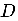 或 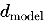） |
|  | 自然数  | 物理上互不相同的层数（）以及沿深度方向的循环迭代次数 / 循环轮数（）3 |
|  | 自然数  | 查询头数（）、键值头数（GQA/MQA 中的 ）以及单个头的维度（）30 |
| 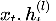 | 向量  | 步 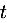 上的输入向量，以及第  层在步  上的隐藏状态 |
| 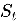 | 矩阵  或向量  | SSM 与线性注意力中大小固定的循环状态（快权重 / 联想记忆）25 |
|  | 二元张量算子 | 逐元素的哈达玛（Hadamard）积（）与外积 / 克罗内克（Kronecker）积（） |
|  | 非线性激活函数 | 逻辑斯谛 sigmoid 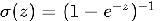 与函数 （Swish-1） |
|  | 泛函  | 库尔贝克—莱布勒（Kullback—Leibler）散度 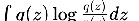 |

下面给出核心架构与算法机制的严格定义：

* **反向模式自动微分（Reverse-Mode AD / Backpropagation，反向传播）**——一种精确计算标量损失函数  对无环计算图所有节点的梯度的算法，其耗时与一次前向传播成正比，做法是将伴随导数  从输出递归地传播到输入7。  
* **自适应计算时间（Adaptive Computation Time，ACT / Early Exit Gate）**——通过可学习的停止门 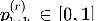 为每个 token 动态分配循环迭代次数  的机制，使模型能把更多算术运算花在逻辑上复杂的位置上41。  
* **快权重与测试时训练（Fast Weights / Test-Time Training，TTT）**——内部子网络或联想记忆矩阵  的参数，它们在推理阶段被动态更新（通过 Hebb 规则、德尔塔规则或针对自监督损失的梯度下降步），从而把长上下文压缩进固定大小的存储中44。  
* **向量量化、残差向量量化与有限标量量化（VQ / RVQ / FSQ）**——对连续潜在向量  的离散化：或通过搜索码本中最近的元素（VQ），或通过对  个码本逐级量化残差（SoundStream、EnCodec、Mimi 中的 Residual VQ），或直接在有界整数格点上逐坐标取整而无需可学习码本（CosyVoice 3 中的 Finite Scalar Quantization）46。  
* **分组查询注意力（Grouped-Query Attention，GQA）与多查询注意力（MQA）**——令同一组键和值投影  在全部  个查询头之间共享（，MQA），或在  个分组内共享（，GQA），从而成倍减少 KV 缓存的体积以及解码时来自显存 HBM 的流量39。  
* **压缩潜在缓存注意力（Multi-Head Latent Attention，MLA）**——将隐藏状态投影为单个低秩向量 （），并另设一条小维度分支用于 Decoupled RoPE 位置编码；推理时只缓存压缩后的潜在向量，使模型层面的 KV 缓存内存减少 93.3%（相对于 128 头 MHA，按单层计算最高达 98.24%）50。  
* **组相对策略优化（Group Relative Policy Optimization，GRPO）**——一种无需独立评论家网络（value model）的强化学习算法，它通过对同一提示生成的  条轨迹组内的奖励做标准化来估计优势 53。  
* **线性注意力中的德尔塔规则（DeltaNet / Gated DeltaNet / KDA）**——以带衰减  的广义豪斯霍尔德（Householder）反射取代加法写入 ：在写入新值  之前，先按键  擦除旧值（其中 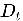 在 GDN 中为标量 ，在 KDA 中为对角矩阵 ）24。  
* **离散文本扩散（Masked / Uniform Diffusion Language Models，dLLM / MDM / UDLM）**——基于双向 Transformer 的非自回归语言模型，通过最小化加权的似然变分界，从掩码 \[MASK\]（MDM：MDLM、LLaDA、Dream、Mercury）或随机词表替换（UDLM）中并行地恢复 token35。  
* **潜在表示对齐（Representation Alignment，REPA / JEPA）**——一类训练原理：在视觉世界理解中（I-JEPA、V-JEPA），网络在 EMA 编码器的空间中预测被掩码块的隐藏表示，而无需生成像素；在扩散生成中（REPA），DiT 的中间层按余弦相似度与预训练视觉教师（例如 DINOv2）的特征对齐36。  
* **流形约束超连接（Manifold-Constrained Hyper-Connections，mHC）**——把 Transformer 的残差流从单个向量  扩展为  条并行通道 ，其中通道混合矩阵由 Sinkhorn—Knopp 算法投影到由双随机矩阵构成的伯克霍夫多面体上，使信号在任意深度上都做非扩张传播（）2。  
* **状态空间模型（Structured State Space Models，SSM / S4 / Mamba）**——线性动力系统 ，以步长  离散化；在选择性 SSM（Mamba-1/2/3）中，参数  依赖于输入，使训练对  呈线性并行，推理时每步仅需常数内存 32。  
* **多 token 预测（Multi-Token Prediction，MTP）**——一种训练与自推测解码架构：在模型共享主干之上，由级联的头预测未来的多个文本 token 或音频码本 RVQ 的残差层级29。  
* **正交化矩阵动量（Muon / MuonClip）**——面向二维矩阵层的优化器，它用动量矩阵  的近似正交化（牛顿—舒尔茨（Newton—Schulz）多项式迭代，）取代梯度的逐坐标缩放，从而使更新步的奇异值谱趋于平坦65。  
* **深度注意力残差连接（Attention Residuals，AttnRes）**——把对所有前序层输出的固定求和，替换为沿深度轴（对先前各块）的可学习 softmax 注意力，从而消除深层 Pre-LN Transformer 中特征范数被稀释的问题34。  
* **全双工语音模型（Full-Duplex Speech-to-Speech，STS）**——同步处理输入的用户音频 token 流，并生成并行的“内心独白”（文本）流与回复音频 token 流的架构（Moshi、PersonaPlex、NemotronLabs VoiceChat），无需切分为轮流发言，因而支持打断与插话，延迟为 160–205 毫秒68。  
* **旋转位置嵌入（Rotary Position Embedding，RoPE / p-RoPE / 3D-RoPE / TMRoPE）**——通过将查询  与键  的坐标对旋转角度  来编码相对位置，使得标量积  仅依赖于偏移 ；可推广为仅旋转一部分子空间（\-RoPE），以及视频和音频的时空轴（3D-RoPE、TMRoPE）71。  
* **稀疏混合专家（Sparse Mixture-of-Experts，MoE / LatentMoE）**——以由  个专家子网络组成的池取代稠密 FFN 层，每个 token 激活其中  个专家；在 **LatentMoE** 中，输入向量先被压缩为低维潜在向量，以降低权重读取与服务器间 All-to-All 传输的流量27。  
* **稀疏硬件对齐注意力（NSA / DSA / CSA）**——可学习的稀疏注意力机制（Native Sparse Attention、DeepSeek Sparse Attention、Compressed Sparse Attention），利用分层分块压缩或轻量索引器（lightning indexer）为每个查询挑选 top\- 个键，使注意力复杂度从  降至 31。  
* **循环深度（环路）Transformer（Looped / Recurrent-Depth Transformer，PLT）**——跨深度共享权重的架构，把隐藏状态通过同一个层块反复送入  次（Huginn、Ouro）；在 **Parallel Loop Transformer（PLT）** 中，相邻 token 的串行迭代在一次并行前向中以流水线方式执行（Cross-Loop Parallelism）3。  
* **整流流与流匹配（Flow Matching / Rectified Flow）**——沿数据与高斯噪声之间的线性插值  直接回归速度场，以训练生成式 ODE ，从而只需少量欧拉步即可实现快速的确定性生成5。  
* **token 与时长转录器（Token-and-Duration Transducer，TDT）**——流式 ASR 解码器 RNN-T 的扩展，联合预测子词 token 及其所覆盖的声学帧数 ，以便在推理时跳过平稳段与停顿79。

## **1958**

**领域：** 基础  
神经网络参数化学习的起点，是弗兰克·罗森布拉特（Frank Rosenblatt）在《Psychological Review》上发表的 *«The Perceptron: A Probabilistic Model for Information Storage and Organization in the Brain»*（№ 1\），以及 Mark I Perceptron 机器在康奈尔航空实验室的硬件实现（事先在 IBM 704 大型机上做过模拟）82。与麦卡洛克（McCulloch）和皮茨（Pitts）（1943）固定的逻辑元件不同，罗森布拉特的感知机把感觉视网膜（\-单元）、随机非线性联想投影层（\-单元，特征 ）与可学习的阈值求和器（\-单元）区分开来，由后者给出分离超平面：  
  
误差校正规则仅在被错误分类的对象  上更新权重 ，其中 ，更新公式为 83。同在 1958 年，约翰·冯·诺伊曼（John von Neumann）的专著 *«The Computer and the Brain»*（№ 2）遗作出版，首次把大脑突触记忆的大规模并行、低频架构与数字计算机的串行瓶颈相对照。尽管罗森布拉特在 1958 年就已考虑过多层方案，但他缺少针对隐藏层的可微信用分配算法7。

## **1959**

**领域：** 编码器 基础  
1959 年，未来深度网络的三大概念支柱出现了：视觉滤波器的神经生理学层级结构、并行级联识别，以及评估函数随时间的自举（bootstrapping）。大卫·休贝尔（David Hubel）与托尔斯滕·维泽尔（Torsten Wiesel）在《The Journal of Physiology》上的论文（№ 3\）中，于猫的纹状皮层发现了局部的方向选择性感受野，它成为卷积核的生物学原型85。同时，奥利弗·塞尔弗里奇（Oliver Selfridge）在泰丁顿研讨会上提出了 **Pandemonium** 架构（№ 4\）——一种由“特征魔鬼”、对其加权的“认知魔鬼”以及选取最大响应  的顶层“决策魔鬼”构成的并行层级结构87。同年，亚瑟·塞缪尔（Arthur Samuel）在《IBM Journal of Research and Development》上发表了关于自学习跳棋程序的著名论文（№ 5），确立了 *machine learning*（机器学习）这一术语，并引入了依据当前局面与后继局面评估值之差来更新评估多项式权重的做法——这直接是时序差分方法（TD learning）和强化学习中评论家的原型。

## **1960**

**领域：** 基础 优化  
从感知机不连续的阈值规则向平滑梯度优化的转变，是由伯纳德·威德罗（Bernard Widrow）与马西安·霍夫（Marcian Hoff）完成的，他们提出了自适应线性节点 **ADALINE** 和最小二乘算法 **LMS**（Widrow–Hoff / Delta Rule，№ 6\）88。ADALINE 的原则性创新在于：误差是在二值阈值量化器 *之前*，根据连续的线性输出  计算的。对瞬时二次误差  做随机梯度下降，便得到经典的德尔塔规则：  
  
正是这一方程——改写为矩阵联想记忆形式 ——构成了现代线性 Transformer **DeltaNet** 与 **Gated DeltaNet**（2024–2026）的基础25。同在 1960 年，亨利·凯利（Henry Kelley）在《ARS Journal》上发表了论文 *«Gradient Theory of Optimal Flight Paths»*（№ 7），推导出沿动力系统轨迹反向传播代价泛函导数的连续伴随方程方法——它是反向传播算法和 Neural ODE 二者在分析意义上的先驱7。

## **1961**

**领域：** 循环 记忆 基础  
1961 年，德国控制论学者卡尔·施泰因布赫（Karl Steinbuch）在《Kybernetik》第一卷上发表了 *«Die Lernmatrix»*（“学习矩阵”，№ 8\）——这是第一个基于导线交叉点阵的异联想记忆矩阵架构91。在施泰因布赫矩阵中，输入特征向量  与类别码  通过 Hebb 型局部规则  相互关联，而提取则通过并行的矩阵—向量乘法  并配合竞争性最大值选取来完成。从代数上看，“学习矩阵”奠定了现代线性键—值联想记忆  的雏形。同年，爱德华多·卡亚涅洛（Eduardo Caianiello）在《Journal of Theoretical Biology》（№ 9\）中把神经网络动力学划分为两个相互耦合的时间尺度：激活弛豫的快速“神经方程”，以及突触权重可塑性的缓慢绝热“记忆方程”。

## **1962**

**领域：** 基础 编码器  
1962 年 4 月，数学家阿尔伯特·诺维科夫（Albert Novikoff）给出了**感知机收敛定理**的严格而简洁的证明（№ 10；同年 H. D. 布洛克（H. D. Block）发表了相关估计，№ 13\）92。诺维科夫证明：若样本集  的输入范数有界 ，且可由单位向量 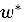（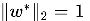）以正间隔  线性分离，则从零向量 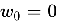 出发的感知机算法至多经过  次更新即告终止。在每个错误样本上，与“神谕”向量的标量积至少增加 （），而错误条件  把范数平方的增量上界限定为 （），由此得到一个完全不依赖于空间维数 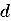 的估计83：  
  
同年出版的还有弗兰克·罗森布拉特的总结性专著 *«Principles of Neurodynamics»*（№ 11）、伯纳德·威德罗的分段线性架构 **MADALINE**（№ 12\），以及休贝尔与维泽尔的经典论文（№ 14），后者描述了视觉皮层中 *简单细胞*（局部线性边缘检测器）与 *复杂细胞*（空间不变的池化）的交替排列87。

## **1963**

**领域：** 基础 优化  
弗拉基米尔·瓦普尼克（Vladimir Vapnik）与亚历山大·勒纳（Alexander Lerner）在发展分离间隔  的几何学时，于《Автоматика и телемеханика》（《自动化与远程力学》）上发表了论文 *《利用广义肖像进行模式识别》*（№ 15\）97。作者没有去寻找任意的分离超平面，而是把问题表述为二次优化问题，即求唯一的**最大间隔超平面**（支持向量机 SVM 的线性原型），其法向量仅由样本中最外缘的支持向量 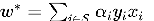 展开。这样，作为分类器容量度量的权重范数  控制原则便进入了学习理论。同年，施泰因布赫与皮斯克（Piske）在《IEEE Transactions on Electronic Computers》上发表了关于含噪信号下连续记忆矩阵的分析（№ 16），而斯图尔特·德雷福斯（Stuart Dreyfus）则借助动态规划简化了伴随乘子链式法则的推导（№ 17\）7。

## **1964**

**领域：** 优化 基础  
1964 年诞生了三种直接用于现代深度学习框架的数学工具。鲍里斯·特奥多罗维奇·波利亚克（Boris Polyak）在《Журнал вычислительной математики и математической физики》（《计算数学与数学物理杂志》）上发表了惯性的 **“重球”（Heavy-Ball Momentum）** 方法（№ 18\），用于在病态的沟壑型问题中加速梯度下降100：  
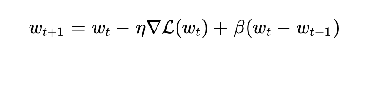  
惯性项  抑制了梯度的横向振荡，并把二次问题的有效条件数从  缩减为 。与此同时，马克·艾泽尔曼（Mark Aizerman）、埃马努伊尔·布拉韦尔曼（Emmanuil Braverman）与列夫·罗佐诺埃尔（Lev Rozonoer）在《Автоматика и телемеханика》上引入了**势函数方法**（№ 19\）——这是对 *核技巧*  的严格论证，与未来线性注意力的核分解直接相关20。同年，罗伯特·文格特（Robert Wengert）在《Communications of the ACM》（№ 20\）上提出了基于基本运算列表的**前向模式自动微分（Forward-Mode AD）**程序算法。

## **1965**

**领域：** 基础 优化  
1965 年，阿列克谢·格里戈里耶维奇·伊瓦赫年科（Alexey Ivakhnenko）与瓦连京·格里戈里耶维奇·拉帕（Valentin Lapa）出版了专著 *《控制论预测装置》*（№ 21），描述了首批可运行的、隐藏层数任意的**深度多层感知机**逐层训练算法7。网络的每个节点都计算带有输入乘积项的柯尔莫哥洛夫—伽柏（Kolmogorov—Gabor）二次多项式（——这是 GLU 与 SwiGLU 门控单元的代数先驱），系数由最小二乘法求得，而验证集在构建下一层之前会淘汰过拟合的神经元7。  
与此同时，托马斯·科弗（Thomas Cover）在《IEEE Transactions on Electronic Computers》上证明了基础性的**科弗线性可分容量定理**（№ 22）：一般位置的  个点在  中可线性实现的二元划分数等于 ，恰好是全部 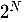 种二分法的一半（当  时），当 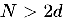 时则以指数速度趋于零。这一几何事实解释了为什么 MLP 与 MoE 的隐藏层中需要宽的特征投影。这一年还添上了尼尔斯·尼尔森（Nils Nilsson）的经典著作 *«Learning Machines»*（№ 23\）88，以及用于线性不等式组的 Ho—Kashyap 梯度方法（№ 24）。

## **1966**

**领域：** 优化 基础  
1966 年，雅科夫·扎尔马诺维奇·齐普金（Yakov Tsypkin）在 *《自动系统中的适应、学习与自学习》*（《Автоматика и телемеханика》，№ 25\）一文中，借助 Robbins—Monro 递推随机逼近 ，把零散的感知机、ADALINE 与滤波规则统一为一个变分问题，即**损失函数数学期望（平均风险）最小化** 105。这一提法成为现代神经网络优化理论的标准语言。同年，埃马努伊尔·布拉韦尔曼把势函数方法推广到无监督自学习与聚类问题（№ 26\）20，而劳伦斯·福格尔（Lawrence Fogel）、艾尔文·欧文斯（Alvin Owens）与迈克尔·沃尔什（Michael Walsh）出版了专著 *«Artificial Intelligence through Simulated Evolution»*（№ 27），开启了无梯度的演化搜索方向。

## **1967**

**领域：** 基础 优化  
1967 年 6 月，甘利俊一（Shun'ichi Amari）在《IEEE Transactions on Electronic Computers》上发表了论文 *«A Theory of Adaptive Pattern Classifiers»*（№ 28\）——这是史上第一项把**端到端随机梯度下降（end-to-end SGD）**用于训练带非线性隐藏层的多层神经网络、并应用于线性不可分分布的工作7。甘利以光滑可微的激活函数取代阈值阶跃，推导出隐藏权重  修正的链式法则，并在 1986 年 *Nature* 论文发表的十九年之前，通过实验训练了一个 5 层分类器7。  
同年还出现了两项具有深远意义的工作：托马斯·科弗与彼得·哈特（Peter Hart）证明了最近邻规则的渐近误差估计（，№ 29），为向量检索与 RAG 系统奠定了理论基础；而理查德·辛克霍恩（Richard Sinkhorn）与保罗·克诺普（Paul Knopp）在《Pacific Journal of Mathematics》上发表了把正矩阵的行与列交替归一化为双随机形式的定理和迭代算法（№ 30\）——这正是 **Sinkhorn–Knopp** 算子，它在 2025–2026 年之交保证了 DeepSeek 架构中多通道超连接 **mHC** 的稳定性2。

## **1968**

**领域：** 基础 循环  
1968 年，阿列克谢·伊瓦赫年科在《Автоматика》杂志上（№ 31\）将**数据分组处理方法（МГУА / Group Method of Data Handling，GMDH）**成形104，系统化了深度多项式网络的自动增长，包括对最优神经元的规则化选取，以及在独立验证集上提前终止深度。与此同时，斯蒂芬·格罗斯伯格（Stephen Grossberg）在 *PNAS* 上发表了联想学习的非线性模型 **Outstar**，以及短时（STM）与长时（LTM）记忆的微分方程组（№ 32\）109：  
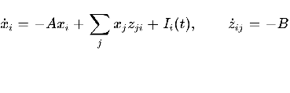  
并证明了突触权重无条件收敛到输入模式的空间比例。同年，弗拉基米尔·瓦普尼克与阿列克谢·切尔沃宁基斯（Alexey Chervonenkis）在《Доклады АН СССР》（《苏联科学院报告》）上发表了关于经验频率在事件类上一致收敛于概率的定理，并引入了函数族容量的组合度量——**瓦普尼克—切尔沃宁基斯维数（VC-dimension）**（№ 33）。

## **1969**

**领域：** 基础 编码器 优化  
1969 年，马文·明斯基（Marvin Minsky）与西摩·派珀特（Seymour Papert）出版了分析性专著 *«Perceptrons: An Introduction to Computational Geometry»*（№ 34\）7。借助群的不变量理论，作者严格证明了单层感知机在局部特征阶数有限的条件下，无法实现奇偶谓词（包括两比特的 **XOR**）和拓扑连通性谓词。尽管作者指出多层网络并不受此限制，但由于缺少一种在西方广为人知的隐藏层有效训练算法，英语学术界对联结主义的兴趣趋冷7。  
然而，同在 1969 年，现代深度学习的两个关键要素相继发表。阿瑟·布赖森（Arthur Bryson）与何毓琦（Yu-Chi Ho）在书 *«Applied Optimal Control»*（№ 35\）中写出了拉格朗日乘子经多步级联  反向传播的显式离散公式7。与此同时，福岛邦彦（Kunihiko Fukushima）在论文 *«Visual Feature Extraction by a Multilayered Network of Analog Threshold Elements»*（*IEEE Transactions on Systems Science and Cybernetics*，№ 36\）85 中引入了带有**模拟半波整流器**  的多层视觉网络——这在历史上是 **ReLU** 激活函数在多层神经网络中的首次应用7。

## **1970**

**领域：** 基础 优化  
1970 年，芬兰数学家塞波·林奈因马（Seppo Linnainmaa）在赫尔辛基大学通过了硕士学位论文（№ 37\）7，其中首次针对任意计算图提出并以机器码实现了**反向模式自动微分（Reverse-Mode Automatic Differentiation）**的通用算法。若标量损失函数  的计算被分解为基本节点 （），则从  到  的反向传递递归地累积偏导数：  
  
对任意数量参数 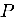 计算完整的梯度向量 ，其代价仅为一次前向传播运算量的常数倍114。同在 1970 年，布罗伊登（Broyden）、弗莱彻（Fletcher）、戈德法布（Goldfarb）与香农（Shanno）各自独立地推导出二阶拟牛顿方法 **BFGS**（№ 38），而伊瓦赫年科则在国际期刊 *Automatica* 上发表了关于深度网络启发式自组织的综述（№ 39\）115。

## **1971**

**领域：** 基础 记忆  
1971 年 10 月，阿列克谢·伊瓦赫年科在 *IEEE Transactions on Systems, Man, and Cybernetics* 上发表论文 *«Polynomial Theory of Complex Systems»*（№ 40\）115，详细描述了按 GMDH 方法构建并训练**8 层深度**前馈网络的过程，并在验证集上以正则化方式选择特征7。这篇文章成为国际文献中最早被广泛引用的、实际训练深度八层架构的例子之一7。  
同年，大卫·马尔（David Marr）在 *Philosophical Transactions of the Royal Society B* 上发表了海马体的数学模型 *«Simple Memory: A Theory for Archicortex»*（№ 41\）7。马尔表明：高维空间中对输入向量的稀疏编码，加上局部 Hebb 可塑性与自适应抑制阈值，能够一次遍历就写入大量情景联想，并凭借部分线索无误地将其恢复——这一原理是现代稀疏外部记忆模块与参数化记忆模块的基础。

## **1972**

**领域：** 循环 记忆  
1972 年 11 月，甘利俊一在 *IEEE Transactions on Computers* 上发表论文 *«Learning Patterns and Pattern Sequences by Self-Organizing Nets of Threshold Elements»*（№ 42），比霍普菲尔德的论文早十年，推导出离散循环联想网络（**甘利—霍普菲尔德网络**）的稳定性方程，既适用于权重矩阵对称的静态吸引子，也适用于权重矩阵非对称的序列动态链7：  
  
同在 1972 年，图沃·科霍嫩（Teuvo Kohonen）在 *IEEE Transactions on Computers* 上独立地引入了相关矩阵记忆（№ 43\）118；詹姆斯·安德森（James Anderson）在 *Mathematical Biosciences* 上描述了线性—阈值交互记忆（№ 44）；中野馨（Kaoru Nakano）构建了联想系统 **Associatron**（№ 45\）7；休·威尔逊（Hugh Wilson）与杰克·考恩（Jack Cowan）在 *Biophysical Journal* 上导出了相互耦合的兴奋性与抑制性神经元群体的非线性 ODE 系统（，№ 46），并从解析上证明了振荡极限环与记忆的多稳态滞后之间的联系119。

## **1973**

**领域：** 编码器 循环  
1973 年，克里斯托夫·冯·德尔·马尔斯堡（Christoph von der Malsburg）在 *Kybernetik* 上发表论文 *«Self-Organization of Orientation Sensitive Cells in the Striate Cortex»*（№ 47\）115——这是对局部特征检测器**竞争性自学习（competitive learning）**的首次计算机演示。他把近程皮层内兴奋、侧向抑制与 Hebb 规则结合起来，并**保持每个神经元输入突触的 \-范数不变**（），展示了在没有教师的情况下方向柱有序图谱的自发形成。  
与此同时，斯蒂芬·格罗斯伯格在 *Studies in Applied Mathematics* 上发表了对带乘性饱和与除法型侧向抑制的**分流（shunting）循环网络**的严格分析（№ 48\）109：他证明，正是 S 形传递特性抑制了小幅度的背景噪声，并在输入总亮度任意增大时仍保持模式的相对对比度而不饱和——这是激活归一化层的理论基础。休·威尔逊与杰克·考恩把他们的群体动力学推广到皮层与丘脑在空间上连续的神经场（№ 49\）124。

## **1974**

**领域：** 基础 优化 循环  
1974 年，保罗·韦尔博斯（Paul Werbos）在哈佛大学通过了博士论文 *«Beyond Regression: New Tools for Prediction and Analysis in the Behavioral Sciences»*（№ 50\）7。韦尔博斯提出了“动态反馈”方法——把目标函数的导数沿链式规则反向传播，穿过任意带非线性节点的多层网络的显式公式——为 1980 年代初把该方法直接应用于神经网络做了准备115。  
同年，物理学家威廉·利特尔（William Little）在 *Mathematical Biosciences* 上发表了论文 *«The Existence of Persistent States in the Brain»*（№ 51\）126，在**伊辛（Ising）自旋系统**的统计物理与随机循环神经网络之间建立了直接对应。他引入突触噪声的有效温度  与神经元发放的逻辑斯谛概率 ，把长期记忆描述为马尔可夫转移矩阵退化的最大本征态——这是玻尔兹曼机与热力学生成模型的基础。

## **1975**

**领域：** 编码器 记忆 基础  
1975 年，福岛邦彦在 *Biological Cybernetics* 上提出了多层自组织网络 **Cognitron**（№ 52\）86。在 Cognitron 中，局部的兴奋性与抑制性感受野与分流式除法关系 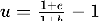 相结合，并且只对邻域内最活跃神经元的突触进行竞争性增强；但该网络尚未在整个平面上共享权重，因而对图像的平移仍然敏感129。  
同时，相邻领域出现了三项标志性工作：詹姆斯·阿尔布斯（James Albus）创建了具有重叠粗粒度感受野的快速局部哈希式小脑控制器架构 **CMAC**（№ 53\）130；戴维·谢林顿（David Sherrington）与斯科特·柯克帕特里克（Scott Kirkpatrick）在 *Physical Review Letters* 上引入了带随机变号耦合  的可解**自旋玻璃 SK 模型**（№ 54\）126，其解析的复本方法成为计算神经网络相变与容量的基础；而约翰·霍兰德（John Holland）出版了专著 *«Adaptation in Natural and Artificial Systems»*（№ 55），奠定了遗传算法的数学基础。

## **1976**

**领域：** 优化 循环 基础  
1976 年 6 月，塞波·林奈因马在国际期刊 *BIT Numerical Mathematics* 上发表了英文论文 *«Taylor Expansion of the Accumulated Rounding Error»*（№ 56\）23。除了在计算图上给出一阶及高阶反向微分的完整算法之外，林奈因马还首次分析了反向传播的一个根本性内存问题——必须保存所有运算的中间状态——以及降低峰值内存消耗的方法，预示了现代选择性重新计算激活的技术（**activation / gradient checkpointing**，尤其用于 Ring Attention 与 DeepSeek mHC2 的训练）。  
同年，斯蒂芬·格罗斯伯格在 *Biological Cybernetics* 的两部分论文中（№ 57\）126 提出了**稳定性—可塑性困境**（如何让网络学习新类别而不灾难性地破坏先前学到的表示），并提出了以自上而下的预期对自下而上特征进行共振滤波的机制（**Adaptive Resonance Theory，ART**）；戴维·威尔肖（David Willshaw）与克里斯托夫·冯·德尔·马尔斯堡则构建了视网膜连续拓扑投影自组织的突触模型（№ 58）。

## **1977**

**领域：** 循环 记忆 优化  
1977 年，詹姆斯·安德森、杰克·西尔弗斯坦（Jack Silverstein）、斯蒂芬·里茨（Stephen Ritz）与兰德尔·琼斯（Randall Jones）在 *Psychological Review* 上发表了类别记忆的非线性循环模型 **Brain-State-in-a-Box（BSB）**（№ 59\）122，它用单位超立方体  的壁约束正反馈轨迹：  
  
对称的 Hebb 连接矩阵  沿主特征向量方向强化投影，直至状态在超立方体对应于纯离散记忆原型的顶点处稳定下来。同年，甘利俊一发表了带侧向抑制的连续神经场中局域兴奋（工作记忆“凸起”（bumps））的经典数学理论（№ 60\）124，图沃·科霍嫩出版了专著 *«Associative Memory»*（№ 61），而阿瑟·登普斯特（Arthur Dempster）、南·莱尔德（Nan Laird）与唐纳德·鲁宾（Donald Rubin）在 *JRSS-B* 上通过 Jensen 变分界将含隐变量模型的似然最大化形式化为 **EM 算法**（№ 62\）——这是训练 MoE 与变分自编码器的分析基础。

## **1978**

**领域：** 记忆 循环 基础  
1978 年，威廉·利特尔与戈登·肖（Gordon Shaw）在 *Mathematical Biosciences* 上发表了 *«Analytic Study of the Memory Storage Capacity of a Neural Network»*（№ 63\）127。通过解析求解带可塑连接的随机神经网络的线性化模型，作者严格表明：分布式神经记忆的信息容量与**突触数**  成正比，而不是与神经元数  成正比127。在现代工程中，这一规律恰恰解释了：即使处理一个 token 只需要一小部分活跃神经元，存储世界知识仍然需要把权重参数总量扩展到数千亿乃至稀疏 MoE 架构中的万亿。  
同年，吉迪恩·施瓦茨（Gideon Schwarz）在 *Annals of Statistics* 上引入了用于参数模型维度选择的贝叶斯信息准则 **BIC**（№ 64），斯蒂芬·格罗斯伯格提出了工作记忆中序列层级分块（chunking）理论（№ 65\）109，而福岛邦彦改进了用于深度无监督自学习的均方型突触规则（№ 66\）129。

## **1979**

**领域：** 编码器 基础  
1979 年 10 月，福岛邦彦在日本期刊 *Transactions of the IECE of Japan*（J62-A 卷，第 10 期，第 658–665 页）上发表了第一篇关于 **Neocognitron** 架构的论文——这是第一个对输入图像的空间平移具有不变性的深度卷积神经网络（№ 67\）7。受休贝尔与维泽尔发现的启发，福岛把网络组织为由两类层成对构成的多级交替结构：**\-细胞**平面，同一平面内的所有神经元具有*完全相同的共享权重*（weight sharing），在二维场的每个点上提取局部特征（带 ReLU 整流的 2D 卷积运算）；以及 **\-细胞**平面，它对 \-细胞局部邻域的响应进行聚合并降低分辨率（空间池化运算），由此，容许的平移误差逐层平滑累积，而不丢失细节之间的相互几何关系87。同年，利昂·库珀（Leon Cooper）、F. 利伯曼（F. Liberman）与埃尔基·奥亚（Erkki Oja）在 *Biological Cybernetics* 上发表了视觉皮层神经元选择性形成的突触模型（№ 68）。

## **1980**

**领域：** 编码器 优化  
1980 年 4 月，福岛邦彦的经典英文论文 *«Neocognitron: A Self-Organizing Neural Network Model for a Mechanism of Pattern Recognition Unaffected by Shift in Position»*（№ 69\）86 发表于 *Biological Cybernetics*（第 36 卷，第 193–202 页），使卷积—池化层级结构为全世界学界所知。在特征平面  第  层的位置  上，\-细胞的响应在局部窗口  内受均方活动  的除法抑制，由下式给出：  
  
这样，深度视觉网络的全部结构拓扑——带权重共享的多通道 2D 卷积、整流 、局部均方归一化与空间池化——就已完全构建起来，只待以全局梯度下降取代局部自组织规则87。同年，斯蒂芬·格罗斯伯格在 *Psychological Review* 上发表了关于共振认知编码的综述性论文（№ 70），而维尔弗里德·鲍尔（Walter Baur）与福尔克尔·施特拉森（Volker Strassen）证明了著名的代数复杂度定理（Baur–Strassen Theorem，№ 71）：在算术电路上计算任意多元有理函数的梯度，所需运算量不超过计算该函数本身所需运算量的五倍114。

## **1981**

**领域：** 记忆 循环 优化  
1981 年，杰弗里·辛顿（Geoffrey Hinton）与詹姆斯·安德森出版了纲领性的合著专著 *«Parallel Models of Associative Memory»*（№ 72\）140，论证了从符号化的局部主义节点（“一个概念——一个单元”）向稠密的**分布式向量表示**（distributed representations）的转变：每个概念由众多单元的活动模式编码，从而实现依据微特征相似性的自动泛化。同年，詹姆斯·麦克莱兰（James McClelland）与戴维·鲁梅尔哈特（David Rumelhart）在 *Psychological Review* 上提出了带双向层间反馈的字母与单词知觉的**交互激活模型**（№ 73），而安德鲁·巴托（Andrew Barto）、理查德·萨顿（Richard Sutton）与彼得·布劳尔（Peter Brouwer）在 *Biological Cybernetics* 上发表了**联想搜索网络**模型（№ 74），把随机动作生成与基于标量强化信号的学习结合起来——这是基于梯度的强化学习方法的直接前驱。

## **1982**

**领域：** 循环 记忆 编码器 基础  
1982 年 4 月，约翰·霍普菲尔德（John Hopfield）在 *PNAS* 上发表了著名论文 *«Neural Networks and Physical Systems with Emergent Collective Computational Abilities»*（№ 75\）124。他为权重矩阵  对称（）的二值循环网络  对应地给出了显式的物理**李雅普诺夫（Lyapunov）能量函数**：  
  
霍普菲尔德证明了在异步阈值更新  下能量单调不增（），并收敛到局部极小——即可按内容寻址的记忆吸引子（经典二值版本的容量约为 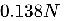 个互不相关的模式，而 2016–2020 年的现代连续霍普菲尔德网络具有指数级容量，并等价于 Transformer 的 softmax 注意力142）。  
同在 1982 年，保罗·韦尔博斯在 IFIP 会议上首次明确发表了把误差反向传播直接用于人工神经网络的工作（№ 76\）7；图沃·科霍嫩创建了拓扑式**自组织特征映射（SOM）**（№ 77）；埃尔基·奥亚推导出局部归一化的可塑性规则 （**奥亚规则**，№ 78），它提取数据协方差矩阵的主特征向量（神经 PCA）；比嫩斯托克（Bienenstock）、库珀与门罗（Munro）提出了带滑动阈值的非线性突触修饰规则 **BCM**（№ 79）；并且戴维·马尔的基础性著作 *«Vision»*（№ 80）以遗作形式问世。

## **1983**

**领域：** 优化 循环  
1983 年，尤里·叶夫根尼耶维奇·涅斯捷罗夫（Yurii Nesterov）在《Доклады АН СССР》（《苏联科学院报告》，*Soviet Mathematics Doklady*，27(2)，372–376）上发表了以收敛速率  最小化光滑凸函数的最优方法——**涅斯捷罗夫加速梯度法（NAG）**（№ 81\）143：  
  
在前瞻的惯性点  处计算梯度，使轨迹在损失地形的陡峭转弯处得到修正，并成为现代 SGD、NAdam 以及正交化动量 Muon 改进版本中的标准做法。在 *Science* 五月号上，斯科特·柯克帕特里克、查尔斯·杰拉特（Charles Gelatt）与马里奥·韦基（Mario Vecchi）提出了采用 **模拟退火（Simulated Annealing）** 的随机全局优化，其转移概率为 Metropolis 型 （№ 82\）144，而安德鲁·巴托、理查德·萨顿与查尔斯·安德森（Charles Anderson）在 *IEEE TSMC* 上发表了应用于倒立摆平衡任务的神经网络架构 **Actor–Critic**（№ 83\）144。

## **1984**

**领域：** 基础 循环 扩散  
1984 年 11 月，莱斯利·瓦利安特（Leslie Valiant）在 *Communications of the ACM* 上发表了论文 *«A Theory of the Learnable»*（№ 84\）146，为**概率近似正确学习（PAC Learning）**奠定了严格的计算—统计基础：它将以置信度  达到泛化误差  所需的样本复杂度与计算复杂度形式化。同年，约翰·霍普菲尔德把他的模型推广到带光滑单调 sigmoid  与连续李雅普诺夫泛函的连续动力学回路（№ 85），斯图尔特·杰曼（Stuart Geman）与唐纳德·杰曼（Donald Geman）兄弟在 *IEEE TPAMI* 上，针对具有吉布斯分布  的马尔可夫随机场，引入了用于含噪图像贝叶斯恢复的**吉布斯采样（Gibbs Sampling）**（№ 86），而图沃·科霍嫩则出版了扩充版专著 *«Self-Organization and Associative Memory»*（№ 87）。

## **1985**

**领域：** 基础 记忆 扩散  
1985 年，戴维·阿克利（David Ackley）、杰弗里·辛顿与特伦斯·谢诺夫斯基（Terrence Sejnowski）在 *Cognitive Science* 上发表了**玻尔兹曼机**的学习算法（№ 88\）146——这是带有*隐变量*  的随机能量网络，通过边缘化  对可见向量  的分布建模。库尔贝克—莱布勒散度对对称权重  的梯度化为两种热力学状态下成对相关性之差：  
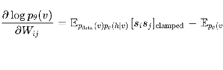  
尽管长时间的 MCMC 退火限制了全连接玻尔兹曼机的规模，但这是在生成式网络中学习深度分布式表示的第一次理论上严格的演示150。同在 1985 年，杨立昆（Yann LeCun）在巴黎 *Cognitiva 85* 会议上（№ 89\）与戴维·帕克（David Parker）在 MIT 报告 *«Learning-Logic»* 中（№ 90\）各自独立地发表了多层网络误差反向传播的梯度方案，而戴维·鲁梅尔哈特与戴维·齐普泽（David Zipser）则系统化了特征的竞争性聚类（№ 91）。

## **1986**

**领域：** 基础 循环 优化  
1986 年 10 月，戴维·鲁梅尔哈特、杰弗里·辛顿与罗纳德·威廉姆斯（Ronald Williams）在 *Nature* 上发表了著名论文 *«Learning Representations by Back-Propagating Errors»*（№ 92），与此同时 PDP 小组的两卷本基础性著作 *«Parallel Distributed Processing»*（MIT Press，№ 93\）出版7。作者表明：带光滑激活  的多层感知机（MLP），通过敏感度向量的递归传播来训练：  
  
可以在中间层构造出非平凡的语义表示，并求解非线性可分的谓词151。在同一部 PDP 中，保罗·斯莫伦斯基（Paul Smolensky）引入了不含层内连接的二部能量网络 **Harmonium**——它在数学上等价于具有精确一步条件推断  的**受限玻尔兹曼机（RBM）**（№ 94）；迈克尔·乔丹（Michael Jordan）提出了把输出反馈到上下文状态向量 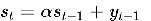 的循环网络（**Jordan RNN**，№ 95）；而特伦斯·谢诺夫斯基与查尔斯·罗森伯格（Charles Rosenberg）展示了英文文本音素转写合成器 **NETtalk**（№ 96）。

## **1987**

**领域：** STT 循环 编码器  
1987 年，亚历山大·魏贝尔（Alex Waibel）、花泽辰之（Toshiyuki Hanazawa）、杰弗里·辛顿、鹿野清宏（Kiyohiro Shikano）与凯文·朗（Kevin Lang）创建了用于语音音素识别的 **Time-Delay Neural Network（TDNN）**（№ 97\）87——这是沿时间轴的第一个带共享权重的一维卷积网络，对声学共振峰的平移具有不变性，并以误差反向传播训练。同年，杰弗里·辛顿与戴维·普劳特（David Plaut）发表了 *«Using Fast Weights to Deblur Old Memories»*（№ 98\）45，为每个连接配备了由缓慢的长期权重与快速衰减的上下文权重组成的一对权重（**Fast Weights**）——这直接是现代线性注意力层与测试时训练（TTT 与 Titans）的概念源头。同时，丹娜·巴拉德（Dana Ballard）在 AAAI 会议上提出了以**自编码器堆栈**对深层层级进行模块化逐层预训练（№ 99），盖尔·卡彭特（Gail Carpenter）与斯蒂芬·格罗斯伯格形式化了自适应共振架构 **ART 1**（№ 100\）110，而费尔南多·皮内达（Fernando Pineda）在 *Physical Review Letters* 上推导出循环吸引子不动点  的梯度连续反向传播（**Recurrent Backpropagation**，№ 101\）——这是平衡网络 DEQ 在分析意义上的先驱。

## **1988**

**领域：** 编码器 优化 循环  
1988 年，张伟（Wei Zhang）等人发表了第一个用于字符识别、直接以误差反向传播方法训练的**二维平移不变卷积神经网络（Shift-Invariant 2D CNN）**（№ 102\）20。戴维·布鲁姆黑德（David Broomhead）与戴维·洛（David Lowe）在 *Complex Systems* 上引入了**径向基函数网络（RBF Networks）** （№ 103）。在学习理论方面，理查德·萨顿在 *Machine Learning* 杂志上发表了关于**时序差分学习 TD(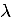)** 的基础性工作（№ 104\）152，它在回合结束之前就依据贝尔曼残差 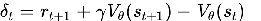 更新预测器的参数。同时，埃尔韦·布拉尔（Hervé Bourlard）与伊夫·康普（Yves Kamp）证明，具有  维窄瓶颈的线性自编码器所学到的，是到 SVD 主奇异子空间的正交投影（№ 105），而巴特·科斯科（Bart Kosko）引入了双向异联想记忆 **BAM**（№ 106）。

## **1989**

**领域：** 编码器 基础 优化 循环  
1989 年，杨立昆、伯恩哈德·博瑟（Bernhard Boser）、约翰·登克尔（John Denker）、多尼·亨德森（Donnie Henderson）、理查德·霍华德（Richard Howard）、韦恩·哈伯德（Wayne Hubbard）与劳伦斯·杰克尔（Lawrence Jackel）在 *Neural Computation* 上发表了论文 *«Backpropagation Applied to Handwritten Zip Code Recognition»*（№ 107\）87，他们直接在经归一化的 USPS 手写邮政编码像素上训练了带 5×5 共享滤波器与子采样（stride 2\）的深度卷积网络，并展示了通过权重的空间共享使泛化能力大幅提升。同年，乔治·西本科（George Cybenko）（№ 108\）以及各自独立的库尔特·霍尼克（Kurt Hornik）、马克斯韦尔·斯廷奇科姆（Maxwell Stinchcombe）与霍尔伯特·怀特（Halbert White）（№ 109\）证明了关于连续函数在紧集上被带非多项式激活的两层感知机逼近的**万能逼近定理**。这一年还有罗纳德·威廉姆斯与戴维·齐普泽的循环网络在线学习算法 **RTRL**（№ 110）、克里斯托弗·沃特金斯（Christopher Watkins）博士论文中创立的 **Q-learning**（№ 111）、刘东（Dong Liu）与豪尔赫·诺塞达尔（Jorge Nocedal）的有限内存方法 **L-BFGS**（№ 112\）153，以及约翰·布里德尔（John Bridle）对 **Softmax** 函数的概率解释（№ 113）。

## **1990**

**领域：** 循环 优化 基础  
1990 年，杰弗里·埃尔曼（Jeffrey Elman）在 *Cognitive Science* 上发表了论文 *«Finding Structure in Time»*（№ 114\）154，使**简单循环网络（Simple RNN / Elman Network）**  成为序列建模的基本工具，并展示了在预测下一个词时隐藏空间中句法—语义簇的自发涌现。保罗·韦尔博斯在 *Proceedings of the IEEE* 中通过逐步展开计算图，固定了**随时间反向传播（BPTT）**的一般表述（№ 115）。在 NIPS 会议上，杨立昆、约翰·登克尔与萨拉·索拉（Sara Solla）提出了基于海森矩阵对角线  的二阶稀疏权重剪枝方法 **Optimal Brain Damage（OBD）**（№ 116\）——这是现代 LLM 压缩算法的直接先驱。同时，于尔根·施密德胡伯（Jürgen Schmidhuber）在**对抗式人工好奇心**的框架内提出了两个网络的极小极大博弈（№ 117\）7，而拉尔斯·汉森（Lars Hansen）与彼得·萨拉蒙（Peter Salamon）论证了**神经网络集成**中误差方差的降低（№ 118）。

## **1991**

**领域：** MoE 循环 注意力/LLM 基础  
1991 年奠定了三种基础机制，它们决定了 2024–2027 年旗舰模型的架构。罗伯特·雅各布斯（Robert Jacobs）、迈克尔·乔丹、史蒂文·诺兰（Steven Nowlan）与杰弗里·辛顿在 *Neural Computation* 上发表了论文 *«Adaptive Mixtures of Local Experts»*（**第一个 MoE**，№ 119\）156。他们用在门控网络  控制下对高斯混合对数似然的最大化，取代了对平方误差的平均：  
  
使专家  在输入空间的不同区域上实现竞争性的专门化，因为梯度主要由对该样本后验责任最大的专家获得。  
同年 6 月，泽普·霍赫赖特（Sepp Hochreiter）在于尔根·施密德胡伯指导下通过了毕业论文（№ 120\）7，首次通过雅可比矩阵之积  严格分析了深层网络与循环网络中的**梯度消失与爆炸**。而 1991 年春，施密德胡伯提出了 **Fast Weight Programmers** 架构（№ 121；期刊发表于 1992\）7，其中缓慢网络动态生成键向量与值向量，用于对快权重矩阵 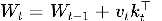 做加法式覆写与读出 ——这一构造在数学上与未归一化的线性自注意力同构22。这一年的收尾之作是马克·克莱默（Mark Kramer）的五层非线性自编码器（№ 122\），以及赫兹（Hertz）、克罗（Krogh）与帕尔默（Palmer）的神经网络统计力学经典教科书（№ 123）。

## **1992**

**领域：** 优化 循环 基础  
1992 年，罗纳德·威廉姆斯在 *Machine Learning* 上发表了带有为降低方差而减去基线  的策略梯度估计 **REINFORCE**（№ 124）：  
  
它成为用 PPO 与 GRPO 方法优化推理语言模型的直接基础53。同时，于尔根·施密德胡伯在 *Neural Computation* 上引入了**神经历史压缩器**（№ 125\）22——这是对 RNN 的层级式自监督预训练，只把不可预测（“令人惊讶”）的 token 传递给上层，并随后把深层教师压缩（“蒸馏”）为紧凑的学生网络7。鲍里斯·波利亚克与阿纳托利·尤迪茨基（Anatoli Juditsky）证明了**对 SGD 权重轨迹取平均**  的渐近最优性（№ 126\）——这是 DINO、JEPA 与扩散中 EMA 目标的理论基础；安德斯·克罗（Anders Krogh）与约翰·赫兹论证了以权重衰减作正则化（**Weight Decay**，№ 127）；而博瑟、吉永（Guyon）与瓦普尼克在 COLT 上把超平面间隔与核技巧结合起来（№ 128）。

## **1993**

**领域：** 编码器 基础 优化  
1993 年，简·布罗姆利（Jane Bromley）、伊莎贝尔·吉永、杨立昆等人在 NIPS 上提出了**孪生神经网络（Siamese Networks）**（№ 129）：两座共享权重的相同卷积塔把一对输入映射到共同的余弦相似度度量空间——这一范式是所有现代对比式编码器（CLIP、SigLIP、稠密检索）的基础。在 COLT 会议上，杰弗里·辛顿与德鲁·范·坎普（Drew van Camp）通过最小化变分自由能 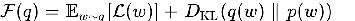，提出了权重最小描述长度原理（**神经网络中的变分贝叶斯推断**，№ 130），预示了 ELBO 泛函。同年，安德鲁·巴伦（Andrew Barron）证明了对傅里叶谱范数有界的函数，两层网络的逼近速率  与空间维数  无关（№ 131），而巴巴克·哈西比（Babak Hassibi）与戴维·斯托克（David Stork）把海森矩阵剪枝推广为完整的非对角形式 **Optimal Brain Surgeon（OBS）**（№ 132\）——这是现代 LLM 权重量化器（GPTQ）的数学基础。

## **1994**

**领域：** 循环 MoE 优化  
1994 年，约书亚·本吉奥（Yoshua Bengio）、帕特里斯·西马尔（Patrice Simard）与保罗·弗拉斯科尼（Paolo Frasconi）在 *IEEE Transactions on Neural Networks* 上发表了严格的定理 *«Learning Long-Term Dependencies with Gradient Descent is Difficult»*（№ 133），证明了非线性动力系统中的根本冲突：要在双曲吸引子中鲁棒地抗干扰存储一个比特，需要雅可比矩阵的特征值 ，而这会自动导致误差梯度随时间呈指数衰减。同年，迈克尔·乔丹与罗伯特·雅各布斯把混合专家推广为树状的**层次混合专家（HME）**，并配以快速 EM 训练（№ 134）；巴鲁克·珀尔马特（Barak Pearlmutter）导出了微分算子 ，能够在不存储二阶导数矩阵的情况下，以  次运算精确计算海森矩阵与向量的乘积（№ 135）；西蒙·海金（Simon Haykin）的基础性教程 *«Neural Networks: A Comprehensive Foundation»*（№ 136）也出了第一版。

## **1995**

**领域：** 基础 扩散 编码器  
1995 年 5 月，杰弗里·辛顿、彼得·达扬（Peter Dayan）、布伦丹·弗雷（Brendan Frey）与拉德福德·尼尔（Radford Neal）在 *Science* 上发表了**亥姆霍兹机**架构及两阶段算法 **Wake–Sleep**（№ 137），把有向生成模型  与快速的识别推断网络  配成一对——这是变分自编码器在结构上的直接先驱。安东尼·贝尔（Anthony Bell）与特伦斯·谢诺夫斯基通过最大化非线性输出的熵，创建了盲信号分离算法 **InfoMax ICA**（№ 138）；科琳娜·科尔特斯（Corinna Cortes）与弗拉基米尔·瓦普尼克引入了软间隔分类器 **Support-Vector Networks**（№ 139\）149；杨立昆与约书亚·本吉奥系统化了用于语音与图像的 1D/2D 卷积架构（№ 140）；而克里斯托弗·毕晓普（Christopher Bishop）出版了经典专著 *«Neural Networks for Pattern Recognition»*（Oxford University Press，№ 141\）88，确立了损失函数与正则化的贝叶斯与概率论解释。

## **1996**

**领域：** 编码器 基础 循环  
1996 年 6 月，布鲁诺·奥尔斯豪森（Bruno Olshausen）与戴维·菲尔德（David Field）在 *Nature* 杂志上表明（*«Emergence of Simple-Cell Receptive Field Properties by Learning a Sparse Code for Natural Images»*，№ 142），用过完备字典对自然图像的二次重构误差加上 \-稀疏惩罚  进行最小化，会自发形成局部化、有方向的 Gabor 小波——这既是稀疏编码的数学基础，也是现代用于 LLM 可解释性的 Sparse Autoencoders（SAE）的数学基础。同年，拉德福德·尼尔在专著 *«Bayesian Learning for Neural Networks»*（№ 143\）中证明了随机初始化的无限宽（）神经网络收敛到**高斯过程（NNGP）**，克里斯托夫·戈勒（Christoph Goller）与安德烈亚斯·屈希勒（Andreas Küchler）引入了在无环图与句法树上的反向传播（№ 144），布赖恩·里普利（Brian Ripley）的著作 *«Pattern Recognition and Neural Networks»*（№ 145）也问世了。

## **1997**

**领域：** 循环 记忆 优化  
1997 年 11 月，泽普·霍赫赖特与于尔根·施密德胡伯在 *Neural Computation* 上发表了 **Long Short-Term Memory（LSTM）** 架构（№ 146\）7。为克服梯度消失，作者用在时间上雅可比矩阵为单位阵的线性**恒定误差传送带（Constant Error Carousel，CEC）**  取代了对状态的压缩性非线性变换，并以乘性的输入门（）与输出门（）保护写入与读出：  
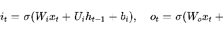  
同在 1997 年，迈克尔·舒斯特（Mike Schuster）与库尔迪普·帕利瓦尔（Kuldip Paliwal）在 *IEEE TSP* 上创建了**双向循环网络（BiRNN）**（№ 147），它把前向与后向的时间展开结合起来，实现完整的上下文编码；霍赫赖特与施密德胡伯引入了寻找海森矩阵曲率小的**平坦极小值（Flat Minima）**的准则以改善泛化（№ 148）；而约夫·弗洛因德（Yoav Freund）与罗伯特·沙皮尔（Robert Schapire）发表了加权提升算法 **AdaBoost**（№ 149）。

## **1998**

**领域：** 编码器 优化 基础  
1998 年 11 月，杨立昆、莱昂·博图（Léon Bottou）、约书亚·本吉奥与帕特里克·哈夫纳（Patrick Haffner）在 *Proceedings of the IEEE* 上发表了里程碑式论文 *«Gradient-Based Learning Applied to Document Recognition»*（№ 150），确立了标准的 7 层卷积网络 **LeNet-5**（在 MNIST 数据集上误差为 0.8%），以及可全局训练的、无需预先分割即可阅读多字符文档的**图转录器网络（GTN）**，并附上了关于激活缩放与初始化的实用指南 *«Efficient BackProp»*（№ 151）。与此同时，甘利俊一在 *Neural Computation* 中，于费希尔（Fisher）信息矩阵  的黎曼度量下导出了**自然梯度（Natural Gradient）** （№ 152\）159——这是二阶算法 K-FAC、Shampoo、SOAP 以及 PPO 信赖域的与参数化无关的基础160。同年还出版了理查德·萨顿与安德鲁·巴托关于强化学习的经典专著（№ 153\）152，以及弗拉基米尔·瓦普尼克的 *«Statistical Learning Theory»*（№ 154\）99。

## **1999**

**领域：** 循环 记忆 基础  
在没有重置标记的连续数据流中，1997 年原始 LSTM 的线性记忆单元  会无限饱和。费利克斯·格尔斯（Felix Gers）、于尔根·施密德胡伯与弗雷德·卡明斯（Fred Cummins）在 ICANN 1999 会议上解决了这一问题（№ 155\）155，引入了乘性**遗忘门（Forget Gate）** ，使单元能够动态擦除过时的状态。值得注意的是，2024–2025 年从线性 DeltaNet 向 **Gated DeltaNet** 与 **KDA** 的过渡，重现了在矩阵记忆之前引入依赖输入的衰减乘子  这同一个数学思想24。同年，丹尼尔·李（Daniel Lee）与塞巴斯蒂安·承（Sebastian Seung）在 *Nature* 上发表了**非负矩阵分解（NMF）**（№ 156），表明在  的条件下禁止特征相互抵消，能够提取出可解释的加性成分（这一原则在 2025 年被移植到 DeepSeek **mHC** 架构的非负投影  中2），而秦宁（Ning Qian）则给出了梯度下降中动量的精确谱分析（№ 157）。

## **2000**

**领域：** 循环 记忆 基础  
2000 年，格尔斯、施密德胡伯与卡明斯在 *Neural Computation* 上发表了**带遗忘门的 LSTM** 的完整期刊版本（№ 158\），并以从单元状态  直接连到各个门的**“窥视孔”连接（Peephole Connections）**对其加以补充，以便精确地计数时间间隔（№ 159）：  
  
在 NIPS 2000 会议上，沙尔勒·迪加（Charles Dugas）、约书亚·本吉奥等人引入了光滑的严格正激活函数 **Softplus** （№ 160\）161，它是逻辑斯谛 sigmoid 的原函数，在现代 SSM（Mamba-1/2/3）与德尔塔网络中是离散化步长  的标准参数化器24。同时，*Science* 上发表了对数据流形做非线性展平的几何算法：特嫩鲍姆（Tenenbaum）等人的 **Isomap**（№ 161\）与罗伊斯（Roweis）和绍尔（Saul）的 **LLE**（№ 162）。

## **2001**

**领域：** 循环 编码器 基础  
2001 年，赫伯特·耶格尔（Herbert Jaeger）在关于**回声状态网络（Echo State Networks，ESN）**的报告中提出了储备池计算的概念（№ 163）：一个谱半径为  的大型固定循环储备池，把输入历史非线性地投影到高维状态  中，只用线性回归训练其上的输出读出矩阵，无需 BPTT。在 ICML 2001 会议上，约翰·拉弗蒂（John Lafferty）、安德鲁·麦卡勒姆（Andrew McCallum）与费尔南多·佩雷拉（Fernando Pereira）引入了**条件随机场（Conditional Random Fields，CRF）**（№ 164），它对整个输出序列  的概率做全局归一化，消除了局部归一化马尔可夫模型的偏置问题。同年，哈斯蒂（Hastie）、蒂布希拉尼（Tibshirani）与弗里德曼（Friedman）的基础性统计学专著 *«The Elements of Statistical Learning»*（№ 165）也出了第一版。

## **2002**

**领域：** 扩散 基础 循环  
2002 年，杰弗里·辛顿在 *Neural Computation* 上发表了**对比散度（\-step Contrastive Divergence，CD\-）**算法（№ 166\）142，它极大加快了能量模型与 RBM 的训练：负相梯度不再让马尔可夫链长时间收敛到平衡的被建模密度，而是仅用从真实数据向量出发的  步吉布斯采样来近似。沃尔夫冈·马斯（Wolfgang Maass）、托马斯·那切拉格（Thomas Natschläger）与亨利·马克拉姆（Henry Markram）提出了储备池网络的脉冲对应物——**液态机（Liquid State Machine，LSM）**（№ 167）；迈克尔·柯林斯（Michael Collins）在 EMNLP 上把感知机与诺维科夫定理推广到带维特比解码的结构化序列预测任务（№ 168）；而罗南·科洛贝尔（Ronan Collobert）、萨米·本吉奥（Samy Bengio）与约翰尼·马里埃托兹（Johnny Mariéthoz）发布了开放的模块化 C++ 库 **Torch**（№ 169），它成为现代 PyTorch 的先祖。

## **2003**

**领域：** 基础 注意力/LLM 编码器  
2003 年，约书亚·本吉奥、雷让·迪沙尔姆（Réjean Ducharme）、帕斯卡尔·樊尚（Pascal Vincent）与克里斯蒂安·若万（Christian Jauvin）在 *JMLR* 上发表了论文 *«A Neural Probabilistic Language Model»*（№ 170），以可学习的**稠密词向量嵌入**矩阵  和作用于先前 token 拼接窗口  的光滑感知机，取代了离散的 \-gram 计数：  
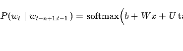  
嵌入与隐藏层的联合训练，把概率质量转移到了语义相近、而在语料中从未字面出现过的词语组合上，为现代 LLM 直接开辟了道路。同年，帕特里斯·西马尔、戴夫·施泰因克劳斯（Dave Steinkraus）与约翰·普拉特（John Platt）引入了数据的弹性形变，并在 ICDAR 上规范了简单的卷积实践（MNIST 上误差为 0.4%，№ 171），而戴维·麦凯（David MacKay）出版了基础性著作 *«Information Theory, Inference, and Learning Algorithms»*（№ 172）。

## **2004**

**领域：** 优化 基础  
2004 年，吴京秀（Kyoung-Su Oh）与郑起哲（Keechul Jung）在 *Pattern Recognition* 上发表了论文 *«GPU Implementation of Neural Networks»*（№ 173），首次把全连接神经网络的矩阵乘法移植到显卡的像素着色器流水线上（ATI Radeon 9700 Pro），相对于中央处理器获得 **20 倍加速**7。在 ICML 2004 会议上，吴恩达（Andrew Ng）严格证明：在存在指数数量噪声特征时，\-正则化的样本复杂度仅以对数方式增长 ，而带 \-惩罚的旋转不变方法则线性增长 （№ 174）。在 NIPS 上，马克斯·韦林（Max Welling）、米夏尔·罗森—茨维（Michal Rosen-Zvi）与杰弗里·辛顿把 RBM 架构推广到指数族的连续分布（**Exponential Family Harmoniums**，№ 175\）162。

## **2005**

**领域：** 扩散 STT 编码器 基础  
2005 年，阿波·许韦里宁（Aapo Hyvärinen）在 *JMLR* 上发表了**得分匹配（Score Matching）**方法（№ 176\）161，通过最小化对数密度关于数据向量  的梯度之间的差异（借助分部积分消去未知的 ），使得无需计算配分函数 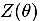 即可训练未归一化的能量密度 ：  
  
同年，亚历克斯·格雷夫斯（Alex Graves）与于尔根·施密德胡伯把带门的 LSTM 与双向时间展开结合起来（**BiLSTM**），并通过各门做完整的反向传播，用于语音音素分类（№ 177）；苏米特·乔普拉（Sumit Chopra）、拉亚·哈德塞尔（Raia Hadsell）与杨立昆在 CVPR 上引入了度量损失函数 **Contrastive Loss**（№ 178）；马可·戈里（Marco Gori）、加布里埃莱·蒙法尔迪尼（Gabriele Monfardini）与佛朗哥·斯卡塞利（Franco Scarselli）提出了**图神经网络（GNN）**的首个表述（№ 179）；而弗雷德里克·莫兰（Frederic Morin）与约书亚·本吉奥借助沿词的二叉树进行的**层次 Softmax**，把语言模型输出层的复杂度从  加速到 （№ 180）。

## **2006**

**领域：** STT 基础 编码器  
在 ICML 2006 会议上，亚历克斯·格雷夫斯、圣地亚哥·费尔南德斯（Santiago Fernández）、福斯蒂诺·戈麦斯（Faustino Gomez）与于尔根·施密德胡伯提出了 **Connectionist Temporal Classification（CTC）** 机制（№ 181），使语音与手写文本识别不再需要逐帧的音素标注。通过用空符号 （blank）扩充字母表，并引入折叠重复与空白的算子 ，CTC 以前向—后向动态规划，在 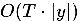 的时间内对所有长度为  的合法对齐路径求和，从而算出目标转写  的精确概率：  
  
同时，杰弗里·辛顿、西蒙·奥森德罗（Simon Osindero）与郑义怀（Yee-Whye Teh）发表了对由 RBM 堆叠而成的**深度信念网络（Deep Belief Nets）**的逐层预训练（№ 182\）142，而辛顿与鲁斯兰·萨拉胡丁诺夫（Ruslan Salakhutdinov）在 *Science* 上展示了用深度自编码器做非线性数据压缩并以反向传播微调（№ 183），使深度网络重新回到科学关注的中心。这一年的收尾之作是杨立昆等人关于能量模型的基础性综述（№ 184\），以及克里斯托弗·毕晓普的经典教材 *«Pattern Recognition and Machine Learning»*（№ 185\）164。

## **2007**

**领域：** 基础 优化 编码器  
2007 年，约书亚·本吉奥、帕斯卡尔·朗布兰（Pascal Lamblin）、丹·波波维奇（Dan Popovici）与雨果·拉罗谢尔（Hugo Larochelle）在 NIPS 上表明（*«Greedy Layer-Wise Training of Deep Networks»*，№ 186\）163，对确定性自编码器做贪心逐层预训练来初始化深度网络，效果与随机的 RBM 一样成功。在同一会议上，莱昂·博图与奥利维耶·布斯凯（Olivier Bousquet）发表了 *«The Tradeoffs of Large Scale Learning»*（№ 187），证明在计算时间预算固定、处于大样本的情形下，简单的一阶随机梯度下降（SGD）在渐近意义上比笨重的二阶优化器更有效地最小化期望泛化风险。安德烈·姆尼（Andriy Mnih）与杰弗里·辛顿引入了 **Log-Bilinear Language Model**（№ 188），而鲁斯兰·萨拉胡丁诺夫、安德烈·姆尼与杰弗里·辛顿把 RBM 应用于 Netflix Prize 上的矩阵推荐过滤（№ 189）。

## **2008**

**领域：** 编码器 扩散 注意力/LLM  
在 ICML 2008 会议上，帕斯卡尔·樊尚、雨果·拉罗谢尔、约书亚·本吉奥与皮埃尔—安托万·曼扎戈尔（Pierre-Antoine Manzagol）提出了**去噪自编码器（Denoising Autoencoders，DAE）**（№ 190\）161：输入向量被有意地通过随机置零部分分量（掩码）或高斯噪声  破坏，网络则被训练把带噪点重新投影回干净数据的流形 165。这种以去噪取代恒等重构的简单替换，成为通向掩码语言建模（BERT、LLaDA）和扩散得分匹配的直接概念桥梁。在同一届 ICML 上，罗南·科洛贝尔与杰森·韦斯顿（Jason Weston）训练了一个带有在维基百科上预训练的词向量的统一卷积架构，无需手工特征工程便同时解决六项 NLP 任务（№ 191），而劳伦斯·范德马滕（Laurens van der Maaten）与杰弗里·辛顿在 *JMLR* 上提出了流形可视化算法 **t-SNE**（№ 192）。

## **2009**

**领域：** 编码器 优化 基础  
2009 年有三件事同时发生，为现代深度学习的规模化做好了准备。邓嘉（Jia Deng）、李飞飞（Fei-Fei Li）等人在 CVPR 上发表了层级语料库 **ImageNet**（超过 1400 万张已标注图像，№ 193\）167；拉贾特·赖纳（Rajat Raina）、阿南德·马德哈万（Anand Madhavan）与吴恩达在 ICML 上，用可编程的 **CUDA GPU** 核心训练了含 1 亿参数的深度网络，相对多核 CPU 取得 **70 倍加速**（№ 194）；而约书亚·本吉奥、热罗姆·卢拉杜尔（Jérôme Louradour）、罗南·科洛贝尔与杰森·韦斯顿形式化了**课程学习（Curriculum Learning）**（№ 195\）——逐步提高训练样本的难度与长度，它已成为所有现代 LLM 和视频生成器在长上下文与高分辨率上做渐进式训练时必不可少的环节59。同年，萨拉胡丁诺夫与辛顿创建了带有双向层间连接的**深度玻尔兹曼机（DBM）**（№ 196），而佛朗哥·斯卡塞利等人在 *IEEE TNN* 上确立了图网络 **GNN** 的数学收敛性（№ 197）。

## **2010**

**领域：** 基础 优化 循环  
2010 年，从零开始、不经逐层预训练就训练深度前馈网络的主要障碍被扫除了。格扎维埃·格洛罗（Xavier Glorot）与约书亚·本吉奥在 AISTATS 会议上（№ 198\）表明，若要同时保持前向传播中信号的方差和反向传播中梯度的方差，层的权重必须以**格洛罗方差（Xavier Initialization）**进行初始化：  
  
在 ICML 2010 会议上，维诺德·奈尔（Vinod Nair）与杰弗里·辛顿发表了 *«Rectified Linear Units Improve Restricted Boltzmann Machines»*（№ 199），把在正半轴上导数为 1 的分段线性激活 **ReLU**  引入了广泛的实践。同年，托马斯·米科洛夫（Tomáš Mikolov）等人在 Interspeech 上提出了用于语音识别的**循环语言模型（RNNLM）**（№ 200），迈克尔·古特曼（Michael Gutmann）与阿波·许韦里宁推导出**噪声对比估计（NCE）**（№ 201），詹姆斯·马滕斯（James Martens）用二阶方法 **Hessian-Free** 在不预训练的情况下训练了深度网络（№ 202），并且詹姆斯·伯格斯特拉（James Bergstra）与本吉奥团队的 GPU 符号—张量自动微分编译器 **Theano** 问世（№ 203）。

## **2011**

**领域：** 优化 扩散 基础 STT  
2011 年，约翰·杜奇（John Duchi）、埃拉德·哈赞（Elad Hazan）与约拉姆·辛格（Yoram Singer）在 *JMLR* 上发表了自适应优化器 **AdaGrad**（№ 204\）168，它用每个坐标过去梯度平方累积和的平方根来归一化该坐标的步长 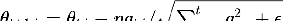，由此开启了整个深度网络自适应优化方法家族。  
2011 年夏，帕斯卡尔·樊尚在 *Neural Computation* 上发表了重要的理论论文 *«A Connection Between Score Matching and Denoising Autoencoders»*（**Denoising Score Matching，DSM**，№ 205\）161。樊尚严格证明：训练自编码器去除高斯噪声 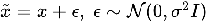，等价于估计 Parzen 平滑密度  的得分函数，*而无需计算雅可比矩阵的二阶导数*166：  
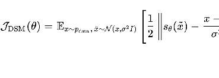  
鉴于 ，这一公式正是所有连续扩散模型（NCSN、DDPM、Score SDE）直接的数学核心142。同年，格洛罗、博尔德斯（Bordes）与本吉奥论证了基于 ReLU 的深度网络的稀疏性（№ 206），马克斯·韦林与郑义怀把随机梯度与朗之万（Langevin）动力学结合为 **SGLD**（№ 207），弗兰克·赛德（Frank Seide）、李刚（Gang Li）与俞栋（Dong Yu）以混合模型 **CD-DNN-HMM** 在工业级口语语音识别上取得突破（№ 208），而科洛贝尔等人在 *JMLR* 上发表了总结性论文 *«Natural Language Processing (Almost) from Scratch»*（№ 209）。

## **2012**

**领域：** 编码器 STT 优化 循环  
2012 年 12 月，亚历克斯·克里热夫斯基（Alex Krizhevsky）、伊利亚·苏茨克弗（Ilya Sutskever）与杰弗里·辛顿在 NIPS 上提出了八层卷积网络 **AlexNet**（№ 210\）96，它把 ImageNet ILSVRC-2012 上的 Top-5 误差从 26.2% 降到了 **15.3%**（Top-1 准确率 63.3%）。AlexNet 的成功汇集了 6000 万参数、**ReLU** 非线性（相对于 ，收敛速度提高 6 倍）、用于抑制特征共适应的随机神经元失活 **Dropout**（辛顿等，2012，№ 212\），以及在两块 NVIDIA GTX 580 显卡上的模型并行训练167。  
与此同时，2012 年 11 月，亚历克斯·格雷夫斯发表了 **RNN-Transducer（RNN-T）** 架构（№ 211），它把声学编码器 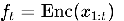 与自回归文本预测网络  合并进联合网络 **Joiner** ，并在二维格  上做边缘化，从而去除了 CTC 输出条件独立的假设——这是直至现代 TDT 的所有流式语音识别系统的标准170。同年还出现了辛顿的滑动均方根步长缩放 **RMSProp** 与马修·泽勒（Matthew Zeiler）的无量纲方法 **Adadelta**（№ 213）、杰夫·迪恩（Jeff Dean）等人的分布式集群框架 **DistBelief**（№ 214）、丹·奇雷尚（Dan Ciresan）、乌尔斯·迈尔（Ueli Meier）与于尔根·施密德胡伯的 GPU-CNN 集成（在交通标志识别上首次达到超人精度，№ 215\）155，以及伯格斯特拉与本吉奥对超参数随机搜索有效性的证明（№ 216）。

## **2013**

**领域：** 编码器 扩散 基础 优化  
2013 年 12 月，迪德里克·金马（Diederik Kingma）与马克斯·韦林发表了**变分自编码器（Variational Autoencoder，VAE）**（*«Auto-Encoding Variational Bayes»*，№ 217；达尼洛·雷森德（Danilo Rezende）、沙基尔·穆罕默德（Shakir Mohamed）与达恩·维尔斯特拉（Daan Wierstra）独立提出，№ 218），它最大化似然的变分下界（**ELBO**）：  
  
作者引入的**重参数化技巧**  把随机性转移到外部噪声上，使得任意深度的概率编码器都可以用普通的误差反向传播来训练；如今，VAE 的压缩空间正构成所有旗舰图像、视频与长语音生成器的潜在基底74。  
与此同时，托马斯·米科洛夫等人在 Google 提出了对比式架构 **Word2Vec**（带负采样的 Skip-Gram 与 CBOW，№ 219），把词向量表示的训练扩展到十亿级语料，并具有线性的语义结构。林敏（Min Lin）、陈强（Qiang Chen）与颜水成（Shuicheng Yan）在 **Network in Network** 中引入了逐点 1×1 卷积与全局平均池化（№ 220），伊恩·古德费洛（Ian Goodfellow）等人提出了 **Maxout** 激活（№ 221），弗拉基米尔·姆尼（Volodymyr Mnih）与 DeepMind 团队在 Atari 游戏上把卷积网络与 Q 学习和经验缓冲区结合为 **DQN**（№ 222），安德鲁·萨克斯（Andrew Saxe）、詹姆斯·麦克莱兰与苏里亚·甘古利（Surya Ganguli）证明了深度网络**正交初始化**时雅可比矩阵奇异值的保持（№ 223\）175，而理查德·约翰逊（Rie Johnson）与张潼（Tong Zhang）引入了梯度方差缩减方法 **SVRG**（№ 224）。

## **2014**

**领域：** 注意力/LLM 循环 扩散 编码器 优化  
2014 年，软的可微注意力、生成对抗网络以及现代深度学习的主要优化器相继诞生。继伊利亚·苏茨克弗、奥里奥尔·维尼亚尔斯（Oriol Vinyals）与阮国（Quoc Le）把输入语句压缩进 LSTM 单个固定向量的 **Seq2Seq** 模型（№ 225）之后，德米特里·巴赫达瑙（Dzmitry Bahdanau）、赵京铉（Kyunghyun Cho）与约书亚·本吉奥（*«Neural Machine Translation by Jointly Learning to Align and Translate»*，№ 226\）消除了固定向量的信息瓶颈，让解码器在每一步  动态地对编码器全部隐藏状态 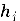 加权（**加性注意力**）：  
  
同年，赵京铉等人在 **GRU** 中把带门的循环单元简化为两个门（，№ 227），而亚历克斯·格雷夫斯、格雷格·韦恩（Greg Wayne）与伊沃·达尼赫尔卡（Ivo Danihelka）在 **Neural Turing Machine（NTM）** 中为神经网络配备了可微的外部矩阵记忆（№ 228）。在 NIPS 2014 上，伊恩·古德费洛等人表述了生成器与判别器的极小极大博弈 **GAN**（，№ 229），而 12 月，迪德里克·金马与吉米·巴（Jimmy Ba）发表了优化器 **Adam**（№ 230），它把梯度一阶与二阶矩的指数滑动估计与零偏置修正结合起来。在计算机视觉与嵌入方面，出现了西蒙尼扬（Simonyan）与齐瑟曼（Zisserman）的窄 3×3 卷积核级联 **VGG**（№ 231\）176、塞格迪（Szegedy）等人的多尺度模块 **GoogLeNet / Inception**（№ 232）、彭宁顿（Pennington）等人基于词共现的矩阵分解 **GloVe**（№ 233）、古德费洛等人关于**对抗扰动（FGSM）**线性本质的工作（№ 234\），以及贾扬清（Yangqing Jia）的 **Caffe** 库（№ 235）。

## **2015**

**领域：** 基础 扩散 编码器 优化 STT  
2015 年，网络深度退化的障碍被克服，同时热力学扩散也被表述出来。在鲁佩什·斯里瓦斯塔瓦（Rupesh Srivastava）、克劳斯·格雷夫（Klaus Greff）与于尔根·施密德胡伯的带门高速公路 **Highway Networks**（，№ 236\）7 的基础上，何恺明、张祥雨、任少卿与孙剑把信号的直通简化为纯粹的恒等加法，得到 **ResNet-152**（№ 237；并配合针对 ReLU 的初始化 **Kaiming Init** ，№ 238\）61：  
  
雅可比矩阵中的加性单位项  保证了梯度流穿过数百层而不衰减，并以 3.57% 的集成误差赢得了 ILSVRC-2015 冠军34。  
同年，谢尔盖·约菲（Sergey Ioffe）与克里斯蒂安·塞格迪引入了 **Batch Normalization**（№ 239\）178；奥拉夫·龙内贝格尔（Olaf Ronneberger）、菲利普·菲舍尔（Philipp Fischer）与托马斯·布罗克斯（Thomas Brox）创建了带空间特征图跳跃连接的对称卷积编码器—解码器架构 **U-Net**（№ 240\）179；而贾沙·索尔—迪克斯坦（Jascha Sohl-Dickstein）、埃里克·韦斯（Eric Weiss）、尼鲁·马赫斯瓦拉纳坦（Niru Maheswaranathan）与苏里亚·甘古利在 ICML 2015 上发表了开创性论文 *«Deep Unsupervised Learning using Nonequilibrium Thermodynamics»*（№ 241），引入了前向的扩散加噪马尔可夫链 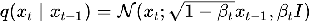 与可学习的生成式恢复反向链 。这一年还增添了辛顿、维尼亚尔斯与迪恩的温度**知识蒸馏**（№ 242）、马滕斯与格罗斯（Grosse）的费希尔近似 **K-FAC**（№ 243）、卢昂（Luong）的标量注意力（№ 244）、陈（Chan）等人的端到端语音架构 **LAS**（№ 245\）与阿莫迪（Amodei）等人的 **DeepSpeech 2**（№ 246）、森里奇（Sennrich）等人的子词切分 **BPE**（№ 247\），以及框架 **TensorFlow** 的开源发布（№ 248）。

## **2016**

**领域：** TTS 循环 基础 优化 编码器  
2016 年，逐 token 归一化、自适应循环与自回归音频合成的机制成型。吉米·巴、杰米·基罗斯（Jamie Kiros）与杰弗里·辛顿提出了 **Layer Normalization（LayerNorm）**（№ 249），它独立于批大小，对每个单独 token 的特征向量做归一化；而何恺明等人证明，把归一化移入残差分支（**Pre-LN ResNet**：，№ 250\）在超过 1000 层的深度上仍能保留纯粹的恒等主干61。亚历克斯·格雷夫斯引入了 **Adaptive Computation Time（ACT）** 机制（№ 251\）41，它使网络在 S 形停止门（ponder cost）的控制下，对每个 token 执行可变的、可学习次数的内部迭代——这是 Universal Transformer、Ouro 与 Huginn 中自适应深度的直接基础41。丹·亨德里克斯（Dan Hendrycks）与凯文·金佩尔（Kevin Gimpel）提出了光滑的概率型非线性 **GELU** （№ 252）。  
在语音合成方面，亚伦·范·登·奥尔德（Aäron van den Oord）与 DeepMind 团队提出了 **WaveNet**（№ 253\）——由因果膨胀 1D 卷积堆叠而成，膨胀率  按指数增长，并带有门控非线性 ，首次使波形合成逼近自然人声。同年，洛朗·丁（Laurent Dinh）、贾沙·索尔—迪克斯坦与萨米·本吉奥创建了可逆归一化流 **RealNVP**（№ 254）；埃里克·姜（Eric Jang）等人导出了可微的类别松弛 **Gumbel-Softmax**（№ 255\）54；托马斯·基普夫（Thomas Kipf）与马克斯·韦林形式化了谱**图卷积网络（GCN）**（№ 256）；黄高（Gao Huang）等人提出了 **DenseNet**（№ 257\）180；伊利亚·洛希洛夫（Ilya Loshchilov）与弗兰克·赫特（Frank Hutter）引入了余弦学习率调度 **SGDR / Cosine Annealing**（№ 258）；古德费洛、本吉奥与库维尔（Courville）的经典教科书 *«Deep Learning»*（MIT Press，№ 259\）8 也出版了。

## **2017**

**领域：** 注意力/LLM MoE TTS 编码器 优化  
2017 年 6 月，阿希什·瓦斯瓦尼（Ashish Vaswani）、诺姆·沙泽尔（Noam Shazeer）、尼基·帕尔马（Niki Parmar）、雅各布·乌兹科雷特（Jakob Uszkoreit）、利昂·琼斯（Llion Jones）、艾丹·戈麦斯（Aidan Gomez）、卢卡斯·凯泽（Łukasz Kaiser）与伊利亚·波洛苏欣（Illia Polosukhin）发表了论文 *«Attention Is All You Need»*（№ 260\）182，以基于缩放点积多头自注意力（**Multi-Head Attention，MHA**）的 **Transformer** 架构取代了循环链与卷积：  
  
因子  在 softmax 之前稳定了 logits 的方差，序列中任意两个位置之间信号传递的路径长度缩短为 ，而训练阶段对全部  个 token 的完全并行，与 GPU 的张量乘法完美契合，代价是二次复杂度 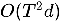。  
同在 2017 年，又有五项工作塑造了现代多模态与稀疏系统的面貌。诺姆·沙泽尔等人在 ICLR 上提出了 **Sparsely-Gated Mixture-of-Experts**（№ 261\）184，借助稀疏路由  以及辅助的专家负载均衡惩罚项，把语言模型扩展到 1370 亿参数。亚伦·范·登·奥尔德、奥里奥尔·维尼亚尔斯与科赖·卡武克乔卢（Koray Kavukcuoglu）创建了 **VQ-VAE**（№ 262），把潜在空间向量量化为离散码本，并采用直通估计器（Straight-Through Estimator）做端到端梯度估计——这是所有现代神经音频编解码器的基础机制。王雨轩（Yuxuan Wang）等人（**Tacotron**，№ 263\）与乔纳森·沈（Jonathan Shen）等人（**Tacotron 2**，№ 264\）构建了“文本  梅尔频谱  神经声码器”的端到端语音合成。在优化方面，伊利亚·洛希洛夫与弗兰克·赫特在 **AdamW** 中把权重衰减与自适应二阶矩分离开来（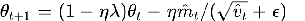，№ 265），约翰·舒尔曼（John Schulman）等人创建了带裁剪代理目标的策略梯度 **PPO**（№ 266\）158，而马丁·阿尔约夫斯基（Martin Arjovsky）、苏米特·钦塔拉（Soumith Chintala）与莱昂·博图用瓦瑟斯坦（Wasserstein）度量 **WGAN** 稳定了对抗网络（№ 267）。架构武库中又增添了霍华德（Howard）等人的深度可分离卷积 **MobileNets**（№ 268）、胡（Hu）等人的通道注意力 **SENet**（№ 269）、拉马钱德兰（Ramachandran）等人的激活函数 **Swish / SiLU** （№ 270\），以及韦利奇科维奇（Veličković）等人的图注意力 **GAT**（№ 271）。

## **2018**

**领域：** 编码器 注意力/LLM 循环 TTS 优化  
2018 年，在大规模无标注语料上预训练 Transformer 的做法分成了两个互补的分支。继马修·彼得斯（Matthew Peters）等人的 BiLSTM 上下文表示 **ELMo**（№ 272）之后，OpenAI 的亚历克·拉德福德（Alec Radford）等人提出了自回归因果解码器 **GPT-1**（№ 273），而 Google 的雅各布·德夫林（Jacob Devlin）、张明蔚（Ming-Wei Chang）、肯顿·李（Kenton Lee）与克里斯蒂娜·图塔诺娃（Kristina Toutanova）创建了深度双向编码器 **BERT**（№ 274\）186，它被训练依据完整的左右上下文恢复 15% 被随机掩盖的 token（**Masked Language Modeling，MLM**）。  
同时，穆斯塔法·德赫加尼（Mostafa Dehghani）等人引入了 **Universal Transformer**（№ 275\）187——第一个沿深度共享权重并带逐 token 的 ACT 停止的循环 Transformer，证明了其在可变深度下的计算通用性，并为现代模型 Huginn 与 Ouro 奠定了直接基础。陈天琦（Ricky Chen）、尤利娅·鲁巴诺娃（Yulia Rubanova）、杰西·贝滕科特（Jesse Bettencourt）与戴维·迪韦诺（David Duvenaud）在 **Neural ODE** 中转向残差网络  的连续极限，采用伴随方程方法训练，沿深度的内存占用为 （№ 276\）190。同年，亚伦·范·登·奥尔德、李亚哲（Yazhe Li）与奥里奥尔·维尼亚尔斯在 **CPC** 框架内表述了对比泛函 **InfoNCE**（№ 277\）191；金马与达里瓦尔（Dhariwal）创建了可逆生成器 **Glow**（№ 278），瑞安·普伦格（Ryan Prenger）等人将其改造为快速的流式语音声码器 **WaveGlow**（№ 279）；吴宇轩（Yuxin Wu）与何恺明引入了 **GroupNorm**（№ 280）；在优化方面出现了沙泽尔与斯特恩（Stern）的低秩 **Adafactor**（№ 281\）192，以及古普塔（Gupta）、科伦（Koren）与辛格的矩阵曲率预条件器 **Shampoo**（№ 282\）160；阿蒂尔·雅科（Arthur Jacot）等人描述了**神经正切核（NTK）**机制（№ 283）；而工藤拓（Taku Kudo）与约翰·理查森（John Richardson）发布了分词器 **SentencePiece**（№ 284\）73。

## **2019**

**领域：** 注意力/LLM 循环 TTS 扩散 优化  
2019 年，现代 LLM 解码器及其分布式训练基础设施的工程骨架成型。亚历克·拉德福德等人在 **GPT-2**（15 亿参数，№ 285\）1 中确立了 **Pre-LN** 方案以及通过语言续写实现的 zero-shot 任务执行。张彪（Biao Zhang）与里科·森里奇提出了 **RMSNorm**（№ 286\）28，舍弃了 LayerNorm 中的均值中心化，只保留以均方根幅值进行的尺度不变归一化：  
  
这加速了 GPU 上的归一化，并成为 2023–2026 年几乎所有开源架构的标准196。11 月，诺姆·沙泽尔发表了 **Multi-Query Attention（MQA）**（№ 287\）49，指出自回归解码受限于读取 KV 缓存时的 HBM 内存带宽，并提出让所有查询头共享投影 。  
在循环模型与长上下文模型方面，白少杰（Shaojie Bai）、齐科·科尔特（Zico Kolter）与弗拉德连·科尔图恩（Vladlen Koltun）创建了 **Deep Equilibrium Models（DEQ）**（№ 288），它用数值求根器寻找循环  的不动点，并借助隐函数定理以  内存对其做解析微分；兰振忠（Zhenzhong Lan）等人在 **ALBERT** 中采用了贯穿各层的端到端权重共享（№ 289\）189；科林·拉费尔（Colin Raffel）等人在 **T5** 中引入了表格式相对注意力偏置（№ 290\）72；而戴自航（Zihang Dai）等人在 **Transformer-XL** 中把分段递归与相对位置结合起来（№ 291\）190。在语音合成方面，任意（Yi Ren）等人创建了带显式音素时长调节器（**Length Regulator**，№ 292）的非自回归 Transformer **FastSpeech**，在不损失稳定性的情况下把梅尔频谱生成加速了两个数量级。宋飏（Yang Song）与斯特凡诺·埃尔蒙（Stefano Ermon）在 **NCSN** 中，借助多尺度噪声网格复兴了基于得分的生成建模（№ 293）。这一年的收尾之作是谭明兴（Mingxing Tan）与阮国的 CNN 复合缩放 **EfficientNet**（№ 294\）178、施耐德（Schneider）等人的自监督音频编码器 **wav2vec**（№ 295）、NVIDIA 的层内张量并行 **Megatron-LM**（№ 296\）198、Microsoft DeepSpeed 对优化器状态与权重的分片 **ZeRO**（№ 297\）73，以及亚当·帕兹克（Adam Paszke）等人关于 **PyTorch** 的标志性论文（№ 298）。

## **2020**

**领域：** 注意力/LLM 扩散 编码器 STT TTS 循环/SSM  
2020 年，语言模型、扩散生成、计算机视觉和语音技术同时发生了变革。Jared Kaplan 及合作者确立了语言损失随参数量、数据量和 FLOPs 预算变化的幂律**缩放定律（Scaling Laws）**  (№ 299\)4，Tom Brown 及 OpenAI 团队在 1750 亿参数的 **GPT-3** 中实现了这些定律，并展现出涌现的上下文学习能力 (№ 300)。Noam Shazeer 引入了门控型全连接块家族 **SwiGLU**  (№ 301\)199，它取代了现代 LLM 中普通的两层 MLP；Angelos Katharopoulos 等人通过正特征核  对注意力进行分解，提出 **Linear Attention** (№ 302\)25，揭示了线性 Transformer 与带有矩阵记忆 、复杂度为  的 RNN 之间的对偶性。  
在生成模型方面，Jonathan Ho、Ajay Jain 和 Pieter Abbeel 发表了 **DDPM** (№ 303\)37，将逆向马尔可夫链的变分训练归结为预测所添加的高斯噪声 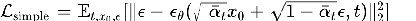；Jiaming Song、Chenlin Meng 和 Stefano Ermon 构建了确定性的非马尔可夫加速采样轨迹 **DDIM** (№ 304\)5；Yang Song 等人则将扩散与得分估计统一为连续随机微分方程 **Score SDE** 和确定性的概率流 **Probability Flow ODE** (№ 305\)5。在计算机视觉领域，Alexey Dosovitskiy、Lucas Beyer 等人提出了纯粹的图像块 Transformer **ViT**（将图像切分为 16×16 的图像块，不使用卷积，ViT-H/14 在 ImageNet 上达到 88.55% Top-1，№ 306\)73，同时涌现了对比自监督学习的突破 **SimCLR** (№ 311\)202、**MoCo** (№ 312\) 以及无需负样本的 **BYOL** (№ 313)。  
在音频处理领域，现代语音技术栈的三个基础组件问世：Anmol Gulati 等人提出的卷积-Transformer 混合模型 **Conformer**（Macaron-FFN \+ MHSA \+ DepthwiseConv，在 LibriSpeech test-clean / test-other 上达到 **1.9% / 3.9% WER**，№ 307\)203，Alexei Baevski 等人提出的原始波形自监督量化编码器 **wav2vec 2.0** (№ 308\)191，以及 Jungil Kong 等人提出的多周期生成对抗声码器 **HiFi-GAN** (№ 309\)206。最后，Albert Gu、Tri Dao 及合作者推导出对信号连续历史进行正交多项式投影的算子 **HiPPO** (№ 310\)62（S4 和 Mamba 的理论基础），Patrick Lewis 等人创建了 **RAG** 架构 (№ 314)，Dmitry Lepikhin 等人则在 **GShard** 系统中将 MoE 扩展到 600B 参数 (№ 315\)27。

## **2021**

**领域：** 注意力/LLM MoE 编码器 循环/SSM TTS 扩散 优化  
2021 年，相对位置编码、低秩适应、结构化状态空间和潜在扩散的标准相继形成。Jianlin Su 及合作者在 **RoFormer** 中引入了**旋转位置编码（RoPE）** (№ 316\)72，即在复平面内将查询和键的坐标对乘以正交旋转矩阵，并采用几何级数的频谱 ：  
  
Ofir Press 等人提出了线性位置注意力惩罚 **ALiBi** (№ 317)；William Fedus、Barret Zoph 和 Noam Shazeer 在 1.6 万亿参数的 **Switch Transformer** 中将 MoE 简化为 **Top-1** 路由 (№ 318)；Edward Hu 等人则创立了 **LoRA** 方法 (№ 319\)210，冻结预训练矩阵 ，仅训练低秩增量 （秩为 ），且推理时无额外延迟。  
在多模态和视觉编码器方面，Alec Radford 等人在 **CLIP** 中用 4 亿对数据对齐了图像与文本空间 (№ 320\)212，Kaiming He 等人提出了非对称的图像块掩码自编码器 **MAE**（掩码 75% 的图像块，№ 321)，Mathilde Caron 等人发现了无需标签的视觉 Transformer 自蒸馏方法 **DINO** (№ 322\)213，Ze Liu 等人则在 **Swin Transformer** 中引入了层次化的移位窗口 (№ 323)。在长序列建模方面，Albert Gu、Karan Goel 和 Christopher Ré 发表了 **S4（Structured State Spaces）** (№ 324\)62：他们将 HiPPO 矩阵分解为正规矩阵与低秩矩阵之和（**NPLR**：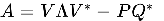），把长度为  的卷积核计算化归为 Cauchy 核与 FFT，复杂度为 ，首次在 Long Range Arena 上解决了长度 16,384 的 Path-X 任务（平均得分 86.09）216；与此同时，Imanol Schlag、Kazuki Irie 和 Jürgen Schmidhuber 在 ICML 2021 上将覆写式 delta 规则引入线性 Transformer（**Fast Weight Programmers**，№ 325\)157，这成为 DeltaNet 的直接理论来源。  
在语音和生成领域，Jaehyeon Kim、Jungil Kong 和 Juhee Son 将变分推断、归一化流和对抗式波形合成结合在 **VITS** 中 (№ 326\)217；Neil Zeghidour 等人创建了首个采用**残差向量量化（RVQ）**的端到端神经音频编解码器 **SoundStream** (№ 327\)47；Wei-Ning Hsu 等人提出了掩码语音编码器 **HuBERT** (№ 328\)191；Prafulla Dhariwal 和 Alex Nichol 在 **ADM** 中证明了扩散模型在图像质量上优于 GAN (№ 329\)219；Jacob Austin 等人在 **D3PM** 中形式化了带有吸收标记 \[MASK\] 的离散扩散 (№ 330\)35；12 月，Robin Rombach、Andreas Blattmann、Dominik Lorenz、Patrick Esser 和 Björn Ommer 在 **Latent Diffusion Models（LDM / Stable Diffusion）** 中将扩散迁移到感知自编码器的压缩空间，并加入文本交叉注意力 (№ 331\)179。

## **2022**

**领域：** 注意力/LLM 优化 扩散 STT TTS  
2022 年，硬件感知的内存算法、计算最优缩放定律以及直线型 ODE 流改变了大模型的经济学。Tri Dao、Daniel Fu、Stefano Ermon、Atri Rudra 和 Christopher Ré 发表了 **FlashAttention** (№ 332\)199：他们将矩阵  分块放入 GPU 的高速片上存储 **SRAM**，并应用精确的分块重缩放**在线 softmax**（可追溯到 Milakov 和 Gimelshein，№ 333)：  
  
由此在不向全局显存 HBM 写入矩阵 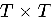 的情况下计算出数学上精确的注意力，将内存消耗降至 223。Jordan Hoffmann 等人在 **Chinchilla** 工作中 (№ 334\)224 表明，在固定 FLOPs 预算下，最优训练方案要求参数量与训练 token 数成比例地缩放（）；Greg Yang、Edward Hu 等人则推导出参数化方案 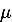**P**，用于把超参数从小模型零样本迁移到巨型训练任务 (№ 335)。  
在生成建模方面，Jonathan Ho 和 Tim Salimans 引入了**无分类器引导（CFG）** (№ 336)，Tero Karras 等人在 **EDM** 中系统化了噪声预条件化与二阶采样器 (№ 337\)37；2022 年秋，Xingchao Liu、Chengyue Gong 和 Qiang Liu（**Rectified Flow**，№ 338)、Yaron Lipman、Ricky Chen 等人（**Flow Matching**，№ 339\) 以及 Michael Albergo 与 Eric Vanden-Eijnden（**Stochastic Interpolants**，№ 340\) 将生成转变为学习 ODE 的直线型速度向量场 ，并沿线性插值  进行，同时配以轨迹拉直过程 **Reflow**5。12 月，William Peebles 和 Saining Xie 将潜在扩散中的 U-Net 替换为带有自适应归一化 **adaLN-Zero** 的可扩展 Transformer，即 **Diffusion Transformer（DiT）**（在 ImageNet 256×256 上 FID 为 2.27，№ 341\)219。在音频和后训练方面，相继问世的有：Alec Radford 等人基于 68 万小时弱标注数据的多语言 ASR Transformer **Whisper** (№ 342\)229，Alexandre Défossez 等人的开源 24 kHz RVQ 编解码器 **EnCodec** (№ 343\)231，Long Ouyang 等人基于人类偏好的三阶段对齐方法 **InstructGPT（RLHF）** (№ 344)，Jason Wei 等人的思维链提示 **Chain-of-Thought** (№ 345\)，以及 Tim Dettmers 等人的分块量化 8 比特优化器 (№ 346\)169。

## **2023**

**领域：** 注意力/LLM MoE 循环/SSM 编码器 视频 STT TTS STS 优化  
2023 年，开源 LLM 生态获得了高效解码的标准，线性循环模型也首次在语言任务上向 Transformer 发起挑战。Joshua Ainslie 等人引入了 **Grouped-Query Attention（GQA）** (№ 347\)39，让  组键值在  个查询头之间共享（已应用于 Touvron 等人的 **Llama 2 70B**，№ 348194）；Woosuk Kwon 等人在 **vLLM** 引擎中以分页机制 **PagedAttention** 消除了 KV 缓存的显存碎片 (№ 349\)232；Tri Dao 在 **FlashAttention-2** 中优化了 warp 级并行 (№ 350\)198；Hao Liu、Matei Zaharia 和 Pieter Abbeel 创建了在加速器环上分布式计算的注意力 **Ring Attention**，面向百万级上下文 (№ 351\)132；Mistral AI 团队发布了开源稀疏混合专家模型 **Mixtral 8x7B**（8 选 Top-2，№ 352\)234；Rafael Rafailov 等人则推导出无需奖励模型的策略对齐闭式形式——**Direct Preference Optimization（DPO）** (№ 353\)158：  
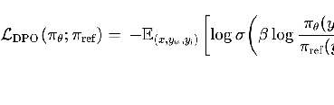  
与此同时，具有恒定推理内存  的次二次复杂度架构全面展开攻势：Bo Peng 等人的 **RWKV-4** (№ 354\)236，Yutao Sun 等人的多尺度保持网络 **RetNet** (№ 355\)49，以及 12 月 Albert Gu 和 Tri Dao 的 **Mamba（S6）** (№ 356\)25。Mamba 将状态空间参数  变为当前输入 token 的函数（**Selective SSM**），并在 SRAM 中实现了硬件感知的并行关联扫描，以线性复杂度  解决了依赖内容的上下文过滤问题。  
在视觉、文本扩散和语音领域，相继问世的有：Assran、LeCun 等人的非生成式图像潜在预测器 **I-JEPA** (№ 357)，Zhai 等人的无 softmax 成对 sigmoid 对比编码器 **SigLIP** (№ 358\)212，Oquab 等人的视觉基础模型 **DINOv2** (№ 359\)176，Blattmann 等人的视频生成器 **Stable Video Diffusion** (№ 360)，Lou、Meng 和 Ermon 的带概率比估计的离散扩散 **SEDD** (№ 361\)57，Wang 等人的首个基于编解码器的语言模型、仅凭 3 秒样本即可零样本合成语音的 **VALL-E** (№ 362\)218，Kumar 等人改进的音频编解码器 **DAC** (№ 363\)55，Zhang 等人的对话语音模型 **SpeechGPT** (№ 364\)240，Rekesh 等人加速 2.8 倍、帧长 80 毫秒的编码器 **FastConformer** (№ 365\)171，Xu、Majumdar 和 Ginsburg 的可跳过空帧的转导器 **Token-and-Duration Transducer（TDT）** (№ 366\)79，Dettmers 等人的 4 比特适配 **QLoRA** (№ 367)，Peng 等人的 RoPE 窗口扩展 **YaRN** (№ 368\)30，以及 Simon Prince 的教材 *«Understanding Deep Learning»*（MIT Press，№ 369\)8。

## **2024**

**领域：** 注意力/LLM MoE 循环/SSM 扩散 视频 编码器 STT TTS STS 优化

### **潜在注意力 MLA、无惩罚的 MoE 均衡与量化预训练**

2024 年，DeepSeek-AI 实验室的一系列工作重新审视了注意力架构和专家路由。在 **DeepSeekMoE** (arXiv:2401.06066, № 370\)29 中，专家被细粒度切分为小型专业化子网络，并与独立的、始终激活的*共享专家*相结合。5 月，**DeepSeek-V2**（arXiv:2405.04434，236B 总参数 / 21B 激活参数，№ 371\)50 引入了 **Multi-Head Latent Attention（MLA）** 机制：  
  
由于在推理阶段将解压矩阵 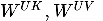 吸收进查询投影和输出投影，内存中每层只需存储压缩向量 ，其仅含  个元素，而 128 头 MHA 则需要 32,768 个元素——每层 KV 缓存减少 98.24%（就 V2 整个模型而言，相对稠密的 DeepSeek 67B 减少 93.3%）50。12 月，**DeepSeek-V3**（arXiv:2412.19437，671B 总参数 / 37B 激活参数，14.8T token，№ 372\)29 整合了：通过动态偏置  在 Top\- 选择时实现的**无辅助损失专家负载均衡**（发展自 Wang 等人的 Loss-Free Balancing，№ 37327），级联式**多 token 预测（Multi-Token Prediction，MTP）**模块（此前 4 月由 Meta 的 Fabian Gloeckle 等人论证，arXiv:2404.19737，№ 37464），通信重叠流水线 **DualPipe**，以及 **FP8** 精度下的稳定训练，总计 278.8 万 H800 GPU 小时（按每小时 \$2 的估算费率约 \$5.576M，不含前期研究性训练与消融实验；MMLU 88.5%，MATH-500 90.2%）29。早在 2 月，Zhihong Shao 等人在 **DeepSeekMath**（arXiv:2402.03300，№ 375\)53 中提出了无评论家的强化学习算法 **GRPO**。与此同时，Shuming Ma 等人在 **BitNet b1.58**（arXiv:2402.17764，№ 376\)51 中证明了三值权重  的可行性，而稠密 Transformer 的开源路线则由 **Llama 3.1 405B** (№ 377\)246 和 **Qwen2.5** (№ 378\)247 领衔。

### **SSM 对偶性、Gated DeltaNet、TTT 与第二代优化器**

在循环序列这条主线上，Tri Dao 和 Albert Gu 在 **Mamba-2**（arXiv:2405.21060，№ 379\)32 中证明了具有标量转移  的选择性 SSM 与半可分线性注意力  之间严格的结构对偶性（**SSD**），从而将 SSM 的训练迁移到 Tensor Cores 上的矩阵分块计算。Maximilian Beck 和 Sepp Hochreiter 在 **xLSTM**（arXiv:2405.04517，№ 380\)183 中将带指数门和协方差矩阵记忆的 LSTM（**mLSTM**）规模化；Songlin Yang 等人通过 Householder 的 WY 表示的分块形式并行化了带 delta 规则的线性 Transformer（**DeltaNet**，№ 381248），并在 12 月与 Jan Kautz 和 Ali Hatamizadeh 合作，把 delta 规则与 Mamba-2 的自适应衰减结合为 **Gated DeltaNet**（arXiv:2412.06464，№ 382\)157：  
  
同一年还问世了：Bo Peng 等人的矩阵循环模型 **RWKV-5/6（Eagle & Finch）** (№ 383\)249，Opher Lieber 等人的 Mamba–Transformer–MoE 混合模型 **Jamba** (№ 384\)184，Defa Zhu 等人的多带残差流 **Hyper-Connections（HC）**（arXiv:2409.19606，№ 385\)61，以及 Yu Sun、Karan Dalal 等人的 **Test-Time Training（TTT-Linear / TTT-MLP）** 层（arXiv:2407.04620，№ 386\)44，它把隐藏状态本身变成了在测试上下文上训练的两层感知机。在硬件和数值优化方面，出现了面向 Hopper H100 芯片的异步 **FlashAttention-3**（FP16 下 740 TFLOPs/s，№ 387\)252，Nikhil Vyas、Sham Kakade 等人的预条件器 **SOAP**（arXiv:2409.11321，在 Shampoo 矩阵的特征基中运行 AdamW，大批量训练时间缩短 35% 以上，№ 388\)168，以及 Keller Jordan 的正交化矩阵动量 **Muon** (№ 389\)65。

### **多模态 DiT、视频 VAE、REPA 与全双工对话 Moshi**

在图像和视频生成方面，Patrick Esser 等人的 **Stable Diffusion 3**（arXiv:2403.03206，№ 390\)174 和 Black Forest Labs 团队的 **FLUX.1**（12B 参数，№ 391\)174 确立了结合 Rectified Flow 的双流架构 **MMDiT**。卷积视频模型被建立在因果 3D-VAE（压缩比 4×8×8）之上的时空 3D-DiT 所取代：Zhuoyi Yang 等人的 **CogVideoX** (№ 392\)255，**Mochi 1** (№ 393\)254，Weijie Kong 等人的 130 亿参数 **HunyuanVideo**（采用 MLLM 提示编码与 3D-RoPE，arXiv:2412.03603，№ 394\)256，以及 Lightricks 的超高速 **LTX-Video**（Video-VAE 压缩比 1:192，arXiv:2501.00103，№ 395\)258。Sihyun Yu 等人通过将潜在图像块与 DINOv2 特征对齐的方法（**REPA**，arXiv:2410.06940，ImageNet 256×256 上 FID 为 1.42，№ 396\)36，使扩散 Transformer 的收敛速度提升超过 **17.5 倍**；Subham Sahoo 等人在 **MDLM**（arXiv:2406.07524，№ 397\)222 中推导出文本掩码扩散的连续极限；Adrien Bardes 等人提出了视频特征预测编码器 **V-JEPA**（arXiv:2404.08471，№ 398\)60；Benjamin Warner 等人则在 **ModernBERT**（arXiv:2412.13663，全局与滑动注意力 1:2 交替，RoPE，GeGLU，unpadding，№ 399\)186 中把双向文本-代码编码器升级到 8,192 token 窗口。  
在语音交互方面，Kyutai 实验室的 Alexandre Défossez 等人发布了 **Moshi** 和流式神经编解码器 **Mimi**（arXiv:2410.00037，№ 400\)26——首个开源全双工语音 LLM，理论延迟 **160 毫秒**（实际 200 毫秒，而人类语音的平均停顿约为 \~230 毫秒）。Mimi 编解码器将 24 kHz 波形压缩到 **12.5 Hz** 的帧率（步长 80 毫秒），使用 8 个各含 2,048 条目的 RVQ 码本（**1.1 kbit/s**），并把 WavLM 的语义蒸馏进第一个码本；而由 7B Temporal Transformer 和小型 Depth Transformer 构成的层次结构，则并行预测文本“内心独白”（Inner Monologue）和两路音频流，无需把对话切分成轮次26。2024 年的技术栈还补充了：非自回归编码器 **SenseVoice**（比 Whisper-Large 快 15 倍）和合成器 **CosyVoice**（FunAudioLLM，№ 401\)263，流式 **F5-TTS** (№ 402\)264，双级联 **Fish-Speech** (№ 403\)265，以及新的基础教材——Christopher 和 Hugh Bishop 的 *«Deep Learning: Foundations and Concepts»*（Springer，№ 404\)266 和 Sebastian Raschka 的 *«Build a Large Language Model (From Scratch)»*（Manning，№ 405\)267。

## **2025**

**领域：** 注意力/LLM MoE 循环/SSM 扩散 视频 编码器 STT TTS STS 优化

### **可验证的推理强化学习、稀疏注意力、mHC 与基于 Muon 的万亿参数模型**

2025 年 1 月，**DeepSeek-R1** 的发表（arXiv:2501.12948，2025 年 9 月刊于 *Nature*，№ 406\)50 通过 **DeepSeek-R1-Zero** 实验表明：在没有初始 SFT 的情况下，仅依据可验证规则对 **GRPO** 强化学习进行规模化训练，就会自发形成自我验证与反思的长链条，使 AIME 2024 的准确率从 15.6% 提升到 71.0%；而完整的多阶段 **DeepSeek-R1** 在 **AIME 2024 上达到 79.8% Pass@1**，在 **MATH-500 上达到 97.3%**，并成功把推理能力蒸馏到 1.5B–70B 的稠密模型中269。2 月，Jingyang Yuan 等人提出了 **Native Sparse Attention（NSA）**（arXiv:2502.11089，ACL 2025 最佳论文，№ 407\)50，把注意力划分为压缩、选择和局部窗口三个分支，解码加速最高达 11.6 倍76。12 月，**DeepSeek-V3.2**（arXiv:2512.02556，№ 408\)10 问世，它在 MLA 之上嵌入了带有快速索引器（lightning indexer）的 **DeepSeek Sparse Attention（DSA）** 机制，并选取 top\- 个 token，复杂度为 （据作者报告，高预算变体 V3.2-Speciale 取得了 IMO 2025 和 IOI 2025 金牌水平的成绩）10；同月还有 Zhenda Xie、Shengding Hu 等人关于 **Manifold-Constrained Hyper-Connections（mHC）** 的工作（arXiv:2512.24880，№ 409\)2，该工作利用 Sinkhorn—Knopp 算法把残差流各带的混合矩阵投影到双随机矩阵的 Birkhoff 多面体上（保证 ，且当  时仅有 6.7% 的时间开销）2。  
与此同时，Moonshot AI 团队证明了矩阵优化器 **Muon** 的可扩展性（arXiv:2502.16982，№ 410\)65，并在 7 月基于 15.5 万亿 token、全程没有出现任何损失尖峰地训练出万亿参数的智能体旗舰模型 **Kimi K2**（arXiv:2507.20534，1.04T 总参数 / 32.6B 激活参数，384 个专家中选 8 个 \+ 1 个共享专家，№ 411\)，这得益于 **MuonClip** 组合（Newton—Schulz 迭代 \+ 限制最大注意力 logit 的 **QK-Clip**）66；10 月又以采用逐通道 delta 衰减 **KDA** 的混合架构 **Kimi Linear** 加以补充（arXiv:2510.26692，在 1M 上下文上解码加速最高达 6 倍，№ 412\)278。开源阵线上还有：可控推理的 **Qwen3** 系列（最大 235B-A22B，36T token，arXiv:2505.09388，№ 413\)247，原生多模态的早期融合模型 **Llama 4 Scout**（109B-A17B，上下文 1000 万 token）和 **Llama 4 Maverick**（400B-A17B，№ 414\)280，智能体模型 **GLM-4.5**（355B-A32B，arXiv:2508.06471，№ 415\)282，以及采用 NVFP4 格式的 Mamba-2 \+ GQA \+ MoE 混合模型 **NVIDIA Nemotron 3 Nano**（31.6B-A3.2B，上下文 1M，arXiv:2512.20848，№ 416\)13。

### **循环深度、推理时记忆、扩散 LLM 与 MoE 视频**

2025 年 2 月，Jonas Geiping、Tom Goldstein 等人在 **Huginn-0125** 模型中规模化了沿深度方向的潜在推理（3.5B 参数，800B token，arXiv:2502.05171，№ 417\)3：三明治方案  以随机初始化  和输入的重复注入 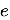 重复运行 4 层核心，最多  次（132 个有效层）；不过后续的探测研究（Lu et al., arXiv:2507.02199）指出，直接对中间隐藏迭代进行文本解释存在歧义，且其事实记忆容量比在 4T token 上训练的模型更为有限（MMLU 31.4%）187。10 月，Rui-Jie Zhu 等人（ByteDance）在 7.7T token 上训练了全栈循环、带自适应退出的 **Ouro-1.4B 和 Ouro-2.6B**（arXiv:2510.25741，№ 418\)77，其中 2.6B 模型在 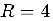 时达到 MATH-500 上 90.8%，借助多步知识组合与最高 12B 的稠密模型相当；Bohong Wu 等人则在 **Parallel Loop Transformer（PLT）**（arXiv:2510.24824，№ 419\)33 中通过流水线调度 **Cross-Loop Parallelism** 消除了循环带来的串行延迟惩罚。同时，Ali Behrouz 等人创建了在推理时以带动量的梯度更新的长期神经记忆 **Titans**（arXiv:2501.00663，№ 420\)288，Tianyuan Zhang 等人在 **LaCT**（arXiv:2505.23884，№ 421\)289 中把快速权重的训练扩展到最长 1M token 的分块，Maximilian Beck 和 Sepp Hochreiter 发布了 **xLSTM 7B**（arXiv:2503.13427，№ 422\)183，Bo Peng 等人则发布了具有动态低秩状态演化的 **RWKV-7 "Goose"**（arXiv:2503.14456，№ 423\)236。  
在离散文本扩散方面，相继问世的有：Shen Nie 等人从零训练、采用加权  ELBO 损失的 **LLaDA-8B**（及其 7B-A1B 的 MoE 变体）（arXiv:2502.09992，№ 424\)35，Inception Labs 的商业化 **Mercury Coder** 系列，在 H100 上并行生成速度达 **1,109 token/s**（arXiv:2506.17298，№ 425\)58，以及 Jiacheng Ye 等人的 **Dream 7B**（arXiv:2508.15487，№ 426\)294。在视频生成方面，Alibaba 团队以 Apache 2.0 许可证开源了 **Wan 2.1**（arXiv:2503.20314，№ 427\) 和 **Wan 2.2**（№ 428\)——首个采用**双专家时间 MoE 去噪器**的视频扩散架构（27B 总参数 / 14B 激活参数，依据 SNR 阈值在粗结构专家与细节专家之间切换，单步成本不增加，另有压缩模型 **TI2V-5B**，VAE 压缩比 4×16×16，单张 RTX 4090 即可运行\)172。此外还有：**HunyuanVideo 1.5**（8.3B 参数，在 step-distilled 模式下于 RTX 4090 上渲染需 75 秒，arXiv:2511.18870，№ 429\)297，上下文编辑器与 320 亿参数生成器 **FLUX.1 Kontext / FLUX.2**（Mistral-3 24B \+ 128 通道 VAE，№ 430\)174，多语言编码器 **SigLIP 2**（arXiv:2502.14786，ViT-g/16 在 ImageNet 上零样本 85.0%，№ 431\)239，具备机器人规划能力的世界视频模型 **V-JEPA 2**（arXiv:2506.09985，№ 432\)59，以及 70 亿参数的视觉编码器 **DINOv3**，其 **Gram Anchoring** 机制可在长时间训练中保持稠密分割图（arXiv:2508.10104，ADE20k 上 55.9 mIoU，№ 433\)301。  
在音频技术栈方面，Alibaba 发布了全模态模型 **Qwen2.5-Omni**（arXiv:2503.20215，№ 434\) 和 **Qwen3-Omni**（arXiv:2509.17765，**Thinker–Talker MoE** 架构 \+ 基于 2000 万小时音频的 12.5 Hz 编码器 **AuT** \+ 即时因果解码器 Code2Wav，文本 MMLU 不下降，№ 435\)303。同期问世的还有：1300 亿参数的 **Step-Audio**（arXiv:2502.11946，№ 436\)306，流式 **LLaMA-Omni2**（arXiv:2505.02625，№ 437\)308，采用 FSQ 量化的合成器 **CosyVoice 3**（arXiv:2505.17589，№ 438\)46，本地开源模型 **Kokoro-82M**、**Orpheus-3B** 和 **Chatterbox**311，基于连续 \-VAE 的 90 分钟对话生成器 **Microsoft VibeVoice**（arXiv:2508.19205，№ 439\)173，Kyutai 的连续音频 LM（arXiv:2509.06926，№ 440\)315，音频 LLM **Mistral Voxtral**（arXiv:2507.13264，№ 441\)316，超高速的 **NVIDIA Canary-1B-v2 和 Parakeet-TDT-0.6B-v3**（arXiv:2509.14128，3,332.7 RTFx，№ 442\)229，以及 **GigaAM-v3**317。

## **2026**

**领域：** 注意力/LLM MoE 循环/SSM 扩散 视频 编码器 STT TTS STS 优化

### **超稀疏旗舰模型、深度注意力（AttnRes）与全局 KV 缓存节省**

到 2026 年 11 月，开源架构（Sebastian Raschka 的目录 *LLM Architecture Gallery* 收录了 132 个模型对其作了系统整理，其专著 *«Build a Reasoning Model (From Scratch)»* 于 2026 年 6 月出版，№ 445\)1 已转向超稀疏的权重激活（每 token 仅 3–6%）与混合式注意力压缩。**DeepSeek V4 Pro**（2026 年 8 月发布，版本 0813，MIT 许可证）将 MoE 规模化到 **1.6 万亿参数，每 token 约 49B 激活（\~3.06%）**，窗口 1M token（使用 Muon 优化器在 \>32T token 上训练）：**Compressed Sparse Attention（CSA）** 与 **Heavily Compressed Attention（HCA）** 的组合将 1M 上下文上的计算开销降至 27% FLOPs，KV 缓存内存降至 V3.2 水平的 10%（根据公开综述和发布材料，据报道其在 LiveCodeBench 上为 93–94%，GPQA Diamond 上 \>90%，DeepSWE 上为 62.7）31。  
Moonshot AI 团队继视觉-智能体模型 **Kimi K2.5**（arXiv:2602.02276）之后，发布了 **Attention Residuals（AttnRes）** 方法（arXiv:2603.15031），它以可学习的、沿先前各层深度轴的分块 softmax 注意力，取代残差流的均匀累加；并在 2026 年 7 月开源了当时最大的 2.8 万亿参数旗舰模型 **Kimi K3**（arXiv:2607.24653，104B 激活参数——896 个路由专家中选 16 个 \+ 2 个共享专家，窗口 1M，原生 MXFP4 检查点，№ 443\)4。Kimi K3 采用了线性层 **KDA**（带有下界受限的 sigmoid 对数衰减，使其能在稠密矩阵的 Tensor Cores 内核上落入 BF16 的动态范围）与全局层 **Gated MLA 且完全不使用位置编码（NoPE）** 以 3:1 交替的结构，以及在升维投影之前设有 RMSNorm 层的 **Normalized LatentMoE**4。大型稀疏注意力 MoE 系列还有 **GLM-5**（arXiv:2602.15763，744B-A40B，MLA \+ DSA \+ 异步智能体 RL APRIL，SWE-bench Verified 上 77.8%，AA Index v4.0 上 50.4）321、**Tencent Hy4**（770B-A49B，Gated MLA \+ 带跨层 IndexCache 的 DSA 与 4 带超连接 iHC）1 以及 **Meta Muse Spark Open**（816B-A42B）1。  
在紧凑本地系统这一极，**Google Gemma 4**（arXiv:2607.02770，Apache 2.0，规格有 E2B、E4B、12B Unified、26B-A4B MoE 和 31B Dense）同时引入了三种架构机制：小模型中的逐层嵌入表 **Per-Layer Embeddings（PLE）**；12B Unified 中将原始 40 毫秒音频块和图像块直接投影进解码器的完全**无编码器投影（Encoder-Free）**；以及在全局注意力层中**把键复用为值（）**并配合部分旋转的 **\-RoPE（）（局部层与全局层之比为 5:1），使全局 KV 缓存减少了 **37.5%**73。尽管在数学和科学测试中得分很高（31B 在 Thinking 模式下 AIME 2026 为 89.2%，GPQA Diamond 为 84.3%），独立的 Artificial Analysis v5.0.1 存档仍指出，31B 模型在复杂的多步智能体场景中相对大型万亿参数系统存在差距324。

### **3:1 混合模型（Qwen 3.8、Nemotron 3/3.5）、Mamba-3、FlashAttention-4 与循环扩散模型**

线性矩阵记忆与稀疏完整注意力的混合化在 **Alibaba Qwen 3.8-27B** 中得以确立（2026 年 8 月，Apache 2.0，稠密 VLM 架构，共 64 层：16 个块，每块 3 层 **Gated DeltaNet** 加 1 层 **Gated Attention**，与闭源/旗舰的 2.4T-A95B Qwen 3.8-Max 并行推出）11。48 层 Gated DeltaNet 存储 48 个值头的固定状态矩阵 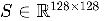，在任意序列长度下都占用恒定的 **72.0 MiB（BF16）**（**144.0 MiB / 151.0 MB（FP32）**），而 16 层 Gated Attention 所需的 KV 缓存内存仅为均匀 64 层 Transformer 的四分之一30。在 **NVIDIA Nemotron 3 Super**（120B-A12B，arXiv:2604.12374）、**Nemotron 3 Ultra**（550B-A55B，108 层，arXiv:2606.15007）和 **Nemotron 3.5 Super & Lightning**（arXiv:2610.38095）系列中，Mamba-2 \+ GQA 混合结构与 **LatentMoE**（）及用于推测解码的递归 MTP 草稿器相结合，支持最长 1M token 的上下文27。  
SSM 和注意力的基础内核本身也迎来了根本性更新。Aakash Lahoti、Tri Dao、Albert Gu 等人提出了 **Mamba-3**（arXiv:2603.15569，ICLR 2026\)32：向二阶精度的**指数-梯形离散化**  过渡，消除了对外部 1D 卷积的需要；**复数值状态转移**（等价于依赖输入的 **RoPE** 旋转）使模型能以 100% 的准确率跟踪奇偶性（Parity）；秩为  的 **MIMO 公式**使解码的算术强度提升 4 倍而不增加延迟，使状态  与原先的  相当329。Ali Hatamizadeh、Jaejin Choi 和 Jan Kautz 在 **Gated DeltaNet-2**（arXiv:2605.22791）248 中把擦除门与写入门分离；Tri Dao 的实验室则面向 **NVIDIA Blackwell（B200/GB200）** 加速器的非对称缩放发布了 **FlashAttention-4**（arXiv:2603.05451）：在 FMA 单元上对指数函数做多项式模拟，并在  时**有条件地跳过在线 softmax 的重缩放**，实现了 1,600 TFLOPs/s（峰值的 71%），而用 Python 的 **CuTe-DSL** 编写内核，使编译时间相比 C++ 模板缩短了 20–30 倍223。在循环与扩散的交汇处，Sanghyun Lee 等人创建了 **Looped Diffusion Language Models（LoopMDM）**（arXiv:2605.26106，NeurIPS 2026），对掩码扩散 LM 的早中期层进行循环，可节省最多 **3.34 倍训练 FLOPs**188（后发展为 **Looped UDLMs**，arXiv:2610.3006656）；此外问世的还有 7B 编码器饱和现象研究 **LoopCoder-v2（PLT-7B）**（arXiv:2606.18023）38、**Hyperloop Transformers**（arXiv:2604.21254）334、**LoopFold**（arXiv:2610.35556）194，以及开源循环 MoE 模型 **Inkling 2 Mini**（Thinking Machines Lab，26.4B-A3.4B，中间层 3 次遍历 \+ AttnRes）197。

### **同步音视频合成 LTX-2.5 与具备工具调用能力的全双工语音智能体**

在生成式视频方面，Lightricks 发表了 **LTX-2**（arXiv:2601.03233，非对称双流 DiT：14B 带 3D-RoPE 的视频流和 5B 带 1D-RoPE 的音频流，通过沿时间的双向交叉注意力相连）335，并于 2026 年 8 月发布了 220 亿参数的 **LTX-2.5**（文本编码器为 Gemma 4 12B，一次前向即可生成最长 20 秒、最高 4K 的同步视频和 24 kHz 立体声音频，具备多镜头场景连续性和 IC-LoRA 控制）258；而在图像生成方面，Wang 等人的解耦 Transformer **DDT-XL/2**（CVPR 2026，arXiv:2504.05741）将 ImageNet 256×256 上的 FID 降至 **1.26**219。在全双工语音方面，NVIDIA 团队推出了 **PersonaPlex 7B**（arXiv:2602.06053，在 Moshi \+ Mimi 架构之上，以上下文固定的角色与声音样本混合提示：自然度 DMOS **3.90 ± 0.15**，声音克隆相似度 SSIM **0.57**）68 和 **NemotronLabs VoiceChat**（arXiv:2609.21967，首个具备原生工具调用 Tool Calling 能力的开源 Full-Duplex STS 模型，配有 RNN-T 辅助转写，打断时 100% 能够截停，听者插入语气词后 93% 能够继续说话）69。流式语音技术栈由以下模型收尾：**Qwen3-TTS**（arXiv:2601.15621，12.5 Hz 因果分支，16 码本 MTP，首包延迟约 **97–100 毫秒**）和 **Qwen-Audio-3.0-TTS**（arXiv:2607.23938）54，**Qwen3.5-Omni**（arXiv:2604.15804，ARIA 对齐）342，**Fish Audio S2-Pro**（arXiv:2603.08823，TTFA \~100 毫秒，RTF 0.195）和 **Drama 3**（arXiv:2610.18010）158，可在笔记本电脑两个 CPU 核心上以 6 倍于实时的速度运行的 **Kyutai Pocket TTS**（100M 参数，MIT）344，流式 **Mistral Voxtral Realtime**（arXiv:2602.11298，延迟 480 毫秒）345，**GigaAM Multilingual**（arXiv:2607.10371，Interspeech 2026\)346，以及双分支的 **Nemotron 3.5 Transcribe**（TDT \+ Sortformer 说话人日志器）348。

## **2027**

**领域：** 注意力/LLM 循环/SSM 扩散 视频 优化  
**2027 年**的科研计划，截至 2026 年 11 月，由冬春季会议 **WACV 2027**、**AAAI / IAAI 2027**、**WSDM 2027**、**DATE 2027** 已录用的论文，以及 OpenReview 上含 37,028 份投稿的 **ICLR 2027** 公开评审语料所记录，其重点在于生成范式的理论统一，以及消除混合网络和循环网络中细微的数值相位病态15。在 WACV 2027 录用的 Amandeep Kumar、Nithin Nair 和 Vishal Patel 的论文 *«Scale-wise VAR is Secretly Discrete Diffusion»* (№ 444\)17 中，严格证明了视觉自回归的下一尺度预测模型（VAR）在功能上等价于多尺度潜在空间中的逐尺度离散掩码扩散。WACV 2027 和 AAAI/IAAI 2027 的论文集还展示了长时分割的视频掩码 Transformer **LVMT**（Norouzi et al.）16、单步流方案（arXiv:2608.09579）、扩散解码器 **PixCell**（arXiv:2611.01141）、结构化注意力偏置（arXiv:2611.04657）以及受限权威检索的工业架构（arXiv:2611.20398）19。  
ICLR 2027 评审语料中揭示出三种下一代的基础机制。第一，对分块 KV 缓存压缩的分析（*«Periodic Weak Spots: Phase Sensitivity from Chunked KV-Cache Compression»*）表明，在 DeepSeek-V4 类模型中，事实检索的准确率会随 token 位置相对于压缩窗口边界的相位而变化，幅度最高达 **40 个百分点**，原因是出现了相位专门化的注意力头15。第二，关于注意力反向传播数值稳定性的工作（OpenReview:LJvGaCWmFh）确定，在使用 **BF16 FlashAttention-3** 训练时，后期的梯度爆炸源于 BF16 舍入破坏了 softmax 行梯度之和的精确守恒律（查询梯度的中位误差为 219%），并提出了一种反向内核修正，将误差降至 **0.34% / 0.37%**（FP32 水平），而每步开销仅增加 4.7%352。第三，提出了中部收窄的**可变宽度（“沙漏”）Transformer**、嵌套的 **Matryoshka Language Model Suites**（训练一系列尺寸时节省 36% 的计算）以及用于在所有递归深度上对循环模型进行安全对齐的 **SafeBridge** 方法——这是对如下发现的回应：在 Ouro 和 Huginn 中，推理时把循环次数减半仍能保持 GSM8K 上 89% 的准确率，但会破坏形成较晚的拒绝向量，使模型对恶意请求的脆弱性提高 5.3–9.9 倍15。

## **附录 A. 架构、基准、统计数据与代码仓库汇总表**

### **表 A.1. 架构与机制的完整年代矩阵（1958–2027，步长 1 年）**

| 年份 | 领域 / 标签 | 关键架构 / 算法 | 核心数学机制 | 里程碑、作者及参考文献编号 |
| :---- | :---- | :---- | :---- | :---- |
| **1958** | 基础 | 感知机 Mark I | 超平面 ，误差修正 | Rosenblatt (№ 1), von Neumann (№ 2\) |
| **1959** | 编码器 基础 | Pandemonium；TD 跳棋；V1 感受野 | 并行选择 ；局面评估的时间差分 | Hubel & Wiesel (№ 3), Selfridge (№ 4), Samuel (№ 5\) |
| **1960** | 基础 优化 | ADALINE / LMS 规则；共轭梯度 | delta 规则 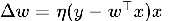；连续共轭 ODE | Widrow & Hoff (№ 6), Kelley (№ 7\)7 |
| **1961** | 循环 记忆 | Die Lernmatrix；记忆方程 | 矩阵异联想记忆  | Steinbuch (№ 8\)91, Caianiello (№ 9\) |
| **1962** | 基础 编码器 | 感知机收敛定理；MADALINE | 误差界 ；皮层的简单细胞与复杂细胞 | Novikoff (№ 10\)93, Hubel & Wiesel (№ 14\) |
| **1963** | 基础 优化 | 广义肖像（线性 SVM） | 最大间隔超平面  | Vapnik & Lerner (№ 15\)98 |
| **1964** | 优化 基础 | Polyak 动量法；势函数 | Heavy-ball ；核技巧；前向 AD | Polyak (№ 18\)101, Aizerman et al. (№ 19), Wengert (№ 20\) |
| **1965** | 基础 | 最早的深层 MLP；Cover 定理 | Kolmogorov—Gabor 多项式的逐层选择；二分数  | Ivakhnenko & Lapa (№ 21\)7, Cover (№ 22\) |
| **1966** | 优化 基础 | 学习中的平均风险最小化 | 随机逼近  | Tsypkin (№ 25\)106, Braverman (№ 26\) |
| **1967** | 基础 优化 | 端到端多层 SGD；Sinkhorn–Knopp | 5 层网络中的梯度下降；双随机矩阵投影 | Amari (№ 28\)21, Sinkhorn & Knopp (№ 30\)61 |
| **1968** | 基础 循环 | GMDH；Outstar 网络；VC 理论 | 深度的验证集正则化；STM/LTM 可塑性方程 | Ivakhnenko (№ 31), Grossberg (№ 32), Vapnik (№ 33\) |
| **1969** | 基础 编码器 | 感知机的局限；模拟 ReLU | 单层不可分的 XOR；多层整流器  | Minsky & Papert (№ 34), Bryson & Ho (№ 35), Fukushima (№ 36\)85 |
| **1970** | 基础 优化 | 自动微分的反向模式；BFGS | 图上的精确链式法则 ；拟牛顿法 | Linnainmaa (№ 37\)113, BFGS (№ 38\) |
| **1971** | 基础 记忆 | 8 层 GMDH 网络；原皮层理论 | 深度多项式网络；海马体的稀疏联想记忆 | Ivakhnenko (№ 40\)115, Marr (№ 41\) |
| **1972** | 循环 记忆 | Amari—Hopfield 网络；Wilson–Cowan 群体 | 循环吸引子 ；E–I 极限环 | Amari (№ 42\)115, Kohonen (№ 43), Wilson & Cowan (№ 46\)120 |
| **1973** | 编码器 循环 | V1 皮层的自组织；分流网络 | 带 \-权重归一化的竞争 Hebb 规则；除法式对比度 | von der Malsburg (№ 47\)123, Grossberg (№ 48\) |
| **1974** | 基础 循环 | 神经网络的 Backprop；大脑自旋模型 | 导数的动态反馈；带温度的 Ising 分布 | Werbos (№ 50\)123, Little (№ 51\)127 |
| **1975** | 编码器 记忆 | Cognitron；CMAC；SK 自旋玻璃 | 层的除法式抑制；局部哈希编码；SK 哈密顿量 | Fukushima (№ 52\)122, Albus (№ 53), SK (№ 54\) |
| **1976** | 优化 循环 | 印刷体中的 Reverse AD（BIT）；ART 的雏形 | 兼顾内存的 Taylor 展开；稳定性—可塑性困境 | Linnainmaa (№ 56\)23, Grossberg (№ 57\) |
| **1977** | 循环 优化 | Brain-State-in-a-Box (BSB)；EM 算法 | 超立方体中的吸引子 ；隐变量似然的下界 | Anderson et al. (№ 59\)122, Dempster et al. (№ 62\) |
| **1978** | 记忆 基础 | 突触记忆容量；BIC 准则 | 记忆容量随突触数的缩放  | Little & Shaw (№ 63\)127, Schwarz (№ 64\) |
| **1979** | 编码器 | Neocognitron（原始发表） | 可分离平面 \-细胞（卷积）与 \-细胞（池化）的级联 | Fukushima (№ 67\)86 |
| **1980** | 编码器 优化 | Neocognitron（国际版）；Baur—Strassen 界 | 通过级联  实现平移不变性；梯度复杂度估计  | Fukushima (№ 69\)129, Baur & Strassen (№ 71\) |
| **1981** | 记忆 循环 | 分布式表示；联想式 RL | 特征的交互激活；基于强化的搜索梯度 | Hinton & Anderson (№ 72), Barto et al. (№ 74\) |
| **1982** | 循环 编码器 | Hopfield 网络；Kohonen 映射（SOM）；Oja 规则 | Lyapunov 函数 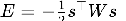；拓扑学习；神经 PCA | Hopfield (№ 75), Werbos (№ 76), Kohonen (№ 77), Oja (№ 78\) |
| **1983** | 优化 循环 | Nesterov 加速方法；模拟退火 | 前瞻点处的最优下降 ；Actor–Critic RL | Nesterov (№ 81\)143, Kirkpatrick (№ 82), Barto (№ 83\) |
| **1984** | 基础 扩散 | PAC 学习；连续 Hopfield；Gibbs 采样器 | 多项式可学习性 ；MRF 场上的 MCMC 松弛 | Valiant (№ 84\)147, Hopfield (№ 85), Geman (№ 86\) |
| **1985** | 基础 扩散 | Boltzmann 机；Backprop 的独立推导 | 相位相关差的梯度  | Ackley, Hinton & Sejnowski (№ 88\)150, LeCun (№ 89\) |
| **1986** | 基础 循环 | MLP \+ Backpropagation；RBM（Harmonium）；Jordan RNN | 隐表示的链式梯度 ；无环的二部能量 | Rumelhart, Hinton & Williams (№ 92), Smolensky (№ 94), Jordan (№ 95\) |
| **1987** | STT 循环 | TDNN；快速权重（Fast Weights）；Autoencoder stack | 面向语音的时间 1D 卷积；可塑的上下文权重增量 | Waibel (№ 97), Hinton & Plaut (№ 98), Ballard (№ 99), Pineda (№ 101\) |
| **1988** | 编码器 优化 | 带 backprop 的 2D-CNN；RBF 网络；TD() 学习 | 带误差学习的二维卷积；Bellman 残差的自举 | Zhang (№ 102\)20, Broomhead (№ 103), Sutton (№ 104\) |
| **1989** | 编码器 基础 | LeCun 卷积网络（USPS）；逼近定理 | 通过带步长的 2D 核的端到端 backprop；MLP 在  中的稠密性；Q-learning | LeCun et al. (№ 107), Cybenko (№ 108), Hornik (№ 109), Watkins (№ 111\) |
| **1990** | 循环 优化 | Elman 网络（Simple RNN）；BPTT；Optimal Brain Damage | 隐上下文 ；按 Hessian 对角线剪枝 | Elman (№ 114), Werbos (№ 115), LeCun et al. (№ 116), Schmidhuber (№ 117\) |
| **1991** | MoE 循环 注意力 | Mixture of Experts；梯度消失；Fast Weights | 门控网络 ；分析 ；线性自注意力 | Jacobs et al. (№ 119), Hochreiter (№ 120), Schmidhuber (№ 121\)22 |
| **1992** | 优化 循环 | REINFORCE；神经历史压缩器；Polyak 平均 | 策略梯度 ；RNN 蒸馏；SGD 的轨迹平均 | Williams (№ 124), Schmidhuber (№ 125), Polyak & Juditsky (№ 126\) |
| **1993** | 编码器 基础 | Siamese 网络；变分 MDL；Barron 界 | 共享权重的度量塔；权重的自由能；OBS 剪枝 | Bromley & LeCun (№ 129), Hinton & van Camp (№ 130), Barron (№ 131\) |
| **1994** | 循环 MoE | 长程依赖定理；层次化 MoE | RNN 中稳定存储与梯度的不相容性；算子  耗时  | Bengio et al. (№ 133), Jordan & Jacobs (№ 134), Pearlmutter (№ 135\) |
| **1995** | 基础 扩散 | Helmholtz 机（Wake–Sleep）；Soft-margin SVM | 生成/推断网络对 ；互信息最大化 | Hinton et al. (№ 137), Cortes & Vapnik (№ 139), Bishop (№ 141\) |
| **1996** | 编码器 基础 | V1 稀疏编码；无限宽度的高斯极限 | 用过完备字典的 \-重构； 收敛到 NNGP | Olshausen & Field (№ 142), Neal (№ 143), Goller & Küchler (№ 144\) |
| **1997** | 循环 记忆 | LSTM；双向 RNN（BiRNN）；平坦极小值 | 加性单元 （CEC）；时间的正向与反向分支 | Hochreiter & Schmidhuber (№ 146), Schuster & Paliwal (№ 147\) |
| **1998** | 编码器 优化 | LeNet-5；Amari 自然梯度 | Conv–Pool–FC 级联 \+ 图转导器；Fisher 度量  | LeCun et al. (№ 150), Amari (№ 152), Sutton & Barto (№ 153\) |
| **1999** | 循环 基础 | LSTM 遗忘门；非负矩阵分解 NMF | 乘性重置 ；加性特征  | Gers, Schmidhuber & Cummins (№ 155\)155, Lee & Seung (№ 156\) |
| **2000** | 循环 基础 | Peephole LSTM；Softplus；流形学习（Isomap/LLE） | 单元  与各门的连接；平滑激活  | Gers et al. (№ 158, 159), Dugas et al. (№ 160), Tenenbaum (№ 161\) |
| **2001** | 循环 编码器 | Echo State Networks (ESN)；条件随机场（CRF） | 衰减的储备池 ；路径的全局归一化  | Jaeger (№ 163), Lafferty et al. (№ 164), Hastie et al. (№ 165\) |
| **2002** | 扩散 基础 | 对比散度（CD\-）；结构化感知机 | 由数据得到的 RBM 梯度的单步 MCMC 估计；Torch 库 | Hinton (№ 166), Collins (№ 168), Collobert et al. (№ 169\) |
| **2003** | 基础 注意力/LLM | 神经概率语言模型（NPLM） | 稠密可学习的词嵌入 ；CNN 的弹性形变 | Bengio et al. (№ 170), Simard et al. (№ 171), MacKay (№ 172\) |
| **2004** | 优化 基础 | 首次在 GPU 上加速神经网络； 与  的理论 | GPU 着色器中的矩阵运算（20 倍）； 的对数复杂度 | Oh & Jung (№ 173), Ng (№ 174), Welling et al. (№ 175\) |
| **2005** | 扩散 STT 基础 | Score Matching；面向语音的 BiLSTM；图神经网络（GNN） | 估计 ，无需配分函数 ；层次化 Softmax | Hyvärinen (№ 176\)163, Graves (№ 177), Gori et al. (№ 179\) |
| **2006** | STT 基础 | CTC；深度信念网络（DBN）与自编码器 | 带空白符的对齐求和 ；逐层堆叠 RBM | Graves et al. (№ 181), Hinton et al. (№ 182, 183), Bishop (№ 185\) |
| **2007** | 基础 优化 | 大数据上 SGD 的渐近性；自编码器堆叠 | 计算时间受限时一阶 SGD 的最优性 | Bengio et al. (№ 186), Bottou & Bousquet (№ 187), Mnih (№ 188\) |
| **2008** | 编码器 扩散 | 去噪自编码器（DAE）；统一的 CNN-NLP | 重构干净的 （由带噪的 ）；多任务嵌入；t-SNE | Vincent et al. (№ 190), Collobert & Weston (№ 191), t-SNE (№ 192\) |
| **2009** | 编码器 优化 | ImageNet；基于 CUDA 的深度学习；Curriculum Learning | 扩展到 14M 图像与 CUDA（70 倍）；难度调度 | Deng et al. (№ 193), Raina, Madhavan & Ng (№ 194), Bengio (№ 195\) |
| **2010** | 基础 优化 | Xavier 初始化；深层网络中的 ReLU；RNNLM；NCE | 方差保持 ；分段线性 ；Theano | Glorot & Bengio (№ 198), Nair & Hinton (№ 199), Mikolov (№ 200\) |
| **2011** | 优化 扩散 | AdaGrad；Denoising Score Matching (DSM)；CD-DNN-HMM | 逐坐标缩放 ；DAE 与  的等价性 | Duchi et al. (№ 204), Vincent (№ 205\)166, Seide et al. (№ 208\) |
| **2012** | 编码器 STT | AlexNet；RNN-Transducer (RNN-T)；Dropout；RMSProp | 带 ReLU 和 Dropout 的深层 GPU-CNN；面向在线 ASR 的联合网格 Joiner  | Krizhevsky et al. (№ 210\)167, Graves (№ 211), Hinton (№ 212\) |
| **2013** | 编码器 扩散 | Variational Autoencoder (VAE)；Word2Vec；NiN；DQN | ELBO 下界 \+ 重参数化 ；对比式 Skip-Gram | Kingma & Welling (№ 217), Mikolov (№ 219), Lin (№ 220), Mnih (№ 222\) |
| **2014** | 注意力 扩散 | Seq2Seq \+ Bahdanau Attention；GRU；GAN；Adam 优化器 | 上下文的软对齐 ；极小极大 ；自适应矩 | Sutskever (№ 225), Bahdanau (№ 226), Cho (№ 227), GAN (№ 229), Adam (№ 230\) |
| **2015** | 基础 扩散 | ResNet \+ Kaiming Init；BatchNorm；U-Net；扩散 | 恒等直连 ；skip 编码器-解码器；马尔可夫链的逆转 | He et al. (№ 237), Ioffe (№ 239), U-Net (№ 240), Sohl-Dickstein (№ 241\) |
| **2016** | TTS 循环 基础 | LayerNorm；Pre-LN ResNet；ACT；GELU；WaveNet | 按 token 特征归一化；可学习的循环停止门；空洞卷积 | Ba (№ 249), He (№ 250), Graves (№ 251), GELU (№ 252), WaveNet (№ 253\) |
| **2017** | 注意力/LLM MoE TTS | 经典 Transformer；Sparse MoE；VQ-VAE；AdamW；PPO | ；Top\- 路由；离散码本；解耦的 weight decay | Vaswani (№ 260), Shazeer (№ 261), VQ-VAE (№ 262), AdamW (№ 265), PPO (№ 266\) |
| **2018** | 编码器 LLM 循环 | BERT；GPT-1；Universal Transformer；Neural ODE；InfoNCE；Shampoo | 双向 MLM 对比因果 AR；带 ACT 的 Transformer 循环；连续深度 | Devlin (№ 274), Radford (№ 273), Dehghani (№ 275), Chen (№ 276), Shampoo (№ 282\) |
| **2019** | 注意力/LLM 循环 TTS | GPT-2；RMSNorm；MQA；DEQ；FastSpeech；NCSN；ZeRO/Megatron | 无平移的归一化；单个 KV 头；隐式不动点 ；长度调节器 | Radford (№ 285), RMSNorm (№ 286), MQA (№ 287), DEQ (№ 288), FastSpeech (№ 292\) |
| **2020** | LLM 扩散 STT | GPT-3 & Scaling Laws；SwiGLU；Linear Attn；DDPM/SDE；ViT；Conformer | 门控 FFN；核 ；噪声损失 ；16×16 图像块；Conv+Attn 混合 | Brown (№ 300), SwiGLU (№ 301), DDPM (№ 303), ViT (№ 306), Conformer (№ 307\) |
| **2021** | LLM 循环/SSM TTS | RoPE；ALiBi；Switch MoE；LoRA；CLIP；S4；VITS；SoundStream；LDM | 复数旋转 ；适配器 （秩为 ）；NPLR SSM；RVQ 音频编解码器；VAE 中的扩散 | RoPE (№ 316), LoRA (№ 319), CLIP (№ 320), S4 (№ 324), SoundStream (№ 327), LDM (№ 331\) |
| **2022** | LLM 扩散 STT | FlashAttention；Chinchilla；DiT；Flow Matching / Rectified Flow；Whisper | 带在线 softmax 的 SRAM 分块；；adaLN-Zero Transformer；直线型 ODE  | Dao (№ 332), Chinchilla (№ 334), Rectified Flow (№ 338), DiT (№ 341), Whisper (№ 342\) |
| **2023** | LLM 循环/SSM STS | GQA；vLLM；Mixtral 8x7B；Mamba (S6)；RWKV/RetNet；SigLIP；VALL-E；TDT；DPO | 分组 KV；依赖输入的 ；sigmoid 损失；按时长跳帧 | GQA (№ 347), Mamba (№ 356), SigLIP (№ 358), VALL-E (№ 362), TDT (№ 366), DPO (№ 353\) |
| **2024** | LLM MoE 循环 STS | DeepSeek-V2/V3 (MLA, Aux-Free MoE, MTP)；Mamba-2；xLSTM；GDN；MMDiT；Moshi | MLA 的低秩 KV 缓存；偏置均衡 ；delta 规则 ；Full-Duplex 160 毫秒（Mimi） | DeepSeek (№ 371, 372), Mamba-2 (№ 379), GDN (№ 382), HunyuanVideo (№ 394), Moshi (№ 400\) |
| **2025** | LLM 循环 扩散 视频 | DeepSeek-R1 & V3.2 (DSA) & mHC；Kimi K2 (MuonClip) & KDA；Huginn/Ouro/PLT；LLaDA/Mercury；Wan 2.2 | 可验证的 GRPO；Sinkhorn 向 Birkhoff 多面体的投影；潜在循环；dLLM；MoE 视频 | R1 (№ 406), V3.2 (№ 408), mHC (№ 409), K2 (№ 411), Huginn (№ 417), Ouro (№ 418), LLaDA (№ 424\) |
| **2026** | LLM 混合 视频 STS | DeepSeek V4 Pro；Kimi K3 (AttnRes)；Gemma 4；Qwen 3.8；Nemotron 3/3.5；Mamba-3；FA-4；LTX-2.5；PersonaPlex | CSA+HCA（10% KV）；深度注意力； \+ \-RoPE；3:1 GDN 混合；复数 MIMO-SSM；音视频 DiT | K3 (№ 443\)4, Gemma 4156, Qwen 3.830, Mamba-332, LTX-2.5297 |
| **2027** | LLM 扩散 优化 | Scale-wise VAR \= dLLM；DeepSeek-V4 的 KV 相位分析；精确的 BF16 FA-bwd；Hourglass LM；SafeBridge | VAR 与掩码扩散的同构；softmax 梯度守恒律；跨循环的安全性 | Kumar et al. (WACV'27, № 444\)17, OpenReview ICLR'2715 |

2024–2026 年开源语言架构的两个决定性的系统性转变，都落在显卡内存管理的层面：对上下文状态的激进压缩（通过低秩缓存 MLA，以及用长度恒定的矩阵记忆 Gated DeltaNet 或 KDA 取代 75% 的注意力层），以及向超稀疏权重激活的转变——在知识总量为 0.7–2.8 万亿参数的情况下，每个 token 仅激活网络的 3.1–10.0%4。  
  
对上述内存规模的对比，解释了长上下文智能体推理的实际经济学：在均匀的完整注意力模型中，KV 缓存的线性增长很快就会超过模型权重本身的大小，迫使推理仅仅为了存储对话历史而分布到多个节点上196。相反，3:1 混合架构使网络中 75% 的层完全冻结了内存增长（无论上下文长度是 32K 还是 1M token，都保持在 72 MiB（BF16）），再结合 3–5% 的激活专家，便能在质量相当的情况下，以便宜一个数量级的成本为多步轨迹提供服务30。

### **表 A.2. 开源旗舰 LLM 与混合模型的架构规格与基准（2024–2026）**

*归属说明（截至 2026 年 11 月 25 日）：* 指标取自开发者的官方技术报告和模型卡；凡有独立测量或综述（Epoch AI、Artificial Analysis、技术汇总）之处，来源均已在单元格中明确标出31。破折号（—）表示原始来源中没有可比的指标发表。

| 模型（发布时间，许可证） | 总参数 / 激活参数 | 注意力 / SSM 与专家架构 | 上下文窗口 | MMLU-Pro (%) | GPQA Diamond (%) | AIME 24 / 25 / 26 (%) | LiveCodeBench (%) | SWE-bench Verified (%) |
| :---- | :---- | :---- | :---- | :---- | :---- | :---- | :---- | :---- |
| **DeepSeek-V3 / 0324** (2024 年 12 月，MIT)29 | 671B / 37B (5.5%) | 61 层：MLA \+ Aux-Loss-Free MoE (8/256 \+ 1 shared) \+ MTP | 128K | 75.9（0324 中为 81.2\) | 59.1（0324 中为 68.4\) | 39.2 ('24；0324 中为 59.4\) | 46.9 (v6, 0324\) | 38.8 (Agentic, 0324\) |
| **DeepSeek-R1 / 0528** (2025 年 1 月/5 月，MIT)268 | 671B / 37B (5.5%) | V3 基座 \+ 多阶段可验证 RL (GRPO) | 128K | 84.0 | 71.5（0528 中为 81.0\) | 79.8 ('24) / 70\.0$\rightarrow$87.5 ('25) | 63\.5$\rightarrow$73.3 (v6) | 49.2 |
| **Llama 4 Maverick** (2025 年 4 月，Llama 4\)280 | 400B / 17B (4.3%) | 稠密层与 MoE 层交替 (1/128 \+ 1 shared)，早期融合 | 1M（Scout 为 10M） | — | 67.0 (Epoch AI) | — | — | — |
| **Qwen3-235B-A22B** (2025 年 5 月/7 月，Apache 2.0)247 | 235B / 22B (9.4%) | 94 层：GQA (64Q / 4KV) \+ MoE (8/128)，Think/Non-Think 模式 | 128K–262K (1M DCA) | 77.3 (non-think) | 62.9 (non-think) | 85.7 ('24) / 81.5 ('25, think) | 70.7 (v5, think) | 34.4 (non-think) |
| **Kimi K2 Instruct** (2025 年 7 月，Mod. MIT)66 | 1.04T / 32.6B (3.1%) | 61 层：MLA (64 头) \+ MoE (8/384 \+ 1 shared)，使用 MuonClip 训练 | 128K | 81.1 | 75.1 | 69.6 ('24) / 49.5 ('25) | 53.7 (v6, non-think) | 65.8 (71.6 multi) |
| **GLM-4.5** (2025 年 7 月，MIT)282 | 355B / 32B (9.0%) | 深层 MoE \+ GQA \+ MTP，Thinking / Non-Thinking 混合 | 128K | 84.6 | 79.1 | 91.0 (AIME'24) | 72.9 | 64.2 |
| **DeepSeek-V3.2** (2025 年 12 月，MIT)10 | 671B / 37B (5.5%) | MLA \+ **DeepSeek Sparse Attention (DSA)** \+ 统一的智能体 GRPO | 128K | \~85.0 | 82.4 | 94.17 (AIME'26) | — | 70.2 (Multilingual) |
| **Nemotron 3 Nano** (2025 年 12 月，OpenMDW)184 | 31.6B / 3.2B (10.1%) | Mamba-2 \+ GQA \+ 细粒度 MoE (6/128) 混合，NVFP4 | 1M (RULER 86.3) | 78.3 | 73.0 (75.0 tools) | 89.1 ('25) / 99.2 (tools) | 68.3 (v6) | 38.8 (OpenHands) |
| **GLM-5 / GLM-5.1** (2026 年 2 月/4 月，MIT)321 | 744B / 40B (5.4%) | 80 层：MLA \+ **DSA** \+ 256 个专家 \+ Muon \+ 异步 RL APRIL | 200K–1M | — | — | 95.4 / 95.3 (AIME'26) | — | 77.8 |
| **Qwen3.5-397B-A17B** (2026 年春，Apache 2.0)353 | 397B / 17B (4.3%) | 3:1 混合 (75% **Gated DeltaNet** \+ 25% GQA) \+ Sparse MoE | 256K | — | 88.4（汇总） | 91.3 (AIME'26) | 83.6 (v6) | — |
| **Gemma 4 31B Dense** (2026 年 4 月/7 月，Apache 2.0)324 | 30.7B / 30.7B (100%) | 60 层：5:1 SWA/Global， **\+ \-RoPE**（节省 37.5% KV），MTP | 256K | 85.2 | 84.3 (75.8 min Epoch) | 89.2 (AIME'26) | 80.0 (v6) | — |
| **Gemma 4 26B-A4B** (2026 年 4 月/7 月，Apache 2.0)324 | 25.2B / 3.8B (15.1%) | 30 层：5:1 SWA/Global (, \-RoPE) \+ MoE (8/128 \+ 1 shared) | 256K | 82.6 | 82.3 | 88.3 (AIME'26) | 77.1 (v6) | — |
| **Nemotron 3 Ultra** (2026 年 6 月，OpenMDW)326 | 550B / 55B (10.0%) | 108 层：Mamba-2 \+ GQA (64Q/2KV) \+ **LatentMoE** (22/512) \+ 2 MTP | 1M | — | — (AA Index 56.4) | — | — | — |
| **Kimi K3** (2026 年 7 月，Kimi K3 Lic.)4 | 2.8T / 104B (3.7%) | 3:1 混合 (**KDA** \+ Gated MLA NoPE) \+ **AttnRes** \+ Stable LatentMoE (16/896) | 1M | — | — | — | — | 81.2 (FrontierSWE) |
| **DeepSeek V4 Pro** (2026 年 8 月，MIT)31 | 1.6T / \~49B (3.1%) | **CSA \+ HCA** 混合（在 1M 上相对 V3.2 为 27% FLOPs 和 10% KV）\+ Muon (\>32T tok.) | 1M | — | \>90.0（发布综述） | — | 93–94（发布综述） | 62.7 (DeepSWE) |
| **Qwen3.8-27B** (2026 年 8 月，Apache 2.0)30 | 27B / 27B (100%, VLM) | 64 层：**48 Gated DeltaNet** (48V/16QK) \+ **16 Gated Attn** (24Q/4KV) \+ MTP | 262K (1M YaRN) | — | — (AA v4.3.2: 33.7) | — | — | 42.2 (DeepSWE 1.1) |
| **Tencent Hy4** (2026 年 8 月，Open)1 | 770B / 49B (6.4%) | 78 层：Gated MLA \+ **DSA (IndexCache)** \+ 4 带 **iHC** \+ MoE (8/256 \+ 1\) | — | — | — | — | — | — |
| **Nemotron 3.5 Super** (2026 年 10 月，OpenMDW)327 | 120B / 12B (10.0%) | Mamba-2 \+ GQA 混合 \+ LatentMoE (512 专家) \+ 递归 MTP drafter | 1M | — | — | — | — | 86\.9$\rightarrow$92.1 (Pro V2 \+ RL) |

2025 与 2026 两代模型之间智能密度的变化，在对比高难度科学与奥赛题目（GPQA Diamond 与 AIME 2026\）和循环深度模型的参数效率时尤为清晰10。  
  
上述数据揭示了一条重要规律：在序列演绎推理任务（AIME、MATH-500）中，起决定作用的不是独立参数的原始数量，而是*顺序非线性变换的有效深度*——它或者通过上下文中的推理模式显式达成（Gemma 4 26B-A4B 的 Thinking 模式仅用 3.8B 激活参数，就把 AIME 2026 提升到 88.3%，而不带推理的 Gemma 3 27B 仅为 20.8%），或者隐式地在隐藏状态内部，通过在 Ouro-2.6B 的共享层栈上进行  次循环遍历而达成286。

### **表 A.3. 循环深度（循环式）与扩散语言模型（2025–2026）**

| 模型 / 架构 | 范式与深度拓扑 | 独立参数 / 训练 token 数 | 关键实验指标与加速 |
| :---- | :---- | :---- | :---- |
| **Huginn-0125** (arXiv:2502.05171)3 | 三明治循环 ，输入  与  采用 concat 注入， () | 3.5B / 800B token (4,096 MI250X) | 随着循环次数增加 ：ARC-Easy 49.07%69.91%，HellaSwag 43.46%65.21%，GSM8K CoT 42.08%；在 4 个槽位上零样本 KV 共享，MT-Bench (5.86) 无损失284 |
| **Ouro-1.4B & Ouro-2.6B** (arXiv:2510.25741)286 | 全栈循环 ()，带可学习的早退门（ACT gate） | 1.4B 和 2.6B / 7.7T token | **Ouro-1.4B**：MMLU 67.3%，GSM8K 78.9%，MATH-500 82.4%；**Ouro-2.6B**：MMLU 74.6%，MMLU-Pro 55.7%，BBH 80.5%，MATH-500 **90.8%**（与最高 12B 的稠密模型相当）286 |
| **PLT & LoopCoder-v2 7B** (arXiv:2510.24824, 2606.18023)33 | Cross-Loop Parallelism (CLP) 流水线 \+ 首次循环的共享 KV \+ Gated SWA () | 1.7B 激活 / 7B 稠密（18T 代码与文本 token） | 消除串行延迟惩罚（+96%\~4% 开销，当  时）；2 次循环上准确率 \+5.0 个百分点，因 CLP 的相位偏移，在  时诊断出饱和33 |
| **Inkling 2 Mini** (Thinking Machines，2026 年 11 月\)197 | 由 24 层构成的三明治，应用  次 \+ AttnRes \+ MoE (8/128) | 总计 26.4B / 3.4B 独立激活（5.4B 激活量） | 上下文 1,048,576 token，Apache 2.0，每块 5 个局部 SWA (1024) \+ 1 个全局 GQA，KV 缓存 192 KiB/token197 |
| **LLaDA-8B / LLaDA-MoE** (arXiv:2502.09992)35 | 双向掩码扩散 Transformer（MDM，加权  ELBO） | 8B 稠密；7B-A1B MoE | 在相同 FLOPs 下与 LLaMA-3 8B 持平；Instruct（分块去掩码）：GSM8K **78.6%**，MATH **42.2%**，CMMLU 69.9%；克服了 reversal curse57 |
| **Dream 7B** (arXiv:2508.15487)57 | 由自回归权重初始化的离散扩散 LLM | 7B 稠密 | MATH **51.2%**，HumanEval **54.3%**，具备强大的规划能力和双向填空能力57 |
| **Mercury Coder Mini / Small** (arXiv:2506.17298)58 | 具有并行 token 生成的商业扩散代码 LLM | 闭源规模（万亿级 token） | 在标准 NVIDIA H100 上的吞吐量：**1,109 tok/s**（Mini）和 **737 tok/s**（Small），据 Artificial Analysis 测量（比 AR 模型快最多 10 倍）58 |
| **LoopMDM & Looped UDLM** (arXiv:2605.26106, 2610.30066)56 | 在离散扩散去噪器内部对早中期层进行选择性循环 | 125M–170M (NeurIPS 2026\) | 在 FineWeb-Edu 上以 **少 3.34 倍的训练 FLOPs** 达到相同的验证 NLL；GSM8K \+8.5 个百分点；自适应退出最多节省 34.8% 的循环56 |

### **表 A.4. 视觉编码器与图像和视频生成模型（2012–2026）**

| 模型（年份） | 类型与关键机制 | 规模 / 潜在压缩 | 经验证的质量与速度指标 |
| :---- | :---- | :---- | :---- |
| **AlexNet** (2012)  **ResNet-152** (2015)  **ViT-H/14** (2020)167 | 从 2D-CNN（ReLU+Dropout）到残差网络和图像块 Transformer 的演进 | 60M  60M  632M | ImageNet-1K Top-1 准确率：**63.3%**（AlexNet） **78.3%**（ResNet-152，集成，3.57% Top-5 err） **88.55%**（ViT-H/14 JFT）177 |
| **SigLIP 2** (2025 年 2 月，arXiv:2502.14786)300 | 多语言 ViT（109 种语言）：Sigmoid loss \+ LocCa 解码器 \+ SILC/TIPS \+ NaFlex | 86M (B), 303M (L), 400M (So400m), 1B (g) | ImageNet-1K 零样本 Top-1：**84.3%**（So400m/16 @ 512px）和 **85.0%**（ViT-g/16 @ 384px）；COCO T2I R@1：B/16 为 53.2%300 |
| **V-JEPA 2** (2025 年 6 月，arXiv:2506.09985)59 | 不依赖像素和文本的自监督视频特征预测 \+ V-JEPA 2-AC | 在 VideoMix22M 上训练（最多 64 帧 384×384） | Something-Something v2：**77.3%** Top-1；PerceptionTest：**84.0%**；Epic-Kitchens-100 动作预判：**39.7 R@5**（相对提升 +44%）59 |
| **DINOv3** (2025 年 8 月，arXiv:2508.10104)301 | 在 1.7B 图像上的自蒸馏 \+ 稠密图像块图的 **Gram Anchoring** | 从 21.6M (ViT-S/16) 到 **7B** (ViT-7B/16) | 冻结特征的线性探测：ImageNet-1K **88.0%**，ADE20k 分割 **55.9 mIoU**（DINOv2-g/14 为 49.5）301 |
| **ADM**  **LDM-4**  **DiT-XL/2**  **SiT-XL/2 \+ REPA**  **DDT-XL/2**36 | ImageNet 256×256 生成的演进：像素级 U-Net  VAE U-Net  DiT  与 DINOv2 对齐  解耦 DiT | 554M / 400M / 675M / 675M / 675M | ImageNet 256×256 上的 FID-50K（带 CFG，越小越好）：**4.59**（ADM） **3.60**（LDM-4） **2.27**（DiT-XL/2） **2.06**（SiT-XL/2） **1.42**（+REPA，收敛快 17.5 倍） **1.26**（DDT-XL/2，2025–2026）36 |
| **FLUX.1** (2024)  **FLUX.2** (2025 年 11 月，BFL)174 | 潜在 Rectified Flow \+ MMDiT；第 2 版为 VLM Mistral-3 24B \+ 128 通道 VAE | 12B (FLUX.1)  32B (FLUX.2 \[dev\]) | 统一的生成与多图编辑，最高 4 MP，步数可控，排版精确299 |
| **HunyuanVideo** (2024 年 12 月\) & **1.5** (2025 年 11 月\)257 | Dual-to-Single Stream DiT \+ MLLM 文本编码器 \+ Causal 3D-VAE \+ 3D-RoPE | 13B (v1.0，压缩 4×8×8) / **8.3B** (v1.5) | v1.0：盲测中运动质量 66.5%（60–80 GB VRAM）；v1.5：在单张 RTX 4090 上渲染约 **75 秒**（step-distilled）297 |
| **Wan 2.1** (2025 年 2 月\) & **Wan 2.2** (2025 年 7 月，Apache 2.0)172 | Flow-Matching DiT；2.2 中为**按 SNR 的双专家时间 MoE** 与压缩 VAE | **27B-A14B MoE** (4×8×8) 和 **TI2V-5B** (4×16×16) | 开源模型中美学领先（Wan-Bench 2.0 上为 85.3）且 VBVR 领先（0.371，CogVideoX-1.5 为 0.273）；5B 在单张 RTX 4090 上渲染 720p@24fps172 |
| **LTX-Video**  **LTX-2**  **LTX-2.5** (2026 年 8 月，Lightricks)259 | 超压缩 Video-VAE (1:192)  **非对称双流音视频 DiT**，带 1D/3D-RoPE 交叉注意力 | 2B/13B  19B (14B V \+ 5B A)  **22B** (+Gemma 4 12B) | 一次前向同步生成最高 4K 的视频（Fast 模式最长 20 秒）与 24 kHz 立体声（对白、拟音、对口型）；FP8 下 12–24 GB VRAM 即可运行297 |

到 2026 年，视觉与语音两个领域中的生成模型同时逼近了两个基本的物理极限：潜在自编码器自身的重构精度极限（标准 SD-VAE 在 ImageNet 256×256 上 rFID \= 1.20），以及真实人类对话中话轮之间自然停顿的平均时长（跨语言测量为 230 毫秒）70。  
  
去噪器达到 FID 1.26 的水平、而 SD-VAE 自身为 1.20，这说明了为何在 2025 年下半年至 2026 年，研究重心从修改扩散 Transformer 本身，转向重新设计自编码器的潜在空间——从用 REPA-E 对 VAE 做端到端调优，到 **FLUX.2-VAE** 的 128 通道空间，再到高压缩的视频空间 **Wan2.2-VAE**36。与此同时，在语音技术栈中，向 **12.5 Hz** 的超低帧率过渡（Mimi、Qwen3-Omni 和 Qwen3-TTS 中步长为 80 毫秒），使得首个音频包的生成能压缩到自回归解码器的一两步之内，从而使带打断的实时语音交流在时序上与人类之间的对话难以区分48。

### **表 A.5. 语音技术栈的汇总特性与指标：STT (ASR)、TTS 与 Full-Duplex STS（2020–2026）**

| 系统（开发者，年份） | 类别与架构 | token 频率 / 编解码器 | 经验证的准确率、速度与延迟指标 |
| :---- | :---- | :---- | :---- |
| **Conformer** (Google, 2020\)203 | STT Macaron FFN \+ MHSA \+ DepthwiseConv \+ RNN-T 混合 | 25 Hz（4× 子采样） | LibriSpeech test-clean / test-other WER：**2.1% / 4.3%**（无 LM），**1.9% / 3.9%**（有 LM）；10M 版本：2.7% / 6.3%203 |
| **Whisper Large-v3** (OpenAI, 2022–2023)229 | STT 1.55B Encoder-Decoder Transformer（32+32 层，128-bin mel） | 编码器 50 Hz（30 秒窗口） | LibriSpeech test-clean **1.86–2.01% WER**，test-other **4.2–5.0% WER**；FLEURS 99 种语言平均约 10.6% WER；速度约 145.5 RTFx229 |
| **SenseVoice-Small** (Alibaba, 2024\)263 | STT 非自回归 ASR 编码器 \+ 情感 (SER) \+ 事件 | NAR 端到端 | 比 Whisper-Large 快 **15 倍以上**，比 Whisper-Small 快 **5 倍**，并具备情感和声音事件识别263 |
| **Parakeet-TDT-0.6B-v3 & Canary-1B-v2** (NVIDIA, 2025 年 9 月\)193 | STT FastConformer（8× stride）\+ **TDT**（跳过 0–4 帧）/ AED | **12.5 Hz**（80 毫秒帧） | **Parakeet-TDT-0.6B-v3**：平均 WER 6.32%，速度 **3,332.7 RTFx**（比 LLM-ASR 快 54 倍）；**Canary-1B-v2**：25 种语言，EN WER 7.15%，749 RTFx229 |
| **Voxtral / Voxtral Realtime** (Mistral, 2025–2026)316 | STT 原生音频 LLM（3B/24B，上下文 32K \= 40 分钟 \+ 函数调用） | 流式编码 | Apache 2.0；**Voxtral Realtime** 在 **480 毫秒**延迟下可与离线 Whisper 比肩，在 960 毫秒时则超越基线316 |
| **GigaAM-v3 & Multilingual** (Sber, 2025–2026)317 | STT Conformer SSL（HuBERT 风格，200 万小时，带图平衡） | 25 Hz（步长 40 毫秒） | 在代表性不足的中亚语料和自发电话语料上超越 Whisper Large-v3 和 Omnilingual-1B317 |
| **Nemotron 3.5 Transcribe** (NVIDIA, 2026 年 10 月\)348 | STT 并行专家编码器（0.6B TDT \+ 冻结的 Sortformer）\+ LLM | 30 秒分块（375 帧，12.5 Hz） | 同时输出逐字转写与格式化转写、词级时间戳和端到端说话人日志，支持 65K token（BF16/FP8/NVFP4）348 |
| **CosyVoice 3** (Alibaba, 2025 年 5 月\)46 | TTS 语音 token 的 AR-LLM \+ Flow-Matching 生成器 \+ DiffRO RL | **25 Hz** 单流 **FSQ** (MinMo) | 在“野外”参考的 CV3-Eval 基准上领先，双向 bi\-streaming 与跨语言声音克隆46 |
| **Qwen3-TTS** (Alibaba, 2026 年 1 月\)341 | TTS 双轨 LLM（0.6B/1.7B，5M 小时）\+ 16 码本 **MTP** | **12.5 Hz**（16 RVQ）或 **25 Hz**（DiT） | 在 12.5 Hz 因果路径上首个音频包约 **97–100 毫秒**；ZH$\rightarrow$KO 错误率相对 CosyVoice 3 降低 66%（WER 4.82 对 14.4）；稳定语音 \>10 分钟63 |
| **Kyutai Pocket TTS** (2026 年 1 月，MIT)315 | TTS 带潜变量加噪的连续音频 LM（100M 参数） | 24 kHz 输出，无需 GPU | 在 **2 个 CPU 核心上约 6 倍于实时**运行（MacBook Air M4），首块延迟约 200 毫秒，支持声音克隆，6 种语言344 |
| **Fish Audio S2-Pro** (2026 年 3 月\)158 | TTS 串行 Dual-AR（按码本的 Fast AR）\+ GRPO \+ SGLang | 10 码本 RVQ（DAC 基座） | 80+ 种语言，**TTFA 约 100 毫秒**，H200 上 **RTF 0.195**（\>3000 tok/s），EmergentTTS-Eval 胜率 81.88%（副语言方面 91.61%）55 |
| **Moshi \+ Mimi** (Kyutai, 2024 年 10 月\)26 | STS 全双工 RQ-Transformer（7B Helium \+ Depth Tr.）\+ Inner Monologue | **Mimi：12.5 Hz**，8 RVQ，**1.1 kbit/s** | 首个开源 Full-Duplex STS：理论延迟 **160 毫秒** / 实际 **200 毫秒**；流式 TTS WER 4.7%，ASR WER 5.7%26 |
| **Qwen3-Omni & 3.5-Omni** (Alibaba, 2025–2026)303 | STS 全模态 **Thinker–Talker MoE** \+ **AuT** 编码器 \+ 因果 Code2Wav | **12.5 Hz** RVQ \+ MTP（3.5 中为 ARIA） | 音频对话延迟 **234 毫秒**（音频+视频 547 毫秒），在 36 个音频基准中的 32 个上取得开源 SOTA，文本 MMLU 不下降（81.69%）304 |
| **NVIDIA PersonaPlex 7B** (2026 年 1 月\)68 | STS Full-Duplex（Moshi \+ Mimi 基座），采用上下文固定的混合提示（文本+声音） | **12.5 Hz** Mimi（窗口 2,048 帧） | Full-Duplex-Bench 自然度 DMOS **3.90 ± 0.15**（Gemini 为 3.72，Moshi 为 3.11），克隆声音相似度 SSIM **0.57**68 |
| **NemotronLabs VoiceChat** (NVIDIA, 2026 年 9 月\)69 | STS Full-Duplex 解码器 \+ 流式编码器 \+ 附加 RNN-T 分支 \+ **Tool Calling** | 流式并行输出 | Full-Duplex-Bench 1.0：**打断时 100% 截停**，回答质量 4.33/5；FDB 1.5：语气词后 **93% 恢复说话**；FDB 3.0：**工具选择 F1 82.5%**69 |

### **表 A.6. 神经网络架构与内核的主要开源仓库注册表（Open-Source Ecosystem）**

| 领域 | 仓库（GitHub / 组织） | 许可证 | 已实现的机制与工程价值 |
| :---- | :---- | :---- | :---- |
| **LLM 架构目录** | rasbt/llm-architecture-gallery197 | Apache-2.0 | 132 种现代 LLM 架构的元数据 models.yml、示意图和内存计算器（2026 年 11 月更新\) |
| **注意力内核（Hopper / Blackwell）** | Dao-AILab/flash-attention223 | BSD-3 | FlashAttention-1/2/3 以及基于 Python CuTe-DSL 的 **FlashAttention-4**（条件式在线 softmax，B200 异步流水线） |
| **潜在与稀疏注意力 \+ MoE** | deepseek-ai/DeepSeek-V3, DeepSeek-V3.2-Exp, FlashMLA, DeepEP, DeepGEMM50 | MIT | MLA、DeepSeek Sparse Attention (DSA)、FP8 GEMM 以及跨服务器专家路由的参考实现 |
| **Birkhoff 流形上的超连接** | tokenbender/mHC-manifold-constrained-hyper-connections384 | MIT | DeepSeek **mHC**（arXiv:2512.24880）的研究实现，含 Sinkhorn—Knopp 投影 |
| **线性注意力与 delta 网络** | fla-org/flash-linear-attention9 | MIT | 用于 **Gated DeltaNet**、**GDN-2**、**Kimi Delta Attention (KDA)**、GLA、RetNet、RWKV-7 和 **AttnRes** 的高速 Triton / TileLang 内核 |
| **状态空间模型（SSM）** | state-spaces/mamba (s4)207 | Apache-2.0 | 官方 CUDA 扫描器和 **S4**、**S4D**、**Mamba-1**、**Mamba-2 (SSD)** 与 **Mamba-3 (MIMO \+ Complex RoPE)** 模块 |
| **矩阵 LSTM 与动态 RNN** | NX-AI/xlstm, mlstm\_kernels; BlinkDL/RWKV-LM175 | Apache-2.0 | 用于 **mLSTM / xLSTM 7B** 的 Triton/CUDA 内核，以及 **RWKV-5/6/7 ("Goose")** 的动态状态演化 |
| **循环深度与循环 LM** | seal-rg/recurrent-pretraining (Huginn); rkstgr/LoopLM (Ouro)42 | Apache-2.0 | **Huginn-0125** 的循环深度预训练，以及 **Ouro** 循环模型中的自适应退出 |
| **推理时快速权重训练** | a1600012888/LaCT; nikhilvyas/SOAP192 | MIT | 基于纯 PyTorch 的大块测试时训练 **LaCT** 和二阶预条件器 **SOAP** |
| **扩散 LLM 与现代编码器** | ML-GSAI/LLaDA; AnswerDotAI/ModernBERT; google-research/big\_vision186 | MIT / Apache-2.0 | 文本掩码扩散 **LLaDA-8B / MoE**、长上下文编码器 **ModernBERT** 和 **SigLIP 2** |
| **图像生成与音视频 DiT** | CompVis/latent-diffusion, black-forest-labs/flux, Wan-Video/Wan2.2, Tencent-Hunyuan/HunyuanVideo-1.5, Lightricks/LTX-2296 | Apache-2.0 / Comm. | 从最早的 LDM 到 MoE 视频生成器 **Wan 2.2**，以及同步音视频 **LTX-2 / LTX-2.5** 的完整技术栈 |
| **语音与全双工技术栈** | kyutai-labs/moshi, kyutai-labs/pocket-tts, NVIDIA/personaplex, NVIDIA/NeMo, QwenLM/Qwen3-Omni, QwenLM/Qwen3-TTS, FunAudioLLM/CosyVoice, fishaudio/fish-speech, salute-developers/GigaAM26 | MIT / Apache-2.0 | 编解码器 **Mimi**、全双工 **Moshi** 与 **PersonaPlex**、**FastConformer / TDT** 解码器、全模态模型 **Qwen3-Omni** 以及 CPU 合成 **Pocket TTS** |

## **附录 B. 所有关键机制的参考程序清单**

下面给出十二个自包含的 Python（torch）模块，实现了第 1958–2027 年各章所涉及的全部十个领域的核心数学机制。

### **清单 B.1. 感知机（1958）与反向自动微分引擎（1970–1986）**

```python
import math
import torch
import torch.nn as nn
import torch.nn.functional as F

class RosenblattPerceptron:
    """1958–1962：带 Novikoff 收敛界 (R/gamma)^2 的 Rosenblatt 线性感知机。"""
    def __init__(self, dim: int, lr: float = 1.0):
        self.w = torch.zeros(dim)
        self.b = torch.zeros(1)
        self.lr = lr

    def fit_step(self, x: torch.Tensor, y: float) -> bool:
        margin = y * (torch.dot(self.w, x) + self.b)
        if margin <= 0.0:
            self.w = self.w + self.lr * y * x
            self.b = self.b + self.lr * y
            return True
        return False

class ScalarNode:
    """1970、1976、1986：自动微分的反向模式（Linnainmaa / Rumelhart et al.）。"""
    def __init__(self, val: float, parents: tuple = ()):
        self.val = float(val)
        self.grad = 0.0
        self._parents = parents

    def __add__(self, other: "ScalarNode") -> "ScalarNode":
        return ScalarNode(self.val + other.val, ((self, 1.0), (other, 1.0)))

    def __mul__(self, other: "ScalarNode") -> "ScalarNode":
        return ScalarNode(self.val * other.val, ((self, other.val), (other, self.val)))

    def tanh(self) -> "ScalarNode":
        t = math.tanh(self.val)
        return ScalarNode(t, ((self, 1.0 - t * t),))

    def backward(self) -> None:
        topo, visited = [], set()

        def build(node: "ScalarNode") -> None:
            if node not in visited:
                visited.add(node)
                for parent, _ in node._parents:
                    build(parent)
                topo.append(node)

        build(self)
        self.grad = 1.0
        for node in reversed(topo):
            for parent, local_deriv in node._parents:
                parent.grad += node.grad * local_deriv
```

### **清单 B.2. Transformer++ 的基础模块：RMSNorm（2019）、SwiGLU（2020）与 Conformer 模块（2020）**

```python
class RMSNorm(nn.Module):
    """2019：不做均值中心化的 Root Mean Square Layer Normalization（Zhang & Sennrich）。"""
    def __init__(self, dim: int, eps: float = 1e-6):
        super().__init__()
        self.eps = eps
        self.weight = nn.Parameter(torch.ones(dim))

    def forward(self, x: torch.Tensor) -> torch.Tensor:
        rms = torch.rsqrt(x.float().pow(2).mean(dim=-1, keepdim=True) + self.eps)
        return (x.float() * rms).to(x.dtype) * self.weight

class SwiGLUFFN(nn.Module):
    """2020：门控全连接子网络 SwiGLU（Shazeer）。"""
    def __init__(self, d_model: int, d_ff: int):
        super().__init__()
        self.w_gate = nn.Linear(d_model, d_ff, bias=False)
        self.w_up = nn.Linear(d_model, d_ff, bias=False)
        self.w_down = nn.Linear(d_ff, d_model, bias=False)

    def forward(self, x: torch.Tensor) -> torch.Tensor:
        return self.w_down(F.silu(self.w_gate(x)) * self.w_up(x))

class ConformerConvModule(nn.Module):
    """2020：Conformer / FastConformer 的卷积模块（Pointwise GLU -> Depthwise Conv1d -> SiLU）。"""
    def __init__(self, d_model: int, kernel_size: int = 15):
        super().__init__()
        self.norm = RMSNorm(d_model)
        self.pw_in = nn.Conv1d(d_model, 2 * d_model, kernel_size=1)
        self.dw = nn.Conv1d(d_model, d_model, kernel_size=kernel_size,
                            padding=kernel_size // 2, groups=d_model)
        self.gn = nn.GroupNorm(1, d_model)
        self.pw_out = nn.Conv1d(d_model, d_model, kernel_size=1)

    def forward(self, x: torch.Tensor) -> torch.Tensor:
        h = self.norm(x).transpose(1, 2)
        a, b = self.pw_in(h).chunk(2, dim=1)
        h = a * torch.sigmoid(b)
        h = self.pw_out(F.silu(self.gn(self.dw(h)))).transpose(1, 2)
        return x + h
```

### **清单 B.3. 门控记忆的演进：带遗忘门的 LSTM（1997–2000）对比 xLSTM 中的 mLSTM（2024–2025）**

```python
class ForgetGateLSTMCell(nn.Module):
    """1997–2000：带误差传送带 CEC 和遗忘门的经典 LSTM 单元。"""
    def __init__(self, d_in: int, d_hid: int):
        super().__init__()
        self.proj = nn.Linear(d_in + d_hid, 4 * d_hid)

    def forward(self, x_t: torch.Tensor, state: tuple[torch.Tensor, torch.Tensor]):
        h_prev, c_prev = state
        i, f, o, g = self.proj(torch.cat([x_t, h_prev], dim=-1)).chunk(4, dim=-1)
        c_t = torch.sigmoid(f) * c_prev + torch.sigmoid(i) * torch.tanh(g)
        h_t = torch.sigmoid(o) * torch.tanh(c_t)
        return h_t, c_t

class MatrixLSTMCell(nn.Module):
    """2024–2025：xLSTM 7B 中的 mLSTM 单元，带矩阵记忆 C_t 和门的 soft-capping。"""
    def __init__(self, d_model: int, d_head: int = 64, softcap: float = 15.0):
        super().__init__()
        self.scale = d_head ** -0.5
        self.softcap = softcap
        self.wq = nn.Linear(d_model, d_head, bias=False)
        self.wk = nn.Linear(d_model, d_head, bias=False)
        self.wv = nn.Linear(d_model, d_head, bias=False)
        self.gates = nn.Linear(d_model, 2)
        self.wo = nn.Linear(d_model, d_head, bias=False)

    def _cap(self, x: torch.Tensor) -> torch.Tensor:
        return self.softcap * torch.tanh(x / self.softcap)

    def step(self, x_t: torch.Tensor, C_prev: torch.Tensor, n_prev: torch.Tensor, m_prev: torch.Tensor):
        q = self.wq(x_t).unsqueeze(-1)
        k = (self.wk(x_t) * self.scale).unsqueeze(-1)
        v = self.wv(x_t).unsqueeze(-1)
        raw_i, raw_f = self._cap(self.gates(x_t)).chunk(2, dim=-1)
        log_f = -F.softplus(-raw_f).unsqueeze(-1)
        log_i = raw_i.unsqueeze(-1)

        m_t = torch.maximum(log_f + m_prev, log_i)
        i_t = torch.exp(log_i - m_t)
        f_t = torch.exp(log_f + m_prev - m_t)

        C_t = f_t * C_prev + i_t * (v @ k.transpose(-1, -2))
        n_t = f_t * n_prev + i_t * k
        denom = torch.clamp((n_t.transpose(-1, -2) @ q).abs(), min=1.0)
        h_tilde = (C_t @ q) / denom
        h_t = torch.sigmoid(self.wo(x_t)) * h_tilde.squeeze(-1)
        return h_t, C_t, n_t, m_t
```

### **清单 B.4. 矩阵优化器：带 Newton—Schulz 迭代的 Muon 与 QK-Clip（2024–2026）及 SOAP（2024–2025）**

```python
def zeropower_via_newtonschulz5(G: torch.Tensor, steps: int = 5, eps: float = 1e-7) -> torch.Tensor:
    """2024–2026：Muon 优化器中对动量矩阵的五步多项式正交化。"""
    a, b, c = (3.4445, -4.7750, 2.0315)
    X = G.bfloat16() / (G.norm() + eps)
    transposed = X.size(0) > X.size(1)
    if transposed:
        X = X.T
    for _ in range(steps):
        A = X @ X.T
        B = b * A + c * (A @ A)
        X = a * X + B @ X
    return X.T if transposed else X

@torch.no_grad()
def apply_qk_clip(wq: torch.Tensor, wk: torch.Tensor, max_attn_logit: float, tau: float = 100.0) -> None:
    """2025：来自 Kimi K2 (MuonClip) 的注意力 logit 稳定器 QK-Clip。"""
    if max_attn_logit > tau:
        scale = (tau / max_attn_logit) ** 0.5
        wq.mul_(scale)
        wk.mul_(scale)

class MinimalSOAPStep:
    """2024–2025：SOAP 优化器的一步——在 Shampoo 预条件器的特征基中运行 Adam。"""
    def __init__(self, shape: tuple[int, int], lr: float = 1e-3, beta1: float = 0.9,
                 beta2: float = 0.999, precond_freq: int = 10):
        m, n = shape
        self.lr, self.b1, self.b2, self.freq = lr, beta1, beta2, precond_freq
        self.step_idx = 0
        self.L, self.R = torch.zeros(m, m), torch.zeros(n, n)
        self.QL, self.QR = torch.eye(m), torch.eye(n)
        self.exp_avg, self.exp_avg_sq = torch.zeros(m, n), torch.zeros(m, n)

    @torch.no_grad()
    def step(self, W: torch.Tensor, G: torch.Tensor) -> torch.Tensor:
        self.step_idx += 1
        self.L.lerp_(G @ G.T, 1.0 - self.b2)
        self.R.lerp_(G.T @ G, 1.0 - self.b2)

        G_rot = self.QL.T @ G @ self.QR
        self.exp_avg.lerp_(G_rot, 1.0 - self.b1)
        self.exp_avg_sq.lerp_(G_rot.pow(2), 1.0 - self.b2)

        step_rot = self.exp_avg / (self.exp_avg_sq.sqrt() + 1e-8)
        W.sub_(self.lr * (self.QL @ step_rot @ self.QR.T))

        if self.step_idx % self.freq == 0:
            _, QL_new = torch.linalg.eigh(self.L + 1e-6 * torch.eye(self.L.size(0), device=G.device))
            _, QR_new = torch.linalg.eigh(self.R + 1e-6 * torch.eye(self.R.size(0), device=G.device))
            self.exp_avg = QL_new.T @ self.QL @ self.exp_avg @ self.QR.T @ QR_new
            self.QL, self.QR = QL_new, QR_new
        return W
```

### **清单 B.5. 现代注意力技术栈：p-RoPE（2021/2026）、FlashAttention-4 在线 softmax（2022–2026）、MLA（2024）与 DSA（2025）**

```python
def apply_partial_rope(x: torch.Tensor, cos: torch.Tensor, sin: torch.Tensor, p_ratio: float = 0.25) -> torch.Tensor:
    """2021、2026：部分旋转位置编码 p-RoPE（RoFormer / Gemma 4 / Qwen 3.8）。"""
    rot_dim = int(x.size(-1) * p_ratio) // 2 * 2
    x_rot, x_pass = x[..., :rot_dim], x[..., rot_dim:]
    x1, x2 = x_rot[..., ::2], x_rot[..., 1::2]
    rotated = torch.stack([x1 * cos - x2 * sin, x1 * sin + x2 * cos], dim=-1).flatten(-2)
    return torch.cat([rotated, x_pass], dim=-1)

def flash_attention_v4_tiled(Q: torch.Tensor, K: torch.Tensor, V: torch.Tensor,
                             block_size: int = 64, tau: float = 0.25) -> torch.Tensor:
    """2022–2026：带条件式跳过重缩放的分块在线 softmax（FlashAttention-4）。"""
    B, H, T, D = Q.shape
    scale = D ** -0.5
    O = torch.zeros_like(Q)
    m = torch.full((B, H, T, 1), -float("inf"), device=Q.device, dtype=Q.dtype)
    ell = torch.zeros((B, H, T, 1), device=Q.device, dtype=Q.dtype)

    for j in range(0, T, block_size):
        Kj = K[:, :, j:j + block_size]
        Vj = V[:, :, j:j + block_size]
        Sj = torch.matmul(Q, Kj.transpose(-1, -2)) * scale

        mj_cand = torch.maximum(m, Sj.amax(dim=-1, keepdim=True))
        need_rescale = (mj_cand - m) > tau
        mj = torch.where(need_rescale, mj_cand, m)
        alpha = torch.where(need_rescale, torch.exp(m - mj), torch.ones_like(m))

        Pj = torch.exp(Sj - mj)
        ell = alpha * ell + Pj.sum(dim=-1, keepdim=True)
        O = alpha * O + torch.matmul(Pj, Vj)
        m = mj
    return O / ell

class MultiHeadLatentAttentionDSA(nn.Module):
    """2024–2026：MLA（DeepSeek-V2/V3）的压缩缓存，配以 DSA（DeepSeek-V3.2）的轻量 top-k 索引器。"""
    def __init__(self, d_model: int = 512, n_heads: int = 8, d_head: int = 64,
                 d_latent_kv: int = 128, top_k_tokens: int = 64):
        super().__init__()
        self.n_heads, self.d_head, self.top_k = n_heads, d_head, top_k_tokens
        self.wq = nn.Linear(d_model, n_heads * d_head, bias=False)
        self.w_dkv = nn.Linear(d_model, d_latent_kv, bias=False)
        self.w_uk = nn.Linear(d_latent_kv, n_heads * d_head, bias=False)
        self.w_uv = nn.Linear(d_latent_kv, n_heads * d_head, bias=False)
        self.idx_q = nn.Linear(d_model, 32, bias=False)
        self.idx_k = nn.Linear(d_latent_kv, 32, bias=False)
        self.wo = nn.Linear(n_heads * d_head, d_model, bias=False)

    def forward(self, h: torch.Tensor) -> torch.Tensor:
        B, T, _ = h.shape
        c_kv = self.w_dkv(h)
        q = self.wq(h).view(B, T, self.n_heads, self.d_head)

        k_sel = min(self.top_k, T)
        idx_scores = torch.matmul(self.idx_q(h), self.idx_k(c_kv).transpose(-1, -2))
        causal = torch.triu(torch.full((T, T), -float("inf"), device=h.device), diagonal=1)
        _, top_indices = torch.topk(idx_scores + causal, k=k_sel, dim=-1)

        c_selected = c_kv.unsqueeze(1).expand(B, T, T, -1).gather(
            2, top_indices.unsqueeze(-1).expand(-1, -1, -1, c_kv.size(-1))
        )
        k = self.w_uk(c_selected).view(B, T, k_sel, self.n_heads, self.d_head)
        v = self.w_uv(c_selected).view(B, T, k_sel, self.n_heads, self.d_head)

        attn_logits = torch.einsum("bthd,btkhd->bthk", q, k) * (self.d_head ** -0.5)
        attn_weights = F.softmax(attn_logits, dim=-1)
        out = torch.einsum("bthk,btkhd->bthd", attn_weights, v).reshape(B, T, -1)
        return self.wo(out)
```

### **清单 B.6. 采用无损失惩罚均衡的稀疏 Normalized LatentMoE（2024–2026）**

```python
class NormalizedLatentMoE(nn.Module):
    """2024–2026：Aux-Loss-Free MoE（DeepSeek-V3）与 Normalized LatentMoE（Nemotron 3 / Kimi K3）的综合。"""
    def __init__(self, d_model: int = 512, d_latent: int = 192, n_routed: int = 16,
                 top_k: int = 4, d_expert: int = 256, bias_lr: float = 1e-3):
        super().__init__()
        self.top_k, self.bias_lr = top_k, bias_lr
        self.down_proj = nn.Linear(d_model, d_latent, bias=False)
        self.up_proj = nn.Linear(d_latent, d_model, bias=False)
        self.post_agg_norm = RMSNorm(d_latent)

        self.router = nn.Linear(d_model, n_routed, bias=False)
        self.register_buffer("expert_bias", torch.zeros(n_routed))

        self.shared_expert = SwiGLUFFN(d_model, 2 * d_expert)
        self.experts = nn.ModuleList([SwiGLUFFN(d_latent, d_expert) for _ in range(n_routed)])

    def forward(self, x: torch.Tensor) -> torch.Tensor:
        B, T, D = x.shape
        x_flat = x.view(-1, D)
        z_flat = self.down_proj(x_flat)

        scores = torch.sigmoid(self.router(x_flat))
        _, top_idx = torch.topk(scores + self.expert_bias, k=self.top_k, dim=-1)
        weights = torch.gather(scores, 1, top_idx)
        weights = weights / (weights.sum(dim=-1, keepdim=True) + 1e-6)

        if self.training:
            with torch.no_grad():
                counts = torch.bincount(top_idx.reshape(-1), minlength=len(self.experts)).float()
                self.expert_bias.add_(self.bias_lr * torch.sign(counts.mean() - counts))

        agg_latent = torch.zeros_like(z_flat)
        for i, expert in enumerate(self.experts):
            tok_ids, slot_ids = torch.where(top_idx == i)
            if tok_ids.numel() > 0:
                agg_latent.index_add_(0, tok_ids, expert(z_flat[tok_ids]) * weights[tok_ids, slot_ids, None])

        routed_out = self.up_proj(self.post_agg_norm(agg_latent))
        return (routed_out + self.shared_expert(x_flat)).view(B, T, D)
```

### **清单 B.7. 线性 delta 网络与 SSM：Gated DeltaNet / KDA（2024–2026）与 Mamba-3 MIMO RoPE-SSM（2026）**

```python
class KimiDeltaAttentionLayer(nn.Module):
    """2024–2026：带有下界受限的逐通道衰减的 Gated DeltaNet / Kimi Delta Attention (KDA)。"""
    def __init__(self, d_model: int = 256, d_k: int = 64, d_v: int = 64, g_min: float = -4.0):
        super().__init__()
        self.d_k, self.d_v, self.g_min = d_k, d_v, g_min
        self.wq = nn.Linear(d_model, d_k, bias=False)
        self.wk = nn.Linear(d_model, d_k, bias=False)
        self.wv = nn.Linear(d_model, d_v, bias=False)
        self.w_beta = nn.Linear(d_model, 1)
        self.w_decay = nn.Linear(d_model, d_k)
        self.w_gate = nn.Linear(d_model, d_v)
        self.wo = nn.Linear(d_v, d_model, bias=False)

    def forward(self, x: torch.Tensor) -> tuple[torch.Tensor, torch.Tensor]:
        B, T, _ = x.shape
        q = F.normalize(self.wq(x), dim=-1)
        k = F.normalize(self.wk(x), dim=-1)
        v = self.wv(x)
        beta = torch.sigmoid(self.w_beta(x)).unsqueeze(-1)
        alpha = torch.exp(self.g_min * torch.sigmoid(self.w_decay(x)))

        S = torch.zeros(B, self.d_v, self.d_k, device=x.device, dtype=x.dtype)
        outputs = []
        for t in range(T):
            S_pred = S * alpha[:, t].unsqueeze(1)
            k_t = k[:, t].unsqueeze(-1)
            v_t = v[:, t].unsqueeze(-1)
            residual = v_t - torch.matmul(S_pred, k_t)
            S = S_pred + beta[:, t] * torch.matmul(residual, k_t.transpose(-1, -2))
            y_t = torch.matmul(S, q[:, t].unsqueeze(-1)).squeeze(-1)
            outputs.append(y_t)

        y = torch.stack(outputs, dim=1) * F.silu(self.w_gate(x))
        return self.wo(y), S

class Mamba3MIMOCell(nn.Module):
    """2026：Mamba-3 的核心——梯形离散化、状态中的 RoPE 旋转以及 MIMO 秩 R。"""
    def __init__(self, d_model: int = 256, state_dim: int = 64, mimo_rank: int = 4):
        super().__init__()
        self.N, self.R = state_dim, mimo_rank
        self.w_x = nn.Linear(d_model, d_model * mimo_rank, bias=False)
        self.w_bc = nn.Linear(d_model, 2 * state_dim * mimo_rank)
        self.w_dt_lam = nn.Linear(d_model, 2)
        self.w_theta = nn.Linear(d_model, state_dim // 2)
        self.wo = nn.Linear(d_model, d_model, bias=False)

    @staticmethod
    def _rotate(v: torch.Tensor, cos: torch.Tensor, sin: torch.Tensor) -> torch.Tensor:
        v1, v2 = v[..., ::2], v[..., 1::2]
        return torch.stack([v1 * cos - v2 * sin, v1 * sin + v2 * cos], dim=-1).flatten(-2)

    def forward(self, u: torch.Tensor) -> torch.Tensor:
        B, T, D = u.shape
        H = torch.zeros(B, D, self.N, device=u.device, dtype=u.dtype)
        prev_u_proj = torch.zeros(B, D, self.N, device=u.device, dtype=u.dtype)
        outs = []

        for t in range(T):
            ut = u[:, t]
            dt_raw, lam_raw = self.w_dt_lam(ut).chunk(2, dim=-1)
            dt = F.softplus(dt_raw).unsqueeze(-1)
            lam = torch.sigmoid(lam_raw).unsqueeze(-1)
            alpha = torch.exp(-dt)

            theta = self.w_theta(ut)
            cos, sin = torch.cos(theta).unsqueeze(1), torch.sin(theta).unsqueeze(1)

            x_r = self.w_x(ut).view(B, D, self.R)
            b_r, c_r = self.w_bc(ut).chunk(2, dim=-1)
            b_r = b_r.view(B, self.R, self.N)
            c_r = c_r.view(B, self.N, self.R)

            cur_u_proj = dt * torch.matmul(x_r, b_r)
            H_rot = self._rotate(H, cos, sin)
            H = alpha * H_rot + (1.0 - lam) * alpha * prev_u_proj + lam * cur_u_proj
            prev_u_proj = cur_u_proj

            yt = torch.matmul(H, c_r).mean(dim=-1)
            outs.append(yt)
        return self.wo(torch.stack(outs, dim=1))
```

### **清单 B.8. 深度拓扑：超连接 mHC（2025–2026）、Attention Residuals（2026）与 Test-Time Training（2024–2025）**

```python
def sinkhorn_knopp_birkhoff(logits: torch.Tensor, iters: int = 8, eps: float = 1e-6) -> torch.Tensor:
    """1967 / 2025：将矩阵投影到双随机矩阵的 Birkhoff 多面体上 (mHC)。"""
    P = torch.exp(logits - logits.amax(dim=-1, keepdim=True))
    for _ in range(iters):
        P = P / (P.sum(dim=-1, keepdim=True) + eps)
        P = P / (P.sum(dim=-2, keepdim=True) + eps)
    return P

class ManifoldHyperConnectionBlock(nn.Module):
    """2025–2026：Manifold-Constrained Hyper-Connections 层（DeepSeek mHC, arXiv:2512.24880）。"""
    def __init__(self, d_model: int, n_streams: int = 4):
        super().__init__()
        self.h_res_logits = nn.Parameter(torch.eye(n_streams) * 2.0)
        self.h_pre_logits = nn.Parameter(torch.zeros(n_streams))
        self.h_post_logits = nn.Parameter(torch.zeros(n_streams))
        self.norm = RMSNorm(d_model)
        self.sublayer = SwiGLUFFN(d_model, 2 * d_model)

    def forward(self, streams: torch.Tensor) -> torch.Tensor:
        H_res = sinkhorn_knopp_birkhoff(self.h_res_logits)
        h_pre = F.softmax(self.h_pre_logits, dim=0)
        h_post = F.softplus(self.h_post_logits)

        layer_in = torch.einsum("n,btnd->btd", h_pre, streams)
        layer_out = self.sublayer(self.norm(layer_in))
        mixed = torch.einsum("mn,btnd->btmd", H_res, streams)
        return mixed + torch.einsum("m,btd->btmd", h_post, layer_out)

class AttentionResidualAggregator(nn.Module):
    """2026：Attention Residuals（AttnRes, Kimi K3, arXiv:2603.15031）——沿深度轴的注意力。"""
    def __init__(self, d_model: int):
        super().__init__()
        self.q_proj = nn.Parameter(torch.randn(d_model) * 0.02)
        self.k_norm = RMSNorm(d_model)

    def forward(self, block_history: list[torch.Tensor]) -> torch.Tensor:
        stacked = torch.stack(block_history, dim=2)
        keys = self.k_norm(stacked)
        scores = torch.einsum("d,btmd->btm", self.q_proj, keys) * (stacked.size(-1) ** -0.5)
        weights = F.softmax(scores, dim=-1)
        return torch.einsum("btm,btmd->btd", weights, stacked)

class LargeChunkTTTLayer(nn.Module):
    """2024–2025：推理时按分块训练快速权重（TTT / Titans / LaCT）。"""
    def __init__(self, d_model: int = 256, inner_lr: float = 0.1):
        super().__init__()
        self.inner_lr = inner_lr
        self.wq = nn.Linear(d_model, d_model, bias=False)
        self.wk = nn.Linear(d_model, d_model, bias=False)
        self.wv = nn.Linear(d_model, d_model, bias=False)
        self.w_fast_init = nn.Parameter(torch.eye(d_model) * 0.1)

    def forward(self, x: torch.Tensor, chunk_size: int = 64) -> torch.Tensor:
        B, T, D = x.shape
        W_fast = self.w_fast_init.unsqueeze(0).expand(B, D, D).clone()
        outs = []
        for s in range(0, T, chunk_size):
            xc = x[:, s:s + chunk_size]
            qc, kc, vc = self.wq(xc), F.normalize(self.wk(xc), dim=-1), self.wv(xc)
            outs.append(torch.matmul(qc, W_fast.transpose(-1, -2)))
            err = torch.matmul(kc, W_fast.transpose(-1, -2)) - vc
            grad_w = torch.matmul(err.transpose(-1, -2), kc) / xc.size(1)
            W_fast = W_fast - self.inner_lr * grad_w
        return torch.cat(outs, dim=1)
```

### **清单 B.9. 循环深度（循环式）网络：带 ACT 的 Looped Transformer（2025）与 PLT 流水线（2025–2026）**

```python
class LoopedTransformerACT(nn.Module):
    """2025–2026：具有循环深度、输入注入和 ACT 门的模型（Huginn / Ouro）。"""
    def __init__(self, vocab_size: int, d_model: int = 256, n_heads: int = 4,
                 core_layers: int = 2, max_loops: int = 4):
        super().__init__()
        self.max_loops = max_loops
        self.emb = nn.Embedding(vocab_size, d_model)
        self.inject_proj = nn.Linear(2 * d_model, d_model)
        self.core = nn.ModuleList([
            nn.TransformerEncoderLayer(d_model, n_heads, 4 * d_model,
                                       activation="gelu", batch_first=True, norm_first=True)
            for _ in range(core_layers)
        ])
        self.exit_gate = nn.Linear(d_model, 1)
        self.norm = RMSNorm(d_model)
        self.head = nn.Linear(d_model, vocab_size)

    def forward(self, idx: torch.Tensor, n_loops: int | None = None) -> tuple[torch.Tensor, torch.Tensor]:
        B, T = idx.shape
        R = n_loops or self.max_loops
        e = self.emb(idx)
        s = e
        causal_mask = nn.Transformer.generate_square_subsequent_mask(T, device=idx.device)

        remaining_prob = torch.ones(B, T, 1, device=idx.device)
        weighted_state = torch.zeros_like(e)
        halt_probs = []

        for r in range(R):
            h = self.inject_proj(torch.cat([s, e], dim=-1))
            for layer in self.core:
                h = layer(h, src_mask=causal_mask, is_causal=True)
            s = h
            p_r = torch.sigmoid(self.exit_gate(s)) if r < R - 1 else torch.ones_like(remaining_prob)
            step_weight = remaining_prob * p_r
            weighted_state = weighted_state + step_weight * s
            remaining_prob = remaining_prob * (1.0 - p_r)
            halt_probs.append(step_weight)

        return self.head(self.norm(weighted_state)), torch.cat(halt_probs, dim=-1)

class ParallelLoopCoreSimulator(nn.Module):
    """2025–2026：Cross-Loop Parallelism 流水线（PLT, Wu et al.）：R 次循环下每个 token 只需 1 次遍历。"""
    def __init__(self, d_model: int = 256, n_loops: int = 3):
        super().__init__()
        self.R = n_loops
        self.shared_block = nn.Sequential(RMSNorm(d_model), SwiGLUFFN(d_model, 2 * d_model))

    def decode_pipeline(self, token_embs: torch.Tensor) -> torch.Tensor:
        B, T, _ = token_embs.shape
        states = [[None for _ in range(self.R + 1)] for _ in range(T)]
        for t in range(T):
            states[t][0] = token_embs[:, t]

        for s in range(T + self.R - 1):
            active_coords = [
                (s - r, r) for r in range(self.R) if 0 <= (s - r) < T and states[s - r][r] is not None
            ]
            if active_coords:
                batch_in = torch.stack([states[tok][lp] for tok, lp in active_coords], dim=1)
                batch_out = batch_in + self.shared_block(batch_in)
                for idx, (tok, lp) in enumerate(active_coords):
                    states[tok][lp + 1] = batch_out[:, idx]

        return torch.stack([states[t][self.R] for t in range(T)], dim=1)
```

### **清单 B.10. 带 REPA 的连续 Rectified Flow（2022–2026）与离散掩码扩散 LLaDA（2025）**

```python
def rectified_flow_repa_loss(dit_step_fn, proj_mlp: nn.Module, x_0: torch.Tensor,
                             dino_clean_feats: torch.Tensor, repa_weight: float = 0.5) -> torch.Tensor:
    """2022–2026：Flow Matching + REPA 联合损失（将隐藏层与 DINOv2/v3 对齐）。"""
    B = x_0.size(0)
    t = torch.sigmoid(torch.randn(B, device=x_0.device))
    t_view = t.view(B, *([1] * (x_0.ndim - 1)))

    noise = torch.randn_like(x_0)
    x_t = (1.0 - t_view) * x_0 + t_view * noise
    v_pred, mid_hidden = dit_step_fn(x_t, t)

    fm_loss = F.mse_loss(v_pred, noise - x_0)
    aligned = F.normalize(proj_mlp(mid_hidden), dim=-1)
    target = F.normalize(dino_clean_feats.detach(), dim=-1)
    repa_loss = -(aligned * target).sum(dim=-1).mean()
    return fm_loss + repa_weight * repa_loss

def llada_masked_diffusion_loss(bidir_transformer: nn.Module, clean_ids: torch.Tensor,
                                mask_token_id: int, eps: float = 1e-3) -> torch.Tensor:
    """2024–2026：离散掩码扩散（MDLM / LLaDA）的严格 1/t 加权 ELBO 损失。"""
    B, L = clean_ids.shape
    t = eps + (1.0 - eps) * torch.rand(B, 1, device=clean_ids.device)
    mask = torch.rand(B, L, device=clean_ids.device) < t
    noisy_ids = torch.where(mask, mask_token_id, clean_ids)

    logits = bidir_transformer(noisy_ids)
    tok_nll = F.cross_entropy(logits.transpose(1, 2), clean_ids, reduction="none")
    weighted_nll = (tok_nll * mask.float()) / t
    return weighted_nll.sum(dim=-1).mean() / L
```

### **清单 B.11. 推理训练与无评论家对齐：DPO（2023）与 GRPO（2024–2026）**

```python
def dpo_preference_loss(policy_w_logp: torch.Tensor, policy_l_logp: torch.Tensor,
                        ref_w_logp: torch.Tensor, ref_l_logp: torch.Tensor, beta: float = 0.1) -> torch.Tensor:
    """2023：直接偏好优化 DPO（Rafailov et al.）。"""
    logits = (policy_w_logp - ref_w_logp) - (policy_l_logp - ref_l_logp)
    return -F.logsigmoid(beta * logits).mean()

def grpo_policy_loss(logp_new: torch.Tensor, logp_old: torch.Tensor, logp_ref: torch.Tensor,
                     rewards: torch.Tensor, resp_mask: torch.Tensor,
                     clip_eps: float = 0.2, kl_beta: float = 0.04) -> torch.Tensor:
    """2024–2026：Group Relative Policy Optimization（DeepSeekMath / DeepSeek-R1 / Qwen3 / GLM-5）。"""
    mean_r = rewards.mean(dim=-1, keepdim=True)
    std_r = rewards.std(dim=-1, keepdim=True) + 1e-6
    advantages = ((rewards - mean_r) / std_r).unsqueeze(-1)

    ratio = torch.exp(logp_new - logp_old.detach())
    surr1 = ratio * advantages
    surr2 = torch.clamp(ratio, 1.0 - clip_eps, 1.0 + clip_eps) * advantages

    log_ratio_ref = logp_ref.detach() - logp_new
    kl_per_tok = torch.exp(log_ratio_ref) - log_ratio_ref - 1.0

    per_tok_obj = torch.minimum(surr1, surr2) - kl_beta * kl_per_tok
    return -(per_tok_obj * resp_mask).sum() / (resp_mask.sum() + 1e-6)
```

### **清单 B.12. 完整的语音技术栈：CTC（2006）、RVQ 与 FSQ（2021–2025）、TDT（2023）以及 Moshi / PersonaPlex 的全双工节拍（2024–2026）**

```python
def ctc_forward_log_likelihood(log_probs: torch.Tensor, targets: list[int], blank: int = 0) -> torch.Tensor:
    """2006：对数空间中精确的 CTC 前向动态规划算法（Graves et al.）。"""
    ext = [blank]
    for y in targets:
        ext.extend([y, blank])
    L_ext, T_steps = len(ext), log_probs.size(0)
    alpha = log_probs.new_full((T_steps, L_ext), -float("inf"))
    alpha[0, 0] = log_probs[0, ext[0]]
    if L_ext > 1:
        alpha[0, 1] = log_probs[0, ext[1]]

    for t in range(1, T_steps):
        for s in range(L_ext):
            prev = [alpha[t - 1, s]]
            if s >= 1:
                prev.append(alpha[t - 1, s - 1])
            if s >= 2 and ext[s] != blank and ext[s] != ext[s - 2]:
                prev.append(alpha[t - 1, s - 2])
            alpha[t, s] = torch.logsumexp(torch.stack(prev), dim=0) + log_probs[t, ext[s]]

    end_terms = [alpha[-1, -1]] + ([alpha[-1, -2]] if L_ext > 1 else [])
    return torch.logsumexp(torch.stack(end_terms), dim=0)

class ResidualVQTokenizer(nn.Module):
    """2021–2026：音频的残差向量量化 RVQ（SoundStream / EnCodec / Mimi / Qwen3-TTS）。"""
    def __init__(self, d_latent: int = 128, n_codebooks: int = 8, codebook_size: int = 2048):
        super().__init__()
        self.codebooks = nn.ModuleList([nn.Embedding(codebook_size, d_latent) for _ in range(n_codebooks)])

    def forward(self, z: torch.Tensor) -> tuple[torch.Tensor, torch.Tensor, torch.Tensor]:
        residual, z_q_total, codes_all, commit_loss = z, torch.zeros_like(z), [], z.new_zeros(())
        for cb in self.codebooks:
            dist = residual.pow(2).sum(-1, keepdim=True) - 2 * (residual @ cb.weight.t()) + cb.weight.pow(2).sum(-1)
            idx = dist.argmin(dim=-1)
            q = cb(idx)
            commit_loss = commit_loss + F.mse_loss(residual, q.detach()) + 0.25 * F.mse_loss(residual.detach(), q)
            z_q_total = z_q_total + (residual + (q - residual).detach())
            residual = residual - q.detach()
            codes_all.append(idx)
        return z_q_total, torch.stack(codes_all, dim=-1), commit_loss

class FiniteScalarQuantizer(nn.Module):
    """2023–2025：无码本的标量量化 FSQ，带直通梯度（CosyVoice 3）。"""
    def __init__(self, d_in: int = 256, levels: list[int] = [8, 5, 5, 5]):
        super().__init__()
        self.register_buffer("levels", torch.tensor(levels, dtype=torch.float32))
        self.proj_down = nn.Linear(d_in, len(levels))
        self.proj_up = nn.Linear(len(levels), d_in)

    def forward(self, h: torch.Tensor) -> tuple[torch.Tensor, torch.Tensor]:
        half_w = (self.levels - 1.0) * 0.5
        z = torch.tanh(self.proj_down(h)) * half_w
        z_q = z + (torch.round(z) - z).detach()
        bases = torch.cumprod(torch.cat([torch.ones(1, device=h.device), self.levels[:-1]]), dim=0)
        indices = ((torch.round(z) + half_w) * bases).long().sum(dim=-1)
        return self.proj_up(z_q), indices

@torch.no_grad()
def tdt_frame_skipping_greedy_decode(enc_frames: torch.Tensor, pred_step_fn, joiner_fn,
                                     blank_id: int = 0, durations: tuple = (0, 1, 2, 3, 4)) -> list[int]:
    """2023–2026：带跳帧的 Token-and-Duration Transducer 解码（Parakeet-TDT）。"""
    T_frames = enc_frames.size(0)
    t, pred_state, transcript, last_tok = 0, None, [], blank_id
    while t < T_frames:
        pred_vec, cand_state = pred_step_fn(last_tok, pred_state)
        tok_logits, dur_logits = joiner_fn(enc_frames[t], pred_vec)
        tok = int(tok_logits.argmax().item())
        skip = durations[int(dur_logits.argmax().item())]
        if tok != blank_id:
            transcript.append(tok)
            last_tok, pred_state = tok, cand_state
            t += max(1, skip) if skip > 0 else 1
        else:
            t += max(1, skip)
    return transcript

class FullDuplexRQStep(nn.Module):
    """2024–2026：Moshi / PersonaPlex 全双工模型的一个 80 毫秒节拍（12.5 Hz）。"""
    def __init__(self, d_temporal: int = 512, d_depth: int = 256, n_cb: int = 8,
                 text_vocab: int = 4096, audio_vocab: int = 2048):
        super().__init__()
        self.n_cb = n_cb
        self.user_embs = nn.ModuleList([nn.Embedding(audio_vocab, d_temporal) for _ in range(n_cb)])
        self.agent_embs = nn.ModuleList([nn.Embedding(audio_vocab, d_temporal) for _ in range(n_cb)])
        self.text_emb = nn.Embedding(text_vocab, d_temporal)

        self.temporal_cell = nn.GRUCell(d_temporal, d_temporal)
        self.inner_monologue_head = nn.Linear(d_temporal, text_vocab)
        self.to_depth = nn.Linear(d_temporal, d_depth)
        self.depth_cell = nn.GRUCell(d_depth, d_depth)
        self.cb_emb_depth = nn.ModuleList([nn.Embedding(audio_vocab, d_depth) for _ in range(n_cb)])
        self.cb_heads = nn.ModuleList([nn.Linear(d_depth, audio_vocab) for _ in range(n_cb)])

    def step_80ms(self, user_codes_t: torch.Tensor, prev_agent_codes: torch.Tensor,
                  prev_text_tok: torch.Tensor, h_temporal: torch.Tensor):
        u_sum = sum(emb(user_codes_t[:, q]) for q, emb in enumerate(self.user_embs))
        a_sum = sum(emb(prev_agent_codes[:, q]) for q, emb in enumerate(self.agent_embs))
        h_temporal = self.temporal_cell(u_sum + a_sum + self.text_emb(prev_text_tok), h_temporal)
        agent_text_tok = self.inner_monologue_head(h_temporal).argmax(dim=-1)

        h_d = self.to_depth(h_temporal)
        d_in = self.cb_emb_depth[0](agent_text_tok % self.cb_heads[0].out_features)
        agent_codes_out = []
        for q in range(self.n_cb):
            h_d = self.depth_cell(d_in, h_d)
            code_q = self.cb_heads[q](h_d).argmax(dim=-1)
            agent_codes_out.append(code_q)
            d_in = self.cb_emb_depth[q](code_q)

        return agent_text_tok, torch.stack(agent_codes_out, dim=-1), h_temporal
```

## **附录 C. basalt 已支持的专著内容**

本附录把专著视为里程碑的模型类型与机制（大多为 2012–2027 年，外加 basalt 所依赖的基础），对照到 2026-11-27 的 basalt main。只有当已注册的 `model_type`、被接受的标志或已路由的端点能够配合真实权重触达某一行时，该行才算「已支持」。独立的核心模块、被拒绝或仅限实验的标志，以及在带种子的骨架上尽力加载权重的模块，都算「部分支持」。如果 basalt 的 README 与代码或 CHANGELOG 不一致，以代码和 CHANGELOG 为准。

指向 `https://github.com/goodmai/mlx-swift-lm/...` 的链接指向固定的分叉修订版 `8e76c2f`（`Package.swift`），大部分架构定义都在该版本中。

专著习题集对应这些行的清单在 issue [#816](https://github.com/goodmai/basalt/issues/816) 中跟踪。

### 基础（Basis）

| 机制 / 模型类型 | 章节（年份） | basalt 中的状态 | basalt 中的位置 |
|---|---|---|---|
| Perceptron Mark I 硬件机器 | 1958; B.1 | 不适用 | 这是一台物理设备。线性单元本身是 `MLXNN.Linear`。 |
| 反向模式自动微分与反向传播 | 1970–1986; B.1 | 已支持 | 适配器训练器中的 MLX `valueAndGrad`：[`ADPOTrainer.swift`](../../Sources/BasaltInference/ADPOTrainer.swift)、[`MLXInferenceEngine+LeJEPATrain.swift`](../../Sources/BasaltInference/MLXInferenceEngine+LeJEPATrain.swift)、[`PVTuner+Steps.swift`](../../Sources/BasaltInference/PVTuner+Steps.swift) |
| 卷积网络（LeNet、AlexNet、VGG、Inception） | 1989–2014 | 部分支持 | 卷积只出现在编码器和解码器内部：[`DeepSeekOCRSAM.swift`](../../Sources/BasaltInference/DeepSeekOCRSAM.swift) 中的 SAM neck 和 [`CausalConv3d.swift`](../../Sources/BasaltInference/Video/CausalConv3d.swift)。没有图像分类端点。 |
| 残差连接与 Pre-LN 分支（ResNet、Pre-LN ResNet、GPT-2） | 2015–2019 | 已支持 | 分叉中的每个解码器块，例如 [`Qwen35.swift`](https://github.com/goodmai/mlx-swift-lm/blob/8e76c2fb9322f9bccc2724fc7c4eebb19fe28f8a/Libraries/MLXLLM/Models/Qwen35.swift) 和 [`Gemma4Text.swift`](https://github.com/goodmai/mlx-swift-lm/blob/8e76c2fb9322f9bccc2724fc7c4eebb19fe28f8a/Libraries/MLXLLM/Models/Gemma4Text.swift) |
| LSTM 与 GRU | 1997, 2014; B.3 | 部分支持 | 只有 sLSTM，即带指数门控的 LSTM 单元，作为 `xlstm` 的可选块存在（[`XLSTMOps.swift`](../../Sources/BasaltInference/Models/XLSTM/XLSTMOps.swift)、[#864](https://github.com/goodmai/basalt/pull/864)）。它是合成的：没有任何公开检查点的布局，只在微型夹具上对照 CPU 参考实现测试过。没有经典的 LSTM 或 GRU。 |
| 带加性（Bahdanau）注意力的 Seq2Seq | 2014 | 部分支持 | 编码器→解码器模式只以音频编码器 → LLM 的形式存在（Nemotron 3.5 Transcribe，[`NemotronTranscribeEncoder.swift`](../../Sources/BasaltInference/NemotronTranscribeEncoder.swift)），以及 DiT 脚手架中的文本交叉注意力。没有加性打分。 |
| 带多头注意力的 Transformer，以及仅解码器的因果语言模型（GPT-1…3） | 2017–2020 | 已支持 | 分叉中每个模型都使用 MLX 融合 SDPA。basalt 的融合路径在 [`FusedTransformerKernels.swift`](../../Sources/BasaltInference/FusedTransformerKernels.swift) 中。由 `basalt serve` 通过 OpenAI 和 Anthropic API 提供服务（[命令](../commands.md)）。 |
| 双向编码器 BERT 与掩码语言模型 | 2018 | 部分支持 | BERT 系列编码器提供 `/v1/embeddings` 和 `/v1/rerank`（[`Bert.swift`](https://github.com/goodmai/mlx-swift-lm/blob/8e76c2fb9322f9bccc2724fc7c4eebb19fe28f8a/Libraries/MLXEmbedders/Models/Bert.swift)、[#178](https://github.com/goodmai/basalt/issues/178)）。没有 MLM 头，也没有 MLM 训练。 |
| ModernBERT | 2024 | 尚未支持 | MLXEmbedders 自带 Bert、NomicBert、Qwen3、Gemma3 和 LFM2Bidirectional，没有 ModernBERT。 |
| 缩放定律、Chinchilla、μP | 2020–2022 | 不适用 | 它们决定预训练的算力分配，而 basalt 不做预训练。 |

### 注意力与位置编码（Attention/LLM）

| 机制 / 模型类型 | 章节（年份） | basalt 中的状态 | basalt 中的位置 |
|---|---|---|---|
| MQA 与 GQA | 2019, 2023 | 已支持 | 分叉中每个注意力层都共享 KV 头。Qwen3.8-27B 使用 4 个 KV 头。Gemma 4 12B 的全局层使用 `num_global_key_value_heads = 1`。KV 的容量估算见[模型](../models.md)。 |
| FlashAttention：带在线 softmax 的分块注意力 | 2022; B.5 | 已支持 | 融合的 Metal SDPA（`MLXFast.scaledDotProductAttention`）。未融合的预填充分块由 [`PrefillAttentionScratch.swift`](../../Sources/BasaltInference/PrefillAttentionScratch.swift) 限制上限（[#762](https://github.com/goodmai/basalt/issues/762)）。 |
| FlashAttention-2/3/4 内核 | 2023–2026; B.5 | 不适用 | 面向 Ampere、Hopper 和 Blackwell 的 CUDA 内核（warp 特化、TMA、FMA 模拟的 exp）。在 Apple GPU 上由 MLX Metal SDPA 承担这一角色。 |
| RoPE | 2021 | 已支持 | 所有提供服务的 LLM 系列，例如 [`Qwen35.swift`](https://github.com/goodmai/mlx-swift-lm/blob/8e76c2fb9322f9bccc2724fc7c4eebb19fe28f8a/Libraries/MLXLLM/Models/Qwen35.swift) |
| YaRN 上下文扩展 | 2023 | 已支持 | 面向 Qwen 3.5/3.6/3.8 的 `--rope-yarn`（[`RopeYarnStage.swift`](../../Sources/BasaltInference/RopeYarnStage.swift)、[#729](https://github.com/goodmai/basalt/issues/729)） |
| ALiBi | 2021 | 尚未支持 | 未找到相关证据。 |
| 相对位置偏置（T5） | 2019 | 部分支持 | Inkling 2 在 [`Inkling2Attention.swift`](../../Sources/BasaltInference/Models/Inkling2/Inkling2Attention.swift) 中加入了可学习的相对偏置（`d_rel` 16，`rel_extent` 1024）。T5 式的分桶偏置不存在。 |
| 带滑动窗口的局部/全局交错（ModernBERT 1:2，Gemma 4 5:1） | 2024–2026 | 已支持 | Gemma 4 以 5:1 的比例使用 1024 token 的窗口。批量解码经由 [`BatchRotatingKVCache.swift`](../../Sources/BasaltInference/BatchRotatingKVCache.swift)（[#255](https://github.com/goodmai/basalt/issues/255)）。 |
| p-RoPE 部分旋转 | 2026; B.5 | 已支持 | Gemma 4 全局层上的 `partial_rotary_factor` 为 0.25（[`Gemma4Text.swift`](https://github.com/goodmai/mlx-swift-lm/blob/8e76c2fb9322f9bccc2724fc7c4eebb19fe28f8a/Libraries/MLXLLM/Models/Gemma4Text.swift)）。p-RoPE 上会拒绝使用 YaRN（[#729](https://github.com/goodmai/basalt/issues/729)）。 |
| 键复用为值，K = V（Gemma 4） | 2026 | 已支持 | 分叉读取 `attention_k_eq_v`。`--experimental-kv-shared-row` 为每个头只存一行 640 个值，为全局 KV 的 0.625 倍（[`KEqVRowKVCache.swift`](../../Sources/BasaltInference/KV/KEqVRowKVCache.swift)、[#645](https://github.com/goodmai/basalt/issues/645)）。 |
| NoPE 层（Kimi K3 全局层） | 2026 | 已支持 | Flint 中的 `no_rope_layer_indices`（[`FlintConfiguration.swift`](../../Sources/BasaltInference/Models/Flint/FlintConfiguration.swift)）。Ripple-65B 使用 NoPE 加部分 RoPE（[#520](https://github.com/goodmai/basalt/issues/520)）。 |
| 门控注意力输出（Qwen 3.8 Gated Attention） | 2026 | 已支持 | [`Qwen35.swift`](https://github.com/goodmai/mlx-swift-lm/blob/8e76c2fb9322f9bccc2724fc7c4eebb19fe28f8a/Libraries/MLXLLM/Models/Qwen35.swift) 中的 `sigmoidMultiply(merged, gate)`，由配置项 `attn_output_gate` 驱动。 |
| MLA，多头潜在注意力 | 2024; B.5 | 已支持 | deepseek_v2/v3（[`DeepseekV3.swift`](https://github.com/goodmai/mlx-swift-lm/blob/8e76c2fb9322f9bccc2724fc7c4eebb19fe28f8a/Libraries/MLXLLM/Models/DeepseekV3.swift)）按头保存解压后的缓存（[模型](../models.md)）。bailing_hybrid 保存吸收后的潜在缓存（[`BailingHybridMLAAbsorption.swift`](../../Sources/BasaltInference/Models/BailingHybrid/BailingHybridMLAAbsorption.swift)、[#672](https://github.com/goodmai/basalt/issues/672)）。 |
| 门控 MLA（Kimi K3、Tencent Hy4） | 2026 | 部分支持 | 带输出门、值门和 NoPE 的 `GatedMLAAttention`（[`GatedMLAAttention.swift`](../../Sources/BasaltInference/Attention/GatedMLAAttention.swift)、[#864](https://github.com/goodmai/basalt/pull/864)）在微型夹具上与 CPU 参考实现一致，但没有任何模型类型使用它。bailing_hybrid 的 MLA 也接受 NoPE 和输出门选项，但尚无真实权重运行（[#672](https://github.com/goodmai/basalt/issues/672)）。没有运行过 Kimi K3 或 Tencent Hy4 的检查点。 |
| 原生稀疏注意力（NSA） | 2025 | 部分支持 | `--attention-backend nsa` 配合 `--nsa-window`（[`KVCacheOptions.swift`](../../Sources/BasaltCLI/KVCacheOptions.swift)、[`SageMXKVCache+NSA.swift`](../../Sources/BasaltInference/Attention/SageMXKVCache+NSA.swift)、[#864](https://github.com/goodmai/basalt/pull/864)）运行三分支的实验性近似：均值池化压缩、经由 [`BlockSparseRoutingMetal.swift`](../../Sources/BasaltInference/Attention/BlockSparseRoutingMetal.swift) 的 top-k 块选择和滑动窗口，用固定门而不是训练得到的门混合。目前还没有真实模型的速度或困惑度表。 |
| 带闪电索引器的 DeepSeek 稀疏注意力（DSA） | 2025; B.5 | 部分支持 | 闪电索引器及其 top-k 稀疏注意力有 Metal 内核，在微型夹具上与 CPU 参考实现一致（[`DSALightningIndexer.swift`](../../Sources/BasaltInference/Attention/DSALightningIndexer.swift)、[`DSALightningIndexerMetal.swift`](../../Sources/BasaltInference/Attention/DSALightningIndexerMetal.swift)、[#864](https://github.com/goodmai/basalt/pull/864)），bailing_hybrid 可通过 `dsa_*` 配置键接入索引器。没有任何 40B 及以下的开放检查点带有训练好的索引器权重，`--attention-backend dsa` 也没有开放。 |
| CSA + HCA 压缩注意力（DeepSeek V4） | 2026 | 尚未支持 | 未找到相关证据。 |
| 无编码器的多模态投影（Gemma 4 12B Unified） | 2026 | 部分支持 | `gemma4_unified` 已注册，图像补丁直接送入解码器（[`Gemma4.swift`](https://github.com/goodmai/mlx-swift-lm/blob/8e76c2fb9322f9bccc2724fc7c4eebb19fe28f8a/Libraries/MLXVLM/Models/Gemma4.swift) 中的 `Gemma4UnifiedVisionEmbedder`）。basalt 通过转写来处理音频（[`PipelineRunner.swift`](../../Sources/BasaltServer/REST/PipelineRunner.swift)），而不是作为原始的 40 ms 片段。 |
| 逐层嵌入（PLE，Gemma 4 E2B/E4B） | 2026 | 已支持 | [`Gemma4Text.swift`](https://github.com/goodmai/mlx-swift-lm/blob/8e76c2fb9322f9bccc2724fc7c4eebb19fe28f8a/Libraries/MLXLLM/Models/Gemma4Text.swift) 和 [`Gemma3nText.swift`](https://github.com/goodmai/mlx-swift-lm/blob/8e76c2fb9322f9bccc2724fc7c4eebb19fe28f8a/Libraries/MLXLLM/Models/Gemma3nText.swift) 中的逐层输入。gemma-4-e2b 和 e4b 列在[模型](../models.md)中。 |

### 混合专家与路由（MoE）

| 机制 / 模型类型 | 章节（年份） | basalt 中的状态 | basalt 中的位置 |
|---|---|---|---|
| 带 top-k 路由的稀疏门控 MoE（Jacobs MoE、Shazeer、Switch top-1、Mixtral top-2） | 1991, 2017, 2021, 2023 | 已支持 | qwen3_moe、`mixtral` 和 Gemma 4 26B-A4B 中的 SwitchGLU 路由（golden，[`GoldenLogitsTests.swift`](../../Tests/BasaltTests/GoldenLogitsTests.swift)）。融合路由器是 [`FusedMoERouterKernel.swift`](../../Sources/BasaltInference/FusedMoERouterKernel.swift)。Mixtral 不在 basalt 的已验证表中，所以它的 serve 功能保持关闭（[`ModelCapabilities.swift`](../../Sources/BasaltInference/ModelCapabilities.swift)）。 |
| 细粒度路由专家加共享专家（DeepSeekMoE） | 2024 | 已支持 | deepseek_v3。Flint 有 512 个路由专家，top-10，外加 1 个共享专家（[#518](https://github.com/goodmai/basalt/issues/518)）。Gemma 4 有一个共享 MLP。 |
| 负载均衡：辅助损失，以及无损失偏置（DeepSeek-V3） | 2017, 2024; B.6 | 部分支持 | 推理时应用训练得到的 `e_score_correction_bias`（[`DeepseekV3.swift`](https://github.com/goodmai/mlx-swift-lm/blob/8e76c2fb9322f9bccc2724fc7c4eebb19fe28f8a/Libraries/MLXLLM/Models/DeepseekV3.swift)）。basalt 不训练路由器。 |
| LatentMoE（Nemotron 3/3.5；Kimi K3 中的归一化变体） | 2026; B.6 | 已支持 | 带 `fc1/fc2_latent_proj` 的 `NemotronLatentMoEMixer`（[`NemotronLightningModel.swift`](../../Sources/BasaltInference/Models/NemotronLightning/NemotronLightningModel.swift)、[#521](https://github.com/goodmai/basalt/issues/521)）。对于在升维投影之前使用 RMSNorm 的变体，未找到相关证据。 |
| 超稀疏 MoE 推理，激活 3–6% 的权重 | 2025–2026 | 已支持 | SSD 专家流式加载，`--expert-streaming`（[`ExpertStreamingLoader.swift`](../../Sources/BasaltInference/ExpertStreamingLoader.swift)、[#225](https://github.com/goodmai/basalt/issues/225)、[#477](https://github.com/goodmai/basalt/issues/477)、[#478](https://github.com/goodmai/basalt/issues/478)）。当 KV 空间不足时，专家会自动流式加载（[#793](https://github.com/goodmai/basalt/issues/793)）。 |
| 跨设备的专家并行（GShard） | 2020 | 部分支持 | [`ZeroBubbleAndExpertParallel.swift`](../../Sources/BasaltInference/Distributed/ZeroBubbleAndExpertParallel.swift)（[#568](https://github.com/goodmai/basalt/issues/568)）在 `Distributed/` 之外没有被引用。 |

### 状态空间模型、线性注意力与 delta 规则（Loops/SSM）

| 机制 / 模型类型 | 章节（年份） | basalt 中的状态 | basalt 中的位置 |
|---|---|---|---|
| 线性注意力（Katharopoulos） | 2020 | 部分支持 | 只通过其门控 delta 后继者（Gated DeltaNet、KDA）出现。没有核特征映射式的线性注意力。 |
| S4 与 HiPPO | 2020–2021 | 尚未支持 | 未找到相关证据。 |
| 选择性 SSM，Mamba | 2023 | 已支持 | `jamba` 模型类型有一个带 `dt_proj` 和 `A_log` 的 Mamba 混合器（[`Jamba.swift`](https://github.com/goodmai/mlx-swift-lm/blob/8e76c2fb9322f9bccc2724fc7c4eebb19fe28f8a/Libraries/MLXLLM/Models/Jamba.swift)）。它不在 basalt 的已验证表中。 |
| Mamba-2 与 SSD 对偶 | 2024 | 已支持 | nemotron_h（golden 夹具）、falcon_h1、mamba2（[`NemotronH.swift`](https://github.com/goodmai/mlx-swift-lm/blob/8e76c2fb9322f9bccc2724fc7c4eebb19fe28f8a/Libraries/MLXLLM/Models/NemotronH.swift)、[`Mamba2.swift`](https://github.com/goodmai/mlx-swift-lm/blob/8e76c2fb9322f9bccc2724fc7c4eebb19fe28f8a/Libraries/MLXLLM/Models/Mamba2.swift)） |
| 从 delta 规则到 Gated DeltaNet（Fast Weight Programmers、DeltaNet、GDN） | 1991, 2021, 2024; B.7 | 已支持 | 仅限门控形式，见 qwen3_5/3.6/3.8 混合模型（Qwen3.8-27B 经过 golden 测试）。Metal 快速路径是 [`GatedDeltaFastPath.swift`](../../Sources/BasaltInference/Kernels/GatedDeltaFastPath.swift)。 |
| Kimi Delta Attention（KDA） | 2025; B.7 | 部分支持 | bailing_hybrid（Ling-3.0），带逐通道 KDA Metal 内核（[`BailingHybridKDAKernel.swift`](../../Sources/BasaltInference/Models/BailingHybrid/BailingHybridKDAKernel.swift)、[#672](https://github.com/goodmai/basalt/issues/672)）。`kimi_linear` 模型类型本身未注册。真实权重验证（P3，[#672](https://github.com/goodmai/basalt/issues/672)）尚未完成。 |
| 第二代 SSM 与 delta 核心：Mamba-3（MIMO、复数转移）和 Gated DeltaNet-2 | 2026; B.7 | 部分支持 | `mamba3`（[`Mamba3Model.swift`](../../Sources/BasaltInference/Models/Mamba3/Mamba3Model.swift)）实现了带 RoPE 式复数转移的 SISO 与 MIMO，并与 `state-spaces/mamba3-mimo-187m` 的配置和第 0 层形状一致，但还没有转换后的检查点端到端运行过：上游的 `.bin` 需要先转换（[#868](https://github.com/goodmai/basalt/issues/868)）。`gdn2`（[`GatedDeltaNet2Model.swift`](../../Sources/BasaltInference/Models/GatedDeltaNet2/GatedDeltaNet2Model.swift)）有融合 Metal 内核，只在微型夹具上测试过，没有可运行的检查点。两者都来自 [#867](https://github.com/goodmai/basalt/pull/867)。 |
| 其他循环式语言模型：RWKV-4…7、RetNet、xLSTM/mLSTM | 2023–2025; B.3 | 部分支持 | `rwkv7`（[`RWKV7Model.swift`](../../Sources/BasaltInference/Models/RWKV7/RWKV7Model.swift)、[#840](https://github.com/goodmai/basalt/pull/840)）和 `xlstm`（[`XLSTMModel.swift`](../../Sources/BasaltInference/Models/XLSTM/XLSTMModel.swift)、[#864](https://github.com/goodmai/basalt/pull/864)）是已注册的模型类型，只在微型夹具上测试过，都没有在真实权重上运行过。没有 RetNet。 |
| 线性注意力与完整注意力 3:1 的混合（Qwen 3.5/3.8） | 2026 | 已支持 | Qwen3.8-27B 有 48 个 GDN 层和 16 个门控注意力层，并经过 golden 测试。循环状态快照使提示缓存得以复用（[`HybridPrefixSnapshot.swift`](../../Sources/BasaltInference/HybridPrefixSnapshot.swift)、[#79](https://github.com/goodmai/basalt/issues/79)）。 |
| Mamba-2、GQA 与 MoE 的混合（Jamba、Nemotron 3/3.5） | 2024–2026 | 已支持 | nemotron_h 与 Nemotron-3.5-Lightning（[#521](https://github.com/goodmai/basalt/issues/521)） |
| 测试时训练层：TTT、Titans、LaCT | 2024–2025; B.8 | 部分支持 | `ttt`（Linear 与 MLP）、`titans`（MAC、MAG、MAL）和 `lact`（[`TTTModel.swift`](../../Sources/BasaltInference/Models/FastWeights/TTTModel.swift)、[`TitansModel.swift`](../../Sources/BasaltInference/Models/FastWeights/TitansModel.swift)、[`LaCTModel.swift`](../../Sources/BasaltInference/Models/FastWeights/LaCTModel.swift)、[#867](https://github.com/goodmai/basalt/pull/867)）在推理时于层内更新快速权重。它们在微型夹具上与标量 CPU 参考实现一致；上游检查点布局既未映射也未运行。 |

### 深度拓扑（Loops）

| 机制 / 模型类型 | 章节（年份） | basalt 中的状态 | basalt 中的位置 |
|---|---|---|---|
| 超连接（HC）、Birkhoff 多面体上的 mHC、iHC | 2024–2026; B.8 | 部分支持 | `mhc`、`ihc` 和 `hyper_connection`（[`HyperConnectionModel.swift`](../../Sources/BasaltInference/Models/HyperConnection/HyperConnectionModel.swift)、[#864](https://github.com/goodmai/basalt/pull/864)），以 Metal 实现到 Birkhoff 多面体的 Sinkhorn–Knopp 投影（[`HyperConnectionSinkhornKernel.swift`](../../Sources/BasaltInference/Kernels/HyperConnectionSinkhornKernel.swift)）。只在微型夹具上测试过；没有任何 40B 及以下的开放检查点使用 mHC 或 iHC。 |
| 注意力残差（AttnRes），沿深度方向的注意力 | 2026; B.8 | 已支持 | Inkling 2 在 6 层残差块上做注意力（[`Inkling2Layers.swift`](../../Sources/BasaltInference/Models/Inkling2/Inkling2Layers.swift) 中的 `depthAttention`），与 mlx-lm 对齐（[#755](https://github.com/goodmai/basalt/issues/755)）。 |
| 循环共享权重的深度（Universal Transformer 到循环语言模型） | 2018–2026; B.9 | 已支持 | Inkling 2 的循环驱动器把第 6–17 层运行三次，共 48 次层访问（[`Inkling2Model.swift`](../../Sources/BasaltInference/Models/Inkling2/Inkling2Model.swift)、[#650](https://github.com/goodmai/basalt/issues/650)）。 |
| Huginn-0125、Ouro 与 Parallel Loop Transformer（跨循环并行） | 2025; B.9 | 部分支持 | Huginn-0125（`huginn_raven`、[`HuginnModel.swift`](../../Sources/BasaltInference/Models/Huginn/HuginnModel.swift)、[#838](https://github.com/goodmai/basalt/pull/838)）、Ouro（`ouro`、[`OuroModel.swift`](../../Sources/BasaltInference/Models/Ouro/OuroModel.swift)、[#832](https://github.com/goodmai/basalt/pull/832)）和 LoopCoder-V2（`iquestpltcoder`、[`PLTModel.swift`](../../Sources/BasaltInference/Models/PLT/PLTModel.swift)、[#869](https://github.com/goodmai/basalt/pull/869)）都在真实权重上运行；LoopCoder-V2 在代码上 2 次循环的困惑度为 1.93，1 次循环为 15.5。PLT 的第 0 次循环共享 KV 与门控滑动窗口已经实现，但各次循环依次执行（每个 token 的开销约为 1.6 倍），因此跨循环并行本身并不存在。 |
| 自适应停止（ACT）与提前退出门（Ouro） | 2016, 2025; B.9 | 已支持 | `--experimental-loop-exit <threshold>`（[`LoopExit.swift`](../../Sources/BasaltInference/Models/LoopExit.swift)、[#820](https://github.com/goodmai/basalt/issues/820)）：Ouro 使用其训练得到的退出门；Inkling 2 与 Huginn 使用无需训练的退出判据，依据两次循环之间残差的相对变化。在 Huginn-0125 上，阈值 0.1 使解码速度提高到 2.3 倍，困惑度上升 1.9%（[#849](https://github.com/goodmai/basalt/pull/849)）。 |
| Hourglass 变宽 Transformer、Matryoshka 套件、跨循环深度的 SafeBridge 安全性 | 2027 | 尚未支持 | 未找到相关证据。存在拒绝方向工具（`steer_search`，[研究工具](../research-tools.md)），但它们不针对每个循环深度做任何事。 |

### 归一化与激活函数（Basis）

| 机制 / 模型类型 | 章节（年份） | basalt 中的状态 | basalt 中的位置 |
|---|---|---|---|
| ReLU，包括平方 ReLU | 2010–2012 | 已支持 | [`NemotronH.swift`](https://github.com/goodmai/mlx-swift-lm/blob/8e76c2fb9322f9bccc2724fc7c4eebb19fe28f8a/Libraries/MLXLLM/Models/NemotronH.swift) 中的 `relu2` MLP |
| GELU/GeGLU、Swish/SiLU 与 SwiGLU | 2016, 2017, 2020; B.2 | 已支持 | Gemma 的 MLP 使用 GeGLU，Qwen 的 MLP 使用 SwiGLU（[`Gemma4Text.swift`](https://github.com/goodmai/mlx-swift-lm/blob/8e76c2fb9322f9bccc2724fc7c4eebb19fe28f8a/Libraries/MLXLLM/Models/Gemma4Text.swift)、[`Qwen35.swift`](https://github.com/goodmai/mlx-swift-lm/blob/8e76c2fb9322f9bccc2724fc7c4eebb19fe28f8a/Libraries/MLXLLM/Models/Qwen35.swift)）。 |
| LayerNorm 与 RMSNorm | 2016, 2019; B.2 | 已支持 | 视觉塔和 BERT 编码器使用 LayerNorm。每个提供服务的解码器系列使用 RMSNorm。 |

### 优化器与训练（Optimisation）

| 机制 / 模型类型 | 章节（年份） | basalt 中的状态 | basalt 中的位置 |
|---|---|---|---|
| Adam 与 AdamW | 2014, 2017 | 已支持 | Adam 驱动蒸馏、语料和在线策略 LoRA 训练器（[`MLXInferenceEngine+DistillTrain.swift`](../../Sources/BasaltInference/MLXInferenceEngine+DistillTrain.swift)）。AdamW 驱动 LeJEPA 和决策库训练器（[`MLXInferenceEngine+LeJEPATrain.swift`](../../Sources/BasaltInference/MLXInferenceEngine+LeJEPATrain.swift)）。 |
| 其他优化器：AdaGrad、RMSProp、Adafactor、Shampoo/SOAP、8 位优化器 | 2011–2024; B.4 | 部分支持 | `--optimizer soap`（[`SOAPOptimizer.swift`](../../Sources/BasaltInference/Training/SOAPOptimizer.swift)、[#853](https://github.com/goodmai/basalt/pull/853)）可训练 LoRA 适配器，并已在 Gemma 4 12B 上运行（留出集 NLL 在 20 步内从 5.954 降到 3.010）。AdaGrad、RMSProp 和 Adafactor 随 [MLXOptimizers](https://github.com/ml-explore/mlx-swift/blob/0.33.0/Source/MLXOptimizers/Optimizers.swift) 一起提供，但 basalt 不构造它们。对于独立的 Shampoo 或 8 位状态，未找到相关证据。 |
| Muon 与 MuonClip（Newton–Schulz、QK-Clip） | 2024–2025; B.4 | 部分支持 | `--optimizer muon` 在适配器训练器中运行带 Newton–Schulz 迭代的匹配 RMS Muon（[`MatchedRMSMuonOptimizer.swift`](../../Sources/BasaltInference/Training/MatchedRMSMuonOptimizer.swift)、[#840](https://github.com/goodmai/basalt/pull/840)、[#853](https://github.com/goodmai/basalt/pull/853)），并已在 Gemma 4 12B 上运行（留出集 NLL 在 20 步内从 5.954 降到 3.530）。MuonClip 的 QK-Clip（[`QKClipController.swift`](../../Sources/BasaltInference/Training/QKClipController.swift)）只在微型夹具上测试过：适配器训练器是唯一的训练路径，它们冻结 `W_q` 和 `W_k`，因此拒绝 `--optimizer muonclip`。 |
| LoRA | 2021 | 已支持 | `--adapter name=dir`（[#179](https://github.com/goodmai/basalt/issues/179)）、`models distill`、MCP `train_experts`，以及带融合导出的 PEFT 导入（[#675](https://github.com/goodmai/basalt/issues/675)） |
| QLoRA：在量化基座上做 LoRA | 2023 | 已支持 | 适配器可在 4 位、mxfp4 和 nvfp4 基座上训练和提供服务（[#746](https://github.com/goodmai/basalt/issues/746)、[#675](https://github.com/goodmai/basalt/issues/675)）。 |
| 知识蒸馏，以及把推理能力蒸馏进稠密模型（R1） | 2015, 2025 | 已支持 | 从 API 教师模型出发的 `basalt models distill`，带序列级 KD 和 `--on-policy` 反向 KL（[命令](../commands.md)、[#393](https://github.com/goodmai/basalt/issues/393)、[#394](https://github.com/goodmai/basalt/issues/394)） |
| 带 PPO 的 RLHF（InstructGPT） | 2017, 2022 | 尚未支持 | 未找到相关证据。 |
| DPO | 2023; B.11 | 已支持 | `basalt models train --dpo-pairs` 用离线 DPO 训练 LoRA（[`OfflineDPOTrainer.swift`](../../Sources/BasaltInference/Training/OfflineDPOTrainer.swift)、[`ModelsTrainCommand.swift`](../../Sources/BasaltCLI/ModelsTrainCommand.swift)、[#840](https://github.com/goodmai/basalt/pull/840)）。在 Gemma 4 12B 上，4 步把偏好间隔从 0 提高到 4.74。DPO 形式的损失也可通过 MCP `train_experts` 运行（[`ADPOTrainer.swift`](../../Sources/BasaltInference/ADPOTrainer.swift)）。 |
| GRPO | 2024; B.11 | 部分支持 | `basalt models train --grpo`（[`GRPOTrainer.swift`](../../Sources/BasaltInference/Training/GRPOTrainer.swift)、[#840](https://github.com/goodmai/basalt/pull/840)）执行组相对、带 PPO 裁剪的更新，已在微型夹具上验证。Gemma 4 12B 的运行解出了所有算术 rollout，因此每组优势都为零，没有应用任何更新（[#822](https://github.com/goodmai/basalt/issues/822)）。 |
| 可验证奖励的强化学习（DeepSeek-R1-Zero） | 2025 | 部分支持 | `train_experts` 只保留验证器接受的答案，训练一个 LoRA，并在留出集的 KL 或 PPL 变差时回滚（[`MLXInferenceEngine+LabTrain.swift`](../../Sources/BasaltInference/MLXInferenceEngine+LabTrain.swift)、[研究工具](../research-tools.md#self-training-train_experts)）。基于可验证奖励的策略梯度更新可通过 `--grpo` 进行，但尚未改变过真实权重（见 GRPO）。 |
| 思维链、思考模式与测试时计算 | 2022, 2025 | 已支持 | `--reasoning-effort`、思考预算（[`ThinkingSplitter.swift`](../../Sources/BasaltInference/ThinkingSplitter.swift)）以及 `--experimental-adaptive-thinking-budget`（[#41](https://github.com/goodmai/basalt/issues/41)） |
| 数据并行、张量并行与流水线并行训练（ZeRO、Megatron、DDP） | 2019 | 部分支持 | [`ZeRO2AdapterTrainer.swift`](../../Sources/BasaltInference/Distributed/ZeRO2AdapterTrainer.swift) 和 [`DiLoCoTrainer.swift`](../../Sources/BasaltInference/Distributed/DiLoCoTrainer.swift)（[#564](https://github.com/goodmai/basalt/issues/564)）在 `Distributed/` 之外没有被引用。 |
| FP8 预训练与 DualPipe（DeepSeek-V3） | 2024 | 不适用 | Apple GPU 没有 FP8 算术，而 DualPipe 是多节点预训练的通信方案。 |
| 修正后的 BF16 FlashAttention 反向传播（ICLR 2027 投稿） | 2027 | 尚未支持 | 未找到相关证据。basalt 通过 MLX SDPA 训练适配器。 |

### 量化与压缩

| 机制 / 模型类型 | 章节（年份） | basalt 中的状态 | basalt 中的位置 |
|---|---|---|---|
| NF4 权重（来自 QLoRA） | 2023 | 已支持 | `models convert --quantize nf4:32`，实验性（[`NF4Linear.swift`](../../Sources/BasaltInference/NF4Linear.swift)、[#357](https://github.com/goodmai/basalt/issues/357)） |
| 三值权重，BitNet b1.58 | 2024 | 已支持 | `bitnet_b1_58` 已注册（[`ModelCapabilities.swift`](../../Sources/BasaltInference/ModelCapabilities.swift)）。Ternary Bonsai 2 27B 在 7.4 GB 内运行（[`PrismHadamard.swift`](../../Sources/BasaltInference/PrismHadamard.swift)、[模型](../models.md)）。 |
| FP8 与 MXFP8 | 2024 | 部分支持 | ModelOpt 的 FP8 层作为 affine 8 位导入，逐通道 FP8 被拒绝（[`ModelOptImporter.swift`](../../Sources/BasaltInference/Quantization/ModelOptImporter.swift)、[#677](https://github.com/goodmai/basalt/issues/677)）。LoRA 可在 mxfp8 基座上运行（[#675](https://github.com/goodmai/basalt/issues/675)）。没有 FP8 算术。 |
| MXFP4（Kimi K3 原生） | 2026 | 已支持 | `mxfp4` 与 `macaq:mxfp4` 目标（[`QuantizationTarget.swift`](../../Sources/BasaltCore/QuantizationTarget.swift)） |
| NVFP4（Nemotron 3 Nano） | 2025 | 已支持 | `models convert --to nvfp4` 与无损的 ModelOpt 导入（[#677](https://github.com/goodmai/basalt/issues/677)） |
| 量化感知与低精度训练 | 2024 | 部分支持 | 有一个 STE 伪量化核心 [`QATFakeQuantizer.swift`](../../Sources/BasaltInference/Quantization/QATFakeQuantizer.swift)（[#616](https://github.com/goodmai/basalt/issues/616)），但 CLI 拒绝 QAT 转换（[CHANGELOG 0.13.0](../../CHANGELOG.md)）。已有的 QAT 检查点（如 Gemma 4 QAT）可以运行。 |
| 带二阶显著性的剪枝（OBD、OBS） | 1990, 1993 | 部分支持 | OBR 补偿核心 [`OBRAndSharedBasisMoE.swift`](../../Sources/BasaltInference/Quantization/OBRAndSharedBasisMoE.swift)（[#552](https://github.com/goodmai/basalt/issues/552)）没有对应的 `QuantizationTarget` 分支。 |

### KV 缓存与长上下文

| 机制 / 模型类型 | 章节（年份） | basalt 中的状态 | basalt 中的位置 |
|---|---|---|---|
| KV 缓存量化与精确区（节省全局 KV） | 2024–2026 | 已支持 | `--kv-bits 4\|8\|auto\|k8v4` 配合 `--kv-zones`（[`ZonedKVCache.swift`](../../Sources/BasaltInference/ZonedKVCache.swift)、[命令](../commands.md)）。`turbo*`、`polar4` 和 `kvarn` 为实验性。 |
| 分页 KV 内存（vLLM PagedAttention） | 2023 | 部分支持 | 前缀树 KV 共享（[`PromptCacheTree.swift`](../../Sources/BasaltInference/PromptCacheTree.swift)）和批量 KV（`--batch-slots`，[`BatchKVCache.swift`](../../Sources/BasaltInference/BatchKVCache.swift)）。没有按块分页的分配器。 |
| 跨设备的 Ring Attention | 2023 | 尚未支持 | 未找到相关证据。 |
| 分块 KV 压缩的相位敏感性（ICLR 2027 投稿） | 2027 | 部分支持 | 存在按组划分区域的 KV 和多深度 passkey 运行（`--kv-zones`）。没有任何内容分析 token 相位与压缩分块边界的关系。 |

### 推测式、多 token 与扩散解码

| 机制 / 模型类型 | 章节（年份） | basalt 中的状态 | basalt 中的位置 |
|---|---|---|---|
| 推测式解码：草稿与验证 | 2023–2026 | 已支持 | 使用 `--speculative-lookup` 的提示查找（[`PromptLookupTokenIterator.swift`](../../Sources/BasaltInference/PromptLookupTokenIterator.swift)、[#239](https://github.com/goodmai/basalt/issues/239)、[#265](https://github.com/goodmai/basalt/issues/265)）以及 `--speculative-recycling` |
| 多 token 预测头，包括递归 MTP 草稿器（Nemotron 3.5） | 2024, 2026 | 已支持 | `--mtp`（[`MTPSidecar.swift`](../../Sources/BasaltInference/MTPSidecar.swift)）覆盖 Qwen 3.5/3.8 MTP（[`Qwen35MTP.swift`](https://github.com/goodmai/mlx-swift-lm/blob/8e76c2fb9322f9bccc2724fc7c4eebb19fe28f8a/Libraries/MLXLLM/Models/Qwen35MTP.swift)）、Nemotron 草稿器（[`NemotronLightningMTP.swift`](../../Sources/BasaltInference/Models/NemotronLightning/NemotronLightningMTP.swift)）和 Inkling 2 DSpark（[#728](https://github.com/goodmai/basalt/issues/728)）。分叉中的 Gemma 4 草稿器（[`Gemma4Assistant.swift`](https://github.com/goodmai/mlx-swift-lm/blob/8e76c2fb9322f9bccc2724fc7c4eebb19fe28f8a/Libraries/MLXVLM/Models/Gemma4Assistant.swift)）尚未接入。 |
| 掩码离散扩散语言模型（D3PM、SEDD、MDLM、LLaDA、Dream、Mercury） | 2021–2025; B.10 | 已支持 | LLaDA-8B（`llada`、[`LLaDAModel.swift`](../../Sources/BasaltInference/Models/LLaDA/LLaDAModel.swift)）在 `--experimental-dllm` 下经 Fast-dLLM 运行器（[`FastDLLMRunner.swift`](../../Sources/BasaltInference/DiffusionLLM/FastDLLMRunner.swift)、[#832](https://github.com/goodmai/basalt/pull/832)、[#833](https://github.com/goodmai/basalt/pull/833)）配合真实权重运行，并使用融合的双块注意力内核（[#840](https://github.com/goodmai/basalt/pull/840)）。Dream 与 Mercury 尚未支持。分叉中的 `nemotron_labs_diffusion` 只在其自回归路径上被驱动。 |
| 循环扩散语言模型（LoopMDM、Looped UDLM）与作为离散扩散的逐尺度 VAR（WACV 2027） | 2026–2027 | 尚未支持 | 未找到相关证据。 |

### 视觉编码器与多模态（Encoder）

| 机制 / 模型类型 | 章节（年份） | basalt 中的状态 | basalt 中的位置 |
|---|---|---|---|
| ViT | 2020 | 已支持 | VLM 塔（[`Qwen3VL.swift`](https://github.com/goodmai/mlx-swift-lm/blob/8e76c2fb9322f9bccc2724fc7c4eebb19fe28f8a/Libraries/MLXVLM/Models/Qwen3VL.swift)、[`Gemma4.swift`](https://github.com/goodmai/mlx-swift-lm/blob/8e76c2fb9322f9bccc2724fc7c4eebb19fe28f8a/Libraries/MLXVLM/Models/Gemma4.swift)），并有真实模型测试（[`VisionRealModelTests.swift`](../../Tests/BasaltTests/VisionRealModelTests.swift)） |
| 对比式图文编码器：CLIP、SigLIP、SigLIP 2 | 2021, 2023, 2025 | 部分支持 | 它们只作为塔出现：DeepSeek-OCR 内部的 CLIP-L（[`DeepSeekOCR.swift`](../../Sources/BasaltInference/DeepSeekOCR.swift)），以及 PaliGemma 和 Idefics3 内部的 SigLIP（[`Paligemma.swift`](https://github.com/goodmai/mlx-swift-lm/blob/8e76c2fb9322f9bccc2724fc7c4eebb19fe28f8a/Libraries/MLXVLM/Models/Paligemma.swift)）。没有图文嵌入或零样本端点，也没有对比训练。 |
| MAE 与 DINO / DINOv2 / DINOv3 | 2021–2025 | 尚未支持 | 未找到相关证据。 |
| JEPA 家族：I-JEPA、V-JEPA 2、LeJEPA | 2023–2026 | 部分支持 | `basalt models train-jepa` 在多视图文本上训练 LeJEPA 的 LoRA 和投影器（[`LeJEPALoss.swift`](../../Sources/BasaltInference/LeJEPALoss.swift)、[命令](../commands.md)）。没有图像或视频 JEPA。 |
| 带多模态/3D RoPE 的原生多模态 LLM（Llama 4 early fusion、Qwen-VL M-RoPE、Kimi K2.5） | 2024–2026 | 已支持 | MLXVLM 系列 gemma4、qwen3_5、qwen3_vl、mistral3 和 muse_glimmer。Qwen3.8 的 `mrope_section` 在分叉中处理。OCR 在 DeepSeek-OCR-2 和 PaddleOCR-VL 上运行。视频使用 [`Fractional3DMultimodalRoPE.swift`](../../Sources/BasaltInference/Video/Fractional3DMultimodalRoPE.swift)。 |

### 语音与全双工音频（STT / TTS / STS）

| 机制 / 模型类型 | 章节（年份） | basalt 中的状态 | basalt 中的位置 |
|---|---|---|---|
| CTC | 2006; B.12 | 部分支持 | 一个 CTC 强制对齐核心（[`SpeechEnhancementAndAligner.swift`](../../Sources/BasaltInference/Speech/SpeechEnhancementAndAligner.swift) 中的 `Qwen3CTCAlignerCore`），没有端点 |
| RNN-Transducer 与 TDT | 2012, 2023; B.12 | 尚未支持 | Nemotron 3.5 Transcribe 用它的 LLM 解码，而不是用转导器头。 |
| Conformer 编码器与带说话人分离的音频 LLM（Conformer、SALM / Voxtral、Nemotron 3.5 Transcribe） | 2020, 2025–2026; B.2 | 已支持 | Nemotron 3.5 Transcribe 在 `/v1/audio/transcriptions` 之后结合了 Conformer 编码器（[`NemotronTranscribeEncoder.swift`](../../Sources/BasaltInference/NemotronTranscribeEncoder.swift)）、Sortformer 说话人分离器（[`NemotronTranscribeDiarizer.swift`](../../Sources/BasaltInference/NemotronTranscribeDiarizer.swift)）和 Nemotron-H LLM（[#230](https://github.com/goodmai/basalt/issues/230)）。它有真实模型测试（[`NemotronTranscribeTests.swift`](../../Tests/BasaltTests/NemotronTranscribeTests.swift)）。 |
| Whisper 与快速 ASR（Parakeet-TDT、Canary、SenseVoice、GigaAM、Voxtral Realtime） | 2022–2026 | 已支持 | `/v1/audio/transcriptions` 通过 `SpeechRecognitionModel` 路由 Whisper（`whisper`、[`Speech/Whisper`](../../Sources/BasaltInference/Speech/Whisper/)、[#838](https://github.com/goodmai/basalt/pull/838)）与 Parakeet-TDT（[`Speech/Parakeet`](../../Sources/BasaltInference/Speech/Parakeet/)、[#839](https://github.com/goodmai/basalt/pull/839)），并在 [#818](https://github.com/goodmai/basalt/issues/818) 中以真实权重完成测量。mlx-community 的 Whisper 仓库仍需要 `tokenizer.json`（[#851](https://github.com/goodmai/basalt/issues/851)）。Canary、SenseVoice、GigaAM 与 Voxtral Realtime 尚未支持。 |
| 自监督语音编码器（wav2vec 2.0、HuBERT、WavLM） | 2019–2021 | 尚未支持 | 未找到相关证据。 |
| 自回归与基于流的波形模型（WaveNet、RealNVP、Glow、WaveGlow） | 2016–2018 | 尚未支持 | 未找到相关证据。 |
| GAN 训练的声码器或编解码器解码器（HiFi-GAN、DAC） | 2020, 2023 | 已支持 | ZONOS3-Mini 使用 DAC 式解码器解码（[`Zonos3MiniCodec.swift`](../../Sources/BasaltInference/TTS/Zonos3MiniCodec.swift)、[`Zonos3MiniTests.swift`](../../Tests/BasaltTests/Zonos3MiniTests.swift)）。其他 TTS 后端中的 iSTFTNet 和 Vocos 模块是脚手架。 |
| 带时长预测器的非自回归 TTS（FastSpeech、VITS、Kokoro） | 2019, 2021, 2025 | 部分支持 | Kokoro-82M 模块（[`KokoroMLXSynthesizer.swift`](../../Sources/BasaltInference/TTS/KokoroMLXSynthesizer.swift)）只加载键和形状与带种子骨架（[`TTSAudioConditioning.swift`](../../Sources/BasaltInference/TTS/TTSAudioConditioning.swift)）匹配的权重。未找到对齐测试。 |
| RVQ 神经编解码器（SoundStream、EnCodec、Mimi），以及基于 Mimi 的 Pocket TTS | 2021–2026; B.12 | 部分支持 | Mimi 和 SNAC 式的编解码器模块从随机的 `.tiny` 初始化开始（[`StreamingAudioCodecs.swift`](../../Sources/BasaltInference/Speech/StreamingAudioCodecs.swift)）。`PocketTTSSynthesizer` 是一个占位实现，通过随机嵌入把字符映射为编码（[`SopranoAndPocketSynthesizers.swift`](../../Sources/BasaltInference/Speech/SopranoAndPocketSynthesizers.swift)）。 |
| FSQ 码本（CosyVoice 3） | 2025; B.12 | 已支持 | ZONOS3-Mini 使用 32 码本的 FSQ 多头 DAC（[#525](https://github.com/goodmai/basalt/issues/525)、[#527](https://github.com/goodmai/basalt/issues/527)）。 |
| 编解码器语言模型 TTS（VALL-E、Fish-Speech、Qwen3-TTS） | 2023–2026 | 已支持 | ZONOS3-Mini 在编解码器 token 上运行 1.6B 的 Llama 主干，RTF 为 0.23–0.26（[`Zonos3MiniLM.swift`](../../Sources/BasaltInference/TTS/Zonos3MiniLM.swift)、[#527](https://github.com/goodmai/basalt/issues/527)）。Qwen3-TTS 模块（[`Qwen3TTSSynthesizer.swift`](../../Sources/BasaltInference/TTS/Qwen3TTSSynthesizer.swift)）是脚手架。 |
| 流匹配 TTS（F5-TTS、CosyVoice 3） | 2024–2025 | 部分支持 | [`CosyVoice3Modules.swift`](../../Sources/BasaltInference/TTS/CosyVoice3Modules.swift) 是带种子的脚手架，尽力加载权重。 |
| 全双工语音语言模型（带 Mimi 的 Moshi） | 2024; B.12 | 部分支持 | LFM2.5-Audio 双工会话运行器不加载任何权重（[`LFM25AudioSessionRunner.swift`](../../Sources/BasaltInference/Speech/LFM25AudioSessionRunner.swift)）。Mac 应用的免提语音是 SpeechAnalyzer、LLM 和 TTS 的级联（[#604](https://github.com/goodmai/basalt/issues/604)）。 |
| 人设提示的双工、带工具调用的双工，以及 Omni Thinker–Talker（PersonaPlex、NemotronLabs VoiceChat、Qwen-Omni） | 2025–2026; B.12 | 尚未支持 | 未找到相关证据。 |

### 图像与视频生成（Diffusion / Video）

图像和视频后端已被路由（[`RESTServer.swift`](../../Sources/BasaltServer/REST/RESTServer.swift) 中的 `/v1/images/*`、`/v1/videos/*`）。每个后端都构建一个带种子的骨架，只复制键和形状匹配的 safetensors（[`ImageRunnerCore.swift`](../../Sources/BasaltInference/Image/ImageRunnerCore.swift)、[`VideoDiTCheckpointCompat.swift`](../../Sources/BasaltInference/Video/VideoDiTCheckpointCompat.swift)）。图像的文本条件是傅里叶哈希嵌入器（[`SharedTextEncoderBridge.swift`](../../Sources/BasaltInference/Image/SharedTextEncoderBridge.swift)）。没有找到真实检查点的对齐测试，因此这些机制被评为部分支持。

| 机制 / 模型类型 | 章节（年份） | basalt 中的状态 | basalt 中的位置 |
|---|---|---|---|
| VAE | 2013 | 部分支持 | 图像和视频脚手架中的 VAE 解码器（[`Causal3DVAE.swift`](../../Sources/BasaltInference/Video/Causal3DVAE.swift)） |
| GAN | 2014 | 部分支持 | 仅有推理，针对 GAN 训练的解码器，例如 ZONOS3 的 DAC。没有对抗训练。 |
| DDPM、DDIM、Score SDE 与 EDM | 2015–2022 | 尚未支持 | 未找到 ε 预测或 DDIM 采样器。这些采样器对速度场做积分。 |
| 无分类器引导 | 2022 | 已支持 | ZONOS3 使用 CFG 1.5（[`Zonos3MiniSampling.swift`](../../Sources/BasaltInference/TTS/Zonos3MiniSampling.swift)、[#527](https://github.com/goodmai/basalt/issues/527)）。图像和视频脚手架也接受引导尺度。 |
| 带 DiT 与 adaLN-Zero 的潜在扩散（LDM、DiT） | 2021–2022 | 部分支持 | [`ImageDiTModules.swift`](../../Sources/BasaltInference/Image/ImageDiTModules.swift) 和 [`PixelDiTModules.swift`](../../Sources/BasaltInference/Image/PixelDiTModules.swift)（脚手架） |
| 整流流与流匹配 | 2022; B.10 | 部分支持 | [`S3DiTSynthesizer.swift`](../../Sources/BasaltInference/Image/S3DiTSynthesizer.swift) 和 [`FluxKleinSynthesizer.swift`](../../Sources/BasaltInference/Image/FluxKleinSynthesizer.swift) 中的速度场采样器（脚手架） |
| MMDiT 双流与单流块，以及上下文内编辑（SD3、FLUX.1、FLUX.1 Kontext / FLUX.2） | 2024–2025 | 部分支持 | [`FluxKleinSynthesizer.swift`](../../Sources/BasaltInference/Image/FluxKleinSynthesizer.swift) 中的 `dualBlocks` 和 `singleBlocks`。参考图像编辑经由 `/v1/images/edits`（[`ReferenceImageKVCache.swift`](../../Sources/BasaltInference/Image/ReferenceImageKVCache.swift)、[#605](https://github.com/goodmai/basalt/issues/605)）（脚手架）。 |
| REPA 与解耦的 DDT | 2024–2026; B.10 | 尚未支持 | 两者都是与 DINOv2 特征对齐的训练期方法。未找到相关证据。 |
| 基于因果 3D VAE 的视频 DiT，包括 Wan 2.2 按 SNR 切换的双专家去噪器（CogVideoX、HunyuanVideo、LTX-Video、Wan） | 2024–2025 | 部分支持 | `serve --video-model` 与 `/v1/videos/generations`（[`PhasedVideoRunnerActor.swift`](../../Sources/BasaltInference/Video/PhasedVideoRunnerActor.swift)、[#608](https://github.com/goodmai/basalt/issues/608)–[#611](https://github.com/goodmai/basalt/issues/611)）。视频 DiT 把 token 路由到通用专家（4 个专家，top-2），没有 SNR 切换（[`AudioVisualVideoDiTModels.swift`](../../Sources/BasaltInference/Video/AudioVisualVideoDiTModels.swift)）。 |
| 音视频双流 DiT（LTX-2、LTX-2.5） | 2026 | 部分支持 | [`AudioVisualVideoDiTModels.swift`](../../Sources/BasaltInference/Video/AudioVisualVideoDiTModels.swift) 中有一路音频输入流。`ltx_2_5_av` 目录由 [`VideoDiTCheckpointCompat.swift`](../../Sources/BasaltInference/Video/VideoDiTCheckpointCompat.swift) 检测（脚手架）。 |

### 分词与嵌入

| 机制 / 模型类型 | 章节（年份） | basalt 中的状态 | basalt 中的位置 |
|---|---|---|---|
| BPE 与 SentencePiece/Unigram 分词器 | 2015, 2018 | 已支持 | swift-transformers 分词器为每个模型提供服务（[CHANGELOG 0.10.0](../../CHANGELOG.md)）。 |
| 对比式文本嵌入与检索（InfoNCE/CPC、RAG） | 2018, 2020 | 部分支持 | `/v1/embeddings` 与 `/v1/rerank`（[#178](https://github.com/goodmai/basalt/issues/178)），外加 LANTERN 语义缓存（[#625](https://github.com/goodmai/basalt/issues/625)）。未找到检索索引或 RAG 流水线。 |

### 旗舰模型系列（表 A.2–A.3）

| 机制 / 模型类型 | 章节（年份） | basalt 中的状态 | basalt 中的位置 |
|---|---|---|---|
| 已提供服务的系列：Qwen3 与 Qwen 3.5/3.8、Gemma 4、Nemotron 3/3.5、GLM-4.5、Inkling 2 Mini | 2025–2026 | 已支持 | [`ModelCapabilities.swift`](../../Sources/BasaltInference/ModelCapabilities.swift) 中的已验证行。Golden 测试覆盖 Gemma 4 26B-A4B、Qwen3.8-27B 和 nemotron_h。`glm4_moe` 来自分叉，未经验证。Inkling 2 与 mlx-lm 对齐（[#755](https://github.com/goodmai/basalt/issues/755)）。 |
| DeepSeek-V3 / R1 | 2024–2025 | 已支持 | `deepseek_v3`（[`DeepseekV3.swift`](https://github.com/goodmai/mlx-swift-lm/blob/8e76c2fb9322f9bccc2724fc7c4eebb19fe28f8a/Libraries/MLXLLM/Models/DeepseekV3.swift)），在 basalt 中未经验证。671B 的规模超出大多数 Mac。 |
| Kimi K2 | 2025 | 部分支持 | DeepSeek-V3 的布局可以加载，但 `kimi_k2` 模型类型没有映射。只存在它的工具调用解析器（[`ToolCallFormat.swift`](https://github.com/goodmai/mlx-swift-lm/blob/8e76c2fb9322f9bccc2724fc7c4eebb19fe28f8a/Libraries/MLXLMCommon/Tool/ToolCallFormat.swift)）。 |
| Llama 4 Scout / Maverick | 2025 | 尚未支持 | 分叉的工厂中没有 `llama4` 模型类型（[`LLMModelFactory.swift`](https://github.com/goodmai/mlx-swift-lm/blob/8e76c2fb9322f9bccc2724fc7c4eebb19fe28f8a/Libraries/MLXLLM/LLMModelFactory.swift)）。 |
| 稀疏注意力前沿模型：DeepSeek-V3.2、GLM-5、DeepSeek V4 Pro、Kimi K3、Tencent Hy4 | 2025–2026 | 尚未支持 | 这些系列没有对应的模型类型。DSA、门控 MLA 和 iHC 只作为微型夹具上的机制存在（[#864](https://github.com/goodmai/basalt/pull/864)），CSA/HCA 不存在。KDA 和 AttnRes 分别存在（bailing_hybrid、Inkling 2）。 |

**合计：120 行——已支持 54，部分支持 44，尚未支持 18，不适用 4。**

## **参考文献**

参考文献索引收录了 **445 条单独编号的原始文献**（1958–2027 年间的科学出版物、基础性专著和开源仓库），按时间顺序排列：

> 1. Rosenblatt, F. (1958). The perceptron: A probabilistic model for information storage and organization in the brain. *Psychological Review*, 65(6), 386–408.82  
> 2. von Neumann, J. (1958). *The Computer and the Brain*. Yale University Press.  
> 3. Hubel, D. H., & Wiesel, T. N. (1959). Receptive fields of single neurones in the cat's striate cortex. *The Journal of Physiology*, 148(3), 574–591.86  
> 4. Selfridge, O. G. (1959). Pandemonium: A paradigm for learning. *Proceedings of the Symposium on Mechanisation of Thought Processes*, HMSO, 511–529.87  
> 5. Samuel, A. L. (1959). Some studies in machine learning using the game of checkers. *IBM Journal of Research and Development*, 3(3), 210–229.  
> 6. Widrow, B., & Hoff, M. E. (1960). Adaptive switching circuits (ADALINE & LMS). *IRE WESCON Convention Record*, Part 4, 96–104.88  
> 7. Kelley, H. J. (1960). Gradient theory of optimal flight paths. *ARS Journal*, 30(10), 947–954.7  
> 8. Steinbuch, K. (1961). Die Lernmatrix. *Kybernetik*, 1(1), 36–45.91  
> 9. Caianiello, E. R. (1961). Outline of a theory of thought-processes and thinking machines. *Journal of Theoretical Biology*, 1(2), 204–235.  
> 10. Novikoff, A. B. J. (1962). On convergence proofs on perceptrons. *Proceedings of the Symposium on the Mathematical Theory of Automata*, 12, 615–622.92  
> 11. Rosenblatt, F. (1962). *Principles of Neurodynamics: Perceptrons and the Theory of Brain Mechanisms*. Spartan Books.  
> 12. Widrow, B. (1962). Generalization and information storage in networks of adaline "neurons" (MADALINE). *Self-Organizing Systems*, Spartan Books, 435–461.  
> 13. Block, H. D. (1962). The perceptron: A model for brain functioning. I. *Reviews of Modern Physics*, 34(1), 123–135.94  
> 14. Hubel, D. H., & Wiesel, T. N. (1962). Receptive fields, binocular interaction and functional architecture in the cat's visual cortex. *The Journal of Physiology*, 160(1), 106–154.96  
> 15. Vapnik, V. N., & Lerner, A. Y. (1963). Pattern recognition using generalized portraits. *Avtomatika i Telemekhanika*, 24(6), 774–780.98  
> 16. Steinbuch, K., & Piske, U. A. W. (1963). Learning matrices and their applications. *IEEE Transactions on Electronic Computers*, EC-12(6), 846–862.  
> 17. Dreyfus, S. E. (1962/1963). Variational problems with inequality constraints. *Journal of Mathematical Analysis and Applications*, 4(2), 297–308.7  
> 18. Polyak, B. T. (1964). Some methods of speeding up the convergence of iteration methods (Heavy-Ball Momentum). *USSR Computational Mathematics and Mathematical Physics*, 4(5), 1–17.100  
> 19. Aizerman, M. A., Braverman, E. M., & Rozonoer, L. I. (1964). Theoretical foundations of the potential function method in pattern recognition learning. *Automation and Remote Control*, 25, 821–837.20  
> 20. Wengert, R. E. (1964). A simple automatic derivative evaluation program. *Communications of the ACM*, 7(8), 463–464.  
> 21. Ivakhnenko, A. G., & Lapa, V. G. (1965). *Cybernetic Predicting Devices* (Кибернетические предсказывающие устройства). Наукова думка.7  
> 22. Cover, T. M. (1965). Geometrical and statistical properties of systems of linear inequalities with applications in pattern recognition. *IEEE Transactions on Electronic Computers*, EC-14(3), 326–334.  
> 23. Nilsson, N. J. (1965). *Learning Machines: Foundations of Trainable Pattern-Classifying Systems*. McGraw-Hill.88  
> 24. Ho, Y.-C., & Kashyap, R. L. (1965). An algorithm for linear inequalities and its applications. *IEEE Transactions on Electronic Computers*, EC-14(5), 683–688.  
> 25. Tsypkin, Y. Z. (1966). Adaptation, training and self-organization in automatic systems. *Avtomatika i Telemekhanika*, 27(1), 23–61.106  
> 26. Braverman, E. M. (1966). The method of potential functions in the problem of training machines to recognize patterns without a teacher. *Avtomatika i Telemekhanika*, 27(10), 100–121.103  
> 27. Fogel, L. J., Owens, A. J., & Walsh, M. J. (1966). *Artificial Intelligence through Simulated Evolution*. John Wiley & Sons.  
> 28. Amari, S.-I. (1967). A theory of adaptive pattern classifiers. *IEEE Transactions on Electronic Computers*, EC-16(3), 299–307.21  
> 29. Cover, T., & Hart, P. (1967). Nearest neighbor pattern classification. *IEEE Transactions on Information Theory*, 13(1), 21–27.  
> 30. Sinkhorn, R., & Knopp, P. (1967). Concerning nonnegative matrices and doubly stochastic matrices. *Pacific Journal of Mathematics*, 21(2), 343–348.61  
> 31. Ivakhnenko, A. G. (1968). The group method of data handling — a rival of the method of stochastic approximation. *Soviet Automatic Control*, 13(3), 43–55.104  
> 32. Grossberg, S. (1968). Some nonlinear networks capable of learning a spatial pattern of arbitrary complexity. *PNAS*, 59(2), 368–372.109  
> 33. Vapnik, V. N., & Chervonenkis, A. Y. (1968). On the uniform convergence of relative frequencies of events to their probabilities. *Doklady Akademii Nauk SSSR*, 181(4), 781–783.  
> 34. Minsky, M., & Papert, S. (1969). *Perceptrons: An Introduction to Computational Geometry*. MIT Press.82  
> 35. Bryson, A. E., & Ho, Y.-C. (1969). *Applied Optimal Control: Optimization, Estimation, and Control*. Blaisdell Publishing.7  
> 36. Fukushima, K. (1969). Visual feature extraction by a multilayered network of analog threshold elements. *IEEE Transactions on Systems Science and Cybernetics*, 5(4), 322–333.85  
> 37. Linnainmaa, S. (1970). *The representation of the cumulative rounding error of an algorithm as a Taylor expansion of the local rounding errors*. Master's Thesis, University of Helsinki.113  
> 38. Goldfarb, D. (1970). A family of variable-metric methods derived by variational means (BFGS). *Mathematics of Computation*, 24(109), 23–26.  
> 39. Ivakhnenko, A. G. (1970). Heuristic self-organization in problems of engineering cybernetics. *Automatica*, 6(2), 207–219.115  
> 40. Ivakhnenko, A. G. (1971). Polynomial theory of complex systems. *IEEE Transactions on Systems, Man, and Cybernetics*, SMC-1(4), 364–378.115  
> 41. Marr, D. (1971). Simple memory: A theory for archicortex. *Philosophical Transactions of the Royal Society of London B*, 262(841), 23–81.7  
> 42. Amari, S.-I. (1972). Learning patterns and pattern sequences by self-organizing nets of threshold elements. *IEEE Transactions on Computers*, C-21(11), 1197–1206.115  
> 43. Kohonen, T. (1972). Correlation matrix memories. *IEEE Transactions on Computers*, C-21(4), 353–359.118  
> 44. Anderson, J. A. (1972). A simple neural network generating an interactive memory. *Mathematical Biosciences*, 14(3–4), 197–220.  
> 45. Nakano, K. (1972). Associatron — A model of associative memory. *IEEE Transactions on Systems, Man, and Cybernetics*, SMC-2(3), 380–388.7  
> 46. Wilson, H. R., & Cowan, J. D. (1972). Excitatory and inhibitory interactions in localized populations of model neurons. *Biophysical Journal*, 12(1), 1–24.119  
> 47. von der Malsburg, C. (1973). Self-organization of orientation sensitive cells in the striate cortex. *Kybernetik*, 14(2), 85–100.123  
> 48. Grossberg, S. (1973). Contour enhancement, short term memory, and constancies in reverberating neural networks. *Studies in Applied Mathematics*, 52(3), 213–257.109  
> 49. Wilson, H. R., & Cowan, J. D. (1973). A mathematical theory of the functional dynamics of cortical and thalamic nervous tissue. *Kybernetik*, 13(2), 55–80.125  
> 50. Werbos, P. J. (1974). *Beyond Regression: New Tools for Prediction and Analysis in the Behavioral Sciences*. PhD Thesis, Harvard University.123  
> 51. Little, W. A. (1974). The existence of persistent states in the brain. *Mathematical Biosciences*, 19(1–2), 101–120.127  
> 52. Fukushima, K. (1975). Cognitron: A self-organizing multilayered neural network. *Biological Cybernetics*, 20(3–4), 121–136.86  
> 53. Albus, J. S. (1975). A new approach to manipulator control: The cerebellar model articulation controller (CMAC). *Transactions of the ASME, Journal of Dynamic Systems, Measurement, and Control*, 97(3), 220–227.130  
> 54. Sherrington, D., & Kirkpatrick, S. (1975). Solvable model of a spin-glass. *Physical Review Letters*, 35(26), 1792–1796.  
> 55. Holland, J. H. (1975). *Adaptation in Natural and Artificial Systems*. University of Michigan Press.  
> 56. Linnainmaa, S. (1976). Taylor expansion of the accumulated rounding error. *BIT Numerical Mathematics*, 16(2), 146–160.23  
> 57. Grossberg, S. (1976). Adaptive pattern classification and universal recoding: I & II. *Biological Cybernetics*, 23, 121–134 & 187–202.89  
> 58. Willshaw, D. J., & von der Malsburg, C. (1976). How patterned neural connections can be set up by self-organization. *Proceedings of the Royal Society of London B*, 194(1117), 431–445.  
> 59. Anderson, J. A., Silverstein, J. W., Ritz, S. A., & Jones, R. S. (1977). Distinctive features, categorical perception, and probability learning: Some applications of a neural model (BSB). *Psychological Review*, 84(5), 413–451.122  
> 60. Amari, S.-I. (1977). Dynamics of pattern formation in lateral-inhibition type neural fields. *Biological Cybernetics*, 27(2), 77–87.124  
> 61. Kohonen, T. (1977). *Associative Memory: A System-Theoretical Approach*. Springer-Verlag.  
> 62. Dempster, A. P., Laird, N. M., & Rubin, D. B. (1977). Maximum likelihood from incomplete data via the EM algorithm. *JRSS: Series B*, 39(1), 1–38.  
> 63. Little, W. A., & Shaw, G. L. (1978). Analytic study of the memory storage capacity of a neural network. *Mathematical Biosciences*, 39(3–4), 281–290.127  
> 64. Schwarz, G. (1978). Estimating the dimension of a model. *The Annals of Statistics*, 6(2), 461–464.  
> 65. Grossberg, S. (1978). A theory of human memory: Self-organization and performance of sensory-motor codes, maps, and plans. *Progress in Theoretical Biology*, 5, 233–374.  
> 66. Fukushima, K. (1979). Improved Cognitron with r.m.s.-type synapses. *Biological Cybernetics*, 32, 97–108.129  
> 67. Fukushima, K. (1979). Neural network model for a mechanism of pattern recognition unaffected by shift in position — Neocognitron (in Japanese). *Transactions of the IECE of Japan*, J62-A(10), 658–665.86  
> 68. Cooper, L. N., Liberman, F., & Oja, E. (1979). A theory for the acquisition and loss of neuron specificity in visual cortex. *Biological Cybernetics*, 33(1), 9–28.  
> 69. Fukushima, K. (1980). Neocognitron: A self-organizing neural network model for a mechanism of pattern recognition unaffected by shift in position. *Biological Cybernetics*, 36(4), 193–202.129  
> 70. Grossberg, S. (1980). How does a brain build a cognitive code? *Psychological Review*, 87(1), 1–51.  
> 71. Baur, W., & Strassen, V. (1983/1980). The complexity of partial derivatives. *Theoretical Computer Science*, 22(3), 317–330.114  
> 72. Hinton, G. E., & Anderson, J. A. (Eds.). (1981). *Parallel Models of Associative Memory*. Lawrence Erlbaum Associates.  
> 73. McClelland, J. L., & Rumelhart, D. E. (1981). An interactive activation model of context effects in letter perception: Part 1\. *Psychological Review*, 88(5), 375–407.  
> 74. Barto, A. G., Sutton, R. S., & Brouwer, P. S. (1981). Associative search network: A reinforcement learning associative memory. *Biological Cybernetics*, 40(3), 201–211.  
> 75. Hopfield, J. J. (1982). Neural networks and physical systems with emergent collective computational abilities. *PNAS*, 79(8), 2554–2558.124  
> 76. Werbos, P. J. (1982). Applications of advances in nonlinear sensitivity analysis. *System Modeling and Optimization (IFIP)*, Springer, 762–770.7  
> 77. Kohonen, T. (1982). Self-organized formation of topologically correct feature maps. *Biological Cybernetics*, 43(1), 59–69.  
> 78. Oja, E. (1982). Simplified neuron model as a principal component analyzer. *Journal of Mathematical Biology*, 15(3), 267–273.  
> 79. Bienenstock, E. L., Cooper, L. N., & Munro, P. W. (1982). Theory for the development of neuron selectivity: Orientation specificity and binocular interaction in visual cortex. *Journal of Neuroscience*, 2(1), 32–48.  
> 80. Marr, D. (1982). *Vision: A Computational Investigation into the Human Representation and Processing of Visual Information*. W. H. Freeman.  
> 81. Nesterov, Y. E. (1983). A method for solving the convex programming problem with convergence rate . *Doklady Akademii Nauk SSSR*, 269(3), 543–547 (*Soviet Math. Dokl.*, 27(2), 372–376).143  
> 82. Kirkpatrick, S., Gelatt, C. D., & Vecchi, M. P. (1983). Optimization by simulated annealing. *Science*, 220(4598), 671–680.144  
> 83. Barto, A. G., Sutton, R. S., & Anderson, C. W. (1983). Neuronlike adaptive elements that can solve difficult learning control problems. *IEEE TSMC*, SMC-13(5), 834–846.  
> 84. Valiant, L. G. (1984). A theory of the learnable. *Communications of the ACM*, 27(11), 1134–1142.147  
> 85. Hopfield, J. J. (1984). Neurons with graded response have collective computational properties like those of two-state neurons. *PNAS*, 81(10), 3088–3092.  
> 86. Geman, S., & Geman, D. (1984). Stochastic relaxation, Gibbs distributions, and the Bayesian restoration of images. *IEEE TPAMI*, 6(6), 721–741.  
> 87. Kohonen, T. (1984). *Self-Organization and Associative Memory*. Springer-Verlag.  
> 88. Ackley, D. H., Hinton, G. E., & Sejnowski, T. J. (1985). A learning algorithm for Boltzmann machines. *Cognitive Science*, 9(1), 147–169.149  
> 89. LeCun, Y. (1985). Une procédure d'apprentissage pour réseau à seuil asymétrique. *Proceedings of Cognitiva 85*, 599–604.  
> 90. Parker, D. B. (1985). *Learning-Logic*. Technical Report TR-47, Center for Computational Research in Economics and Management Science, MIT.  
> 91. Rumelhart, D. E., & Zipser, D. (1985). Feature discovery by competitive learning. *Cognitive Science*, 9(1), 75–112.  
> 92. Rumelhart, D. E., Hinton, G. E., & Williams, R. J. (1986). Learning representations by back-propagating errors. *Nature*, 323(6088), 533–536.115  
> 93. Rumelhart, D. E., McClelland, J. L., & the PDP Research Group. (1986). *Parallel Distributed Processing: Explorations in the Microstructure of Cognition* (Vols. 1 & 2). MIT Press.150  
> 94. Smolensky, P. (1986). Information processing in dynamical systems: Foundations of harmony theory. In *Parallel Distributed Processing* (Vol. 1, pp. 194–281). MIT Press.  
> 95. Jordan, M. I. (1986). *Attractor dynamics and parallelism in a connectionist sequential machine*. Proceedings of the 8th Annual Conference of the Cognitive Science Society, 531–546.  
> 96. Sejnowski, T. J., & Rosenberg, C. R. (1987/1986). Parallel networks that learn to pronounce English text (NETtalk). *Complex Systems*, 1(1), 145–168.  
> 97. Waibel, A., Hanazawa, T., Hinton, G., Shikano, K., & Lang, K. J. (1989/1987). Phoneme recognition using time-delay neural networks (TDNN). *IEEE TASSP*, 37(3), 328–339 (ATR TR-I-0006, 1987).87  
> 98. Hinton, G. E., & Plaut, D. C. (1987). Using fast weights to deblur old memories. *Proceedings of the 9th Annual Conference of the Cognitive Science Society*, 177–186.45  
> 99. Ballard, D. H. (1987). Modular learning in neural networks. *Proceedings of AAAI-87*, 279–284.  
> 100. Carpenter, G. A., & Grossberg, S. (1987). A massively parallel architecture for a self-organizing neural pattern recognition machine (ART 1). *Computer Vision, Graphics, and Image Processing*, 37(1), 54–115.  
> 101. Pineda, F. J. (1987). Generalization of back-propagation to recurrent neural networks. *Physical Review Letters*, 59(19), 2229–2232.  
> 102. Zhang, W., Tanida, J., Itoh, K., & Ichioka, Y. (1988). Shift-invariant pattern recognition neural network and its optical architecture. *Proceedings of Annual Conference of the Japan Society of Applied Physics*, 2147–2151.20  
> 103. Broomhead, D. S., & Lowe, D. (1988). Multivariable functional interpolation and adaptive networks (RBF). *Complex Systems*, 2, 321–355.  
> 104. Sutton, R. S. (1988). Learning to predict by the methods of temporal differences. *Machine Learning*, 3(1), 9–44.  
> 105. Bourlard, H., & Kamp, Y. (1988). Auto-association by multilayer perceptrons and singular value decomposition. *Biological Cybernetics*, 59(4–5), 291–294.  
> 106. Kosko, B. (1988). Bidirectional associative memories. *IEEE TSMC*, 18(1), 49–60.  
> 107. LeCun, Y., Boser, B., Denker, J. S., Henderson, D., Howard, R. E., Hubbard, W., & Jackel, L. D. (1989). Backpropagation applied to handwritten zip code recognition. *Neural Computation*, 1(4), 541–551.96  
> 108. Cybenko, G. (1989). Approximation by superpositions of a sigmoidal function. *Mathematics of Control, Signals, and Systems*, 2(4), 303–314.  
> 109. Hornik, K., Stinchcombe, M., & White, H. (1989). Multilayer feedforward networks are universal approximators. *Neural Networks*, 2(5), 359–366.  
> 110. Williams, R. J., & Zipser, D. (1989). A learning algorithm for continually running fully recurrent neural networks (RTRL). *Neural Computation*, 1(2), 270–280.  
> 111. Watkins, C. J. C. H. (1989). *Learning from Delayed Rewards*. PhD Thesis, King's College, University of Cambridge.  
> 112. Liu, D. C., & Nocedal, J. (1989). On the limited memory BFGS method for large scale optimization. *Mathematical Programming*, 45(1–3), 503–528.153  
> 113. Bridle, J. S. (1990/1989). Probabilistic interpretation of feedforward classification network outputs, with relationships to statistical pattern recognition (Softmax). *Neurocomputing*, Springer, 227–236.  
> 114. Elman, J. L. (1990). Finding structure in time. *Cognitive Science*, 14(2), 179–211.154  
> 115. Werbos, P. J. (1990). Backpropagation through time: What it does and how to do it. *Proceedings of the IEEE*, 78(10), 1550–1560.  
> 116. LeCun, Y., Denker, J. S., & Solla, S. A. (1990). Optimal brain damage. *NeurIPS*, 2, 598–605.  
> 117. Schmidhuber, J. (1990). Making the world differentiable: On using self-supervised fully recurrent neural networks for dynamic reinforcement learning and planning in non-stationary environments. Technical Report FKI-126-90, TU Munich.7  
> 118. Hansen, L. K., & Salamon, P. (1990). Neural network ensembles. *IEEE TPAMI*, 12(10), 993–1001.  
> 119. Jacobs, R. A., Jordan, M. I., Nowlan, S. J., & Hinton, G. E. (1991). Adaptive mixtures of local experts. *Neural Computation*, 3(1), 79–87.156  
> 120. Hochreiter, S. (1991). *Untersuchungen zu dynamischen neuronalen Netzen*. Diploma Thesis, Institut für Informatik, Technische Universität München.7  
> 121. Schmidhuber, J. (1992/1991). Learning to control fast-weight memories: An alternative to dynamic recurrent networks. *Neural Computation*, 4(1), 131–139 (TR FKI-147-91, March 1991).22  
> 122. Kramer, M. A. (1991). Nonlinear principal component analysis using autoassociative neural networks. *AIChE Journal*, 37(2), 233–243.  
> 123. Hertz, J., Krogh, A., & Palmer, R. G. (1991). *Introduction to the Theory of Neural Computation*. Addison-Wesley.  
> 124. Williams, R. J. (1992). Simple statistical gradient-following algorithms for connectionist reinforcement learning (REINFORCE). *Machine Learning*, 8(3–4), 229–256.  
> 125. Schmidhuber, J. (1992). Learning complex, extended sequences using the principle of history compression. *Neural Computation*, 4(2), 234–242.22  
> 126. Polyak, B. T., & Juditsky, A. B. (1992). Acceleration of stochastic approximation by averaging. *SIAM Journal on Control and Optimization*, 30(4), 838–855.  
> 127. Krogh, A., & Hertz, J. A. (1992). A simple weight decay can improve generalization. *NeurIPS*, 4, 950–957.  
> 128. Boser, B. E., Guyon, I. M., & Vapnik, V. N. (1992). A training algorithm for optimal margin classifiers. *Proceedings of COLT*, 144–152.  
> 129. Bromley, J., Guyon, I., LeCun, Y., Säckinger, E., & Shah, R. (1993). Signature verification using a "Siamese" time delay neural network. *NeurIPS*, 6, 737–744.  
> 130. Hinton, G. E., & van Camp, D. (1993). Keeping the neural networks simple by minimizing the description length of the weights. *Proceedings of COLT*, 5–13.  
> 131. Barron, A. R. (1993). Universal approximation bounds for superpositions of a sigmoidal function. *IEEE Transactions on Information Theory*, 39(3), 930–945.  
> 132. Hassibi, B., & Stork, D. G. (1993). Second order derivatives for network pruning: Optimal Brain Surgeon. *NeurIPS*, 5, 164–171.  
> 133. Bengio, Y., Simard, P., & Frasconi, P. (1994). Learning long-term dependencies with gradient descent is difficult. *IEEE Transactions on Neural Networks*, 5(2), 157–166.  
> 134. Jordan, M. I., & Jacobs, R. A. (1994). Hierarchical mixtures of experts and the EM algorithm. *Neural Computation*, 6(2), 181–214.  
> 135. Pearlmutter, B. A. (1994). Fast exact multiplication by the Hessian. *Neural Computation*, 6(1), 147–160.  
> 136. Haykin, S. (1994). *Neural Networks: A Comprehensive Foundation*. Macmillan / Prentice Hall.  
> 137. Hinton, G. E., Dayan, P., Frey, B. J., & Neal, R. M. (1995). The "wake-sleep" algorithm for unsupervised neural networks. *Science*, 268(5214), 1158–1161.  
> 138. Bell, A. J., & Sejnowski, T. J. (1995). An information-maximization approach to blind separation and blind deconvolution. *Neural Computation*, 7(6), 1129–1159.  
> 139. Cortes, C., & Vapnik, V. (1995). Support-vector networks. *Machine Learning*, 20(3), 273–297.149  
> 140. LeCun, Y., & Bengio, Y. (1995). Convolutional networks for images, speech, and time series. In *The Handbook of Brain Theory and Neural Networks* (pp. 255–258). MIT Press.  
> 141. Bishop, C. M. (1995). *Neural Networks for Pattern Recognition*. Oxford University Press.88  
> 142. Olshausen, B. A., & Field, D. J. (1996). Emergence of simple-cell receptive field properties by learning a sparse code for natural images. *Nature*, 381(6583), 607–609.  
> 143. Neal, R. M. (1996). *Bayesian Learning for Neural Networks*. Lecture Notes in Statistics, Vol. 118, Springer.  
> 144. Goller, C., & Küchler, A. (1996). Learning task-dependent distributed representations by backpropagation through structure. *Proceedings of IEEE ICNN*, 1, 347–352.  
> 145. Ripley, B. D. (1996). *Pattern Recognition and Neural Networks*. Cambridge University Press.  
> 146. Hochreiter, S., & Schmidhuber, J. (1997). Long short-term memory. *Neural Computation*, 9(8), 1735–1780.155  
> 147. Schuster, M., & Paliwal, K. K. (1997). Bidirectional recurrent neural networks. *IEEE Transactions on Signal Processing*, 45(11), 2673–2681.  
> 148. Hochreiter, S., & Schmidhuber, J. (1997). Flat minima. *Neural Computation*, 9(1), 1–42.  
> 149. Freund, Y., & Schapire, R. E. (1997). A decision-theoretic generalization of on-line learning and an application to boosting (AdaBoost). *Journal of Computer and System Sciences*, 55(1), 119–139.  
> 150. LeCun, Y., Bottou, L., Bengio, Y., & Haffner, P. (1998). Gradient-based learning applied to document recognition (LeNet-5). *Proceedings of the IEEE*, 86(11), 2278–2324.  
> 151. LeCun, Y., Bottou, L., Orr, G. B., & Müller, K.-R. (1998). Efficient BackProp. In *Neural Networks: Tricks of the Trade* (pp. 9–50). Springer.  
> 152. Amari, S.-I. (1998). Natural gradient works efficiently in learning. *Neural Computation*, 10(2), 251–276.159  
> 153. Sutton, R. S., & Barto, A. G. (1998/2018). *Reinforcement Learning: An Introduction*. MIT Press.152  
> 154. Vapnik, V. N. (1998). *Statistical Learning Theory*. John Wiley & Sons.99  
> 155. Gers, F. A., Schmidhuber, J., & Cummins, F. (1999). Learning to forget: Continual prediction with LSTM. *Proceedings of ICANN*, 2, 850–855.155  
> 156. Lee, D. D., & Seung, H. S. (1999). Learning the parts of objects by non-negative matrix factorization. *Nature*, 401(6755), 788–791.  
> 157. Qian, N. (1999). On the momentum term in gradient descent learning algorithms. *Neural Networks*, 12(1), 145–151.  
> 158. Gers, F. A., Schmidhuber, J., & Cummins, F. (2000). Learning to forget: Continual prediction with LSTM. *Neural Computation*, 12(10), 2451–2471.  
> 159. Gers, F. A., & Schmidhuber, J. (2000). Recurrent nets that time and count (Peephole LSTM). *Proceedings of IEEE IJCNN*, 3, 189–194.  
> 160. Dugas, C., Bengio, Y., Bélisle, F., Nadeau, C., & Garcia, R. (2000). Incorporating second-order functional knowledge for better option pricing (Softplus). *NeurIPS*, 13, 472–478.  
> 161. Tenenbaum, J. B., de Silva, V., & Langford, J. C. (2000). A global geometric framework for nonlinear dimensionality reduction (Isomap). *Science*, 290(5500), 2319–2323.  
> 162. Roweis, S. T., & Saul, L. K. (2000). Nonlinear dimensionality reduction by locally linear embedding (LLE). *Science*, 290(5500), 2323–2326.  
> 163. Jaeger, H. (2001). *The "echo state" approach to analysing and training recurrent neural networks*. GMD Report 148, German National Research Center for Information Technology.  
> 164. Lafferty, J., McCallum, A., & Pereira, F. C. N. (2001). Conditional random fields: Probabilistic models for segmenting and labeling sequence data. *ICML*, 282–289.  
> 165. Hastie, T., Tibshirani, R., & Friedman, J. (2001). *The Elements of Statistical Learning: Data Mining, Inference, and Prediction*. Springer.  
> 166. Hinton, G. E. (2002). Training products of experts by minimizing contrastive divergence. *Neural Computation*, 14(8), 1771–1800.142  
> 167. Maass, W., Natschläger, T., & Markram, H. (2002). Real-time computing without stable states: A new framework for neural computation based on perturbations (LSM). *Neural Computation*, 14(11), 2531–2560.  
> 168. Collins, M. (2002). Discriminative training methods for hidden Markov models: Theory and experiments with perceptron algorithms. *EMNLP*, 1–8.  
> 169. Collobert, R., Bengio, S., & Mariéthoz, J. (2002). *Torch: A modular machine learning software library*. Technical Report IDIAP-RR 02-46.  
> 170. Bengio, Y., Ducharme, R., Vincent, P., & Jauvin, C. (2003). A neural probabilistic language model. *Journal of Machine Learning Research*, 3, 1137–1155.  
> 171. Simard, P. Y., Steinkraus, D., & Platt, J. C. (2003). Best practices for convolutional neural networks applied to visual document analysis. *ICDAR*, 958–963.  
> 172. MacKay, D. J. C. (2003). *Information Theory, Inference, and Learning Algorithms*. Cambridge University Press.  
> 173. Oh, K.-S., & Jung, K. (2004). GPU implementation of neural networks. *Pattern Recognition*, 37(6), 1311–1314.  
> 174. Ng, A. Y. (2004). Feature selection,  vs.  regularization, and rotational invariance. *ICML*, 78\.  
> 175. Welling, M., Rosen-Zvi, M., & Hinton, G. E. (2004). Exponential family harmoniums with an application to information retrieval. *NeurIPS*, 17, 1481–1488.163  
> 176. Hyvärinen, A. (2005). Estimation of non-normalized statistical models by score matching. *Journal of Machine Learning Research*, 6, 695–709.163  
> 177. Graves, A., & Schmidhuber, J. (2005). Framewise phoneme classification with bidirectional LSTM and other neural network architectures. *Neural Networks*, 18(5–6), 602–610.  
> 178. Chopra, S., Hadsell, R., & LeCun, Y. (2005). Learning a similarity metric discriminatively, with application to face verification. *CVPR*, 1, 539–546.  
> 179. Gori, M., Monfardini, G., & Scarselli, F. (2005). A new model for learning in graph domains. *IEEE IJCNN*, 2, 729–734.  
> 180. Morin, F., & Bengio, Y. (2005). Hierarchical probabilistic neural network language model. *AISTATS*, 246–252.  
> 181. Graves, A., Fernández, S., Gomez, F., & Schmidhuber, J. (2006). Connectionist temporal classification: Labelling unsegmented sequence data with recurrent neural networks (CTC). *ICML*, 369–376.  
> 182. Hinton, G. E., Osindero, S., & Teh, Y.-W. (2006). A fast learning algorithm for deep belief nets. *Neural Computation*, 18(7), 1527–1554.142  
> 183. Hinton, G. E., & Salakhutdinov, R. R. (2006). Reducing the dimensionality of data with neural networks. *Science*, 313(5786), 504–507.  
> 184. LeCun, Y., Chopra, S., Hadsell, R., Ranzato, M., & Huang, F. J. (2006). A tutorial on energy-based learning. *Predicting Structured Data*, MIT Press, 1–59.  
> 185. Bishop, C. M. (2006). *Pattern Recognition and Machine Learning*. Springer.164  
> 186. Bengio, Y., Lamblin, P., Popovici, D., & Larochelle, H. (2007). Greedy layer-wise training of deep networks. *NeurIPS*, 19, 153–160.163  
> 187. Bottou, L., & Bousquet, O. (2007). The tradeoffs of large scale learning. *NeurIPS*, 20, 161–168.  
> 188. Mnih, A., & Hinton, G. (2007). Three new graphical models for statistical language modelling. *ICML*, 641–648.  
> 189. Salakhutdinov, R., Mnih, A., & Hinton, G. (2007). Restricted Boltzmann machines for collaborative filtering. *ICML*, 791–798.  
> 190. Vincent, P., Larochelle, H., Bengio, Y., & Manzagol, P.-A. (2008). Extracting and composing robust features with denoising autoencoders. *ICML*, 1096–1103.161  
> 191. Collobert, R., & Weston, J. (2008). A unified architecture for natural language processing: Deep neural networks with multitask learning. *ICML*, 160–167.  
> 192. van der Maaten, L., & Hinton, G. (2008). Visualizing data using t-SNE. *Journal of Machine Learning Research*, 9, 2579–2605.  
> 193. Deng, J., Dong, W., Socher, R., Li, L.-J., Li, K., & Fei-Fei, L. (2009). ImageNet: A large-scale hierarchical image database. *CVPR*, 248–255.  
> 194. Raina, R., Madhavan, A., & Ng, A. Y. (2009). Large-scale deep unsupervised learning using graphics processors. *ICML*, 873–880.  
> 195. Bengio, Y., Louradour, J., Collobert, R., & Weston, J. (2009). Curriculum learning. *ICML*, 41–48.  
> 196. Salakhutdinov, R., & Hinton, G. E. (2009). Deep Boltzmann machines. *AISTATS*, 448–455.  
> 197. Scarselli, F., Gori, M., Tsoi, A. C., Hagenbuchner, M., & Monfardini, G. (2009). The graph neural network model. *IEEE Transactions on Neural Networks*, 20(1), 61–80.  
> 198. Glorot, X., & Bengio, Y. (2010). Understanding the difficulty of training deep feedforward neural networks (Xavier Init). *AISTATS*, 249–256.  
> 199. Nair, V., & Hinton, G. E. (2010). Rectified linear units improve restricted Boltzmann machines (ReLU). *ICML*, 807–814.  
> 200. Mikolov, T., Karafiát, M., Burget, L., Černocký, J., & Khudanpur, S. (2010). Recurrent neural network based language model. *Interspeech*, 1045–1048.  
> 201. Gutmann, M., & Hyvärinen, A. (2010). Noise-contrastive estimation: A new estimation principle for unnormalized statistical models (NCE). *AISTATS*, 297–304.  
> 202. Martens, J. (2010). Deep learning via Hessian-free optimization. *ICML*, 735–742.  
> 203. Bergstra, J., Breuleux, O., Bastien, F., Lamblin, P., Pascanu, R., Desjardins, G., Turian, J., Warde-Farley, D., & Bengio, Y. (2010). Theano: A CPU and GPU math compiler in Python. *SciPy*, 3–10.  
> 204. Duchi, J., Hazan, E., & Singer, Y. (2011). Adaptive subgradient methods for online learning and stochastic optimization (AdaGrad). *Journal of Machine Learning Research*, 12, 2121–2159.168  
> 205. Vincent, P. (2011). A connection between score matching and denoising autoencoders (DSM). *Neural Computation*, 23(7), 1661–1674.161  
> 206. Glorot, X., Bordes, A., & Bengio, Y. (2011). Deep sparse rectifier neural networks. *AISTATS*, 315–323.  
> 207. Welling, M., & Teh, Y. W. (2011). Bayesian learning via stochastic gradient Langevin dynamics (SGLD). *ICML*, 681–688.  
> 208. Seide, F., Li, G., & Yu, D. (2011). Conversational speech transcription using context-dependent deep neural networks. *Interspeech*, 437–440.  
> 209. Collobert, R., Weston, J., Bottou, L., Karlen, M., Kavukcuoglu, K., & Kuksa, P. (2011). Natural language processing (almost) from scratch. *JMLR*, 12, 2493–2537.  
> 210. Krizhevsky, A., Sutskever, I., & Hinton, G. E. (2012). ImageNet classification with deep convolutional neural networks (AlexNet). *NeurIPS*, 25, 1097–1105.96  
> 211. Graves, A. (2012). Sequence transduction with recurrent neural networks (RNN-T). *arXiv preprint arXiv:1211.3711*.  
> 212. Hinton, G. E., Srivastava, N., Krizhevsky, A., Sutskever, I., & Salakhutdinov, R. R. (2012). Improving neural networks by preventing co-adaptation of feature detectors (Dropout). *arXiv:1207.0580* (*JMLR* 2014).  
> 213. Zeiler, M. D. (2012). ADADELTA: An adaptive learning rate method. *arXiv preprint arXiv:1212.5701*.  
> 214. Dean, J., Corrado, G., Monga, R., Chen, K., Devin, M., Mao, M., ... & Ng, A. Y. (2012). Large scale distributed deep networks (DistBelief). *NeurIPS*, 25, 1223–1231.  
> 215. Cireşan, D., Meier, U., & Schmidhuber, J. (2012). Multi-column deep neural networks for image classification. *CVPR*, 3642–3649.155  
> 216. Bergstra, J., & Bengio, Y. (2012). Random search for hyper-parameter optimization. *JMLR*, 13, 281–305.  
> 217. Kingma, D. P., & Welling, M. (2013). Auto-encoding variational Bayes (VAE). *arXiv preprint arXiv:1312.6114* (ICLR 2014).  
> 218. Rezende, D. J., Mohamed, S., & Wierstra, D. (2014/2013). Stochastic backpropagation and approximate inference in deep generative models. *ICML*, 1278–1286.  
> 219. Mikolov, T., Sutskever, I., Chen, K., Corrado, G. S., & Dean, J. (2013). Distributed representations of words and phrases and their compositionality (Word2Vec). *NeurIPS*, 26, 3111–3119.  
> 220. Lin, M., Chen, Q., & Yan, S. (2013). Network in network. *arXiv preprint arXiv:1312.4400*.  
> 221. Goodfellow, I. J., Warde-Farley, D., Mirza, M., Courville, A., & Bengio, Y. (2013). Maxout networks. *ICML*, 1319–1327.  
> 222. Mnih, V., Kavukcuoglu, K., Silver, D., Graves, A., Antonoglou, I., Wierstra, D., & Riedmiller, M. (2013/2015). Playing Atari with deep reinforcement learning (DQN). *arXiv:1312.5602* (*Nature* 2015).  
> 223. Saxe, A. M., McClelland, J. L., & Ganguli, S. (2013). Exact solutions to the nonlinear dynamics of learning in deep linear neural networks. *arXiv:1312.6120* (ICLR 2014).  
> 224. Johnson, R., & Zhang, T. (2013). Accelerating stochastic gradient descent using predictive variance reduction (SVRG). *NeurIPS*, 26, 315–323.  
> 225. Sutskever, I., Vinyals, O., & Le, Q. V. (2014). Sequence to sequence learning with neural networks. *NeurIPS*, 27, 3104–3112.  
> 226. Bahdanau, D., Cho, K., & Bengio, Y. (2014). Neural machine translation by jointly learning to align and translate. *arXiv preprint arXiv:1409.0473* (ICLR 2015).  
> 227. Cho, K., van Merriënboer, B., Gulcehre, C., Bahdanau, D., Bougares, F., Schwenk, H., & Bengio, Y. (2014). Learning phrase representations using RNN encoder-decoder for statistical machine translation (GRU). *EMNLP*, 1724–1734.  
> 228. Graves, A., Wayne, G., & Danihelka, I. (2014). Neural Turing machines. *arXiv preprint arXiv:1410.5401*.  
> 229. Goodfellow, I., Pouget-Abadie, J., Mirza, M., Xu, B., Warde-Farley, D., Ozair, S., Courville, A., & Bengio, Y. (2014). Generative adversarial nets (GAN). *NeurIPS*, 27, 2672–2680.  
> 230. Kingma, D. P., & Ba, J. (2014). Adam: A method for stochastic optimization. *arXiv preprint arXiv:1412.6980* (ICLR 2015).  
> 231. Simonyan, K., & Zisserman, A. (2014). Very deep convolutional networks for large-scale image recognition (VGG). *arXiv preprint arXiv:1409.1556*.176  
> 232. Szegedy, C., Liu, W., Jia, Y., Sermanet, P., Reed, S., Anguelov, D., ... & Rabinovich, A. (2015/2014). Going deeper with convolutions (GoogLeNet). *CVPR*, 1–9 (arXiv:1409.4842).  
> 233. Pennington, J., Socher, R., & Manning, C. D. (2014). GloVe: Global vectors for word representation. *EMNLP*, 1532–1543.  
> 234. Goodfellow, I. J., Shlens, J., & Szegedy, C. (2014). Explaining and harnessing adversarial examples. *arXiv preprint arXiv:1412.6572* (ICLR 2015).  
> 235. Jia, Y., Shelhamer, E., Donahue, J., Karayev, S., Long, J., Girshick, R., Guadarrama, S., & Darrell, T. (2014). Caffe: Convolutional architecture for fast feature embedding. *ACM Multimedia*, 675–678.  
> 236. Srivastava, R. K., Greff, K., & Schmidhuber, J. (2015). Highway networks. *arXiv preprint arXiv:1505.00387*.  
> 237. He, K., Zhang, X., Ren, S., & Sun, J. (2016/2015). Deep residual learning for image recognition (ResNet). *CVPR*, 770–778 (arXiv:1512.03385).61  
> 238. He, K., Zhang, X., Ren, S., & Sun, J. (2015). Delving deep into rectifiers: Surpassing human-level performance on ImageNet classification (Kaiming Init). *ICCV*, 1026–1034.  
> 239. Ioffe, S., & Szegedy, C. (2015). Batch normalization: Accelerating deep network training by reducing internal covariate shift. *ICML*, 448–456.178  
> 240. Ronneberger, O., Fischer, P., & Brox, T. (2015). U-Net: Convolutional networks for biomedical image segmentation. *MICCAI*, Springer, 234–241.179  
> 241. Sohl-Dickstein, J., Weiss, E., Maheswaranathan, N., & Ganguli, S. (2015). Deep unsupervised learning using nonequilibrium thermodynamics. *ICML*, 2256–2265.  
> 242. Hinton, G., Vinyals, O., & Dean, J. (2015). Distilling the knowledge in a neural network. *arXiv preprint arXiv:1503.02531*.  
> 243. Martens, J., & Grosse, R. (2015). Optimizing neural networks with Kronecker-factored approximate curvature (K-FAC). *ICML*, 2408–2417.  
> 244. Luong, M.-T., Pham, H., & Manning, C. D. (2015). Effective approaches to attention-based neural machine translation. *EMNLP*, 1412–1421.  
> 245. Chan, W., Jaitly, N., Le, Q., & Vinyals, O. (2016/2015). Listen, attend and spell (LAS). *ICASSP*, 4960–4964 (arXiv:1508.01211).  
> 246. Amodei, D., Ananthanarayanan, S., Anubhai, R., Bai, J., Battenberg, E., Case, C., ... & Zhu, Z. (2016/2015). Deep Speech 2: End-to-end speech recognition in English and Mandarin. *ICML*, 173–182 (arXiv:1512.02595).  
> 247. Sennrich, R., Haddow, B., & Birch, A. (2016/2015). Neural machine translation of rare words with subword units (BPE). *ACL*, 1715–1725 (arXiv:1508.07909).  
> 248. Abadi, M., Barham, P., Chen, J., Chen, Z., Davis, A., Dean, J., ... & Zheng, X. (2016/2015). TensorFlow: A system for large-scale machine learning. *OSDI*, 265–283 (github.com/tensorflow/tensorflow).  
> 249. Ba, J. L., Kiros, J. R., & Hinton, G. E. (2016). Layer normalization. *arXiv preprint arXiv:1607.06450*.  
> 250. He, K., Zhang, X., Ren, S., & Sun, J. (2016). Identity mappings in deep residual networks (Pre-LN ResNet). *ECCV*, 630–645.61  
> 251. Graves, A. (2016). Adaptive computation time for recurrent neural networks (ACT). *arXiv preprint arXiv:1603.08983*.41  
> 252. Hendrycks, D., & Gimpel, K. (2016). Gaussian error linear units (GELUs). *arXiv preprint arXiv:1606.08415*.  
> 253. van den Oord, A., Dieleman, S., Zen, H., Simonyan, K., Vinyals, O., Graves, A., Kalchbrenner, N., Senior, A., & Kavukcuoglu, K. (2016). WaveNet: A generative model for raw audio. *arXiv:1609.03499*.  
> 254. Dinh, L., Sohl-Dickstein, J., & Bengio, S. (2016). Density estimation using Real NVP. *arXiv preprint arXiv:1605.08803* (ICLR 2017).  
> 255. Jang, E., Gu, S., & Poole, B. (2016). Categorical reparameterization with Gumbel-Softmax. *arXiv preprint arXiv:1611.01144* (ICLR 2017).54  
> 256. Kipf, T. N., & Welling, M. (2016). Semi-supervised classification with graph convolutional networks (GCN). *arXiv preprint arXiv:1609.02907* (ICLR 2017).  
> 257. Huang, G., Liu, Z., Van Der Maaten, L., & Weinberger, K. Q. (2017/2016). Densely connected convolutional networks (DenseNet). *CVPR*, 4700–4708 (arXiv:1608.06993).180  
> 258. Loshchilov, I., & Hutter, F. (2016). SGDR: Stochastic gradient descent with warm restarts (Cosine Annealing). *arXiv:1608.03983* (ICLR 2017).  
> 259. Goodfellow, I., Bengio, Y., & Courville, A. (2016). *Deep Learning*. MIT Press.8  
> 260. Vaswani, A., Shazeer, N., Parmar, N., Uszkoreit, J., Jones, L., Gomez, A. N., Kaiser, Ł., & Polosukhin, I. (2017). Attention is all you need. *NeurIPS*, 30, 5998–6008.182  
> 261. Shazeer, N., Mirhoseini, A., Maziarz, K., Davis, A., Le, Q., Hinton, G., & Dean, J. (2017). Outrageously large neural networks: The sparsely-gated mixture-of-experts layer. *ICLR* (arXiv:1701.06538).184  
> 262. van den Oord, A., Vinyals, O., & Kavukcuoglu, K. (2017). Neural discrete representation learning (VQ-VAE). *NeurIPS*, 30, 6306–6315.  
> 263. Wang, Y., Skerry-Ryan, R., Stanton, D., Wu, Y., Weiss, R. J., Jaitly, N., ... & Saurous, R. A. (2017). Tacotron: Towards end-to-end speech synthesis. *Interspeech*, 4006–4010.  
> 264. Shen, J., Pang, R., Weiss, R. J., Schuster, M., Jaitly, N., Yang, Z., ... & Wu, Y. (2018/2017). Natural TTS synthesis by conditioning WaveNet on mel spectrogram predictions (Tacotron 2). *ICASSP*, 4779–4783 (arXiv:1712.05884).  
> 265. Loshchilov, I., & Hutter, F. (2017). Decoupled weight decay regularization (AdamW). *arXiv preprint arXiv:1711.05101* (ICLR 2019).  
> 266. Schulman, J., Wolski, F., Dhariwal, P., Radford, A., & Klimov, O. (2017). Proximal policy optimization algorithms (PPO). *arXiv preprint arXiv:1707.06347*.158  
> 267. Arjovsky, M., Chintala, S., & Bottou, L. (2017). Wasserstein generative adversarial networks (WGAN). *ICML*, 214–223.  
> 268. Howard, A. G., Zhu, M., Chen, B., Kalenichenko, D., Wang, W., Weyand, T., Andreetto, M., & Adam, H. (2017). MobileNets: Efficient convolutional neural networks for mobile vision applications. *arXiv:1704.04861*.  
> 269. Hu, J., Shen, L., & Sun, G. (2018/2017). Squeeze-and-excitation networks (SENet). *CVPR*, 7132–7141 (arXiv:1709.01507).  
> 270. Ramachandran, P., Zoph, B., & Le, Q. V. (2017). Searching for activation functions (Swish). *arXiv preprint arXiv:1710.05941*.  
> 271. Veličković, P., Cucurull, G., Casanova, A., Romero, A., Liò, P., & Bengio, Y. (2017). Graph attention networks (GAT). *arXiv:1710.10903* (ICLR 2018).  
> 272. Peters, M. E., Neumann, M., Iyyer, M., Gardner, M., Clark, C., Lee, K., & Zettlemoyer, L. (2018). Deep contextualized word representations (ELMo). *NAACL-HLT*, 2227–2237.  
> 273. Radford, A., Narasimhan, K., Salimans, T., & Sutskever, I. (2018). Improving language understanding by generative pre-training (GPT-1). *OpenAI Technical Report*.  
> 274. Devlin, J., Chang, M.-W., Lee, K., & Toutanova, K. (2019/2018). BERT: Pre-training of deep bidirectional transformers for language understanding. *NAACL-HLT*, 4171–4186 (arXiv:1810.04805).186  
> 275. Dehghani, M., Gouws, S., Vinyals, O., Uszkoreit, J., & Kaiser, Ł. (2018). Universal transformers. *arXiv preprint arXiv:1807.03819* (ICLR 2019).41  
> 276. Chen, R. T. Q., Rubanova, Y., Bettencourt, J., & Duvenaud, D. K. (2018). Neural ordinary differential equations. *NeurIPS*, 31, 6571–6583.  
> 277. van den Oord, A., Li, Y., & Vinyals, O. (2018). Representation learning with contrastive predictive coding (CPC / InfoNCE). *arXiv preprint arXiv:1807.03748*.191  
> 278. Kingma, D. P., & Dhariwal, P. (2018). Glow: Generative flow with invertible 1x1 convolutions. *NeurIPS*, 31, 10215–10224.  
> 279. Prenger, R., Valle, R., & Catanzaro, B. (2019/2018). WaveGlow: A flow-based generative network for speech synthesis. *ICASSP*, 3617–3621 (arXiv:1811.00002).  
> 280. Wu, Y., & He, K. (2018). Group normalization. *ECCV*, 3–19.  
> 281. Shazeer, N., & Stern, M. (2018). Adafactor: Adaptive learning rates with sublinear memory cost. *ICML*, 4596–4604.192  
> 282. Gupta, V., Koren, T., & Singer, Y. (2018). Shampoo: Preconditioned stochastic tensor optimization. *ICML*, 1842–1850.160  
> 283. Jacot, A., Gabriel, F., & Hongler, C. (2018). Neural tangent kernel: Convergence and generalization in neural networks. *NeurIPS*, 31, 8571–8580.  
> 284. Kudo, T., & Richardson, J. (2018). SentencePiece: A simple and language independent subword tokenizer and detokenizer for neural text processing. *EMNLP Demo*, 66–71 (github.com/google/sentencepiece).193  
> 285. Radford, A., Wu, J., Child, R., Luan, D., Amodei, D., & Sutskever, I. (2019). Language models are unsupervised multitask learners (GPT-2). *OpenAI Blog*, 1(8), 9\.194  
> 286. Zhang, B., & Sennrich, R. (2019). Root mean square layer normalization (RMSNorm). *NeurIPS*, 32, 12360–12371.73  
> 287. Shazeer, N. (2019). Fast transformer decoding: One write-head is all you need (MQA). *arXiv preprint arXiv:1911.02150*.156  
> 288. Bai, S., Kolter, J. Z., & Koltun, V. (2019). Deep equilibrium models (DEQ). *NeurIPS*, 32, 690–701.  
> 289. Lan, Z., Chen, M., Goodman, S., Gimpel, K., Sharma, P., & Soricut, R. (2019). ALBERT: A lite BERT for self-supervised learning of language representations. *arXiv:1909.11942* (ICLR 2020).189  
> 290. Raffel, C., Shazeer, N., Roberts, A., Lee, K., Narang, S., Matena, M., Zhou, Y., Li, W., & Liu, P. J. (2020/2019). Exploring the limits of transfer learning with a unified text-to-text transformer (T5). *JMLR*, 21(140), 1–67 (arXiv:1910.10683).72  
> 291. Dai, Z., Yang, Z., Yang, Y., Carbonell, J., Le, Q. V., & Salakhutdinov, R. (2019). Transformer-XL: Attentive language models beyond a fixed-length context. *ACL*, 2978–2988.190  
> 292. Ren, Y., Ruan, Y., Tan, X., Qin, T., Zhao, S., Zhao, Z., & Liu, T.-Y. (2019). FastSpeech: Fast, robust and controllable text to speech. *NeurIPS*, 32, 3171–3180.  
> 293. Song, Y., & Ermon, S. (2019). Generative modeling by estimating gradients of the data distribution (NCSN). *NeurIPS*, 32, 11895–11907.  
> 294. Tan, M., & Le, Q. (2019). EfficientNet: Rethinking model scaling for convolutional neural networks. *ICML*, 6105–6114.178  
> 295. Schneider, S., Baevski, A., Collobert, R., & Auli, M. (2019). wav2vec: Unsupervised pre-training for speech recognition. *Interspeech*, 3465–3469.  
> 296. Shoeybi, M., Patwary, M., Puri, R., LeGresley, P., Casper, J., & Catanzaro, B. (2019). Megatron-LM: Training multi-billion parameter language models using model parallelism. *arXiv:1909.08053* (github.com/NVIDIA/Megatron-LM).198  
> 297. Rajbhandari, S., Rasley, J., Ruwase, O., & He, Y. (2020/2019). ZeRO: Memory optimizations toward training trillion parameter models. *SC20* (arXiv:1910.02054, github.com/microsoft/DeepSpeed).73  
> 298. Paszke, A., Gross, S., Massa, F., Lerer, A., Bradbury, J., Chanan, G., ... & Chintala, S. (2019). PyTorch: An imperative style, high-performance deep learning library. *NeurIPS*, 32, 8024–8035 (github.com/pytorch/pytorch).  
> 299. Kaplan, J., McCandlish, S., Henighan, T., Brown, T. B., Chess, B., Child, R., ... & Amodei, D. (2020). Scaling laws for neural language models. *arXiv preprint arXiv:2001.08361*.4  
> 300. Brown, T., Mann, B., Ryder, N., Subbiah, M., Kaplan, J. D., Dhariwal, P., ... & Amodei, D. (2020). Language models are few-shot learners (GPT-3). *NeurIPS*, 33, 1877–1901.  
> 301. Shazeer, N. (2020). GLU variants improve transformer (SwiGLU / GeGLU). *arXiv preprint arXiv:2002.05202*.199  
> 302. Katharopoulos, A., Vyas, A., Pappas, N., & Fleuret, F. (2020). Transformers are RNNs: Fast autoregressive transformers with linear attention. *ICML*, 5156–5165.25  
> 303. Ho, J., Jain, A., & Abbeel, P. (2020). Denoising diffusion probabilistic models (DDPM). *NeurIPS*, 33, 6840–6851.37  
> 304. Song, J., Meng, C., & Ermon, S. (2020). Denoising diffusion implicit models (DDIM). *arXiv preprint arXiv:2010.02502* (ICLR 2021).5  
> 305. Song, Y., Sohl-Dickstein, J., Kingma, D. P., Kumar, A., Ermon, S., & Poole, B. (2020). Score-based generative modeling through stochastic differential equations (Score SDE). *arXiv:2011.13456* (ICLR 2021).37  
> 306. Dosovitskiy, A., Beyer, L., Kolesnikov, A., Weissenborn, D., Zhai, X., Unterthiner, T., ... & Houlsby, N. (2020). An image is worth 16x16 words: Transformers for image recognition at scale (ViT). *arXiv:2010.11929* (ICLR 2021).73  
> 307. Gulati, A., Qin, J., Chiu, C.-C., Parmar, N., Zhang, Y., Yu, J., ... & Pang, R. (2020). Conformer: Convolution-augmented transformer for speech recognition. *Interspeech*, 5036–5040 (arXiv:2005.08100).203  
> 308. Baevski, A., Zhou, Y., Mohamed, A., & Auli, M. (2020). wav2vec 2.0: A framework for self-supervised learning of speech representations. *NeurIPS*, 33, 12449–12460.191  
> 309. Kong, J., Kim, J., & Bae, J. (2020). HiFi-GAN: Generative adversarial networks for efficient and high fidelity speech synthesis. *NeurIPS*, 33, 17022–17033.206  
> 310. Gu, A., Dao, T., Ermon, S., Rudra, A., & Ré, C. (2020). HiPPO: Recurrent memory with optimal polynomial projections. *NeurIPS*, 33, 1474–1487 (arXiv:2008.07669).207  
> 311. Chen, T., Kornblith, S., Norouzi, M., & Hinton, G. (2020). A simple framework for contrastive learning of visual representations (SimCLR). *ICML*, 1597–1607.202  
> 312. He, K., Fan, H., Wu, Y., Xie, S., & Girshick, R. (2020). Momentum contrast for unsupervised visual representation learning (MoCo). *CVPR*, 9729–9738.  
> 313. Grill, J.-B., Strub, F., Altché, F., Tallec, C., Richemond, P., Buchatskaya, E., ... & Valko, M. (2020). Bootstrap your own latent — A new approach to self-supervised learning (BYOL). *NeurIPS*, 33, 21271–21284.  
> 314. Lewis, P., Perez, E., Piktus, A., Petroni, F., Karpukhin, V., Goyal, N., ... & Kiela, D. (2020). Retrieval-augmented generation for knowledge-intensive NLP tasks (RAG). *NeurIPS*, 33, 9459–9474.  
> 315. Lepikhin, D., Lee, H., Xu, Y., Chen, D., Firat, O., Huang, Y., ... & Chen, Z. (2020). GShard: Scaling giant models with conditional computation and automatic sharding. *arXiv:2006.16668* (ICLR 2021).27  
> 316. Su, J., Ahmed, M., Lu, Y., Pan, S., Bo, W., & Liu, Y. (2021). RoFormer: Enhanced transformer with rotary position embedding (RoPE). *arXiv:2104.09864* (*Neurocomputing*, 568, 2024).190  
> 317. Press, O., Smith, N. A., & Lewis, M. (2021). Train short, test long: Attention with linear biases enables input length extrapolation (ALiBi). *arXiv:2108.12409* (ICLR 2022).  
> 318. Fedus, W., Zoph, B., & Shazeer, N. (2021/2022). Switch transformers: Scaling to trillion parameter models with simple and efficient sparsity. *JMLR*, 23(120), 1–39 (arXiv:2101.03961).  
> 319. Hu, E. J., Shen, Y., Wallis, P., Allen-Zhu, Z., Li, Y., Wang, S., Wang, L., & Chen, W. (2021). LoRA: Low-rank adaptation of large language models. *arXiv:2106.09685* (ICLR 2022, github.com/microsoft/LoRA).210  
> 320. Radford, A., Kim, J. W., Hallacy, C., Ramesh, A., Goh, G., Agarwal, S., ... & Sutskever, I. (2021). Learning transferable visual models from natural language supervision (CLIP). *ICML*, 8748–8763 (github.com/openai/CLIP).212  
> 321. He, K., Chen, X., Xie, S., Li, Y., Dollár, P., & Girshick, R. (2022/2021). Masked autoencoders are scalable vision learners (MAE). *CVPR*, 16000–16009 (arXiv:2111.06377).  
> 322. Caron, M., Touvron, H., Misra, I., Jégou, H., Mairal, J., Bojanowski, P., & Joulin, A. (2021). Emerging properties in self-supervised vision transformers (DINO). *ICCV*, 9650–9660.214  
> 323. Liu, Z., Lin, Y., Cao, Y., Hu, H., Wei, Y., Zhang, Z., Lin, S., & Guo, B. (2021). Swin Transformer: Hierarchical vision transformer using shifted windows. *ICCV*, 10012–10022.  
> 324. Gu, A., Goel, K., & Ré, C. (2021). Efficiently modeling long sequences with structured state spaces (S4). *arXiv:2111.00396* (ICLR 2022, github.com/state-spaces/s4).62  
> 325. Schlag, I., Irie, K., & Schmidhuber, J. (2021). Linear transformers are secretly fast weight programmers. *ICML*, 9355–9366 (arXiv:2102.11174).157  
> 326. Kim, J., Kong, J., & Son, J. (2021). Conditional variational autoencoder with adversarial learning for end-to-end text-to-speech (VITS). *ICML*, 5530–5540 (arXiv:2106.06103).217  
> 327. Zeghidour, N., Luebs, A., Omran, A., Skoglund, J., & Tagliasacchi, M. (2021). SoundStream: An end-to-end neural audio codec. *IEEE/ACM TASLP*, 30, 495–507 (arXiv:2107.03312).47  
> 328. Hsu, W.-N., Bolte, B., Tsai, Y.-H. H., Lakhotia, K., Salakhutdinov, R., & Mohamed, A. (2021). HuBERT: Self-supervised speech representation learning by masked prediction of hidden units. *IEEE/ACM TASLP*, 29, 3451–3460.191  
> 329. Dhariwal, P., & Nichol, A. (2021). Diffusion models beat GANs on image synthesis (ADM). *NeurIPS*, 34, 8780–8794.219  
> 330. Austin, J., Johnson, D. D., Ho, J., Tarlow, D., & van den Berg, R. (2021). Structured denoising diffusion models in discrete state-spaces (D3PM). *NeurIPS*, 34, 17981–17993.35  
> 331. Rombach, R., Blattmann, A., Lorenz, D., Esser, P., & Ommer, B. (2022/2021). High-resolution image synthesis with latent diffusion models (LDM / Stable Diffusion). *CVPR*, 10684–10695 (arXiv:2112.10752, github.com/CompVis/latent-diffusion).179  
> 332. Dao, T., Fu, D. Y., Ermon, S., Rudra, A., & Ré, C. (2022). FlashAttention: Fast and memory-efficient exact attention with IO-awareness. *NeurIPS*, 35, 16344–16359 (github.com/Dao-AILab/flash-attention).199  
> 333. Milakov, M., & Gimelshein, N. (2018/2022). Online normalizer calculation for softmax. *arXiv preprint arXiv:1805.02867*.  
> 334. Hoffmann, J., Borgeaud, S., Mensch, A., Buchatskaya, E., Cai, T., Rutherford, E., ... & Sifre, L. (2022). Training compute-optimal large language models (Chinchilla). *NeurIPS*, 35, 30016–30030 (arXiv:2203.15556).  
> 335. Yang, G., Hu, E. J., Babuschkin, I., Sidor, S., Liu, X., Farhi, D., ... & Chen, J. (2022). Tensor programs V: Tuning large neural networks via zero-shot hyperparameter transfer (P). *NeurIPS*, 35, 17084–17097.  
> 336. Ho, J., & Salimans, T. (2022). Classifier-free diffusion guidance (CFG). *NeurIPS 2021 Workshop on Deep Generative Models* (arXiv:2207.12598).  
> 337. Karras, T., Aittala, M., Aila, T., & Laine, S. (2022). Elucidating the design space of diffusion-based generative models (EDM). *NeurIPS*, 35, 26565–26577 (arXiv:2206.00364).37  
> 338. Liu, X., Gong, C., & Liu, Q. (2022). Flow straight and fast: Learning to generate and transfer data with rectified flow. *arXiv:2209.03003* (ICLR 2023).5  
> 339. Lipman, Y., Chen, R. T. Q., Ben-Hamu, H., Nickel, M., & Le, M. (2022). Flow matching for generative modeling. *arXiv:2210.02747* (ICLR 2023).37  
> 340. Albergo, M. S., & Vanden-Eijnden, E. (2022). Building normalizing flows with stochastic interpolants. *arXiv:2209.15571* (ICLR 2023).78  
> 341. Peebles, W., & Xie, S. (2023/2022). Scalable diffusion models with transformers (DiT). *ICCV*, 4195–4205 (arXiv:2212.09748).219  
> 342. Radford, A., Kim, J. W., Xu, T., Brockman, G., McLeavey, C., & Sutskever, I. (2023/2022). Robust speech recognition via large-scale weak supervision (Whisper). *ICML*, 28492–28518 (arXiv:2212.04356, github.com/openai/whisper).229  
> 343. Défossez, A., Copet, J., Synnaeve, G., & Adi, Y. (2022). High fidelity neural audio compression (EnCodec). *arXiv:2210.13438* (*TMLR* 2023, github.com/facebookresearch/encodec).231  
> 344. Ouyang, L., Wu, J., Jiang, X., Almeida, D., Wainwright, C., Mishkin, P., ... & Lowe, R. (2022). Training language models to follow instructions with human feedback (InstructGPT). *NeurIPS*, 35, 27730–27744.  
> 345. Wei, J., Wang, X., Schuurmans, D., Bosma, M., Ichter, B., Xia, F., Chi, E., Le, Q., & Zhou, D. (2022). Chain-of-thought prompting elicits reasoning in large language models. *NeurIPS*, 35, 24824–24837.  
> 346. Dettmers, T., Lewis, M., Shleifer, S., & Zettlemoyer, L. (2022). 8-bit optimizers via block-wise quantization (bitsandbytes). *ICLR* (openreview.net/forum?id=shpkpVXzo3h).169  
> 347. Ainslie, J., Lee-Thorp, J., de Jong, M., Zemlyanskiy, Y., Lebrón, F., & Sanghai, S. (2023). GQA: Training generalized multi-query transformer models from multi-head checkpoints. *EMNLP*, 4895–4901 (arXiv:2305.13245).39  
> 348. Touvron, H., Martin, L., Stone, K., Albert, P., Almahairi, A., Babaei, Y., ... & Scialom, T. (2023). Llama 2: Open foundation and fine-tuned chat models. *arXiv:2307.09288*.194  
> 349. Kwon, W., Li, Z., Zhuang, S., Sheng, Y., Zheng, L., Yu, C. H., Gonzalez, J., Zhang, H., & Stoica, I. (2023). Efficient memory management for large language model serving with PagedAttention (vLLM). *SOSP*, 611–626 (github.com/vllm-project/vllm).232  
> 350. Dao, T. (2023). FlashAttention-2: Faster attention with better parallelism and work partitioning. *arXiv:2307.08691* (ICLR 2024).198  
> 351. Liu, H., Zaharia, M., & Abbeel, P. (2023). Ring Attention with blockwise transformers for near-infinite context. *arXiv:2310.01889* (ICLR 2024).132  
> 352. Jiang, A. Q., Sablayrolles, A., Roux, A., Mensch, A., Savary, B., Bamford, C., ... & Sayed, W. E. (2024/2023). Mixtral of experts. *arXiv:2401.04088* (open weights Dec 2023).234  
> 353. Rafailov, R., Sharma, A., Mitchell, E., Ermon, S., Manning, C. D., & Finn, C. (2023). Direct preference optimization: Your language model is secretly a reward model (DPO). *NeurIPS*, 36, 53728–53741 (arXiv:2305.18290).158  
> 354. Peng, B., Alcaide, E., Anthony, Q., Albalak, A., Arcadinho, S., Biderman, S., ... & Zhu, R.-J. (2023). RWKV: Reinventing RNNs for the transformer era. *Findings of EMNLP*, 14048–14077 (arXiv:2305.13048, github.com/BlinkDL/RWKV-LM).175  
> 355. Sun, Y., Dong, L., Huang, S., Ma, S., Xia, Y., Xue, J., Wang, J., & Wei, F. (2023). Retentive network: A successor to transformer for large language models (RetNet). *arXiv:2307.08621*.49  
> 356. Gu, A., & Dao, T. (2023). Mamba: Linear-time sequence modeling with selective state spaces. *arXiv:2312.00752* (COLM 2024, github.com/state-spaces/mamba).25  
> 357. Assran, M., Duval, Q., Misra, I., Bojanowski, P., Vincent, P., Rabbat, M., LeCun, Y., & Ballas, N. (2023). Self-supervised learning from images with a joint-embedding predictive architecture (I-JEPA). *CVPR*, 15619–15629 (arXiv:2301.08243).  
> 358. Zhai, X., Mustafa, B., Kolesnikov, A., & Beyer, L. (2023). Sigmoid loss for language image pre-training (SigLIP). *ICCV*, 11975–11986 (arXiv:2303.15343).212  
> 359. Oquab, M., Darcet, T., Moutakanni, T., Vo, H., Szafraniec, M., Khalidov, V., ... & Bojanowski, P. (2023). DINOv2: Learning robust visual features without supervision. *arXiv:2304.07193* (*TMLR* 2024, github.com/facebookresearch/dinov2).176  
> 360. Blattmann, A., Dockhorn, T., Kulal, S., Mendelevitch, D., Kilian, M., Lorenz, D., ... & Rombach, R. (2023). Stable Video Diffusion: Scaling latent video diffusion models to large datasets. *arXiv:2311.15127*.  
> 361. Lou, A., Meng, C., & Ermon, S. (2023). Discrete diffusion modeling by estimating the ratios of the data distribution (SEDD). *arXiv:2310.16834* (ICML 2024 Best Paper).56  
> 362. Wang, C., Chen, S., Wu, Y., Zhang, Z., Zhou, L., Liu, S., ... & Wei, F. (2023). Neural codec language models are zero-shot text to speech synthesizers (VALL-E). *arXiv:2301.02111*.218  
> 363. Kumar, R., Seetharaman, P., Luebs, A., Kumar, I., & Kumar, K. (2023). High-fidelity audio compression with improved RVQGAN (DAC). *NeurIPS*, 36 (arXiv:2306.06546).55  
> 364. Zhang, D., Li, S., Zhang, X., Zhan, J., Wang, P., Zhou, Y., & Qiu, X. (2023). SpeechGPT: Empowering large language models with intrinsic cross-modal conversational abilities. *Findings of EMNLP*, 15757–15773 (arXiv:2305.11000).240  
> 365. Rekesh, D., Koluguri, N. R., Kriman, S., Majumdar, S., Noroozi, V., Huang, H., ... & Ginsburg, B. (2023). Fast Conformer with linearly scalable attention for efficient speech recognition. *IEEE ASRU*, 1–8 (arXiv:2305.05084).81  
> 366. Xu, H., Jia, F., Majumdar, S., Huang, H., Watanabe, S., & Ginsburg, B. (2023). Efficient sequence transduction by jointly predicting tokens and durations (TDT). *ICML*, 38464–38484 (arXiv:2304.06795, github.com/NVIDIA/NeMo).79  
> 367. Dettmers, T., Pagnoni, A., Holtzman, A., & Zettlemoyer, L. (2023). QLoRA: Efficient finetuning of quantized LLMs. *NeurIPS*, 36, 10088–10115.  
> 368. Peng, B., Quesnelle, J., Fan, H., & Shippole, E. (2023). YaRN: Efficient context window extension of large language models. *arXiv:2309.00071* (ICLR 2024).30  
> 369. Prince, S. J. D. (2023). *Understanding Deep Learning*. MIT Press (udlbook.github.io/udlbook).8  
> 370. Dai, D., Deng, C., Zhao, C., Xu, R. X., Gao, H., Chen, D., ... & Liang, W. (2024). DeepSeekMoE: Towards ultimate expert specialization in mixture-of-experts language models. *ACL* (arXiv:2401.06066).29  
> 371. DeepSeek-AI. (2024). DeepSeek-V2: A strong, economical, and efficient mixture-of-experts language model (MLA). *arXiv:2405.04434*.51  
> 372. DeepSeek-AI, Liu, A., Feng, B., Xue, B., Wang, B., Wu, B., ... & Liang, W. (2024). DeepSeek-V3 Technical Report. *arXiv:2412.19437* (github.com/deepseek-ai/DeepSeek-V3).29  
> 373. Wang, L., Gao, H., Zhao, C., Sun, X., & Dai, D. (2024). Auxiliary-loss-free load balancing strategy for mixture-of-experts. *arXiv:2408.15664*.27  
> 374. Gloeckle, F., Idrissi, B. Y., Rozière, B., Lopez-Paz, D., & Synnaeve, G. (2024). Better & faster large language models via multi-token prediction (MTP). *ICML* (arXiv:2404.19737).13  
> 375. Shao, Z., Wang, P., Zhu, Q., Xu, R., Song, J., Bi, X., ... & Guo, D. (2024). DeepSeekMath: Pushing the limits of mathematical reasoning in open language models (GRPO). *arXiv:2402.03300*.53  
> 376. Ma, S., Wang, H., Ma, L., Wang, L., Wang, W., Huang, S., Dong, L., Wang, R., Xue, J., & Wei, F. (2024). The era of 1-bit LLMs: All large language models are in 1.58 bits (BitNet b1.58). *arXiv:2402.17764*.51  
> 377. Grattafiori, A., Dubey, A., Jauhri, A., Pandey, A., Kadian, A., Al-Dahle, A., ... & Meta Llama Team. (2024). The Llama 3 herd of models. *arXiv:2407.21783*.246  
> 378. Yang, A., Yang, B., Zhang, B., Hui, B., Zheng, B., Yu, B., ... & Qwen Team. (2024). Qwen2.5 technical report. *arXiv:2412.15115*.247  
> 379. Dao, T., & Gu, A. (2024). Transformers are SSMs: Generalized models and efficient algorithms through structured state space duality (Mamba-2). *ICML* (arXiv:2405.21060).184  
> 380. Beck, M., Pöppel, K., Spanring, M., Auer, A., Prudnikova, O., Kopp, M., Klambauer, G., Brandstetter, J., & Hochreiter, S. (2024). xLSTM: Extended long short-term memory. *NeurIPS* (arXiv:2405.04517, github.com/NX-AI/xlstm).183  
> 381. Yang, S., Wang, B., Zhang, Y., Shen, Y., & Kim, Y. (2024). Parallelizing linear transformers with the delta rule over sequence length (DeltaNet). *NeurIPS* (arXiv:2406.06484, github.com/fla-org/flash-linear-attention).9  
> 382. Yang, S., Kautz, J., & Hatamizadeh, A. (2024). Gated Delta Networks: Improving Mamba2 with delta rule. *arXiv:2412.06464* (ICLR 2025).157  
> 383. Peng, B., Goldstein, D., Anthony, Q., Albalak, A., Alcaide, E., Biderman, S., ... & Zhu, R.-J. (2024). Eagle and Finch: RWKV with matrix-valued states and dynamic recurrence (RWKV-5/6). *COLM* (arXiv:2404.05892).236  
> 384. Lieber, O., Lenz, B., Bata, H., Cohen, G., Osin, J., Dalmedigos, I., ... & Shoham, Y. (2024). Jamba: A hybrid Transformer-Mamba language model. *arXiv:2403.19887*.184  
> 385. Zhu, D., Huang, H., Huang, Z., Zeng, Y., Mao, Y., Wu, B., Min, Q., & Zhou, X. (2024). Hyper-Connections. *arXiv:2409.19606* (ICLR 2025).61  
> 386. Sun, Y., Li, X., Dalal, K., Xu, J., Vikram, A., Zhang, G., Dubois, Y., Chen, X., Wang, X., Koyejo, S., Hashimoto, T., & Guestrin, C. (2024). Learning to (learn at test time): RNNs with expressive hidden states (TTT). *arXiv:2407.04620* (ICML 2025).44  
> 387. Shah, J., Bikshandi, G., Zhang, Y., Thakkar, V., Ramani, P., & Dao, T. (2024). FlashAttention-3: Fast and accurate attention with asynchrony and low-precision. *NeurIPS* (arXiv:2407.08608).198  
> 388. Vyas, N., Morwani, D., Zhao, R., Kwun, M., Shapira, I., Brandfonbrener, D., Janson, L., & Kakade, S. (2024). SOAP: Improving and stabilizing Shampoo using Adam. *arXiv:2409.11321* (ICLR 2025, github.com/nikhilvyas/SOAP).192  
> 389. Jordan, K., Jin, Y., Boza, V., Jiacheng, Y., Cecista, F., Newhouse, L., & Bernstein, J. (2024). Muon: An optimizer for hidden layers in neural networks (github.com/KellerJordan/Muon).65  
> 390. Esser, P., Kulal, S., Blattmann, A., Entezari, R., Müller, J., Saini, H., ... & Rombach, R. (2024). Scaling rectified flow transformers for high-resolution image synthesis (Stable Diffusion 3 / MMDiT). *ICML* (arXiv:2403.03206).174  
> 391. Black Forest Labs. (2024). FLUX.1: 12B Rectified Flow Transformer (github.com/black-forest-labs/flux).254  
> 392. Yang, Z., Teng, J., Zheng, W., Ding, M., Huang, S., Xu, J., ... & Tang, J. (2024). CogVideoX: Text-to-video diffusion models with an expert transformer. *arXiv:2408.06072* (ICLR 2025).255  
> 393. Genmo Team. (2024). Mochi 1: Asymmetric Diffusion Transformer for Video Generation (github.com/genmoai/mochi).254  
> 394. Kong, W., Tian, Q., Zhang, Z., Min, R., Dai, Z., Zhou, J., ... & Zhong, Z. (2024). HunyuanVideo: A systematic framework for large video generative models. *arXiv:2412.03603* (github.com/Tencent-Hunyuan/HunyuanVideo).256  
> 395. HaCohen, Y., Chiprut, N., Brazowski, B., Shalem, D., Moshe, D., Richardson, E., ... & Lightricks Team. (2024). LTX-Video: Realtime video latent diffusion. *arXiv:2501.00103* (github.com/Lightricks/LTX-Video).258  
> 396. Yu, S., Kwak, S., Jang, H., Jeong, J., Huang, J., Shin, J., & Xie, S. (2024). Representation alignment for generation: Training diffusion transformers is easier than you think (REPA). *arXiv:2410.06940* (ICLR 2025).36  
> 397. Sahoo, S. S., Arriola, M., Schiff, Y., Gokaslan, A., Marroquin, E., Chiu, J. T., Rush, A., & Kuleshov, V. (2024). Simple and effective masked diffusion language models (MDLM). *NeurIPS* (arXiv:2406.07524).56  
> 398. Bardes, A., Garrido, Q., Ponce, J., Chen, X., Rabbat, M., LeCun, Y., Assran, M., & Ballas, N. (2024). Revisiting feature prediction for learning visual representations from video (V-JEPA). *TMLR* (arXiv:2404.08471).60  
> 399. Warner, B., Chaffin, A., Clavié, B., Weller, O., Hallström, O., Taghadouini, S., ... & Poli, I. (2024). Smarter, better, faster, longer: A modern bidirectional encoder for fast, memory efficient, and long context finetuning and inference (ModernBERT). *arXiv:2412.13663* (github.com/AnswerDotAI/ModernBERT).186  
> 400. Défossez, A., Mazaré, L., Orsini, M., Royer, A., Pérez, P., Jégou, H., Grave, E., & Zeghidour, N. (2024). Moshi: A speech-text foundation model for real-time dialogue (and Mimi codec). *arXiv:2410.00037* (github.com/kyutai-labs/moshi).26  
> 401. An, K., Chen, Q., Deng, C., Du, Z., Gao, C., Gao, Z., ... & FunAudioLLM Team. (2024). FunAudioLLM: Voice understanding and generation foundation models for natural interaction between humans and LLMs (SenseVoice & CosyVoice). *arXiv:2407.04051* (github.com/FunAudioLLM).407  
> 402. Chen, Y., Niu, Z., Ma, Z., Deng, K., Wang, C., Zhao, J., Yu, K., & Chen, X. (2024). F5-TTS: A fairytaler that fakes fluent and faithful speech with flow matching. *arXiv:2410.06885*.264  
> 403. Liao, S., Wang, Y., Li, T., Cheng, Y., Zhang, R., Zhou, R., & Xing, Y. (2024). Fish-Speech: Leveraging large language models for advanced multilingual text-to-speech synthesis. *arXiv:2411.01156* (github.com/fishaudio/fish-speech).265  
> 404. Bishop, C. M., & Bishop, H. (2024). *Deep Learning: Foundations and Concepts*. Springer Nature (bishopbook.com).8  
> 405. Raschka, S. (2024). *Build a Large Language Model (From Scratch)*. Manning Publications.196  
> 406. DeepSeek-AI, Guo, D., Yang, D., Zhang, H., Song, J., Zhang, R., ... & Liang, W. (2025). DeepSeek-R1: Incentivizing reasoning capability in LLMs via reinforcement learning. *arXiv:2501.12948* (*Nature*, Sept 2025).50  
> 407. Yuan, J., Gao, H., Dai, D., Luo, J., Zhao, L., Zhang, Z., Xie, Z., Wei, Y. X., Wang, L., Xiao, Z., Wang, Y., Ruan, C., Zhang, M., Liang, W., & Zeng, W. (2025). Native Sparse Attention: Hardware-aligned and natively trainable sparse attention (NSA). *ACL* (Best Paper), 23078–23097 (arXiv:2502.11089).50  
> 408. DeepSeek-AI. (2025). DeepSeek-V3.2: Pushing the frontier of open large language models (DeepSeek Sparse Attention, DSA). *arXiv:2512.02556* (github.com/deepseek-ai/DeepSeek-V3.2-Exp).10  
> 409. Xie, Z., Hu, S., Wang, Y., Yuan, J., Wang, L., & Liang, W. (2025/2026). Manifold-Constrained Hyper-Connections (mHC). *arXiv:2512.24880* (github.com/tokenbender/mHC-manifold-constrained-hyper-connections).61  
> 410. Liu, J., Su, J., Yao, X., Jiang, Z., Lai, G., Du, Y., ... & Moonshot AI. (2025). Muon is scalable for LLM training (Moonlight). *arXiv:2502.16982*.65  
> 411. Kimi Team, Bai, Y., Du, Y., ... & Moonshot AI. (2025). Kimi K2: Open agentic intelligence (MuonClip). *arXiv:2507.20534* (github.com/MoonshotAI/Kimi-K2).66  
> 412. Kimi Team, Moonshot AI. (2025). Kimi Linear: An expressive, efficient attention architecture (Kimi Delta Attention, KDA). *arXiv:2510.26692*.24  
> 413. Yang, A., ... & Qwen Team. (2025). Qwen3 technical report. *arXiv:2505.09388* (github.com/QwenLM/Qwen3).247  
> 414. Meta AI. (2025). The Llama 4 herd: Scout & Maverick natively multimodal MoE models (ai.meta.com/blog/llama-4-multimodal-intelligence, huggingface.co/meta-llama).280  
> 415. GLM-4.5 Team, Zhipu AI. (2025). GLM-4.5: Agentic, reasoning, and coding open-weight MoE models. *arXiv:2508.06471* (github.com/zai-org).282  
> 416. NVIDIA, Blakeman, A., et al. (2025). Nemotron 3 Nano: Open, efficient mixture-of-experts hybrid Mamba-Transformer model for agentic reasoning. *arXiv:2512.20848*.184  
> 417. Geiping, J., McLeish, S., Jain, N., Kirchenbauer, J., Singh, S., Bartoldson, B. R., Kailkhura, B., Bhatele, A., & Goldstein, T. (2025). Scaling up test-time compute with latent reasoning: A recurrent depth approach (Huginn-0125). *arXiv:2502.05171* (github.com/seal-rg/recurrent-pretraining).3  
> 418. Zhu, R.-J., Wang, Z., Hua, K., ... & ByteDance. (2025). Scaling latent reasoning via looped language models (Ouro-1.4B / 2.6B). *arXiv:2510.25741* (github.com/rkstgr/LoopLM).42  
> 419. Wu, B., Chen, M., Luo, X., ... & ByteDance Seed. (2025). Parallel Loop Transformer for efficient test-time computation scaling (PLT). *arXiv:2510.24824*.287  
> 420. Behrouz, A., Zhong, P., & Mirrokni, V. (2025). Titans: Learning to memorize at test time. *arXiv:2501.00663*.288  
> 421. Zhang, T., Bi, S., Hong, Y., Zhang, K., Luan, F., Yang, S., Sunkavalli, K., Freeman, W. T., & Tan, H. (2025/2026). Test-time training done right (LaCT). *arXiv:2505.23884* (ICLR 2026, github.com/a1600012888/LaCT).45  
> 422. Beck, M., Pöppel, K., Lippe, P., Kurle, R., Blies, P. M., Klambauer, G., Böck, S., & Hochreiter, S. (2025). xLSTM 7B: A recurrent LLM for fast and efficient inference. *arXiv:2503.13427* (github.com/NX-AI/xlstm-jax).183  
> 423. Peng, B., ... & RWKV Community. (2025). RWKV-7 "Goose" with expressive dynamic state evolution. *arXiv:2503.14456*.249  
> 424. Nie, S., Zhu, F., You, Z., Zhang, X., Ou, J., Hu, J., Zhou, J., Lin, Y., Wen, J.-R., & Li, C. (2025). Large language diffusion models (LLaDA). *arXiv:2502.09992* (github.com/ML-GSAI/LLaDA).35  
> 425. Khanna, S., Kharbanda, S., Li, S., Varma, H., Wang, E., Birnbaum, S., Luo, Z., Miraoui, Y., Palrecha, A., Ermon, S., Grover, A., & Kuleshov, V. (2025). Mercury: Ultra-fast language models based on diffusion. *arXiv:2506.17298*.58  
> 426. Ye, J., Xie, Z., Zheng, L., Gao, J., Wu, Z., Jiang, X., Li, Z., & Kong, L. (2025). Dream 7B: Diffusion large language models. *arXiv:2508.15487*.294  
> 427. Team Wan, Wang, A., Ai, B., Wen, B., ... & Alibaba Cloud. (2025). Wan: Open and advanced large-scale video generative models (Wan 2.1). *arXiv:2503.20314*.421  
> 428. Wan Team, Alibaba Cloud. (2025). Wan 2.2: Mixture-of-Experts video diffusion models & TI2V-5B (wan.video/blog/wan2.2, huggingface.co/Wan-AI).172  
> 429. Wu, B., ... & Tencent Hunyuan Foundation Model Team. (2025). HunyuanVideo 1.5 technical report. *arXiv:2511.18870* (github.com/Tencent-Hunyuan/HunyuanVideo-1.5).298  
> 430. Black Forest Labs. (2025). FLUX.1 Kontext & FLUX.2: Frontier visual intelligence (bfl.ai/blog/flux-2).174  
> 431. Tschannen, M., Gritsenko, A., Wang, X., Naeem, M. F., Alabdulmohsin, I., ... & Zhai, X. (2025). SigLIP 2: Multilingual vision-language encoders with improved semantic understanding, localization, and dense features. *arXiv:2502.14786* (github.com/google-research/big\_vision).212  
> 432. Assran, M., ... & Ballas, N., Rabbat, M. (2025). V-JEPA 2: Self-supervised video models enable understanding, prediction and planning. *arXiv:2506.09985*.59  
> 433. Siméoni, O., Vo, H. V., Seitzer, M., Baldassarre, F., Oquab, M., ... & Meta AI. (2025). DINOv3. *arXiv:2508.10104*.371  
> 434. Xu, J., Guo, Z., He, J., Hu, H., ... & Lin, J. (2025). Qwen2.5-Omni technical report. *arXiv:2503.20215* (github.com/QwenLM/Qwen2.5-Omni).305  
> 435. Xu, J., Guo, Z., Hu, H., Chu, Y., ... & Lin, J. (2025). Qwen3-Omni technical report. *arXiv:2509.17765* (github.com/QwenLM/Qwen3-Omni).303  
> 436. Huang, A., ... & StepFun. (2025). Step-Audio: Unified understanding and generation in intelligent speech interaction. *arXiv:2502.11946*.306  
> 437. Fang, Q., Zhou, Y., Guo, S., Zhang, S., & Feng, Y. (2025). LLaMA-Omni2: LLM-based real-time spoken chatbot with autoregressive streaming speech synthesis. *ACL* (arXiv:2505.02625, github.com/ictnlp/LLaMA-Omni2).308  
> 438. Du, Z., Gao, C., ... & Ye, J. (2025). CosyVoice 3: Towards in-the-wild speech generation via scaling-up and post-training. *arXiv:2505.17589*.310  
> 439. Microsoft VibeVoice Team. (2025). VibeVoice: Continuous speech tokenizers and long-form dialogue synthesis. *arXiv:2508.19205* (github.com/microsoft/VibeVoice).173  
> 440. Kyutai Labs. (2025/2026). Continuous audio language models & Pocket TTS. *arXiv:2509.06926* (github.com/kyutai-labs/pocket-tts).315  
> 441. Mistral AI. (2025/2026). Voxtral (arXiv:2507.13264) & Voxtral Realtime (arXiv:2602.11298).316  
> 442. NVIDIA NeMo Speech Team. (2025/2026). Canary-1B-v2 & Parakeet-TDT-0.6B-v3 (arXiv:2509.14128), PersonaPlex (arXiv:2602.06053, Roy et al., github.com/NVIDIA/personaplex), NemotronLabs VoiceChat (arXiv:2609.21967, Balam et al.) & Nemotron 3.5 Transcribe; Kuzmenko, A., et al. (2026). GigaAM Multilingual (*Interspeech 2026*, arXiv:2607.10371, github.com/salute-developers/GigaAM); Hu, H., et al. (2026). Qwen3-TTS (arXiv:2601.15621) & Qwen-Audio-3.0-TTS (arXiv:2607.23938); Liao, S., et al. (2026). Fish Audio S2 (arXiv:2603.08823) & Drama 3 (arXiv:2610.18010).54  
> 443. Kimi Team (2026). Kimi K2.5 (arXiv:2602.02276), Attention Residuals (arXiv:2603.15031) & Kimi K3: Open frontier intelligence (arXiv:2607.24653); GLM-5 Team (2026). GLM-5 (arXiv:2602.15763); Gemma Team (2026). Gemma 4 (arXiv:2607.02770); NVIDIA (2026). Nemotron 3 Super (arXiv:2604.12374), Ultra (arXiv:2606.15007) & Nemotron 3.5 (arXiv:2610.38095); Alibaba Qwen (2026). Qwen3.5-Omni (arXiv:2604.15804) & Qwen3.8-27B; DeepSeek-AI (2026). DeepSeek V4 Pro; Lahoti, A., Dao, T., Gu, A., et al. (2026). Mamba-3 (arXiv:2603.15569); Hatamizadeh, A., Choi, Y., & Kautz, J. (2026). Gated DeltaNet-2 (arXiv:2605.22791); Dao-AILab (2026). FlashAttention-4 (arXiv:2603.05451); Lee, S., et al. (2026). Looped Diffusion LMs (arXiv:2605.26106, NeurIPS 2026); HaCohen, Y., et al. (2026). LTX-2 (arXiv:2601.03233) & LTX-2.5; Wang, Z., et al. (2026). DDT (CVPR 2026, arXiv:2504.05741).4  
> 444. Kumar, A., Nair, N. G., & Patel, V. M. (2027). Scale-wise VAR is secretly discrete diffusion (*WACV 2027*); Norouzi, N., et al. (2027). LVMT: Video Mask Transformer (*WACV 2027*); Fu, Y., & Gabriel, N. (2027). Bounded retrieval control-logic LLM (*AAAI/IAAI 2027*, arXiv:2611.20398); OpenReview ICLR 2027 Corpus (Periodic Weak Spots in Chunked KV-Cache Compression, Variable-Width Transformers, Matryoshka Language Model Suites, SafeBridge: Aligning Safety Across Recurrent Depths, OpenReview:LJvGaCWmFh BF16 FlashAttention-3 backward conservation).15  
> 445. Raschka, S. (2026). *Build a Reasoning Model (From Scratch)* (Manning, ISBN 978-1-63343-467-7) & *LLM Architecture Gallery* (github.com/rasbt/llm-architecture-gallery); Schmidhuber, J. (2022/2025). Annotated history of modern AI and deep learning (arXiv:2212.11279); Канал «Скрытый слой» (2026). *Обучил 6 нейросетей из разных эпох на «Анне Карениной». От перцептрона до трансформера*.116

#### **Works cited**

> 1. LLM Architecture Gallery \| Sebastian Raschka, PhD, [https\://sebastianraschka.com/llm-architecture-gallery/](https://sebastianraschka.com/llm-architecture-gallery/)  
> 2. mHC: Manifold-Constrained Hyper-Connections \- arXiv, [https\://arxiv.org/html/2512.24880v2](https://arxiv.org/html/2512.24880v2)  
> 3. 1 Scaling by Thinking in Continuous Space \- arXiv, [https\://arxiv.org/html/2502.05171v1](https://arxiv.org/html/2502.05171v1)  
> 4. Kimi K3: Open Frontier Intelligence \- arXiv, [https\://arxiv.org/pdf/2607.24653](https://arxiv.org/pdf/2607.24653)  
> 5. Rectified Flow \- UT Austin Computer Science, [https\://www\.cs.utexas.edu/\~lqiang/rectflow/html/intro.html](https://www.cs.utexas.edu/~lqiang/rectflow/html/intro.html)  
> 6. Inside the LLM Architecture Gallery \| Sebastian Raschka, PhD, [https\://sebastianraschka.com/blog/2026/llm-architecture-gallery.html](https://sebastianraschka.com/blog/2026/llm-architecture-gallery.html)  
> 7. Annotated history of modern AI and deep neural networks, [https\://shuyuej.com/resources/Annotated-History-of-Modern-AI-and-Deep-Learning.pdf](https://shuyuej.com/resources/Annotated-History-of-Modern-AI-and-Deep-Learning.pdf)  
> 8. machinelearning/docs/02\_-\_resources.md at main \- GitHub, [https\://github.com/diegoandresalvarez/machinelearning/blob/main/docs/02\_-\_resources.md](https://github.com/diegoandresalvarez/machinelearning/blob/main/docs/02_-_resources.md)  
> 9. GitHub \- fla-org/flash-linear-attention: Efficient implementations for, [https\://github.com/fla-org/flash-linear-attention](https://github.com/fla-org/flash-linear-attention)  
> 10. Paper page \- DeepSeek-V3.2: Pushing the Frontier of Open Large, [https\://huggingface.co/papers/2512.02556](https://huggingface.co/papers/2512.02556)  
> 11. Qwen3.8 27B (eager) — Architecture, Evals & Inference Performance, [https\://inferencex.semianalysis.com/model/qwen-3-8-27b-eager](https://inferencex.semianalysis.com/model/qwen-3-8-27b-eager)  
> 12. Qwen 3.8 27B Release: A Deep Dive \- Kie.ai, [https\://kie.ai/blog/qwen-3-8-27b-27b-dense-multimodal-local-model](https://kie.ai/blog/qwen-3-8-27b-27b-dense-multimodal-local-model)  
> 13. NVIDIA Nemotron 3: Efficient and Open Intelligence, [https\://research.nvidia.com/labs/nemotron/files/NVIDIA-Nemotron-3-White-Paper.pdf](https://research.nvidia.com/labs/nemotron/files/NVIDIA-Nemotron-3-White-Paper.pdf)  
> 14. Kimi K3: Moonshot's 2.8T Flagship, Open Weights, 1M Context \- Morph, [https\://www\.morphllm.com/kimi-k3](https://www.morphllm.com/kimi-k3)  
> 15. Paper Digest: ICLR 2027 Top-Rated Submissions & Review Score, [https\://www\.paperdigest.org/2026/11/iclr-2027-papers-highlights/](https://www.paperdigest.org/2026/11/iclr-2027-papers-highlights/)  
> 16. Publications \- Daan de Geus, [https\://daandegeus.com/publications/](https://daandegeus.com/publications/)  
> 17. Nithin Gopalakrishnan Nair, [https\://nithin-gk.github.io/](https://nithin-gk.github.io/)  
> 18. Computer Science \- arXiv, [https\://arxiv.org/list/cs/new?skip=500](https://arxiv.org/list/cs/new?skip=500)  
> 19. Computer Science \- arXiv, [https\://www\.arxiv.org/list/cs/new?skip=875\&show=1000](https://www.arxiv.org/list/cs/new?skip=875&show=1000)  
> 20. Annotated History of Modern AI and Deep Learning, [https\://people.idsia.ch/\~juergen/deep-learning-history.html](https://people.idsia.ch/~juergen/deep-learning-history.html)  
> 21. Optimization Methods for Large-Scale Machine Learning, [https\://epubs.siam.org/doi/10.1137/16M1080173](https://epubs.siam.org/doi/10.1137/16M1080173)  
> 22. Who Invented Deep Learning?, [https\://people.idsia.ch/\~juergen/who-invented-deep-learning.html](https://people.idsia.ch/~juergen/who-invented-deep-learning.html)  
> 23. Taylor expansion of the accumulated rounding error, [https\://papers.baulab.info/papers/also/Linnainmaa-1976.pdf](https://papers.baulab.info/papers/also/Linnainmaa-1976.pdf)  
> 24. Inside Kimi K3 Technical Report \| Towards AI, [https\://towardsai.com/p/machine-learning/inside-kimi-k3-technical-report](https://towardsai.com/p/machine-learning/inside-kimi-k3-technical-report)  
> 25. Kalman Delta Networks: Uncertainty-aware Associative Memory, [https\://arxiv.org/pdf/2609.07816](https://arxiv.org/pdf/2609.07816)  
> 26. GitHub \- kyutai-labs/moshi: Moshi is a speech-text foundation model, [https\://github.com/kyutai-labs/moshi](https://github.com/kyutai-labs/moshi)  
> 27. Nemotron 3 Super: Open, Efficient Mixture-of-Experts Hybrid Mamba, [https\://arxiv.org/html/2604.12374v1](https://arxiv.org/html/2604.12374v1)  
> 28. Kimi K3: Open Frontier Intelligence \- arXiv, [https\://arxiv.org/html/2607.24653v2](https://arxiv.org/html/2607.24653v2)  
> 29. DeepSeek-V3 Technical Report \- arXiv, [https\://arxiv.org/pdf/2412.19437](https://arxiv.org/pdf/2412.19437)  
> 30. Qwen/Qwen3.8-27B \- Hugging Face, [https\://huggingface.co/Qwen/Qwen3.8-27B](https://huggingface.co/Qwen/Qwen3.8-27B)  
> 31. [https\://www\.eigent.ai/blog/deepseek-v4-pro](https://www.eigent.ai/blog/deepseek-v4-pro)  
> 32. Mamba-3: Improved Sequence Modeling using State Space Principles, [https\://arxiv.org/pdf/2603.15569](https://arxiv.org/pdf/2603.15569)  
> 33. Parallel Loop Transformer for Efficient Test-Time Computation Scaling, [https\://arxiv.org/pdf/2510.24824](https://arxiv.org/pdf/2510.24824)  
> 34. Attention Residuals \- arXiv, [https\://arxiv.org/pdf/2603.15031](https://arxiv.org/pdf/2603.15031)  
> 35. LLaDA \- Large Language Diffusion Models, [https\://ml-gsai.github.io/LLaDA-demo/](https://ml-gsai.github.io/LLaDA-demo/)  
> 36. Representation Alignment for Generation: Training Diffusion, [https\://www\.alphaxiv.org/abs/2410.06940](https://www.alphaxiv.org/abs/2410.06940)  
> 37. Rectified Diffusion: Straightness Is Not Your Need in Rectified Flow, [https\://arxiv.org/html/2410.07303v1](https://arxiv.org/html/2410.07303v1)  
> 38. LoopCoder-v2: Only Loop Once for Efficient Test-Time Computation, [https\://arxiv.org/html/2606.18023v1](https://arxiv.org/html/2606.18023v1)  
> 39. GQA: Training Generalized Multi-Query Transformer Models ... \- arXiv, [https\://arxiv.org/abs/2305.13245](https://arxiv.org/abs/2305.13245)  
> 40. MAMBA-3: IMPROVED SEQUENCE MODELING USING STATE, [https\://openreview.net/pdf?id=HwCvaJOiCj](https://openreview.net/pdf?id=HwCvaJOiCj)  
> 41. Depth-adaptive Inference of Looped Language Models via ... \- arXiv, [https\://arxiv.org/pdf/2608.09444](https://arxiv.org/pdf/2608.09444)  
> 42. rkstgr/LoopLM: Implementation of "Scaling Latent Reasoning via, [https\://github.com/rkstgr/LoopLM](https://github.com/rkstgr/LoopLM)  
> 43. Running Fewer Loops Removes Refusal Behaviour in Recurrent, [https\://www\.researchgate.net/publication/415749610\_Running\_Fewer\_Loops\_Removes\_Refusal\_Behaviour\_in\_Recurrent-Depth\_Language\_Models](https://www.researchgate.net/publication/415749610_Running_Fewer_Loops_Removes_Refusal_Behaviour_in_Recurrent-Depth_Language_Models)  
> 44. Learning to (Learn at Test Time): RNNs with Expressive Hidden States, [https\://icml.cc/virtual/2025/poster/43617](https://icml.cc/virtual/2025/poster/43617)  
> 45. TEST-TIME TRAINING DONE RIGHT \- ICLR Proceedings, [https\://proceedings.iclr.cc/paper\_files/paper/2026/file/ffbfff81fb78e4bb558273b91e12e318-Paper-Conference.pdf](https://proceedings.iclr.cc/paper_files/paper/2026/file/ffbfff81fb78e4bb558273b91e12e318-Paper-Conference.pdf)  
> 46. CosyVoice 3: Towards In-the-wild Speech Generation via Scaling, [https\://arxiv.org/html/2505.17589v1](https://arxiv.org/html/2505.17589v1)  
> 47. SoundStream: An End-to-End Neural Audio Codec \- arXiv, [https\://arxiv.org/abs/2107.03312](https://arxiv.org/abs/2107.03312)  
> 48. Full-Duplex Speech-to-Speech AI Explained: Audio Tokens and, [https\://safeguard.sh/resources/blog/full-duplex-speech-to-speech-ai-models-explained-audio-tokens-neural-codecs-why-they-sound-human-and-how-to-label-synthetic-speech](https://safeguard.sh/resources/blog/full-duplex-speech-to-speech-ai-models-explained-audio-tokens-neural-codecs-why-they-sound-human-and-how-to-label-synthetic-speech)  
> 49. A Survey of Techniques to Extend the Context Length in Large, [https\://arxiv.org/html/2402.02244v2](https://arxiv.org/html/2402.02244v2)  
> 50. Chinese AI Labs: The Complete Guide to DeepSeek, Qwen, Kimi, [https\://blog.prompt20.com/posts/chinese-ai-labs-complete-guide/](https://blog.prompt20.com/posts/chinese-ai-labs-complete-guide/)  
> 51. DeepSeek-V2: A Strong, Economical, and Efficient Mixture-of ... \- arXiv, [https\://arxiv.org/abs/2405.04434](https://arxiv.org/abs/2405.04434)  
> 52. [unknown\_url](http://docs.google.com/unknown_url)  
> 53. Boosting Long-Context Efficiency with DeepSeek Sparse Attention, [https\://aarnphm.xyz/thoughts/papers/DeepSeek\_V3\_2.pdf](https://aarnphm.xyz/thoughts/papers/DeepSeek_V3_2.pdf)  
> 54. Qwen-Audio-3.0-TTS: Freely Controllable and Highly Robust ... \- arXiv, [https\://arxiv.org/pdf/2607.23938](https://arxiv.org/pdf/2607.23938)  
> 55. Fish Audio S2 Technical Report \- alphaXiv, [https\://www\.alphaxiv.org/abs/2603.08823](https://www.alphaxiv.org/abs/2603.08823)  
> 56. Looped Uniform Diffusion Language Models \- arXiv, [https\://arxiv.org/pdf/2610.30066](https://arxiv.org/pdf/2610.30066)  
> 57. Diffusion Language Models: LLaDA, Masked Discrete Diffusion, [https\://iotdigitaltwinplm.com/diffusion-language-models-llada-masked-discrete-diffusion-vs-autoregressive-parallel-decoding-2026/](https://iotdigitaltwinplm.com/diffusion-language-models-llada-masked-discrete-diffusion-vs-autoregressive-parallel-decoding-2026/)  
> 58. arXiv:2506.17298v1 \[cs.CL\] 17 Jun 2025, [https\://arxiv.org/pdf/2506.17298](https://arxiv.org/pdf/2506.17298)  
> 59. V-JEPA 2: Self-Supervised Video Models Enable Understanding, [https\://arxiv.org/html/2506.09985v1](https://arxiv.org/html/2506.09985v1)  
> 60. Revisiting Feature Prediction for Learning Visual Representations, [https\://arxiv.org/abs/2404.08471](https://arxiv.org/abs/2404.08471)  
> 61. mHC: Manifold-Constrained Hyper-Connections \- arXiv, [https\://arxiv.org/pdf/2512.24880](https://arxiv.org/pdf/2512.24880)  
> 62. EFFICIENTLY MODELING LONG SEQUENCES WITH, [https\://openreview.net/pdf?id=uYLFoz1vlAC](https://openreview.net/pdf?id=uYLFoz1vlAC)  
> 63. (PDF) Qwen3-TTS Technical Report \- ResearchGate, [https\://www\.researchgate.net/publication/400002843\_Qwen3-TTS\_Technical\_Report](https://www.researchgate.net/publication/400002843_Qwen3-TTS_Technical_Report)  
> 64. Better & Faster Large Language Models via Multi-token Prediction, [https\://arxiv.org/pdf/2404.19737](https://arxiv.org/pdf/2404.19737)  
> 65. Muon is Scalable for LLM Training \- arXiv, [https\://arxiv.org/pdf/2502.16982](https://arxiv.org/pdf/2502.16982)  
> 66. Kimi K2: Open Agentic Intelligence \- arXiv, [https\://arxiv.org/html/2507.20534?ref=nextomoro.com](https://arxiv.org/html/2507.20534?ref=nextomoro.com)  
> 67. \[2603.15031\] Attention Residuals \- arXiv, [https\://arxiv.org/abs/2603.15031](https://arxiv.org/abs/2603.15031)  
> 68. personaplex: voice and role control for full duplex conversational, [https\://www\.rivista.ai/wp-content/uploads/2026/01/personaplex\_preprint.pdf](https://www.rivista.ai/wp-content/uploads/2026/01/personaplex_preprint.pdf)  
> 69. NemotronLabs VoiceChat: An Open Full-duplex Speech-to ... \- arXiv, [https\://arxiv.org/pdf/2609.21967](https://arxiv.org/pdf/2609.21967)  
> 70. Moshi: a speech-text foundation model for real-time dialogue, [https\://www\.researchgate.net/publication/384563750\_Moshi\_a\_speech-text\_foundation\_model\_for\_real-time\_dialogue](https://www.researchgate.net/publication/384563750_Moshi_a_speech-text_foundation_model_for_real-time_dialogue)  
> 71. Qwen2.5-Omni Technical Report \- alphaXiv, [https\://www\.alphaxiv.org/abs/2503.20215](https://www.alphaxiv.org/abs/2503.20215)  
> 72. roformer: enhanced transformer with rotary position embedding, [https\://zhanggroup.org/teaching/literature/Su\_2022\_RoFormer.pdf](https://zhanggroup.org/teaching/literature/Su_2022_RoFormer.pdf)  
> 73. Gemma 4 Technical Report \- arXiv, [https\://arxiv.org/pdf/2607.02770](https://arxiv.org/pdf/2607.02770)  
> 74. HunyuanVideo: A Systematic Framework For Large Video ... \- arXiv, [https\://arxiv.org/html/2412.03603v1](https://arxiv.org/html/2412.03603v1)  
> 75. DeepSeek-V3.2: Pushing the Frontier of Open Large Language, [https\://cocoxu.github.io/CS8803-LLM-spring2026/presentations/2026-03-02/deepseek-v3-2-pushing-the-frontier-of-open-large.pdf](https://cocoxu.github.io/CS8803-LLM-spring2026/presentations/2026-03-02/deepseek-v3-2-pushing-the-frontier-of-open-large.pdf)  
> 76. Optimizing Native Sparse Attention with Latent Attention and Local, [https\://arxiv.org/html/2511.00819v1](https://arxiv.org/html/2511.00819v1)  
> 77. Scaling Latent Reasoning via Looped Language Models, [https\://www\.farez.ai/papers/looped-language-models/](https://www.farez.ai/papers/looped-language-models/)  
> 78. Improving the Training of Rectified Flows \- arXiv, [https\://arxiv.org/html/2405.20320v1](https://arxiv.org/html/2405.20320v1)  
> 79. Efficient Sequence Transduction by Jointly Predicting Tokens and, [https\://huggingface.co/papers/2304.06795](https://huggingface.co/papers/2304.06795)  
> 80. arXiv:2409.05601v1 \[eess.AS\] 9 Sep 2024, [https\://arxiv.org/pdf/2409.05601?](https://arxiv.org/pdf/2409.05601)  
> 81. Parakeet TDT vs. Whisper on Apple Silicon \- Lapis, [https\://lapis.lvrpiz.com/en/blog/parakeet-vs-whisper-apple-silicon](https://lapis.lvrpiz.com/en/blog/parakeet-vs-whisper-apple-silicon)  
> 82. The Perceptron Convergence Theorem \| by dilli\_hangrae \- Medium, [https\://medium.com/@dillihangrae/the-perceptron-convergence-theorem-c71d0efbc334](https://medium.com/@dillihangrae/the-perceptron-convergence-theorem-c71d0efbc334)  
> 83. Novikoff 's Proof for Perceptron Convergence \- Math Stack Exchange, [https\://math.stackexchange.com/questions/2183227/novikoff-s-proof-for-perceptron-convergence](https://math.stackexchange.com/questions/2183227/novikoff-s-proof-for-perceptron-convergence)  
> 84. The Perceptron as a prototype for machine learning theory., [https\://archives.argmin.net/2021/11/04/perceptron/](https://archives.argmin.net/2021/11/04/perceptron/)  
> 85. Visual Feature Extraction by a Multilayered Network of Analog, [https\://www\.semanticscholar.org/paper/Visual-Feature-Extraction-by-a-Multilayered-Network-Fukushima/30ed843e8e1f4893f5885bdc419e1df67b01dde3](https://www.semanticscholar.org/paper/Visual-Feature-Extraction-by-a-Multilayered-Network-Fukushima/30ed843e8e1f4893f5885bdc419e1df67b01dde3)  
> 86. Neocognitron \- Wikipedia, [https\://en.wikipedia.org/wiki/Neocognitron](https://en.wikipedia.org/wiki/Neocognitron)  
> 87. The neocognitron (October 1979–April 1980\) \- The History of AI, [https\://thehistoryofai.com/en/timeline/papers?milestone=neocognitron\&pdf=schmidhuber-2022-historia](https://thehistoryofai.com/en/timeline/papers?milestone=neocognitron&pdf=schmidhuber-2022-historia)  
> 88. Neural Networks for Pattern Recognition, [https\://people.sabanciuniv.edu/berrin/cs512/lectures/Book-Bishop-Neural%20Networks%20for%20Pattern%20Recognition.pdf](https://people.sabanciuniv.edu/berrin/cs512/lectures/Book-Bishop-Neural%20Networks%20for%20Pattern%20Recognition.pdf)  
> 89. 30 years of adaptive neural networks \- Information Systems Laboratory, [https\://www-isl.stanford.edu/\~widrow/papers/j199030years.pdf](https://www-isl.stanford.edu/~widrow/papers/j199030years.pdf)  
> 90. UNIVERSITÉ DU QUÉBEC À RIMOUSKI \- UQAR, [https\://semaphore.uqar.ca/id/eprint/3305/1/Samira\_Mohammadi\_mars2025.pdf](https://semaphore.uqar.ca/id/eprint/3305/1/Samira_Mohammadi_mars2025.pdf)  
> 91. Neural Nets \| Quarterly Reviews of Biophysics \| Cambridge Core, [https\://www\.cambridge.org/core/journals/quarterly-reviews-of-biophysics/article/neural-nets/28E212CF4A4133332FD563BAE6DBAFEC](https://www.cambridge.org/core/journals/quarterly-reviews-of-biophysics/article/neural-nets/28E212CF4A4133332FD563BAE6DBAFEC)  
> 92. On Convergence proofs for perceptrons, [https\://cs.uwaterloo.ca/\~y328yu/classics/novikoff.pdf](https://cs.uwaterloo.ca/~y328yu/classics/novikoff.pdf)  
> 93. Exploration 2.4: Perceptron Convergence Theorem and Proof, [https\://web.engr.oregonstate.edu/\~huanlian/teaching/ML/2024fall/unit2/convergence.html](https://web.engr.oregonstate.edu/~huanlian/teaching/ML/2024fall/unit2/convergence.html)  
> 94. The Perceptron Mistake Bound, [https\://svivek.com/teaching/machine-learning/lectures/slides/perceptron/perceptron-mistake-bound.pdf](https://svivek.com/teaching/machine-learning/lectures/slides/perceptron/perceptron-mistake-bound.pdf)  
> 95. Perceptrons, [https\://academicweb.nd.edu/\~dchiang/teaching/tonn/2024/chapter2.pdf](https://academicweb.nd.edu/~dchiang/teaching/tonn/2024/chapter2.pdf)  
> 96. GitHub \- ishandutta2007/Awesome-Neocognitron, [https\://github.com/ishandutta2007/Awesome-Neocognitron](https://github.com/ishandutta2007/Awesome-Neocognitron)  
> 97. Early History of Support Vector Machines \- ResearchGate, [https\://www\.researchgate.net/publication/297645312\_Early\_History\_of\_Support\_Vector\_Machines](https://www.researchgate.net/publication/297645312_Early_History_of_Support_Vector_Machines)  
> 98. Master's Thesis \- LUTPub, [https\://lutpub.lut.fi/bitstream/handle/10024/163995/diplomityo\_lunttila\_jenni.pdf?sequence=1\&isAllowed=y](https://lutpub.lut.fi/bitstream/handle/10024/163995/diplomityo_lunttila_jenni.pdf?sequence=1&isAllowed=y)  
> 99. Support Vector Method for Novelty Detection, [http\://papers.neurips.cc/paper/1723-support-vector-method-for-novelty-detection.pdf](http://papers.neurips.cc/paper/1723-support-vector-method-for-novelty-detection.pdf)  
> 100. by James Martens A thesis submitted in conformity with ... \- toronto.edu, [https\://www\.cs.toronto.edu/\~jmartens/docs/thesis\_phd\_martens.pdf](https://www.cs.toronto.edu/~jmartens/docs/thesis_phd_martens.pdf)  
> 101. Optimization of Fast Deep Learning Models for Audio Analysis and, [https\://ai.honu.io/misc/Deep%20learning%20networks%20for%20audio%20analysis%20and%20synthesis.pdf](https://ai.honu.io/misc/Deep%20learning%20networks%20for%20audio%20analysis%20and%20synthesis.pdf)  
> 102. Deep Learning Architectures \- A Mathematical Approach \[1, [https\://dokumen.pub/deep-learning-architectures-a-mathematical-approach-1nbsped-9783030367206-9783030367213.html](https://dokumen.pub/deep-learning-architectures-a-mathematical-approach-1nbsped-9783030367206-9783030367213.html)  
> 103. On pattern classification algorithms introduction and survey \- SciSpace, [https\://scispace.com/pdf/on-pattern-classification-algorithms-introduction-and-survey-1zxhwc4y39.pdf](https://scispace.com/pdf/on-pattern-classification-algorithms-introduction-and-survey-1zxhwc4y39.pdf)  
> 104. Deep learning in neural networks: An overview, [https\://faculty.sites.iastate.edu/tesfatsi/archive/tesfatsi/DeepLearningInNeuralNetworksOverview.JSchmidhuber2015.pdf](https://faculty.sites.iastate.edu/tesfatsi/archive/tesfatsi/DeepLearningInNeuralNetworksOverview.JSchmidhuber2015.pdf)  
> 105. A Historical Perspective of Adaptive Control and Learning \- arXiv, [https\://arxiv.org/pdf/2108.11336](https://arxiv.org/pdf/2108.11336)  
> 106. A Historical Perspective of Adaptive Control and Learning \- arXiv, [https\://arxiv.org/html/2108.11336v2](https://arxiv.org/html/2108.11336v2)  
> 107. A Theory of Pattern Recognition \- J-Stage, [https\://www\.jstage.jst.go.jp/article/sicejl1962/7/3/7\_3\_180/\_article/-char/en](https://www.jstage.jst.go.jp/article/sicejl1962/7/3/7_3_180/_article/-char/en)  
> 108. Residual Networks, Neural Differential Equations and Transformers, [https\://hal.science/tel-04955468v1/file/Manuscript\_HAL.pdf](https://hal.science/tel-04955468v1/file/Manuscript_HAL.pdf)  
> 109. SELF-ORGANIZING NEURAL NETWORKS FOR STABLE, [https\://sites.bu.edu/steveg/files/2016/06/Gro1993SelfOrganNN.pdf](https://sites.bu.edu/steveg/files/2016/06/Gro1993SelfOrganNN.pdf)  
> 110. Neural Network Models for Pattern Recognition and Associative, [https\://papers.baulab.info/papers/also/Carpenter-1991.pdf](https://papers.baulab.info/papers/also/Carpenter-1991.pdf)  
> 111. Visual Feature Extraction by a Multilayered Network of Analog, [https\://colab.ws/articles/10.1109%2FTSSC.1969.300225](https://colab.ws/articles/10.1109%2FTSSC.1969.300225)  
> 112. Neural network (machine learning) \- Wikipedia, [https\://en.wikipedia.org/wiki/Neural\_network\_(machine\_learning)](https://en.wikipedia.org/wiki/Neural_network_\(machine_learning\))  
> 113. Seppo Linnainmaa \- Wikipedia, la enciclopedia libre, [https\://es.wikipedia.org/wiki/Seppo\_Linnainmaa](https://es.wikipedia.org/wiki/Seppo_Linnainmaa)  
> 114. Taylor expansion of the accumulated rounding error, [https\://www\.semanticscholar.org/paper/Taylor-expansion-of-the-accumulated-rounding-error-Linnainmaa/f49101078fb25f714a9813259ece149581017782](https://www.semanticscholar.org/paper/Taylor-expansion-of-the-accumulated-rounding-error-Linnainmaa/f49101078fb25f714a9813259ece149581017782)  
> 115. History of artificial neural networks \- Wikipedia, [https\://en.wikipedia.org/wiki/History\_of\_artificial\_neural\_networks](https://en.wikipedia.org/wiki/History_of_artificial_neural_networks)  
> 116. Modern Artificial Intelligence in the 1970s \- Bryant McGill \- Substack, [https\://bryantmcgill.substack.com/p/modern-artificial-intelligence-in](https://bryantmcgill.substack.com/p/modern-artificial-intelligence-in)  
> 117. devoted to the Group Method of Data Handling \- GMDH, [http\://www\.gmdh.net/articles/rus/list.pdf](http://www.gmdh.net/articles/rus/list.pdf)  
> 118. Deep Learning in Neural Networks: An Overview Technical Report, [https\://arxiv.org/html/1404.7828v4](https://arxiv.org/html/1404.7828v4)  
> 119. excitatory and inhibitory interactions in localized populations, [https\://case.edu/artsci/math/thomas/b378s08/WilsonCowan1972BiophysicalJournal.pdf](https://case.edu/artsci/math/thomas/b378s08/WilsonCowan1972BiophysicalJournal.pdf)  
> 120. Excitatory and inhibitory interactions in localized populations of, [https\://www\.semanticscholar.org/paper/Excitatory-and-inhibitory-interactions-in-localized-Wilson-Cowan/ebe6859ace06f9fde4edcb46e1c1612c7dd026e1](https://www.semanticscholar.org/paper/Excitatory-and-inhibitory-interactions-in-localized-Wilson-Cowan/ebe6859ace06f9fde4edcb46e1c1612c7dd026e1)  
> 121. Excitatory and Inhibitory Interactions in Localized Populations of, [https\://pmc.ncbi.nlm.nih.gov/articles/PMC1484078/](https://pmc.ncbi.nlm.nih.gov/articles/PMC1484078/)  
> 122. Perceptron PDF \| PDF \| Red neuronal artificial \- Scribd, [https\://es.scribd.com/document/96839153/Perceptron-pdf](https://es.scribd.com/document/96839153/Perceptron-pdf)  
> 123. Eine Einführung \- Literaturverzeichnis \- Neuronale Netze, [https\://www\.neuronalesnetz.de/literaturverzeichnis.html](https://www.neuronalesnetz.de/literaturverzeichnis.html)  
> 124. Excitatory and Inhibitory Interactions in Localized Populations of, [https\://scispace.com/papers/excitatory-and-inhibitory-interactions-in-localized-4861zp0jf0](https://scispace.com/papers/excitatory-and-inhibitory-interactions-in-localized-4861zp0jf0)  
> 125. Hugh R. Wilson \| alphaXiv, [https\://www\.alphaxiv.org/@hugh-r-wilson](https://www.alphaxiv.org/@hugh-r-wilson)  
> 126. Spiking Neuron Models \- Laboratory of Computational Neuroscience, [https\://lcnwww.epfl.ch/gerstner/PUBLICATIONS/SpikingNeuronM-extracts.pdf](https://lcnwww.epfl.ch/gerstner/PUBLICATIONS/SpikingNeuronM-extracts.pdf)  
> 127. Analytic study of the memory storage capacity of a neural network, [https\://www\.semanticscholar.org/paper/Analytic-study-of-the-memory-storage-capacity-of-a-Little-Shaw/55df761c57a71bc14ac36323d3ba49062d48243e](https://www.semanticscholar.org/paper/Analytic-study-of-the-memory-storage-capacity-of-a-Little-Shaw/55df761c57a71bc14ac36323d3ba49062d48243e)  
> 128. Demystifying Deep Learning \[1 ed.\] 9781394205608 \- dokumen.pub, [https\://dokumen.pub/demystifying-deep-learning-1nbsped-9781394205608.html](https://dokumen.pub/demystifying-deep-learning-1nbsped-9781394205608.html)  
> 129. Neocognitron: A self-organizing neural network model for a, [https\://www\.rctn.org/bruno/public/papers/Fukushima1980.pdf](https://www.rctn.org/bruno/public/papers/Fukushima1980.pdf)  
> 130. 过程神经元网络的若干理论问题, [http\://devp-service.oss-cn-beijing.aliyuncs.com/c1bef5bc349340ef8ae8faa19e39d47e/file\_1562050542944.pdf](http://devp-service.oss-cn-beijing.aliyuncs.com/c1bef5bc349340ef8ae8faa19e39d47e/file_1562050542944.pdf)  
> 131. Seppo Linnainmaa \- Wikipedia, [https\://en.wikipedia.org/wiki/Seppo\_Linnainmaa](https://en.wikipedia.org/wiki/Seppo_Linnainmaa)  
> 132. Ring Attention with Blockwise Transformers for Near-Infinite Context., [https\://arxiv.org/pdf/2310.01889](https://arxiv.org/pdf/2310.01889)  
> 133. artificial general intelligence systems challenges \- ResearchGate, [https\://www\.researchgate.net/publication/370818366\_ARTIFICIAL\_GENERAL\_INTELLIGENCE\_SYSTEMS\_CHALLENGES](https://www.researchgate.net/publication/370818366_ARTIFICIAL_GENERAL_INTELLIGENCE_SYSTEMS_CHALLENGES)  
> 134. Neural Networks and Statistical Learning \[2nd ed. 2019\] 978-1-4471, [https\://dokumen.pub/neural-networks-and-statistical-learning-2nd-ed-2019-978-1-4471-7451-6-978-1-4471-7452-3.html](https://dokumen.pub/neural-networks-and-statistical-learning-2nd-ed-2019-978-1-4471-7451-6-978-1-4471-7452-3.html)  
> 135. International Joint Conference on Neural Networks ... \- Gwern.net, [https\://gwern.net/doc/ai/nn/1990-caudill-internationaljointconferenceonneuralnetworks1990-v1.pdf](https://gwern.net/doc/ai/nn/1990-caudill-internationaljointconferenceonneuralnetworks1990-v1.pdf)  
> 136. The eigenvalues of a deterministic neural net \- ScienceDirect \- DOI, [https\://doi.org/10.1016/0025-5564(81)90003-1](https://doi.org/10.1016/0025-5564\(81\)90003-1)  
> 137. Active Filtering: A Predictive Function of Recurrent Circuits of, [https\://www\.annualreviews.org/content/journals/10.1146/annurev-vision-101922-041523?crawler=true](https://www.annualreviews.org/content/journals/10.1146/annurev-vision-101922-041523?crawler=true)  
> 138. Neocognitron \- Scholarpedia, [http\://www\.scholarpedia.org/article/Neocognitron](http://www.scholarpedia.org/article/Neocognitron)  
> 139. a self organizing neural network model for a mechanism of pattern, [https\://pubmed.ncbi.nlm.nih.gov/7370364/](https://pubmed.ncbi.nlm.nih.gov/7370364/)  
> 140. Neural associative memories and sparse coding \- MIT, [https\://www\.mit.edu/\~9.54/fall14/Classes/class07/Palm.pdf](https://www.mit.edu/~9.54/fall14/Classes/class07/Palm.pdf)  
> 141. Lagrangian Density Space-Time Deep Neural Network Topology, [https\://arxiv.org/pdf/2207.12209](https://arxiv.org/pdf/2207.12209)  
> 142. A Connection Between Score Matching and Denoising Autoencoders, [https\://portal.mardi4nfdi.de/wiki/A\_Connection\_Between\_Score\_Matching\_and\_Denoising\_Autoencoders](https://portal.mardi4nfdi.de/wiki/A_Connection_Between_Score_Matching_and_Denoising_Autoencoders)  
> 143. 「量子(68)アニーリングの基礎」の参考文献の参考文献 \- Qiita, [https\://qiita.com/kaizen\_nagoya/items/2b2fe08b5824c6c3c68d](https://qiita.com/kaizen_nagoya/items/2b2fe08b5824c6c3c68d)  
> 144. Untitled \- IIIA-CSIC, [https\://www\.iiia.csic.es/\~raquel.ros/publications/2024\_CCIA\_Sanz\_Proceedings.pdf](https://www.iiia.csic.es/~raquel.ros/publications/2024_CCIA_Sanz_Proceedings.pdf)  
> 145. Proceedings of Abstracts – ICRAMCS 2026 \- Sciencesconf.org, [https\://icramcs2026.sciencesconf.org/data/Proceedings\_Abstracts\_ICRAMCS\_2026.pdf](https://icramcs2026.sciencesconf.org/data/Proceedings_Abstracts_ICRAMCS_2026.pdf)  
> 146. \[PDF\] Learning Disjunction of Conjunctions \- Semantic Scholar, [https\://www\.semanticscholar.org/paper/Learning-Disjunction-of-Conjunctions-Valiant/6bee88f11407225011db66795bf0d74f9bedffad](https://www.semanticscholar.org/paper/Learning-Disjunction-of-Conjunctions-Valiant/6bee88f11407225011db66795bf0d74f9bedffad)  
> 147. Connectionist Learning Procedures \- University of Toronto, [https\://www\.cs.toronto.edu/\~hinton/absps/clp.pdf](https://www.cs.toronto.edu/~hinton/absps/clp.pdf)  
> 148. The Lagrangian Brain:A Constraint Mechanics of Mind and Machine, [https\://arxiv.org/html/2611.10737v1](https://arxiv.org/html/2611.10737v1)  
> 149. Important papers in the history of artificial intelligence \- GitHub, [https\://github.com/beamlab-hsph/journalclub](https://github.com/beamlab-hsph/journalclub)  
> 150. Scaling Relationships in Back-Propagation Learning \- Wolfram, [https\://content.wolfram.com/sites/13/2018/02/01-2-7.pdf](https://content.wolfram.com/sites/13/2018/02/01-2-7.pdf)  
> 151. DOCUMENT RESUME TM 011 451 Hinton, Geoffrey E ... \- ERIC, [https\://files.eric.ed.gov/fulltext/ED294889.pdf](https://files.eric.ed.gov/fulltext/ED294889.pdf)  
> 152. A Technical Review of Quantum Computing Use-Cases for Finance, [https\://www\.preprints.org/manuscript/202511.1802](https://www.preprints.org/manuscript/202511.1802)  
> 153. Numerical methods for large-scale minimization \- ECMWF, [https\://www\.ecmwf.int/sites/default/files/elibrary/1991/74609-numerical-methods-large-scale-minimization\_0.pdf](https://www.ecmwf.int/sites/default/files/elibrary/1991/74609-numerical-methods-large-scale-minimization_0.pdf)  
> 154. Systematic Generalization in Connectionist Models \- Róbert Csordás, [https\://robertcsordas.github.io/data/thesis.pdf](https://robertcsordas.github.io/data/thesis.pdf)  
> 155. Understanding Artificial Neural Networks \| PDF \| Deep Learning, [https\://www\.scribd.com/document/817384772/Neural-network-machine-learning](https://www.scribd.com/document/817384772/Neural-network-machine-learning)  
> 156. Gemma 4 Technical Report \- arXiv, [https\://arxiv.org/html/2607.02770v2](https://arxiv.org/html/2607.02770v2)  
> 157. Allocating Recurrent Compute in Looped Language Models, [https\://www\.researchgate.net/publication/412820914\_Allocating\_Recurrent\_Compute\_in\_Looped\_Language\_Models](https://www.researchgate.net/publication/412820914_Allocating_Recurrent_Compute_in_Looped_Language_Models)  
> 158. Fish Audio S2 Technical Report \- arXiv, [https\://arxiv.org/html/2603.08823v1](https://arxiv.org/html/2603.08823v1)  
> 159. Optimization Methods for Large-Scale Machine Learning \- arXiv, [https\://arxiv.org/pdf/1606.04838v1.pdf?source=post\_page---------------------------](https://arxiv.org/pdf/1606.04838v1.pdf?source=post_page---------------------------)  
> 160. \[PDF\] SOAP: Improving and Stabilizing Shampoo using Adam, [https\://www\.semanticscholar.org/paper/8c21832fb5a2294281d4190ec53e8bbc3bb74702](https://www.semanticscholar.org/paper/8c21832fb5a2294281d4190ec53e8bbc3bb74702)  
> 161. A Connection Between Score Matching and Denoising Autoencoders, [https\://www\.researchgate.net/publication/51050318\_A\_Connection\_Between\_Score\_Matching\_and\_Denoising\_Autoencoders](https://www.researchgate.net/publication/51050318_A_Connection_Between_Score_Matching_and_Denoising_Autoencoders)  
> 162. A Connection Between Score Matching and Denoising Autoencoders, [https\://www\.semanticscholar.org/paper/A-Connection-Between-Score-Matching-and-Denoising-Vincent/872bae24c109f7c30e052ac218b17a8b028d08a0](https://www.semanticscholar.org/paper/A-Connection-Between-Score-Matching-and-Denoising-Vincent/872bae24c109f7c30e052ac218b17a8b028d08a0)  
> 163. A Connection Between Score Matching and Denoising Autoencoders, [https\://www\.iro.umontreal.ca/\~vincentp/Publications/smdae\_techreport.pdf](https://www.iro.umontreal.ca/~vincentp/Publications/smdae_techreport.pdf)  
> 164. \[N\] New book by Bishop: Deep Learning Foundations and Concepts, [https\://www\.reddit.com/r/MachineLearning/comments/18pp37w/n\_new\_book\_by\_bishop\_deep\_learning\_foundations/](https://www.reddit.com/r/MachineLearning/comments/18pp37w/n_new_book_by_bishop_deep_learning_foundations/)  
> 165. A connection between Score Matching and Denoising Autoencoders, [https\://citeseerx.ist.psu.edu/document?repid=rep1\&type=pdf\&doi=00832729e722d619a8508190ee538ba0dd245946](https://citeseerx.ist.psu.edu/document?repid=rep1&type=pdf&doi=00832729e722d619a8508190ee538ba0dd245946)  
> 166. Score Matching and Denoising Autoencoders: A Connection, [https\://hunterheidenreich.com/notes/machine-learning/generative-models/score-matching-denoising-autoencoders/](https://hunterheidenreich.com/notes/machine-learning/generative-models/score-matching-denoising-autoencoders/)  
> 167. ImageNet Classification with Deep Convolutional Neural Networks, [https\://medium.com/@alriffaud/imagenet-classification-with-deep-convolutional-neural-networks-a-detailed-analysis-of-krizhevsky-d41d6fe418fd](https://medium.com/@alriffaud/imagenet-classification-with-deep-convolutional-neural-networks-a-detailed-analysis-of-krizhevsky-d41d6fe418fd)  
> 168. SOAP: Improving and Stabilizing Shampoo using Adam \- arXiv, [https\://arxiv.org/html/2409.11321v1](https://arxiv.org/html/2409.11321v1)  
> 169. SOAP: Improving and Stabilizing Shampoo using Adam, [https\://www\.researchgate.net/publication/384085944\_SOAP\_Improving\_and\_Stabilizing\_Shampoo\_using\_Adam](https://www.researchgate.net/publication/384085944_SOAP_Improving_and_Stabilizing_Shampoo_using_Adam)  
> 170. Label-Looping: Highly Efficient Decoding for Transducers \- arXiv, [https\://arxiv.org/html/2406.06220v1](https://arxiv.org/html/2406.06220v1)  
> 171. FastConformer, explained \| Quran Lab, [https\://fastconformer.com/](https://fastconformer.com/)  
> 172. Wan2.2 \- Wan AI: Leading AI Video Generation Model, [https\://wan.video/blog/wan2.2](https://wan.video/blog/wan2.2)  
> 173. VibeVoice Technical Report \- arXiv, [https\://arxiv.org/html/2508.19205v1](https://arxiv.org/html/2508.19205v1)  
> 174. FLUX.2 latent-space representation comparison \- Black Forest Labs, [https\://bfl.ai/research/representation-comparison](https://bfl.ai/research/representation-comparison)  
> 175. RWKV (pronounced RwaKuv) is an RNN with great LLM ... \- GitHub, [https\://github.com/blinkdl/rwkv-lm](https://github.com/blinkdl/rwkv-lm)  
> 176. Comparative Analysis of ImageNet Pre-Trained Deep Learning, [https\://arxiv.org/pdf/2402.07595](https://arxiv.org/pdf/2402.07595)  
> 177. Daily Papers \- Hugging Face, [https\://huggingface.co/papers?q=32-layer%20ResNet](https://huggingface.co/papers?q=32-layer+ResNet)  
> 178. High-Performance Large-Scale Image Recognition Without ... \- arXiv, [https\://arxiv.org/pdf/2102.06171](https://arxiv.org/pdf/2102.06171)  
> 179. High-Resolution Image Synthesis With Latent Diffusion Models, [https\://openaccess.thecvf.com/content/CVPR2022/papers/Rombach\_High-Resolution\_Image\_Synthesis\_With\_Latent\_Diffusion\_Models\_CVPR\_2022\_paper.pdf](https://openaccess.thecvf.com/content/CVPR2022/papers/Rombach_High-Resolution_Image_Synthesis_With_Latent_Diffusion_Models_CVPR_2022_paper.pdf)  
> 180. Model Zoo — FiftyOne Docs, [https\://docs.voxel51.com/model\_zoo/](https://docs.voxel51.com/model_zoo/)  
> 181. Foundations of Deep Learning \- Penn State, [https\://www\.cse.psu.edu/\~mzm616/courses/cse580/slides/cse580\_syllabus\_spring2025.pdf](https://www.cse.psu.edu/~mzm616/courses/cse580/slides/cse580_syllabus_spring2025.pdf)  
> 182. TRANSFORMERS AS IN-CONTEXT SAMPLERS \- OpenReview, [https\://openreview.net/pdf?id=Ga6UG3NWAE](https://openreview.net/pdf?id=Ga6UG3NWAE)  
> 183. xLSTM 7B: A Recurrent LLM for Fast and Efficient Inference \- arXiv, [https\://arxiv.org/html/2503.13427v1](https://arxiv.org/html/2503.13427v1)  
> 184. Nemotron 3 Nano: Open, Efficient Mixture-of-Experts Hybrid Mamba, [https\://research.nvidia.com/labs/nemotron/files/NVIDIA-Nemotron-3-Nano-Technical-Report.pdf](https://research.nvidia.com/labs/nemotron/files/NVIDIA-Nemotron-3-Nano-Technical-Report.pdf)  
> 185. Fish Audio Drama 3 Technical Report \- arXiv, [https\://arxiv.org/html/2610.18010v1](https://arxiv.org/html/2610.18010v1)  
> 186. arXiv:2412.13663v2 \[cs.CL\] 19 Dec 2024, [https\://arxiv.org/pdf/2412.13663](https://arxiv.org/pdf/2412.13663)  
> 187. Research Library \| RecurrentDepth.org, [https\://recurrentdepth.org/research](https://recurrentdepth.org/research)  
> 188. Looped Diffusion Language Models \- arXiv, [https\://arxiv.org/pdf/2605.26106](https://arxiv.org/pdf/2605.26106)  
> 189. Parallel Loop Transformer for Efficient Test-Time Computation Scaling, [https\://arxiv.org/html/2510.24824v1](https://arxiv.org/html/2510.24824v1)  
> 190. RoFormer: Enhanced Transformer with Rotary Position Embedding, [https\://www\.semanticscholar.org/paper/RoFormer%3A-Enhanced-Transformer-with-Rotary-Position-Su-Ahmed/66c10bf1f11bc1b2d92204d8f8391d087f6de1c4](https://www.semanticscholar.org/paper/RoFormer%3A-Enhanced-Transformer-with-Rotary-Position-Su-Ahmed/66c10bf1f11bc1b2d92204d8f8391d087f6de1c4)  
> 191. Recent Advances in Speech Language Models: A Survey, [https\://aclanthology.org/2025.acl-long.682.pdf](https://aclanthology.org/2025.acl-long.682.pdf)  
> 192. Soap: Improving and stabilizing shampoo using adam. \- arXiv, [https\://arxiv.org/pdf/2409.11321](https://arxiv.org/pdf/2409.11321)  
> 193. nvidia/canary-1b-v2 · Hugging Face, [https\://huggingface.co/nvidia/canary-1b-v2](https://huggingface.co/nvidia/canary-1b-v2)  
> 194. LoopFold: Parallelizing Recurrent Depth in Looped Transformers, [https\://arxiv.org/html/2610.35556v1](https://arxiv.org/html/2610.35556v1)  
> 195. xLSTM 7B: A Recurrent LLM for Fast and Efficient Inference \| alphaXiv, [https\://www\.alphaxiv.org/abs/2503.13427](https://www.alphaxiv.org/abs/2503.13427)  
> 196. LLM Architecture in 2026: What You Need to Know with Sebastian, [https\://podcasts.apple.com/ie/podcast/llm-architecture-in-2026-what-you-need-to-know-with/id1610318868?i=1000761022875](https://podcasts.apple.com/ie/podcast/llm-architecture-in-2026-what-you-need-to-know-with/id1610318868?i=1000761022875)  
> 197. rasbt/llm-architecture-gallery \- GitHub, [https\://github.com/rasbt/llm-architecture-gallery](https://github.com/rasbt/llm-architecture-gallery)  
> 198. A Modern Bidirectional Encoder for Fast, Memory Efficient, and Long, [https\://www\.semanticscholar.org/paper/Smarter%2C-Better%2C-Faster%2C-Longer%3A-A-Modern-Encoder-Warner-Chaffin/8dc5a5f57b5a4564536badf3ca98e5680f313314](https://www.semanticscholar.org/paper/Smarter%2C-Better%2C-Faster%2C-Longer%3A-A-Modern-Encoder-Warner-Chaffin/8dc5a5f57b5a4564536badf3ca98e5680f313314)  
> 199. TabiBERT:A Large-Scale ModernBERT Foundation Model and A, [https\://arxiv.org/html/2512.23065v2](https://arxiv.org/html/2512.23065v2)  
> 200. Kimi K2 Explained: Agentic Architecture & MCP Integration \- Cirra AI, [https\://cirra.ai/articles/kimi-k2-agentic-llm-mcp](https://cirra.ai/articles/kimi-k2-agentic-llm-mcp)  
> 201. when diffusion recommenders stop sampling: preserving generative di, [https\://arxiv.org/pdf/2610.36954](https://arxiv.org/pdf/2610.36954)  
> 202. arXiv:2003.10580v4 \[cs.LG\] 1 Mar 2021, [https\://arxiv.org/pdf/2003.10580](https://arxiv.org/pdf/2003.10580)  
> 203. Convolution-augmented Transformer for Speech Recognition \- arXiv, [https\://arxiv.org/abs/2005.08100](https://arxiv.org/abs/2005.08100)  
> 204. Convolution-augmented Transformer for Speech Recognition \- GptGet, [https\://gptget.net/papers/2005.08100?lang=en](https://gptget.net/papers/2005.08100?lang=en)  
> 205. Audio Representation Learning and Downstream Task Modeling, [https\://openreview.net/pdf/257c18c46a6e177d783e176a6cf6e792b72e58ff.pdf](https://openreview.net/pdf/257c18c46a6e177d783e176a6cf6e792b72e58ff.pdf)  
> 206. LLaMA-Omni2: LLM-based Real-time Spoken Chatbot with ... \- arXiv, [https\://arxiv.org/pdf/2505.02625](https://arxiv.org/pdf/2505.02625)  
> 207. raminmh/l-state-spaces: Sequence Modeling with Structured State, [https\://github.com/raminmh/l-state-spaces](https://github.com/raminmh/l-state-spaces)  
> 208. RoFormer: Enhanced Transformer with Rotary Position Embedding, [https\://arxiv.org/abs/2104.09864](https://arxiv.org/abs/2104.09864)  
> 209. RoFormer: Enhanced Transformer with Rotary Position Embedding, [https\://www\.researchgate.net/publication/351019664\_RoFormer\_Enhanced\_Transformer\_with\_Rotary\_Position\_Embedding](https://www.researchgate.net/publication/351019664_RoFormer_Enhanced_Transformer_with_Rotary_Position_Embedding)  
> 210. LoRA: Low-Rank Adaptation of Large Language Models \- arXiv, [https\://arxiv.org/abs/2106.09685](https://arxiv.org/abs/2106.09685)  
> 211. ON MULTI-TOKEN PREDICTION FOR EFFICIENT LLM INFERENCE, [https\://openreview.net/pdf?id=gKInyC9nlQ](https://openreview.net/pdf?id=gKInyC9nlQ)  
> 212. SigLIP 2: Enhanced Multilingual Encoders \| PDF \- Scribd, [https\://www\.scribd.com/document/863972086/SigLIP-2-Multilingual-Vision-Language-Encoders-with-Improved-Semantic-Understanding-Localization-and-Dense-Features](https://www.scribd.com/document/863972086/SigLIP-2-Multilingual-Vision-Language-Encoders-with-Improved-Semantic-Understanding-Localization-and-Dense-Features)  
> 213. DINOv3 Guide: Train Meta's Self-Supervised Vision Model \- Roboflow, [https\://roboflow.com/blog/train-dinov3](https://roboflow.com/blog/train-dinov3)  
> 214. PABLO GOMEZ ARENILLAS \| Procesado Avanzado de Señales y, [https\://blogs.upm.es/pasd/perfil/8133a865-9acc-4a76-b68b-626327ac6919/](https://blogs.upm.es/pasd/perfil/8133a865-9acc-4a76-b68b-626327ac6919/)  
> 215. Efficiently Modeling Long Sequences with Structured State Spaces, [https\://arxiv.org/abs/2111.00396](https://arxiv.org/abs/2111.00396)  
> 216. Efficiently Modeling Long Sequences with Structured State Spaces, [https\://research.rudrite.com/s4](https://research.rudrite.com/s4)  
> 217. Conditional Variational Autoencoder with Adversarial Learning for, [https\://arxiv.org/abs/2106.06103](https://arxiv.org/abs/2106.06103)  
> 218. Qwen3-TTS Technical Report \- Scilit, [https\://www\.scilit.com/publications/4846dcfdba06efd8bf7fa6a37d5d61ee](https://www.scilit.com/publications/4846dcfdba06efd8bf7fa6a37d5d61ee)  
> 219. Decoupled Diffusion Transformer for Enhanced Image Generation, [https\://www\.studocu.vn/vn/document/truong-dai-hoc-an-giang/assessment-in-education/ddt-decoupled-diffusion-transformer-for-enhanced-image-generation/167900363](https://www.studocu.vn/vn/document/truong-dai-hoc-an-giang/assessment-in-education/ddt-decoupled-diffusion-transformer-for-enhanced-image-generation/167900363)  
> 220. High-Resolution Image Synthesis with Latent Diffusion Models \- arXiv, [https\://arxiv.org/abs/2112.10752](https://arxiv.org/abs/2112.10752)  
> 221. High-Resolution Image Synthesis with Latent Diffusion Models, [https\://research.rudrite.com/latent-diffusion](https://research.rudrite.com/latent-diffusion)  
> 222. Language Models Can Control Their Own Attention \- arXiv, [https\://arxiv.org/html/2609.02737v1](https://arxiv.org/html/2609.02737v1)  
> 223. FlashAttention-4: Algorithm and Kernel Pipelining Co-Design ... \- arXiv, [https\://arxiv.org/html/2603.05451v1](https://arxiv.org/html/2603.05451v1)  
> 224. LEARNING TO COPY, LEARNING TO DEPEND \- OpenReview, [https\://openreview.net/pdf?id=wTZ679dxjO](https://openreview.net/pdf?id=wTZ679dxjO)  
> 225. Elucidating the Design Space of Diffusion-Based Generative Models, [https\://arxiv.org/abs/2206.00364](https://arxiv.org/abs/2206.00364)  
> 226. Learning to Generate and Transfer Data with Rectified Flow \- arXiv, [https\://arxiv.org/abs/2209.03003](https://arxiv.org/abs/2209.03003)  
> 227. Representation Entanglement for Generation: Training Diffusion, [https\://www\.alphaxiv.org/abs/2507.01467](https://www.alphaxiv.org/abs/2507.01467)  
> 228. A U-Shaped Transformer for Efficient End-to-End Pixel Diffusion \- arXiv, [https\://arxiv.org/html/2606.27760v1](https://arxiv.org/html/2606.27760v1)  
> 229. Canary-1B-v2 & Parakeet-TDT-0.6B-v3 \- alphaXiv, [https\://www\.alphaxiv.org/abs/2509.14128](https://www.alphaxiv.org/abs/2509.14128)  
> 230. WHISPER LARGE V3 Speech Recognition Model \- Local AI Master, [https\://localaimaster.com/models/whisper-large-v3](https://localaimaster.com/models/whisper-large-v3)  
> 231. Better & Faster Large Language Models via Multi-token Prediction, [https\://arxiv.org/html/2404.19737](https://arxiv.org/html/2404.19737)  
> 232. Hybrid Latent Attention for Looped Language Models \- ResearchGate, [https\://www\.researchgate.net/publication/415321441\_Hybrid\_Latent\_Attention\_for\_Looped\_Language\_Models](https://www.researchgate.net/publication/415321441_Hybrid_Latent_Attention_for_Looped_Language_Models)  
> 233. Ring Attention with Blockwise Transformers for Near-Infinite Context, [https\://arxiv.org/abs/2310.01889](https://arxiv.org/abs/2310.01889)  
> 234. Moshi: a speech-text foundation model for real-time dialogue, [https\://research.rudrite.com/moshi](https://research.rudrite.com/moshi)  
> 235. Direct Preference Optimization: Your Language Model is Secretly a, [https\://arxiv.org/abs/2305.18290](https://arxiv.org/abs/2305.18290)  
> 236. EmbeddingRWKV: State-Centric Retrieval with Reusable States, [https\://arxiv.org/html/2601.07861v1](https://arxiv.org/html/2601.07861v1)  
> 237. BRIDGING TRANSFORMERS AND RWKV: TOWARDS EFFICIENT, [https\://openreview.net/pdf?id=kmNqnwA4aV](https://openreview.net/pdf?id=kmNqnwA4aV)  
> 238. paperwave/mamba-3: Mamba SSM architecture \- GitHub, [https\://github.com/paperwave/mamba-3](https://github.com/paperwave/mamba-3)  
> 239. SigLIP 2: Multilingual Vision-Language Encoders with Improved, [https\://arxiv.org/pdf/2502.14786?](https://arxiv.org/pdf/2502.14786)  
> 240. LLaMA-Omni: Seamless Speech Interaction with Large Language, [https\://www\.researchgate.net/publication/383918535\_LLaMA-Omni\_Seamless\_Speech\_Interaction\_with\_Large\_Language\_Models](https://www.researchgate.net/publication/383918535_LLaMA-Omni_Seamless_Speech_Interaction_with_Large_Language_Models)  
> 241. Deep Learning – Foundations and Concepts (Chris Bishop), [https\://news.ycombinator.com/item?id=38605453](https://news.ycombinator.com/item?id=38605453)  
> 242. Hardware-Aligned and Natively Trainable Sparse Attention, [https\://www\.researchgate.net/publication/389091440\_Native\_Sparse\_Attention\_Hardware-Aligned\_and\_Natively\_Trainable\_Sparse\_Attention](https://www.researchgate.net/publication/389091440_Native_Sparse_Attention_Hardware-Aligned_and_Natively_Trainable_Sparse_Attention)  
> 243. \[2412.19437\] DeepSeek-V3 Technical Report \- arXiv, [https\://arxiv.org/abs/2412.19437](https://arxiv.org/abs/2412.19437)  
> 244. DeepSeek-V3 Technical Report \- alphaXiv, [https\://www\.alphaxiv.org/abs/2412.19437](https://www.alphaxiv.org/abs/2412.19437)  
> 245. Better & Faster Large Language Models via Multi-token Prediction, [https\://arxiv.org/abs/2404.19737](https://arxiv.org/abs/2404.19737)  
> 246. Hyperloop Transformers \- arXiv, [https\://arxiv.org/html/2604.21254v1](https://arxiv.org/html/2604.21254v1)  
> 247. Qwen3 Technical Report \- arXiv, [https\://arxiv.org/html/2505.09388v1](https://arxiv.org/html/2505.09388v1)  
> 248. 1 Introduction \- arXiv, [https\://arxiv.org/html/2610.00232v1](https://arxiv.org/html/2610.00232v1)  
> 249. RWKV Language Model, [https\://wiki.rwkv.com/](https://wiki.rwkv.com/)  
> 250. \[2409.19606\] Hyper-Connections \- arXiv, [https\://arxiv.org/abs/2409.19606](https://arxiv.org/abs/2409.19606)  
> 251. Learning to (Learn at Test Time): RNNs with Expressive Hidden States, [https\://arxiv.org/abs/2407.04620](https://arxiv.org/abs/2407.04620)  
> 252. (PDF) FlashAttention-3: Fast and Accurate Attention with Asynchrony, [https\://www\.researchgate.net/publication/382178162\_FlashAttention-3\_Fast\_and\_Accurate\_Attention\_with\_Asynchrony\_and\_Low-precision](https://www.researchgate.net/publication/382178162_FlashAttention-3_Fast_and_Accurate_Attention_with_Asynchrony_and_Low-precision)  
> 253. Scaling Rectified Flow Transformers for High-Resolution Image, [https\://arxiv.org/abs/2403.03206](https://arxiv.org/abs/2403.03206)  
> 254. 视频与世界模型· 一个产品经理的观察笔记, [https\://www\.yukipeng.com/research/video-model-survey-reader.html](https://www.yukipeng.com/research/video-model-survey-reader.html)  
> 255. \[2408.06072\] CogVideoX: Text-to-Video Diffusion Models with An, [https\://arxiv.org/abs/2408.06072](https://arxiv.org/abs/2408.06072)  
> 256. A Systematic Framework For Large Video Generative Models \- arXiv, [https\://arxiv.org/abs/2412.03603](https://arxiv.org/abs/2412.03603)  
> 257. HunyuanVideo: A Systematic Framework For Large Video ... \- GitHub, [https\://github.com/Tencent-Hunyuan/HunyuanVideo](https://github.com/Tencent-Hunyuan/HunyuanVideo)  
> 258. GitHub \- Lightricks/LTX-Video: Official repository for LTX-Video, [https\://github.com/Lightricks/ltx-video](https://github.com/Lightricks/ltx-video)  
> 259. LTX-Video : Realtime Video Latent Diffusion \| LTX Research, [https\://ltx.io/publications/ltx-video-realtime-video-latent-diffusion](https://ltx.io/publications/ltx-video-realtime-video-latent-diffusion)  
> 260. Training Diffusion Transformers Is Easier Than You Think, [https\://www\.researchgate.net/publication/384770224\_Representation\_Alignment\_for\_Generation\_Training\_Diffusion\_Transformers\_Is\_Easier\_Than\_You\_Think](https://www.researchgate.net/publication/384770224_Representation_Alignment_for_Generation_Training_Diffusion_Transformers_Is_Easier_Than_You_Think)  
> 261. Looped Diffusion Language Models (NeurIPS 2026\) \- scime atlas, [https\://atlas.scime.ai/paper/95446/looped-diffusion-language-models](https://atlas.scime.ai/paper/95446/looped-diffusion-language-models)  
> 262. Smarter, Better, Faster, Longer: A Modern Bidirectional Encoder for, [https\://arxiv.org/abs/2412.13663](https://arxiv.org/abs/2412.13663)  
> 263. FunAudioLLM: Voice Understanding and Generation Foundation, [https\://arxiv.org/html/2407.04051v1](https://arxiv.org/html/2407.04051v1)  
> 264. VoiceAssistant-Eval: Benchmarking AI Assistants ... \- OpenReview, [https\://openreview.net/attachment?id=PLWFoRWVci\&name=pdf](https://openreview.net/attachment?id=PLWFoRWVci&name=pdf)  
> 265. Fish-Speech: Leveraging Large Language Models for Advanced, [https\://www\.researchgate.net/publication/385529582\_Fish-Speech\_Leveraging\_Large\_Language\_Models\_for\_Advanced\_Multilingual\_Text-to-Speech\_Synthesis](https://www.researchgate.net/publication/385529582_Fish-Speech_Leveraging_Large_Language_Models_for_Advanced_Multilingual_Text-to-Speech_Synthesis)  
> 266. Ready to Read Deep Learning Foundations and Concepts \- Scribd, [https\://www\.scribd.com/document/1077973245/Ready-to-Read-Deep-Learning-Foundations-and-Concepts](https://www.scribd.com/document/1077973245/Ready-to-Read-Deep-Learning-Foundations-and-Concepts)  
> 267. Machine Learning and Data Science Experts to Follow \- Engatica, [https\://engatica.com/blog/machine-learning-experts-to-follow/](https://engatica.com/blog/machine-learning-experts-to-follow/)  
> 268. DeepSeek-R1: Incentivizing Reasoning Capability in LLMs via, [https\://www\.beri.net/learning/deepseek-r1-paper](https://www.beri.net/learning/deepseek-r1-paper)  
> 269. DeepSeek-R1: Incentivizing Reasoning Capability in LLMs ... \- arXiv, [https\://arxiv.org/html/2501.12948v1](https://arxiv.org/html/2501.12948v1)  
> 270. DeepSeek R1 Just Got Eyes with Fireworks Document Inlining, [https\://fireworks.ai/blog/deepseek-r1-got-eyes](https://fireworks.ai/blog/deepseek-r1-got-eyes)  
> 271. AI-Knowledge/sources/frontier-reasoning/md/deepseek-r1 ... \- GitHub, [https\://github.com/frederictriquet/AI-Knowledge/blob/master/sources/frontier-reasoning/md/deepseek-r1.md](https://github.com/frederictriquet/AI-Knowledge/blob/master/sources/frontier-reasoning/md/deepseek-r1.md)  
> 272. Hardware-Aligned and Natively Trainable Sparse Attention, [https\://aclanthology.org/2025.acl-long.1126.pdf](https://aclanthology.org/2025.acl-long.1126.pdf)  
> 273. Foreign Sparse Attention: Effective Distillation into ... \- OpenReview, [https\://openreview.net/pdf?id=SUupmv3fn4](https://openreview.net/pdf?id=SUupmv3fn4)  
> 274. DeepSeek-V3.2: Pushing the Frontier of Open Large Language, [https\://arxiv.org/abs/2512.02556](https://arxiv.org/abs/2512.02556)  
> 275. deepseek-ai/DeepSeek-V3.2 \- Hugging Face, [https\://huggingface.co/deepseek-ai/DeepSeek-V3.2](https://huggingface.co/deepseek-ai/DeepSeek-V3.2)  
> 276. \[2502.16982\] Muon is Scalable for LLM Training \- arXiv, [https\://arxiv.org/abs/2502.16982](https://arxiv.org/abs/2502.16982)  
> 277. Kimi K2 is the large language model series developed by Moonshot, [https\://github.com/moonshotai/kimi-k2](https://github.com/moonshotai/kimi-k2)  
> 278. Kimi Linear: An Attention Architecture That Outperforms Full Attention, [https\://www\.developersdigest.tech/blog/kimi-linear-attention-architecture-hn-analysis](https://www.developersdigest.tech/blog/kimi-linear-attention-architecture-hn-analysis)  
> 279. Qwen3 · LLM Wiki, [https\://vivarium.sh/wiki/wiki/Qwen3.html](https://vivarium.sh/wiki/wiki/Qwen3.html)  
> 280. The Llama 4 herd: The beginning of a new era of natively ... \- Meta AI, [https\://ai.meta.com/blog/llama-4-multimodal-intelligence/](https://ai.meta.com/blog/llama-4-multimodal-intelligence/)  
> 281. Llama 4 Scout / Maverick — Base / pretrained models \- AI Potluck, [https\://www\.aipotluck.org/product/llama](https://www.aipotluck.org/product/llama)  
> 282. GLM-4.5: Agentic, Reasoning, and Coding (ARC) Foundation Models, [https\://arxiv.org/html/2508.06471v1](https://arxiv.org/html/2508.06471v1)  
> 283. Nemotron 3 Nano: Open, Efficient Mixture-of-Experts Hybrid Mamba, [https\://arxiv.org/abs/2512.20848](https://arxiv.org/abs/2512.20848)  
> 284. Report 02 · Scaling up Test-Time Compute with Latent Reasoning, [https\://github.com/asimfish/awesome\_loop\_transformer/blob/main/reports/en/02\_recurrent\_depth\_huginn.md](https://github.com/asimfish/awesome_loop_transformer/blob/main/reports/en/02_recurrent_depth_huginn.md)  
> 285. What Is a Looped Transformer? Complete Guide to Recurrent Depth, [https\://tosea.ai/blog/looped-transformer-recurrent-depth-astra-guide](https://tosea.ai/blog/looped-transformer-recurrent-depth-astra-guide)  
> 286. Looped Language Models: Ouro, [https\://ouro-llm.github.io/](https://ouro-llm.github.io/)  
> 287. Parallel Loop Transformer for Efficient Test-Time Computation Scaling, [https\://arxiv.org/abs/2510.24824](https://arxiv.org/abs/2510.24824)  
> 288. Titans: Learning to Memorize at Test Time \- arXiv, [https\://arxiv.org/html/2501.00663v1](https://arxiv.org/html/2501.00663v1)  
> 289. \[2505.23884\] Test-Time Training Done Right \- arXiv, [https\://arxiv.org/abs/2505.23884](https://arxiv.org/abs/2505.23884)  
> 290. Test-Time Training Done Right \- OpenReview, [https\://openreview.net/forum?id=Tb9qAxT3xv](https://openreview.net/forum?id=Tb9qAxT3xv)  
> 291. xLSTM 7B: A Recurrent LLM for Fast and Efficient Inference \- arXiv, [https\://arxiv.org/abs/2503.13427](https://arxiv.org/abs/2503.13427)  
> 292. GitHub \- ML-GSAI/LLaDA: Official PyTorch implementation for, [https\://github.com/ML-GSAI/LLaDA](https://github.com/ML-GSAI/LLaDA)  
> 293. (PDF) Mercury: Ultra-Fast Language Models Based on Diffusion, [https\://www\.researchgate.net/publication/392941742\_Mercury\_Ultra-Fast\_Language\_Models\_Based\_on\_Diffusion](https://www.researchgate.net/publication/392941742_Mercury_Ultra-Fast_Language_Models_Based_on_Diffusion)  
> 294. \[2508.15487\] Dream 7B: Diffusion Large Language Models \- arXiv, [https\://arxiv.org/abs/2508.15487](https://arxiv.org/abs/2508.15487)  
> 295. Alibaba's Wan 2.2 Video Models Adopt a New Architecture To Sort, [https\://www\.deeplearning.ai/the-batch/alibabas-wan-2-2-video-models-adopt-a-new-architecture-to-sort-noisy-from-less-noisy-inputs](https://www.deeplearning.ai/the-batch/alibabas-wan-2-2-video-models-adopt-a-new-architecture-to-sort-noisy-from-less-noisy-inputs)  
> 296. Wan2.2: Alibaba's Open‑Source Breakthrough in AI Video Generation, [https\://rits.shanghai.nyu.edu/ai/wan2-2-alibabas-open%E2%80%91source-breakthrough-in-ai-video-generation/](https://rits.shanghai.nyu.edu/ai/wan2-2-alibabas-open%E2%80%91source-breakthrough-in-ai-video-generation/)  
> 297. Best Video Generation AI Models in 2026 \| Pinggy Blog, [https\://pinggy.io/blog/best\_video\_generation\_ai\_models/](https://pinggy.io/blog/best_video_generation_ai_models/)  
> 298. Paper page \- HunyuanVideo 1.5 Technical Report \- Hugging Face, [https\://huggingface.co/papers/2511.18870](https://huggingface.co/papers/2511.18870)  
> 299. FLUX.2: Frontier Visual Intelligence \| Black Forest Labs, [https\://bfl.ai/blog/flux-2](https://bfl.ai/blog/flux-2)  
> 300. SigLIP 2 Explained: ImageNet Zero-Shot Accuracy & Benchmarks, [https\://biff.ai/releases-under-the-radar-siglip-2/](https://biff.ai/releases-under-the-radar-siglip-2/)  
> 301. DINOv3 \- alphaXiv, [https\://www\.alphaxiv.org/abs/2508.10104](https://www.alphaxiv.org/abs/2508.10104)  
> 302. \[2508.10104\] DINOv3 \- arXiv, [https\://arxiv.org/abs/2508.10104](https://arxiv.org/abs/2508.10104)  
> 303. Qwen3-Omni Technical Report \- arXiv, [https\://arxiv.org/html/2509.17765v1](https://arxiv.org/html/2509.17765v1)  
> 304. Qwen3-Omni Technical Report \| alphaXiv, [https\://www\.alphaxiv.org/abs/2509.17765](https://www.alphaxiv.org/abs/2509.17765)  
> 305. \[2503.20215\] Qwen2.5-Omni Technical Report \- arXiv, [https\://arxiv.org/abs/2503.20215](https://arxiv.org/abs/2503.20215)  
> 306. Step-Audio: Unified Understanding and Generation in Intelligent, [https\://arxiv.org/html/2502.11946v2](https://arxiv.org/html/2502.11946v2)  
> 307. VoiceAssistant-Eval: Benchmarking AI Assistants across Listening, [https\://arxiv.org/html/2509.22651v1](https://arxiv.org/html/2509.22651v1)  
> 308. \[2505.02625\] LLaMA-Omni2: LLM-based Real-time Spoken Chatbot, [https\://arxiv.org/abs/2505.02625](https://arxiv.org/abs/2505.02625)  
> 309. LLaMA-Omni2: LLM-based Real-time Spoken Chatbot with, [https\://www\.chapterpal.com/s/m3i8y4lz/llama-omni2-llm-based-real-time-spoken-chatbot-with-autoregressive-streaming-speech-synthesis](https://www.chapterpal.com/s/m3i8y4lz/llama-omni2-llm-based-real-time-spoken-chatbot-with-autoregressive-streaming-speech-synthesis)  
> 310. CosyVoice 3: Towards In-the-wild Speech Generation via Scaling, [https\://arxiv.org/abs/2505.17589](https://arxiv.org/abs/2505.17589)  
> 311. GitHub \- ai4s-research/awesome-text-to-speech: A curated list of the, [https\://github.com/ai4s-research/awesome-text-to-speech](https://github.com/ai4s-research/awesome-text-to-speech)  
> 312. Open-source text to speech compared (2026) \- Bland AI, [https\://www\.bland.ai/blog/open-source-tts-compared](https://www.bland.ai/blog/open-source-tts-compared)  
> 313. 10 Best Open Source TTS Models in 2026 (License-Checked), [https\://www\.cekura.ai/blogs/open-source-tts](https://www.cekura.ai/blogs/open-source-tts)  
> 314. \[2508.19205\] VibeVoice Technical Report \- arXiv, [https\://arxiv.org/abs/2508.19205](https://arxiv.org/abs/2508.19205)  
> 315. Continuous Audio Language Models \- arXiv, [https\://arxiv.org/html/2509.06926v3](https://arxiv.org/html/2509.06926v3)  
> 316. Voxtral \- arXiv, [https\://arxiv.org/html/2507.13264v1](https://arxiv.org/html/2507.13264v1)  
> 317. GitHub \- salute-developers/GigaAM: Foundational Model for Speech, [https\://github.com/salute-developers/GigaAM](https://github.com/salute-developers/GigaAM)  
> 318. DeepSeek V4 Pro Hardware Requirements: RAM, VRAM & GPU, [https\://shop.zimaspace.com/pages/deepseek-v4-pro-hardware-requirements](https://shop.zimaspace.com/pages/deepseek-v4-pro-hardware-requirements)  
> 319. deepseek-v4-pro-0813-2026-en.md \- GitHub Gist, [https\://gist.github.com/sing1ee/4a9df17182e25b176416b6c99cf76555](https://gist.github.com/sing1ee/4a9df17182e25b176416b6c99cf76555)  
> 320. \[2602.02276\] Kimi K2.5: Visual Agentic Intelligence \- arXiv, [https\://arxiv.org/abs/2602.02276](https://arxiv.org/abs/2602.02276)  
> 321. GLM-5: from Vibe Coding to Agentic Engineering \- arXiv, [https\://arxiv.org/pdf/2602.15763](https://arxiv.org/pdf/2602.15763)  
> 322. GLM-5 / GLM-5.1 — Architecture, Evals & Inference Performance, [https\://inferencex.semianalysis.com/model/glm-5-1](https://inferencex.semianalysis.com/model/glm-5-1)  
> 323. GLM-5: Zhipu AI's Agentic Engineering Breakthrough \- LLM Stats, [https\://llm-stats.com/blog/research/glm-5-launch](https://llm-stats.com/blog/research/glm-5-launch)  
> 324. google/gemma-4-31B · Hugging Face, [https\://huggingface.co/google/gemma-4-31B](https://huggingface.co/google/gemma-4-31B)  
> 325. Gemma 4 — Base / pretrained models — Open Source AI Map, [https\://www\.aipotluck.org/product/gemma](https://www.aipotluck.org/product/gemma)  
> 326. Nemotron 3 Ultra: Open, Efficient Mixture-of-Experts Hybrid Mamba, [https\://research.nvidia.com/labs/nemotron/files/NVIDIA-Nemotron-3-Ultra-Technical-Report.pdf](https://research.nvidia.com/labs/nemotron/files/NVIDIA-Nemotron-3-Ultra-Technical-Report.pdf)  
> 327. Nemotron 3.5 Super and Lightning: Open, Efficient Mixture-of ... \- arXiv, [https\://arxiv.org/html/2610.38095v1](https://arxiv.org/html/2610.38095v1)  
> 328. Mamba-3: Improved Sequence Modeling using State Space Principles, [https\://arxiv.org/abs/2603.15569](https://arxiv.org/abs/2603.15569)  
> 329. Mamba-3: Improved Sequence Modeling using State Space Principles, [https\://arxiv.org/html/2603.15569v1](https://arxiv.org/html/2603.15569v1)  
> 330. Mamba-3: Improved Sequence Modeling using State Space Principles, [https\://www\.wispaper.ai/en/blog/mamba-3-improved-sequence-modeling-using-state-space-principles-20260320/eng](https://www.wispaper.ai/en/blog/mamba-3-improved-sequence-modeling-using-state-space-principles-20260320/eng)  
> 331. Allocating Recurrent Compute in Looped Language Models \- arXiv, [https\://arxiv.org/html/2608.18230v1](https://arxiv.org/html/2608.18230v1)  
> 332. (PDF) FlashAttention-4: Algorithm and Kernel Pipelining Co-Design, [https\://www\.researchgate.net/publication/401599856\_FlashAttention-4\_Algorithm\_and\_Kernel\_Pipelining\_Co-Design\_for\_Asymmetric\_Hardware\_Scaling](https://www.researchgate.net/publication/401599856_FlashAttention-4_Algorithm_and_Kernel_Pipelining_Co-Design_for_Asymmetric_Hardware_Scaling)  
> 333. \[2605.26106\] Looped Diffusion Language Models \- arXiv, [https\://arxiv.org/abs/2605.26106](https://arxiv.org/abs/2605.26106)  
> 334. Hyperloop Transformers \- arXiv, [https\://arxiv.org/pdf/2604.21254](https://arxiv.org/pdf/2604.21254)  
> 335. LTX-2: Efficient Joint Audio-Visual Foundation Model \- arXiv, [https\://arxiv.org/html/2601.03233v1](https://arxiv.org/html/2601.03233v1)  
> 336. (PDF) LTX-2: Efficient Joint Audio-Visual Foundation Model, [https\://www\.researchgate.net/publication/399522516\_LTX-2\_Efficient\_Joint\_Audio-Visual\_Foundation\_Model](https://www.researchgate.net/publication/399522516_LTX-2_Efficient_Joint_Audio-Visual_Foundation_Model)  
> 337. LTX 2.5: video con IA y sonido, hasta 4K \- Morphic, [https\://morphic.com/es/resources/models/ltx-2-5](https://morphic.com/es/resources/models/ltx-2-5)  
> 338. DDT: Decoupled Diffusion Transformer \| CVF Open Access, [https\://openaccess.thecvf.com/content/CVPR2026/papers/Wang\_DDT\_Decoupled\_Diffusion\_Transformer\_CVPR\_2026\_paper.pdf](https://openaccess.thecvf.com/content/CVPR2026/papers/Wang_DDT_Decoupled_Diffusion_Transformer_CVPR_2026_paper.pdf)  
> 339. GitHub \- NVIDIA/personaplex, [https\://github.com/NVIDIA/personaplex](https://github.com/NVIDIA/personaplex)  
> 340. NemotronLabs VoiceChat: An Open Full-duplex Speech-to ... \- arXiv, [https\://arxiv.org/abs/2609.21967](https://arxiv.org/abs/2609.21967)  
> 341. Qwen3-TTS Technical Report \- alphaXiv, [https\://www\.alphaxiv.org/abs/2601.15621](https://www.alphaxiv.org/abs/2601.15621)  
> 342. Qwen3.5-Omni Technical Report \- arXiv, [https\://arxiv.org/html/2604.15804v2](https://arxiv.org/html/2604.15804v2)  
> 343. Fish Audio Drama 3 Technical Report \- arXiv, [https\://arxiv.org/pdf/2610.18010](https://arxiv.org/pdf/2610.18010)  
> 344. kyutai/pocket-tts \- Hugging Face, [https\://huggingface.co/kyutai/pocket-tts](https://huggingface.co/kyutai/pocket-tts)  
> 345. Voxtral Realtime \- arXiv, [https\://arxiv.org/pdf/2602.11298](https://arxiv.org/pdf/2602.11298)  
> 346. \[2607.10371\] GigaAM Multilingual: Foundation Model for ... \- arXiv, [https\://arxiv.org/abs/2607.10371](https://arxiv.org/abs/2607.10371)  
> 347. GigaAM Multilingual \- arXiv, [https\://arxiv.org/pdf/2607.10371](https://arxiv.org/pdf/2607.10371)  
> 348. Nemotron 3.5 Transcribe Technical Report \- Research at NVIDIA, [https\://research.nvidia.com/labs/nemotron/files/NVIDIA-Nemotron-3.5-Transcribe-Technical-Report.pdf](https://research.nvidia.com/labs/nemotron/files/NVIDIA-Nemotron-3.5-Transcribe-Technical-Report.pdf)  
> 349. Exploiting Biases in Attention for Transformers \- arXiv, [https\://arxiv.org/html/2611.04657](https://arxiv.org/html/2611.04657)  
> 350. You Only Flow Once: Calibrated and Real-Time Radar Pose ... \- arXiv, [https\://arxiv.org/abs/2608.09579](https://arxiv.org/abs/2608.09579)  
> 351. GESTALT: Fast, Generalizable Histopathology Image Synthesis from, [https\://arxiv.org/abs/2611.01141](https://arxiv.org/abs/2611.01141)  
> 352. WHY FLASHATTENTION GRADIENTS BLOW UP LATE IN TRAINING, [https\://openreview.net/pdf?id=LJvGaCWmFh](https://openreview.net/pdf?id=LJvGaCWmFh)  
> 353. Qwen 3.5 to 3.8: Alibaba Open-Weights Guide (2026) \- Codersera, [https\://codersera.com/blog/qwen-3-5-complete-guide-2026/](https://codersera.com/blog/qwen-3-5-complete-guide-2026/)  
> 354. DeepSeek-V3: The 671B MoE Model You Can Run Locally in 2026, [https\://dev.to/rams901/deepseek-v3-the-671b-moe-model-you-can-run-locally-in-2026-30o4](https://dev.to/rams901/deepseek-v3-the-671b-moe-model-you-can-run-locally-in-2026-30o4)  
> 355. DeepSeek R1: Reasoning Model Benchmarks & How to Use, [https\://deepseekai.guide/models/deepseek-r1/](https://deepseekai.guide/models/deepseek-r1/)  
> 356. meta-llama/Llama-4-Maverick-17B-128E-Instruct \- Hugging Face, [https\://huggingface.co/meta-llama/Llama-4-Maverick-17B-128E-Instruct](https://huggingface.co/meta-llama/Llama-4-Maverick-17B-128E-Instruct)  
> 357. Qwen/Qwen3-235B-A22B-Instruct-2507 \- Hugging Face, [https\://huggingface.co/Qwen/Qwen3-235B-A22B-Instruct-2507](https://huggingface.co/Qwen/Qwen3-235B-A22B-Instruct-2507)  
> 358. GLM-4.5 by Z.ai — Specs, Benchmarks, Pricing \| AI/TLDR, [https\://ai-tldr.dev/models/glm-4-5/](https://ai-tldr.dev/models/glm-4-5/)  
> 359. DeepSeek V3.2 Explained: How Data, RL, and Sparse Attention, [https\://kili-technology.com/blog/data-story-deepseek-v3-2](https://kili-technology.com/blog/data-story-deepseek-v3-2)  
> 360. nvidia / nemotron-3-nano-30b-a3b, [https\://docs.api.nvidia.com/nim/reference/nvidia-nemotron-3-nano-30b-a3b](https://docs.api.nvidia.com/nim/reference/nvidia-nemotron-3-nano-30b-a3b)  
> 361. Gemma 4 Technical Report \- arXiv, [https\://arxiv.org/html/2607.02770v1](https://arxiv.org/html/2607.02770v1)  
> 362. AI Models database \- Epoch AI, [https\://epoch.ai/data/all\_ai\_models.csv](https://epoch.ai/data/all_ai_models.csv)  
> 363. qwen3-8-27b-2026-en.md \- GitHub Gist, [https\://gist.github.com/sing1ee/4864458ec409d10d7accaa5c3a0e31ad](https://gist.github.com/sing1ee/4864458ec409d10d7accaa5c3a0e31ad)  
> 364. (PDF) What RL on Expert-Built Tasks Teaches Nemotron 3.5 Super, [https\://www\.researchgate.net/publication/418027056\_What\_RL\_on\_Expert-Built\_Tasks\_Teaches\_Nemotron\_35\_Super](https://www.researchgate.net/publication/418027056_What_RL_on_Expert-Built_Tasks_Teaches_Nemotron_35_Super)  
> 365. 2-3x parameter efficiency achieved by Looped Language Models, [https\://note.com/ainest/n/na07f61d4b3f9?hl=en](https://note.com/ainest/n/na07f61d4b3f9?hl=en)  
> 366. Large Language Diffusion Models \- arXiv, [https\://arxiv.org/html/2502.09992v3](https://arxiv.org/html/2502.09992v3)  
> 367. Continuous-Space Diffusion and Flow Language Models: A Survey, [https\://www\.preprints.org/frontend/manuscript/08712a3d1efdbe2664ab275bca8a4f0a/download\_pub](https://www.preprints.org/frontend/manuscript/08712a3d1efdbe2664ab275bca8a4f0a/download_pub)  
> 368. \[2502.14786\] SigLIP 2: Multilingual Vision-Language Encoders with, [https\://arxiv.org/abs/2502.14786](https://arxiv.org/abs/2502.14786)  
> 369. SigLIP 2 review: pricing and verdict (2026) \- ReviewRamble, [https\://www\.reviewramble.com/models/siglip-2](https://www.reviewramble.com/models/siglip-2)  
> 370. V-JEPA 2: Self-Supervised Video Models Enable Understanding, [https\://arxiv.org/abs/2506.09985](https://arxiv.org/abs/2506.09985)  
> 371. Paper page \- DINOv3 \- Hugging Face, [https\://huggingface.co/papers/2508.10104](https://huggingface.co/papers/2508.10104)  
> 372. HunyuanVideo: A Systematic Framework For Large Video ... \- alphaXiv, [https\://www\.alphaxiv.org/abs/2412.03603](https://www.alphaxiv.org/abs/2412.03603)  
> 373. Wan 2.2, HunyuanVideo & LTX-2.3 GPU VRAM Requirements, [https\://www\.spheron.network/blog/ai-video-generation-gpu-guide/](https://www.spheron.network/blog/ai-video-generation-gpu-guide/)  
> 374. A Very Big Video Reasoning Suite \- arXiv, [https\://arxiv.org/html/2602.20159v1](https://arxiv.org/html/2602.20159v1)  
> 375. whisper-large-v3.md \- transcribe.cpp \- GitHub, [https\://github.com/handy-computer/transcribe.cpp/blob/main/docs/models/whisper-large-v3.md](https://github.com/handy-computer/transcribe.cpp/blob/main/docs/models/whisper-large-v3.md)  
> 376. Multi-Emotion Modeling for Instruction-Following TTS \- arXiv, [https\://arxiv.org/html/2608.30325v1](https://arxiv.org/html/2608.30325v1)  
> 377. Qwen3-TTS Technical Report \- arXiv, [https\://arxiv.org/html/2601.15621v1](https://arxiv.org/html/2601.15621v1)  
> 378. Fish Speech \- Fish Audio, [https\://speech.fish.audio/](https://speech.fish.audio/)  
> 379. (PDF) Qwen3-Omni Technical Report \- ResearchGate, [https\://www\.researchgate.net/publication/395725723\_Qwen3-Omni\_Technical\_Report](https://www.researchgate.net/publication/395725723_Qwen3-Omni_Technical_Report)  
> 380. PersonaPlex: Voice and Role Control for Full Duplex Conversational, [https\://www\.alphaxiv.org/abs/2602.06053](https://www.alphaxiv.org/abs/2602.06053)  
> 381. DeepSeek-V3.2-Exp/DeepSeek\_V3\_2.pdf at main ... \- GitHub, [https\://github.com/deepseek-ai/DeepSeek-V3.2-Exp/blob/main/DeepSeek\_V3\_2.pdf](https://github.com/deepseek-ai/DeepSeek-V3.2-Exp/blob/main/DeepSeek_V3_2.pdf)  
> 382. TILELANG: BRIDGE PROGRAMMABILITY AND PERFORMANCE IN, [https\://proceedings.iclr.cc/paper\_files/paper/2026/file/76fb92288bf90360c527efb0d1c2aba6-Paper-Conference.pdf](https://proceedings.iclr.cc/paper_files/paper/2026/file/76fb92288bf90360c527efb0d1c2aba6-Paper-Conference.pdf)  
> 383. DeepSeek-V3/README.md at main \- GitHub, [https\://github.com/deepseek-ai/DeepSeek-V3/blob/main/README.md](https://github.com/deepseek-ai/DeepSeek-V3/blob/main/README.md)  
> 384. mHC-manifold-constrained-hyper-connections \- GitHub, [https\://github.com/tokenbender/mHC-manifold-constrained-hyper-connections](https://github.com/tokenbender/mHC-manifold-constrained-hyper-connections)  
> 385. Releases · fla-org/flash-linear-attention \- GitHub, [https\://github.com/fla-org/flash-linear-attention/releases](https://github.com/fla-org/flash-linear-attention/releases)  
> 386. Mamba-3 public release · state-spaces/mamba3-mimo-187m at, [https\://huggingface.co/state-spaces/mamba3-mimo-187m/commit/8fd6e9eb7b795f2e15d7f6353251d0137980c43e](https://huggingface.co/state-spaces/mamba3-mimo-187m/commit/8fd6e9eb7b795f2e15d7f6353251d0137980c43e)  
> 387. tomg-group-umd/huginn-0125 \- Hugging Face, [https\://huggingface.co/tomg-group-umd/huginn-0125](https://huggingface.co/tomg-group-umd/huginn-0125)  
> 388. a1600012888/LaCT: Code release for paper "Test-Time ... \- GitHub, [https\://github.com/a1600012888/LaCT](https://github.com/a1600012888/LaCT)  
> 389. Paper page \- SigLIP 2: Multilingual Vision-Language Encoders with, [https\://huggingface.co/papers/2502.14786](https://huggingface.co/papers/2502.14786)  
> 390. Revealing Massive Activations in Diffusion Transformers \- arXiv, [https\://arxiv.org/html/2605.13974v2](https://arxiv.org/html/2605.13974v2)  
> 391. High-Resolution Image Synthesis with Latent Diffusion Models, [https\://github.com/compvis/latent-diffusion](https://github.com/compvis/latent-diffusion)  
> 392. Qwen3-TTS is an open-source series of TTS models ... \- GitHub, [https\://github.com/QwenLM/Qwen3-TTS](https://github.com/QwenLM/Qwen3-TTS)  
> 393. Steering intonational tunes in text-to-speech synthesis \- arXiv, [https\://arxiv.org/html/2610.27403v1](https://arxiv.org/html/2610.27403v1)  
> 394. Qwen3-omni is a natively end-to-end, omni-modal LLM ... \- GitHub, [https\://github.com/QwenLM/Qwen3-Omni](https://github.com/QwenLM/Qwen3-Omni)  
> 395. (PDF) Step size self-adaptation for SGD \- ResearchGate, [https\://www\.researchgate.net/publication/350699516\_Step\_size\_self-adaptation\_for\_SGD](https://www.researchgate.net/publication/350699516_Step_size_self-adaptation_for_SGD)  
> 396. Pascal Vincent \- DBLP, [https\://dblp.org/pid/43/861](https://dblp.org/pid/43/861)  
> 397. A Systematic Framework For Large Video Generative Models, [https\://www\.chapterpal.com/s/3p2aksnp/hunyuanvideo-a-systematic-framework-for-large-video-generative-models](https://www.chapterpal.com/s/3p2aksnp/hunyuanvideo-a-systematic-framework-for-large-video-generative-models)  
> 398. A Survey of Linear Attention: Algorithm, Theory, Application, and, [https\://www\.techrxiv.org/doi/pdf/10.36227/techrxiv.177032877.70562626](https://www.techrxiv.org/doi/pdf/10.36227/techrxiv.177032877.70562626)  
> 399. Titans: Learning to Memorize at Test Time \- NeurIPS 2026, [https\://neurips.cc/virtual/2025/poster/119639](https://neurips.cc/virtual/2025/poster/119639)  
> 400. \[2409.11321\] SOAP: Improving and Stabilizing Shampoo using Adam, [https\://arxiv.org/abs/2409.11321](https://arxiv.org/abs/2409.11321)  
> 401. SOAP: Improving and Stabilizing Shampoo using Adam for, [https\://openreview.net/forum?id=IDxZhXrpNf](https://openreview.net/forum?id=IDxZhXrpNf)  
> 402. tencent/HunyuanVideo-I2V \- Byte Goose AI, [https\://bytegoose.com/models/518](https://bytegoose.com/models/518)  
> 403. LTX-2: Efficient Joint Audio-Visual Foundation Model \| alphaXiv, [https\://www\.alphaxiv.org/abs/2601.03233](https://www.alphaxiv.org/abs/2601.03233)  
> 404. \[PDF\] Large Language Diffusion Models \- Semantic Scholar, [https\://www\.semanticscholar.org/paper/Large-Language-Diffusion-Models-Nie-Zhu/0d11a9674b68216b92e08cf7617a93fbd3fb91f4](https://www.semanticscholar.org/paper/Large-Language-Diffusion-Models-Nie-Zhu/0d11a9674b68216b92e08cf7617a93fbd3fb91f4)  
> 405. Smarter, Better, Faster, Longer: A Modern Bidirectional Encoder for, [https\://portkey.ai/blog/smarter-better-faster-longer-a-modern-bidirectional-encoder-for-fast-memory-efficient-and-long-context-finetuning-and-inference-summary-2/](https://portkey.ai/blog/smarter-better-faster-longer-a-modern-bidirectional-encoder-for-fast-memory-efficient-and-long-context-finetuning-and-inference-summary-2/)  
> 406. STT Kyutai Operator \- LOPs, [https\://docs.dotsimulate.com/operators/pipelines/stt\_kyutai/](https://docs.dotsimulate.com/operators/pipelines/stt_kyutai/)  
> 407. FunAudioLLM: Voice Understanding and Generation Foundation, [https\://arxiv.org/abs/2407.04051](https://arxiv.org/abs/2407.04051)  
> 408. Voice Understanding and Generation Foundation Models for Natural, [https\://huggingface.co/papers/2407.04051](https://huggingface.co/papers/2407.04051)  
> 409. NeurIPS Poster Jailbreak-AudioBench: In-Depth Evaluation and, [https\://neurips.cc/virtual/2025/poster/121592](https://neurips.cc/virtual/2025/poster/121592)  
> 410. CosyVoice 3: Towards In-the-wild Speech Generation via Scaling, [https\://www\.semanticscholar.org/paper/CosyVoice-3%3A-Towards-In-the-wild-Speech-Generation-Du-Gao/138a2de840af1726ec5daa51c43e44825b51f528](https://www.semanticscholar.org/paper/CosyVoice-3%3A-Towards-In-the-wild-Speech-Generation-Du-Gao/138a2de840af1726ec5daa51c43e44825b51f528)  
> 411. ‪Zhengyan Zhang‬ \- ‪Google 学术搜索‬, [https\://scholar.google.com/citations?user=GJ0K8HEAAAAJ\&hl=zh-CN](https://scholar.google.com/citations?user=GJ0K8HEAAAAJ&hl=zh-CN)  
> 412. \[2512.24880\] mHC: Manifold-Constrained Hyper-Connections \- arXiv, [https\://arxiv.org/abs/2512.24880](https://arxiv.org/abs/2512.24880)  
> 413. \[2507.20534\] Kimi K2: Open Agentic Intelligence \- arXiv, [https\://arxiv.org/abs/2507.20534](https://arxiv.org/abs/2507.20534)  
> 414. (PDF) Kimi Linear: An Expressive, Efficient Attention Architecture, [https\://www\.researchgate.net/publication/397088634\_Kimi\_Linear\_An\_Expressive\_Efficient\_Attention\_Architecture](https://www.researchgate.net/publication/397088634_Kimi_Linear_An_Expressive_Efficient_Attention_Architecture)  
> 415. Qwen3 is the large language model series developed by ... \- GitHub, [https\://github.com/qwenLM/qwen3](https://github.com/qwenLM/qwen3)  
> 416. Paper page \- Scaling Latent Reasoning via Looped Language Models, [https\://huggingface.co/papers/2510.25741](https://huggingface.co/papers/2510.25741)  
> 417. ‪Bohong Wu‬ \- ‪Google Scholar‬, [https\://scholar.google.com/citations?user=iVx8sqAAAAAJ\&hl=en](https://scholar.google.com/citations?user=iVx8sqAAAAAJ&hl=en)  
> 418. RWKV-7 ”Goose” with Expressive Dynamic State Evolution \- arXiv, [https\://arxiv.org/html/2503.14456v2](https://arxiv.org/html/2503.14456v2)  
> 419. \[2502.09992\] Large Language Diffusion Models \- arXiv, [https\://arxiv.org/abs/2502.09992](https://arxiv.org/abs/2502.09992)  
> 420. Revision History for Mercury: Ultra-Fast Language Models, [https\://openreview.net/revisions?id=9pvOtC5Cuj](https://openreview.net/revisions?id=9pvOtC5Cuj)  
> 421. Wan-AI/Wan2.2-TI2V-5B \- Hugging Face, [https\://huggingface.co/Wan-AI/Wan2.2-TI2V-5B](https://huggingface.co/Wan-AI/Wan2.2-TI2V-5B)  
> 422. Wan: Open and Advanced Large-Scale Video Generative Models, [https\://arxiv.org/abs/2503.20314](https://arxiv.org/abs/2503.20314)  
> 423. Wan-AI/Wan2.2-T2V-A14B \- Hugging Face, [https\://huggingface.co/Wan-AI/Wan2.2-T2V-A14B](https://huggingface.co/Wan-AI/Wan2.2-T2V-A14B)  
> 424. \[2511.18870\] HunyuanVideo 1.5 Technical Report \- arXiv, [https\://arxiv.org/abs/2511.18870](https://arxiv.org/abs/2511.18870)  
> 425. Revision History for DINOv3 \- OpenReview, [https\://openreview.net/revisions?id=3osoGC7A6B](https://openreview.net/revisions?id=3osoGC7A6B)  
> 426. Paper page \- Qwen2.5-Omni Technical Report \- Hugging Face, [https\://huggingface.co/papers/2503.20215](https://huggingface.co/papers/2503.20215)  
> 427. \[PDF\] Qwen3-Omni Technical Report \- Semantic Scholar, [https\://www\.semanticscholar.org/paper/Qwen3-Omni-Technical-Report-Xu-Guo/edfa18a4dd07afe54d18bab5c0dd3e24596ef9ef](https://www.semanticscholar.org/paper/Qwen3-Omni-Technical-Report-Xu-Guo/edfa18a4dd07afe54d18bab5c0dd3e24596ef9ef)  
> 428. Paper page \- LLaMA-Omni2: LLM-based Real-time Spoken Chatbot, [https\://huggingface.co/papers/2505.02625](https://huggingface.co/papers/2505.02625)  
> 429. ‪Qingkai Fang‬ \- ‪Google Scholar‬, [https\://scholar.google.com/citations?user=n2lRntoAAAAJ\&hl=en](https://scholar.google.com/citations?user=n2lRntoAAAAJ&hl=en)  
> 430. \[2601.15621\] Qwen3-TTS Technical Report \- arXiv, [https\://arxiv.org/abs/2601.15621](https://arxiv.org/abs/2601.15621)  
> 431. KIT's Submission to Cross-Lingual Voice Cloning in IWSLT 2026, [https\://arxiv.org/pdf/2606.07240](https://arxiv.org/pdf/2606.07240)  
> 432. \[2509.14128\] Canary-1B-v2 & Parakeet-TDT-0.6B-v3: Efficient and, [https\://arxiv.org/abs/2509.14128](https://arxiv.org/abs/2509.14128)  
> 433. Nemotron 3 Ultra: Open, Efficient Mixture-of-Experts Hybrid Mamba, [https\://arxiv.org/abs/2606.15007](https://arxiv.org/abs/2606.15007)  
> 434. Nemotron 3 Super: Open, Efficient Mixture-of-Experts Hybrid Mamba, [https\://arxiv.org/abs/2604.12374](https://arxiv.org/abs/2604.12374)  
> 435. Nemotron 3.5 Super and Lightning: Open, Efficient Mixture-of ... \- arXiv, [https\://arxiv.org/abs/2610.38095](https://arxiv.org/abs/2610.38095)  
> 436. Build a Reasoning Model (from Scratch) von Sebastian Raschka, [https\://www\.lehmanns.de/shop/technik/86731182-9781633434677-build-a-reasoning-model-from-scratch](https://www.lehmanns.de/shop/technik/86731182-9781633434677-build-a-reasoning-model-from-scratch)  
> 437. The Basics of AI Essentials \- YouTube, [https\://www\.youtube.com/watch?v=KqkIMU-0aSU](https://www.youtube.com/watch?v=KqkIMU-0aSU)
